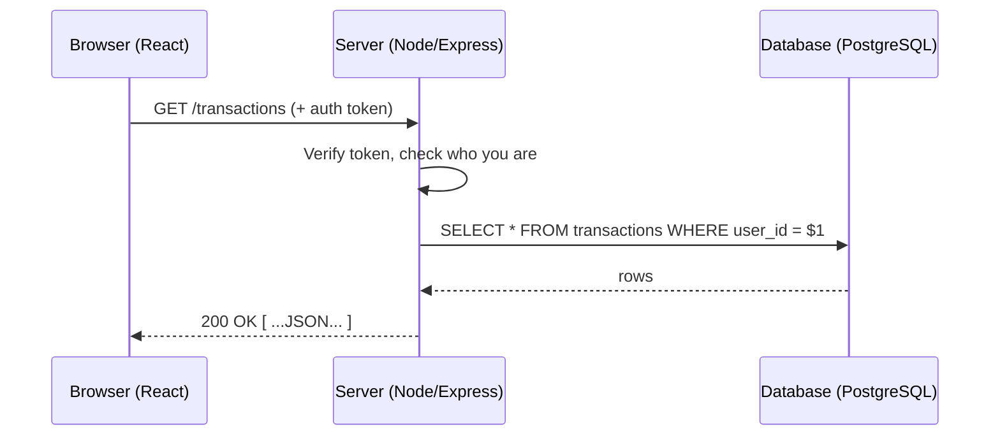

# 01. What Is a Backend?

> **One-liner:** After this you'll be able to run your own tiny server that answers a `fetch()` — and explain, precisely, what happens on the *other side* of every API call you've ever made.
> **Where this fits:** This is chapter 1 — the mental model. Every later chapter (Express, PostgreSQL, auth, caching) is just detail hung on the round trip you learn here. It's the hands-on twin of the concept-level [../system-design/02-client-server-basics.md](../system-design/02-client-server-basics.md).

---

## 1. The Idea in Plain Words

You already know one half of this picture. In React you write:

```ts
// Frontend code you've written a hundred times
const res = await fetch('https://api.habex.santhu.site/transactions');
const transactions = await res.json();
```

You've always treated that `fetch` URL as a black box that magically returns data. **The backend is what's inside the box.** It's a program running on a computer somewhere that receives your request, decides what to do, usually reads or writes a database, and sends data back.

Let's define every term now, once, so the rest of the track is smooth:

| Term | Plain meaning (frontend analogy) |
|---|---|
| **Client** | The thing that *asks*. Usually the browser running your React app. Also mobile apps, `curl`, Postman. |
| **Server** | A program that *waits for requests and answers them*. Not a magic box — literally a running process, often `node something.js`. |
| **Backend** | All the server-side code + database + services that power your app. The "back" (hidden) part, vs the "front" (UI in the browser). |
| **Frontend** | The UI that runs in the user's browser — your React app. The part the user sees and touches. |
| **API** | *Application Programming Interface*. The set of URLs (endpoints) your backend exposes for clients to call, e.g. `GET /transactions`. Your app's "menu". |
| **Endpoint** | One specific callable URL + method, e.g. `POST /transactions`. |
| **Request** | The message the client sends: method (`GET`/`POST`…), URL, headers, and maybe a body. |
| **Response** | The message the server sends back: a status code (`200`, `404`…), headers, and usually a JSON body. |
| **Database (DB)** | A separate program built to *store data durably* and answer queries about it (e.g. PostgreSQL). Think of it as the app's long-term memory. |
| **Port** | A numbered "door" on a machine that a server listens at, e.g. `3000`. `localhost:3000` = "the program at door 3000 on this computer". |
| **Host** | The machine (address) the server runs on, e.g. `localhost` in dev, `api.habex.santhu.site` in prod. |

**The one-sentence definition:** a backend is a program that listens on a port, receives requests over HTTP, runs trusted business logic, talks to a database, and returns responses.

That's the whole job. Everything else is refinement.

### Client vs server, quickly

- The **client initiates**. Servers don't call you first; they wait. (Realtime/WebSockets in [16-realtime-websockets.md](16-realtime-websockets.md) bends this, but the default is request→response.)
- The **client is untrusted**. Anyone can open DevTools, edit your React state, or replay your requests with `curl`. So the server can *never* assume the client is honest.
- The **server is the authority**. It owns the real data and the rules.

That trust boundary is the single most important idea in this chapter, and it's why the backend exists at all.

### Who does what: frontend vs backend vs database

Three layers, three jobs. Keeping them straight is half of backend thinking:

| Layer | Owns | Must NOT do | Habex example |
|---|---|---|---|
| **Frontend** (React, in the browser) | Presentation, UX, local interaction; treats data as *untrusted until the server confirms* | Hold secrets; be the source of truth; be the final word on rules | Renders your expense list; shows a form to add a transaction |
| **Backend** (Node/Express, on a server) | Auth, validation, business rules, orchestration, secrets, talking to other services | Trust the client; leak secrets; do slow CPU work inline (ch02) | Verifies your token, checks the amount is valid, enforces "this txn is yours" |
| **Database** (PostgreSQL) | Durable storage, integrity constraints, fast queries | Contain business logic that belongs in the app; be reachable from the browser | Stores `transactions`, guarantees `user_id` references a real user |

The rule of thumb: **the browser asks, the backend decides, the database remembers.**

---

## 2. Why It Matters

"Why can't I just do everything in React?" Three reasons, and each maps to a real Habex bug you'd hit:

1. **Security & secrets.** Anything shipped to the browser is *public*. Your DB password, JWT signing secret, or Stripe key would be readable by any user in DevTools. Secrets must live on a server the user can't see. (More in [13-authorization-and-security.md](13-authorization-and-security.md).)
2. **Single source of truth.** If each browser is the authority, two devices disagree and there's no referee. A server gives you *one* copy of the truth that every client reads and writes.
3. **Shared & durable data.** `localStorage` lives in *one* browser and vanishes when it's cleared. For accounts, cross-device sync, and data that survives forever, you need a database behind a server.
4. **Trusted business logic.** Rules like "you can't spend from another user's account" or "a budget can't go negative" must be enforced where the user can't tamper with them — the server.

Interviewers probe this constantly because it separates people who've *only* done frontend from people who understand systems. If you can crisply say **"the client is untrusted, so validation, auth, secrets, and money math must happen server-side"**, you're already ahead.

---

## 3. Picture It (Diagram)

The round trip — browser → API → database → back — is the heartbeat of every backend request:

```
   ┌──────────────┐        1. HTTP request              ┌─────────────────────┐
   │              │   GET /transactions                 │   BACKEND SERVER     │
   │   BROWSER    │   Authorization: Bearer <token>     │  (Node + Express)    │
   │  (React app) │ ──────────────────────────────────▶ │  listening on :3000  │
   │   = CLIENT   │                                     │                      │
   │              │                                     │  a) check auth       │
   │              │                                     │  b) run logic        │
   │              │                                     │  c) query the DB ──┐ │
   └──────────────┘                                     └────────────────────┼─┘
          ▲                                                                   │
          │                                              2. SQL query         ▼
          │                                             ┌──────────────────────────┐
          │            4. HTTP response                 │   DATABASE (PostgreSQL)   │
          │       200 OK                                │  stores users, txns, ...  │
          │       [{ "id": 1, "amount_cents": 4200 }]   │  3. returns matching rows │
          └─────────────────────────────────────────────┴──────────────────────────┘
```

Read it as a story: **(1)** the browser sends an HTTP request → **(2)** the server authenticates it and asks the database for data → **(3)** the DB returns rows → **(4)** the server shapes them into JSON and responds. Your React app then renders it. That loop is *the* thing you're learning to build for the next 22 chapters.

The same flow as a sequence diagram (renders on GitHub):



---

## 4. Hands-On (TypeScript + Node)

Let's demystify "a server" by building the smallest one possible — no frameworks, ~10 lines. A server is *not* magic; it's a normal program that never exits because it's waiting for requests.

Create a file `server.ts`:

```ts
// server.ts — the smallest possible backend.
// `node:http` is Node's built-in HTTP module (no npm install needed).
import { createServer } from 'node:http';

// createServer registers ONE function that Node runs on EVERY incoming request.
//   req = the incoming request  (what the client sent: method, url, headers, body)
//   res = the response object    (how we reply: status, headers, body)
const server = createServer((req, res) => {
  // A "header" is metadata about the response. We tell the client "this is JSON".
  res.writeHead(200, { 'Content-Type': 'application/json' });

  // res.end sends the body and closes the response. Bodies are strings/bytes,
  // so we serialize our object with JSON.stringify — exactly the shape your
  // React `await res.json()` will parse on the other side.
  res.end(JSON.stringify({ message: 'Hello from your backend', youAsked: req.url }));
});

// listen() opens port 3000 and keeps the process alive, waiting for requests.
// THIS is what "a server" means: a program parked on a port.
server.listen(3000, () => {
  console.log('Backend listening on http://localhost:3000');
});
```

**Run it.** In dev we use `tsx`, a zero-config tool that runs `.ts` files directly (no compile step). You'll install it properly in [03-project-setup-typescript-node.md](03-project-setup-typescript-node.md); for now:

```bash
npx tsx server.ts
# → Backend listening on http://localhost:3000
```

**Call it** from another terminal (this is your `fetch`, but from the command line):

```bash
curl http://localhost:3000/transactions
# → {"message":"Hello from your backend","youAsked":"/transactions"}
```

Or just open `http://localhost:3000` in your browser. Congratulations — you are now the thing on the other side of the `fetch`. Notice what happened:

- The process **didn't exit** after printing the log. It's *waiting*. That's the defining behavior of a server vs a normal script.
- It answered **any** path (`/transactions`, `/anything`) the same way. Real routing — mapping `GET /transactions` to specific logic — is what Express gives you in [04-http-servers-and-express-basics.md](04-http-servers-and-express-basics.md).
- There's no database yet, so it can't *remember* anything. That's chapters 8–11.

Under the hood, `createServer`'s callback runs on Node's **event loop** without you spawning threads — the reason Node handles thousands of these requests at once. That's the whole next chapter: [02-nodejs-runtime-and-event-loop.md](02-nodejs-runtime-and-event-loop.md).

---

## 5. Apply It to Habex

Right now **Habex** ([habex.santhu.site](https://habex.santhu.site)) is frontend-only: a lovely React app that keeps your expenses and habits in the browser (React state + `localStorage`). That's fine for a demo and terrible for a product. Every limitation below is *exactly* a job the backend takes over:

| Habex today (frontend-only) | Why it's broken | What the backend fixes | Chapter |
|---|---|---|---|
| Data lives in `localStorage` | Clear the browser → your expenses are gone. No backups. | A **PostgreSQL** database stores every transaction durably | [08](08-sql-and-postgresql-fundamentals.md)–[11](11-transactions-and-query-performance.md) |
| "Accounts" are fake (no server) | Anyone could impersonate anyone; no real login | Real **users** table + password hashing + JWT auth | [12-authentication.md](12-authentication.md) |
| No cross-device sync | Add an expense on your laptop → your phone never sees it | One server = one **source of truth** every device reads | [10-connecting-node-to-postgres.md](10-connecting-node-to-postgres.md) |
| All logic in the browser | A user could edit React state to fake a budget or another user's data | Logic + validation enforced **server-side**, untrusted client | [07](07-input-validation-and-error-handling.md), [13](13-authorization-and-security.md) |
| No secrets possible | Can't safely call a bank/email API — keys would be public | Server holds secrets, talks to other services privately | [03](03-project-setup-typescript-node.md), [13](13-authorization-and-security.md) |
| Recurring rules never fire when app is closed | The browser must be open to "run" anything | A **background worker** runs recurring expenses on a schedule | [15-background-jobs-and-queues.md](15-background-jobs-and-queues.md) |

Here's the target shape of a real Habex request once the backend exists — the browser stops *owning* the data and starts *asking* for it:

```ts
// Habex frontend, AFTER we build the backend.
// The browser no longer stores the truth — it requests it from the server.
async function loadTransactions(token: string) {
  const res = await fetch('https://api.habex.santhu.site/transactions', {
    headers: { Authorization: `Bearer ${token}` }, // server checks WHO you are
  });
  if (!res.ok) throw new Error(`Request failed: ${res.status}`);

  // amount_cents is an INTEGER number of cents (4200 = ₹42.00), never a float.
  // Storing money as float lets 0.1 + 0.2 !== 0.3 corrupt real balances —
  // a correctness rule we drill all track long (see the README).
  return res.json() as Promise<Array<{ id: number; amount_cents: number; note: string }>>;
}
```

By [chapter 22](22-capstone-habex-backend.md) you will have built and deployed the server that answers this exact call. For a system-design view of *this same app*, see [../system-design/25-case-study-expense-tracker.md](../system-design/25-case-study-expense-tracker.md).

---

## 6. Interview Questions (with answer pointers)

1. **"What is a backend / what does a server do?"** *(all companies, warm-up)*
   → A program listening on a port that receives HTTP requests, authenticates them, runs business logic, reads/writes a database, and returns responses. Emphasize the trust boundary: the client is untrusted.

2. **"Why not put all the logic in the frontend?"** *(Zepto, Swiggy)*
   → Secrets would leak (browser code is public), no single source of truth across devices, `localStorage` isn't durable/shared, and users can tamper with client logic. Security, consistency, and durability all demand a server.

3. **"Walk me through what happens from `fetch('/transactions')` to data on screen."**
   → DNS resolves the host → TCP/TLS connection → HTTP request with headers/token → server routes it → middleware authenticates → query the DB → serialize to JSON → HTTP response → browser parses and React renders. (DNS/HTTP detail: [../system-design/03-ip-and-dns.md](../system-design/03-ip-and-dns.md), [../system-design/04-http-and-https.md](../system-design/04-http-and-https.md).)

4. **"Frontend vs backend vs database — who's responsible for what?"** *(Groww)*
   → Frontend: presentation + UX, treats data as untrusted-until-server-confirms. Backend: auth, validation, business rules, orchestration, secrets. Database: durable storage + integrity constraints + fast queries. Money math and validation belong on the backend.

5. **"What's a 'port' and what does it mean that a server 'listens' on one?"**
   → A port is a numbered endpoint on a host's network interface; "listening" means the process is bound to that port and blocks waiting for incoming connections instead of exiting. Two servers can't bind the same port.

6. **"Where should input validation happen — client or server, and why?"** *(CRED, Razorpay)*
   → Both, but the server is mandatory. Client validation is UX (fast feedback); it can be bypassed with `curl`/DevTools, so the server must re-validate everything. Never trust the client. (See [07-input-validation-and-error-handling.md](07-input-validation-and-error-handling.md).)

7. **"Why store money as integer cents instead of a float?"** *(CRED, Razorpay, Groww — fintech favorite)*
   → Floats can't represent many decimals exactly (`0.1 + 0.2 === 0.30000000000000004`), so sums drift and reconciliation breaks. Integer cents are exact. This is a correctness bug, not a style choice.

8. **"Is the client ever trustworthy?"**
   → No. Treat every request as potentially forged or malicious. Auth, authorization, and validation are the server's job precisely because it's the only party you control.

---

## 7. Trade-offs & Pitfalls ("Why Not Just X?")

- **"Why not just use Firebase / Supabase / a BaaS?"** You can, and for a solo MVP it's great — a *Backend*-as-a-Service gives you a DB, auth, and APIs without writing a server. But (a) you still need to understand this round trip to use it well and secure it, (b) interviews test your ability to *build* the backend, not rent one, and (c) Habex is your chance to prove you can. We build the real thing.

- **"Why not just serverless functions?"** Serverless (AWS Lambda, Vercel Functions) still *is* a backend — each function is a tiny server that spins up per request. Same concepts (routing, auth, DB), different deployment/scaling model. We start with a long-running Node server because it's simpler to reason about and interview on; deployment options come in [20-deployment-and-devops.md](20-deployment-and-devops.md).

- **Pitfall: trusting the client.** The #1 beginner backend mistake. `if (user.isAdmin)` decided in React means nothing — the server must decide. Re-validate and re-authorize on every request.

- **Pitfall: leaking secrets into the frontend.** Any key in your React bundle is public. If a task needs a secret, it belongs on the server.

- **Pitfall: thinking `localStorage` is a database.** It's per-browser, small, synchronous, and clearable. It's a cache at best, never your source of truth.

- **Pitfall: money as a float.** Store `amount_cents` as an INT. Always.

---

## 8. TL;DR

- A **backend** is a program that **listens on a port**, receives **HTTP requests**, runs **trusted logic**, talks to a **database**, and returns **responses**. It's the other side of your `fetch()`.
- The **client is untrusted**; the **server is the authority**. That trust boundary is *why* backends exist: security, secrets, a single source of truth, durable shared data, and enforceable business rules.
- The core loop is **browser → API → database → response**. Memorize it — everything else is detail.
- You can build a real server in ~10 lines with `node:http`; **Express** just makes routing and the rest ergonomic ([04-http-servers-and-express-basics.md](04-http-servers-and-express-basics.md)).
- For **Habex**, the backend turns a browser-only demo into a real product: durable data, real accounts, cross-device sync, secrets, and scheduled recurring expenses.
- Correctness rule, forever: **store money as integer cents**, never a float.

**Next → [02-nodejs-runtime-and-event-loop.md](02-nodejs-runtime-and-event-loop.md):** how Node handles thousands of these requests on a single thread without blocking — a top interview topic.
