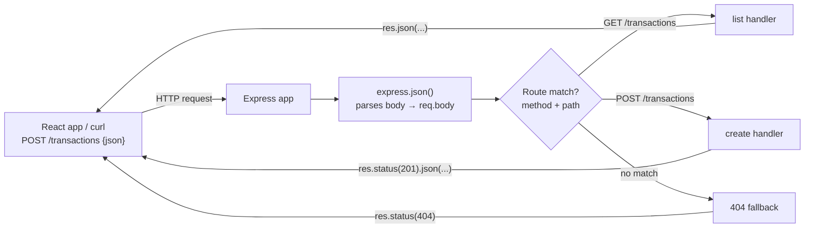

# 04. HTTP Servers & Express Basics

> **One-liner:** An HTTP server is just a program that listens on a port and answers requests; **Express** is the thin, interview-standard framework that turns Node's raw request machinery into clean, readable routes.
> **Where this fits:** You now know *what* a backend is (ch01) and *how* Node runs async code (ch02), and you have a TypeScript project scaffolded (ch03). This chapter is where that project starts *answering HTTP requests*. It's the foundation the next three chapters build on: middleware (ch05), REST design (ch06), and validation (ch07).

## 1. The Idea in Plain Words

As a React dev you're always the **client**: you call `fetch('/api/transactions')`. The thing on the other end of that call is an **HTTP server** — a long-running program that:

1. **Listens on a port** (say `3000`). A *port* is just a numbered door on your machine; `localhost:3000` means "door 3000 on this computer."
2. **Receives an HTTP request** — a method (`GET`, `POST`, …), a URL path (`/transactions`), headers, and maybe a body (JSON).
3. **Runs your logic** — checks who's calling, reads/writes data.
4. **Sends back an HTTP response** — a status code (`200`, `404`, …) and usually a JSON body.

Node ships with a built-in `http` module that can do all of this. Here's a complete server with **zero dependencies**:

```ts
// raw-http.ts — a full HTTP server using only Node's built-in module
import { createServer } from 'node:http';

const server = createServer((req, res) => {
  // We have to inspect method + url ourselves...
  if (req.method === 'GET' && req.url === '/health') {
    res.writeHead(200, { 'Content-Type': 'application/json' });
    res.end(JSON.stringify({ status: 'ok' }));
    return;
  }

  // ...and hand-write the "nothing matched" case.
  res.writeHead(404, { 'Content-Type': 'application/json' });
  res.end(JSON.stringify({ error: 'Not found' }));
});

server.listen(3000, () => console.log('listening on http://localhost:3000'));
```

It works — but notice the friction. **You** match the method and URL by hand. **You** set every header. Now imagine reading a JSON body: Node hands it to you as a raw stream of chunks you must collect yourself:

```ts
// Reading a JSON POST body with raw http — tedious and easy to get wrong
let body = '';
req.on('data', (chunk) => { body += chunk; });          // buffer the stream
req.on('end', () => {
  const data = JSON.parse(body);                         // hope it's valid JSON!
  // ...now finally do the actual work
});
```

Multiply that boilerplate across 30 endpoints, plus auth checks, logging, and error handling on each, and you'd reinvent a **framework** — a reusable library that handles the repetitive plumbing so you write only the interesting parts.

**Express** is that framework. It's a thin, unopinionated layer *on top of* `node:http` that gives you three things:

- **Routing** — map `METHOD + path` to a function, declaratively.
- **A parsed request / helpful response** — `req.params`, `req.query`, `req.body`, and helpers like `res.status(201).json(...)`.
- **Middleware** — a chain of functions every request flows through (the whole of ch05).

A **route** is a rule: "when a `GET /transactions` comes in, run this function." That function is the **route handler** (or just *handler*). A method+path pair like `GET /transactions` is an **endpoint**. That's 90% of the vocabulary.

## 2. Why It Matters

| Concern | Raw `node:http` | Express |
|---|---|---|
| Routing | `if (req.method === … && req.url === …)` ladders | `app.get('/transactions', handler)` |
| URL params (`/transactions/42`) | Parse the string yourself | `req.params.id` |
| Query string (`?kind=expense`) | Use the `url` module manually | `req.query.kind` |
| JSON body | Buffer stream chunks + `JSON.parse` in a try/catch | `express.json()` → `req.body` |
| Splitting code into files | Manual dispatch table | `Router()` modules |
| Ecosystem (auth, cors, logging) | Build it all | `npm i` a middleware |

Two more reasons this chapter matters for *you*:

- **It's the interview default.** "Build a REST endpoint" in a product-company interview almost always means Express (or something Express-shaped). Knowing its request/response model cold is table stakes.
- **Everything else hangs off routes.** Auth (ch12), validation (ch07), the database (ch10) — they're all just logic you attach to routes. Get the routing model right and the rest slots in.

## 3. Picture It (Diagram)

A request's life inside Express: it enters, flows through any middleware (here, the built-in JSON body parser), hits the **first matching route**, and the handler sends a response back.



Read it left to right: **request in → middleware → route match → handler → response out.** Hold this picture; ch05 zooms into the middleware box, and ch06 zooms into how you *design* the routes.

## 4. Hands-On (TypeScript + Node)

We'll grow the **`habex-api`** project from ch03 into a real Express server with a `/health` check and an in-memory `/transactions` GET + POST, so you can watch data flow end to end. (Validation and a real database come in ch07 and ch08–ch10; the in-memory store is deliberately temporary.)

### 4.1 Install Express + its TypeScript types

```bash
# in the habex-api/ folder from ch03
npm install express
npm install -D @types/express        # Express ships no types of its own; add them
```

> Our ch03 setup runs TypeScript with **`tsx`** in dev (`npm run dev`), so relative imports don't need `.js` extensions. (If your ch03 tsconfig uses pure ESM `"moduleResolution": "nodenext"`, add `.js` to relative imports.)

### 4.2 Split the app from the server

One small structural decision pays off for the rest of the track: keep **building the app** (`app.ts`) separate from **starting it** (`server.ts`). The app becomes importable, which is exactly what `supertest` needs in ch18.

```
habex-api/
├─ src/
│  ├─ app.ts               # builds & configures the Express app (no listening)
│  ├─ server.ts            # entry point: starts listening
│  ├─ routes/
│  │  ├─ health.ts
│  │  └─ transactions.ts
│  └─ store/
│     └─ transactions.ts   # TEMPORARY in-memory data (real DB arrives in ch08+)
├─ package.json
└─ tsconfig.json
```

```ts
// src/app.ts — builds and configures the Express application
import express from 'express';
import { healthRouter } from './routes/health';
import { transactionsRouter } from './routes/transactions';

export function createApp() {
  const app = express();               // the Express application object

  // Built-in middleware: parse JSON request bodies into req.body.
  // Without this, req.body is undefined for JSON requests. (More in ch05.)
  app.use(express.json());

  // Mount each feature's Router under a base path.
  app.use('/health', healthRouter);
  app.use('/transactions', transactionsRouter);

  return app;
}
```

```ts
// src/server.ts — entry point: build the app, then start listening
import { createApp } from './app';

const PORT = Number(process.env.PORT) || 3000;
const app = createApp();

// app.listen binds to the port and starts accepting requests.
app.listen(PORT, () => {
  console.log(`habex-api listening on http://localhost:${PORT}`);
});
```

> In ch03 you wrapped config in a typed `env` helper; we read `process.env.PORT` directly here to keep `server.ts` self-contained. Swap in `env.PORT` if you have it.

### 4.3 The `/health` route (and what a Router is)

A **Router** is a mini-app: a group of routes you define in their own file and *mount* under a base path. Because we mounted this one at `/health`, its `'/'` route answers `GET /health`.

```ts
// src/routes/health.ts
import { Router } from 'express';

export const healthRouter = Router();

// GET /health → liveness check used by Docker/Railway later (ch19, ch20)
healthRouter.get('/', (req, res) => {
  res.status(200).json({ status: 'ok', uptime: process.uptime() });
});
```

### 4.4 A temporary in-memory store

```ts
// src/store/transactions.ts — in-memory only; replaced by Postgres in ch08–ch10
import { randomUUID } from 'node:crypto';

export type Transaction = {
  id: string;
  userId: string;
  categoryId: string | null;
  amountCents: number;       // integer cents — NEVER a float. ₹250.00 → 25000
  kind: 'income' | 'expense';
  note: string | null;
  occurredAt: string;        // ISO date string
  createdAt: string;
};

const transactions: Transaction[] = [];

export function listTransactions(): Transaction[] {
  return transactions;
}

export function findTransaction(id: string): Transaction | undefined {
  return transactions.find((t) => t.id === id);
}

export function addTransaction(
  input: Omit<Transaction, 'id' | 'createdAt'>,
): Transaction {
  const tx: Transaction = { ...input, id: randomUUID(), createdAt: new Date().toISOString() };
  transactions.push(tx);
  return tx;
}
```

### 4.5 The `/transactions` routes — params, query, body, status codes

This one file demonstrates **all three ways to read input** and **how to send responses**.

```ts
// src/routes/transactions.ts
import { Router } from 'express';
import { addTransaction, findTransaction, listTransactions } from '../store/transactions';

export const transactionsRouter = Router();

// GET /transactions?kind=expense  → list, optionally filtered by query string
transactionsRouter.get('/', (req, res) => {
  const kind = req.query.kind;          // req.query = the ?key=value part (values are strings)
  let items = listTransactions();

  if (kind === 'income' || kind === 'expense') {
    items = items.filter((t) => t.kind === kind);
  }

  res.status(200).json({ data: items, count: items.length });
});

// GET /transactions/:id  → one transaction (":id" is a ROUTE PARAM)
transactionsRouter.get('/:id', (req, res) => {
  const tx = findTransaction(req.params.id);   // req.params = the /:placeholders in the path
  if (!tx) {
    return res.status(404).json({ error: 'Transaction not found' }); // return → stop here
  }
  res.status(200).json({ data: tx });
});

// POST /transactions  → create one (reads the JSON BODY via express.json())
transactionsRouter.post('/', (req, res) => {
  const { amountCents, kind, note, categoryId, occurredAt } = req.body ?? {};

  // Hand-rolled validation for now — Zod replaces this in ch07.
  if (typeof amountCents !== 'number' || !Number.isInteger(amountCents)) {
    return res.status(400).json({ error: 'amountCents must be an integer number of cents' });
  }
  if (kind !== 'income' && kind !== 'expense') {
    return res.status(400).json({ error: "kind must be 'income' or 'expense'" });
  }

  const created = addTransaction({
    userId: 'demo-user',                        // real user id comes from auth in ch12
    categoryId: categoryId ?? null,
    amountCents,
    kind,
    note: note ?? null,
    occurredAt: occurredAt ?? new Date().toISOString(),
  });

  res.status(201).json({ data: created });      // 201 Created + the new resource
});
```

Three inputs, three sources — the single most confused trio for beginners:

| Source | Comes from | Example URL / body | Read with |
|---|---|---|---|
| **Route param** | a `/:placeholder` in the path | `GET /transactions/**42**` | `req.params.id` |
| **Query string** | the `?key=value` after `?` | `GET /transactions?**kind=expense**` | `req.query.kind` |
| **Body** | the JSON payload of the request | `POST /transactions` `{ "amountCents": 25000 }` | `req.body` (needs `express.json()`) |

### 4.6 Run it and watch data flow

```bash
npm run dev        # starts src/server.ts with tsx watch (from ch03)
```

```bash
# 1) liveness
curl http://localhost:3000/health
# {"status":"ok","uptime":1.83}

# 2) create a ₹250.00 expense (25000 cents). The Content-Type header is REQUIRED
#    or express.json() won't parse the body and req.body stays undefined.
curl -X POST http://localhost:3000/transactions \
  -H "Content-Type: application/json" \
  -d '{"amountCents":25000,"kind":"expense","note":"Groceries"}'
# {"data":{"id":"…","amountCents":25000,"kind":"expense",...}}  ← 201

# 3) list them
curl http://localhost:3000/transactions
# {"data":[ ... ],"count":1}

# 4) filter via query string
curl "http://localhost:3000/transactions?kind=income"
# {"data":[],"count":0}
```

No `curl`? **Thunder Client** (a VS Code extension) or Postman gives you the same requests with a UI — set the method, URL, and a JSON body, and hit Send.

## 5. Apply It to Habex

Habex has four resources beyond auth. Each becomes its own `Router` file, mounted under a base path in `app.ts`. This is your **route surface** — the map of everything the API can do.

| Resource | Base path | Router file | Endpoints (preview — built over ch06–ch13) |
|---|---|---|---|
| Auth | `/auth` | `routes/auth.ts` | `POST /auth/signup`, `/auth/login`, `/auth/refresh` (ch12) |
| Transactions | `/transactions` | `routes/transactions.ts` | `GET`, `POST`, `GET /:id`, `PATCH /:id`, `DELETE /:id` |
| Categories | `/categories` | `routes/categories.ts` | `GET`, `POST`, `PATCH /:id`, `DELETE /:id` |
| Budgets | `/budgets` | `routes/budgets.ts` | `GET`, `POST`, `PATCH /:id` |

```ts
// src/app.ts — the Habex route surface, assembled
import express from 'express';
import { healthRouter } from './routes/health';
import { authRouter } from './routes/auth';                 // ch12
import { transactionsRouter } from './routes/transactions';
import { categoriesRouter } from './routes/categories';
import { budgetsRouter } from './routes/budgets';

export function createApp() {
  const app = express();
  app.use(express.json());

  app.use('/health', healthRouter);
  app.use('/auth', authRouter);
  app.use('/transactions', transactionsRouter);
  app.use('/categories', categoriesRouter);
  app.use('/budgets', budgetsRouter);

  return app;
}
```

Each Router owns one resource, keeps its file small, and can later get its own **middleware** (e.g. "require login on everything under `/transactions`") in one line — you'll do exactly that in ch05. The *shape* of these routes (nouns, plurals, nesting, status codes) is the subject of [06-rest-api-design-in-practice.md](06-rest-api-design-in-practice.md); the deeper "why REST" is in [../system-design/17-api-design-rest-graphql.md](../system-design/17-api-design-rest-graphql.md).

## 6. Interview Questions (with answer pointers)

1. **What does Express give you over the raw `http` module?**
   Routing (method+path → handler), parsed `req.params`/`req.query`/`req.body`, response helpers (`res.status().json()`), and a **middleware** pipeline — all the boilerplate you'd otherwise hand-write. It's a thin layer *on top of* `node:http`, not a replacement; `app.listen` still uses `http` underneath.

2. **What does `express.json()` actually do, and what breaks without it?**
   It's built-in middleware that reads the request body stream, parses it as JSON, and sets `req.body`. Without it (or if the client omits `Content-Type: application/json`), `req.body` is `undefined`. It only parses JSON bodies — for form posts you'd use `express.urlencoded()`.

3. **`req.params` vs `req.query` vs `req.body` — when is each populated?**
   `params` = the `/:placeholder` segments of the path (`/transactions/:id`). `query` = the `?key=value` string (always strings — `?limit=10` gives `"10"`). `body` = the parsed request payload (needs a body-parser like `express.json()`). See the table in §4.5.

4. **What status codes would a create endpoint return, and why?**
   `201 Created` on success (with the new resource), `400 Bad Request` for invalid input, `401`/`403` for auth (ch12/13), `404` if a referenced resource is missing, `500` for unexpected server errors. Meaningful codes are part of the API contract — see [06-rest-api-design-in-practice.md](06-rest-api-design-in-practice.md) and [../system-design/04-http-and-https.md](../system-design/04-http-and-https.md).

5. **What is a `Router` and why split routes into modules?**
   A Router is a mountable group of routes. Splitting by resource keeps files small, lets each resource carry its own middleware, and scales past the "one giant `app.ts`" problem.

6. **How does Express decide which handler runs?**
   Top-to-bottom, first match wins by method + path pattern. So `GET /transactions/new` would be captured by `GET /transactions/:id` if that's declared first — **order matters** (a recurring theme in ch05).

## 7. Trade-offs & Pitfalls ("Why Not Just X?")

**"Why not just use raw `node:http`?"** For a two-endpoint script, fine. Past that, you'd rebuild routing, body parsing, and middleware yourself — badly, and untested. Express is ~2 KB of concepts for a huge boilerplate saving.

**"Why not Fastify or NestJS?"** Both are great — Fastify is faster and has built-in schema validation; NestJS adds structure (decorators, DI) for large teams. We pin **Express** because it's the interview lingua franca and the simplest place to *see* the request/response model. The concepts transfer directly.

| Pitfall | Symptom | Fix |
|---|---|---|
| Forgot `express.json()` | `req.body` is `undefined` on POST | `app.use(express.json())` before your routes |
| Client omits `Content-Type: application/json` | Body not parsed even with `express.json()` | Send the header (curl `-H`, Thunder Client auto-sets it) |
| Missing `return` after `res.json()` | "Cannot set headers after they are sent" crash | `return res.status(...).json(...)` to stop the handler |
| Route order | `/:id` swallows `/summary` | Put specific paths **before** parameterized ones |
| Money as float | `amountCents: 250.5`, rounding drift | Always integer cents; reject non-integers (§4.5) |
| In-memory store | Data vanishes on restart | Expected for now — Postgres lands in ch08–ch10 |

> **Security note:** never trust `req.body`/`req.query`/`req.params`. Right now our hand-rolled checks are thin; ch07 replaces them with **Zod** schemas, and ch13 covers the broader input-safety picture. Treat every input as hostile until validated.

## 8. TL;DR

- An **HTTP server** listens on a port, receives requests, and returns responses. Node's `http` module can do it, but you'd hand-write routing, body parsing, and error handling.
- **Express** is a thin framework over `node:http` giving you **routing**, **parsed request objects**, **response helpers**, and **middleware**.
- Define routes with `app.get/post/put/patch/delete(path, handler)`. Read input from **`req.params`** (path), **`req.query`** (`?…`), and **`req.body`** (payload — needs `express.json()`).
- Send responses with `res.status(code).json(data)`; use meaningful status codes (`200/201/400/404/500`).
- Split routes into **`Router`** modules, one per resource, mounted in `app.ts`. Keep `app.ts` (build) separate from `server.ts` (listen) so tests can import the app.
- The Habex route surface is `/auth`, `/transactions`, `/categories`, `/budgets`, each a Router.
- **Next:** [05-middleware-and-request-lifecycle.md](05-middleware-and-request-lifecycle.md) — the chain every request flows through, and how auth, logging, and errors plug into it.
