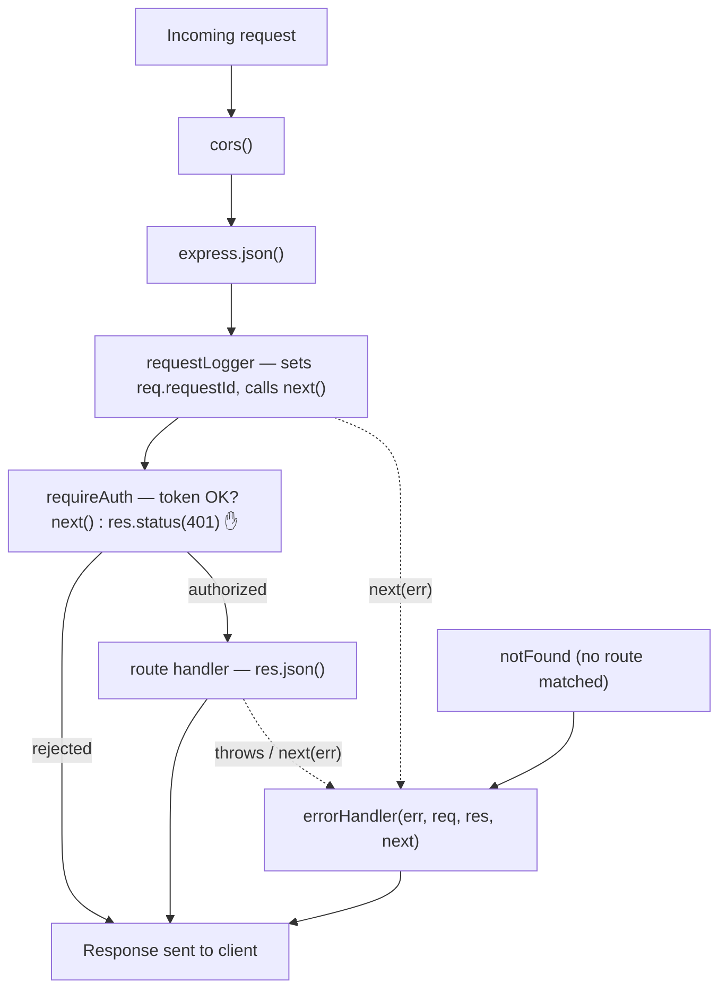

# 05. Middleware & the Request Lifecycle

> **One-liner:** Middleware is a function `(req, res, next)` that sits in a chain between the incoming request and your route handler — it's the single most important Express concept, and auth, logging, validation, and error handling are all just middleware.
> **Where this fits:** In ch04 you wired routes and used one built-in middleware (`express.json()`) without dwelling on it. This chapter is the deep dive on the *pipeline* those routes live in. It's the backbone for validation (ch07), authentication (ch12), and logging/observability (ch17) — each is a middleware you'll slot into the stack you build here.

## 1. The Idea in Plain Words

A **middleware** is a function that runs **in the middle** — between the request arriving and the response leaving. Its signature is three arguments:

```ts
function myMiddleware(req, res, next) {
  // do something with the request or response...
  next(); // ...then hand control to the NEXT function in the chain
}
```

Express lines up your middleware (and route handlers — a route handler is just the *last* middleware in the line) into an ordered **stack**. A request enters the top and flows down. Each middleware gets a turn to:

- **inspect or modify** `req` (e.g. attach `req.userId` after checking a token),
- **inspect or modify** `res` (e.g. set a header),
- **end the response** (`res.json(...)`) — which stops the chain, or
- **call `next()`** — passing control to the next middleware down.

That's the whole model. The magic word is **`next`**: it's a callback Express hands you meaning "I'm done, continue." Two rules follow, and they cause 90% of beginner middleware bugs:

- **Call `next()` exactly once** to continue — or **end the response and *don't* call `next()`** to stop.
- If you neither respond nor call `next()`, **the request hangs forever** (the client's `fetch` never resolves).

Think of it as **airport security checkpoints** before you reach your gate (the route handler). Check-in tags your bag (`req.body` parsing). The ID desk verifies you and stamps your pass (`requireAuth` sets `req.userId`) — or turns you away right there (`res.status(401)`, no `next()`). Security logs your passage (request logger). Only after every checkpoint waves you through (`next()`) do you reach the gate. And if anything goes wrong at any point, you're diverted to a single complaints desk — the **error handler**.

## 2. Why It Matters

Middleware is how Express handles **cross-cutting concerns** — things *every* (or *many*) routes need — in **one place** instead of copy-pasting into every handler:

| Concern | Without middleware | With middleware |
|---|---|---|
| Parse JSON body | `JSON.parse` in all 20 handlers | `app.use(express.json())` once |
| Require login | auth check pasted in each handler | `app.use('/transactions', requireAuth)` once |
| Log every request | `console.log` in each handler | one `requestLogger` at the top |
| Handle errors | try/catch in each handler | one central error handler |

For interviews this is *the* Express question. "What is middleware, and how does the request flow through it?" separates people who've built with Express from people who've only heard of it. And practically: once you internalize the pipeline, features stop feeling bolted-on. Auth isn't special — it's a middleware. Validation isn't special — it's a middleware. Everything composes.

## 3. Picture It (Diagram)

A request flows **down** the stack; the response flows **back up**. Any middleware can short-circuit (respond and stop) or fail (send the request sideways to the error handler).



Another way people describe it is the **onion model** — each middleware wraps the next, and the request passes *in* through every layer to reach the core (your handler), then the response passes back *out*:

```
      ┌─────────── cors ───────────┐
      │  ┌──────── json ────────┐  │
      │  │  ┌──── logger ────┐  │  │
 req ─┼──┼──┼──► handler ────┼──┼──┼──► res
      │  │  └────────────────┘  │  │
      │  └──────────────────────┘  │
      └────────────────────────────┘
```

## 4. Hands-On (TypeScript + Node)

We'll add three custom middlewares to the **`habex-api`** app from ch04 — a **request logger**, an **auth guard**, and a central **error handler** — plus a 404 fallback, then wire them in the correct order.

### 4.1 Teach TypeScript about the properties we attach

Middleware often *adds* data to `req` for later handlers (a request id, the logged-in user). TypeScript doesn't know about those yet, so we extend Express's `Request` type once via **declaration merging**:

```ts
// src/types/express.d.ts — make sure "src" is covered by your tsconfig "include"
import 'express';

declare global {
  namespace Express {
    interface Request {
      requestId?: string;   // set by requestLogger
      userId?: string;      // set by requireAuth (real value arrives in ch12)
    }
  }
}
```

### 4.2 A request-id + logging middleware

Every request gets a unique id we can trace through the logs (and return in the response header, so a user reporting a bug can quote it).

```ts
// src/middleware/requestLogger.ts
import type { Request, Response, NextFunction } from 'express';
import { randomUUID } from 'node:crypto';

export function requestLogger(req: Request, res: Response, next: NextFunction) {
  const requestId = randomUUID();
  req.requestId = requestId;                 // attach for downstream middleware/handlers
  res.setHeader('x-request-id', requestId);  // expose it to the client

  const startedAt = Date.now();
  console.log(`--> ${req.method} ${req.originalUrl} [${requestId}]`);

  // 'finish' fires once the response has been fully sent — perfect for timing.
  res.on('finish', () => {
    const ms = Date.now() - startedAt;
    console.log(`<-- ${req.method} ${req.originalUrl} ${res.statusCode} ${ms}ms [${requestId}]`);
  });

  next(); // IMPORTANT: pass control on, or the request hangs here forever
}
```

> This uses `console.log` to stay focused. In ch17 you swap it for **pino** structured JSON logs and carry `requestId` on every log line — that's what real observability looks like. See [17-logging-monitoring-observability.md](17-logging-monitoring-observability.md).

### 4.3 An auth-guard middleware (forward-ref to ch12)

The classic **protect-these-routes** pattern: verify the caller, attach their identity, or reject before the handler ever runs.

```ts
// src/middleware/requireAuth.ts — SIMPLIFIED; real JWT verification arrives in ch12
import type { Request, Response, NextFunction } from 'express';

export function requireAuth(req: Request, res: Response, next: NextFunction) {
  const header = req.headers.authorization; // expected: "Bearer <token>"

  if (!header || !header.startsWith('Bearer ')) {
    // End the response HERE and do NOT call next() — the chain stops, handler never runs.
    return res.status(401).json({ error: 'Missing or invalid Authorization header' });
  }

  const token = header.slice('Bearer '.length);

  // TODO(ch12): verify the JWT signature and decode the real user id.
  // For now we accept a dev token so protected routes are wired end to end.
  if (token !== 'dev-token') {
    return res.status(401).json({ error: 'Invalid token' });
  }

  req.userId = 'demo-user'; // downstream handlers now know who's calling
  next();                   // authorized — continue to the route
}
```

### 4.4 The 404 and the central error handler

Two special "last resort" middlewares. The **404** runs when no route matched. The **error handler** is special: it takes **four** arguments — `(err, req, res, next)` — and that arity is *how Express recognizes it as an error handler*.

```ts
// src/middleware/notFound.ts
import type { Request, Response } from 'express';

// Reached only if no route above it matched.
export function notFound(req: Request, res: Response) {
  res.status(404).json({ error: `Route not found: ${req.method} ${req.originalUrl}` });
}
```

```ts
// src/middleware/errorHandler.ts
import type { Request, Response, NextFunction } from 'express';

// FOUR args = error handler. Express only routes errors here (via next(err) or a
// thrown sync error). The `next` param must be present even if unused, or Express
// counts 3 args and treats this as a normal middleware.
export function errorHandler(err: unknown, req: Request, res: Response, next: NextFunction) {
  const requestId = req.requestId;
  console.error(`[error] ${req.method} ${req.originalUrl} [${requestId}]`, err);

  // Never leak stack traces / internals to the client.
  res.status(500).json({
    error: 'Internal Server Error',
    requestId, // the user quotes this; you grep your logs for it
  });
}
```

> ch07 upgrades this into a proper error handler that maps typed errors (a `ValidationError`, a `NotFoundError`) to the right status codes instead of a blanket 500. This is the seam it plugs into.

### 4.5 How errors propagate (the async gotcha)

Express automatically catches an error **thrown synchronously** in a handler and routes it to the error handler. But it does **not** catch a rejected promise from an `async` handler in Express 4 — you must forward it with `next(err)`. A tiny wrapper does that for every async route:

```ts
// src/middleware/asyncHandler.ts — forwards async errors to the error handler (Express 4)
import type { RequestHandler } from 'express';

export function asyncHandler(fn: RequestHandler): RequestHandler {
  return (req, res, next) => Promise.resolve(fn(req, res, next)).catch(next);
}
```

```ts
// The difference in practice:
app.get('/sync-error', (req, res) => {
  throw new Error('boom');                 // ✅ Express 4 catches this → errorHandler
});

app.get('/async-error', asyncHandler(async (req, res) => {
  const data = await db.query('...');      // if this REJECTS, asyncHandler's .catch(next)
  res.json(data);                          //    forwards it → errorHandler (✅)
}));                                        // WITHOUT the wrapper, the rejection is unhandled
```

> Express 5 auto-forwards rejected promises, so the wrapper becomes optional there. We keep it because most codebases (and interviewers) are still on Express 4, and being explicit is a good habit. More on the whole error strategy in [07-input-validation-and-error-handling.md](07-input-validation-and-error-handling.md).

### 4.6 Wire it all together — order is everything

```bash
npm install cors
npm install -D @types/cors
```

```ts
// src/app.ts — the middleware stack, in deliberate order
import express from 'express';
import cors from 'cors';
import { requestLogger } from './middleware/requestLogger';
import { requireAuth } from './middleware/requireAuth';
import { notFound } from './middleware/notFound';
import { errorHandler } from './middleware/errorHandler';
import { healthRouter } from './routes/health';
import { transactionsRouter } from './routes/transactions';

export function createApp() {
  const app = express();

  // 1. Third-party + built-in middleware — run for EVERY request, first.
  app.use(cors());            // set CORS headers so the browser lets Habex's frontend call us (ch13 tightens this)
  app.use(express.json());    // parse JSON bodies → req.body

  // 2. Custom application-level middleware.
  app.use(requestLogger);     // assign request id + log timing

  // 3. Routes. /health is public; /transactions is guarded by router-level middleware.
  app.use('/health', healthRouter);
  app.use('/transactions', requireAuth, transactionsRouter); // requireAuth runs before the router

  // 4. Fallbacks — MUST come last, in this order.
  app.use(notFound);          // nothing matched above → 404
  app.use(errorHandler);      // 4-arg error handler → 500 (always dead last)

  return app;
}
```

Note the two ways to apply middleware:
- **Application-level** — `app.use(fn)` runs for every request (cors, json, logger).
- **Router-level** — `app.use('/transactions', requireAuth, transactionsRouter)` runs `requireAuth` only for that path. You can also guard a single route: `router.post('/', requireAuth, handler)`.

Run it and see the guard + logger + error path:

```bash
npm run dev

# Public route — no token needed:
curl http://localhost:3000/health
# server log: --> GET /health [<id>]   then   <-- GET /health 200 3ms [<id>]

# Protected route WITHOUT a token → blocked by requireAuth, handler never runs:
curl -i http://localhost:3000/transactions
# HTTP/1.1 401 ... {"error":"Missing or invalid Authorization header"}

# Protected route WITH the dev token → passes the guard:
curl -H "Authorization: Bearer dev-token" http://localhost:3000/transactions
# {"data":[],"count":0}   (note the x-request-id response header)

# Unknown route → notFound → 404:
curl -i http://localhost:3000/nope
# HTTP/1.1 404 ... {"error":"Route not found: GET /nope"}
```

## 5. Apply It to Habex

Habex's production stack is exactly the order in `app.ts` above. Read it top-to-bottom as "what happens to every request, in sequence":

| # | Middleware | Type | Runs for | Job |
|---|---|---|---|---|
| 1 | `cors()` | third-party | all | Allow the Habex frontend origin to call the API (ch13) |
| 2 | `express.json()` | built-in | all | Parse JSON body → `req.body` |
| 3 | `requestLogger` | custom | all | Assign `req.requestId`, log method/status/timing (ch17) |
| 4 | `requireAuth` | custom | protected routes | Verify token, set `req.userId`, else `401` (ch12) |
| 5 | route handlers | — | matched route | The actual business logic |
| 6 | `notFound` | custom | unmatched | `404` for unknown routes |
| 7 | `errorHandler` | custom | any thrown/`next(err)` | Log + safe `500` (ch07 refines) |

`/auth` routes sit **before** `requireAuth` in the stack (you can't require a login to log in). Everything under `/transactions`, `/categories`, and `/budgets` sits **behind** it, so `req.userId` is guaranteed present in those handlers — which is exactly how each handler will scope queries to "this user's data only" once the database lands (ch10, ch13).

Later additions drop straight into this stack with no restructuring: rate limiting (ch14) goes near the top; a Zod validation middleware (ch07) goes just before each handler; pino request logging (ch17) replaces #3. That's the payoff of the pipeline model — features are middlewares you insert at the right position.

## 6. Interview Questions (with answer pointers)

1. **What is middleware in Express?**
   A function `(req, res, next)` that runs in an ordered chain between the request and the response. It can read/modify `req`/`res`, end the response, or call `next()` to pass control on. Route handlers, `express.json()`, cors, auth, and error handlers are all middleware.

2. **Why does middleware order matter? Give an example.**
   Express runs middleware top-to-bottom, first match first. `express.json()` must come *before* routes that read `req.body`, or the body isn't parsed. `requireAuth` must come *before* the handler it protects. The `errorHandler` must come *last*, or errors from later middleware never reach it.

3. **How does an error-handling middleware differ, and how do errors reach it?**
   It has **four** parameters `(err, req, res, next)` — that arity is how Express identifies it. Errors reach it when a synchronous handler `throw`s or when any middleware calls `next(err)` with an argument. Express then skips all remaining *normal* middleware and jumps to the error handler.

4. **What are the ways to call `next()`?**
   `next()` → continue to the next middleware. `next(err)` → skip to the error handler. Not calling `next()` (and not responding) → the request **hangs**. Calling `next()` *after* already sending a response → "Cannot set headers after they are sent."

5. **Sync vs async errors — what's the trap?**
   Express 4 auto-catches synchronous `throw`s but **not** rejected promises from `async` handlers; those need `next(err)`, usually via an `asyncHandler` wrapper. Express 5 forwards async rejections automatically.

6. **Application-level vs router-level vs built-in vs third-party middleware?**
   Application-level: `app.use(fn)` (all requests). Router-level: attached to a specific path/router. Built-in: ships with Express (`express.json`, `express.static`). Third-party: installed (`cors`, `helmet`, `morgan`). Custom: your own (logger, auth).

## 7. Trade-offs & Pitfalls ("Why Not Just X?")

**"Why not just put the auth check / logging inside each route handler?"** You'd repeat it across dozens of handlers, drift out of sync, and forget it on the one endpoint that mattered. Middleware centralizes cross-cutting concerns so they're applied consistently and changed in one place.

**"Why not one giant `try/catch` per handler instead of an error middleware?"** You *can*, but you'll repeat identical error-shaping everywhere. A central error handler gives every route the same safe response shape and one place to log — and ch07 makes it map typed errors to status codes cleanly.

| Pitfall | Symptom | Fix |
|---|---|---|
| Forgot `next()` (and didn't respond) | Request hangs; client `fetch` never resolves | Call `next()` or send a response — exactly one |
| `errorHandler` written with 3 args | Errors return the default HTML page, not your JSON | Use the 4-arg signature `(err, req, res, next)` |
| `errorHandler` not last | Errors from later middleware skip it | Register it after all routes and `notFound` |
| Responded, then called `next()` | "Cannot set headers after they are sent" | `return` after sending; don't fall through |
| Async handler throws, no wrapper | Unhandled rejection; request hangs (Express 4) | Wrap with `asyncHandler` or use `next(err)` |
| `requireAuth` mounted after the route | Route runs unauthenticated | Put the guard before the router/handler |
| `express.json()` after the routes | `req.body` undefined in handlers | Register body parsers before routes |

> **Security note:** the error handler must **not** leak stack traces, SQL, or internal messages to clients — return a generic message + a request id, and log the details server-side. Attackers read verbose errors for clues. This connects to OWASP basics in ch13 and [../system-design/20-security-basics.md](../system-design/20-security-basics.md).

## 8. TL;DR

- **Middleware** = a function `(req, res, next)` in an ordered chain between request and response. Route handlers are just the last middleware.
- Each one can modify `req`/`res`, **end the response** (stop), or call **`next()`** (continue). Do exactly one, or the request hangs.
- **Order matters:** body parsers and logger first, auth before protected routes, `notFound` then `errorHandler` **last**.
- Types: **application-level** (`app.use`), **router-level** (per path), **built-in** (`express.json`), **third-party** (`cors`, `helmet`), and **custom** (your logger/auth).
- **Error handling** middleware has the special **4-arg** signature `(err, req, res, next)`; errors reach it via a sync `throw` or `next(err)`. Async rejections need `next(err)` (Express 4) — use an `asyncHandler` wrapper.
- Attach cross-cutting data to `req` (e.g. `req.requestId`, `req.userId`) and tell TypeScript via declaration merging.
- The Habex stack: **cors → json → requestLogger → routes (auth guard on protected ones) → notFound → errorHandler.**
- **Next:** [07-input-validation-and-error-handling.md](07-input-validation-and-error-handling.md) turns the thin checks and blanket-500 handler here into real Zod validation and typed errors. See also [04-http-servers-and-express-basics.md](04-http-servers-and-express-basics.md), [12-authentication.md](12-authentication.md), and [17-logging-monitoring-observability.md](17-logging-monitoring-observability.md).
