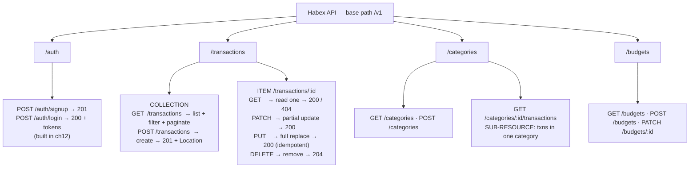

# 06. REST API Design in Practice

> **One-liner:** Turn the Habex data model into a clean, predictable REST API — resource URLs, the right status codes, one error envelope, filtering + cursor pagination, and `/v1` versioning that never breaks your live React app.
> **Where this fits:** This is the **hands-on build** that puts the concept chapter [`../system-design/17-api-design-rest-graphql.md`](../system-design/17-api-design-rest-graphql.md) into real Express code — so we won't re-argue REST vs GraphQL here, we'll just build REST *well*. Chapters [`04-http-servers-and-express-basics.md`](04-http-servers-and-express-basics.md) and [`05-middleware-and-request-lifecycle.md`](05-middleware-and-request-lifecycle.md) gave you routes and the middleware chain; validation + error handling get their own chapter next ([`07-input-validation-and-error-handling.md`](07-input-validation-and-error-handling.md)). The *operating* side — rate limiting, deep pagination theory, the full versioning playbook — lives in [`../system-design/18-rate-limiting-pagination-versioning.md`](../system-design/18-rate-limiting-pagination-versioning.md).

## 1. The Idea in Plain Words

**REST** (Representational State Transfer) is a style for designing HTTP APIs with one core rule: **model your data as *resources* (nouns), give each a URL, and act on it with HTTP *verbs* (methods).** You never put the action in the URL.

That single rule does a lot of work. Compare:

```
❌ verb-in-URL, ad-hoc          ✅ RESTful, resource-oriented
POST /createTransaction          POST   /transactions
POST /getTransactions            GET    /transactions
POST /getTransactionById         GET    /transactions/:id
POST /updateTransaction          PATCH  /transactions/:id
POST /deleteTransaction          DELETE /transactions/:id
```

The left column is a pile of function names with no rules — you have to *read the docs* for every one. The right column is a *grammar*: once you know `GET /transactions` lists them, you can **guess** that `POST /transactions` creates and `DELETE /transactions/98` removes. That guessability is the whole point.

Here's your unfair advantage as a React dev: **you've consumed hundreds of these APIs.** You already have a gut feel for "this endpoint is clean" vs "why do I need three calls to render one card?" This chapter turns that consumer instinct into designer skill. Every term gets defined the first time, but the shape will feel familiar because you've been on the receiving end of it for years.

A few terms up front:

- **Resource** — a *thing* your API exposes: a transaction, a category, a user. Always a **plural noun** collection: `/transactions`, `/categories`.
- **Collection vs item** — `/transactions` is the collection; `/transactions/txn_98` is one item in it.
- **Sub-resource** — a resource *belonging to* another: `/categories/cat_food/transactions` = "the transactions in the Food category."
- **Endpoint** — a specific verb + URL pair, e.g. `POST /transactions`.

## 2. Why It Matters

| Reason | What it buys you |
|---|---|
| **It's the contract with your own frontend** | Your Habex React app is *the* client. A consistent API means one `fetch` wrapper and one error handler, not per-endpoint special cases. |
| **Guessable = less docs, fewer bugs** | Nouns + verbs means new endpoints follow the existing pattern. No `getX` / `fetchX` / `loadX` sprawl. |
| **Status codes drive your UI** | React branches on the code: `401` → redirect to login, `422` → highlight the bad field, `409` → "already exists." Wrong codes = wrong UX. |
| **Correctness with money** | Habex moves money. `amount_cents` is an **integer** in every request and response — the API contract is where you enforce "never a float." |
| **It's an interview staple** | "Design the API for a cart / feed / payment" is asked at every product company. Walking a clean resource design *is* the answer. |

## 3. Picture It (Diagram)

The **REST resource map for Habex** — every noun, its URL, and the verbs it answers. Read it like a sitemap for your API.



Notice the shape: **collections are plural nouns**, an **item** is a collection plus an id, and a **sub-resource** nests one collection under another item. Filtering/sorting/paginating never change the *path* — they ride in the **query string** (`?month=…&category_id=…&cursor=…`), because they *narrow a collection* rather than name a new resource.

## 4. Hands-On (TypeScript + Node)

We'll build the `/transactions` resource end to end. We don't have a database yet (Postgres arrives in ch08–11), so we use a tiny in-memory store behind a `repo` object — **the route code is identical once you swap the store for Prisma** in [`10-connecting-node-to-postgres.md`](10-connecting-node-to-postgres.md). Auth (setting `req.userId`) arrives in [`12-authentication.md`](12-authentication.md); here we stub it so the code runs today.

> This chapter keeps validation *minimal and inline* so the routing is clear. The proper version — Zod schemas + a `validate()` middleware + custom error classes — is the very next chapter, [`07-input-validation-and-error-handling.md`](07-input-validation-and-error-handling.md). Assume `express.json()` is already mounted (ch04/05) so `req.body` is parsed.

### 4a. The resource, the store, and shared helpers

```ts
// src/modules/transactions/transactions.repo.ts
export type Kind = "income" | "expense";

export interface Transaction {
  id: string;
  user_id: string;
  category_id: string;
  amount_cents: number; // INTEGER cents — never a float. 240.50 rupees => 24050
  kind: Kind;
  note: string | null;
  occurred_at: string;  // "YYYY-MM-DD" (ISO date); sorts chronologically as a string
  created_at: string;   // ISO timestamp
}

// In-memory stand-in for PostgreSQL. Same method names Prisma will give us.
const rows: Transaction[] = [];
let seq = 1;

export const repo = {
  create: (t: Omit<Transaction, "id" | "created_at">): Transaction => {
    const row: Transaction = { ...t, id: `txn_${seq++}`, created_at: new Date().toISOString() };
    rows.push(row);
    return row;
  },
  findById: (id: string) => rows.find((r) => r.id === id) ?? null,
  remove: (id: string) => {
    const i = rows.findIndex((r) => r.id === id);
    if (i === -1) return false;
    rows.splice(i, 1);
    return true;
  },
  // newest first: occurred_at desc, then id desc as a stable tiebreaker
  listForUser: (userId: string) =>
    rows
      .filter((r) => r.user_id === userId)
      .sort((a, b) => b.occurred_at.localeCompare(a.occurred_at) || b.id.localeCompare(a.id)),
};
```

```ts
// src/modules/transactions/helpers.ts
import type { Request } from "express";

// Stub until ch12 wires real JWT auth and sets req.userId.
export const getUserId = (req: Request): string =>
  (req as any).userId ?? req.header("x-user-id") ?? "user_1";

// One error envelope for the whole API (matches ch07's central handler).
export const errorBody = (code: string, message: string, field?: string) => ({
  error: { code, message, ...(field ? { field } : {}) },
});

// Cursor = opaque base64 token encoding the last row's (occurred_at, id).
export const encodeCursor = (t: { occurred_at: string; id: string }) =>
  Buffer.from(JSON.stringify({ o: t.occurred_at, i: t.id })).toString("base64url");

export const decodeCursor = (c: string): { occurred_at: string; id: string } => {
  const { o, i } = JSON.parse(Buffer.from(c, "base64url").toString("utf8"));
  if (typeof o !== "string" || typeof i !== "string") throw new Error("bad cursor");
  return { occurred_at: o, id: i };
};
```

### 4b. `GET /transactions` — filter by month/category + **cursor** pagination

```ts
// src/modules/transactions/transactions.routes.ts
import { Router, type Request, type Response } from "express";
import { repo, type Transaction } from "./transactions.repo";
import { getUserId, errorBody, encodeCursor, decodeCursor } from "./helpers";

const router = Router();

// GET /v1/transactions?month=2026-06&category_id=cat_food&limit=20&cursor=...
router.get("/", (req: Request, res: Response) => {
  const userId = getUserId(req);
  const limit = Math.min(Math.max(Number(req.query.limit) || 20, 1), 100);
  const month = req.query.month as string | undefined;         // "YYYY-MM"
  const categoryId = req.query.category_id as string | undefined;
  const cursor = req.query.cursor as string | undefined;

  let list = repo.listForUser(userId); // already sorted occurred_at desc, id desc

  if (categoryId) list = list.filter((t) => t.category_id === categoryId);
  if (month) list = list.filter((t) => t.occurred_at.startsWith(month)); // "2026-06-…"

  // Keyset seek: keep only rows strictly AFTER the cursor anchor in our sort order.
  if (cursor) {
    let anchor;
    try {
      anchor = decodeCursor(cursor);
    } catch {
      return res.status(400).json(errorBody("BAD_CURSOR", "Invalid pagination cursor."));
    }
    list = list.filter(
      (t) =>
        t.occurred_at < anchor.occurred_at ||
        (t.occurred_at === anchor.occurred_at && t.id < anchor.id),
    );
  }

  const pageRows = list.slice(0, limit);
  const hasMore = list.length > limit;
  const last = pageRows[pageRows.length - 1];

  res.status(200).json({
    data: pageRows,
    page: { limit, has_more: hasMore, next_cursor: hasMore && last ? encodeCursor(last) : null },
  });
});

export default router;
```

**Request → response** for the first page and the next page:

```http
GET /v1/transactions?month=2026-06&limit=2
```
```json
{
  "data": [
    { "id": "txn_140", "user_id": "user_1", "category_id": "cat_food",
      "amount_cents": 24050, "kind": "expense", "note": "Zepto groceries",
      "occurred_at": "2026-06-28", "created_at": "2026-06-28T09:12:00.000Z" },
    { "id": "txn_138", "user_id": "user_1", "category_id": "cat_rent",
      "amount_cents": 1800000, "kind": "expense", "note": "June rent",
      "occurred_at": "2026-06-25", "created_at": "2026-06-25T06:00:00.000Z" }
  ],
  "page": { "limit": 2, "has_more": true, "next_cursor": "eyJvIjoiMjAyNi0wNi0yNSIsImkiOiJ0eG5fMTM4In0" }
}
```

The client is **opaque to the cursor** — it just echoes `next_cursor` back to get the next slice:

```http
GET /v1/transactions?month=2026-06&limit=2&cursor=eyJvIjoiMjAyNi0wNi0yNSIsImkiOiJ0eG5fMTM4In0
```

No `page=2&limit=2` "skip 2 rows" math — we seek straight to "items after `(2026-06-25, txn_138)`." That's why the feed can't show duplicates when a new transaction lands mid-scroll, and why page 400 is as fast as page 1. The full offset-vs-cursor deep dive (page drift, slow deep offsets) is in [`../system-design/18-rate-limiting-pagination-versioning.md`](../system-design/18-rate-limiting-pagination-versioning.md); we'll summarise the decision in §7.

### 4c. `POST /transactions` — create with `201 Created` + `Location`

```ts
router.post("/", (req: Request, res: Response) => {
  const userId = getUserId(req);
  const { category_id, amount_cents, kind, note, occurred_at } = req.body ?? {};

  // Minimal guards now; full Zod validation in ch07. The money rule is non-negotiable:
  if (typeof amount_cents !== "number" || !Number.isInteger(amount_cents) || amount_cents <= 0) {
    return res
      .status(422)
      .json(errorBody("VALIDATION_ERROR", "amount_cents must be a positive integer (money is integer cents).", "amount_cents"));
  }
  if (kind !== "income" && kind !== "expense") {
    return res.status(422).json(errorBody("VALIDATION_ERROR", "kind must be 'income' or 'expense'.", "kind"));
  }
  if (typeof category_id !== "string") {
    return res.status(422).json(errorBody("VALIDATION_ERROR", "category_id is required.", "category_id"));
  }

  const txn = repo.create({
    user_id: userId,
    category_id,
    amount_cents,
    kind,
    note: typeof note === "string" ? note : null,
    occurred_at: typeof occurred_at === "string" ? occurred_at : new Date().toISOString().slice(0, 10),
  });

  res.status(201).location(`/v1/transactions/${txn.id}`).json({ data: txn });
});
```

```http
POST /v1/transactions
Content-Type: application/json

{ "category_id": "cat_food", "amount_cents": 24050, "kind": "expense",
  "note": "Zepto groceries", "occurred_at": "2026-06-28" }
```
```http
HTTP/1.1 201 Created
Location: /v1/transactions/txn_141

{ "data": { "id": "txn_141", "user_id": "user_1", "category_id": "cat_food",
  "amount_cents": 24050, "kind": "expense", "note": "Zepto groceries",
  "occurred_at": "2026-06-28", "created_at": "2026-07-08T10:00:00.000Z" } }
```

`201` (not a bare `200`) plus a `Location` header pointing at the new resource is exactly the precision interviewers mean by "clean REST." Note we sent `amount_cents: 24050` — the **frontend** converts ₹240.50 → 24050 (`Math.round(rupees * 100)`) *at the edge* so the wire is always integer cents.

### 4d. Read one, update, replace, delete — and the ownership check

```ts
// GET /v1/transactions/:id
router.get("/:id", (req, res) => {
  const txn = repo.findById(req.params.id);
  if (!txn || txn.user_id !== getUserId(req)) {
    // Return 404 (not 403) for someone else's row so we don't LEAK that it exists.
    // 403 is the textbook "logged in but not allowed" code — use it only when you
    // deliberately reveal existence. More on this in ch13 (authorization).
    return res.status(404).json(errorBody("NOT_FOUND", `No transaction ${req.params.id}.`));
  }
  res.status(200).json({ data: txn });
});

// PATCH /v1/transactions/:id — partial update (send only the fields you change)
router.patch("/:id", (req, res) => {
  const txn = repo.findById(req.params.id);
  if (!txn || txn.user_id !== getUserId(req)) {
    return res.status(404).json(errorBody("NOT_FOUND", `No transaction ${req.params.id}.`));
  }
  const patch = req.body ?? {};
  if ("amount_cents" in patch && (!Number.isInteger(patch.amount_cents) || patch.amount_cents <= 0)) {
    return res.status(422).json(errorBody("VALIDATION_ERROR", "amount_cents must be a positive integer.", "amount_cents"));
  }
  // Server-owned fields can never be set by the client:
  const { id, user_id, created_at, ...allowed } = patch;
  Object.assign(txn, allowed);
  res.status(200).json({ data: txn });
});

// PUT /v1/transactions/:id — full REPLACE. Idempotent: same body twice = same state.
router.put("/:id", (req, res) => {
  const txn = repo.findById(req.params.id);
  if (!txn || txn.user_id !== getUserId(req)) {
    return res.status(404).json(errorBody("NOT_FOUND", `No transaction ${req.params.id}.`));
  }
  const { category_id, amount_cents, kind, note, occurred_at } = req.body ?? {};
  if (!Number.isInteger(amount_cents) || amount_cents <= 0) {
    return res.status(422).json(errorBody("VALIDATION_ERROR", "amount_cents must be a positive integer.", "amount_cents"));
  }
  Object.assign(txn, { category_id, amount_cents, kind, note: note ?? null, occurred_at });
  res.status(200).json({ data: txn });
});

// DELETE /v1/transactions/:id
router.delete("/:id", (req, res) => {
  const txn = repo.findById(req.params.id);
  if (!txn || txn.user_id !== getUserId(req)) {
    return res.status(404).json(errorBody("NOT_FOUND", `No transaction ${req.params.id}.`));
  }
  repo.remove(req.params.id);
  res.status(204).send(); // 204 No Content: success, empty body
});
```

### 4e. The sub-resource, and mounting under `/v1`

```ts
// src/modules/categories/categories.routes.ts (excerpt)
// GET /v1/categories/:id/transactions — "the transactions in this category"
categoriesRouter.get("/:id/transactions", (req, res) => {
  const list = repo.listForUser(getUserId(req)).filter((t) => t.category_id === req.params.id);
  res.status(200).json({ data: list, page: { limit: list.length, has_more: false, next_cursor: null } });
});
```

```ts
// src/app.ts
import express from "express";
import transactions from "./modules/transactions/transactions.routes";
import categories from "./modules/categories/categories.routes";

export const app = express();
app.use(express.json());

// Everything hangs under /v1 so we can later add /v2 IN PARALLEL without touching this.
app.use("/v1/transactions", transactions);
app.use("/v1/categories", categories);

// 404 for unknown routes + the central error handler both come in ch07.
```

### 4f. The status codes, and when Habex returns each

Your React app branches on these, so pick the one that *means* what happened:

| Code | Name | Habex trigger |
|---|---|---|
| `200` | OK | `GET` list/one succeeded; `PATCH`/`PUT` updated |
| `201` | Created | `POST /transactions` made a row (+ `Location`) |
| `204` | No Content | `DELETE` succeeded — nothing to return |
| `400` | Bad Request | malformed JSON, or a bad `cursor` token — the request itself is broken |
| `401` | Unauthorized | missing/expired JWT (really "unauthenticated") — ch12 |
| `403` | Forbidden | authenticated, but not allowed (see the leak note in 4d) — ch13 |
| `404` | Not Found | `/transactions/txn_999` doesn't exist (or isn't yours) |
| `409` | Conflict | clashes with current state — replayed `Idempotency-Key`, or a duplicate on a unique column (e.g. category name) |
| `422` | Unprocessable Entity | JSON parsed fine, but the *data* is invalid — `amount_cents` is a float/negative |
| `500` | Internal Server Error | an uncaught bug — return a generic message, never a stack trace (ch07) |

## 5. Apply It to Habex

**The full Habex resource map.** Every endpoint follows the same grammar, so your React data layer is one thin `fetch` wrapper:

| Resource | Endpoints | Notes |
|---|---|---|
| **auth** | `POST /v1/auth/signup`, `POST /v1/auth/login`, `POST /v1/auth/refresh` | actions on the *session* resource; built in ch12 |
| **transactions** | `GET/POST /v1/transactions`, `GET/PATCH/PUT/DELETE /v1/transactions/:id` | filter `?month&category_id`, cursor paginate |
| **categories** | `GET/POST /v1/categories`, `GET/PATCH/DELETE /v1/categories/:id`, `GET /v1/categories/:id/transactions` | the sub-resource for a category's spend |
| **budgets** | `GET/POST /v1/budgets`, `PATCH /v1/budgets/:id` | one budget per `(category, month)` |
| **recurring_rules** | `GET/POST /v1/recurring-rules`, `PATCH/DELETE /v1/recurring-rules/:id` | multi-word resource → kebab-case URL; the worker that runs them is ch15 |

**Versioning without breaking the live app.** Habex is already deployed at `habex.santhu.site`; the React app calls today's shape. When you *must* make a breaking change — say money becomes a multi-currency object — you do **not** edit `/v1`:

1. Ship **`/v2/transactions` alongside `/v1`** — both run at once, `/v1` unchanged, zero downtime.
2. Point the React app at `/v2` and deploy it *on your own schedule*.
3. Advertise `/v1`'s sunset with `Deprecation` / `Sunset` headers, watch its traffic drain, then retire it.

The five-step migration is detailed in [`../system-design/18-rate-limiting-pagination-versioning.md`](../system-design/18-rate-limiting-pagination-versioning.md). The rule to memorise: **within a version, only *add* — never rename, remove, or retype a field.** Adding an optional `tags` field to `/v1` is free; changing `amount_cents` to an object is a `/v2`.

**Idempotency & money.** `POST /v1/transactions` is *not* idempotent — a double-tap on flaky mobile data logs the expense twice. The fix is an **`Idempotency-Key`** header the client generates once per action; the server stores it and returns the *same* result on a replay (`409`-style dedupe). This matters intensely at fintechs — the mechanics live in [`15-background-jobs-and-queues.md`](15-background-jobs-and-queues.md) and [`../system-design/17-api-design-rest-graphql.md`](../system-design/17-api-design-rest-graphql.md). The next chapter ([`07`](07-input-validation-and-error-handling.md)) makes all of these write-endpoint bodies bulletproof with Zod.

## 6. Interview Questions (with answer pointers)

**Q1. "Which HTTP methods are idempotent, and why do you care?" _(Razorpay, Groww)_**
`GET`, `PUT`, `DELETE`, `HEAD` are idempotent — doing them N times lands the same state as once. `POST` is **not**. It matters because networks fail and clients retry: a retried `POST /transactions` logs the expense twice. Fix: an **idempotency key** so the server dedupes replays. Say "money makes this non-negotiable" — that's the fintech signal.

**Q2. "`PUT` vs `PATCH`?" _(Groww, CRED)_**
`PUT` **replaces the whole resource** at a known URL (send every field; missing fields get cleared) → idempotent. `PATCH` is a **partial update** (send only what changes). Use `PATCH` for "edit the note," `PUT` when the client owns the full object.

**Q3. "How do you choose between `400`, `404`, `409`, `422`?" _(Razorpay, Swiggy)_**
`400` = the request is malformed (bad JSON, bad cursor). `422` = it parsed but the *data* is invalid (negative `amount_cents`). `404` = no such resource. `409` = it conflicts with current state (duplicate unique key, replayed idempotency key). Picking precisely is what "clean REST" means; the frontend branches on it.

**Q4. "Design the pagination for a Swiggy/Zepto infinite-scroll feed." _(Zepto, Swiggy)_**
**Cursor (keyset)**, not offset. Sort by a stable key `(created_at, id)`; the cursor encodes the last item's key; each page seeks to "items after this anchor." Two wins: **no page drift** when items are inserted mid-scroll, and **fast at any depth** (index seek, not `OFFSET 100000` row-walking). Trade-off: can't jump to an arbitrary page or cheaply show a total count. Deep dive: [`../system-design/18`](../system-design/18-rate-limiting-pagination-versioning.md).

**Q5. "When *would* you use offset pagination then?" _(Groww)_**
Small, stable, **admin-style** tables where "jump to page 57 of 200" and an exact total matter more than drift-safety. Offset is simpler and supports random page access — the right tool for a reporting table, the wrong tool for a live feed.

**Q6. "Design the Razorpay-style transactions API." _(Razorpay, CRED)_**
Narrate the grammar: nouns (`/payments`, `/refunds`) → verbs → sub-resources (`/payments/:id/refunds`) → query params for filter/sort/paginate → one JSON envelope + one error envelope → precise status codes → **idempotency keys on every write** → `/v1` versioning. Stress money = integer minor units (paise/cents), never float.

**Q7. "How do you evolve an API without breaking existing clients?" _(Swiggy, Razorpay)_**
Prefer **additive** changes (new optional fields are backward-compatible — no version needed). For breaking changes, ship `/v2` **in parallel** with `/v1`, migrate clients, advertise deprecation via `Deprecation`/`Sunset` headers, monitor, then retire. Golden rule: within a version, only add.

**Q8. "Why nouns not verbs in URLs?" _(all five)_**
Because the HTTP method *is* the verb. Nouns-only URLs make the whole API a consistent, guessable grammar; verb-in-URL sprawls into `/getX`, `/fetchX`, `/loadX` with no rules and no caching story.

## 7. Trade-offs & Pitfalls ("Why Not Just X?")

**"Why not just return `200` for everything and put a status in the body?"** Because HTTP status codes are the *lingua franca* — CDNs, proxies, monitoring, `fetch`'s `res.ok`, and React Query all understand them for free. Bury the real status in the body and you throw away caching, retries, and every tool's error handling, forcing bespoke logic everywhere.

**"Why not `POST` for reads too — it's simpler to always POST?"** You lose everything `GET` gives you: HTTP caching, safe/idempotent retries, shareable URLs, and readability in DevTools. `GET` for reads, `POST` for creates — the distinction is load-bearing.

**"Why not offset pagination everywhere — `?page=2` is easy?"** Great for small, stable, admin data. On a **large or changing** feed it breaks twice: **page drift** (inserts shift positions → duplicates/skips) and **slow deep offsets** (`OFFSET 100000` walks 100k rows every time). Match the tool: offset for stable tables, cursor for live feeds.

**"Why version at all — can't I just be careful?"** Products change (multi-currency money, new shapes). Refusing to version means either freezing the API forever or breaking `habex.santhu.site` on deploy day. Versioning buys a controlled migration window; the cost is running two versions briefly — cheap insurance against a flag-day outage.

**"Why not deeply nest, like `/users/42/categories/7/transactions/98`?"** Nest **one level** to express real ownership (`/categories/:id/transactions`), then stop. Deep nesting bloats URLs and couples resources that also need to stand alone — `/transactions/98` should work without walking the whole tree.

| Decision | Cheap/simple side | Robust side | You pay with… |
|---|---|---|---|
| Signalling result | `200` + body status | Real HTTP status codes | A little discipline vs free tooling |
| Pagination | Offset / `?page` | Cursor / keyset | Random-page access vs drift-safety + speed |
| Evolving | Edit in place | `/v2` in parallel | Effort now vs a broken live app |
| Write safety | Plain `POST` | `POST` + idempotency key | Extra state vs double-charging money |

## 8. TL;DR

- **REST = resources (nouns) + HTTP verbs.** `POST /transactions`, never `POST /createTransaction`. Collections are plural; an item is collection + id; nest one level for sub-resources (`/categories/:id/transactions`).
- **Filter/sort/paginate live in the query string** (`?month=2026-06&category_id=cat_food&cursor=…`), never in the path.
- **Pick status codes that mean something:** `201`+`Location` on create, `204` on delete, `422` for invalid data, `404`/`409`/`401`/`403` distinctly. Your React app branches on them.
- **One response envelope** (`{ data, page }`) and **one error envelope** (`{ error: { code, message, field } }`) across the whole API → one frontend handler. (Enforced centrally in [ch07](07-input-validation-and-error-handling.md).)
- **Money is always `amount_cents` (integer).** Reject floats at the boundary; the frontend converts rupees→cents before sending.
- **Cursor pagination** for the Habex feed (drift-free, fast at depth); offset only for stable admin tables. Full theory: [`../system-design/18`](../system-design/18-rate-limiting-pagination-versioning.md).
- **`POST` isn't idempotent** → use an idempotency key on writes; `PUT`/`DELETE` are idempotent by design.
- **Version in the path (`/v1`).** Only *add* within a version; ship `/v2` in parallel for breaking changes so the live app never breaks.
- This is the *how*; the *why* (REST vs GraphQL vs gRPC) is [`../system-design/17`](../system-design/17-api-design-rest-graphql.md). Next: make every input trustworthy in [`07`](07-input-validation-and-error-handling.md).
