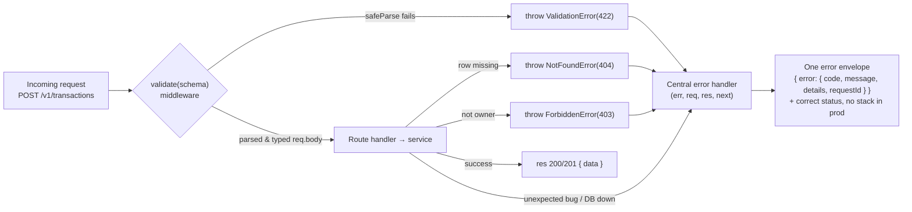

# 07. Input Validation & Error Handling

> **One-liner:** Every request from the internet is untrusted until proven otherwise — validate and *parse* it at the edge with Zod, and funnel every failure through one central error handler that returns a consistent, safe envelope.
> **Where this fits:** This hardens the routes you built in [`06-rest-api-design-in-practice.md`](06-rest-api-design-in-practice.md). It's a direct use of the middleware chain from [`05-middleware-and-request-lifecycle.md`](05-middleware-and-request-lifecycle.md) — validation and error handling are *both just middleware*. It sets up the auth guards in [`12-authentication.md`](12-authentication.md) and [`13-authorization-and-security.md`](13-authorization-and-security.md), which will `throw` the same error classes you define here.

## 1. The Idea in Plain Words

There are two separate jobs in this chapter, and beginners smear them together:

1. **Input validation** — *at the front door*, refuse to let bad data in. "Is `amount_cents` a positive integer? Is `kind` one of `income`/`expense`?" If not, reject with a clear `4xx` before any business logic runs.
2. **Error handling** — *once something goes wrong anywhere* (a missing row, an unauthorized user, a DB timeout), turn it into one consistent HTTP response — without crashing the server or leaking secrets.

The mindset that ties them together is **"never trust the client."** As a React dev you wrote the form that sends `{ amount_cents: 24050 }`, so it *feels* safe. It isn't. The request can come from `curl`, Postman, a buggy mobile build, a malicious script, or a replayed old payload. Your React validation is a **UX nicety** (instant feedback); **server validation is the actual security boundary.** They are not redundant — they do different jobs, and you need both.

The senior technique here has a name: **parse, don't validate.** The naive way is to *check* the raw `req.body` (which TypeScript types as `any`) and then keep using that untyped blob, hoping you checked everything. The better way is to run it through a schema that **returns a new, fully-typed value** — after that line, TypeScript *knows* `amount_cents` is a `number`, and any field you forgot to handle is a compile error, not a 2 a.m. production bug. You validate once, at the boundary, and everything downstream is typed and trusted.

Terms, defined once:

- **Zod** — a TypeScript-first schema library. You describe the shape you *expect*; Zod checks a value against it and, crucially, **infers the TS type** from the schema so you never write the type twice.
- **Schema** — the description of a valid value (`z.object({ amount_cents: z.number().int().positive() })`).
- **`safeParse`** — runs the schema and returns `{ success: true, data }` or `{ success: false, error }` — no exceptions, you branch on it.
- **Error envelope** — the single JSON shape every error response uses, so the frontend writes *one* handler.

## 2. Why It Matters

| If you skip it… | What happens |
|---|---|
| **Security hole** | Unvalidated input is how SQL injection, NoSQL operator injection, and mass-assignment bugs get in. A request could set `user_id` or `is_admin` if you blindly `Object.assign(row, req.body)`. (More in [`13`](13-authorization-and-security.md) and [`../system-design/20-security-basics.md`](../system-design/20-security-basics.md).) |
| **Correctness rot** | `amount_cents: 240.5` or `"24050"` silently poisons your ledger. For Habex — an *expense tracker* — a corrupt number is the whole product broken. |
| **Server crashes** | An unhandled `throw` or rejected promise in a handler can take down the Node process, killing *all* in-flight requests, not just the bad one. |
| **Leaked secrets** | An uncaught error that dumps a stack trace or SQL string to the client hands attackers your internals (table names, file paths, library versions). |
| **Frontend chaos** | Ten endpoints inventing ten error shapes = ten special cases in your React code. One envelope = one handler. |

For fintech-adjacent interviews (CRED, Razorpay, Groww) this is a *love* topic: "how do you make sure a bad amount never reaches the database?" is really "do you validate at the boundary and store money as integer cents?"

## 3. Picture It (Diagram)

The path of one request, and the **two ways it can bail out** — both landing in the *same* central error handler.



The key insight, straight from [`05`](05-middleware-and-request-lifecycle.md): **validation is a middleware you run *before* the handler; the error handler is a special 4-argument middleware you register *last*.** Handlers and services never build error responses themselves — they just `throw` a typed error and let the one handler at the end format it. One place decides what every error looks like.

## 4. Hands-On (TypeScript + Node)

Install: `npm i zod`. We'll build four pieces — the schema, the `validate()` middleware, the error classes, the central handler — and wire them into `habex-api`.

### 4a. The Zod schema (and free TypeScript types)

The star rule for Habex: **`amount_cents` is a positive integer.** Zod's `.int()` rejects floats, so `240.5` — a frontend dev accidentally sending rupees — is caught at the door.

```ts
// src/modules/transactions/transactions.schema.ts
import { z } from "zod";

export const createTransactionSchema = z.object({
  category_id: z.string().min(1, "category_id is required"),

  // MONEY: integer cents, strictly positive. .int() rejects 240.5; we also reject
  // strings so "24050" can't sneak in. This one line is the anti-float guard.
  amount_cents: z
    .number({ invalid_type_error: "amount_cents must be a number of cents" })
    .int("amount_cents must be an integer — money is stored as integer cents, not rupees")
    .positive("amount_cents must be greater than 0"),

  kind: z.enum(["income", "expense"]), // anything else → a clean error listing the options

  note: z.string().max(280).optional(),

  // Accept an ISO date/datetime string; z.coerce.date() would also accept it and hand
  // back a Date. We keep the string and just prove it's a real date, not in the future.
  occurred_at: z
    .string()
    .datetime({ offset: true })
    .or(z.string().regex(/^\d{4}-\d{2}-\d{2}$/, "occurred_at must be YYYY-MM-DD or ISO datetime")),
})
  .strict(); // reject UNKNOWN keys → blocks mass-assignment (e.g. a sneaky "user_id")

// The big TS win: infer the type FROM the schema. One source of truth, no drift.
export type CreateTransactionInput = z.infer<typeof createTransactionSchema>;
// { category_id: string; amount_cents: number; kind: "income" | "expense";
//   note?: string; occurred_at: string }
```

Two things a TS dev should savour: `z.infer` means you **never hand-write that type** (change the schema, the type updates itself), and `.strict()` makes extra keys an error — so a client can't smuggle in `user_id` or `is_admin`. That `.strict()` is a real security control, not a nicety.

### 4b. The `validate()` middleware — one guard for body, params, and query

```ts
// src/middleware/validate.ts
import type { RequestHandler } from "express";
import { ZodTypeAny } from "zod";
import { ValidationError } from "../errors";

interface Schemas {
  body?: ZodTypeAny;
  params?: ZodTypeAny;
  query?: ZodTypeAny;
}

// Runs schemas, and on failure throws ONE ValidationError with field-level details.
// On success it REPLACES req.body/params/query with the parsed, typed values
// (parse-don't-validate): downstream code is now working with trusted data.
export const validate =
  (schemas: Schemas): RequestHandler =>
  (req, _res, next) => {
    for (const key of ["body", "params", "query"] as const) {
      const schema = schemas[key];
      if (!schema) continue;

      const result = schema.safeParse(req[key]);
      if (!result.success) {
        // Turn Zod's issues into a flat, frontend-friendly list.
        const details = result.error.issues.map((i) => ({
          field: i.path.join(".") || key,
          message: i.message,
        }));
        // Body → 422 (data invalid). Params/query → 400 (the request itself is malformed).
        throw new ValidationError(details, key === "body" ? 422 : 400);
      }
      // Overwrite with the parsed, typed value (result.data). Downstream now trusts it.
      req[key] = result.data;
    }
    next();
  };
```

Why `safeParse` and not `parse`? `parse` *throws* a `ZodError`; `safeParse` returns a result you branch on. Here we want to shape the error ourselves (into field-level `details` and pick 400 vs 422), so `safeParse` gives cleaner control. We deliberately throw *our own* `ValidationError` so the central handler only ever needs to understand *our* error classes, not Zod's internals.

### 4c. Custom error classes — a small, throwable vocabulary

```ts
// src/errors.ts
// Base class every "expected" (operational) error extends. isOperational = "we anticipated
// this, it's a normal 4xx" vs a genuine bug/crash we must log loudly and hide.
export class AppError extends Error {
  constructor(
    message: string,
    public readonly statusCode: number,
    public readonly code: string,
    public readonly details?: unknown,
    public readonly isOperational = true,
  ) {
    super(message);
    this.name = new.target.name; // "NotFoundError", etc., in logs
    Error.captureStackTrace?.(this, new.target);
  }
}

export class ValidationError extends AppError {
  constructor(details: unknown, statusCode: 400 | 422 = 422) {
    super("Validation failed", statusCode, "VALIDATION_ERROR", details);
  }
}
export class NotFoundError extends AppError {
  constructor(message = "Resource not found") {
    super(message, 404, "NOT_FOUND");
  }
}
export class UnauthorizedError extends AppError {           // really "unauthenticated"
  constructor(message = "Authentication required") {
    super(message, 401, "UNAUTHENTICATED");
  }
}
export class ForbiddenError extends AppError {
  constructor(message = "You do not have access to this resource") {
    super(message, 403, "FORBIDDEN");
  }
}
export class ConflictError extends AppError {
  constructor(message = "Resource conflict") {
    super(message, 409, "CONFLICT");
  }
}
```

Now your **service layer throws intent, not HTTP** — clean and testable:

```ts
// src/modules/transactions/transactions.service.ts
import { repo } from "./transactions.repo";
import { NotFoundError, ForbiddenError } from "../../errors";
import type { CreateTransactionInput } from "./transactions.schema";

export const transactionsService = {
  getOwned(id: string, userId: string) {
    const txn = repo.findById(id);
    if (!txn) throw new NotFoundError(`No transaction ${id}.`);
    // NOTE: returning 403 here confirms the row EXISTS to a stranger. To avoid leaking
    // existence, many APIs throw NotFoundError instead. See ch13. We show 403 for clarity.
    if (txn.user_id !== userId) throw new ForbiddenError();
    return txn;
  },

  create(input: CreateTransactionInput, userId: string) {
    // input is already validated & typed — no defensive checks needed here.
    return repo.create({ ...input, user_id: userId, note: input.note ?? null });
  },
};
```

### 4d. Handling async errors so a `throw` never hangs the request

In **Express 4**, if an `async` handler rejects (or `throw`s after an `await`), Express does **not** catch it — the request hangs until it times out. Two fixes:

```ts
// Option A: a one-line wrapper. Wrap every async handler with it.
import type { RequestHandler } from "express";
export const asyncHandler =
  (fn: RequestHandler): RequestHandler =>
  (req, res, next) =>
    Promise.resolve(fn(req, res, next)).catch(next); // rejection → next(err) → error handler
```

```ts
// Option B: import ONCE at the top of your entry file; it patches Express to forward
// rejected promises automatically, so you can write plain async handlers.
import "express-async-errors";
```

> **Express 5** does this natively — a rejected async handler is forwarded to the error middleware automatically. Until you're on v5, use Option A or B. Synchronous `throw`s (like our validation before any `await`) are *already* caught by Express, so they always reach the handler.

### 4e. The central error handler — the single exit for every failure

```ts
// src/middleware/errorHandler.ts
import type { ErrorRequestHandler } from "express";
import { AppError } from "../errors";
import { logger } from "../logger"; // pino — see ch17

// Express recognises this as error middleware ONLY because it has FOUR params.
// Register it LAST, after all routes. `next` must stay in the signature even if unused.
export const errorHandler: ErrorRequestHandler = (err, req, res, _next) => {
  const requestId = (req as any).id; // set by a request-id middleware (ch17)

  // 1. Expected, operational errors → their own status + safe envelope.
  if (err instanceof AppError) {
    return res.status(err.statusCode).json({
      error: {
        code: err.code,
        message: err.message,
        ...(err.details ? { details: err.details } : {}),
        requestId,
      },
    });
  }

  // 2. Anything else is an UNEXPECTED bug: log the whole thing server-side...
  logger.error({ err, requestId }, "Unhandled error");

  // ...but tell the client almost nothing. Never leak stack traces/SQL in production.
  const isProd = process.env.NODE_ENV === "production";
  return res.status(500).json({
    error: {
      code: "INTERNAL_ERROR",
      message: isProd ? "Something went wrong. Please try again." : String(err?.message ?? err),
      ...(isProd ? {} : { stack: (err as Error)?.stack }), // dev-only aid
      requestId,
    },
  });
};
```

### 4f. Wiring it all into `habex-api`

```ts
// src/app.ts
import express from "express";
import { validate } from "./middleware/validate";
import { errorHandler } from "./middleware/errorHandler";
import { asyncHandler } from "./middleware/asyncHandler";
import { createTransactionSchema } from "./modules/transactions/transactions.schema";
import { transactionsService } from "./modules/transactions/transactions.service";
import { getUserId } from "./modules/transactions/helpers";
import { NotFoundError } from "./errors";

export const app = express();
app.use(express.json()); // parses JSON body (ch05). Malformed JSON → a 400 we handle below.

// validate() runs BEFORE the handler. If the body is bad, the handler never runs.
app.post(
  "/v1/transactions",
  validate({ body: createTransactionSchema }),
  asyncHandler(async (req, res) => {
    const txn = await transactionsService.create(req.body, getUserId(req));
    res.status(201).location(`/v1/transactions/${txn.id}`).json({ data: txn });
  }),
);

// ...other routes...

// 404 for unmatched routes → throw, so it flows through the SAME envelope.
app.use((req, _res, next) => next(new NotFoundError(`No route ${req.method} ${req.path}`)));

// THE central error handler — always registered LAST.
app.use(errorHandler);
```

**Happy path** — the body passes, `201` comes back:

```http
POST /v1/transactions
Content-Type: application/json

{ "category_id": "cat_food", "amount_cents": 24050, "kind": "expense", "occurred_at": "2026-06-28" }
```
```json
{ "data": { "id": "txn_141", "amount_cents": 24050, "kind": "expense", "category_id": "cat_food",
  "note": null, "occurred_at": "2026-06-28", "user_id": "user_1", "created_at": "2026-07-08T10:00:00.000Z" } }
```

**A float amount and a bad enum** — `422` with **field-level** details the React form can map straight to inputs:

```http
POST /v1/transactions
Content-Type: application/json

{ "category_id": "cat_food", "amount_cents": 240.5, "kind": "grocery", "occurred_at": "2026-06-28" }
```
```json
{
  "error": {
    "code": "VALIDATION_ERROR",
    "message": "Validation failed",
    "details": [
      { "field": "amount_cents", "message": "amount_cents must be an integer — money is stored as integer cents, not rupees" },
      { "field": "kind", "message": "Invalid enum value. Expected 'income' | 'expense', received 'grocery'" }
    ],
    "requestId": "req_a1b2c3"
  }
}
```

Your React error handler now does one thing everywhere: read `error.code` to decide behaviour, and loop `error.details` to paint red under each field. One envelope, one handler.

## 5. Apply It to Habex

**Validate every write endpoint** — a schema per operation, all funnelling into the same `validate()` + error handler:

| Endpoint | Schema highlights |
|---|---|
| `POST /v1/auth/signup` | `email` (`z.string().email()`), `password` (`.min(8)`), `name` (`.min(1)`) |
| `POST /v1/auth/login` | `email`, `password` present (don't reveal *which* is wrong → generic 401 in ch12) |
| `POST /v1/transactions` | the `createTransactionSchema` above — the integer-cents guard is the headline |
| `PATCH /v1/transactions/:id` | `createTransactionSchema.partial().strict()` — every field optional, but still validated |
| `POST /v1/categories` | `name` (`.min(1).max(40)`), `kind` enum, `color` (`.regex(/^#[0-9a-f]{6}$/i)`) |
| `POST /v1/budgets` | `month` (`.regex(/^\d{4}-\d{2}$/)`), `limit_cents` (positive int), `category_id` |
| all list endpoints | a **query** schema: `limit` (`z.coerce.number().int().min(1).max(100)`), `cursor`, `month`, `category_id` |

Two Habex-specific wins to call out in an interview:

- **`createTransactionSchema.partial()` for `PATCH`** — Zod derives the "all fields optional" update schema *from* the create schema, so the money rule and the enum are enforced identically on edits. No duplicated logic.
- **Coercing query strings** — query params are always strings (`?limit=20` is `"20"`). `z.coerce.number().int()` turns `"20"` into `20` and *still* rejects `"20.5"` or `"abc"`. Validation and type-coercion in one line.

Every one of these throws the same `ValidationError`/`NotFoundError`/`ForbiddenError`, so the auth guards you add in [`12`](12-authentication.md) (throwing `UnauthorizedError`) and [`13`](13-authorization-and-security.md) (throwing `ForbiddenError`) drop in with zero new plumbing — they already speak the envelope.

## 6. Interview Questions (with answer pointers)

**Q1. "If the frontend already validates, why validate on the server?" _(all five)_**
Because the client is *untrusted* — `curl`, Postman, a stale mobile build, or an attacker bypass it entirely. Client validation is **UX** (instant feedback); server validation is the **security + correctness boundary**. They do different jobs; you need both. Never trust input you didn't generate.

**Q2. "What does 'parse, don't validate' mean and why is it better?" _(CRED, Groww)_**
Instead of *checking* an untyped `any` blob and hoping you covered every field, you run it through a schema that **returns a new, fully-typed value**. After that line the data is trusted *and* TypeScript-typed, so a forgotten field is a compile error, not a runtime bug. Zod's `z.infer` gives you the type for free.

**Q3. "`400` vs `422` — where's the line?" _(Razorpay, Swiggy)_**
`400 Bad Request` = the request is *malformed* — unparseable JSON, a bad cursor, wrong param type. `422 Unprocessable Entity` = it parsed fine but the *data* is semantically invalid — negative `amount_cents`, unknown `kind`. Honest caveat: teams differ (some return `400` for all validation), so the real answer is **be consistent and always include a machine-readable `code`** in the body.

**Q4. "How do you structure error responses?" _(Razorpay, CRED)_**
One envelope everywhere: `{ error: { code, message, details?, requestId } }`. A machine-readable `code` (frontend switches on it), a human `message` (log/toast), `details` (field-level for forms), and a `requestId` (trace it in logs). One shape → one frontend handler. Return the correct HTTP status alongside it.

**Q5. "How do you catch async errors in Express?" _(Groww, Swiggy)_**
Express 4 doesn't catch rejected promises from `async` handlers — the request hangs. Fix with an `asyncHandler` wrapper (`Promise.resolve(fn()).catch(next)`) or the `express-async-errors` package; Express 5 does it natively. All paths funnel into the **one** error-handling middleware (the 4-arg one, registered last).

**Q6. "How do you make sure a bad money value never hits the DB?" _(CRED, Razorpay, Groww)_**
Store money as **integer `amount_cents`**, and validate at the boundary with `z.number().int().positive()` — `.int()` rejects floats like `240.5`, and rejecting strings blocks `"24050"`. Combined with a DB `INTEGER`/`CHECK (amount_cents > 0)` constraint (ch09), you get defence in depth: bad money is impossible by construction.

**Q7. "How do you avoid leaking internals in errors?" _(Razorpay, security-minded rounds)_**
Split *operational* errors (your `AppError` subclasses — safe to show) from *unexpected* ones (bugs, DB down). Operational → their status + message. Unexpected → **log the full error server-side, return a generic `500`** with no stack trace or SQL. Gate any debug detail behind `NODE_ENV !== "production"`.

**Q8. "What's mass-assignment and how do you prevent it?" _(CRED, Groww)_**
Blindly spreading `req.body` into a record lets a client set fields they shouldn't — `user_id`, `is_admin`, `id`. Prevent it by validating with a **strict** schema (`.strict()` rejects unknown keys) and only ever persisting the *parsed* object, never the raw body. Never `Object.assign(row, req.body)`.

## 7. Trade-offs & Pitfalls ("Why Not Just X?")

**"Why not just `if`-check fields by hand — no library?"** You can, for one field. Across dozens of endpoints it becomes inconsistent, untyped, and easy to forget a case (the exact gap attackers find). Zod centralises the rules, gives field-level messages, and *infers the type* so validation and types can't drift apart. The `if`-soup is the thing that rots.

**"Why not `throw` a plain `Error` with a status property?"** It works, but typed classes (`NotFoundError`, `ForbiddenError`) are self-documenting, give you `instanceof` checks in the handler, and separate *operational* from *unexpected* so you know what to hide. A bag of ad-hoc `{ status: 404 }` objects loses that structure.

**"Why not let each route format its own error response?"** Then you have N error shapes, N places to update when the envelope changes, and inevitable drift — some routes leak stacks, some don't. One central handler = one shape, one security policy, one place to change. This is the single highest-leverage pattern in the chapter.

**"Why not send the real stack trace to the client — it helps debugging?"** It helps *attackers* more: stack traces expose file paths, library versions, and query fragments that map your internals. Log the full detail *server-side* (pino, ch17) keyed by `requestId`; send the client only a generic message + that id.

**"Isn't server validation redundant with a strict DB schema?"** They're complementary layers. The DB constraint (`CHECK (amount_cents > 0)`) is the last line of defence, but it returns an ugly, generic error *after* work is wasted. Validating at the edge gives a clean, field-level `422` immediately and keeps garbage out of business logic. Defence in depth: validate at the edge **and** constrain in the DB.

| Decision | Cheap/simple side | Robust side | You pay with… |
|---|---|---|---|
| Validation | Hand-rolled `if`s | Zod schemas + `z.infer` | A dependency vs consistency + free types |
| Errors | `throw new Error()` | Typed `AppError` classes | A little boilerplate vs structure |
| Formatting | Per-route responses | One central handler | Central discipline vs zero drift |
| Prod errors | Echo the exception | Log server-side, generic to client | Slower local debug vs no leaks |

## 8. TL;DR

- **Never trust the client.** React validation is UX; **server validation is the security + correctness boundary.** Do both, for different reasons.
- **Parse, don't validate:** run input through a **Zod** schema that returns a *typed* value. Downstream code is trusted and typed; `z.infer` gives you the TS type for free — no hand-written duplicate.
- **Money rule:** `amount_cents` = `z.number().int().positive()`. `.int()` rejects floats like `240.5`; reject strings too. Pair with a DB `CHECK` for defence in depth.
- **`.strict()` schemas** reject unknown keys → block **mass-assignment** of `user_id`/`is_admin`. Persist only the *parsed* object, never raw `req.body`.
- **`validate(schema)` middleware** runs before handlers; body failures → `422`, malformed params/query → `400`; both with **field-level `details`**.
- **Custom error classes** (`AppError` + `NotFoundError`/`ValidationError`/`UnauthorizedError`/`ForbiddenError`/`ConflictError`) let services `throw` *intent*, not HTTP.
- **One central error handler** (the 4-arg middleware, registered **last**) formats every failure into one envelope: `{ error: { code, message, details?, requestId } }`.
- **Catch async errors** with an `asyncHandler` wrapper or `express-async-errors` (native in Express 5) so a rejected promise never hangs a request.
- **Don't leak internals:** log full errors server-side, return a generic `500` in prod — no stack traces, no SQL. Gate debug detail behind `NODE_ENV`.
- These pieces plug straight into the routes from [`06`](06-rest-api-design-in-practice.md) and the guards from [`12`](12-authentication.md)/[`13`](13-authorization-and-security.md).
