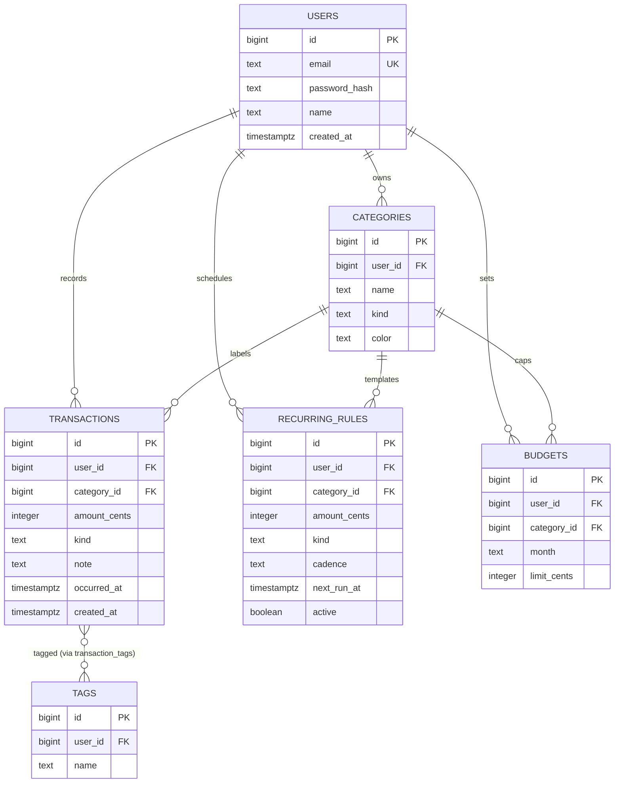

# 09. Data Modeling & Migrations

> **One-liner:** Data modeling is deciding *what tables exist and how they relate* before you write app code; migrations are the versioned, replayable schema-change files that let you evolve that model safely — in a team, in production, without ever hand-editing the live database.
> **Where this fits:** In [08-sql-and-postgresql-fundamentals.md](08-sql-and-postgresql-fundamentals.md) you built three Habex tables by pasting `CREATE TABLE` into psql. That's fine for learning and fatal for a real app — there's no history, no rollback, and no way for a teammate to reproduce it. This chapter turns that ad-hoc SQL into a **designed schema** (adding `budgets` and `recurring_rules`) and a **migration history** you commit to git. It's the bridge between raw SQL and the ORM: you'll see raw SQL migrations here and preview Prisma Migrate ([10-connecting-node-to-postgres.md](10-connecting-node-to-postgres.md)), then use transactions & indexes on this schema in [11-transactions-and-query-performance.md](11-transactions-and-query-performance.md). The *why* behind normalization and scale lives in [../system-design/09-sql-vs-nosql.md](../system-design/09-sql-vs-nosql.md) and [../system-design/12-sharding-and-partitioning.md](../system-design/12-sharding-and-partitioning.md).

---

## 1. The Idea in Plain Words

### Data modeling

**Data modeling** is the design step: before any code, you decide the tables, their columns, and how they link. Three words to define:

- **Entity** — a *noun* your app tracks. In Habex: a user, a category, a transaction, a budget, a recurring rule. Each entity usually becomes one **table**.
- **Attribute** — a *property* of an entity → a **column**. A transaction's amount, note, and date are attributes.
- **Relationship** — how two entities connect. There are exactly three shapes, and naming them is half of every modeling interview:

| Relationship | Meaning | Habex example | How you model it |
|---|---|---|---|
| **One-to-one (1:1)** | each A has at most one B | a user ↔ their profile settings | same table, or a second table with a `UNIQUE` FK |
| **One-to-many (1:N)** | one A has many B; each B has one A | one user has many transactions | put the **FK on the "many" side** (`transactions.user_id`) |
| **Many-to-many (M:N)** | each A has many B *and* vice-versa | a transaction can have many tags; a tag applies to many transactions | a **junction table** (`transaction_tags`) with two FKs |

Habex's core is almost entirely **one-to-many**: a user has many categories, many transactions, many budgets, many recurring rules; a category labels many transactions. The FK always sits on the "many" side. We'll model a **many-to-many** (transactions ↔ tags) as an optional feature so you own the pattern.

### Keys: surrogate vs natural

A **key** uniquely identifies a row. A **natural key** is real-world data that happens to be unique (an email, a passport number). A **surrogate key** is a meaningless auto-generated `id` (`BIGINT IDENTITY`). Default to **surrogate keys**: they never change (people change emails), they're compact and fast to join on, and they don't leak business meaning. Keep the natural key too, but as a `UNIQUE` *constraint* (`users.email`), not as the primary key.

### Normalize vs denormalize (the one-sentence version)

**Normalization** = store each fact exactly once, split into related tables, link by foreign keys. Benefit: no duplication, so an update happens in one place and can't drift. **Denormalization** = deliberately duplicate or pre-join data to make a specific hot read faster, accepting that you must now keep the copies in sync. **Normalize by default; denormalize later, on a path you've measured is too slow.** (Full treatment: [../system-design/09-sql-vs-nosql.md](../system-design/09-sql-vs-nosql.md).)

### Migrations

A **migration** is a single, ordered, versioned change to your schema, stored as a file in your repo — `0001_init.sql`, `0002_add_tags.sql`, and so on. Think of it as **git for your database shape**. Each migration has an **up** (apply the change) and ideally a **down** (undo it). You run them in order on every environment — your laptop, CI, staging, production — so every database ends up identical and reproducible. The golden rule: **you never open a psql prompt on production and `ALTER TABLE` by hand.** Every change is a reviewed, committed migration.

---

## 2. Why It Matters

- **Schema mistakes are the most expensive kind.** Changing a table with a million live rows is slow and risky; renaming a badly-chosen column ripples through every query and every deploy. A few minutes of modeling saves weeks of pain.
- **Migrations make schema changes safe and social.** They're reviewable in a pull request, replayable in CI's test database, and rollback-able when something's wrong. Without them, "how is prod's schema different from mine?" has no answer.
- **"Never hand-edit prod" is a seniority marker.** Interviewers ask *"how do you change a live database's schema?"* to separate people who've shipped from people who haven't. The answer is "a versioned migration, applied through the pipeline, additive-first for zero downtime."
- **This is where Habex becomes a real product.** By the end you have the *complete* schema (five tables, the right indexes, sensible defaults) captured as migration files you can `git log`.

---

## 3. Picture It (Diagram)

The complete Habex model — all five tables, plus the optional tags feature. Crow's-foot `||--o{` reads "one … has many …"; `}o--o{` on the tag link is the many-to-many.



Everything hangs off `users` (a strict tenant boundary — every row is owned by exactly one user). `budgets` gets a compound uniqueness rule you'll enforce below: **one budget per (user, month, category)**.

---

## 4. Hands-On (design → migrations → seed)

### 4.1 The design process, applied to Habex

A repeatable four-step routine you can narrate in an interview:

1. **List entities (nouns).** user, category, transaction, recurring_rule, budget. → five tables.
2. **Draw relationships & place FKs.** All one-to-many, so the FK goes on the many side: `categories.user_id`, `transactions.user_id` + `transactions.category_id`, and the same pair on `recurring_rules` and `budgets`.
3. **Pick keys.** Surrogate `BIGINT IDENTITY` PK on every table. Natural keys become `UNIQUE` constraints (`users.email`; `budgets (user_id, month, category_id)`).
4. **Decide types, nullability, defaults, constraints.** Money as `INTEGER` cents; timestamps as `TIMESTAMPTZ DEFAULT now()`; enum-like text guarded by `CHECK`; `active BOOLEAN DEFAULT true`.

### 4.2 Enums vs lookup tables

`kind` is always `'income'|'expense'`; `cadence` is `'daily'|'weekly'|'monthly'`. You have three ways to enforce a fixed set of values:

| Approach | How | Good when | Cost |
|---|---|---|---|
| **`CHECK` on a `TEXT` column** ← our choice | `kind TEXT CHECK (kind IN ('income','expense'))` | few, stable values | changing the set = a migration to alter the CHECK |
| **Native `ENUM` type** | `CREATE TYPE kind AS ENUM ('income','expense')` | you want the type reused across tables | *removing/reordering* values is painful; adding is easy but `ALTER TYPE` has quirks |
| **Lookup table** | a tiny `kinds(code, label)` table + FK | values have *attributes* or change often | an extra join; more moving parts |

Rule: **`CHECK` for a short, stable list; a lookup table once the "enum" grows attributes or changes at runtime.** Habex's `categories` are already a lookup-style table (user-defined, colored, typed) — that's the tell that categories deserved a table while `kind` didn't.

### 4.3 Nullability & defaults

- **Default to `NOT NULL`.** A nullable column is a promise that "absent" is a *meaningful* state. Make each nullable column earn it.
- **Where NULL is meaningful in Habex:** `transactions.category_id` (uncategorized), `transactions.note` (optional memo), `categories.color` (optional). Everything else is `NOT NULL`.
- **NULL ≠ empty string ≠ 0.** `NULL` = "unknown/none"; `''` = "a real, empty string". Don't smear them together.
- **Defaults remove foot-guns:** `created_at TIMESTAMPTZ DEFAULT now()`, `active BOOLEAN DEFAULT true`. The DB fills them so no code path forgets.

### 4.4 The initial migration — `0001_init.sql`

Here's the whole schema as your first migration file. This is exactly what you'd commit to `migrations/0001_init.sql`. (The three tables from chapter 8 are here too, so this file stands alone as "create Habex from nothing.")

```sql
-- migrations/0001_init.sql   (UP)
BEGIN;

CREATE TABLE users (
  id            BIGINT GENERATED ALWAYS AS IDENTITY PRIMARY KEY,
  email         TEXT        NOT NULL UNIQUE,
  password_hash TEXT        NOT NULL,
  name          TEXT        NOT NULL,
  created_at    TIMESTAMPTZ NOT NULL DEFAULT now()
);

CREATE TABLE categories (
  id       BIGINT GENERATED ALWAYS AS IDENTITY PRIMARY KEY,
  user_id  BIGINT NOT NULL REFERENCES users(id) ON DELETE CASCADE,
  name     TEXT   NOT NULL,
  kind     TEXT   NOT NULL CHECK (kind IN ('income', 'expense')),
  color    TEXT
);

CREATE TABLE transactions (
  id           BIGINT GENERATED ALWAYS AS IDENTITY PRIMARY KEY,
  user_id      BIGINT  NOT NULL REFERENCES users(id) ON DELETE CASCADE,
  category_id  BIGINT  REFERENCES categories(id) ON DELETE SET NULL,
  amount_cents INTEGER NOT NULL CHECK (amount_cents > 0),
  kind         TEXT    NOT NULL CHECK (kind IN ('income', 'expense')),
  note         TEXT,
  occurred_at  TIMESTAMPTZ NOT NULL DEFAULT now(),
  created_at   TIMESTAMPTZ NOT NULL DEFAULT now()
);

CREATE TABLE recurring_rules (
  id           BIGINT GENERATED ALWAYS AS IDENTITY PRIMARY KEY,
  user_id      BIGINT  NOT NULL REFERENCES users(id) ON DELETE CASCADE,
  category_id  BIGINT  REFERENCES categories(id) ON DELETE SET NULL,
  amount_cents INTEGER NOT NULL CHECK (amount_cents > 0),
  kind         TEXT    NOT NULL CHECK (kind IN ('income', 'expense')),
  cadence      TEXT    NOT NULL CHECK (cadence IN ('daily', 'weekly', 'monthly')),
  next_run_at  TIMESTAMPTZ NOT NULL,
  active       BOOLEAN NOT NULL DEFAULT true
);

CREATE TABLE budgets (
  id          BIGINT GENERATED ALWAYS AS IDENTITY PRIMARY KEY,
  user_id     BIGINT  NOT NULL REFERENCES users(id) ON DELETE CASCADE,
  category_id BIGINT  NOT NULL REFERENCES categories(id) ON DELETE CASCADE,
  month       TEXT    NOT NULL CHECK (month ~ '^\d{4}-\d{2}$'),  -- 'YYYY-MM'
  limit_cents INTEGER NOT NULL CHECK (limit_cents >= 0),
  -- one budget per user, per month, per category:
  UNIQUE (user_id, month, category_id)
);

-- Indexes for the queries Habex actually runs (see ../system-design/10-database-indexing.md):
-- 1) list/aggregate a user's transactions by date  -> composite index, newest-first
CREATE INDEX idx_transactions_user_occurred
  ON transactions (user_id, occurred_at DESC);
-- 2) the background worker: "which rules are due?" -> partial index over active rules only
CREATE INDEX idx_recurring_due
  ON recurring_rules (next_run_at) WHERE active;
-- 3) a user's categories
CREATE INDEX idx_categories_user
  ON categories (user_id);

COMMIT;
```

Notes on the choices:

- **`UNIQUE (user_id, month, category_id)`** is a *compound* unique constraint — it stops a user from creating two "July / Food" budgets, and it doubles as an index for looking a budget up. Exactly the constraint the assignment demands.
- **`month TEXT CHECK (month ~ '^\d{4}-\d{2}$')`** stores `'2026-07'` and rejects anything that isn't `YYYY-MM`. (Alternative: a `DATE` pinned to the 1st of the month. Text is fine here and matches the API's month string.)
- **`idx_transactions_user_occurred (user_id, occurred_at DESC)`** is *the* index for Habex — every dashboard query filters by `user_id` and sorts/ranges by date. Order matters: the equality column (`user_id`) comes first, the range/sort column second. Why, in depth: [../system-design/10-database-indexing.md](../system-design/10-database-indexing.md).
- **`idx_recurring_due … WHERE active`** is a *partial* index — it indexes only active rules, keeping it tiny and perfectly matched to the worker's query `WHERE active AND next_run_at <= now()` (chapter 15).
- The whole file is wrapped in `BEGIN … COMMIT` so it's **atomic**: if any statement fails, the migration rolls back and leaves the DB untouched (Postgres supports transactional DDL — a genuinely great feature).

### 4.5 How migrations actually work

A migration tool keeps a small bookkeeping table recording which files have run, then applies any it hasn't — in order.

```sql
-- The tool creates this once and reads/writes it:
CREATE TABLE schema_migrations (
  version    TEXT PRIMARY KEY,       -- e.g. '0001_init'
  applied_at TIMESTAMPTZ NOT NULL DEFAULT now()
);
```

The loop is simply: *"list `migrations/*.sql`, subtract the versions already in `schema_migrations`, run the rest in filename order inside a transaction, and insert their version rows."* Naming is a zero-padded, sortable prefix (`0001_`, `0002_`, …) or a timestamp (`20260708_`) so order is unambiguous.

**Up and down.** Each change ideally ships with a reverse. Many teams keep paired files:

```sql
-- migrations/0002_add_tags.up.sql   (a many-to-many feature, added later)
BEGIN;
CREATE TABLE tags (
  id      BIGINT GENERATED ALWAYS AS IDENTITY PRIMARY KEY,
  user_id BIGINT NOT NULL REFERENCES users(id) ON DELETE CASCADE,
  name    TEXT   NOT NULL,
  UNIQUE (user_id, name)
);
CREATE TABLE transaction_tags (           -- the junction table for M:N
  transaction_id BIGINT NOT NULL REFERENCES transactions(id) ON DELETE CASCADE,
  tag_id         BIGINT NOT NULL REFERENCES tags(id)         ON DELETE CASCADE,
  PRIMARY KEY (transaction_id, tag_id)    -- composite PK = each pair at most once
);
COMMIT;
```

```sql
-- migrations/0002_add_tags.down.sql   (the rollback)
BEGIN;
DROP TABLE IF EXISTS transaction_tags;
DROP TABLE IF EXISTS tags;
COMMIT;
```

That `transaction_tags` table is the canonical **many-to-many** pattern: two foreign keys, a composite primary key so a (transaction, tag) pair can't be duplicated. Memorize it — "how do you model many-to-many?" is a standard question and "a junction/join table with two FKs" is the answer.

> **Migrations are append-only and forward-only in spirit.** Once `0002` has run in production, you don't edit it — you write `0003` to make the next change. Rollbacks exist for emergencies, but the safe default is "roll *forward* with a new migration."

### 4.6 Preview: the same thing with Prisma Migrate

From chapter 10 you'll use **Prisma**, and it does exactly the above — you just don't hand-write the SQL. You describe the schema declaratively in `schema.prisma`:

```prisma
model Budget {
  id          BigInt   @id @default(autoincrement())
  userId      BigInt   @map("user_id")
  categoryId  BigInt   @map("category_id")
  month       String                          // 'YYYY-MM'
  limitCents  Int      @map("limit_cents")
  user        User     @relation(fields: [userId], references: [id], onDelete: Cascade)
  category    Category @relation(fields: [categoryId], references: [id], onDelete: Cascade)

  @@unique([userId, month, categoryId])       // same compound UNIQUE as the SQL above
  @@map("budgets")
}
```

Then `npx prisma migrate dev --name add_budgets` **diffs** your models against the DB, **generates** a timestamped SQL migration file (real SQL, which you review and commit), applies it locally, and records it — the same `schema_migrations` idea under a different name (`_prisma_migrations`). In production you run `npx prisma migrate deploy`, which only *applies* already-committed migrations (never auto-generates). So: same discipline (versioned, committed, replayable), less typing. The raw SQL you learned here is what Prisma prints — which is why learning it first makes the ORM legible instead of magic.

### 4.7 Seeding sample data

**Seeding** loads baseline/demo rows so a fresh database (or a fresh clone by a teammate) is instantly usable. Keep it **idempotent** — safe to run twice — with `ON CONFLICT`:

```sql
-- seeds/seed.sql   (run after migrations)
BEGIN;

INSERT INTO users (email, password_hash, name)
VALUES ('santhosh@habex.app', '$2b$dummyhash', 'Santhosh')
ON CONFLICT (email) DO NOTHING;               -- idempotent: re-running won't duplicate

INSERT INTO categories (user_id, name, kind, color) VALUES
  (1, 'Food',   'expense', '#ef4444'),
  (1, 'Rent',   'expense', '#3b82f6'),
  (1, 'Salary', 'income',  '#10b981')
ON CONFLICT DO NOTHING;

INSERT INTO transactions (user_id, category_id, amount_cents, kind, note, occurred_at) VALUES
  (1, 1, 45000,   'expense', 'Groceries',   '2026-07-02'),
  (1, 2, 1800000, 'expense', 'July rent',   '2026-07-01'),
  (1, 3, 9000000, 'income',  'July salary', '2026-07-01');

INSERT INTO budgets (user_id, category_id, month, limit_cents) VALUES
  (1, 1, '2026-07', 800000)                    -- ₹8,000 food budget for July
ON CONFLICT (user_id, month, category_id) DO NOTHING;

INSERT INTO recurring_rules (user_id, category_id, amount_cents, kind, cadence, next_run_at) VALUES
  (1, 2, 1800000, 'expense', 'monthly', '2026-08-01');

COMMIT;
```

Run it with `psql "$DATABASE_URL" -f seeds/seed.sql`. From chapter 10 you'll usually write the seed as a small TypeScript script (`pg`/Prisma) so you can generate realistic data in a loop — but the idea is identical: repeatable setup data, checked into the repo.

---

## 5. Apply It to Habex — finalized schema & migration history

Habex's schema is now **done** and captured as files you commit to git:

| Version | File | What it does |
|---|---|---|
| `0001_init` | `0001_init.sql` | users, categories, transactions, recurring_rules, budgets + core indexes + budgets compound UNIQUE |
| `0002_add_tags` | `0002_add_tags.{up,down}.sql` | optional M:N tagging: `tags` + `transaction_tags` junction |
| `0003_txn_note_search` | *(future)* | e.g. a trigram index on `note` when search gets slow |

The workflow you'll live in from now on:

1. Need a schema change? **Write a new migration file** (or edit `schema.prisma` and let Prisma generate one). Never touch a shipped migration; never edit prod by hand.
2. **Open a PR** — the migration is reviewed like any code.
3. **CI runs it against a throwaway test DB** and runs your tests (chapter 18).
4. **Deploy runs `migrate deploy`** before the new app code starts.

That's the entire lifecycle, and it's the same at Zepto or Razorpay as it is on your laptop. The schema here is what every later chapter builds on: the `pg`/Prisma queries in [10](10-connecting-node-to-postgres.md), the transactional "insert transaction + update budget" flow and indexes in [11](11-transactions-and-query-performance.md), the recurring-rules worker in chapter 15.

---

## 6. Interview Questions (with answer pointers)

**Q1. What is normalization? Give the first three normal forms in your own words. (Razorpay, CRED)**
Pointer: Normalization = organize tables so each fact lives in exactly one place, eliminating duplication. **1NF:** atomic columns, no repeating groups (no comma-separated lists in a cell). **2NF:** every non-key column depends on the *whole* primary key (matters for composite keys). **3NF:** no column depends on another non-key column (no "derived" fields that can drift). Practical takeaway: normalize by default so updates touch one row; denormalize deliberately for a measured hot read.

**Q2. Model a one-to-many and a many-to-many. (asked everywhere)**
Pointer: One-to-many → put the foreign key on the "many" side (`transactions.user_id` references `users.id`). Many-to-many → a **junction table** with two FKs and a composite primary key (`transaction_tags(transaction_id, tag_id)`). Never try to cram a list into one column.

**Q3. What is a migration and why not just edit the production database directly? (Groww, Razorpay)**
Pointer: A migration is a versioned, committed, replayable schema change. Hand-editing prod is unreproducible (no one else can recreate your change), unreviewable, and unrollback-able, and it drifts prod away from every other environment. Migrations give you history, code review, CI testing on a throwaway DB, and a repeatable deploy step.

**Q4. How do you add a `NOT NULL` column to a huge table with zero downtime? (senior signal)**
Pointer: Do it in steps (expand → migrate → contract), never in one blocking `ALTER`:
1. **Add the column nullable** (or with a constant default — Postgres 11+ makes that a fast metadata-only change).
2. **Backfill** existing rows in batches so you don't lock the table.
3. Deploy app code that **writes the column** on every insert/update.
4. Add the **`NOT NULL`**: use `ADD CONSTRAINT … CHECK (col IS NOT NULL) NOT VALID`, then `VALIDATE CONSTRAINT` (validation takes a lighter lock than a direct `SET NOT NULL`).
Keep each migration additive and backward-compatible so old and new app versions both work during the rollout.

**Q5. Enum vs lookup table — when do you use each?**
Pointer: `CHECK`-constrained text (or a native `ENUM`) for a short, stable list with no extra data (`kind`, `cadence`). A lookup table once the values gain attributes (a color, a label, an ordering) or must be edited at runtime — which is exactly why Habex's *categories* are a table, not an enum. Native `ENUM`'s downside: removing/reordering values is painful, so many teams prefer `CHECK` for changeability.

**Q6. Surrogate vs natural primary key?**
Pointer: Surrogate (auto `id`) is the default — stable, compact, meaningless, so it never has to change. Natural keys (email) change and leak business meaning; keep them as `UNIQUE` constraints, not as the PK.

**Q7. How do you roll back a bad migration safely?**
Pointer: Prefer **rolling forward** — write a new migration that fixes the problem — because a `down` that drops a column destroys data. Keep migrations additive and reversible where you can, wrap DDL in a transaction (Postgres rolls back a failed migration automatically), and take a backup/snapshot before destructive changes.

---

## 7. Trade-offs & Pitfalls ("Why Not Just X?")

- **"Why not just `prisma db push` / edit the schema live?"** `db push` (and hand-editing) mutates the DB with *no migration file* — great for a throwaway prototype, disastrous for anything real: no history, no review, no rollback, instant drift between environments. Use generated migrations for anything you'll deploy.
- **`ON DELETE CASCADE` vs `SET NULL` vs `RESTRICT` — choose per relationship.** CASCADE (children die with the parent) is right for `user → everything`. SET NULL (orphan the child) is right for `category → transaction` (don't delete history when a label is removed). RESTRICT (block the delete) is right when children must be dealt with first. Picking CASCADE everywhere is a silent data-loss bug.
- **Big-table migrations take locks.** A naive `ALTER TABLE … ADD COLUMN … NOT NULL DEFAULT (expensive)` or adding an index without `CONCURRENTLY` can lock a large table and stall the app. On big tables: additive-first, backfill in batches, `CREATE INDEX CONCURRENTLY`. When a *single* table grows beyond one machine, that's the domain of partitioning/sharding — [../system-design/12-sharding-and-partitioning.md](../system-design/12-sharding-and-partitioning.md) (and note: sharding makes cross-shard FKs/joins hard, another reason to delay it).
- **"Why not denormalize now so reads are fast?"** Because every duplicated copy is now something writes must keep in sync, and the moment one copy is missed your data lies. Fix slow reads first with an **index** ([../system-design/10-database-indexing.md](../system-design/10-database-indexing.md)); denormalize only a specific, measured path.
- **Over-normalizing is also a smell.** Splitting a table into six because a textbook said so adds joins to every read for no benefit. Model for how the app actually reads and writes, not for purity.
- **"Why not native `ENUM` types everywhere?"** They read nicely but are rigid: you can add values but not cleanly remove/reorder them, and every change is an `ALTER TYPE` migration. `CHECK`-on-text is easier to evolve; a lookup table is right once the "enum" earns attributes.
- **Nullable-by-default is a trap.** Every needless nullable column forces every reader to handle a `NULL` that can't actually occur. Make columns `NOT NULL` unless "missing" is a real, intended state.

---

## 8. TL;DR

- **Data modeling** = entities (→ tables), attributes (→ columns), relationships. The three shapes: **1:1**, **1:N** (FK on the many side — Habex's whole core), **M:N** (a **junction table** with two FKs, e.g. `transaction_tags`).
- Default to **surrogate `BIGINT IDENTITY` keys**; keep natural keys (email) as `UNIQUE`. **Normalize by default**, denormalize only on a measured hot path ([../system-design/09-sql-vs-nosql.md](../system-design/09-sql-vs-nosql.md)).
- Enforce fixed value sets with a **`CHECK`** for short stable lists (`kind`, `cadence`); use a **lookup table** once values gain attributes (why `categories` is a table). Default columns to **`NOT NULL`** with sensible **defaults**.
- **Migrations** are versioned, committed, replayable schema changes — git for your DB shape. Bookkeeping table tracks applied versions; files are ordered and append-only; **never hand-edit production**. Same discipline whether raw SQL or **Prisma Migrate** (which generates the SQL you learned to read).
- The finalized Habex schema is five tables + the key indexes: **`(user_id, occurred_at DESC)`** on transactions and a **compound `UNIQUE (user_id, month, category_id)`** on budgets. Seed idempotently with `ON CONFLICT`.
- Zero-downtime column add = **expand → backfill → switch → contract**, additive and backward-compatible at every step.

Next: run this schema from Node — the `pg` driver and Prisma — in [10-connecting-node-to-postgres.md](10-connecting-node-to-postgres.md), then make it transactional and fast in [11-transactions-and-query-performance.md](11-transactions-and-query-performance.md).
