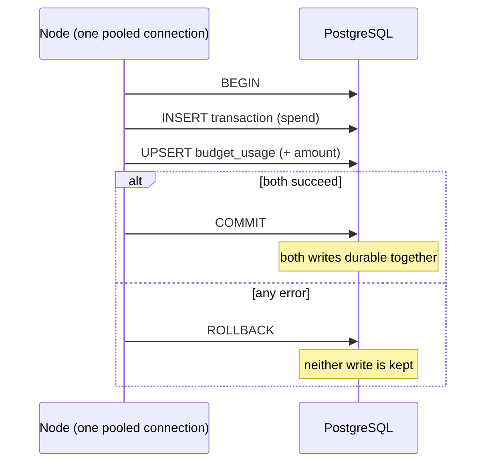
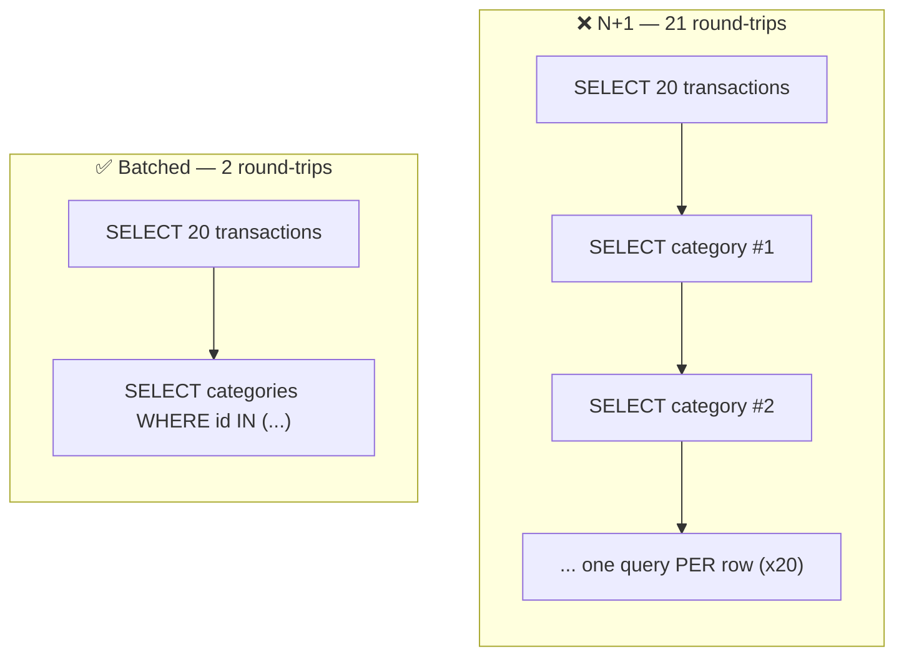

# 11. Transactions & Query Performance

> **One-liner:** A database **transaction** bundles several writes into one all-or-nothing unit (ACID in code); then **indexes**, **connection pooling**, and killing the **N+1 query** are how you keep those writes correct-under-concurrency and your reads fast.
> **Where this fits:** You can now talk to Postgres from Node with `pg` and Prisma ([10-connecting-node-to-postgres.md](10-connecting-node-to-postgres.md)), on tables you designed ([09-data-modeling-and-migrations.md](09-data-modeling-and-migrations.md)) with SQL you can write ([08-sql-and-postgresql-fundamentals.md](08-sql-and-postgresql-fundamentals.md)). This chapter is where a "working" query becomes a *correct and fast* one. It's the most fintech-relevant chapter in the track: CRED, Razorpay, and Groww interviews lean hard on transactions, race conditions, and query tuning. Pair it with the theory in [../system-design/14-acid-vs-base-and-consistency.md](../system-design/14-acid-vs-base-and-consistency.md) and [../system-design/10-database-indexing.md](../system-design/10-database-indexing.md).

---

## 1. The Idea in Plain Words

### Transactions

A **transaction** is a group of database operations treated as **one single unit**: either *all* of them commit, or *none* of them do. You wrap them in three keywords:

- **`BEGIN`** — start a transaction. Everything after this is provisional.
- **`COMMIT`** — make all the changes permanent, together, atomically.
- **`ROLLBACK`** — throw all the provisional changes away as if they never happened.

That all-or-nothing property is the **A** in **ACID** — the four guarantees a relational database gives you (full theory in [../system-design/14-acid-vs-base-and-consistency.md](../system-design/14-acid-vs-base-and-consistency.md)):

| Letter | Name | Plain meaning |
|---|---|---|
| **A** | Atomicity | All writes in the transaction happen, or none do. No half-done state. |
| **C** | Consistency | The DB moves from one valid state to another; constraints/foreign keys always hold. |
| **I** | Isolation | Concurrent transactions don't corrupt each other; it *looks* like they ran one at a time. |
| **D** | Durability | Once `COMMIT` returns, the data survives a crash. |

**When do you actually need one?** Whenever a single business action requires **two or more writes that must not be separated**:

- Classic: **transfer money** — subtract from A *and* add to B. If the server crashes between the two, you must not have subtracted without adding.
- Habex: **record a spend *and* roll it into that month's budget usage.** If the transaction insert succeeds but the budget update fails, your dashboard lies.
- Habex: a **recurring rule fires** — insert a new transaction *and* advance the rule's `next_run_at`. Do half of that and you either double-charge or never advance.

### The race problem (why isolation matters)

Two requests running at the same time can stomp on each other. The famous one is the **lost update**:

```
Budget spent = 900.
Request A reads 900, plans to write 900+50 = 950.
Request B reads 900, plans to write 900+30 = 930.
A writes 950. B writes 930.  ← A's +50 is LOST. Final should be 980.
```

Two tools fix this:

- **Pessimistic locking** — lock the row *before* you touch it (`SELECT ... FOR UPDATE`). Others wait. Safe, but holds locks.
- **Optimistic locking** — don't lock; add a `version` column and only write if the version is unchanged since you read it. If someone beat you, retry. Cheap when conflicts are rare.

### Query performance

Three levers you'll reach for constantly:

- **Index** — a sorted side-structure so the DB *jumps* to matching rows instead of scanning the whole table. The single highest-leverage perf fix. (Concept: [../system-design/10-database-indexing.md](../system-design/10-database-indexing.md).)
- **`EXPLAIN` / `EXPLAIN ANALYZE`** — ask Postgres *how* it plans to run a query (and, with `ANALYZE`, actually run it and report timings). Your window into slow queries.
- **The N+1 query problem** — accidentally firing one query per row in a loop (1 list query + N row queries). The classic ORM performance bug. Fix by loading relations up front.

- **Connection pooling** — reuse a fixed set of open connections instead of opening one per query. Introduced in [10-connecting-node-to-postgres.md](10-connecting-node-to-postgres.md); we size it properly here.

---

## 2. Why It Matters

| Reason | Why you care |
|---|---|
| **Correctness under concurrency** | Real apps serve many requests at once. Without transactions and isolation, concurrent writes silently corrupt data — unforgivable for money. |
| **Fintech interview bread-and-butter** | "What's a transaction? How do you prevent a double-spend? What's the isolation level?" are near-guaranteed at CRED / Razorpay / Groww. |
| **N+1 is the #1 real-world perf bug** | It's the most common reason an endpoint that was fast in dev crawls in prod. Spotting and fixing it is a senior signal. |
| **Indexes are the cheapest 100x** | Adding one index often turns a multi-second query into a millisecond one, with a one-line migration. |
| **Pools are where prod breaks** | "Too many connections" and serverless connection storms are common outages. Knowing pool sizing prevents them. |

---

## 3. Picture It (Diagram)

**A transaction wrapping multiple writes** — both land, or neither does:



**N+1 vs a single batched read** — same data, wildly different round-trip counts:



---

## 4. Hands-On (TypeScript + Node)

### 4a. A raw `pg` transaction (see every keyword)

The critical rule: a transaction must run on **one single connection**. `pool.query()` may pick a *different* connection each call, so you check one out with `pool.connect()` and use that `client` throughout.

```ts
// src/repositories/spendRepository.raw.ts
import { pool } from "../db/pool";

export async function recordSpendRaw(input: {
  userId: number;
  categoryId: number;
  amountCents: number;
  occurredAt: Date;
  note?: string;
}) {
  const month = input.occurredAt.toISOString().slice(0, 7); // 'YYYY-MM'
  const client = await pool.connect(); // ONE connection for the whole transaction
  try {
    await client.query("BEGIN");

    const inserted = await client.query(
      `INSERT INTO transactions (user_id, category_id, amount_cents, kind, note, occurred_at)
       VALUES ($1, $2, $3, 'expense', $4, $5)
       RETURNING *`,
      [input.userId, input.categoryId, input.amountCents, input.note ?? null, input.occurredAt],
    );

    // Increment this month's running spend; create the row if it's the first spend.
    await client.query(
      `INSERT INTO budget_usage (user_id, category_id, month, spent_cents)
       VALUES ($1, $2, $3, $4)
       ON CONFLICT (user_id, category_id, month)
       DO UPDATE SET spent_cents = budget_usage.spent_cents + EXCLUDED.spent_cents`,
      [input.userId, input.categoryId, month, input.amountCents],
    );

    await client.query("COMMIT");      // both writes become permanent together
    return inserted.rows[0];
  } catch (err) {
    await client.query("ROLLBACK");    // any failure → undo BOTH writes
    throw err;
  } finally {
    client.release();                  // ALWAYS return the connection to the pool
  }
}
```

If the process dies between the `INSERT` and the `COMMIT`, Postgres rolls the transaction back automatically — the spend never happened. That's atomicity doing its job.

> `budget_usage(user_id, category_id, month, spent_cents)` is a small **rollup** table: a running total so "how much have I spent this category this month?" is a single-row read instead of `SUM`-ing every transaction each time. Keeping it in sync *inside the same transaction* as the insert is exactly why we need atomicity here. The `budgets` table still holds the `limit_cents` cap.

### 4b. The same thing in Prisma — `$transaction`

Prisma has two flavors. The **array form** runs independent writes atomically:

```ts
// All succeed or all roll back. Good when the writes don't depend on each other.
await prisma.$transaction([
  prisma.transaction.create({ data: { /* ... */ } }),
  prisma.category.update({ where: { id: 3 }, data: { color: "#f00" } }),
]);
```

The **interactive form** (a callback) is what you want when a later write depends on an earlier read, or you need an upsert — like our spend + budget rollup:

```ts
// src/repositories/spendRepository.ts
import { prisma } from "../db/prisma";

export function recordSpend(input: {
  userId: number;
  categoryId: number;
  amountCents: number;
  occurredAt: Date;
  note?: string;
}) {
  const month = input.occurredAt.toISOString().slice(0, 7); // 'YYYY-MM'

  // `tx` is a Prisma client bound to ONE transaction. Use `tx`, not `prisma`, inside.
  return prisma.$transaction(async (tx) => {
    const txn = await tx.transaction.create({
      data: {
        userId: input.userId,
        categoryId: input.categoryId,
        amountCents: input.amountCents,
        kind: "expense",
        note: input.note,
        occurredAt: input.occurredAt,
      },
    });

    // Atomic upsert of the monthly rollup: create it, or increment if it exists.
    await tx.budgetUsage.upsert({
      where: {
        userId_categoryId_month: {
          userId: input.userId,
          categoryId: input.categoryId,
          month,
        },
      },
      create: {
        userId: input.userId,
        categoryId: input.categoryId,
        month,
        spentCents: input.amountCents,
      },
      update: { spentCents: { increment: input.amountCents } }, // += amount, atomically
    });

    return txn; // returning here → COMMIT. Throwing anywhere → ROLLBACK.
  });
}
```

The matching `BudgetUsage` model (money as `Int` cents, with the composite unique the upsert targets):

```prisma
// prisma/schema.prisma  (add to the models from chapter 10)
model BudgetUsage {
  id         Int    @id @default(autoincrement())
  userId     Int    @map("user_id")
  categoryId Int    @map("category_id")
  month      String // 'YYYY-MM'
  spentCents Int    @default(0) @map("spent_cents")

  @@unique([userId, categoryId, month], name: "userId_categoryId_month")
  @@map("budget_usage")
}
```

### 4c. Add the composite index

The hottest Habex read is "this user's transactions in a date range." Index the two columns it filters on, in the right order:

```sql
-- raw SQL (goes in a migration)
CREATE INDEX idx_txn_user_occurred ON transactions (user_id, occurred_at);
```

```prisma
// or declaratively in Prisma — same index, created by `prisma migrate dev`
model Transaction {
  // ...fields...
  @@index([userId, occurredAt])
}
```

**Column order matters.** `(user_id, occurred_at)` serves `WHERE user_id = ?` and `WHERE user_id = ? AND occurred_at BETWEEN ...`, because `user_id` is the *leftmost* column. It does **not** help a query that filters on `occurred_at` alone. (This "leftmost-prefix" rule is a favorite interview point — deep dive in [../system-design/10-database-indexing.md](../system-design/10-database-indexing.md).)

Confirm it's actually used with `EXPLAIN ANALYZE`:

```sql
EXPLAIN ANALYZE
SELECT * FROM transactions
WHERE user_id = 42 AND occurred_at >= '2026-07-01';
```

Read the plan at a high level:
- **`Seq Scan`** on a big table = red flag (reading every row). **`Index Scan`** / **`Bitmap Heap Scan`** = the index is being used. Good.
- The numbers: `cost` is Postgres's estimate; with `ANALYZE`, `actual time` and `rows` are real. A huge gap between estimated and actual rows often means stale stats (`ANALYZE transactions;`).

### 4d. The N+1 problem, live

```ts
// ❌ N+1: 1 query for the list, then 1 query PER transaction inside the loop.
const txns = await prisma.transaction.findMany({ where: { userId: 42 }, take: 20 });
for (const t of txns) {
  const category = await prisma.category.findUnique({ where: { id: t.categoryId } });
  console.log(t.amountCents, category?.name);
}
// Round-trips: 1 + 20 = 21. Feels fine on 20 rows in dev; melts under load in prod.

// ✅ Fixed: ask for the relation up front. Prisma batches it.
const txnsFixed = await prisma.transaction.findMany({
  where: { userId: 42 },
  take: 20,
  include: { category: true },
});
for (const t of txnsFixed) console.log(t.amountCents, t.category.name);
// Round-trips: 2 total (one for transactions, one `WHERE id IN (...)` for categories),
// no matter how many rows. In raw SQL you'd do the same job with a single JOIN.
```

Two accurate nuances worth saying in an interview: (1) Prisma's `include` typically issues a **second batched query** (`... WHERE id IN (...)`), so it's 1+1 = **2 queries**, not one JOIN. (2) A hand-written **JOIN** would be a single query. Both fix N+1; the point is *constant* round-trips instead of *N*.

### 4e. Locking, briefly (the race fix)

**Pessimistic** — lock the row for the duration of the transaction:

```sql
BEGIN;
SELECT spent_cents FROM budget_usage
  WHERE user_id = 42 AND category_id = 3 AND month = '2026-07'
  FOR UPDATE;               -- other transactions touching this row now WAIT
-- ...compute new value in app...
UPDATE budget_usage SET spent_cents = $1 WHERE ...;
COMMIT;                     -- lock released
```

**Optimistic** — no lock; only write if nobody changed the row since you read it:

```sql
UPDATE budgets
SET limit_cents = $1, version = version + 1
WHERE id = $2 AND version = $3;   -- 0 rows updated ⇒ someone beat you ⇒ retry
```

> For a pure counter increment like `spent_cents`, the cleanest fix is neither — it's letting the **database** do the arithmetic in one statement (`SET spent_cents = spent_cents + $1`, or Prisma's `{ increment }`). The read-modify-write race disappears because there's no read-then-write in your app at all.

---

## 5. Apply It to Habex

**Which operations need a transaction?** Any action that's *two writes that must not split*:

| Habex action | Writes involved | Transaction? |
|---|---|---|
| Record a spend + update monthly usage | insert `transactions` + upsert `budget_usage` | **Yes** — §4a/4b |
| Recurring rule fires | insert `transactions` + advance `recurring_rules.next_run_at` | **Yes** — must not double-run or skip |
| Sign up | insert one `users` row | No — single write is already atomic |
| Edit a note | update one `transactions` row | No — single write |

The recurring-rule worker ([15-background-jobs-and-queues.md](15-background-jobs-and-queues.md)) is the sharpest case: insert the generated transaction **and** move `next_run_at` forward **in one transaction**, so a crash can't create the expense without advancing the schedule (or vice-versa). Pair it with an idempotency key so a retried job can't double-insert.

**Which queries need indexes?** The ones on your hot read paths:

| Habex query | Index that helps |
|---|---|
| Month of a user's transactions (list + dashboard) | `(user_id, occurred_at)` |
| Login by email | `email` is already `UNIQUE` → indexed for free |
| A category's transactions | `(category_id)` or `(user_id, category_id)` |
| Dashboard: spend per category this month | `(user_id, occurred_at)` powers the scan; the `GROUP BY` aggregates the matched rows |

The dashboard aggregation — `SUM(amount_cents) GROUP BY category_id` for a user's month — is exactly what the `(user_id, occurred_at)` index accelerates: the index narrows millions of rows down to one user's one month, then Postgres sums just those. Without it, that's a full `Seq Scan` every dashboard load. (If it's still hot, cache the result in Redis — [14-caching-with-redis.md](14-caching-with-redis.md) — or lean on the `budget_usage` rollup you're already maintaining.)

---

## 6. Interview Questions (with answer pointers)

**Q1. "What is a database transaction? Give an example." (CRED, Razorpay, Groww — near-certain)**
Pointer: A group of operations that commit all-or-nothing (`BEGIN`/`COMMIT`/`ROLLBACK`) with ACID guarantees. Example: money transfer, or Habex's spend + budget-usage update. Land atomicity: "if the server dies mid-way, `ROLLBACK` ensures no half-write."

**Q2. "Two requests update the same balance at once — what goes wrong and how do you fix it?" (fintech favorite)**
Pointer: The **lost update** race. Fixes: (a) do the math in the DB (`SET x = x + $1`) so there's no read-modify-write; (b) **pessimistic** lock (`SELECT ... FOR UPDATE`); (c) **optimistic** lock (`version` column, retry on conflict); (d) raise the **isolation level** to `Serializable` and retry serialization failures. Name the trade: locks add contention, optimistic adds retries.

**Q3. "Explain isolation levels." (Groww, Razorpay)**
Pointer: Postgres default is **Read Committed** (you only see committed data, but a row can change between two reads in your txn). **Repeatable Read** gives a stable snapshot for the whole transaction (blocks non-repeatable reads). **Serializable** makes concurrent txns behave as if run one-by-one (blocks all anomalies, may abort with a serialization error you retry). Higher isolation = more correctness, more contention/retries.

**Q4. "What's an N+1 query and how do you fix it?" (asked everywhere)**
Pointer: 1 query for a list + N queries for each row's relation = N+1 round-trips, usually from looping and lazily loading a relation. Fix: eager-load with `include` (batched `IN` query) or a `JOIN` → constant round-trips. At scale/GraphQL, batch with **DataLoader**. Mention you catch it by watching the ORM's query log.

**Q5. "A query is slow. Walk me through debugging it." (Zepto, Swiggy)**
Pointer: `EXPLAIN ANALYZE` it → look for `Seq Scan` on big tables / bad row estimates. Add the **right index** (match the `WHERE`/`ORDER BY`, leftmost column first). Select only needed columns (avoid `SELECT *`), fix N+1, paginate with a **cursor** not big `OFFSET`. Re-`EXPLAIN` to confirm an `Index Scan`. If reads still dominate, cache ([14-caching-with-redis.md](14-caching-with-redis.md)) or add read replicas ([../system-design/11-replication.md](../system-design/11-replication.md)).

**Q6. "How does connection pooling work and how do you size the pool?" (scale-focused rounds)**
Pointer: A pool keeps N open connections and lends them to requests, avoiding per-query handshakes and respecting Postgres's `max_connections`. Size it so `pool_size × app_instances < max_connections`, with headroom — bigger isn't better (each connection costs DB memory; too many causes contention). Serverless breaks this (each instance = its own pool → connection storms); fix with **PgBouncer** (transaction-mode pooling) or a managed proxy.

---

## 7. Trade-offs & Pitfalls ("Why Not Just X?")

**"Why not wrap everything in a transaction to be safe?"** Transactions hold **locks** and a snapshot for their whole lifetime. Long or unnecessary transactions increase **lock contention** (others wait) and bloat. Keep transactions **short and focused**: only the writes that truly must be atomic, no slow network calls or user waits inside them.

**"Why not index every column?"** Every index must be **updated on every write**, so more indexes = slower `INSERT`/`UPDATE`/`DELETE` and more storage. Indexes also help only queries whose filter/sort they match. Index your real hot paths, not everything. (Full cost/benefit: [../system-design/10-database-indexing.md](../system-design/10-database-indexing.md).)

### Optimistic vs pessimistic locking

| | Pessimistic (`FOR UPDATE`) | Optimistic (`version` column) |
|---|---|---|
| Mechanism | lock the row, others wait | no lock; verify version on write, retry on clash |
| Best when | conflicts are **frequent**; contention expected | conflicts are **rare** |
| Cost | waiting, risk of deadlocks | wasted work + retries when clashes happen |
| Habex fit | a hot shared counter under heavy contention | editing your own transaction (collisions unlikely) |

**"Why not just retry on any DB error?"** Retry only **transient, safe** errors (serialization failures, deadlock victims, dropped connections) — and only if the operation is **idempotent** (or guarded by an idempotency key), or you'll double-charge. Never blindly retry a write that may have partially succeeded.

**"Isn't the N+1 fix just `include` everywhere?"** No — over-eager `include` swings you to **over-fetching** (dragging back relations/columns you don't render). Fetch what a given endpoint needs: `select` specific columns, `include` only the relations you'll actually use.

**Pooling / serverless pitfalls:**
- Running a transaction across **`pool.query()` calls** — they may hit different connections. Use one checked-out `client` (raw) or `$transaction` (Prisma).
- **Forgetting `client.release()`** — leaks a connection every time; the pool drains and the app hangs. Always release in `finally`.
- **Serverless connection storms** — each function instance opens its own pool. Put **PgBouncer** (or a managed pooler) in front, and keep app pool sizes tiny.
- **Read scaling** — once one primary can't keep up with reads, add **read replicas** and route heavy reads there ([../system-design/11-replication.md](../system-design/11-replication.md)); mind replication lag for read-after-write.

---

## 8. TL;DR

- A **transaction** = multiple writes as one all-or-nothing unit (`BEGIN`/`COMMIT`/`ROLLBACK`), giving **ACID** (see [../system-design/14-acid-vs-base-and-consistency.md](../system-design/14-acid-vs-base-and-consistency.md)). Use it when two+ writes must not split — Habex's **spend + budget-usage** and **recurring-run insert + advance `next_run_at`**.
- Concurrency causes the **lost-update** race. Fix by doing arithmetic in the DB (`x = x + $1`), **pessimistic** locks (`SELECT ... FOR UPDATE`), **optimistic** version checks, or higher **isolation** (`Serializable` + retry).
- **Prisma:** array `$transaction([...])` for independent writes; the **interactive** `$transaction(async (tx) => ...)` when a write depends on a read or needs an `upsert`. Use `tx`, not `prisma`, inside; throw to roll back.
- **Speed reads:** add the right **index** (`(user_id, occurred_at)` for Habex; leftmost column must match the filter), confirm with **`EXPLAIN ANALYZE`** (`Seq Scan` bad, `Index Scan` good), and don't index everything (writes pay for each index).
- **Kill N+1:** never loop-and-query; eager-load with `include`/`JOIN` (constant round-trips) — but avoid over-fetching. At GraphQL scale, batch with **DataLoader**.
- **Pool** connections (reuse, don't reconnect per query); size so `pool × instances < max_connections`; use **PgBouncer** for serverless; offload heavy reads to **replicas** ([../system-design/11-replication.md](../system-design/11-replication.md)).

Foundations for this chapter: [08-sql-and-postgresql-fundamentals.md](08-sql-and-postgresql-fundamentals.md), [09-data-modeling-and-migrations.md](09-data-modeling-and-migrations.md), [10-connecting-node-to-postgres.md](10-connecting-node-to-postgres.md). Concept companions: [../system-design/10-database-indexing.md](../system-design/10-database-indexing.md), [../system-design/11-replication.md](../system-design/11-replication.md), [../system-design/14-acid-vs-base-and-consistency.md](../system-design/14-acid-vs-base-and-consistency.md). Next: locking down who can do what → [12-authentication.md](12-authentication.md).
