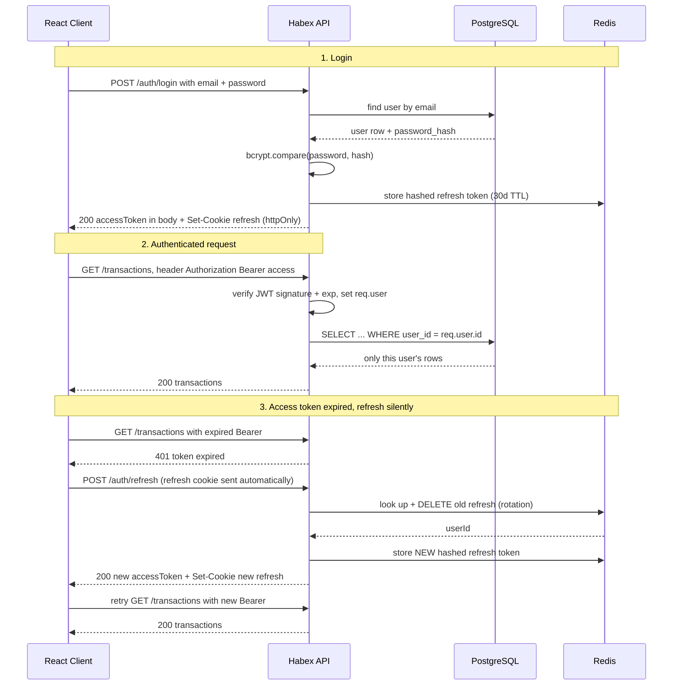

# 12. Authentication

> **One-liner:** Authentication is how your server proves *who* is making a request — signup, login, password hashing with bcrypt, and issuing/verifying JWT access + refresh tokens so every following request carries a trustworthy identity.
> **Where this fits:** This is the hands-on, type-the-code companion to the concept-level [../system-design/20-security-basics.md](../system-design/20-security-basics.md). It builds directly on [05 — Middleware & the Request Lifecycle](05-middleware-and-request-lifecycle.md) (auth is middleware) and [07 — Input Validation & Error Handling](07-input-validation-and-error-handling.md) (login input is untrusted). It sets up [13 — Authorization & Security](13-authorization-and-security.md) (once we know *who* you are, we decide *what* you can do) and uses [14 — Caching with Redis](14-caching-with-redis.md) as the refresh-token store. For Habex this is the feature that turns a demo into a real product with real accounts.

## 1. The Idea in Plain Words

Two words get confused constantly, so pin them once:

- **Authentication (authN)** = *"who are you?"* — proving identity. Logging into Habex with your email and password.
- **Authorization (authZ)** = *"what are you allowed to do?"* — checking permissions. That's chapter 13.

This chapter is **all authN**. The job: after a user proves who they are once, make every later request carry proof of that identity, without asking for the password again.

**The core problem: HTTP is stateless.** Each HTTP request stands on its own — the server does not inherently remember you from the last one (see [../system-design/04-http-and-https.md](../system-design/04-http-and-https.md)). So after you log in, the *next* `GET /transactions` has to re-prove it's still you. There are two schools of thought for that:

- **Sessions (server-side state).** On login the server creates a **session** — a record in its own store (Redis or a DB table) — and hands the browser a **cookie** (a small blob the browser auto-sends on every request) holding an opaque **session ID**. Each request, the server looks up that ID: "ah, this is Santhosh." The server *remembers*; the cookie is just a claim ticket.
- **Tokens (stateless).** On login the server hands you a **token** — a signed string that *contains* your identity. The server stores nothing; each request you send the token and the server verifies the signature to trust it. The standard format is a **JWT** (JSON Web Token). The server *forgets*; the token carries the truth.

| | Sessions (server-side) | JWT / tokens (stateless) |
|---|---|---|
| Server stores state? | Yes — a session store | No — token self-contains claims |
| Revoke instantly? | Yes, delete the session | Hard — valid until it expires |
| Scale to many servers | Needs a **shared** store (Redis) | Trivial — any server can verify |
| Client sees the payload? | No, it's an opaque ID | Yes — base64, **readable** |
| Best fit | Classic server-rendered web apps | APIs, SPAs, mobile, microservices |

Habex is a React SPA calling a JSON API, so we use **JWT**, but with the one refinement that fixes JWT's biggest weakness (no revocation): a **short-lived access token** plus a **long-lived, server-stored refresh token**. You get statelessness on the hot path *and* the ability to log someone out.

**A JWT in one breath:** three base64url parts joined by dots — `header.payload.signature`. The header says the algorithm (`HS256`), the payload holds **claims** (`sub` = user id, `exp` = expiry), and the signature is an HMAC of `header.payload` using a server secret. Verifying = recompute the signature and check it matches, then check `exp`. Critical gotcha: **the payload is only base64-encoded, not encrypted — anyone can read it.** The signature proves it wasn't *changed*, not that it's *secret*. Never put a password or card number in a JWT.

## 2. Why It Matters

- **It's the front door to everything.** Every protected Habex route assumes "I already know who `req.user` is." Get authN wrong and either legitimate users can't get in, or attackers can.
- **It's fintech-adjacent, so correctness is non-negotiable.** Habex holds people's money data. A plaintext-password leak or a forgeable token is a breach, not a bug ticket. CRED and Razorpay interviewers *will* probe password storage and token handling.
- **It's a guaranteed interview block.** "How do you store passwords?", "sessions vs JWT?", "where does the frontend keep the token?", "how do you log a JWT out?" — you should be able to answer all of these while sketching the flow.
- **It's your Habex story.** "I built email/password auth with bcrypt, short access JWTs, and rotating refresh tokens in Redis" is a concrete, senior-sounding sentence you can defend line by line.

## 3. Picture It (Diagram)

Login, then an authenticated request, then a silent refresh when the access token expires:



The access token lives ~15 minutes so a leak has a small window; the refresh token lives weeks but is stored server-side in Redis so it's **revocable** and **rotated** (each use burns the old one).

## 4. Hands-On (TypeScript + Node)

We'll build the whole thing: password hashing, JWT sign/verify, a Redis refresh-token store with rotation, the four routes, and the `requireAuth` middleware.

```bash
npm i bcrypt jsonwebtoken cookie-parser ioredis zod
npm i -D @types/bcrypt @types/jsonwebtoken @types/cookie-parser
```

**The Prisma user model** (money-app data model from the README; `password_hash` maps to a camelCase field):

```prisma
model User {
  id           String   @id @default(uuid())
  email        String   @unique
  passwordHash String   @map("password_hash")
  name         String
  createdAt    DateTime @default(now()) @map("created_at")

  @@map("users")
}
```

**Step 1 — Hash passwords with bcrypt.** Never store the plaintext, and never store a *fast* hash (MD5/SHA-256) either — those are crackable at billions/second. Use a **slow, salted** algorithm. `bcrypt.hash` generates a random **salt** per password and embeds it in the output, so two users with the same password get different hashes (this kills precomputed "rainbow table" attacks). The **cost factor** (a.k.a. work factor / rounds) controls slowness — each `+1` doubles the work.

```ts
// lib/password.ts
import bcrypt from 'bcrypt';

const COST_FACTOR = 12; // ~200-300ms/hash on modern hardware; raise it as CPUs get faster

export function hashPassword(plain: string): Promise<string> {
  return bcrypt.hash(plain, COST_FACTOR); // salt is generated + embedded automatically
}

export function verifyPassword(plain: string, hash: string): Promise<boolean> {
  return bcrypt.compare(plain, hash); // re-derives the salt from `hash`, no separate storage
}

// A precomputed hash so login timing is identical whether or not the email exists.
// Without this, "email not found" returns fast and "wrong password" returns slow —
// leaking which emails are registered (user enumeration).
export const DUMMY_HASH = bcrypt.hashSync('placeholder-not-a-real-password', COST_FACTOR);
```

> **Gotchas:** bcrypt only hashes the **first 72 bytes** of the input — cap password length in validation so long passwords aren't silently truncated. **argon2** (`argon2id`) is the current OWASP first choice because it's *memory-hard* (resists GPU cracking); bcrypt is the battle-tested default and totally fine. Either way: slow + salted. More on the *why* in [../system-design/20-security-basics.md](../system-design/20-security-basics.md).

**Step 2 — Sign & verify JWTs.** Two secrets (access vs refresh) so leaking one doesn't compromise the other. Always **pin the algorithm** on verify — accepting `alg: none` or an attacker-chosen algorithm is a classic signature-bypass.

```ts
// lib/tokens.ts
import jwt from 'jsonwebtoken';

const ACCESS_SECRET = process.env.JWT_ACCESS_SECRET!; // 32+ random bytes, from env, never committed

export interface AccessClaims { sub: string; email: string }

export function signAccessToken(user: { id: string; email: string }): string {
  return jwt.sign(
    { email: user.email },          // custom claims (NOT secret — readable by anyone)
    ACCESS_SECRET,
    { subject: user.id, expiresIn: '15m', algorithm: 'HS256' },
  );
}

export function verifyAccessToken(token: string): AccessClaims {
  const p = jwt.verify(token, ACCESS_SECRET, { algorithms: ['HS256'] }) as jwt.JwtPayload;
  return { sub: p.sub as string, email: p.email as string }; // throws if tampered/expired
}
```

**Step 3 — Refresh tokens in Redis, hashed and rotated.** The refresh token is an **opaque random string**, not a JWT — we *want* server state here so we can revoke it. We store only a **hash** of it (so a leaked Redis dump isn't a pile of usable tokens — same reasoning as password hashing). Each token is one-time-use: `/auth/refresh` deletes the old one and issues a new one (**rotation**). If a token is presented whose id we know but whose secret is wrong, that's a theft signal → we revoke the user's whole token family.

```ts
// lib/refreshStore.ts
import { createHash, randomBytes } from 'node:crypto';
import { redis } from './redis'; // an ioredis client, see chapter 14

const TTL = 60 * 60 * 24 * 30;                              // 30 days, matches refresh lifetime
const sha256 = (s: string) => createHash('sha256').update(s).digest('hex');
const tokKey = (id: string) => `refresh:${id}`;
const userSet = (userId: string) => `refresh-index:${userId}`;

export async function issueRefreshToken(userId: string): Promise<string> {
  const id = randomBytes(16).toString('hex');
  const secret = randomBytes(32).toString('hex');
  const token = `${id}.${secret}`;                         // client sees this; we store its hash
  await redis.multi()
    .set(tokKey(id), JSON.stringify({ userId, hash: sha256(token) }), 'EX', TTL)
    .sadd(userSet(userId), id)                             // index so we can "log out everywhere"
    .expire(userSet(userId), TTL)
    .exec();
  return token;
}

// Returns the userId and rotates (consumes) the token, or null if invalid.
export async function consumeRefreshToken(token: string): Promise<string | null> {
  const [id] = token.split('.');
  if (!id) return null;
  const raw = await redis.get(tokKey(id));
  if (!raw) return null;                                    // unknown, expired, or already used
  const { userId, hash } = JSON.parse(raw) as { userId: string; hash: string };
  if (hash !== sha256(token)) {                            // known id, wrong secret -> theft
    await revokeAllForUser(userId);
    return null;
  }
  await redis.multi().del(tokKey(id)).srem(userSet(userId), id).exec(); // one-time use
  return userId;
}

export async function revokeRefreshToken(token: string): Promise<void> {
  const [id] = token.split('.');
  if (!id) return;
  const raw = await redis.get(tokKey(id));
  if (!raw) return;
  const { userId } = JSON.parse(raw) as { userId: string };
  await redis.multi().del(tokKey(id)).srem(userSet(userId), id).exec();
}

export async function revokeAllForUser(userId: string): Promise<void> {
  const ids = await redis.smembers(userSet(userId));
  await redis.del(userSet(userId), ...ids.map(tokKey));    // logout on every device
}
```

**Step 4 — The four routes.** Notice login returns the *same* generic error whether the email is unknown or the password is wrong, and always runs a bcrypt compare (against `DUMMY_HASH` when the user doesn't exist) so timing doesn't leak which emails are registered.

```ts
// routes/auth.routes.ts
import { Router } from 'express';
import { z } from 'zod';
import { prisma } from '../lib/prisma';
import { hashPassword, verifyPassword, DUMMY_HASH } from '../lib/password';
import { signAccessToken } from '../lib/tokens';
import { issueRefreshToken, consumeRefreshToken, revokeRefreshToken } from '../lib/refreshStore';

export const authRouter = Router();

const creds = z.object({ email: z.string().email(), password: z.string().min(8).max(72) });

const REFRESH_COOKIE = 'habex_refresh';
const cookieOpts = {
  httpOnly: true,                               // JS can't read it -> XSS can't steal it
  secure: process.env.NODE_ENV === 'production',// HTTPS-only in prod
  sameSite: 'strict' as const,                  // not sent cross-site -> blocks CSRF
  path: '/auth',                                // only ever sent to /auth/* routes
  maxAge: 1000 * 60 * 60 * 24 * 30,
};

// POST /auth/signup
authRouter.post('/signup', async (req, res) => {
  const parsed = creds.extend({ name: z.string().min(1) }).safeParse(req.body);
  if (!parsed.success) return res.status(400).json({ error: 'Invalid input' });
  const { email, password, name } = parsed.data;

  if (await prisma.user.findUnique({ where: { email } }))
    return res.status(409).json({ error: 'Email already registered' });

  const user = await prisma.user.create({
    data: { email, name, passwordHash: await hashPassword(password) },
    select: { id: true, email: true, name: true },
  });

  const accessToken = signAccessToken(user);
  res.cookie(REFRESH_COOKIE, await issueRefreshToken(user.id), cookieOpts);
  return res.status(201).json({ user, accessToken });
});

// POST /auth/login
authRouter.post('/login', async (req, res) => {
  const parsed = creds.safeParse(req.body);
  if (!parsed.success) return res.status(400).json({ error: 'Invalid input' });
  const { email, password } = parsed.data;

  const user = await prisma.user.findUnique({ where: { email } });
  const ok = await verifyPassword(password, user?.passwordHash ?? DUMMY_HASH);
  if (!user || !ok) return res.status(401).json({ error: 'Invalid email or password' });

  const accessToken = signAccessToken(user);
  res.cookie(REFRESH_COOKIE, await issueRefreshToken(user.id), cookieOpts);
  return res.json({ user: { id: user.id, email: user.email, name: user.name }, accessToken });
});

// POST /auth/refresh  (rotates the refresh token, returns a fresh access token)
authRouter.post('/refresh', async (req, res) => {
  const presented = req.cookies?.[REFRESH_COOKIE];
  if (!presented) return res.status(401).json({ error: 'No refresh token' });

  const userId = await consumeRefreshToken(presented);
  if (!userId) {
    res.clearCookie(REFRESH_COOKIE, { path: '/auth' });
    return res.status(401).json({ error: 'Invalid refresh token' });
  }
  const user = await prisma.user.findUnique({
    where: { id: userId }, select: { id: true, email: true, name: true },
  });
  if (!user) return res.status(401).json({ error: 'Invalid refresh token' });

  res.cookie(REFRESH_COOKIE, await issueRefreshToken(user.id), cookieOpts); // rotate
  return res.json({ accessToken: signAccessToken(user) });
});

// POST /auth/logout
authRouter.post('/logout', async (req, res) => {
  const presented = req.cookies?.[REFRESH_COOKIE];
  if (presented) await revokeRefreshToken(presented);
  res.clearCookie(REFRESH_COOKIE, { path: '/auth' });
  return res.status(204).end();
});
```

**Step 5 — The `requireAuth` middleware.** It reads the `Authorization: Bearer <token>` header, verifies the access token, and attaches `req.user`. Everything downstream can trust `req.user.id`. (This is a textbook use of the middleware chain from [chapter 05](05-middleware-and-request-lifecycle.md).)

```ts
// middleware/requireAuth.ts
import type { Request, Response, NextFunction } from 'express';
import { verifyAccessToken } from '../lib/tokens';

declare global {                       // teach TypeScript that req.user exists everywhere after this
  namespace Express {
    interface Request { user?: { id: string; email: string } }
  }
}

export function requireAuth(req: Request, res: Response, next: NextFunction) {
  const header = req.headers.authorization;
  if (!header?.startsWith('Bearer '))
    return res.status(401).json({ error: 'Missing bearer token' });
  try {
    const claims = verifyAccessToken(header.slice('Bearer '.length));
    req.user = { id: claims.sub, email: claims.email };
    next();
  } catch {
    return res.status(401).json({ error: 'Invalid or expired token' }); // expired/tampered/malformed
  }
}
```

Wire it up in `app.ts` — note `cookieParser()` so `req.cookies` is populated:

```ts
import cookieParser from 'cookie-parser';
app.use(cookieParser());
app.use('/auth', authRouter);          // public
app.use('/transactions', requireAuth, transactionsRouter); // protected
```

**Where does the React app keep these tokens?** This is *the* frontend follow-up, and it's a trade-off, not a "best":

| Storage | Read by JS? | XSS exposure | CSRF exposure | Verdict |
|---|---|---|---|---|
| `localStorage` | Yes | **High** — any injected script reads it | None (not auto-sent) | Avoid for auth |
| `httpOnly` cookie | No | Low — script can't read it | Needs `SameSite`/CSRF token | Good for the refresh token |
| In-memory JS variable | Yes (only your code) | Gone on refresh/reload | None | Good for the access token |

The pattern this chapter uses: **access token in memory** (a JS variable / React state — short-lived, disappears on reload, re-fetched via `/auth/refresh`), **refresh token in an `httpOnly` + `Secure` + `SameSite=Strict` cookie** (can't be read by a malicious script, and doesn't ride along on cross-site requests). You get XSS resistance on the long-lived secret and no long-term secret sitting in `localStorage`.

## 5. Apply It to Habex

Auth is only worth anything if it actually guards data. The rule for Habex: **every protected route runs `requireAuth`, and every query is scoped to `req.user.id`.** Money is stored as integer `amount_cents`, and each row belongs to exactly one user.

```ts
// routes/transactions.routes.ts  (mounted behind requireAuth)
transactionsRouter.get('/', async (req, res) => {
  const rows = await prisma.transaction.findMany({
    where: { userId: req.user!.id },       // never returns another user's rows
    orderBy: { occurredAt: 'desc' },
  });
  res.json(rows);
});

transactionsRouter.post('/', async (req, res) => {
  // ...validate body with Zod (chapter 07)...
  const tx = await prisma.transaction.create({
    data: { ...input, userId: req.user!.id }, // owner comes from the TOKEN, never the request body
  });
  res.status(201).json(tx);
});
```

Two habits to burn in now:

1. **The owner comes from the verified token (`req.user.id`), never from the request body or a query param.** A client that sends `{ userId: "someone-else" }` must not be able to create rows for another account.
2. **Scoping a *list* by `userId` is authN plumbing; checking ownership on a *single* `/:id` is authZ** — and forgetting it is the #1 real-world bug (IDOR). That's the whole opening of [chapter 13](13-authorization-and-security.md), so we hand off there.

For "log out this device," call `/auth/logout` (revokes that one refresh token). For "log out everywhere" (password change, stolen laptop), call `revokeAllForUser(userId)`. Access tokens already out there stay valid until they expire — that's why they're short-lived.

## 6. Interview Questions (with answer pointers)

**Q1. "How do you store passwords?"** *(all companies — near-guaranteed.)*
Never plaintext, never a fast hash (MD5/SHA-256). Use a **slow, salted** hash — **bcrypt** or **argon2id**. Salt is per-user and embedded, defeating rainbow tables; slowness throttles offline brute-force. Tune the cost factor upward over time. Mention bcrypt's 72-byte limit and that argon2 is memory-hard (current OWASP pick).

**Q2. "Sessions vs JWT — when would you pick each?"** *(CRED, Razorpay.)*
Sessions store state server-side: easy instant revocation, but needs a shared store (Redis) to scale horizontally. JWTs are stateless: any server verifies them with the secret, but you **can't revoke before expiry**. The mature answer is the hybrid I built: short-lived access JWT (statelessness, small leak window) + stored, rotating refresh token (revocation). State the trade-off out loud.

**Q3. "Where should the frontend store the JWT?"** *(CRED, Swiggy — the frontend-dev trap.)*
Not `localStorage` — any XSS reads it. Refresh token → `httpOnly` + `Secure` + `SameSite` cookie (script-proof); access token → in memory. The honest framing: it's *XSS exposure* (localStorage) vs *CSRF handling* (cookies), and you pick cookies + SameSite because XSS is the scarier, more common leak.

**Q4. "How does refresh-token rotation work, and why?"** *(Razorpay, Groww.)*
Each `/auth/refresh` consumes the presented token and issues a new one; the old one is deleted. If an old (already-used) token shows up again, that's a replay/theft signal → revoke the whole family. This shrinks the value of a stolen refresh token to a single use and gives you a detector.

**Q5. "How do you log out a JWT — it's stateless?"** *(CRED, Groww — the gotcha.)*
You can't truly invalidate a signed access token before `exp`; that's why it's short-lived (~15 min). Real logout = revoke the **refresh token** (delete it from Redis) so no new access tokens can be minted, and drop the cookie. For instant global logout you'd add a server-side denylist or a per-user "token version" claim checked on each request — call out that this trades away statelessness.

**Q6. "Walk me through what's inside a JWT and how it's verified."** *(Groww, CRED.)*
`header.payload.signature`, base64url. Verify = recompute the HMAC over `header.payload` with the secret, compare, then check `exp`. Pitfalls: payload is **readable, not encrypted** (no secrets in it); **pin the algorithm** and reject `alg: none`; keep expiry short because you can't revoke.

## 7. Trade-offs & Pitfalls ("Why Not Just X?")

**"Why not just use JWTs for everything — they're stateless and scale great?"** Statelessness *is* the downside for auth: you can't revoke before expiry. A pure-JWT setup can't force-logout a user or kill a leaked token. Hence short access JWT (small window) + stored, revocable refresh token (control). You trade a little statelessness back for revocation.

**"Why not store the JWT in `localStorage`? It's one line."** Any XSS that runs on your page reads `localStorage` and walks off with the token. An `httpOnly` cookie survives XSS (JS can't read it) — but then you must handle CSRF with `SameSite`/tokens. Neither is free; pick the one whose risk you can actually mitigate (cookies + SameSite).

**"Why two secrets / two tokens? Isn't one simpler?"** One long-lived token means one leak = long-lived compromise with no revocation. Splitting into a short access token (used everywhere, easy to leak, low blast radius) and a refresh token (used only at `/auth/refresh`, stored, revocable) contains the damage. Separate secrets mean cracking one doesn't forge the other.

**"Why hash slowly — isn't fast better?"** For passwords, no. Fast hashing helps the attacker who stole your DB try billions of guesses/second. bcrypt/argon2 are deliberately slow (and argon2 memory-hard) so offline cracking crawls. The few hundred ms per legitimate login is the entire point.

**Common pitfalls:** returning different errors/timings for "no such email" vs "wrong password" (user enumeration — use one generic 401 and always run a compare); putting secrets or roles you never re-check in the JWT payload and trusting them forever; forgetting `algorithms: ['HS256']` on verify; storing raw refresh tokens instead of their hash; and the big one — authenticating but never authorizing per-object (chapter 13).

## 8. TL;DR

- **AuthN = who you are** (this chapter); **authZ = what you can do** ([chapter 13](13-authorization-and-security.md)). HTTP is stateless, so every request must re-prove identity.
- **Passwords:** hash with **bcrypt** (or argon2id) + per-user salt + a tuned cost factor. Never plaintext, never fast hashes. `bcrypt.compare` on login.
- **Sessions** (server state, revocable, needs shared store) vs **JWT** (stateless, scales free, hard to revoke). Habex uses the hybrid: **short access JWT + stored, rotating refresh token** in Redis.
- **Four routes:** `/auth/signup`, `/auth/login`, `/auth/refresh` (rotates), `/auth/logout` (revokes). **`requireAuth`** verifies the access token and sets `req.user`.
- **A JWT is `header.payload.signature`** — base64, **not encrypted**; signature proves integrity only. Pin the algorithm, keep expiry short, no secrets in the payload.
- **Frontend storage:** access token **in memory**, refresh token in an **`httpOnly` + `Secure` + `SameSite` cookie**. Avoid `localStorage` for auth.
- **Owner comes from the token, never the request body**, and every Habex query is scoped to `req.user.id`.
- Deeper *why* in [../system-design/20-security-basics.md](../system-design/20-security-basics.md); next, lock down *what each identity may do* in [chapter 13](13-authorization-and-security.md).
