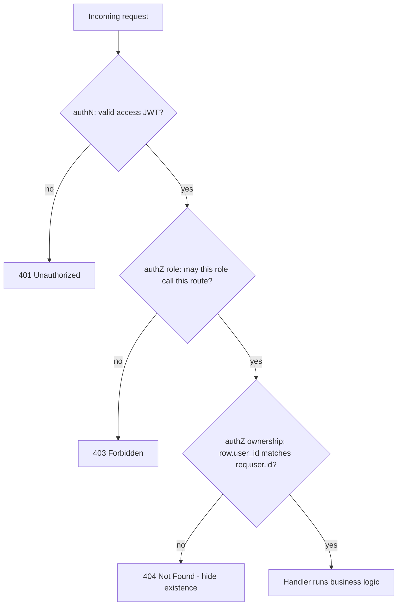

# 13. Authorization & Security

> **One-liner:** Authorization decides *what* an authenticated user may do — the ownership and role checks that stop user A from touching user B's data — and this chapter pairs it with the web-security shortlist (IDOR, injection, XSS, CSRF, CORS, headers, secrets, rate limiting) every backend dev must get right.
> **Where this fits:** This is the hands-on companion to [../system-design/20-security-basics.md](../system-design/20-security-basics.md) and the direct sequel to [12 — Authentication](12-authentication.md): authN told us *who* `req.user` is; now we decide *what they can do*. It leans on [07 — Input Validation & Error Handling](07-input-validation-and-error-handling.md) (untrusted input, safe errors), [10 — Connecting Node to PostgreSQL](10-connecting-node-to-postgres.md) (parameterized queries stop injection), and [14 — Caching with Redis](14-caching-with-redis.md) (a shared rate-limit store). For a fintech-adjacent app like Habex, this is where most real breaches would happen — so it's where interviewers push hardest.

## 1. The Idea in Plain Words

Once [chapter 12](12-authentication.md) has proven *who* you are (`req.user`), **authorization** answers the next question: *are you allowed to do **this**, to **this** resource?* It comes in two flavors, and you need both:

- **Object-level (ownership) authorization** — "is this row yours?" Habex letting you read *your* transactions but not another user's. This is per-resource and it's where apps get breached.
- **Function/role-level authorization** — "is your role allowed to call this endpoint at all?" Only an `admin` may hit `/admin/analytics`. This is per-route.

**The #1 real-world bug: IDOR (Insecure Direct Object Reference), a.k.a. broken object-level authorization.** You're logged in (authN passes), you call `GET /transactions/tx_999`, and the server happily returns it — even though `tx_999` belongs to someone else — because nobody checked ownership. It's dead simple to exploit (just change an id in the URL) and it's consistently at the top of the OWASP list. The fix is a discipline, not a library: **every query that touches a user-owned row must be filtered by `req.user.id`.**

```ts
// VULNERABLE — trusts the id, never checks who owns it (classic IDOR)
const tx = await prisma.transaction.findUnique({ where: { id: req.params.id } });

// SAFE — ownership is part of the query; another user's id simply returns null
const tx = await prisma.transaction.findFirst({ where: { id: req.params.id, userId: req.user.id } });
```

For roles, the standard model is **RBAC (Role-Based Access Control):** each user carries a **role** (`user`, `admin`), each role grants a set of permissions, and the server checks the role before the action. (The finer-grained cousin, **ABAC**, decides from *attributes* — this user, this resource, this amount — but RBAC covers most apps.)

Two principles sit under all of it:

- **Least privilege** — grant the minimum access needed, nothing more. A Habex analytics admin sees *aggregates*, not people's individual transactions.
- **Enforce on the server, every time.** Hiding a button in React is **not** authorization — anyone can `curl` the API directly. The check must live on the backend, on every request.

## 2. Why It Matters

- **Broken access control is the most common serious web vuln.** It sits at #1 on the OWASP Top 10 for a reason: it's easy to introduce (forget one `where` clause) and easy to exploit (change one id).
- **Habex holds money data for every user in one table.** A single missing ownership filter leaks everyone's spending to anyone with an account. That's a breach, not a bug.
- **Security is a full-stack interview screen.** "What's IDOR?", "CORS vs CSRF vs XSS?", "how do you store secrets?", "how do you rate-limit login?" are fintech favorites (CRED, Razorpay, Groww). Getting CORS-is-not-authorization right instantly marks you as more than a frontend dev.
- **The defenses are cheap and mechanical** — a `where` clause, `helmet()`, an allow-list CORS config, a rate limiter, env vars. There's no excuse to skip them, and interviewers know it.

## 3. Picture It (Diagram)

Every protected request runs the same gauntlet: authenticate, then authorize by role, then authorize by ownership, and only then run business logic.



Note the status codes: **401** = we don't know who you are (authenticate). **403** = we know you, but your role can't do this. **404 (not 403)** for a resource that exists but isn't yours — returning 403 would confirm the id exists, a small info leak; 404 reveals nothing. (Either is defensible; say why you chose one.)

## 4. Hands-On (TypeScript + Node)

### 4.1 Ownership checks — the IDOR fix, three ways

The most robust pattern makes ownership **part of the query** so there is no code path that returns a row the user doesn't own.

```ts
// lib/httpError.ts
export class HttpError extends Error {
  constructor(public status: number, message: string) { super(message); }
}

// services/transactions.ts — the query itself is the authorization check
import { prisma } from '../lib/prisma';
import { HttpError } from '../lib/httpError';

export async function getTransactionForUser(id: string, userId: string) {
  const tx = await prisma.transaction.findFirst({ where: { id, userId } });
  if (!tx) throw new HttpError(404, 'Transaction not found'); // not found OR not yours
  return tx;
}
```

For routes that only need a yes/no gate before the handler, a **middleware factory** keeps it DRY across resources. We assume `req.user` was set by `requireAuth` from [chapter 12](12-authentication.md).

```ts
// middleware/requireOwnership.ts
import type { Request, Response, NextFunction } from 'express';
import { prisma } from '../lib/prisma';

// Map the route segment to the Prisma model that owns it.
const OWNED = {
  transactions: prisma.transaction,
  categories:   prisma.category,
  budgets:      prisma.budget,
} as const;

export function requireOwnership(resource: keyof typeof OWNED) {
  return async (req: Request, res: Response, next: NextFunction) => {
    // single `as any`: the delegates share id+userId but their union types don't line up
    const row = await (OWNED[resource] as any).findFirst({
      where: { id: req.params.id, userId: req.user!.id },
      select: { id: true },
    });
    if (!row) return res.status(404).json({ error: 'Not found' }); // block the IDOR here
    next();
  };
}

// usage: another user's id can never reach the handler
transactionsRouter.get('/:id', requireOwnership('transactions'), getTransactionHandler);
transactionsRouter.delete('/:id', requireOwnership('transactions'), deleteTransactionHandler);
```

> **Golden rule:** the owner is always `req.user.id` from the verified token — **never** a `userId` from the request body, query string, or a header the client controls. Trusting client-supplied identity *is* the IDOR bug.

### 4.2 Role-based access control (RBAC)

Add a `role` to the users table, include it in the access-token claims, and have `requireAuth` attach it. Then a tiny middleware gates whole routes:

```ts
// (chapter 12 extended) req.user now carries role
declare global {
  namespace Express {
    interface Request { user?: { id: string; email: string; role: 'user' | 'admin' } }
  }
}

// middleware/requireRole.ts
import type { Request, Response, NextFunction } from 'express';

export function requireRole(...allowed: Array<'user' | 'admin'>) {
  return (req: Request, res: Response, next: NextFunction) => {
    if (!req.user) return res.status(401).json({ error: 'Unauthenticated' });
    if (!allowed.includes(req.user.role))
      return res.status(403).json({ error: 'Forbidden' }); // known user, wrong role
    next();
  };
}

// usage: only admins reach the analytics route
adminRouter.get('/analytics', requireAuth, requireRole('admin'), analyticsHandler);
```

The role must live in a **signed** claim (or be re-read from the DB) — never trust a plain `x-role` header or a value the client can set.

### 4.3 App-wide hardening: helmet, CORS, rate limiting

```bash
npm i helmet cors express-rate-limit rate-limit-redis
```

```ts
// middleware/security.ts
import helmet from 'helmet';
import cors from 'cors';
import rateLimit from 'express-rate-limit';
import type { Express } from 'express';

const ALLOWED = (process.env.CORS_ORIGINS ?? '').split(',').filter(Boolean); // ['https://habex.santhu.site']

export function applySecurity(app: Express) {
  // 1. Security headers: CSP, HSTS, X-Content-Type-Options, X-Frame-Options, etc.
  app.use(helmet());

  // 2. CORS — explicit allow-list, credentials ON so the refresh cookie works.
  //    NEVER pair origin '*' with credentials:true — browsers reject it, and it would
  //    let ANY site make authenticated calls with the user's cookies.
  app.use(cors({ origin: ALLOWED, credentials: true }));

  // 3. Coarse global limit (DoS guard).
  app.use(rateLimit({ windowMs: 60_000, limit: 300, standardHeaders: true, legacyHeaders: false }));
}

// Strict limiter for the auth endpoints — this is a SECURITY control (brute-force / credential stuffing).
export const authLimiter = rateLimit({
  windowMs: 15 * 60_000,
  limit: 10,                              // 10 attempts / 15 min / IP
  message: { error: 'Too many attempts, please try again later' },
});
// apply as: app.use('/auth/login', authLimiter)
```

> In production you run **multiple app instances**, so an in-memory counter is per-instance and leaky. Back the limiter with **Redis** (`rate-limit-redis`) so the count is shared across the fleet — see [14 — Caching with Redis](14-caching-with-redis.md) and the concept detail in [../system-design/18-rate-limiting-pagination-versioning.md](../system-design/18-rate-limiting-pagination-versioning.md).

### 4.4 CSRF, and why Habex's API is mostly immune

Because the access token travels in an **`Authorization: Bearer` header** (not a cookie), a malicious site *can't* forge an authenticated API call — it can't read the token and browsers won't attach a header automatically. The one CSRF surface is the **refresh cookie** on `POST /auth/refresh`, which the browser *does* send automatically. That's already defended by `SameSite=Strict` + `path=/auth` from [chapter 12](12-authentication.md); for defense-in-depth you can also require a custom header (`X-Requested-With`) that cross-site forms can't set. Contrast: **CSRF** abuses a request the browser sends *for* the user; **XSS** runs attacker JS *as* the user. Different attacks, different fixes.

### 4.5 The backend security shortlist (OWASP-ish)

| Risk | What it is | Habex defense | Cross-link |
|---|---|---|---|
| **Broken access control / IDOR** | Access others' rows by changing an id | Scope every query by `req.user.id`; `requireOwnership` | §4.1 |
| **Injection (SQLi)** | Untrusted input becomes SQL | **Parameterized queries** / Prisma — never string-concatenate | [10](10-connecting-node-to-postgres.md) |
| **XSS** | Attacker JS runs in a victim's browser | Escape/encode output (React does by default), CSP via helmet, **httpOnly** cookies so tokens can't be read | [12](12-authentication.md) |
| **CSRF** | Trick a logged-in browser into a request | Bearer-in-header API + `SameSite` refresh cookie | §4.4 |
| **Security misconfig** | Missing headers, verbose errors | `helmet()`, safe error handler | [07](07-input-validation-and-error-handling.md) |
| **Broken CORS** | `*` + credentials, or reflecting any origin | Explicit origin allow-list, credentials only for known origins | §4.3 |
| **Secrets exposure** | Keys hardcoded / committed | Env vars, `.env` git-ignored, rotate on leak | below |
| **Brute force** | Guess passwords/OTPs at scale | Rate limit + lockout + slow hashing (bcrypt) | [14](14-caching-with-redis.md) |
| **Data in transit/at rest** | Sniffing or a stolen disk | HTTPS/TLS everywhere; DB & backup encryption | [../system-design/20-security-basics.md](../system-design/20-security-basics.md) |
| **Sensitive data in errors/logs** | Leaking stack traces, tokens, PII | Generic client errors; redact logs | [07](07-input-validation-and-error-handling.md) |

**Secrets management (do this from day one).** The JWT signing keys, DB URL, and any OAuth `client_secret` live in **environment variables**, loaded from a git-ignored `.env` locally and from the host's secret store (Railway/Render variables, or a manager like Doppler/Vault) in prod. Never hardcode them, never commit them, and **rotate** if one leaks. A JWT secret in your repo = anyone can forge Habex login tokens.

**Don't leak in errors/logs.** Send the client a generic message and a status code; keep the stack trace server-side (the centralized error handler from [chapter 07](07-input-validation-and-error-handling.md)). When logging with pino, **redact** secrets and PII — never log passwords, tokens, or full request bodies:

```ts
import pino from 'pino';
export const logger = pino({
  redact: ['req.headers.authorization', 'req.headers.cookie', '*.password', '*.passwordHash'],
});
```

## 5. Apply It to Habex

Habex's authorization rules, stated plainly — the thing you'd whiteboard in an interview:

| Resource | `user` role | `admin` (analytics) role |
|---|---|---|
| `transactions` | CRUD **only their own** (`where userId = req.user.id`) | **No** access to raw rows |
| `categories` | CRUD only their own | No access to raw rows |
| `budgets` | CRUD only their own | No access to raw rows |
| `recurring_rules` | CRUD only their own | No access to raw rows |
| `/admin/analytics` | **403 Forbidden** | Read-only **aggregates** across all users |

Every user-facing query carries the `userId` filter; there is no endpoint that returns a row without it. The **admin analytics role** is the least-privilege showcase: an admin can see *totals and trends* but never an individual's transactions.

```ts
// routes/admin.routes.ts
adminRouter.get('/analytics', requireAuth, requireRole('admin'), async (_req, res) => {
  // Aggregate only — no user-identifying rows leave the server.
  const [users, totals] = await Promise.all([
    prisma.user.count(),
    prisma.transaction.aggregate({ _sum: { amountCents: true }, _count: true }),
  ]);
  res.json({
    userCount: users,
    transactionCount: totals._count,
    grossVolumeCents: totals._sum.amountCents ?? 0, // money stays in integer cents
  });
});
```

Wiring, top to bottom:

```ts
applySecurity(app);                                  // helmet + cors + global limiter
app.use(cookieParser());
app.use('/auth/login', authLimiter);                 // brute-force guard on login
app.use('/auth', authRouter);                        // public
app.use('/transactions', requireAuth, transactionsRouter); // authN, then per-row ownership inside
app.use('/admin', requireAuth, requireRole('admin'), adminRouter); // authN + role gate
```

The layering to narrate: **transport** (HTTPS/TLS in front, via Railway/Render), **headers** (helmet), **CORS** (allow-list), **rate limit** (Redis-backed), **authN** (`requireAuth`), **role authZ** (`requireRole`), **ownership authZ** (`where userId`), **input validation** (Zod, chapter 07), **safe errors/logs**. Defense in depth — no single check is the whole wall.

## 6. Interview Questions (with answer pointers)

**Q1. "What is IDOR / broken access control, and how do you prevent it?"** *(CRED, Razorpay — top of the list.)*
Accessing another user's resource by changing an id, because the server authenticated you but never checked ownership. Prevent it by making `userId` part of every query (`where: { id, userId: req.user.id }`) so a foreign id returns null → 404, and never trusting a client-supplied owner id. Note it's OWASP #1.

**Q2. "CORS vs CSRF vs XSS — aren't they the same thing?"** *(Swiggy, CRED — the differentiator.)*
No. **XSS** = attacker JS runs in the victim's page (fix: output encoding, CSP, httpOnly cookies). **CSRF** = a site tricks the victim's browser into sending an authenticated request (fix: SameSite cookies / anti-CSRF token). **CORS** is a *browser* rule about which origins may *read* a cross-origin response — **not** an authorization mechanism. Killer point: any non-browser client (curl, Postman) ignores CORS, so the server must still authorize every request; CORS is never your security boundary.

**Q3. "You configured `cors({ origin: '*', credentials: true })` — what happens?"** *(Razorpay.)*
Browsers reject that exact combo, and semantically it would mean "any website may make authenticated calls with the user's cookies" — a giant hole. Use an explicit origin allow-list with `credentials: true` only for origins you trust.

**Q4. "How do you store and manage secrets?"** *(all fintech.)*
Environment variables, never in code or git; `.env` git-ignored locally, the platform's secret store or a manager (Vault/Doppler/AWS Secrets Manager) in prod; rotate on leak; separate secrets per environment. A leaked JWT secret means forgeable tokens, so treat it like a password.

**Q5. "How is rate limiting a security control, not just a scaling one?"** *(CRED, Swiggy.)*
It blunts brute-force and credential-stuffing on login, OTP abuse, and scraping. Cap attempts per IP/account, add backoff/lockout/CAPTCHA on repeated failures, and back the counter with Redis so it's shared across instances. Cross-link [14](14-caching-with-redis.md) and [../system-design/18-rate-limiting-pagination-versioning.md](../system-design/18-rate-limiting-pagination-versioning.md).

**Q6. "RBAC vs ABAC — and where would you draw the line for an admin?"** *(Groww.)*
RBAC = permissions attached to roles (`user`, `admin`); simple, covers most apps. ABAC = decide from attributes (resource owner, amount, time). For Habex: least privilege means the analytics admin sees aggregates only, never individual transactions — the finer the data, the tighter the check.

## 7. Trade-offs & Pitfalls ("Why Not Just X?")

**"Why not just hide the admin buttons / check permissions in React?"** Client-side checks are UX, not security — anyone can call the API directly with curl. Authorization **must** be enforced on the server, on every request. The React check just avoids showing buttons that would 403 anyway.

**"Can't I rely on CORS to protect my API?"** No — the single most common frontend-dev misconception. CORS only restricts what a *browser* lets *other sites' JavaScript* read. curl, Postman, mobile apps, and bots ignore it entirely. It's a guardrail against some cross-site browser abuse, never an authorization layer.

**"Why 404 instead of 403 for someone else's resource?"** 403 confirms the id exists (a small enumeration leak); 404 reveals nothing about whether the resource is real. Both are valid — the point is to have a reason. Be consistent so timing/shape doesn't leak either.

**"Why put the `userId` in every query instead of one central check?"** Because a central "load then compare" is easy to forget on a new endpoint, and a forgotten check is an IDOR. Baking `userId` into the `where` clause means the *default* path is safe and there's no unowned row to accidentally return. Combine with a shared `requireOwnership`/service helper so it's one line, not copy-paste.

**"Isn't RBAC enough — why also do per-row ownership?"** They answer different questions. RBAC gates *which endpoints* a role can hit; ownership gates *which rows* within an endpoint. A `user` is allowed to call `GET /transactions/:id` (role check passes) but only for *their* transactions (ownership check). Skip either and you have a hole.

**Common pitfalls:** trusting a `userId`/`role` from the request body or an unsigned header; forgetting the ownership filter on a newly added route; `origin: '*'` with credentials; an in-memory rate limiter that resets per instance and per deploy; leaking stack traces or tokens in error responses/logs; and treating the React UI as the enforcement point.

## 8. TL;DR

- **AuthZ = what an authenticated user may do.** Two layers: **role** (which routes) and **ownership** (which rows). You need both.
- **IDOR / broken access control is the #1 real bug.** Fix = **every query filtered by `req.user.id`** (`where: { id, userId }`), and the owner always comes from the **token**, never client input.
- **RBAC:** a signed `role` claim + a `requireRole` middleware gates whole routes (e.g. admin-only analytics). Least privilege: admin sees **aggregates**, not individuals' data.
- **Status codes:** 401 = not authenticated, 403 = wrong role, 404 = exists but not yours (hide existence).
- **Harden the app:** `helmet()` for headers, **allow-list CORS** (never `*` + credentials), **Redis-backed rate limiting** on login as a security control.
- **Know the attack/defense pairs:** IDOR → ownership checks; SQLi → parameterized queries ([10](10-connecting-node-to-postgres.md)); XSS → output encoding + httpOnly cookies; CSRF → SameSite + Bearer-in-header; secrets → env vars + rotation; brute force → rate limit + slow hashing.
- **Don't leak in errors/logs** (generic client errors, redact secrets/PII — [07](07-input-validation-and-error-handling.md)), and encrypt **in transit** (HTTPS/TLS) and **at rest**.
- Concept-level depth in [../system-design/20-security-basics.md](../system-design/20-security-basics.md); this chapter is how you actually wire it into the Habex backend on top of [chapter 12](12-authentication.md).
