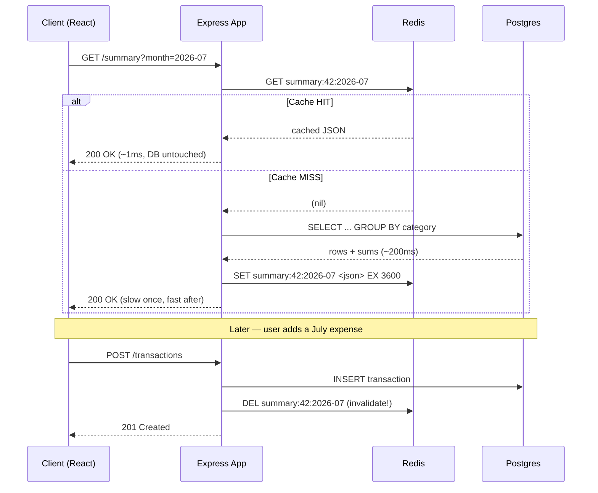

# 14. Caching with Redis

> **One-liner:** Redis is an in-memory key-value store; the **cache-aside** pattern lets Habex serve an expensive dashboard aggregate from RAM in ~1ms instead of re-running a heavy `GROUP BY` on Postgres every single time.
> **Where this fits:** This is the **hands-on** build of the concepts in [../system-design/07-caching.md](../system-design/07-caching.md) — go there for the deep *why* (hit rates, eviction theory, the five cache layers); here you'll *wire Redis into the Habex code*. It sits right after [10 — Connecting Node to Postgres](10-connecting-node-to-postgres.md) and [11 — Transactions & Query Performance](11-transactions-and-query-performance.md) (you cache the expensive queries you just learned to write), and the same Redis box you stand up here powers sessions/refresh tokens ([12 — Authentication](12-authentication.md)), rate limiting ([13 — Authorization & Security](13-authorization-and-security.md)), and background jobs ([15 — Background Jobs & Queues](15-background-jobs-and-queues.md)).

---

## 1. The Idea in Plain Words

Let's define the star of the chapter before anything else.

> **Redis** ("REmote DIctionary Server") is an **in-memory key-value store**: a database that keeps all its data in **RAM** (not on disk) and hands it back by **key**, like a giant `Map<string, value>` living in its own process that every one of your servers can talk to over the network.

Two terms, defined once:

- **In-memory** = the data lives in RAM. RAM reads take *nanoseconds*; spinning-disk/SSD reads and a full SQL query take *milliseconds*. That gap — often **100–200×** — is the entire reason Redis is fast.
- **Key-value store** = you don't write `SELECT ... WHERE ... JOIN ...`. You say `GET summary:42:2026-07` and get one blob back. No query planner, no joins, no scanning rows — just "look up this key." Simple *is* the feature.

**Why Redis is so fast, in one breath:** data in RAM (no disk seek), a dead-simple lookup model (no query planning), and a single-threaded event loop that runs each command to completion with no locking overhead. You trade SQL's power for raw speed on a narrow job: "give me the value for this key, now."

### The cache-aside pattern

A **cache** is a small fast store holding *copies* of expensive-to-produce data (full theory in [07](../system-design/07-caching.md)). **Cache-aside** (also called *lazy loading*) is the pattern you'll reach for 90% of the time. Your application manages the cache "on the side":

1. **Read** → ask Redis first.
2. **Hit** (the value was there) → return it. Postgres never wakes up.
3. **Miss** (not there) → run the expensive Postgres query, **store the result in Redis with a TTL**, and return it. The *next* read within that window is a hit.

> **TTL** = *time-to-live*, the number of seconds a key is allowed to live before Redis auto-deletes it. It's your safety net: even if you forget to update a cached value, it can't be wrong for longer than its TTL.

That's the whole loop. The cache is a dumb fast box; your code decides when to fill it and when to throw copies away.

---

## 2. Why It Matters

Habex is **read-heavy**: you open the dashboard dozens of times a day and add an expense only now and then. Every dashboard open re-runs the same expensive monthly aggregation over hundreds of transaction rows. That is the textbook thing to cache.

Put numbers on it. Say the monthly-summary query costs **200ms** on Postgres and the same answer costs **1ms** from Redis:

| | No cache | Cache-aside @ 95% hit rate |
|---|---|---|
| Average read latency | 200ms | (0.95 × 1ms) + (0.05 × 200ms) ≈ **11ms** |
| Postgres load | 100% of reads | **5%** of reads |
| Cost when traffic 10× | DB melts | Redis shrugs; DB still sees ~5% |

Same data, ~18× faster on average, and your database does one-twentieth of the work — which is exactly what lets you scale reads by adding stateless app servers ([../system-design/06](../system-design/06-scaling-vertical-vs-horizontal.md)).

And Redis is **more than a cache**. The same box you deploy for caching also gives Habex:

| Use | Redis feature | Cross-link |
|---|---|---|
| Cache expensive aggregates | `GET`/`SET` + TTL | this chapter |
| Session / refresh-token store | keyed blobs with TTL | [12 — Authentication](12-authentication.md) |
| Rate limiting | `INCR` + `EXPIRE` | [13](13-authorization-and-security.md), [../system-design/18](../system-design/18-rate-limiting-pagination-versioning.md) |
| Background job queue | lists / streams (via BullMQ) | [15 — Background Jobs](15-background-jobs-and-queues.md) |
| Leaderboards / counters | sorted sets (`ZADD`/`ZREVRANGE`) | §5 below |

**Interview reality:** Zepto and Swiggy live and die on caching (millions of catalog/menu reads per minute). "How would you make this endpoint faster?" almost always wants "cache-aside with Redis" as the first sentence. This chapter makes sure you can also *write it*.

---

## 3. Picture It (Diagram)

The cache-aside read, both branches, as a sequence:



Read it as two stories. **Top:** the read fills the cache on a miss and serves from it on a hit. **Bottom:** a *write* must **delete the now-stale key** so the next read recomputes. That `DEL`-on-write is cache **invalidation** — the genuinely hard part, and the line most beginners forget.

---

## 4. Hands-On (TypeScript + Node)

We'll use **ioredis** (the standard Redis client for Node, and the one BullMQ needs in [15](15-background-jobs-and-queues.md), so one client serves both).

```bash
npm i ioredis
```

### 4.1 A Redis client singleton

You want **one** shared connection for the whole process. Redis multiplexes commands over a single TCP socket — a new client per request would exhaust connections fast.

```ts
// src/lib/redis.ts
import Redis from 'ioredis';
import { env } from '../config/env';
import { logger } from './logger';

// One shared connection for the whole app process.
export const redis = new Redis(env.REDIS_URL, {
  // Fail a command after a few tries instead of queueing forever if Redis is down.
  maxRetriesPerRequest: 3,
});

// A cache outage must never crash the app — log it and let callers fall back to the DB.
redis.on('error', (err) => logger.error({ err }, 'redis connection error'));
redis.on('connect', () => logger.info('redis connected'));
```

### 4.2 A generic cache-aside helper

Wrap the pattern once so every cached read is a one-liner and Redis outages degrade to "slower," never "broken."

```ts
// src/lib/cache.ts
import { redis } from './redis';
import { logger } from './logger';

/**
 * Cache-aside: try Redis, and on a miss run `loader()` (the slow DB work),
 * store the JSON result with a TTL, and return it.
 * If Redis is unreachable we log and fall through to `loader()` — a cache
 * outage should slow the app, not break it.
 */
export async function cacheAside<T>(
  key: string,
  ttlSeconds: number,
  loader: () => Promise<T>,
): Promise<T> {
  try {
    const cached = await redis.get(key);
    if (cached !== null) return JSON.parse(cached) as T; // HIT
  } catch (err) {
    logger.warn({ err, key }, 'cache read failed; falling back to DB');
  }

  const fresh = await loader(); // MISS → do the slow work once

  try {
    // Add up to 30s of jitter so a burst of keys never expires in lockstep (see §7).
    const ttl = ttlSeconds + Math.floor(Math.random() * 30);
    await redis.set(key, JSON.stringify(fresh), 'EX', ttl);
  } catch (err) {
    logger.warn({ err, key }, 'cache write failed'); // not fatal — we still return `fresh`
  }

  return fresh;
}
```

### 4.3 A cached `getMonthlySummary(userId, month)`

The expensive read: sum a month of transactions grouped by category. This is the exact `GROUP BY` from [11](11-transactions-and-query-performance.md), now cached.

```ts
// src/services/summary.service.ts
import { prisma } from '../lib/prisma';
import { cacheAside } from '../lib/cache';

export interface MonthlySummary {
  month: string;              // 'YYYY-MM'
  totalSpentCents: number;    // integer cents — never floats (fintech rule!)
  byCategory: { categoryId: number; name: string; totalCents: number }[];
  computedAt: string;
}

// One canonical key builder so read and invalidation can never disagree.
export const summaryKey = (userId: number, month: string) => `summary:${userId}:${month}`;

/** Public API: cache-aside wrapper around the expensive aggregate, TTL 1 hour. */
export function getMonthlySummary(userId: number, month: string): Promise<MonthlySummary> {
  return cacheAside(summaryKey(userId, month), 3600, () => computeMonthlySummary(userId, month));
}

async function computeMonthlySummary(userId: number, month: string): Promise<MonthlySummary> {
  // month = 'YYYY-MM' → half-open range [first-of-month, first-of-next-month).
  const start = new Date(`${month}-01T00:00:00.000Z`);
  const end = new Date(start);
  end.setUTCMonth(end.getUTCMonth() + 1);

  // The expensive part: GROUP BY category + SUM(amount_cents).
  const grouped = await prisma.transaction.groupBy({
    by: ['categoryId'],
    where: { userId, kind: 'expense', occurredAt: { gte: start, lt: end } },
    _sum: { amountCents: true },
  });

  const categories = await prisma.category.findMany({
    where: { userId },
    select: { id: true, name: true },
  });
  const nameById = new Map(categories.map((c) => [c.id, c.name]));

  const byCategory = grouped.map((g) => ({
    categoryId: g.categoryId,
    name: nameById.get(g.categoryId) ?? 'Uncategorized',
    totalCents: g._sum.amountCents ?? 0,
  }));

  return {
    month,
    totalSpentCents: byCategory.reduce((s, c) => s + c.totalCents, 0),
    byCategory,
    computedAt: new Date().toISOString(),
  };
}
```

### 4.4 Invalidation on write (the hard part)

When a transaction is created, the cached summary for *that user, that month* is now wrong. Delete exactly that key — surgical, not "flush everything."

```ts
// src/services/transaction.service.ts
import { prisma } from '../lib/prisma';
import { redis } from '../lib/redis';
import { summaryKey } from './summary.service';

const monthOf = (d: Date) => d.toISOString().slice(0, 7); // 'YYYY-MM'

export async function createTransaction(input: {
  userId: number; categoryId: number; amountCents: number;
  kind: 'income' | 'expense'; note?: string; occurredAt: Date;
}) {
  const tx = await prisma.transaction.create({ data: input });

  // Invalidate only the summary this write can affect. Next read recomputes once.
  // (Do this AFTER the DB commit — never delete the cache for a write that failed.)
  await redis.del(summaryKey(input.userId, monthOf(input.occurredAt)));

  return tx;
}
```

> **Delete, don't update.** You *could* recompute-and-`SET` the new summary here, but deleting is simpler and safe: it can never write a *wrong* value, and the next reader rebuilds it. Recompute-on-write only pays off for keys read far more often than the write frequency.

### 4.5 A tiny Redis rate-limit middleware

Redis's atomic `INCR` (increment a counter, returns the new value) plus `EXPIRE` gives you a fixed-window rate limiter in ~15 lines — the hands-on version of [../system-design/18](../system-design/18-rate-limiting-pagination-versioning.md).

```ts
// src/middleware/rate-limit.ts
import type { Request, Response, NextFunction } from 'express';
import { redis } from '../lib/redis';

/** At most `max` requests per `windowSec`, per user (or IP), per route. */
export function rateLimit(max: number, windowSec: number) {
  return async (req: Request, res: Response, next: NextFunction) => {
    const id = (req as any).userId ?? req.ip;      // user if logged in, else IP
    const key = `ratelimit:${id}:${req.path}`;

    try {
      const hits = await redis.incr(key);          // atomic +1, returns new count
      if (hits === 1) await redis.expire(key, windowSec); // start the window on first hit
      if (hits > max) {
        const ttl = await redis.ttl(key);
        res.setHeader('Retry-After', String(ttl));
        return res.status(429).json({ error: 'Too Many Requests', retryAfter: ttl });
      }
      return next();
    } catch {
      return next(); // fail OPEN: if Redis is down, don't lock everyone out
    }
  };
}
// Usage: app.post('/auth/login', rateLimit(5, 60), loginHandler); // 5 logins/min
```

> **Subtle bug worth naming in interviews:** if the process dies *between* `INCR` and `EXPIRE`, the key never expires and that user is blocked forever. The robust fix is to make both atomic — a tiny Lua script, or `SET key 1 EX windowSec NX` then `INCR`. Mentioning this shows you've actually run one in production.

---

## 5. Apply It to Habex

**What to cache — the expensive, read-heavy, change-rarely reads:**

| Read | Why it's a cache target | Key | TTL | Invalidate when |
|---|---|---|---|---|
| Monthly summary (dashboard) | Heavy `GROUP BY`, opened constantly | `summary:{uid}:{yyyy-mm}` | ~1h | any transaction in that user+month is added/edited/deleted |
| Category breakdown / charts | Same aggregate, different shape | `charts:{uid}:{yyyy-mm}` | ~1h | same as above |
| Budget-vs-spent status | Joins budgets + summed spend | `budget:{uid}:{yyyy-mm}` | ~5m | transaction write, or budget change |
| User profile (rarely changes) | Read on every page | `user:{uid}` | ~1h | profile update |

**Keeping them fresh — the two-layer strategy:**

1. **Delete-on-write** for precision: any transaction mutation runs `DEL summary:{uid}:{month}` (and the sibling chart/budget keys). The very next dashboard load recomputes once and re-warms the cache.
2. **TTL as a safety net:** even if you miss an invalidation path (say a bulk import), the key self-heals within its TTL. Correctness never depends *only* on you remembering to invalidate.

**Choosing the TTL** is a dial between freshness and hit rate: too long = stale, too short = pointless. Match it to how stale the feature can tolerably be — a dashboard being up to a minute old is fine; a live account balance is not (skip the cache or use write-through there).

**Other Redis uses in Habex:**

- **Session / refresh-token store** ([12](12-authentication.md)): store refresh tokens as `refresh:{jti}` → userId with a TTL equal to the token's lifetime. Logout = `DEL` the key (instant revocation — a stateless JWT alone can't do that). Sessions in *shared* Redis (not one server's memory) are what let Habex run several stateless app servers behind a load balancer.
- **Rate limiter** ([13](13-authorization-and-security.md)): the `INCR`+`EXPIRE` middleware above — protect `/auth/login` and `/auth/signup` from brute-force and abuse.
- **Leaderboard / counters:** a fun Habex feature — a "longest streak" board across users via a **sorted set**: `ZADD habit:streaks 12 user:42`, then `ZREVRANGE habit:streaks 0 9 WITHSCORES` for the top 10. `INCR` also gives cheap counters ("expenses logged today") without a DB write per bump.

---

## 6. Interview Questions (with answer pointers)

**Q1. What is Redis and why is it fast? (warm-up — everyone)**
> An in-memory key-value store. Fast because data lives in RAM (no disk seek), the access model is a simple keyed lookup (no query planning or joins), and a single-threaded event loop runs each command to completion without locking overhead. Often 100–200× faster than a SQL query for the same lookup.

**Q2. Walk me through cache-aside. Why is it the default? (Swiggy, Zepto)**
> Read: check Redis; hit → return; miss → query Postgres, `SET` the result with a TTL, return. The app owns the cache "on the side." Default because it's simple, only caches data actually requested (no wasted RAM), and degrades gracefully — if Redis is down you just hit the DB. Downsides: first read per key is a cold miss, and hot-key expiry risks a stampede.

**Q3. Cache-aside vs write-through — when each? (CRED, Razorpay)**
> Cache-aside populates the cache lazily on read misses; write-through writes cache **and** DB together on every write so the cache is never stale. Write-through costs a slower write and only helps data you re-read soon after writing. Most systems use cache-aside reads + explicit delete-on-write. For money you must show exactly, prefer write-through or skip the cache — never risk serving a stale balance.

**Q4. TTL vs explicit invalidation — how do you keep a cache fresh? (Groww, Razorpay)**
> TTL = accept bounded staleness with zero coordination (great for dashboards). Explicit invalidation = `DEL` the affected keys on write for precision, but you must remember *every* key a change touches or it's stale forever. Best practice is both: delete-on-write for correctness, plus a TTL as a self-healing backstop.

**Q5. What should and shouldn't you cache? (Zepto, Swiggy)**
> Cache read-heavy, change-rarely, staleness-tolerant data (Habex monthly summaries, catalog/menu data, user profiles). Don't cache data that changes every second (stale instantly), data read once and never again (wastes RAM), or values that must be exact-to-the-rupee unless via write-through.

**Q6. What's a cache stampede and how do you prevent it? (Zepto, Swiggy — the scale question)**
> A hot key expires and thousands of simultaneous requests all miss and slam the DB at once, possibly crushing it. Prevent with **single-flight/locking** (one request rebuilds the key while others wait or get stale), **jittered TTLs** so keys don't expire in lockstep, and **serving slightly-stale data** while a background worker refreshes.

**Q7. How would you build a rate limiter with Redis? (CRED — security angle)**
> Fixed window: `INCR ratelimit:{id}:{route}`; on the first hit set `EXPIRE windowSec`; reject when the count exceeds the limit. Make `INCR`+`EXPIRE` atomic (Lua) so a crash between them can't strand the key. For smoother limits use a sliding-window log (a sorted set of timestamps) or token bucket. Fail open so a Redis outage doesn't lock out all users.

---

## 7. Trade-offs & Pitfalls ("Why Not Just X?")

**"Why not cache *everything* and never touch Postgres?"**
Because a cache holds *copies*, and copies go stale. Cache fast-changing data → you serve wrong answers; cache data nobody re-reads → you waste RAM and evict the stuff that matters. Cache the read-heavy, change-rarely, staleness-tolerant slice only.

**"Why not just add a Postgres index instead of a cache?"**
Do both — they solve different problems. An index ([11](11-transactions-and-query-performance.md)) speeds up a query; a cache **skips the query entirely** and lives in RAM, so it's usually 100–200× faster *and* it takes load off the DB (protecting writes too). Index first so the cold-miss path is fast; cache on top of that for the hot path.

**"Why not a local in-process cache (just a JS `Map`) instead of Redis?"**
An in-process `Map` is even faster (no network hop) — but with N app servers you get N *different* copies that disagree, and invalidation must fan out to all of them. That reintroduces the state problem that stops you scaling horizontally. Common answer: a tiny local cache for immutable hot data + shared Redis for anything that must be consistent across servers.

**"Why not set a huge TTL everywhere for a giant hit rate?"**
Longer TTL = higher hit rate *and* more staleness. It's a dial, not a free win. Set each key's TTL to its real staleness tolerance and use explicit invalidation for anything that must be fresh-on-change.

**Pitfalls to name out loud:**

| Pitfall | What happens | Fix |
|---|---|---|
| **Stale data** | Cached copy no longer matches DB | TTL + delete-on-write |
| **Stampede / thundering herd** | Hot key expires → simultaneous misses crush DB | single-flight lock, jittered TTL, serve-stale |
| **Cache penetration** | Requests for non-existent keys bypass cache, hit DB every time | cache the "not found" with a short TTL; Bloom filter |
| **Invalidation miss** | You forgot a key a write touches → stale forever | central key-builder (`summaryKey`), TTL backstop |
| **Caching money as authoritative** | Serve a stale balance | write-through or skip the cache |

---

## 8. TL;DR

- **Redis** = an in-memory key-value store; fast because RAM + simple keyed lookups + a single-threaded no-lock loop (often 100–200× a SQL query).
- **Cache-aside** = read Redis → hit returns fast → miss queries Postgres, `SET`s with a TTL, returns. The app manages the cache; a Redis outage should degrade to "slower," not "broken" (fall back to the DB).
- **TTL** bounds staleness with zero coordination; **delete-on-write** invalidation gives precision. Use **both** — delete for correctness, TTL as a self-healing backstop. This is the theory of [../system-design/07](../system-design/07-caching.md) turned into Habex code.
- In Habex, cache the **monthly summary / dashboard aggregates** (`summary:{uid}:{yyyy-mm}`, TTL ~1h) and `DEL` the key whenever a transaction in that user+month changes.
- Same Redis box also does **sessions/refresh tokens** ([12](12-authentication.md)), **rate limiting** via `INCR`+`EXPIRE` ([13](13-authorization-and-security.md), [../system-design/18](../system-design/18-rate-limiting-pagination-versioning.md)), **leaderboards/counters**, and the **job queue** in [15 — Background Jobs & Queues](15-background-jobs-and-queues.md).
- Watch for **stampede** (jitter + single-flight), **penetration** (cache negatives), and never cache a value you must show exactly. Zepto/Swiggy interviews open with "add a cache" — now you can also write it.
