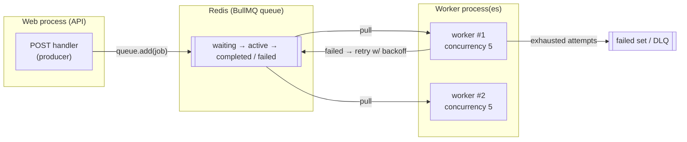
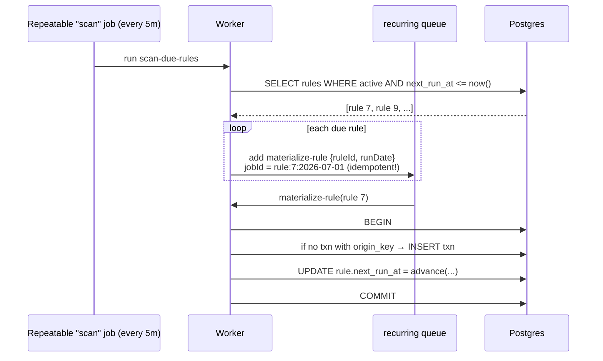

# 15. Background Jobs & Queues

> **One-liner:** Move slow, flaky, or *scheduled* work off the request path onto a **queue**, and let separate **worker** processes do it reliably with automatic retries — this is how Habex generates recurring transactions and mails monthly reports without ever making a user wait.
> **Where this fits:** The **hands-on** build of [../system-design/15 — Message Queues & Pub-Sub](../system-design/15-message-queues-and-pubsub.md) (go there for the *why* of async). It stands on the Redis you set up in [14 — Caching with Redis](14-caching-with-redis.md) (BullMQ stores jobs in Redis), the DB transactions from [11 — Transactions & Query Performance](11-transactions-and-query-performance.md), and the event-loop intuition from [02 — Node Runtime & Event Loop](02-nodejs-runtime-and-event-loop.md). The **idempotency** discipline here is the code form of [../system-design/19 — Reliability Patterns](../system-design/19-reliability-patterns.md), and running the worker as its own process points forward to [19 — Docker](19-docker-and-containers.md) and [20 — Deployment](20-deployment-and-devops.md).

---

## 1. The Idea in Plain Words

Every endpoint you've written so far is **synchronous**: the client waits while the server does *everything*, then replies. That's fine for "save a row." It's a disaster for slow, flaky, or scheduled work.

- **Slow:** rendering a PDF report or calling an email provider can take seconds. The user shouldn't stare at a spinner for that.
- **Flaky:** the email API might be down for 3 seconds. That must **not** fail the user's request — it should just retry later.
- **Scheduled:** "generate this month's recurring rent expense on the 1st" isn't triggered by any user request at all. Nobody is waiting; it just has to *happen*.

The answer to all three is to do the work **outside the request**, asynchronously. The tool is a **job queue**. Vocabulary, each defined once:

- **Job** (or *message*) — a small packet describing work to do: `{ "type": "send-report", "userId": 42, "month": "2026-06" }`.
- **Producer** — the code that *creates* a job and drops it on the queue. Usually your Express handler. It returns to the user immediately.
- **Queue** — a durable line of pending jobs (here, stored in **Redis**). It remembers jobs even if everything else restarts.
- **Worker** (or *consumer*) — a **separate process** that pulls jobs off the queue and actually does the work, one or several at a time.

> The mental model: the web process says "here's a note, someone deal with it" and replies to the user in milliseconds. The worker process picks the note up a moment later and does the slow part. They talk only through the queue.

**BullMQ** is the standard Node library for this. It implements the producer/queue/worker model **on top of Redis** — the same Redis you already run for caching ([14](14-caching-with-redis.md)) — and adds the production-grade features you'd otherwise hand-roll: retries with backoff, delayed jobs, repeatable/cron jobs, concurrency, and a dead-letter list for jobs that keep failing.

---

## 2. Why It Matters

Three payoffs, and Habex needs all three:

| Payoff | Without a queue | With a queue |
|---|---|---|
| **Fast responses** | `POST /transactions` waits for email + push → 3s | Save row, enqueue, reply in ~20ms; email happens later |
| **Resilience via retries** | Email API blips → user's request 500s | Job auto-retries with backoff; user never noticed |
| **Scheduling** | A `while(true)`/cron on one box, no retries, dies with the box | Repeatable jobs + durable queue survive restarts |

There's an event-loop reason too ([02](02-nodejs-runtime-and-event-loop.md)): Node handles concurrency on a **single thread**. A burst of CPU-heavy or slow-IO work done inline blocks *every other request* on that process. Pushing it to a worker keeps the web process's event loop free to answer users.

**Habex's natural async workload:**

| Work | Trigger | Why it belongs off the request path |
|---|---|---|
| Generate recurring transactions | Schedule (`next_run_at` due) | No user is waiting; must be exactly-once *in effect* |
| Budget-exceeded alerts | After a transaction pushes spend over budget | Sending a notification shouldn't slow the write |
| Monthly report emails | 1st of the month, per user | Thousands of slow email calls; must retry failures |
| Dashboard aggregate warming | After writes / on a timer | Recompute + cache off the hot path ([14](14-caching-with-redis.md)) |

**Interview reality:** CRED and Razorpay probe **idempotency** hard here (§4.5, §6) — "a job may run twice; how do you make sure Habex never double-charges or double-inserts?" is a near-guaranteed follow-up.

---

## 3. Picture It (Diagram)

**The core model** — producer drops a job in Redis, one of several workers picks it up:



**The recurring-transaction flow** — a repeatable "scan" heartbeat fans out one small job per due rule:



The split matters: the scan stays tiny (just IDs), and each rule becomes its **own independently-retryable job**. If rule 9 fails, rule 7 is unaffected.

---

## 4. Hands-On (TypeScript + Node)

```bash
npm i bullmq ioredis
```

### 4.1 The BullMQ connection (the #1 gotcha)

BullMQ uses **blocking** Redis commands to wait for jobs. Its connection therefore **must** set `maxRetriesPerRequest: null`, or ioredis aborts the blocking call and BullMQ throws. Use a connection *separate* from your cache client from [14](14-caching-with-redis.md).

```ts
// src/queues/connection.ts
import IORedis from 'ioredis';
import { env } from '../config/env';

// maxRetriesPerRequest MUST be null for BullMQ's blocking commands. #1 setup gotcha.
export const bullConnection = new IORedis(env.REDIS_URL, {
  maxRetriesPerRequest: null,
});
```

### 4.2 Declaring queues (producers)

```ts
// src/queues/index.ts
import { Queue } from 'bullmq';
import { bullConnection } from './connection';

// One queue per kind of work. The name is any stable string.
export const recurringQueue = new Queue('recurring', { connection: bullConnection });
export const emailQueue = new Queue('email', { connection: bullConnection });
```

Enqueuing a job is now a one-liner from any handler — and it returns instantly:

```ts
// inside a route, after saving something:
await emailQueue.add(
  'monthly-report',
  { userId, month },
  { attempts: 3, backoff: { type: 'exponential', delay: 5000 } }, // retry policy
);
// user gets their 200 immediately; the email is sent by a worker later.
```

> **Retries + backoff:** `attempts: 3` means "try up to 3 times." `backoff: exponential, delay 5000` waits 5s, then 10s, then 20s between tries — **exponential backoff** avoids hammering a struggling downstream service. Without backoff, retries can turn a blip into a self-inflicted flood.

### 4.3 A repeatable (cron) scan job

A **repeatable job** re-enqueues itself on a schedule — BullMQ's cron. Register it once at worker startup.

```ts
// src/queues/schedulers.ts
import { recurringQueue } from './index';

export async function registerSchedulers() {
  await recurringQueue.add(
    'scan-due-rules',
    {},
    {
      // Cron pattern: every 5 minutes. BullMQ derives a stable "repeat key" from
      // name + pattern, so calling this on every boot won't stack duplicate timers.
      repeat: { pattern: '*/5 * * * *' },
      removeOnComplete: true,
      removeOnFail: 100, // keep the last 100 failures for inspection
    },
  );
}
```

### 4.4 The worker (concurrency, events)

A worker is a long-running process. `concurrency: 5` means it processes up to 5 jobs at once; add more worker *processes* to scale horizontally.

```ts
// src/workers/recurring.worker.ts
import { Worker, Job } from 'bullmq';
import { bullConnection } from '../queues/connection';
import { recurringQueue } from '../queues';
import { prisma } from '../lib/prisma';
import { logger } from '../lib/logger';

export const recurringWorker = new Worker(
  'recurring',
  async (job: Job) => {
    if (job.name === 'scan-due-rules') return scanDueRules();
    if (job.name === 'materialize-rule') return materializeRule(job.data.ruleId, job.data.runDate);
    throw new Error(`unknown job: ${job.name}`);
  },
  { connection: bullConnection, concurrency: 5 },
);

recurringWorker.on('completed', (job) => logger.info({ id: job.id, name: job.name }, 'job done'));
recurringWorker.on('failed', (job, err) =>
  logger.error({ id: job?.id, name: job?.name, attempts: job?.attemptsMade, err }, 'job failed'),
);

/** Heartbeat: find due rules and fan out one small, retryable job per rule. */
async function scanDueRules() {
  const now = new Date();
  const due = await prisma.recurringRule.findMany({
    where: { active: true, nextRunAt: { lte: now } },
    select: { id: true, nextRunAt: true },
  });

  await Promise.all(
    due.map((rule) =>
      recurringQueue.add(
        'materialize-rule',
        { ruleId: rule.id, runDate: rule.nextRunAt.toISOString() },
        {
          // IDEMPOTENCY at enqueue: jobId = rule + the exact run it's for.
          // If the scan runs twice (overlap/retry), the duplicate add is a no-op.
          jobId: `rule:${rule.id}:${rule.nextRunAt.toISOString()}`,
          attempts: 5,
          backoff: { type: 'exponential', delay: 1000 },
          removeOnComplete: true,
        },
      ),
    ),
  );
  return { enqueued: due.length };
}
```

### 4.5 Idempotency — the part CRED/Razorpay grill you on

BullMQ (like almost every queue) is **at-least-once**: a job is guaranteed to run, but under a crash-and-retry it *may run more than once*. So the handler must be **idempotent** — running it twice has the same effect as running it once. For Habex that means: **never insert the same recurring transaction twice, and never advance the schedule twice.**

Two guards, belt-and-suspenders:

1. **The `jobId` dedupe** (above) stops most duplicate *enqueues*.
2. **A UNIQUE `origin_key` on `transactions`** is the *real* guarantee — it holds even if a completed job was removed and re-added, because it's enforced by Postgres itself. Add the column via a migration ([09](09-data-modeling-and-migrations.md)):

```prisma
model Transaction {
  // ...existing fields...
  originKey String? @unique   // e.g. "recurring:7:2026-07-01T00:00:00.000Z"
}
```

Now the handler does the insert *and* the schedule advance inside **one DB transaction** ([11](11-transactions-and-query-performance.md)) so they commit together or not at all:

```ts
/**
 * Materialize one due rule: insert its transaction and advance next_run_at.
 * IDEMPOTENT — a re-run is a no-op thanks to the UNIQUE origin_key.
 * Both writes are in ONE DB transaction so we never insert without advancing.
 */
async function materializeRule(ruleId: number, runDate: string) {
  const originKey = `recurring:${ruleId}:${runDate}`;

  await prisma.$transaction(async (tx) => {
    const rule = await tx.recurringRule.findUnique({ where: { id: ruleId } });
    if (!rule || !rule.active) return; // deleted/paused since the scan — skip cleanly

    // Dedupe: has this exact run already been materialized?
    const already = await tx.transaction.findUnique({ where: { originKey } });
    if (already) return; // duplicate delivery — do nothing

    await tx.transaction.create({
      data: {
        userId: rule.userId,
        categoryId: rule.categoryId,
        amountCents: rule.amountCents, // integer cents — never floats
        kind: rule.kind,
        note: 'Recurring',
        occurredAt: new Date(runDate),
        originKey, // the UNIQUE idempotency guard
      },
    });

    await tx.recurringRule.update({
      where: { id: ruleId },
      data: { nextRunAt: advance(rule.nextRunAt, rule.cadence) },
    });
  });
}

function advance(from: Date, cadence: 'daily' | 'weekly' | 'monthly'): Date {
  const d = new Date(from);
  if (cadence === 'daily') d.setUTCDate(d.getUTCDate() + 1);
  else if (cadence === 'weekly') d.setUTCDate(d.getUTCDate() + 7);
  else d.setUTCMonth(d.getUTCMonth() + 1);
  return d;
}
```

> **Why the DB constraint, not just the `jobId`?** Because `removeOnComplete` deletes finished jobs — once gone, the same `jobId` can be re-added and would *not* be deduped by the queue. The UNIQUE column is enforced by Postgres regardless of queue state, so it's the guarantee that actually holds. Say this in an interview and you've answered the idempotency question at a senior level.

### 4.6 The email worker + a dead-letter list

```ts
// src/workers/email.worker.ts
import { Worker, Queue } from 'bullmq';
import { bullConnection } from '../queues/connection';
import { getMonthlySummary } from '../services/summary.service'; // reuses the ch14 cache!
import { sendMonthlyReportEmail } from '../lib/mailer';

// Where jobs go after exhausting every retry — inspect/replay by hand.
const deadLetter = new Queue('email:dead', { connection: bullConnection });

export const emailWorker = new Worker(
  'email',
  async (job) => {
    if (job.name === 'monthly-report') {
      const { userId, month } = job.data;
      const summary = await getMonthlySummary(userId, month);
      await sendMonthlyReportEmail(userId, summary);
    }
  },
  { connection: bullConnection, concurrency: 10 },
);

// Dead-letter handling: when a job has exhausted all attempts, move it aside
// (into the deadLetter queue above) for a human to inspect/replay.
emailWorker.on('failed', async (job, err) => {
  if (job && job.attemptsMade >= (job.opts.attempts ?? 1)) {
    await deadLetter.add('dead', { original: job.data, name: job.name, error: err.message });
  }
});
```

> A **dead-letter queue (DLQ)** is where jobs go after they've failed every retry — a "poison job" (a malformed payload, a permanently-gone record) shouldn't retry forever or vanish. BullMQ already parks exhausted jobs in a **failed** set you can inspect (`queue.getFailed()`) and replay (`job.retry()`); routing them to an explicit `email:dead` queue makes that triage obvious. If you expose a queue admin UI (e.g. **Bull Board**) to inspect and replay these, put it behind admin-only auth/RBAC — a queue dashboard leaks user data and can re-fire jobs, so it needs the authorization controls from [13 — Authorization & Security](13-authorization-and-security.md).

### 4.7 Run the worker as its own process

Critically, the worker is a **separate entrypoint** from the API — a different `node` process (and, in prod, a different container/service). The web process should *only* produce jobs; the worker *only* consumes.

```ts
// src/worker.ts — the worker entrypoint (NOT the API)
import './workers/recurring.worker';
import './workers/email.worker';
import { registerSchedulers } from './queues/schedulers';
import { logger } from './lib/logger';

registerSchedulers().then(() => logger.info('workers online, schedulers registered'));
```

```jsonc
// package.json
"scripts": {
  "start:web":    "node dist/index.js",   // Express API
  "start:worker": "node dist/worker.js"   // BullMQ workers — scale this separately
}
```

In [19 — Docker](19-docker-and-containers.md) this becomes two services off the *same image* (one runs `start:web`, one `start:worker`), and in [20 — Deployment](20-deployment-and-devops.md) you scale the worker independently of the API. Same code, two roles.

---

## 5. Apply It to Habex

Habex's full async workload, wired the way above:

| Feature | Producer | Worker does | Idempotency key |
|---|---|---|---|
| **Recurring transactions** | Repeatable `scan-due-rules` every 5m fans out per-rule jobs | Insert txn + advance `next_run_at` in one DB txn | `recurring:{ruleId}:{runDate}` (UNIQUE) |
| **Budget-exceeded alerts** | `createTransaction` enqueues `check-budget` after commit | Sum month's spend, compare to `budgets.limit_cents`, notify once if newly over | `budget-alert:{uid}:{month}` (don't re-alert same month) |
| **Monthly report emails** | Repeatable job on the 1st fans out one `monthly-report` per active user | Build summary (cached), render, send email | `report:{uid}:{month}` |
| **Dashboard warming** | After a write, enqueue a `warm-summary` | Recompute + `SET` the cache key so the next reader is a guaranteed hit | n/a (cache is self-correcting) |

Notice the compounding design: the recurring worker *writes* transactions, which *invalidate* the cache from [14](14-caching-with-redis.md), and can *trigger* a budget-alert job — three chapters cooperating on one Habex feature. That end-to-end story is exactly what the capstone ([22](22-capstone-habex-backend.md)) assembles, and it's a great thing to narrate in an interview.

---

## 6. Interview Questions (with answer pointers)

**Q1. Why use a queue at all — why not just do the work in the request? (everyone)**
> To keep responses fast (don't make the user wait on slow email/PDF work), to make flaky work resilient (retry with backoff instead of failing the request), and to run scheduled work no user triggered. It also protects the single-threaded event loop from being blocked by heavy work ([02](02-nodejs-runtime-and-event-loop.md)).

**Q2. At-least-once vs exactly-once delivery — which does BullMQ give you? (CRED, Razorpay)**
> At-least-once: a job is guaranteed to run but may run more than once after a crash/retry. True exactly-once delivery is effectively impossible in a distributed system, so you engineer *exactly-once effect* by making handlers **idempotent** — the app, not the queue, guarantees correctness.

**Q3. How do you make a job handler idempotent so Habex never double-inserts? (CRED, Razorpay — the hard probe)**
> Give each unit of work a deterministic key (`recurring:{ruleId}:{runDate}`), enforce a UNIQUE constraint on it in Postgres, and check-or-rely-on that constraint before inserting. Do the insert and any state advance in **one DB transaction** so they commit together. The DB constraint — not the queue's `jobId` — is the real guarantee, because completed jobs get removed.

**Q4. How do you schedule recurring work? (Groww, Swiggy)**
> A repeatable/cron job (BullMQ `repeat: { pattern }`) acts as a heartbeat. Keep it thin: it *scans* for due records (`next_run_at <= now`) and enqueues one small job per record, so each unit is independently retryable and the heavy work is spread out. The queue is durable in Redis, so a restart doesn't drop the schedule — unlike a bare `setInterval` on one box.

**Q5. What happens if a worker crashes mid-job? (Razorpay, CRED)**
> The job wasn't acknowledged as complete, so BullMQ returns it to the queue and another worker (or the restarted one) picks it up — that's the at-least-once guarantee in action. Because the handler is idempotent and its DB writes are transactional, the re-run either completes the unfinished work or safely no-ops. A partially-committed transaction can't happen: the DB transaction either committed fully or rolled back.

**Q6. What's a dead-letter queue and when do you need one? (Swiggy, Groww)**
> The parking lot for jobs that failed every retry (a "poison" job — bad payload, permanently-missing record). Instead of retrying forever or dropping it, you move it to a DLQ for a human to inspect/replay. It keeps one broken job from clogging the pipeline or vanishing silently.

**Q7. Should the worker run in the same process as the API? (architecture — Groww)**
> No. Run it as a separate process/container so heavy background work can't slow the API's event loop, and so you can scale and deploy the two independently — e.g. 2 web instances but 5 workers during month-end report generation. They communicate only through the queue.

---

## 7. Trade-offs & Pitfalls ("Why Not Just X?")

**"Why not just `await` the slow work in the handler?"**
Because the user waits for the slowest thing you do, and any downstream failure becomes *their* failed request. Fine for a fast DB write; wrong for email, PDFs, third-party calls, or anything that can retry.

**"Why not `setTimeout`/`setInterval` or a node-cron in the web process?"**
It dies when the process restarts or crashes (no durability, no retries), it runs on *every* instance (duplicate work when you scale to N servers), and heavy work blocks that process's event loop. A durable queue in Redis + a dedicated worker fixes all three.

**"Why not a plain OS cron job hitting an endpoint?"**
Works for a single trivial task, but you lose retries, backoff, concurrency control, visibility, and idempotency plumbing — you'd re-implement BullMQ badly. And an endpoint-triggered cron still runs your work *inside a web request*.

**"Why not Kafka / SQS / RabbitMQ instead of BullMQ?"**
Those are the heavier-duty options ([../system-design/15](../system-design/15-message-queues-and-pubsub.md), 16). BullMQ is the right first tool when you *already run Redis* and need per-app jobs with retries, delays, and cron. Reach for Kafka when you need massive throughput, durable event replay, or many independent consumer groups — overkill for Habex.

**Pitfalls to name:**

| Pitfall | Consequence | Fix |
|---|---|---|
| Non-idempotent handler | Duplicate charges / double-inserts on retry | Deterministic key + UNIQUE constraint + DB txn |
| `maxRetriesPerRequest` not `null` | BullMQ throws on the blocking connection | Set it to `null` (§4.1) |
| Fat scan job doing all the work | One failure/timeout loses the whole batch | Scan → fan out one small job per record |
| No backoff on retries | Retries flood a struggling downstream | Exponential backoff |
| Ignoring the failed set | Poison jobs pile up or vanish | Inspect/replay; route to a DLQ |
| Worker in the web process | Blocked event loop, duplicate cron across instances | Separate worker process/container |

---

## 8. TL;DR

- Do slow, flaky, or scheduled work **outside the request**: the **producer** enqueues a **job**, replies to the user instantly, and a separate **worker** does it later. This is [../system-design/15](../system-design/15-message-queues-and-pubsub.md) in code.
- **BullMQ on Redis** gives you the whole toolkit: `queue.add`, workers with `concurrency`, retries with **exponential backoff**, **delayed** and **repeatable/cron** jobs, and a **failed/dead-letter** set.
- Queues are **at-least-once** → jobs can run twice → handlers must be **idempotent**. For Habex: a deterministic `origin_key` with a **UNIQUE** Postgres constraint, and the insert + `next_run_at` advance in **one DB transaction** ([11](11-transactions-and-query-performance.md)) — so a re-run safely no-ops. This is the [../system-design/19](../system-design/19-reliability-patterns.md) idempotency pattern, and CRED/Razorpay grill it.
- Schedule recurring work with a thin **repeatable "scan"** job that finds `next_run_at <= now` rows and fans out one small, independently-retryable job per rule.
- Run the **worker as its own process/container** (`start:worker`), separate from the API (`start:web`) — points forward to [19 — Docker](19-docker-and-containers.md) and [20 — Deployment](20-deployment-and-devops.md).
- Habex's async workload: recurring transactions, budget-exceeded alerts, monthly report emails, and dashboard-cache warming ([14](14-caching-with-redis.md)) — several chapters cooperating on one feature.
