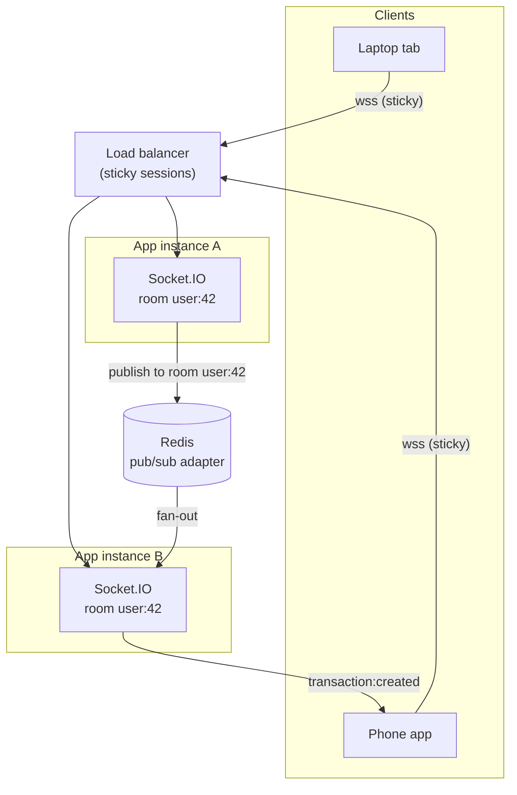

# 16. Realtime with WebSockets

> **One-liner:** HTTP only lets the server *reply* to a request; when you need the server to **push** data to the client unprompted (live updates), you keep a two-way connection open — a **WebSocket** — and **Socket.IO** makes that practical in Node, so a transaction you add on your laptop can appear live in Habex on your phone.
> **Where this fits:** This is the **hands-on** version of the transport discussion in [../system-design/24 — Design a Chat App](../system-design/24-case-study-chat-app.md) (the canonical realtime interview question). It reuses the **JWT** you built in [12 — Authentication](12-authentication.md) to secure a socket, and it leans on **Redis** ([14 — Caching with Redis](14-caching-with-redis.md)) plus load-balancer **sticky sessions** ([../system-design/05 — Load Balancers](../system-design/05-load-balancers.md)) to scale across multiple server instances. Be warned up front: **Habex mostly doesn't need realtime** — we treat it as an optional enhancement and, more importantly, a high-value interview topic.

---

## 1. The Idea in Plain Words

Everything you've built so far runs on **request/response**: the client asks, the server answers, the connection closes. The client is always the one who starts the conversation. That model has a hard limit — **the server can never speak first.**

But sometimes it needs to. Another device just added an expense; a shared budget just changed; a delivery moved on the map. The data appears on the *server*, and the client never asked for it. So the core question of this chapter is: **how does a server send something to a client that isn't currently asking?**

There are four ways to fake or achieve "server push," from crudest to best. Define each once:

- **Short polling** — the client asks *"anything new?"* on a timer (say every 5s). Simple, but mostly wasteful empty requests, and updates lag by up to the interval.
- **Long polling** — the client asks, and the server *holds the request open* until it has something to say (or times out), then the client immediately re-asks. Feels more "live," but every message still costs a full new HTTP request/response.
- **Server-Sent Events (SSE)** — one long-lived HTTP connection the **server streams down**. Real push, but **one-directional** (server → client only) and text-only. Great for a live feed; can't carry client → server messages on the same channel.
- **WebSocket** — a single TCP connection that starts as HTTP then **upgrades** to a persistent, **full-duplex** (both directions at once) channel. Either side can send a message any time until someone closes it. This is *true* realtime.

> **WebSocket**, defined: a protocol (`ws://` / `wss://`) that begins with an HTTP request carrying an `Upgrade: websocket` header (the **handshake**), and if the server agrees, the same connection stops being request/response and becomes a two-way pipe. Now the server can push whenever it likes.

**Socket.IO** is a Node library on top of WebSockets that adds the things you'd otherwise hand-build: automatic reconnection, **rooms** (named groups of connections you can broadcast to), an event API (`emit`/`on`), and a **fallback to long-polling** when a WebSocket can't be established. You get realtime without babysitting raw frames.

---

## 2. Why It Matters

Picking the transport is the first realtime decision, and interviewers want the trade-offs, not a favorite:

| Transport | Direction | Live-ness | Cost | Use when |
|---|---|---|---|---|
| **Short polling** | client pulls | laggy (interval) | wasteful empty requests | trivial, low-frequency, "good enough" |
| **Long polling** | client pulls (held) | near-live | 1 request per message | fallback when WS blocked |
| **SSE** | server → client | live | 1 long connection | one-way live feeds (notifications, dashboards) |
| **WebSocket** | both (full-duplex) | live | 1 long connection | chat, multiplayer, live two-way sync |

The rule of thumb: **need the server to push, one-way and text?** SSE is simpler. **Need both directions (client also sends over the same channel), or binary?** WebSocket. **Updates are rare and lateness is fine?** Don't do realtime at all — poll, or just refetch.

That last point matters for honesty: **Habex is a personal expense/habit tracker, and it mostly doesn't need realtime.** You look at your own data; a refetch-on-focus covers 95% of it. The genuine cases are narrow — *live multi-device sync* (add on laptop, see it on phone) and *live shared-budget* updates (two people on one household budget). Frame it that way in an interview: "Here's where realtime earns its complexity, and here's why I wouldn't sprinkle it everywhere." That judgment is exactly what senior interviewers are listening for.

---

## 3. Picture It (Diagram)

The hard part isn't one socket — it's **many servers**. A WebSocket is a *stateful* connection pinned to one instance. If your two tabs land on different instances, an `emit` on instance A won't reach a socket held by instance B... unless the instances share a backplane. That backplane is **Redis pub/sub**:



Read it: your laptop's write reaches instance A, which `emit`s to room `user:42`. A holds only the laptop socket — but the **Redis adapter publishes** the event, **every** instance subscribed receives it, and instance B delivers it to your phone. Two extra notes on the picture: the load balancer uses **sticky sessions** (route a given client's connection to the *same* instance for its lifetime — see [../system-design/05](../system-design/05-load-balancers.md)), because a WebSocket can't hop instances mid-connection; and Redis here is doing **pub/sub**, a different job from the caching in [14](14-caching-with-redis.md), on the same server.

---

## 4. Hands-On (TypeScript + Node)

```bash
npm i socket.io @socket.io/redis-adapter
# client side: npm i socket.io-client
```

### 4.1 Attach Socket.IO to your existing HTTP server

Socket.IO shares the same `http.Server` as Express — you don't run a second port. Wrap `app` in `http.createServer` so both live together.

```ts
// src/index.ts
import http from 'http';
import { app } from './app';            // your Express app
import { initRealtime } from './realtime/io';
import { env } from './config/env';
import { logger } from './lib/logger';

const server = http.createServer(app);   // Express handles HTTP; Socket.IO handles upgrades
initRealtime(server);

server.listen(env.PORT, () => logger.info(`listening on ${env.PORT}`));
```

### 4.2 The Socket.IO server: auth, rooms, scale-out

```ts
// src/realtime/io.ts
import { Server, Socket } from 'socket.io';
import type { Server as HttpServer } from 'http';
import jwt from 'jsonwebtoken';
import { createAdapter } from '@socket.io/redis-adapter';
import { redis } from '../lib/redis';
import { env } from '../config/env';
import { logger } from '../lib/logger';

let io: Server;

export function initRealtime(httpServer: HttpServer): Server {
  io = new Server(httpServer, {
    cors: { origin: env.WEB_ORIGIN, credentials: true }, // your React app's origin
  });

  // --- SCALE-OUT across instances ---
  // The Redis adapter makes io.to(room).emit() reach sockets on OTHER instances
  // (see §3). pub and sub must be SEPARATE connections: a subscribed Redis
  // connection can't run normal commands, so we duplicate() one.
  const pubClient = redis;
  const subClient = redis.duplicate();
  io.adapter(createAdapter(pubClient, subClient));

  // --- AUTH: runs ONCE per connection, before any event is handled ---
  io.use((socket: Socket, next) => {
    // The client sends its JWT in the handshake, not a header (WS has no per-message headers).
    const token = socket.handshake.auth?.token as string | undefined;
    if (!token) return next(new Error('unauthorized'));
    try {
      // Same secret + verify from ch12 — reuse, don't reinvent, your auth.
      const payload = jwt.verify(token, env.JWT_ACCESS_SECRET) as { sub: string };
      socket.data.userId = Number(payload.sub); // stash for the connection's lifetime
      next();
    } catch {
      next(new Error('unauthorized')); // bad/expired token → connection refused
    }
  });

  // --- CONNECTION lifecycle ---
  io.on('connection', (socket: Socket) => {
    const userId = socket.data.userId as number;

    // Put ALL of this user's sockets (laptop tab, phone, 2nd tab) into one room.
    // Broadcasting to `user:42` then reaches every device they have open.
    socket.join(`user:${userId}`);
    logger.info({ userId, socketId: socket.id }, 'socket connected');

    socket.on('disconnect', (reason) =>
      logger.info({ userId, reason }, 'socket disconnected'),
    );
    // A socket auto-leaves its rooms on disconnect — no manual cleanup needed here.
  });

  return io;
}

/**
 * Called from your REST layer AFTER a transaction is created.
 * Reaches every tab/device of this user, on ANY instance, thanks to the adapter.
 */
export function emitTransactionCreated(userId: number, tx: unknown): void {
  io.to(`user:${userId}`).emit('transaction:created', tx);
}
```

### 4.3 Fire the event from your create-transaction route

Realtime *augments* your normal REST flow — it doesn't replace it. Save via HTTP as always, then push to the user's *other* open tabs.

```ts
// src/routes/transactions.ts (excerpt)
import { createTransaction } from '../services/transaction.service';
import { emitTransactionCreated } from '../realtime/io';

router.post('/transactions', requireAuth, async (req, res) => {
  const tx = await createTransaction({ userId: req.userId, ...req.body });
  res.status(201).json(tx);                 // the caller gets its normal REST response
  emitTransactionCreated(req.userId, tx);   // + push to this user's OTHER devices/tabs
});
```

### 4.4 The client side (React sketch)

```ts
// web/src/realtime.ts
import { io } from 'socket.io-client';

const socket = io(import.meta.env.VITE_API_URL, {
  auth: { token: getAccessToken() },        // the ch12 access token, sent in the handshake
});

socket.on('connect', () => console.log('realtime connected'));
socket.on('transaction:created', (tx) => {
  // Update your React Query cache / Zustand store so the OTHER tab reflects it
  // instantly — no refetch, no polling.
  queryClient.setQueryData(['transactions'], (old) => [tx, ...(old ?? [])]);
});
socket.on('connect_error', (err) => {
  // Our auth middleware rejects with Error('unauthorized') → surfaces here.
  if (err.message === 'unauthorized') refreshTokenAndReconnect();
});
```

That's a complete loop: authenticated connection → per-user room → server pushes `transaction:created` → your other tab updates live, and it works even with several app instances behind a load balancer because of the Redis adapter.

---

## 5. Apply It to Habex

Be honest about scope — two features genuinely benefit, and they're both **enhancements**, not core:

| Feature | What the user sees | How |
|---|---|---|
| **Live multi-device sync** | Add an expense on your laptop; it appears on your phone within a second, no refresh | Room `user:{id}`; emit `transaction:created` after the write (§4.3) |
| **Live shared budget** | Two people on a household budget; one adds a big expense, the other sees the budget bar move live | A room per shared budget, e.g. `budget:{budgetId}`; emit `budget:updated` to everyone in it |

Design notes that double as interview signal:

- **REST stays the source of truth.** The socket carries *notifications of changes*, not the only copy of the data. If a socket message is missed (reconnect gap), the next normal fetch reconciles — the app is correct without realtime, and *nicer* with it. Never build a feature that *only* works if the socket is up.
- **Reuse ch12 auth.** The socket authenticates with the same access token; no second auth system. On token expiry, `connect_error` fires and the client refreshes and reconnects.
- **Shared-budget rooms** are the interesting case: membership is "everyone who can see budget X," so you `socket.join(\`budget:${id}\`)` for each authorized member on connect, and emit to that room on any budget change.
- **Everything else stays request/response.** The dashboard, reports, history — none of it needs a live socket. Realtime is a scalpel, not a coat of paint.

---

## 6. Interview Questions (with answer pointers)

**Q1. WebSocket vs SSE vs polling — when each? (very common — Swiggy/Zepto realtime cousin)**
> Polling: client asks on a timer — simple, laggy, wasteful; fine when updates are rare. SSE: one long-lived connection the server streams down — real push but **one-way** (server→client) and text-only; great for notification feeds. WebSocket: one connection, **full-duplex**, either side sends anytime — for chat, multiplayer, two-way live sync. Pick the simplest that meets the direction and frequency needs.

**Q2. How do you scale WebSockets across many servers? (the scale probe)**
> A WebSocket is stateful and pinned to one instance, so an `emit` on instance A won't reach a socket on B by default. Two pieces: **sticky sessions** at the load balancer so a client stays on one instance for the connection's life ([../system-design/05](../system-design/05-load-balancers.md)), and a **Redis pub/sub adapter** so a broadcast published by any instance fans out to sockets on all instances. Rooms then work cluster-wide.

**Q3. How do you authenticate a WebSocket connection? (CRED, Razorpay — security)**
> WebSockets have no per-message headers, so send the JWT in the **handshake** (`auth.token`) and verify it once in a connection-level middleware (`io.use`) before accepting the socket — reusing the same JWT + secret as the REST API ([12](12-authentication.md)). Stash the userId on `socket.data` for the connection's lifetime, and reject (`next(new Error(...))`) on a bad/expired token. For long-lived sockets, also handle token expiry by forcing a reconnect.

**Q4. When would you NOT use realtime? (judgment — senior signal)**
> When updates are infrequent or lateness is harmless — a refetch-on-focus or short poll is simpler, cheaper, and stateless (keeps horizontal scaling trivial). Realtime adds persistent stateful connections, sticky-session and fan-out complexity, and reconnection handling. For Habex, most screens are personal and static enough that realtime isn't worth it; I'd reserve it for multi-device sync and shared budgets.

**Q5. How do you avoid losing messages when a client reconnects? (reliability)**
> Don't treat the socket as the source of truth. Persist changes normally (DB), and on reconnect have the client refetch/reconcile from REST so any gap is filled. For strict delivery you'd add per-message acks and a durable per-user outbox/stream, but for Habex, "socket for liveness + REST for truth" is the pragmatic, correct design.

**Q6. Why not just poll every 2 seconds instead of a WebSocket? (trade-off)**
> Polling is stateless and dead simple, but at scale it's N clients × constant empty requests hammering your API, and updates still lag by the interval. A WebSocket delivers instantly with one connection and no busy-work — but costs you stateful connections, sticky sessions, and a fan-out layer. Choose by update frequency and how live it must feel.

---

## 7. Trade-offs & Pitfalls ("Why Not Just X?")

**"Why not make everything realtime — it feels modern?"**
Because persistent connections are *stateful*, and state is the enemy of easy horizontal scaling ([../system-design/05](../system-design/05-load-balancers.md), [../system-design/06](../system-design/06-scaling-vertical-vs-horizontal.md)). Every socket pins a client to an instance, needs sticky routing, a Redis fan-out to talk across instances, and reconnection logic. Add all that only where liveness is a real feature.

**"Why not skip the Redis adapter — it works on my laptop!"**
It works with **one** instance. The moment you run two (which you will, behind a load balancer), a broadcast on instance A silently never reaches sockets on B. The adapter is what makes rooms work cluster-wide; leaving it out is the classic "works in dev, breaks in prod" realtime bug.

**"Why not put the JWT in the URL query string for the socket?"**
Tokens in URLs leak into logs, proxies, and browser history. Send it in the Socket.IO **handshake auth** payload (or, for browsers, a cookie) and verify in `io.use`. Same secret and validation as [12](12-authentication.md).

**"Why not use raw `ws` instead of Socket.IO?"**
Raw `ws` is leaner and standards-pure, but you re-implement reconnection, rooms, heartbeats, and multiplexing yourself. Socket.IO gives those out of the box plus a long-polling fallback. Use raw `ws` when you need the smallest footprint or strict protocol control; Socket.IO when you want batteries included (the common product-app choice).

| Concern | WebSocket / Socket.IO helps | Cost it adds |
|---|---|---|
| Instant server → client updates | Yes — true push | Persistent stateful connections |
| Two-way live interaction | Yes — full-duplex | Sticky sessions at the LB |
| Scaling across instances | Yes — with Redis adapter | Extra pub/sub infra |
| Simple, infrequent updates | — | Overkill; poll or refetch instead |
| Guaranteed delivery | — | Need acks + durable store; REST-reconcile in practice |

---

## 8. TL;DR

- HTTP is request/response — the server can't speak first. For **server push** you choose among **polling** (simple, laggy), **long polling** (near-live, request-per-message), **SSE** (real push but one-way/text), and **WebSocket** (one connection, **full-duplex**, either side sends anytime).
- **Socket.IO** wraps WebSockets with rooms, an `emit`/`on` event API, auto-reconnect, and a long-polling fallback — realtime without hand-rolling frames. It shares your Express `http.Server`.
- **Auth a socket** by sending the ch12 **JWT** in the handshake and verifying it once in `io.use` before accepting the connection; stash `userId` on `socket.data`.
- **Rooms** (`user:{id}`) let you push to all of one user's tabs/devices. `emit('transaction:created', tx)` after a write powers live multi-device sync.
- **Scale across instances** with **sticky sessions** at the load balancer ([../system-design/05](../system-design/05-load-balancers.md)) **plus** the **Redis pub/sub adapter** ([14](14-caching-with-redis.md)) so a broadcast fans out to sockets on every instance — the transport story of [../system-design/24](../system-design/24-case-study-chat-app.md).
- Be honest: **Habex mostly doesn't need realtime.** Reserve it for multi-device sync and live shared budgets, keep REST as the source of truth, and know *when not to use it* — that judgment is the real interview win.
