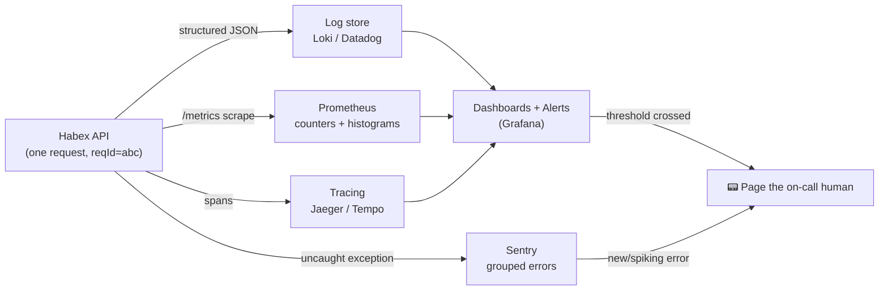

# 17. Logging, Monitoring & Observability

> **One-liner:** After this you'll be able to turn a silent production server into one that *tells you what it's doing* — structured JSON logs with a request id, a `/healthz` a load balancer can trust, error tracking, and the three RED metrics — so when Habex breaks at 2am you can actually find out why.
> **Where this fits:** This is where your Habex API stops being a dev toy and becomes *operable*. It builds directly on the middleware chain from [05-middleware-and-request-lifecycle.md](05-middleware-and-request-lifecycle.md), watches the background worker from [15-background-jobs-and-queues.md](15-background-jobs-and-queues.md), and feeds the deploy pipeline in [20-deployment-and-devops.md](20-deployment-and-devops.md). It's the hands-on twin of [../system-design/19-reliability-patterns.md](../system-design/19-reliability-patterns.md).

---

## 1. The Idea in Plain Words

You've debugged React with `console.log` and the browser DevTools. On the frontend that works: it's *your* browser, *one* user (you), and you can see the whole thing. Production backend is the opposite of all three:

- It runs on **a machine you can't see**, often several identical copies behind a load balancer.
- It serves **thousands of users at once**, their requests interleaved on the same process.
- When something breaks, **the user is gone** — you get a bug report hours later with "it didn't work."

So you can't reproduce by clicking. Your only window into a live server is **what it wrote down while it ran**. Making a server write down the *right* things, in a *findable* shape, is the whole discipline of this chapter.

Let's define the vocabulary once:

| Term | Plain meaning |
|---|---|
| **Logging** | The app writes timestamped records of events ("request received", "login failed") as it runs. Your app's diary. |
| **Structured log** | A log line that's a **JSON object** (`{"level":"error","reqId":"abc","msg":"db timeout"}`) instead of a human sentence. Machines can filter/search it. |
| **Log level** | A severity tag on each line — `trace < debug < info < warn < error < fatal` — so you can turn the noise up or down. |
| **Metric** | A **number over time**: requests/sec, error rate, p95 latency. Aggregated, cheap, great for dashboards and alerts. |
| **Trace** | The **path of one request** across services/functions, with timing for each hop. Answers "where did the 900ms go?" |
| **Observability** | How well you can understand what's happening *inside* the system from its outputs (logs + metrics + traces), *without* shipping new code to investigate. |
| **Monitoring** | The active side: dashboards that watch the metrics and **alerts** that page a human when something crosses a line. |
| **Health check** | An endpoint (`/healthz`) that answers "am I able to serve traffic?" so a load balancer/orchestrator can route around a sick instance. |
| **Redaction** | Deliberately *removing* secrets (passwords, tokens, card numbers) from logs before they're written. |

The mental model: **logs, metrics, and traces are three different lenses on the same running system.** You'll wire up all three for Habex in this chapter.

### Why `console.log` doesn't cut it in production

`console.log('user logged in', user)` feels fine until you're staring at a live incident. Here's what goes wrong:

| Problem with `console.log` | What it costs you in prod |
|---|---|
| Unstructured text | You can't `WHERE level = 'error' AND reqId = 'abc'`. You `grep` and pray. |
| No severity | Everything's the same "loudness"; you can't silence debug noise or alert on errors only. |
| No context | Which of 5,000 interleaved requests wrote this line? No way to tell. |
| No timestamps/host | In a multi-instance deploy you can't order events or know *which* box logged it. |
| Synchronous & slow | `console.log` blocks on stdout; under load it becomes a real bottleneck. |
| Leaks secrets | People `console.log(req.body)` and dump passwords/tokens into logs forever. |

Structured logging with **pino** (our pinned logger) fixes every row of that table.

---

## 2. Why It Matters

**For Habex:** the moment real users touch it, "it's broken" reports arrive with no stack trace. Without observability you're blind. With it, you paste the user's request id into a log search and see the exact failing line, the SQL that timed out, and the 5xx spike that started 4 minutes ago.

**For your interviews:** at Zepto/Swiggy/CRED/Razorpay/Groww, "how would you debug a production incident?" and "logs vs metrics vs traces?" are *standard* senior-signal questions. Most frontend-heavy candidates freeze here. Being able to say "I'd start at the RED metrics to see the blast radius, pivot to logs by request id for the failing case, and use a trace to find the slow hop" instantly reads as someone who's operated real software.

**The correctness/security angle:** logs are a *data store you forget you have*. Dumping a password, JWT, or full card number into them is a real breach — those logs get shipped to third parties, indexed, and kept for months. Redaction isn't optional polish; at a fintech it's a compliance requirement (PCI-DSS forbids storing card data / CVV). We treat "never log secrets" as a hard rule, exactly like "money is integer cents."

---

## 3. Picture It (Diagram)

One running app emits three signal types; each flows to tooling that turns it into something a human watches:

```
                          ┌──────────────────────────────────────┐
                          │        HABEX API (Node/Express)       │
   request ──▶ x-request-id│  ┌──────────┐ ┌────────┐ ┌────────┐  │
              (reqId=abc)  │  │  LOGS    │ │METRICS │ │ TRACES │  │
                          │  │ pino JSON│ │counters│ │per-req │  │
                          │  └────┬─────┘ └───┬────┘ └───┬────┘  │
                          └───────┼───────────┼──────────┼───────┘
                                  │           │          │
              stdout / shipper    │           │ /metrics │  span export
                                  ▼           ▼          ▼
                          ┌───────────┐ ┌──────────┐ ┌──────────────┐
                          │ Log store │ │Prometheus│ │  Tracing UI  │
                          │ (Loki /   │ │ (scrapes │ │ (Jaeger /    │
                          │  Datadog) │ │  numbers)│ │  Tempo)      │
                          └─────┬─────┘ └────┬─────┘ └──────┬───────┘
                                │            │              │
                                ▼            ▼              ▼
                          ┌─────────────────────────────────────────┐
                          │      DASHBOARDS  +  ALERTS  (Grafana)     │
                          │   graphs a human watches → pages on-call  │
                          └───────────────────────────────────────────┘

           Separately: uncaught EXCEPTIONS ──▶ Sentry (grouped errors + stack traces + reqId)
```

The same flow as a graph (renders on GitHub):



Read it as: **the app is the source of truth; the tooling just makes its signals searchable and watchable.** Your job in code is only the left box — emit good signals. The rest is configuration.

---

## 4. Hands-On (TypeScript + Node)

We'll add four things to `habex-api`: a pino logger, a request-scoped logging middleware with a request id, redaction of sensitive fields, and a real `/healthz` that checks Postgres + Redis. Then a metrics endpoint and Sentry.

```bash
npm i pino pino-http @sentry/node prom-client
npm i -D pino-pretty            # dev-only: pretty prints logs for humans
```

### 4.1 The base logger (with redaction baked in)

```ts
// src/logger.ts
import pino from 'pino';

// A single shared logger for the whole app. Configure it ONCE, here.
export const logger = pino({
  // Level comes from env so you can crank up detail in staging without a deploy.
  level: process.env.LOG_LEVEL ?? 'info',

  // REDACTION: these paths are stripped from every log object before it's written.
  // This is the security rule — secrets must never reach your log store.
  redact: {
    paths: [
      'req.headers.authorization',   // the Bearer JWT
      'req.headers.cookie',          // session/refresh cookies
      'req.body.password',
      'req.body.token',
      'password',
      'password_hash',
      '*.password',                  // any nested { password } object
      'card.number',
      'card.cvv',
    ],
    censor: '[REDACTED]',
  },

  // In dev: colorized, human-friendly. In prod: raw JSON to stdout (fast, parseable).
  transport:
    process.env.NODE_ENV === 'development'
      ? { target: 'pino-pretty', options: { colorize: true, translateTime: 'HH:MM:ss' } }
      : undefined,
});
```

Why JSON-to-stdout in prod? Because in a container (see [19-docker-and-containers.md](19-docker-and-containers.md)) the platform captures stdout and ships it to your log store for you. Your app should **not** know or care where logs end up — that's 12-factor logging ([20-deployment-and-devops.md](20-deployment-and-devops.md)).

### 4.2 A request-scoped logger with a request id (ties to ch05)

Back in [05-middleware-and-request-lifecycle.md](05-middleware-and-request-lifecycle.md) you learned middleware runs on *every* request in order. This is the perfect place to stamp each request with an id and hand it a **child logger** — a logger that automatically includes `{ reqId }` on every line it writes, so you never repeat it.

```ts
// src/middleware/request-logger.ts
import type { Request, Response, NextFunction } from 'express';
import { randomUUID } from 'node:crypto';
import { logger } from '../logger';

// Tell TypeScript that every request now carries an id and its own logger.
declare global {
  // eslint-disable-next-line @typescript-eslint/no-namespace
  namespace Express {
    interface Request {
      id: string;
      log: typeof logger;
    }
  }
}

export function requestLogger(req: Request, res: Response, next: NextFunction) {
  // Reuse an id from upstream (LB / gateway) if present, else mint one.
  const reqId = (req.headers['x-request-id'] as string) || randomUUID();
  req.id = reqId;
  req.log = logger.child({ reqId }); // ← child logger: { reqId } auto-added to every line
  res.setHeader('x-request-id', reqId); // echo it back so the client/user can quote it

  const startNs = process.hrtime.bigint();
  req.log.info({ method: req.method, url: req.originalUrl }, 'request received');

  // res 'finish' fires once the response is fully sent — perfect for the summary line.
  res.on('finish', () => {
    const durationMs = Math.round(Number(process.hrtime.bigint() - startNs) / 1e6);
    const level = res.statusCode >= 500 ? 'error' : res.statusCode >= 400 ? 'warn' : 'info';
    req.log[level](
      { method: req.method, url: req.originalUrl, status: res.statusCode, durationMs },
      'request completed',
    );
  });

  next();
}
```

Register it **first**, before your routes, so every downstream handler can use `req.log`:

```ts
// src/app.ts (excerpt)
import express from 'express';
import { requestLogger } from './middleware/request-logger';

export const app = express();
app.use(express.json());
app.use(requestLogger); // ← every request now has req.id and req.log

// Inside any handler, log WITH context — no need to pass reqId around:
app.post('/transactions', (req, res) => {
  req.log.info({ amount_cents: req.body.amount_cents }, 'creating transaction');
  // ...
});
```

Now a single failing request produces a *trail* you can filter by one id:

```json
{"level":"info","time":1720425600000,"reqId":"3f9a…","method":"POST","url":"/transactions","msg":"request received"}
{"level":"info","time":1720425600004,"reqId":"3f9a…","amount_cents":4200,"msg":"creating transaction"}
{"level":"error","time":1720425600051,"reqId":"3f9a…","status":500,"durationMs":51,"msg":"request completed"}
```

Search `reqId:"3f9a…"` and the whole story is there — even with 5,000 other requests interleaved.

### 4.3 Liveness vs readiness: a `/healthz` that checks DB + Redis

There are **two** different health questions, and load balancers/orchestrators use them differently:

| Probe | Question | Who uses it | If it fails |
|---|---|---|---|
| **Liveness** (`/livez`) | "Is the process alive at all?" | Kubernetes/orchestrator | **Restart** the container |
| **Readiness** (`/healthz`) | "Can I actually serve traffic? (deps up?)" | Load balancer | **Stop routing** traffic here (but don't kill it) |

The distinction matters: if Postgres is briefly down, you want the LB to *stop sending traffic* (readiness fails) but you do **not** want the orchestrator to kill and restart every instance (liveness stays OK) — restarting won't fix Postgres.

```ts
// src/routes/health.ts
import { Router } from 'express';
import { prisma } from '../db';     // your Prisma client (ch10)
import { redis } from '../redis';   // your ioredis client (ch14)

export const health = Router();

// LIVENESS: cheap, no dependencies. "The event loop is turning."
health.get('/livez', (_req, res) => res.status(200).json({ status: 'ok' }));

// READINESS: verify the things we NEED to serve a real request.
health.get('/healthz', async (_req, res) => {
  const checks: Record<string, 'ok' | 'fail'> = { db: 'fail', redis: 'fail' };

  // Bound each check with a timeout — a hung dep must not hang the health check.
  const withTimeout = <T>(p: Promise<T>, ms = 800) =>
    Promise.race([p, new Promise<never>((_, r) => setTimeout(() => r(new Error('timeout')), ms))]);

  try { await withTimeout(prisma.$queryRaw`SELECT 1`); checks.db = 'ok'; } catch { /* stays fail */ }
  try { await withTimeout(redis.ping());               checks.redis = 'ok'; } catch { /* stays fail */ }

  const healthy = Object.values(checks).every((c) => c === 'ok');
  // 200 = route traffic to me; 503 = skip me until I recover.
  res.status(healthy ? 200 : 503).json({ status: healthy ? 'ok' : 'degraded', checks });
});
```

This is exactly the "deep health check" your load balancer polls in [../system-design/05-load-balancers.md](../system-design/05-load-balancers.md), and the automatic-failover trigger from [../system-design/19-reliability-patterns.md](../system-design/19-reliability-patterns.md). Keep it **fast and dependency-scoped** — never make `/healthz` do heavy work, or the health check itself becomes the outage.

### 4.4 RED metrics (request rate, errors, duration)

The **RED method** is the standard starting set for any request-serving service:

- **R**ate — requests per second
- **E**rrors — how many are failing (5xx)
- **D**uration — how long they take (track p50/p95/p99, not the average — averages hide the slow tail)

`prom-client` exposes these as a `/metrics` endpoint that Prometheus *scrapes* (pulls) on a schedule.

```ts
// src/metrics.ts
import client from 'prom-client';

export const registry = new client.Registry();
client.collectDefaultMetrics({ register: registry }); // CPU, memory, event-loop lag, etc.

export const httpRequests = new client.Counter({
  name: 'http_requests_total',
  help: 'Total HTTP requests',
  labelNames: ['method', 'route', 'status'] as const, // slice by any of these later
  registers: [registry],
});

export const httpDuration = new client.Histogram({
  name: 'http_request_duration_seconds',
  help: 'HTTP request latency (seconds)',
  labelNames: ['method', 'route', 'status'] as const,
  buckets: [0.01, 0.05, 0.1, 0.3, 0.5, 1, 2, 5], // histogram → lets Prometheus compute p95/p99
  registers: [registry],
});
```

```ts
// src/middleware/metrics.ts
import type { Request, Response, NextFunction } from 'express';
import { httpRequests, httpDuration } from '../metrics';

export function metricsMiddleware(req: Request, res: Response, next: NextFunction) {
  const end = httpDuration.startTimer();
  res.on('finish', () => {
    // Use the ROUTE pattern (/transactions/:id), not the raw URL, or you get
    // millions of unique label values ("cardinality explosion") and blow up Prometheus.
    const route = req.route?.path ?? 'unknown';
    const labels = { method: req.method, route, status: String(res.statusCode) };
    httpRequests.inc(labels);
    end(labels);
  });
  next();
}
```

```ts
// expose the scrape endpoint (usually on an internal port, not the public API)
import { registry } from './metrics';
app.get('/metrics', async (_req, res) => {
  res.set('Content-Type', registry.contentType);
  res.end(await registry.metrics());
});
```

Prometheus stores these numbers; **Grafana** graphs them ("where dashboards come from") and evaluates alert rules like *"5xx rate > 5% for 5 minutes → page on-call."*

### 4.5 Error tracking with Sentry

Logs are for *expected* events; **Sentry** is for *exceptions* — it captures the stack trace, **groups** identical errors (so one bug that hits 10,000 times is one issue, not 10,000 log lines), and attaches context like the `reqId` and user.

```ts
// src/instrument.ts — imported at the VERY TOP of your entrypoint, before anything else
import * as Sentry from '@sentry/node';

Sentry.init({
  dsn: process.env.SENTRY_DSN,           // secret, from env — never hard-coded
  environment: process.env.NODE_ENV,
  tracesSampleRate: 0.1,                  // sample 10% of requests for performance tracing
});
```

```ts
// src/middleware/error-handler.ts — the LAST middleware (ties to ch07's central error handler)
import * as Sentry from '@sentry/node';
import type { Request, Response, NextFunction } from 'express';

export function errorHandler(err: unknown, req: Request, res: Response, _next: NextFunction) {
  // Tie the exception to this request's id so Sentry ↔ logs cross-reference.
  Sentry.withScope((scope) => {
    scope.setTag('reqId', req.id);
    Sentry.captureException(err);
  });
  req.log.error({ err }, 'unhandled error'); // pino serializes Error → stack safely

  // NEVER leak internals to the client. Give them the reqId to quote in a bug report.
  res.status(500).json({ error: 'Internal Server Error', reqId: req.id });
}
```

That last point is the whole payoff: the user sees `reqId: 3f9a…`, sends it to you, and you jump straight to their exact failing request in both Sentry and your logs.

---

## 5. Apply It to Habex

Concretely, here's what your Habex backend should log, measure, and alert on:

| Signal | What to emit | Why / interview angle |
|---|---|---|
| **Failed logins** | `warn` log `{ email, ip, reqId }` on bad password | Spot credential-stuffing / brute force ([13-authorization-and-security.md](13-authorization-and-security.md)); alert if one IP fails >20×/min |
| **5xx spikes** | RED error-rate metric | Alert when 5xx > 1–5% for 5 min — your earliest "something broke" signal |
| **Slow queries** | `warn` log when a Prisma query > 300ms | Catch missing indexes / N+1 before users feel it ([11-transactions-and-query-performance.md](11-transactions-and-query-performance.md)) |
| **Job failures** | BullMQ worker `error` log + Sentry on failed recurring-rule jobs | A silently failing worker means recurring expenses stop posting; alert on the queue's `failed` count ([15-background-jobs-and-queues.md](15-background-jobs-and-queues.md)) |
| **Money mutations** | `info` `{ userId, amount_cents, txnId, reqId }` on every write | Audit trail for financial data — but **log cents, never card/bank details** |
| **Health** | `/healthz` (DB+Redis), `/livez` | LB routing + orchestrator restart decisions |

A few Habex-specific rules that fall out of this chapter:

1. **Redact `password`, `password_hash`, and `authorization` header** everywhere — already handled by `src/logger.ts` above. Verify by logging in during dev and confirming the log shows `[REDACTED]`.
2. **Log the `reqId` on every money write**, so a disputed transaction is traceable end-to-end.
3. **Alert on worker failures**, not just API errors — the BullMQ worker is invisible to users until recurring expenses quietly stop.
4. **Watch p95 latency, not average.** A p95 of 40ms with p99 of 2s means 1% of users are having a bad time; the average hides it.

You now have the observability layer the capstone ([22-capstone-habex-backend.md](22-capstone-habex-backend.md)) assumes exists.

---

## 6. Interview Questions (with answer pointers)

1. **"Why not just use `console.log` in production?"** *(warm-up)*
   → It's unstructured (can't query), unlevelled (can't silence/alert), context-free (can't tell requests apart), and blocking. Structured JSON logging (pino) gives you searchable, levelled, request-scoped logs. Also: `console.log` is where secrets accidentally leak.

2. **"Structured vs plain-text logs — what's the difference and why care?"** *(Zepto, Swiggy)*
   → Structured logs are JSON objects with fields (`level`, `reqId`, `status`). Machines can filter/aggregate them (`level=error AND reqId=abc`); plain text you can only `grep`. At scale, structured logging is what makes logs *usable* during an incident.

3. **"Logs vs metrics vs traces — when do you reach for each?"** *(all companies)*
   → **Metrics** = aggregated numbers, cheap, for "*is* something wrong and how big?" (dashboards/alerts). **Logs** = discrete events, for "what *exactly* happened to this request?" **Traces** = one request's path across services, for "*where* did the time/error go?" You typically start at metrics, pivot to logs by reqId, and use a trace for the slow hop.

4. **"What should you never log, and how do you enforce it?"** *(CRED, Razorpay — security)*
   → Never log passwords, JWTs/session tokens, full card numbers, CVV, or PII. Enforce with **redaction** configured in the logger (pino `redact` paths) so it's automatic, not per-call discipline. It's a compliance requirement (PCI-DSS), not a nicety.

5. **"What's a health check? Liveness vs readiness?"**
   → An endpoint an LB/orchestrator polls. **Liveness** = "is the process alive?" → failing means *restart me*. **Readiness** = "can I serve traffic? (deps healthy?)" → failing means *stop routing to me* but don't kill me. Keep them fast and timeout-bounded. (See [../system-design/05-load-balancers.md](../system-design/05-load-balancers.md).)

6. **"Walk me through debugging a production incident."** *(senior signal)*
   → (1) Confirm blast radius on the RED dashboard — error rate, which routes, since when. (2) Correlate with a deploy/traffic change. (3) Grab a failing `reqId` and read its log trail; check Sentry for the grouped exception + stack. (4) If it's slow not failing, open a trace to find the hop. (5) Mitigate (roll back / scale / shed load), then fix. Emphasize *reqId correlation* and *rollback-first*.

7. **"What is the RED method?"**
   → **R**ate, **E**rrors, **D**uration — the three metrics to track for any request-serving service. (USE — Utilization/Saturation/Errors — is the sibling for *resources* like CPU/disk.) Track latency as percentiles (p95/p99), never the average.

8. **"Where do dashboards and alerts come from?"**
   → The app exposes metrics (e.g. `/metrics`), Prometheus scrapes and stores them, Grafana graphs them and evaluates alert rules that page on-call via PagerDuty/Slack when a threshold holds for N minutes. The app only emits numbers; the tooling does the watching.

---

## 7. Trade-offs & Pitfalls ("Why Not Just X?")

- **"Why not just log everything at `debug`?"** Log volume costs real money (ingestion + storage) and *hides* signal in noise. Default to `info` in prod, make the level an env var so you can temporarily raise it, and reserve `error` for things a human should look at.

- **"Why not build my own metrics dashboard?"** You'd be reinventing Prometheus/Grafana badly. Emit standard metrics and let mature tooling store, graph, and alert. Your value is *choosing good metrics*, not building time-series databases.

- **Pitfall: high-cardinality labels.** Putting `userId` or a raw URL (`/transactions/8f2c…`) in a metric label creates millions of unique series and melts Prometheus. Use bounded labels: the route *pattern* (`/transactions/:id`), method, status.

- **Pitfall: logging secrets.** The classic `req.log.info(req.body)` dumps passwords. Redact at the logger, and code-review for raw `body`/`headers` logging. This is a breach, not a bug.

- **Pitfall: a `/healthz` that's too deep.** If health also pings three external APIs, one slow third party marks *all* your instances unhealthy and the LB pulls the whole fleet — a self-inflicted outage. Check only *your own* critical deps (DB, Redis), with timeouts.

- **Pitfall: alert fatigue.** Alerting on every error trains people to ignore the pager. Alert on *symptoms users feel* (5xx rate, p99 latency, queue backlog), with a duration threshold so a 3-second blip doesn't wake anyone.

- **Pitfall: averages.** "Average latency 60ms" can hide that 1% of users wait 4 seconds. Always look at p95/p99.

---

## 8. TL;DR

- **`console.log` doesn't scale to prod**: no structure, no levels, no per-request context, and it leaks secrets. Use **pino** for structured JSON logs.
- Give every request a **request id** in middleware and a **child logger** (`req.log`) so one search reconstructs a whole request's story across interleaved traffic ([05-middleware-and-request-lifecycle.md](05-middleware-and-request-lifecycle.md)).
- **Never log** passwords, tokens, card numbers, or PII — configure **redaction** in the logger so it's automatic. Security rule, same tier as "money is integer cents."
- The **three pillars**: metrics (aggregate numbers → alerts), logs (discrete events → what happened), traces (one request's path → where it went). Start at metrics, pivot to logs by reqId.
- Ship **`/livez`** (liveness → restart) and **`/healthz`** (readiness, checks DB+Redis → route traffic) for your load balancer and orchestrator ([../system-design/19-reliability-patterns.md](../system-design/19-reliability-patterns.md)).
- Track the **RED** metrics (Rate, Errors, Duration) with percentiles; use **Sentry** for grouped exceptions; alert on user-visible symptoms.
- For **Habex**, log/alert on failed logins, 5xx spikes, slow queries, and **worker job failures** — the last one is invisible until recurring expenses silently stop.

**Next → [18-testing-backend.md](18-testing-backend.md):** the other half of shipping with confidence — proving your API works *before* it hits production, with Vitest and supertest against a real test database.
