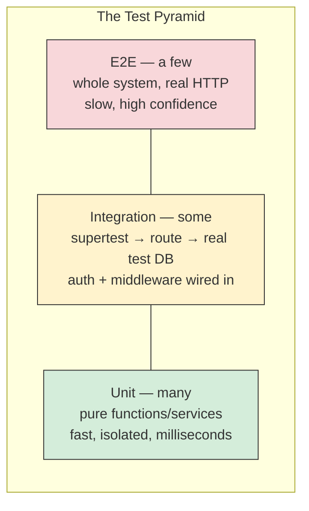

# 18. Testing the Backend

> **One-liner:** After this you'll be able to prove your Habex API works *before* it hits production — a fast unit test for your money math and a full `supertest` integration test that signs up a user, gets a JWT, creates a transaction, and asserts the row actually landed in a real test database.
> **Where this fits:** This is the safety net under every other chapter. It exercises your validation ([07-input-validation-and-error-handling.md](07-input-validation-and-error-handling.md)), transactions ([11-transactions-and-query-performance.md](11-transactions-and-query-performance.md)), auth ([12-authentication.md](12-authentication.md)), authorization ([13-authorization-and-security.md](13-authorization-and-security.md)), and background jobs ([15-background-jobs-and-queues.md](15-background-jobs-and-queues.md)). Tests are what let you refactor all of it without fear.

---

## 1. The Idea in Plain Words

As a React dev you may have written a few component tests, or maybe skipped them because "I can see it in the browser." On the backend you *can't* see it — there's no UI. A backend test **is** how you look at your API: it runs your code, feeds it inputs, and checks the outputs and side effects (like "a row got written").

Let's define the vocabulary once:

| Term | Plain meaning |
|---|---|
| **Test** | Code that runs your code with known inputs and *asserts* the result is what you expect. If not, it fails loudly. |
| **Unit test** | Tests one small piece — a pure function/service — in isolation, no DB or network. Milliseconds each. |
| **Integration test** | Tests several pieces wired together — an Express route hitting a real database through your real handler/middleware. |
| **E2E (end-to-end)** | Tests the whole system as a user would — real HTTP, real DB, sometimes a real browser. Slowest, most realistic. |
| **Assertion** | The check itself: `expect(result).toBe(4200)`. A test is a bunch of assertions. |
| **Fixture / factory** | Reusable test data — a pre-made user, or a function that *builds* one (`createUser()`). |
| **Mock / stub** | A fake stand-in for a real dependency (e.g. a fake email sender) so the test stays fast and deterministic. |
| **Coverage** | The % of your code lines/branches that tests actually execute. A rough map of what's untested. |
| **TDD** | Test-Driven Development: write the failing test *first*, then the code to pass it. |

The one-sentence version: **a good backend test suite lets you change code and instantly know if you broke something** — without clicking through the app or waiting for a user to report it.

### Why bother testing a backend?

1. **Confidence to refactor and ship.** Your Habex backend will grow — new routes, a schema change, swapping raw SQL for Prisma. Without tests, every change is a gamble. With tests, you refactor freely: if the suite's green, behaviour is preserved.
2. **Bugs cost more the later you catch them.** A bug caught by a unit test costs seconds. The same bug caught in production — a mis-summed budget, a user seeing another user's transactions — costs trust and possibly money.
3. **Interviews and good teams expect it.** "How do you test this?" is a standard question at Zepto/Swiggy/CRED/Razorpay/Groww. Shipping untested code to a product-company codebase is a red flag; being fluent in the test pyramid is a green one.
4. **Tests are executable documentation.** A test named `rejects a negative amount with 400` tells the next developer exactly how the endpoint should behave.

---

## 2. Why It Matters

The specific thing tests buy you is **the ability to move fast without breaking things**. Frontend-heavy devs often under-test the backend and then freeze — afraid to touch working code because they can't tell what a change will break. That fear is what tests remove.

For **Habex** the stakes are concrete and financial:

- If your `summarize()` helper mis-adds cents, every dashboard total is wrong.
- If `POST /transactions` doesn't enforce ownership, user A can write to user B's account.
- If the recurring-rules worker isn't **idempotent**, a retry double-posts an expense and the balance is wrong.

Each of those is a bug you *cannot* reliably catch by clicking around, but a five-line test catches it forever. That's the whole pitch.

---

## 3. Picture It (Diagram)

The **test pyramid** is the standard guide to the *mix* of tests: many fast unit tests at the base, fewer integration tests, very few slow E2E tests at the top.

```
                    ╱╲
                   ╱  ╲        E2E  (a few)          slow · brittle · most realistic
                  ╱ E2E╲       whole system over HTTP, prod-like env
                 ╱──────╲
                ╱        ╲     INTEGRATION (some)    supertest + REAL test DB
               ╱ INTEGR.  ╲    routes + middleware + auth + DB wired together
              ╱────────────╲
             ╱              ╲  UNIT (many)           fast · isolated · deterministic
            ╱     UNIT       ╲ pure logic: money math, validators, services
           ╱──────────────────╲
          ▔▔▔▔▔▔▔▔▔▔▔▔▔▔▔▔▔▔▔▔▔▔
   fast & cheap  ◀───────────────────────▶  slow & expensive
   run on every save                        run in CI / before release
```



**Why a pyramid and not a square?** Unit tests are fast and pinpoint *where* a bug is, so you want lots of them. E2E tests are slow and flaky (real network, real timing) and only tell you *that* something broke, not where — so you want just a few, covering the critical happy paths (signup → login → create transaction). Integration tests are the sweet spot for an API: they prove your route, auth, and DB actually work together.

---

## 4. Hands-On (TypeScript + Node)

Our pinned tools: **Vitest** (a fast, TypeScript-native test runner — same API as Jest but no config headaches) and **supertest** (fires real HTTP requests at your Express app *without* opening a port).

```bash
npm i -D vitest supertest @types/supertest @vitest/coverage-v8
```

### 4.1 Make the app testable: export `app` separately from `listen`

supertest needs your Express `app` object, but it must **not** already be listening on a port. Split them:

```ts
// src/app.ts — builds the app, DOES NOT listen. Import this in tests.
import express from 'express';
export const app = express();
// ... app.use(...) middleware and routes ...

// src/server.ts — the real entrypoint. Only this file binds a port.
import { app } from './app';
app.listen(process.env.PORT ?? 3000, () => console.log('habex-api up'));
```

### 4.2 A unit test for the money/summary helper

First the pure function under test — no DB, no I/O, just cents in → cents out:

```ts
// src/lib/summary.ts
export interface Txn { amount_cents: number; kind: 'income' | 'expense'; }
export interface Summary { incomeCents: number; expenseCents: number; balanceCents: number; }

export function summarize(txns: Txn[]): Summary {
  let incomeCents = 0;
  let expenseCents = 0;
  for (const t of txns) {
    if (t.kind === 'income') incomeCents += t.amount_cents;
    else expenseCents += t.amount_cents;
  }
  return { incomeCents, expenseCents, balanceCents: incomeCents - expenseCents };
}
```

Now the test. Note the **Arrange-Act-Assert** structure — the standard shape of a readable test:

```ts
// src/lib/summary.test.ts
import { describe, it, expect } from 'vitest';
import { summarize } from './summary';

describe('summarize', () => {
  it('sums income and expense in integer cents and computes balance', () => {
    // Arrange — set up the inputs
    const txns = [
      { amount_cents: 5000, kind: 'income' as const },
      { amount_cents: 4200, kind: 'expense' as const },
      { amount_cents: 800, kind: 'expense' as const },
    ];
    // Act — run the thing under test
    const result = summarize(txns);
    // Assert — check the outcome
    expect(result).toEqual({ incomeCents: 5000, expenseCents: 5000, balanceCents: 0 });
  });

  it('returns zeros for an empty list (edge case)', () => {
    expect(summarize([])).toEqual({ incomeCents: 0, expenseCents: 0, balanceCents: 0 });
  });

  it('has NO floating-point drift because everything is integer cents', () => {
    const txns = Array.from({ length: 3 }, () => ({ amount_cents: 10, kind: 'expense' as const }));
    expect(summarize(txns).expenseCents).toBe(30); // exactly 30, never 30.000000004
  });
});
```

This is the base of the pyramid: three tests, all run in a few milliseconds, and they lock in your money math forever. Run them:

```bash
npx vitest            # watch mode: re-runs on every save
npx vitest run        # one-shot (what CI uses)
```

### 4.3 The test database (real Postgres, not a mock)

**Rule: use a real Postgres for DB tests, never a mock.** Mocking the database means you're testing your *assumptions* about SQL, not actual SQL — you'd miss constraint violations, `CASCADE` behaviour, and the exact thing DB tests exist to catch. You have two good ways to get a throwaway Postgres:

| Option | How | When |
|---|---|---|
| **Dedicated test DB** | A `habex_test` database (a service in `docker-compose`, see [19-docker-and-containers.md](19-docker-and-containers.md)); `DATABASE_URL` points at it in `.env.test` | Simple, fast, great for local + CI |
| **Testcontainers** | `@testcontainers/postgresql` spins up a fresh Postgres container per test run in code, then tears it down | Maximum isolation; each CI run is pristine |

We'll use a dedicated test DB. The pattern is: **migrate once, truncate between every test** so each test starts from a known-empty state.

```ts
// vitest.config.ts
import { defineConfig } from 'vitest/config';

export default defineConfig({
  test: {
    globals: true,                       // use describe/it/expect without importing
    globalSetup: ['./test/global-setup.ts'], // runs ONCE before the whole suite
    setupFiles: ['./test/setup.ts'],         // runs before EACH test file
    fileParallelism: false,                  // DB tests share tables; run files serially
  },
});
```

```ts
// test/global-setup.ts — migrate the test DB once, safely
import { execSync } from 'node:child_process';

export default function globalSetup() {
  // Guard rail: refuse to run migrations/truncations against a non-test DB.
  // This single check has saved many people from wiping their dev/prod data.
  if (!process.env.DATABASE_URL?.includes('test')) {
    throw new Error('Refusing to run tests: DATABASE_URL is not a *test* database');
  }
  execSync('npx prisma migrate deploy', { stdio: 'inherit' }); // apply all migrations
}
```

```ts
// test/setup.ts — reset state before each test, disconnect at the end
import { beforeEach, afterAll } from 'vitest';
import { prisma } from '../src/db';

beforeEach(async () => {
  // Truncate every table so tests can't leak state into each other.
  // RESTART IDENTITY resets serial ids; CASCADE respects foreign keys.
  await prisma.$executeRawUnsafe(
    'TRUNCATE transactions, budgets, recurring_rules, categories, users RESTART IDENTITY CASCADE',
  );
});

afterAll(async () => {
  await prisma.$disconnect(); // close the pool so the process exits cleanly
});
```

A tiny **factory** keeps tests readable — build a user in one line instead of repeating field soup:

```ts
// test/factories.ts
import { prisma } from '../src/db';
import { hashPassword } from '../src/auth/password'; // your bcrypt wrapper (ch12)

export async function createUser(over: Partial<{ email: string; password: string }> = {}) {
  const email = over.email ?? `user_${crypto.randomUUID()}@habex.dev`;
  const password_hash = await hashPassword(over.password ?? 'S3cret!pass');
  return prisma.user.create({ data: { email, password_hash, name: 'Test User' } });
}
```

### 4.4 The integration test: `POST /transactions` end-to-end (with auth)

This is the headline test. It exercises the *real* stack — routing, JWT auth middleware, validation, and the database — exactly as a client would:

```ts
// test/transactions.test.ts
import { describe, it, expect } from 'vitest';
import request from 'supertest';
import { app } from '../src/app';
import { prisma } from '../src/db';

describe('POST /transactions', () => {
  it('creates a transaction for the authenticated user → 201 + persisted row', async () => {
    // Arrange: go through the REAL auth flow (ch12) to get a JWT.
    const agent = request(app);
    await agent
      .post('/auth/signup')
      .send({ email: 'santhosh@habex.dev', password: 'S3cret!pass' })
      .expect(201);
    const login = await agent
      .post('/auth/login')
      .send({ email: 'santhosh@habex.dev', password: 'S3cret!pass' })
      .expect(200);
    const token = login.body.accessToken as string;

    // Act: create a transaction WITH the token in the Authorization header.
    const res = await agent
      .post('/transactions')
      .set('Authorization', `Bearer ${token}`)
      .send({ amount_cents: 4200, kind: 'expense', note: 'Groceries' })
      .expect(201);

    // Assert 1 — the response looks right.
    expect(res.body).toMatchObject({ amount_cents: 4200, kind: 'expense', note: 'Groceries' });
    expect(res.body.id).toBeTypeOf('number');

    // Assert 2 — the row REALLY landed in the DB (don't trust the response alone).
    const row = await prisma.transaction.findUnique({ where: { id: res.body.id } });
    expect(row).not.toBeNull();
    expect(row?.amount_cents).toBe(4200); // still integer cents in the DB
  });

  it('rejects an unauthenticated request → 401', async () => {
    await request(app)
      .post('/transactions')
      .send({ amount_cents: 4200, kind: 'expense' })
      .expect(401); // no token → auth middleware blocks it (ch12/ch13)
  });

  it('rejects a negative amount → 400 (validation from ch07)', async () => {
    const user = await createUser();
    const token = signAccessToken(user.id); // your JWT helper
    await request(app)
      .post('/transactions')
      .set('Authorization', `Bearer ${token}`)
      .send({ amount_cents: -5, kind: 'expense' })
      .expect(400); // Zod rejects negative cents
  });
});
```

Assert on the **database row**, not just the HTTP response — the response could look right while the write silently failed. Checking persistence is the whole point of an integration test.

### 4.5 Mock the *external* world, keep the DB real

The rule of thumb: **mock things you don't own and can't control** (third-party HTTP, email/SMS providers, payment gateways), **use the real thing for what you own** (your Postgres, your Redis). Mocking email keeps tests fast, deterministic, and free of real sends.

```ts
// test/signup-email.test.ts
import { describe, it, expect, vi } from 'vitest';
import * as mailer from '../src/lib/mailer';

// Replace the real email sender with a spy — no actual email leaves the building.
vi.spyOn(mailer, 'sendWelcomeEmail').mockResolvedValue(undefined);

describe('signup side effects', () => {
  it('sends exactly one welcome email', async () => {
    await request(app).post('/auth/signup').send({ email: 'a@habex.dev', password: 'S3cret!pass' });
    expect(mailer.sendWelcomeEmail).toHaveBeenCalledOnce();
    expect(mailer.sendWelcomeEmail).toHaveBeenCalledWith('a@habex.dev');
  });
});
```

### 4.6 Coverage (and its limits)

```bash
npx vitest run --coverage   # prints a table: % of lines/branches your tests execute
```

Coverage shows you what's *never* run by any test — genuinely useful for finding blind spots. But it measures *execution*, not *correctness*: a test that calls a function but asserts nothing gives 100% coverage and catches zero bugs. Chase coverage on the *risky* code (money math, auth, ownership checks), and don't fetishize a magic number like 100%. **80% with good assertions on the important paths beats 100% of trivial getters.**

---

## 5. Apply It to Habex

Prioritize tests by *blast radius* — what hurts most if it's wrong:

| What to test | Type | Why it's critical |
|---|---|---|
| **Money math** (`summarize`, budget rollups) | Unit | A wrong total is a wrong product; integer-cents drift is a classic bug ([11](11-transactions-and-query-performance.md)) |
| **Auth flow** (signup → login → protected route) | Integration | If tokens don't gate routes, everything downstream is exposed ([12](12-authentication.md)) |
| **Ownership / authorization** | Integration | User A must **not** read or write user B's transactions — test the 403/404 explicitly ([13](13-authorization-and-security.md)) |
| **Validation** (negative amounts, bad `kind`, missing fields) | Integration | Confirms Zod actually rejects bad input with 400 ([07](07-input-validation-and-error-handling.md)) |
| **Recurring-job idempotency** | Integration | Running the same recurring rule twice must post the expense **once**, not twice ([15](15-background-jobs-and-queues.md)) |
| **Transactions/atomicity** | Integration | A transfer or budget update either fully applies or not at all ([11](11-transactions-and-query-performance.md)) |

The **ownership test** is the one interviewers love and beginners forget — write it explicitly:

```ts
it("returns 404 when reading another user's transaction (no cross-user leaks)", async () => {
  const alice = await createUser({ email: 'alice@habex.dev' });
  const bob = await createUser({ email: 'bob@habex.dev' });
  const txn = await prisma.transaction.create({
    data: { user_id: alice.id, amount_cents: 999, kind: 'expense' },
  });
  // Bob asks for Alice's transaction — must be denied, not returned.
  await request(app)
    .get(`/transactions/${txn.id}`)
    .set('Authorization', `Bearer ${signAccessToken(bob.id)}`)
    .expect(404); // 404 (not 403) so we don't even leak that the id exists
});
```

And the **idempotency test** for the worker (from [15-background-jobs-and-queues.md](15-background-jobs-and-queues.md)):

```ts
it('posting the same recurring rule twice creates exactly one transaction', async () => {
  const user = await createUser();
  const rule = await prisma.recurringRule.create({
    data: { user_id: user.id, amount_cents: 1500, kind: 'expense', cadence: 'monthly', next_run_at: new Date() },
  });
  await runRecurringRule(rule.id); // first run
  await runRecurringRule(rule.id); // retry / duplicate delivery
  const count = await prisma.transaction.count({ where: { user_id: user.id } });
  expect(count).toBe(1); // idempotent: not 2
});
```

---

## 6. Interview Questions (with answer pointers)

1. **"Unit vs integration vs E2E — what's the difference and the right mix?"** *(all companies)*
   → Unit = one pure piece, isolated, fast, *many*. Integration = several pieces wired together (route + auth + DB), *some*. E2E = whole system over real HTTP, slow/brittle, *few*. The pyramid: lots of unit, some integration, a handful of E2E. Unit tells you *where* a bug is; E2E only that one exists.

2. **"How do you test database code?"** *(Groww, Razorpay)*
   → Against a **real** throwaway Postgres (dedicated test DB or Testcontainers), not a mock — mocking the DB tests your assumptions, not real SQL. Migrate once, truncate between tests for isolation, use factories for data. Assert on the actual persisted row.

3. **"How do you test auth-protected routes?"** *(CRED, Razorpay)*
   → Drive the real flow with supertest: sign up → log in → get the JWT → send it in `Authorization: Bearer`. Also test the *negative* cases: no token → 401, another user's resource → 403/404. Those negatives are the point of auth.

4. **"What do you mock and what do you keep real?"**
   → Mock what you don't own and can't control: third-party HTTP, email/SMS, payment gateways, the clock/randomness for determinism. Keep real what you own and want to actually verify: your database, your business logic.

5. **"What does code coverage tell you — and not tell you?"**
   → It's the % of code executed by tests; good for finding *untested* code. It does **not** measure correctness — you can have 100% coverage with zero meaningful assertions. Aim coverage at risky code (money, auth), not a vanity number.

6. **"What's the Arrange-Act-Assert pattern?"**
   → A readable test shape: **Arrange** the inputs/state, **Act** by calling the thing under test once, **Assert** the outcome. Keeps tests focused on one behaviour each.

7. **"What is TDD and would you use it?"**
   → Write the failing test first, then the minimal code to pass, then refactor (red-green-refactor). Great for well-specified logic like money math and validators; looser for exploratory work. The honest answer: use it where the spec is clear, and always leave tests behind either way.

8. **"How do you keep integration tests from interfering with each other?"**
   → Isolate state: truncate (or transaction-rollback) between tests, run DB test files serially or give each worker its own schema/DB, and never depend on test execution order. A flaky test that passes alone but fails in the suite is almost always shared state.

---

## 7. Trade-offs & Pitfalls ("Why Not Just X?")

- **"Why not just test manually in Postman?"** Manual testing doesn't repeat itself. It can't run on every commit, won't catch a regression you introduce next month, and doesn't scale past a handful of cases. Automated tests are manual testing that runs forever, for free.

- **"Why not mock the database to keep tests fast?"** A mocked DB tests your *belief* about how queries behave, so it sails past broken SQL, missing constraints, and wrong `CASCADE` rules — exactly the bugs DB tests exist to catch. A local Postgres is milliseconds per query; use it.

- **"Why not just write E2E tests, since they're the most realistic?"** They're slow, flaky (timing/network), and when they fail they don't say *where*. An all-E2E suite is so slow and noisy people stop running it. Push logic down to fast unit tests; keep E2E for a few critical journeys.

- **Pitfall: shared state / test order dependence.** Tests that pass alone but fail together are leaking state. Truncate between tests; never rely on ordering.

- **Pitfall: over-mocking.** Mock everything and your test proves only that your mocks agree with each other, not that the system works. Mock the edges (external services), keep the core (your DB/logic) real.

- **Pitfall: asserting the response but not the DB.** A `201` can come back while the write silently failed. For a create/update, read the row back and assert on it.

- **Pitfall: running the suite against dev/prod data.** One missing guard rail and `TRUNCATE` wipes real data. Assert `DATABASE_URL` contains `test` before any destructive setup (we did this in `global-setup.ts`).

---

## 8. TL;DR

- Backend tests are how you *see* an API with no UI: feed inputs, assert outputs and side effects. They give you **confidence to refactor and ship**, and they're table stakes at product companies.
- Follow the **test pyramid**: many **unit** tests (fast, pure logic like money math), some **integration** tests (route + auth + real DB via supertest), a few **E2E**.
- **Vitest** runs fast TS-native tests; **supertest** fires real HTTP at your Express `app` (export `app` separately from `listen`).
- Test DB code against a **real Postgres** (dedicated test DB or Testcontainers): migrate once, **truncate between tests**, use factories. Never mock your own database.
- **Mock the edges** (email, third-party HTTP), keep the core real. Assert on the **persisted row**, not just the HTTP status.
- **Coverage** finds untested code but doesn't prove correctness — aim it at risky paths (money, auth, ownership).
- For **Habex**, the must-have tests: auth flow, **ownership/authorization** (no cross-user leaks), money math, validation, and **recurring-job idempotency** (running a rule twice posts one transaction).

**Next → [19-docker-and-containers.md](19-docker-and-containers.md):** package the whole tested backend — API, worker, Postgres, Redis — into containers so it runs identically on your laptop, in CI, and in production.
