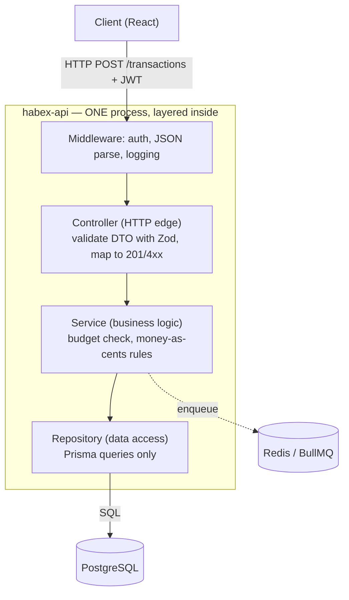

# 21. Architecture & Project Structure

> **One-liner:** After this you'll know how to arrange a growing backend into clean **layers** — routes/controllers → services → repositories — so each piece is testable and swappable, and why you should keep Habex a **modular monolith** long before you ever think about microservices.
> **Where this fits:** The pieces exist now (Express [04](04-http-servers-and-express-basics.md)/[05](05-middleware-and-request-lifecycle.md), validation [07](07-input-validation-and-error-handling.md), Prisma [10](10-connecting-node-to-postgres.md), tests [18](18-testing-backend.md), deploy [20](20-deployment-and-devops.md)); this chapter is how they *fit together* without turning into spaghetti. It's the hands-on twin of [../system-design/21-architecture-patterns.md](../system-design/21-architecture-patterns.md) and the blueprint the [capstone (22)](22-capstone-habex-backend.md) follows.

---

## 1. The Idea in Plain Words

When you started Habex's API, it was fine to put everything in the route handler — validate, run the rule, hit the database, respond, all in one function. But you already know from React what happens next: a component that fetches, transforms, holds state, *and* renders becomes impossible to change or test. You reach for hooks, containers, and presentational components to **separate concerns**. Backend architecture is the same instinct, applied to the server.

The standard, boring, *correct* answer is **layered architecture**. You split each request's journey into layers, each with one job:

| Layer | Its one job | Knows about | Must NOT import |
|---|---|---|---|
| **Route / Controller** | The HTTP edge — read the request, validate the **DTO**, call a service, shape the response + status code | `req`/`res`, Zod schemas | Prisma, SQL, business rules |
| **Service** | The **business logic** — the rules that make Habex *Habex* (money-as-cents, "an expense can't exceed its budget") | domain concepts, other services/repos (as injected deps) | `req`/`res`, Express, SQL |
| **Repository (data access)** | Talk to the database — the *only* layer that knows we use Prisma/Postgres | Prisma client, tables | `req`/`res`, business rules |

Two more terms:

- **DTO** (*Data Transfer Object*): the exact, validated shape of data crossing a boundary — e.g. the JSON allowed *in* on `POST /transactions`. Zod validates untrusted input into a DTO right at the edge, so every layer below can trust it.
- **Modular monolith**: one deployable app (one repo, one process type per role, one database) organized into clear internal **modules** with real boundaries. It is *not* a big ball of mud, and it is *not* microservices — it's the sweet spot for a team of your size.

### Dependency direction (the rule that makes it worth it)

Draw the arrows: **Controller → Service → Repository.** Dependencies point *inward*, toward the business logic, and the business logic points at *nothing infrastructural*. The service doesn't know an HTTP request exists; the repository doesn't know a budget rule exists. That one-way flow is what lets you test the middle in isolation and swap the edges.

The tool that enforces it is a **light touch of dependency injection (DI)**: instead of a service reaching out and `import`-ing a global database singleton, you **pass its dependencies in** (via a constructor). The service receives "something that can store transactions" — in prod that's the real Prisma repository; in a test it's a fake object. No mocking framework, no magic; just "pass deps in, don't grab globals."

---

## 2. Why It Matters

- **Testability.** With logic pulled out of the controller and deps injected, you can unit-test the budget rule with **no HTTP and no database** — pass fake repos, assert it throws. Milliseconds, not a running Postgres. This is the single biggest payoff, and it's why [18](18-testing-backend.md) got so much easier once we did this.
- **Swapability.** Prisma → raw SQL, Express → Fastify, Postgres → something else: if it's isolated in one layer, you change that layer and the business rules never move. The rules are the valuable, hard-won part; protect them from infrastructure churn.
- **Change containment & onboarding.** A feature living in one folder means a bug fix touches one place, two people can work on transactions and budgets without colliding, and a new dev can find things by name.
- **Interview signal.** "Where does business logic go?" is a direct test. "In the controller" is a red flag; "in a service layer, with controllers thin and repositories owning DB access" is the answer they want — and it's the honest reason senior codebases look the way they do.

---

## 3. Picture It (Diagram)

One request — `POST /transactions` — falling straight down through the layers and back. Notice the arrows only point *down*: each layer depends on the one below it, never up.



The same idea as concentric rings, which makes the dependency rule obvious — **outer depends on inner; the core (business logic) depends on nothing infrastructural:**

```
      ┌───────────────────────────────────────────┐
      │  HTTP EDGE  (routes, controllers, DTOs)     │   ← Express lives only here
      │   ┌─────────────────────────────────────┐   │
      │   │  BUSINESS LOGIC  (services)          │   │   ← pure rules, no framework
      │   │   ┌─────────────────────────────┐   │   │
      │   │   │  DATA ACCESS  (repositories) │   │   │   ← Prisma lives only here
      │   │   │      ↓ Prisma                │   │   │
      │   │   └─────────────────────────────┘   │   │
      │   └─────────────────────────────────────┘   │
      └───────────────────────────────────────────┘
        Dependencies point INWARD →→→→→→→→→→→→→→→→
```

---

## 4. Hands-On (TypeScript + Node)

### 4a. The folder shape — feature-based (modular monolith)

Group by **feature** (domain), not by technical layer. Each module is a self-contained vertical slice; shared plumbing lives in `shared/`. This is the layout the capstone uses.

```
habex-api/
├── src/
│   ├── config.ts                 # env parsed + validated once (Zod), fail-fast
│   ├── app.ts                    # builds the Express app (no listen) — testable
│   ├── server.ts                 # WEB entrypoint: create app, listen, graceful shutdown
│   ├── worker.ts                 # WORKER entrypoint: BullMQ workers (same codebase)
│   ├── container.ts              # composition root — wires dependencies together
│   ├── db/prisma.ts              # PrismaClient singleton
│   ├── queue/connection.ts       # Redis/BullMQ connection
│   ├── shared/
│   │   ├── errors.ts             # AppError, NotFoundError, BudgetExceededError…
│   │   ├── http.ts               # asyncHandler wrapper
│   │   └── logger.ts             # pino
│   ├── middleware/
│   │   ├── auth.ts               # requireAuth → sets req.userId
│   │   └── error-handler.ts      # one place: error → HTTP status
│   └── modules/
│       ├── transactions/
│       │   ├── transaction.routes.ts       # url → controller
│       │   ├── transaction.controller.ts   # HTTP edge
│       │   ├── transaction.service.ts      # business rules
│       │   ├── transaction.repo.ts         # Prisma
│       │   ├── transaction.schema.ts       # Zod DTOs
│       │   └── transaction.service.test.ts # unit test (no infra!)
│       ├── budgets/budget.repo.ts
│       └── auth/  (routes, controller, service, repo)
├── prisma/schema.prisma
└── package.json
```

### 4b. A vertical slice: "create transaction," layer by layer

**① The DTO + validation at the edge** (`transaction.schema.ts`) — untrusted JSON becomes a trusted, typed object:

```ts
import { z } from 'zod';

// The DTO: the exact shape allowed IN across the HTTP boundary.
// Money arrives as integer cents; reject anything else HERE, at the edge.
export const createTransactionSchema = z.object({
  categoryId: z.string().uuid(),
  amountCents: z.number().int().positive(), // 4200 = ₹42.00, never a float
  kind: z.enum(['income', 'expense']),
  note: z.string().max(200).optional(),
  occurredAt: z.coerce.date().default(() => new Date()),
});
export type CreateTransactionDTO = z.infer<typeof createTransactionSchema>;
```

**② The repository** (`transaction.repo.ts`) — the only file that knows Prisma exists:

```ts
import type { PrismaClient } from '@prisma/client';
import type { CreateTransactionDTO } from './transaction.schema';

// Speaks in domain terms ("create a transaction"), not raw SQL details.
// Swap Prisma for `pg`/Drizzle later and NOTHING above this file changes.
export class TransactionRepository {
  constructor(private readonly db: PrismaClient) {} // dependency passed IN

  create(userId: string, data: CreateTransactionDTO) {
    return this.db.transaction.create({ data: { ...data, userId } });
  }

  // Sum of a user's expenses in a category+month — used by the budget rule.
  async sumForCategoryMonth(userId: string, categoryId: string, month: string) {
    const start = new Date(`${month}-01T00:00:00Z`);
    const end = new Date(start);
    end.setUTCMonth(end.getUTCMonth() + 1);
    const res = await this.db.transaction.aggregate({
      _sum: { amountCents: true },
      where: { userId, categoryId, kind: 'expense', occurredAt: { gte: start, lt: end } },
    });
    return res._sum.amountCents ?? 0; // integer cents
  }
}
```

**③ The service** (`transaction.service.ts`) — pure business rules, dependencies injected, zero HTTP/SQL:

```ts
import type { CreateTransactionDTO } from './transaction.schema';
import type { TransactionRepository } from './transaction.repo';
import type { BudgetRepository } from '../budgets/budget.repo';
import { BudgetExceededError } from '../../shared/errors';

// Knows NOTHING about req/res and NOTHING about Prisma — only "what a valid
// transaction is." Deps are passed via the constructor, so tests pass fakes.
export class TransactionService {
  constructor(
    private readonly txns: TransactionRepository,
    private readonly budgets: BudgetRepository,
  ) {}

  async createTransaction(userId: string, input: CreateTransactionDTO) {
    // Business rule: an expense may not push a category over its monthly budget.
    if (input.kind === 'expense') {
      const month = input.occurredAt.toISOString().slice(0, 7); // 'YYYY-MM'
      const budget = await this.budgets.findForCategoryMonth(userId, input.categoryId, month);
      if (budget) {
        const spent = await this.txns.sumForCategoryMonth(userId, input.categoryId, month);
        if (spent + input.amountCents > budget.limitCents) {
          // All money math in integer cents; format only at the very edge.
          throw new BudgetExceededError(
            `This ₹${(input.amountCents / 100).toFixed(2)} expense would exceed your ` +
              `₹${(budget.limitCents / 100).toFixed(2)} budget for this category.`,
          );
        }
      }
    }
    return this.txns.create(userId, input); // rules passed → persist
  }
}
```

**④ The controller** (`transaction.controller.ts`) — thin HTTP glue, no rules:

```ts
import type { Request, Response } from 'express';
import { createTransactionSchema } from './transaction.schema';
import type { TransactionService } from './transaction.service';

export class TransactionController {
  constructor(private readonly service: TransactionService) {}

  create = async (req: Request, res: Response) => {
    const dto = createTransactionSchema.parse(req.body); // validate at the edge
    const userId = req.userId!;                          // set by auth middleware
    const txn = await this.service.createTransaction(userId, dto);
    res.status(201).json(txn);                           // shape + status only
  };
}
```

**⑤ The routes** (`transaction.routes.ts`) — url → controller mapping, nothing else:

```ts
import { Router } from 'express';
import { requireAuth } from '../../middleware/auth';
import { asyncHandler } from '../../shared/http'; // forwards async errors to error-handler
import type { TransactionController } from './transaction.controller';

export function transactionRoutes(controller: TransactionController) {
  const router = Router();
  router.post('/', requireAuth, asyncHandler(controller.create));
  return router;
}
```

### 4c. Wire it up — the composition root (`container.ts`)

One place builds the whole object graph and injects deps. Everything else just *receives* what it needs — nothing reaches for a global. Note `buildContainer(db)` takes the DB, so a test can pass a different one.

```ts
import { prisma } from './db/prisma';
import { TransactionRepository } from './modules/transactions/transaction.repo';
import { BudgetRepository } from './modules/budgets/budget.repo';
import { TransactionService } from './modules/transactions/transaction.service';
import { TransactionController } from './modules/transactions/transaction.controller';

// The COMPOSITION ROOT: the single spot that knows how pieces snap together.
export function buildContainer(db = prisma) {
  const txnRepo = new TransactionRepository(db);
  const budgetRepo = new BudgetRepository(db);
  const txnService = new TransactionService(txnRepo, budgetRepo);
  const txnController = new TransactionController(txnService);
  return { txnController /*, authController, … */ };
}
```

```ts
// src/app.ts — build the app WITHOUT listening, so supertest can import it (ch18).
import express from 'express';
import { buildContainer } from './container';
import { transactionRoutes } from './modules/transactions/transaction.routes';
import { errorHandler } from './middleware/error-handler';

export function createApp(container = buildContainer()) {
  const app = express();
  app.use(express.json());
  app.get('/health', (_req, res) => res.json({ status: 'ok' }));
  app.use('/transactions', transactionRoutes(container.txnController));
  app.use(errorHandler); // centralized: AppError.status → HTTP status
  return app;
}
```

### 4d. The payoff — a unit test with fakes (no DB, no HTTP)

Because deps are injected, testing the budget rule needs zero infrastructure. This is *why* we did all of the above:

```ts
// transaction.service.test.ts — runs in milliseconds, no Postgres, no Express.
import { describe, it, expect } from 'vitest';
import { TransactionService } from './transaction.service';

describe('TransactionService', () => {
  it('rejects an expense that would exceed the category budget', async () => {
    const fakeTxns = {
      create: async () => ({ id: 't1' }),
      sumForCategoryMonth: async () => 9_000,           // ₹90 already spent
    } as any;
    const fakeBudgets = {
      findForCategoryMonth: async () => ({ limitCents: 10_000 }), // ₹100 cap
    } as any;
    const service = new TransactionService(fakeTxns, fakeBudgets);

    await expect(
      service.createTransaction('u1', {
        categoryId: 'c1', amountCents: 2_000, kind: 'expense', // +₹20 → ₹110 > ₹100
        occurredAt: new Date('2026-07-08'),
      } as any),
    ).rejects.toThrow(/exceed/);
  });
});
```

### 4e. Shared building blocks

**Config** (`config.ts`) — validate env once, fail fast (from [03](03-project-setup-typescript-node.md)):

```ts
import { z } from 'zod';
const Env = z.object({
  NODE_ENV: z.enum(['development', 'test', 'production']).default('development'),
  PORT: z.coerce.number().default(3000),
  DATABASE_URL: z.string().url(),
  REDIS_URL: z.string().url(),
  JWT_SECRET: z.string().min(32),
});
export const env = Env.parse(process.env); // throws at boot if misconfigured
```

**Typed errors** (`shared/errors.ts`) — services throw meaning, the error middleware maps to HTTP (from [07](07-input-validation-and-error-handling.md)):

```ts
export class AppError extends Error {
  constructor(readonly status: number, message: string, readonly code?: string) {
    super(message);
  }
}
export class NotFoundError extends AppError {
  constructor(what = 'Resource') { super(404, `${what} not found`, 'not_found'); }
}
export class BudgetExceededError extends AppError {
  constructor(message: string) { super(422, message, 'budget_exceeded'); }
}
```

---

## 5. Apply It to Habex

The capstone [(22)](22-capstone-habex-backend.md) uses exactly this structure. The key architectural move is that the **web process and the worker process share one codebase and one service layer** — two entrypoints, same business rules:

```
                 ┌──────────────────────────────────────┐
                 │            ONE codebase / image        │
                 │                                        │
   HTTP  ───────▶│  server.ts ─► app.ts ─► controllers ─┐ │
                 │                                       ▼ │
                 │                        ┌──► SERVICES ◄──┼── shared business rules
                 │                        │              ▲ │   (budget check, cents)
   BullMQ jobs ─▶│  worker.ts ────────────┘   repositories│ │
                 │                                       │ │
                 └───────────────────────────────────────┼─┘
                                                          ▼
                                          Postgres  +  Redis
```

```ts
// src/worker.ts — SEPARATE process, SAME codebase. No Express, no HTTP port.
import { Worker } from 'bullmq';
import { connection } from './queue/connection';
import { buildContainer } from './container';

const { recurringService } = buildContainer(); // reuse the exact same service layer

new Worker(
  'recurring',
  async (job) => {
    // "Materialize today's recurring expenses" — the SAME money/budget rules the
    // API enforces, called from a job instead of an HTTP request. One source of truth.
    await recurringService.materialize(job.data.ruleId);
  },
  { connection },
);
```

The final Habex modules: `auth` (signup/login, JWT), `transactions` (the slice above), `categories`, `budgets`, `recurring` (rules + the worker that fires them), plus `shared/` and `middleware/`. Every module is a controller → service → repository stack; every rule lives in a service both entrypoints can call. When you build the capstone, you're just filling in these boxes.

Keep it a **modular monolith** — do **not** split into microservices for an app this size. That's the same guidance as [../system-design/21-architecture-patterns.md](../system-design/21-architecture-patterns.md), and the *signals* that would actually justify extracting a service later are concrete:

| Signal | Example for Habex | Extract? |
|---|---|---|
| A part needs to **scale independently** | A heavy monthly **analytics/reporting** job pegs CPU and starves the API | Maybe — pull analytics into its own service |
| A part has a **different runtime profile** | The **worker** is already a separate *process* (not yet a separate service) | Already split at the process level — cheapest possible "split" |
| A **team boundary** forms | A payments team owns charging end-to-end | Yes — split along the team/bounded-context line |
| Different **deploy cadence** | One area changes hourly, the rest monthly | Consider it |
| **Nothing above is true** | Habex today | **No — stay a monolith** |

Note the worker is the template for a *good* future split: it already has a clean boundary (a queue) and shares only the service layer. Extracting it into its own deployable is a small step *because* the structure was clean first.

---

## 6. Interview Questions (with answer pointers)

1. **"Explain layered architecture. What are the layers and what does each do?"** *(all)*
   → Controller (HTTP edge: validate DTO, status codes), Service (business logic/rules), Repository (DB access, the only Prisma-aware layer). Dependencies point inward; the service knows nothing about HTTP or SQL. Benefits: testability, swapability, containment.

2. **"Where should business logic live — and where do people wrongly put it?"** *(all, direct test)*
   → In the **service layer**. The common anti-pattern is fat controllers (rules tangled with `req`/`res`) or "smart" repositories with rules in SQL. Keeping rules in services means you can unit-test them without HTTP or a database, and reuse them from a worker.

3. **"What is dependency injection and why bother?"** *(Groww, CRED)*
   → Pass a component's dependencies in (usually via constructor) instead of importing globals. It inverts control so you can substitute a fake repo in tests and swap real implementations (Prisma → raw SQL) without touching business logic. You don't need a framework — a composition root that `new`s things up is enough.

4. **"Monolith or microservices for a small app like this?"** *(senior signal, Swiggy/Zepto)*
   → **Modular monolith.** One deploy, one DB, clear internal module boundaries. Microservices add network failure, distributed transactions, and ops overhead you don't need yet. Start monolith; split later along real boundaries. Name the trap: a **distributed monolith** (split services that still share a DB) is the worst of both worlds.

5. **"How do you keep a monolith from becoming a big ball of mud?"** *(all)*
   → Enforce layer boundaries (controllers never touch Prisma, services never touch `req`/`res`), group by feature so each module is cohesive, inject dependencies, centralize config and error handling, and lean on TypeScript + lint rules to police imports. Modularity is a discipline, not a folder name.

6. **"When would you actually extract a service?"** *(senior)*
   → When a part needs independent scaling, has a distinct runtime profile, forms a team/ownership boundary, or has a genuinely separate bounded context (its own data + lifecycle). For Habex, the analytics/reporting workload or the already-separate worker are the realistic first candidates — and only when the pain is real, not for résumé reasons.

7. **"Feature-based vs layer-based folders — which and why?"**
   → Both group code; feature-based (`modules/transactions/*`) keeps a change in one folder and pre-draws the seams for a future service extraction, while layer-based (`/controllers`, `/services`) scatters one feature across folders. Feature-based scales better as the app grows; either is fine when tiny.

---

## 7. Trade-offs & Pitfalls ("Why Not Just X?")

- **"Why not just put everything in the route handler?"** Fine for a 3-endpoint toy; it collapses fast. You can't test a rule without spinning up HTTP + a DB, two features fight in one file, and reuse from the worker is impossible. The layers cost a little ceremony now to save you from a rewrite later.

- **"Isn't a repository over Prisma redundant — Prisma is already an abstraction?"** Partly fair. The win isn't hiding SQL; it's a **seam for testing** and a single place for query logic (the budget `SUM` lives in one method, not copy-pasted). Keep repositories thin — don't wrap every Prisma call one-to-one just to feel enterprise.

- **"Why not microservices from day one?"** You'd pay the entire distributed-systems tax (network calls that fail, no cross-service transaction, deploy orchestration, data spread everywhere) before you have the scale or team to benefit. Start monolith; extract when a real signal appears. See [../system-design/21-architecture-patterns.md](../system-design/21-architecture-patterns.md).

- **Pitfall: the anemic service.** If your service just calls the repo and returns, and all the *rules* leaked into the controller or SQL, the layer is pure overhead. The service must own the decisions (the budget check, the money math).

- **Pitfall: leaky layers.** A controller importing Prisma, or a repository throwing `res.status(400)`, breaks the whole point. Enforce the direction — a lint rule that bans `@prisma/client` imports outside `*.repo.ts` is worth it.

- **Pitfall: over-injection.** You don't need a DI *container library* for an app this size; a hand-written composition root is clearer and has zero magic. Reach for a framework only when wiring genuinely hurts.

- **Pitfall: circular dependencies between modules.** If `transactions` imports `budgets` which imports `transactions`, extract the shared piece into `shared/` or pass it in. Keep the dependency graph acyclic.

---

## 8. TL;DR

- Structure the backend in **layers**: Controller (HTTP + DTO validation) → Service (business logic) → Repository (Prisma). Dependencies point **inward**; the service knows nothing about HTTP or SQL.
- **Business logic lives in services.** Thin controllers, Prisma-only repositories. That's what makes rules unit-testable and reusable from the worker.
- Use a **light touch of DI**: pass deps in via constructors, wire them in one **composition root** (`container.ts`). No framework needed; it's what unlocks testing with fakes.
- Prefer **feature-based folders** (`modules/<feature>/*`) — a change is one folder, and it pre-draws the seams for any future service split.
- Keep Habex a **modular monolith**. Do **not** jump to microservices; watch for real signals (independent scaling, team boundaries, a heavy analytics workload) before extracting — and never build a **distributed monolith**.
- The **web and worker share one codebase and one service layer** — two entrypoints (`server.ts`, `worker.ts`), one set of rules, one source of truth.

**Next → [22-capstone-habex-backend.md](22-capstone-habex-backend.md):** assemble every chapter — this structure, the layers, auth, DB, queue, tests, Docker, and the deploy from [20](20-deployment-and-devops.md) — into the finished Habex backend.
