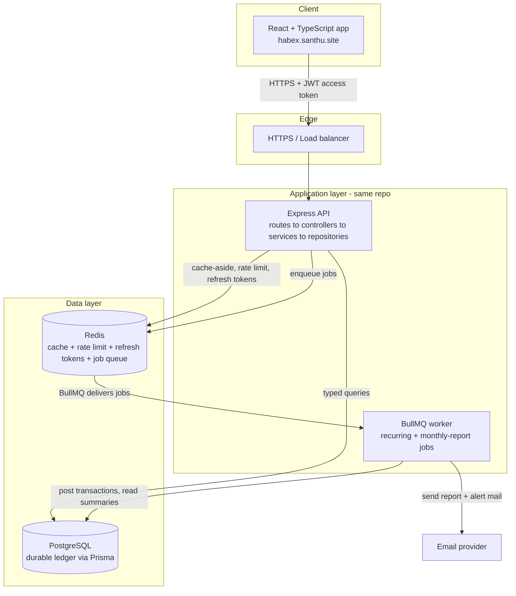
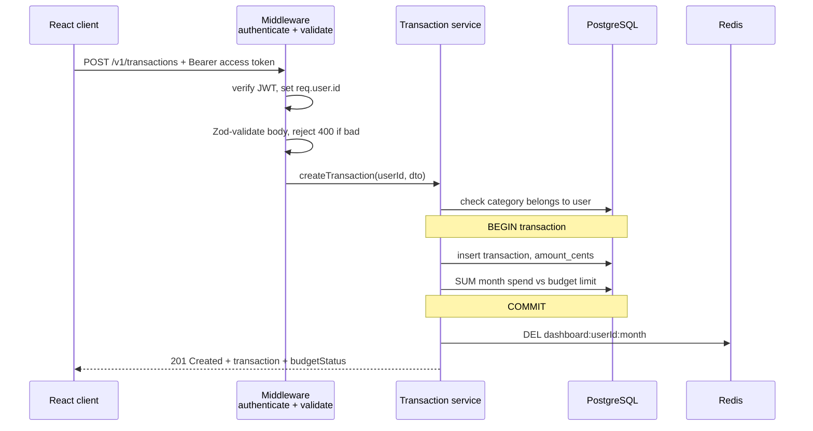
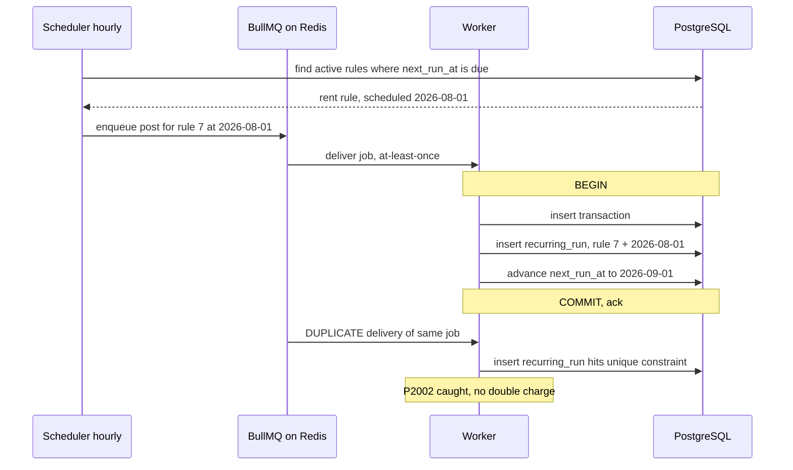
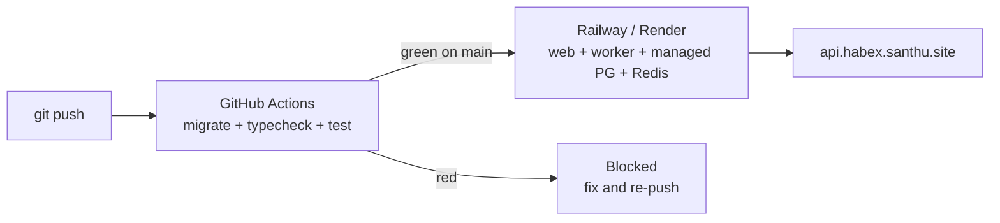

# 22. Capstone: The Habex Backend, End to End

> **One-liner:** Assemble every chapter of this track into *one* coherent, buildable, deployable backend for **Habex** ([habex.santhu.site](https://habex.santhu.site)) — auth, a PostgreSQL ledger, a REST API, Redis caching, idempotent background jobs, tests, Docker, and CI/CD — the real project you'll point interviewers to.
> **What you'll have built:** a production-shaped Node/TypeScript API where a React client logs in, records money as integer cents, sees fast cached dashboards, and has recurring expenses posted for it by a worker that can *never* double-charge — all running in containers in the cloud. This chapter doesn't teach new concepts; it **wires the whole track together** into the app you started in [03-project-setup-typescript-node.md](03-project-setup-typescript-node.md) and have grown ever since.

---

## 1. What We're Building

Back in [01-what-is-backend.md](01-what-is-backend.md), Habex was a lovely React app that kept your money in `localStorage` — a demo, not a product. Over 21 chapters you've built the *other side* of the `fetch()`. Now you connect it all.

**Habex is a personal finance tracker.** A user signs up, creates categories (Food, Rent, Salary…), records **transactions** (income and expense), sets **monthly budgets** per category, defines **recurring rules** (rent on the 1st, salary on the 25th) that post themselves, and stares at **dashboards** that chart where their money went — on their phone *and* laptop, in sync.

| Feature | What the backend owns | Built in |
|---|---|---|
| **Accounts** | Signup, login, JWT access + refresh, logout | [12-authentication.md](12-authentication.md) |
| **Categories** | Per-user income/expense buckets with a colour | [06](06-rest-api-design-in-practice.md), [09](09-data-modeling-and-migrations.md) |
| **Transactions** | The money ledger — integer cents, budget checks | [08](08-sql-and-postgresql-fundamentals.md)–[11](11-transactions-and-query-performance.md) |
| **Budgets** | Monthly limit per category, over-budget alerts | [11](11-transactions-and-query-performance.md), [15](15-background-jobs-and-queues.md) |
| **Recurring rules** | Auto-posted transactions on a cadence | [15-background-jobs-and-queues.md](15-background-jobs-and-queues.md) |
| **Dashboards** | Cached spend-by-category / income-vs-expense summaries | [14-caching-with-redis.md](14-caching-with-redis.md) |
| **Report emails** | Monthly summary emailed to each user | [15-background-jobs-and-queues.md](15-background-jobs-and-queues.md) |

**The goal of this chapter is a deployed, tested API** — not a toy. By the end you have a repo you can clone, `docker compose up`, and hit with `curl`; a CI pipeline that runs your tests on every push; and a live URL at `api.habex.santhu.site`. That artefact — *"here's a backend I designed, built, tested, and shipped"* — is the strongest thing you can bring into a product-company interview ([23-backend-interview-prep.md](23-backend-interview-prep.md)).

> **The through-line, one more time:** money is **always integer cents** (`amount_cents`), never a float. `0.1 + 0.2 !== 0.3`. This single rule, applied everywhere, is what makes Habex *correct* — and it's exactly what CRED/Razorpay/Groww interviewers listen for.

---

## 2. Requirements & Scope

Before writing a line, we do what the [system-design track](../system-design/25-case-study-expense-tracker.md) drilled into you: **clarify requirements first.** That chapter designed Habex *at scale* (5M users, read replicas, sharding-if-ever). **This chapter is the implementation** of the small, correct core that design starts from — one API, one Postgres, one Redis, one worker. Same app, two altitudes: [25 — Design an Expense Tracker (Habex)](../system-design/25-case-study-expense-tracker.md) is the *why at scale*; this is the *how you build it today*.

**Functional requirements:**

| # | Requirement | Endpoint(s) |
|---|---|---|
| F1 | Sign up, log in, refresh, log out | `POST /auth/*` |
| F2 | CRUD categories (scoped to the user) | `/categories` |
| F3 | Create/list/edit/delete transactions | `/transactions` |
| F4 | Adding an expense checks the category's monthly budget | inside `POST /transactions` |
| F5 | CRUD budgets (one limit per category per month) | `/budgets` |
| F6 | CRUD recurring rules; a worker posts them when due | `/recurring-rules` + worker |
| F7 | Dashboard summary for a month (cached) | `GET /dashboard/summary` |
| F8 | Monthly report email per user | worker |

**Non-functional requirements — these drive the engineering:**

| Property | Target | How we meet it |
|---|---|---|
| **Correctness** | A user's ledger is exactly what they entered | Integer cents; ACID transactions ([11](11-transactions-and-query-performance.md)) |
| **Security** | No user can read/write another's data | JWT auth; `WHERE user_id = req.user.id` on **every** query ([12](12-authentication.md), [13](13-authorization-and-security.md)) |
| **Performance** | Dashboards feel instant | Redis cache-aside on the summary ([14](14-caching-with-redis.md)) |
| **Reliability** | A retried recurring job never double-posts | Idempotency ledger + unique constraint ([15](15-background-jobs-and-queues.md)) |
| **Observability** | Every request traceable; health checkable | pino structured logs + `/healthz` ([17](17-logging-monitoring-observability.md)) |
| **Confidence** | Refactors don't break money paths | Vitest + supertest integration tests ([18](18-testing-backend.md)) |
| **Reproducibility** | "Works on my machine" everywhere | Docker + docker-compose ([19](19-docker-and-containers.md)); CI/CD ([20](20-deployment-and-devops.md)) |

**Explicitly out of scope (say this in an interview — right-sizing is senior):** multi-currency, bank/SMS auto-import, shared/group budgets, and realtime push. Each is a real *stretch goal* (§10), deferred on purpose because the correct core comes first. Jumping to Kafka and microservices for a single-user budgeting app is the classic over-engineering red flag ([../system-design/26-interview-playbook.md](../system-design/26-interview-playbook.md)).

---

## 3. Architecture at a Glance

One stateless Express API, one Postgres (via Prisma), one Redis (cache **and** the BullMQ backing store), and one worker process. The API and worker share the same codebase and the same database — the worker is just a second entrypoint (`worker.ts`) that consumes jobs instead of HTTP.



**The layered structure inside the API** is exactly [21-architecture-and-project-structure.md](21-architecture-and-project-structure.md): a request falls through **middleware → controller → service → repository**, and only the repository touches Prisma. Business rules (budget checks, money math) live in **services**; HTTP lives in **controllers**; SQL lives in **repositories**. That separation is what makes the code testable (§8) and is a great thing to be able to draw on a whiteboard.

```
habex-api/
├─ src/
│  ├─ app.ts                 # Express app: middleware chain + routes + error handler
│  ├─ server.ts              # HTTP entrypoint (imports app, listens)
│  ├─ worker.ts              # BullMQ worker entrypoint (no HTTP)
│  ├─ config/
│  │  ├─ env.ts              # Zod-validated process.env (fail fast on boot)
│  │  ├─ prisma.ts           # PrismaClient singleton
│  │  ├─ redis.ts            # ioredis singleton
│  │  └─ logger.ts           # pino instance
│  ├─ middleware/            # authenticate, validate, rateLimit, errorHandler
│  ├─ modules/
│  │  ├─ auth/               # auth.routes / .controller / .service / .schema
│  │  ├─ categories/
│  │  ├─ transactions/
│  │  ├─ budgets/
│  │  ├─ recurring/
│  │  └─ dashboard/
│  ├─ queues/                # recurring.queue.ts, report.queue.ts (+ processors)
│  └─ lib/                   # jwt.ts, password.ts, money.ts, errors.ts
├─ prisma/schema.prisma
├─ tests/                    # *.test.ts (Vitest + supertest)
├─ Dockerfile
├─ docker-compose.yml
└─ package.json
```

---

## 4. The Data Layer

Five tables, exactly the [canonical Habex model](00-README.md) you've used all track. The schema is where correctness starts: **`amount_cents` and `limit_cents` are `Int`** (integer cents), the ownership column `user_id` leads every index, and foreign keys guarantee no transaction points at a missing category.

```prisma
// prisma/schema.prisma
generator client { provider = "prisma-client-js" }
datasource db    { provider = "postgresql"; url = env("DATABASE_URL") }

enum Kind    { income  expense }
enum Cadence { daily   weekly   monthly }

model User {
  id           String   @id @default(cuid())
  email        String   @unique                       // login identity
  passwordHash String   @map("password_hash")         // bcrypt, never plaintext
  name         String
  createdAt    DateTime @default(now()) @map("created_at")

  categories     Category[]
  transactions   Transaction[]
  recurringRules RecurringRule[]
  budgets        Budget[]

  @@map("users")
}

model Category {
  id     String @id @default(cuid())
  userId String @map("user_id")
  name   String
  kind   Kind                                          // 'income' | 'expense'
  color  String

  user           User            @relation(fields: [userId], references: [id], onDelete: Cascade)
  transactions   Transaction[]
  recurringRules RecurringRule[]
  budgets        Budget[]

  @@index([userId])
  @@map("categories")
}

model Transaction {
  id          String   @id @default(cuid())
  userId      String   @map("user_id")
  categoryId  String   @map("category_id")
  amountCents Int      @map("amount_cents")            // INTEGER cents — never a float
  kind        Kind
  note        String?
  occurredAt  DateTime @map("occurred_at")             // the accounting date
  createdAt   DateTime @default(now()) @map("created_at")

  user     User     @relation(fields: [userId], references: [id], onDelete: Cascade)
  category Category @relation(fields: [categoryId], references: [id])

  @@index([userId, occurredAt])              // hot query: "this user's month"
  @@index([userId, categoryId, occurredAt])  // hot query: "this user, this category, this month"
  @@map("transactions")
}

model RecurringRule {
  id          String   @id @default(cuid())
  userId      String   @map("user_id")
  categoryId  String   @map("category_id")
  amountCents Int      @map("amount_cents")
  kind        Kind
  cadence     Cadence
  nextRunAt   DateTime @map("next_run_at")             // when it fires next
  active      Boolean  @default(true)

  user     User     @relation(fields: [userId], references: [id], onDelete: Cascade)
  category Category @relation(fields: [categoryId], references: [id])

  @@index([active, nextRunAt])               // the scheduler's hot query
  @@map("recurring_rules")
}

model Budget {
  id         String @id @default(cuid())
  userId     String @map("user_id")
  categoryId String @map("category_id")
  month      String @db.VarChar(7)                     // 'YYYY-MM'
  limitCents Int    @map("limit_cents")                // INTEGER cents

  user     User     @relation(fields: [userId], references: [id], onDelete: Cascade)
  category Category @relation(fields: [categoryId], references: [id])

  @@unique([userId, categoryId, month])      // one budget per category per month
  @@map("budgets")
}
```

**Why the indexes look like that** ([11-transactions-and-query-performance.md](11-transactions-and-query-performance.md)): every read is scoped to one user, so `user_id` is the **leading column** — the DB jumps straight to this user's rows and `occurred_at` keeps a month as a contiguous slice. The `@@unique([userId, categoryId, month])` on budgets means "one limit per category per month" is enforced by the database, not by hopeful application code.

**Migrations** ([09-data-modeling-and-migrations.md](09-data-modeling-and-migrations.md)) — schema changes are versioned SQL files in git, applied the same way in every environment:

```bash
npx prisma migrate dev --name init        # dev: create + apply a migration, regenerate client
npx prisma migrate deploy                 # prod/CI: apply committed migrations, no prompts
```

---

## 5. The API

Clean REST ([06-rest-api-design-in-practice.md](06-rest-api-design-in-practice.md)): resources + standard verbs, everything under `/v1`, everything (except auth) requiring a valid access token. **`user_id` always comes from the verified JWT, never the request body** — the single most important security habit in the app.

| Method & path | Auth | Does |
|---|---|---|
| `POST /v1/auth/register` | — | Create account, return access + refresh |
| `POST /v1/auth/login` | — | Verify password, return access + refresh |
| `POST /v1/auth/refresh` | refresh | Rotate tokens |
| `POST /v1/auth/logout` | refresh | Revoke the refresh token |
| `GET/POST /v1/categories` | ✅ | List / create categories |
| `PATCH/DELETE /v1/categories/:id` | ✅ | Edit / delete (ownership-checked) |
| `GET /v1/transactions?month=YYYY-MM` | ✅ | List a month's transactions |
| `POST /v1/transactions` | ✅ | Record a transaction + budget check |
| `PATCH/DELETE /v1/transactions/:id` | ✅ | Edit / delete (ownership-checked) |
| `GET/POST/PATCH/DELETE /v1/budgets` | ✅ | Manage monthly budgets |
| `GET/POST/PATCH/DELETE /v1/recurring-rules` | ✅ | Manage recurring rules |
| `GET /v1/dashboard/summary?month=YYYY-MM` | ✅ | Cached spend summary |
| `GET /healthz` | — | Liveness for the load balancer |

Now three **vertical slices** in real code, each falling through the layers. Type them and you have a working spine.

### Slice A — `POST /auth/login` (controller → schema → service → response)

```ts
// modules/auth/auth.schema.ts — the contract for the request body (Zod, ch07)
import { z } from 'zod';
export const loginSchema = z.object({
  email: z.string().email(),
  password: z.string().min(8),
});
export type LoginDto = z.infer<typeof loginSchema>;
```

```ts
// modules/auth/auth.service.ts — business logic only; no req/res in here
import bcrypt from 'bcrypt';
import { prisma } from '../../config/prisma';
import { redis } from '../../config/redis';
import { signAccess, signRefresh, refreshKey } from '../../lib/jwt';
import { AppError } from '../../lib/errors';
import type { LoginDto } from './auth.schema';

export async function login({ email, password }: LoginDto) {
  const user = await prisma.user.findUnique({ where: { email } });
  // Same generic error whether the email is unknown or the password is wrong —
  // never leak which accounts exist (ch13).
  if (!user) throw new AppError(401, 'Invalid credentials');

  const ok = await bcrypt.compare(password, user.passwordHash);
  if (!ok) throw new AppError(401, 'Invalid credentials');

  const accessToken = signAccess(user.id);          // short-lived, e.g. 15m
  const { token: refreshToken, jti } = signRefresh(user.id); // long-lived, e.g. 7d

  // Store the refresh token's id in Redis so we can revoke it on logout (ch12, ch14).
  await redis.set(refreshKey(user.id, jti), '1', 'EX', 60 * 60 * 24 * 7);

  return { accessToken, refreshToken, user: { id: user.id, email: user.email, name: user.name } };
}
```

The **controller** and **route** are the same thin pattern shown in Slice B below: a controller that calls `login(req.body)` and returns `200`, wired as `authRouter.post('/login', validate(loginSchema), loginController)` — the `validate` middleware runs Zod *before* the controller, so the service only ever sees clean input ([05](05-middleware-and-request-lifecycle.md), [07](07-input-validation-and-error-handling.md)).

### Slice B — `POST /transactions` (the money path, with a budget check inside a DB transaction)

This is the heart of Habex. It shows all four rules at once: **money as integer cents**, **ownership from the token**, an **ACID transaction** wrapping the insert + budget recompute, and a **cache invalidation** so the user sees their own change immediately.

```ts
// modules/transactions/transaction.schema.ts
import { z } from 'zod';
export const createTxnSchema = z.object({
  categoryId:  z.string().cuid(),
  amountCents: z.number().int().positive(),   // integer cents — the type enforces it
  kind:        z.enum(['income', 'expense']),
  note:        z.string().max(280).optional(),
  occurredAt:  z.coerce.date(),
});
export type CreateTxnDto = z.infer<typeof createTxnSchema>;
```

```ts
// lib/money.ts — one place for money helpers, so cents never leak into floats
export const monthKey = (d: Date) => d.toISOString().slice(0, 7); // 'YYYY-MM'
export const monthRange = (month: string) => {
  const start = new Date(`${month}-01T00:00:00.000Z`);
  const end = new Date(start); end.setUTCMonth(end.getUTCMonth() + 1);
  return { start, end };
};
export const rupees = (cents: number) => `₹${(cents / 100).toFixed(2)}`; // display ONLY
```

```ts
// modules/transactions/transaction.service.ts
import { prisma } from '../../config/prisma';
import { redis } from '../../config/redis';
import { reportQueue } from '../../queues/report.queue';
import { monthKey, monthRange } from '../../lib/money';
import { AppError } from '../../lib/errors';
import type { CreateTxnDto } from './transaction.schema';

export async function createTransaction(userId: string, dto: CreateTxnDto) {
  // Ownership check: the category must belong to THIS user (ch13, prevents IDOR).
  const category = await prisma.category.findFirst({
    where: { id: dto.categoryId, userId },
  });
  if (!category) throw new AppError(404, 'Category not found');

  const month = monthKey(dto.occurredAt);
  const { start, end } = monthRange(month);

  // ACID transaction (ch11): insert + recompute-spend happen all-or-nothing.
  const { txn, budgetStatus } = await prisma.$transaction(async (tx) => {
    const txn = await tx.transaction.create({
      data: { ...dto, userId },
    });

    // Recompute this category's spend for the month, in cents, with SUM in the DB.
    const spent = await tx.transaction.aggregate({
      where: { userId, categoryId: dto.categoryId, kind: 'expense', occurredAt: { gte: start, lt: end } },
      _sum: { amountCents: true },
    });
    const spentCents = spent._sum.amountCents ?? 0;

    const budget = await tx.budget.findUnique({
      where: { userId_categoryId_month: { userId, categoryId: dto.categoryId, month } },
    });

    const budgetStatus = budget
      ? { limitCents: budget.limitCents, spentCents, over: spentCents > budget.limitCents }
      : null;

    return { txn, budgetStatus };
  });

  // Read-your-writes: drop the cached summary so the user's next dashboard is fresh (ch14).
  await redis.del(`dashboard:${userId}:${month}`);

  // Soft budget: we don't block the spend, we alert. Enqueue an email if crossing (ch15).
  if (budgetStatus?.over) {
    await reportQueue.add('budget-alert', { userId, categoryId: dto.categoryId, month });
  }

  return { transaction: txn, budgetStatus };
}
```

```ts
// modules/transactions/transaction.controller.ts
import type { Response } from 'express';
import type { AuthedRequest } from '../../middleware/authenticate';
import { createTransaction } from './transaction.service';

export async function createTxnController(req: AuthedRequest, res: Response) {
  // req.user.id came from the verified JWT — NOT from the body.
  const result = await createTransaction(req.user.id, req.body);
  res.status(201).json(result);
}
```

The request flow, end to end:



### Slice C — `GET /dashboard/summary` (cache-aside on the read-heavy path)

Dashboards are the dominant load, and each one is a `GROUP BY` aggregation. Serve it from Redis; compute on a miss ([14-caching-with-redis.md](14-caching-with-redis.md)).

```ts
// modules/dashboard/dashboard.service.ts
import { prisma } from '../../config/prisma';
import { redis } from '../../config/redis';
import { monthRange } from '../../lib/money';

export async function getSummary(userId: string, month: string) {
  const cacheKey = `dashboard:${userId}:${month}`;

  const cached = await redis.get(cacheKey);
  if (cached) return JSON.parse(cached);          // cache HIT — sub-millisecond

  const { start, end } = monthRange(month);
  const rows = await prisma.transaction.groupBy({
    by: ['categoryId', 'kind'],
    where: { userId, occurredAt: { gte: start, lt: end } },
    _sum: { amountCents: true },                  // still integer cents
  });

  const summary = {
    month,
    totalIncomeCents:  sum(rows, 'income'),
    totalExpenseCents: sum(rows, 'expense'),
    byCategory: rows.map((r) => ({ categoryId: r.categoryId, kind: r.kind, totalCents: r._sum.amountCents ?? 0 })),
  };

  // Cache with a TTL as a safety net; writes also actively invalidate (Slice B).
  await redis.set(cacheKey, JSON.stringify(summary), 'EX', 300);
  return summary;
}

const sum = (rows: { kind: string; _sum: { amountCents: number | null } }[], kind: string) =>
  rows.filter((r) => r.kind === kind).reduce((a, r) => a + (r._sum.amountCents ?? 0), 0);
```

---

## 6. Auth, Security & Ownership

Auth is two files of primitives ([12-authentication.md](12-authentication.md)) plus one discipline applied everywhere.

```ts
// lib/password.ts — bcrypt with a sane cost factor
import bcrypt from 'bcrypt';
export const hashPassword  = (plain: string) => bcrypt.hash(plain, 12);
export const verifyPassword = (plain: string, hash: string) => bcrypt.compare(plain, hash);
```

```ts
// lib/jwt.ts — short access token, long rotating refresh token
import jwt from 'jsonwebtoken';
import { randomUUID } from 'node:crypto';
import { env } from '../config/env';

export const signAccess  = (userId: string) =>
  jwt.sign({ sub: userId }, env.JWT_ACCESS_SECRET, { expiresIn: '15m' });

export const signRefresh = (userId: string) => {
  const jti = randomUUID();
  const token = jwt.sign({ sub: userId, jti }, env.JWT_REFRESH_SECRET, { expiresIn: '7d' });
  return { token, jti };
};

export const refreshKey = (userId: string, jti: string) => `refresh:${userId}:${jti}`;
```

```ts
// middleware/authenticate.ts — turns a Bearer token into req.user
import type { Request, Response, NextFunction } from 'express';
import jwt from 'jsonwebtoken';
import { env } from '../config/env';
import { AppError } from '../lib/errors';

export interface AuthedRequest extends Request { user: { id: string } }

export function authenticate(req: Request, _res: Response, next: NextFunction) {
  const header = req.headers.authorization;
  if (!header?.startsWith('Bearer ')) throw new AppError(401, 'Missing token');
  try {
    const payload = jwt.verify(header.slice(7), env.JWT_ACCESS_SECRET) as { sub: string };
    (req as AuthedRequest).user = { id: payload.sub };
    next();
  } catch {
    throw new AppError(401, 'Invalid or expired token');
  }
}
```

**Ownership is the rule that never bends:** every service filters by `userId` from the token — `findFirst({ where: { id, userId } })`, never `findUnique({ where: { id } })` on a user-owned row. Skip it and user A can `GET /transactions/<B's id>` and read someone else's money — an **IDOR** / broken-access-control bug, the #1 web risk ([13-authorization-and-security.md](13-authorization-and-security.md)).

**The hardening middleware chain** ([13](13-authorization-and-security.md), [05](05-middleware-and-request-lifecycle.md)):

```ts
// app.ts (excerpt) — order matters: security first, routes last, errors at the end
import express from 'express';
import helmet from 'helmet';
import cors from 'cors';
import { pinoHttp } from 'pino-http';
import { logger } from './config/logger';
import { rateLimit } from './middleware/rateLimit';   // Redis-backed (ch14)
import { errorHandler } from './middleware/errorHandler';

export const app = express();
app.use(helmet());                                     // secure headers
app.use(cors({ origin: env.CLIENT_ORIGIN, credentials: true }));
app.use(express.json({ limit: '100kb' }));             // cap body size
app.use(pinoHttp({ logger }));                         // structured request logs
app.use(rateLimit({ windowMs: 60_000, max: 100 }));    // throttle abuse
app.get('/healthz', (_req, res) => res.json({ status: 'ok' }));
// ... /v1 routers here ...
app.use(errorHandler);                                 // centralized errors, LAST
```

Secrets (`JWT_*_SECRET`, `DATABASE_URL`, `REDIS_URL`) come only from environment variables, validated on boot in `config/env.ts` so a missing secret crashes at startup, not at 2am ([13](13-authorization-and-security.md), [20](20-deployment-and-devops.md)).

---

## 7. Background Work

Two jobs run off BullMQ ([15-background-jobs-and-queues.md](15-background-jobs-and-queues.md)), both on the same Redis: **recurring transactions** and **monthly report emails**. The interesting one is recurring, because a retried or duplicated job must **never** post rent twice.

**The idempotency design** (the exact discipline CRED/Razorpay probe — [../system-design/19-reliability-patterns.md](../system-design/19-reliability-patterns.md)): a tiny ledger table records "this rule fired for this scheduled instant," with a **unique constraint** as the referee. The domain stays the 5 canonical tables; this is one infrastructure table supporting exactly-once.

```prisma
// add to schema.prisma — the idempotency ledger for recurring posts
model RecurringRun {
  id            String   @id @default(cuid())
  ruleId        String   @map("rule_id")
  scheduledFor  DateTime @map("scheduled_for")
  transactionId String   @map("transaction_id")
  createdAt     DateTime @default(now()) @map("created_at")

  @@unique([ruleId, scheduledFor])   // the referee: one post per rule per instant
  @@map("recurring_runs")
}
```

A **repeatable scheduler job** wakes hourly, finds due rules, and enqueues one job per occurrence. The worker posts idempotently:

```ts
// queues/recurring.processor.ts — runs in worker.ts
import { prisma } from '../config/prisma';
import { Prisma } from '@prisma/client';
import { advance } from '../lib/cadence';   // nextRunAt + 1 day/week/month

export async function processRecurring(job: { data: { ruleId: string; scheduledFor: string } }) {
  const scheduledFor = new Date(job.data.scheduledFor);
  const rule = await prisma.recurringRule.findFirst({ where: { id: job.data.ruleId, active: true } });
  if (!rule) return; // deleted or paused between enqueue and run — safe no-op

  try {
    await prisma.$transaction(async (tx) => {
      // 1) Post the real transaction.
      const txn = await tx.transaction.create({
        data: {
          userId: rule.userId, categoryId: rule.categoryId,
          amountCents: rule.amountCents, kind: rule.kind,
          note: 'Recurring', occurredAt: scheduledFor,
        },
      });
      // 2) Claim the occurrence. UNIQUE(ruleId, scheduledFor) makes a re-run throw here.
      await tx.recurringRun.create({
        data: { ruleId: rule.id, scheduledFor, transactionId: txn.id },
      });
      // 3) Advance the clock in the SAME transaction — atomic with the insert.
      await tx.recurringRule.update({
        where: { id: rule.id },
        data: { nextRunAt: advance(rule.nextRunAt, rule.cadence) },
      });
    });
  } catch (e) {
    // Already processed → unique violation → treat as success. This is what makes
    // at-least-once delivery safe: re-processing is a harmless no-op.
    if (e instanceof Prisma.PrismaClientKnownRequestError && e.code === 'P2002') return;
    throw e; // real failure → let BullMQ retry with backoff
  }
}
```



The **monthly-report job** is a repeatable BullMQ job (`{ pattern: '0 6 1 * *' }` — 6am on the 1st) that, per user, reads their previous month's summary and sends an email. It's idempotent-ish too: dedupe per `(userId, month)` so a retry doesn't email twice.

---

## 8. Caching, Logging, Testing

**Caching** you already wired in Slice C: cache-aside on `dashboard:{userId}:{month}`, invalidated on every write to that month. That's the single biggest performance lever, because dashboards are read far more than transactions are written ([14-caching-with-redis.md](14-caching-with-redis.md), [../system-design/25-case-study-expense-tracker.md](../system-design/25-case-study-expense-tracker.md)).

**Logging & health** ([17-logging-monitoring-observability.md](17-logging-monitoring-observability.md)): `pino` emits structured JSON (one object per request, with a request id), so production logs are greppable and pipe cleanly into any log service. **Never log secrets or full request bodies** — redact `authorization` and `password`. `/healthz` gives the load balancer and Railway a cheap liveness probe.

```ts
// config/logger.ts
import pino from 'pino';
export const logger = pino({
  level: process.env.LOG_LEVEL ?? 'info',
  redact: ['req.headers.authorization', 'req.body.password'], // never leak these
});
```

**Testing** ([18-testing-backend.md](18-testing-backend.md)): the money paths get **integration tests** with `supertest` against a real test Postgres (Docker), because a unit test with a mocked DB can't catch a broken budget query. One test that pays for itself:

```ts
// tests/transactions.test.ts
import request from 'supertest';
import { describe, it, expect, beforeAll } from 'vitest';
import { app } from '../src/app';

describe('POST /v1/transactions', () => {
  let token: string, categoryId: string;
  beforeAll(async () => { ({ token, categoryId } = await seedUserWithCategory()); });

  it('records money as integer cents and returns 201', async () => {
    const res = await request(app)
      .post('/v1/transactions')
      .set('Authorization', `Bearer ${token}`)
      .send({ categoryId, amountCents: 4200, kind: 'expense', occurredAt: '2026-07-08' });

    expect(res.status).toBe(201);
    expect(res.body.transaction.amountCents).toBe(4200); // exact cents, no float drift
  });

  it('rejects another user\'s category with 404 (ownership)', async () => {
    const other = await seedUserWithCategory();
    const res = await request(app)
      .post('/v1/transactions')
      .set('Authorization', `Bearer ${token}`)              // user A's token
      .send({ categoryId: other.categoryId, amountCents: 100, kind: 'expense', occurredAt: '2026-07-08' });

    expect(res.status).toBe(404); // A cannot write into B's category — IDOR blocked
  });

  it('rejects a negative amount with 400 (validation)', async () => {
    const res = await request(app)
      .post('/v1/transactions')
      .set('Authorization', `Bearer ${token}`)
      .send({ categoryId, amountCents: -5, kind: 'expense', occurredAt: '2026-07-08' });

    expect(res.status).toBe(400); // Zod caught it before the controller
  });
});
```

Those three tests assert the three things Habex must never get wrong: **exact cents**, **ownership**, and **validation**. Run them in CI on every push (§9).

---

## 9. Containerize & Deploy

**Locally**, one command boots the whole system — API, worker, Postgres, Redis — so a teammate (or an interviewer looking at your repo) runs it with zero setup ([19-docker-and-containers.md](19-docker-and-containers.md)):

```yaml
# docker-compose.yml
services:
  db:
    image: postgres:16
    environment: { POSTGRES_PASSWORD: dev, POSTGRES_DB: habex }
    ports: ["5432:5432"]
    volumes: ["pgdata:/var/lib/postgresql/data"]
  redis:
    image: redis:7
    ports: ["6379:6379"]
  api:
    build: .
    command: node dist/server.js
    environment:
      DATABASE_URL: postgres://postgres:dev@db:5432/habex
      REDIS_URL: redis://redis:6379
    depends_on: [db, redis]
    ports: ["3000:3000"]
  worker:
    build: .
    command: node dist/worker.js       # same image, different entrypoint
    environment:
      DATABASE_URL: postgres://postgres:dev@db:5432/habex
      REDIS_URL: redis://redis:6379
    depends_on: [db, redis]
volumes: { pgdata: {} }
```

The API and worker share **one image, two commands** — build once, run the HTTP server *or* the queue consumer. The `Dockerfile` is a multi-stage build (deps → build TypeScript → slim runtime) so the shipped image is small.

**In production** ([20-deployment-and-devops.md](20-deployment-and-devops.md)): push to **Railway/Render** as two services (web + worker) plus managed Postgres and Redis add-ons; set secrets as env vars in the dashboard; run `prisma migrate deploy` on release. A **GitHub Actions** pipeline gates every push:

```yaml
# .github/workflows/ci.yml (sketch)
on: [push, pull_request]
jobs:
  test:
    runs-on: ubuntu-latest
    services:
      postgres: { image: postgres:16, env: { POSTGRES_PASSWORD: test }, ports: ["5432:5432"] }
      redis:    { image: redis:7, ports: ["6379:6379"] }
    steps:
      - uses: actions/checkout@v4
      - uses: actions/setup-node@v4
        with: { node-version: 20, cache: npm }
      - run: npm ci
      - run: npx prisma migrate deploy
      - run: npm run typecheck        # tsc --noEmit — types are a test too
      - run: npm test                 # vitest + supertest
      # on main, a green build triggers the Railway/Render deploy
```

That pipeline is the story in one picture: **types check → tests pass → deploy**. Nothing reaches `api.habex.santhu.site` without going through green.



---

## 10. Stretch Goals & What to Say in Interviews

**Stretch goals** (each maps to a chapter, and each is a great "what would you build next" answer):

| Goal | The core idea | Chapter |
|---|---|---|
| **Realtime multi-device sync** | On a write, push the change over WebSockets so the laptop updates the moment the phone posts | [16-realtime-websockets.md](16-realtime-websockets.md) |
| **Bank / SMS import** | An ingestion worker parses statements into transactions, deduped by an idempotency key | [15](15-background-jobs-and-queues.md), [../system-design/16-kafka-and-webhooks.md](../system-design/16-kafka-and-webhooks.md) |
| **Shared / group budgets** | A `memberships` join table breaks the clean "one user owns their data" model — scope by membership, not user | [09](09-data-modeling-and-migrations.md), [13](13-authorization-and-security.md) |
| **CSV / PDF export** | An async job builds the file and stores it; the API returns a job id, then a download link | [15](15-background-jobs-and-queues.md) |
| **Scale-out** | Read replicas + heavier caching once one Postgres strains — see the at-scale design | [../system-design/25-case-study-expense-tracker.md](../system-design/25-case-study-expense-tracker.md) |

**How to pitch this build in an interview.** Don't recite features — narrate *decisions*, because decisions are what senior engineers are scored on:

> "I built Habex, an expense tracker, as a real full-stack app. The backend is Node, TypeScript, and Express in a layered controller-service-repository structure, on Postgres via Prisma. Because it's money I store everything as **integer cents** and wrap the insert-plus-budget-check in a **single ACID transaction**, so the ledger is always exactly what the user entered. Auth is **JWT access plus a rotating refresh token in Redis**, and every query is scoped to the user id from the token, so there's no IDOR. Dashboards are the read-heavy path, so I **cache them in Redis cache-aside** and invalidate on write. Recurring transactions run on a **BullMQ worker** that's **idempotent** — a unique constraint per occurrence means a retry can never double-post rent. It's tested with Vitest and supertest against a real Postgres, containerized with docker-compose, and deployed on Railway with a GitHub Actions pipeline that runs migrations, typecheck, and tests before every deploy."

That paragraph name-drops correctness, transactions, auth, security, caching, idempotency, testing, and CI/CD — most of this track — and every clause is **true**, so you can go deep on any of them when they poke. When an interviewer asks something adjacent ("design a payments ledger", "how do you prevent double-charges"), **bridge to Habex**: *"that's exactly the idempotency problem I solved for recurring transactions — let me walk through it."* See [23-backend-interview-prep.md](23-backend-interview-prep.md) for the full playbook.

---

## 11. TL;DR

- **This chapter assembles the whole track** into one buildable Habex backend: Express (layered controller→service→repository) on Postgres/Prisma, Redis, and a BullMQ worker — the app you point interviewers to.
- **Five canonical tables**, money as **`Int` cents** everywhere, `user_id` leading every index. Foreign keys and a unique budget constraint let the **database enforce correctness**.
- **The money path** (`POST /transactions`) is the showpiece: validate with Zod → ownership from the token → insert + budget recompute in **one ACID transaction** → invalidate the dashboard cache.
- **Auth** is JWT access + a rotating refresh token in Redis, bcrypt hashing, and helmet/cors/rate-limit — with **ownership scoping on every query** to kill IDOR.
- **Dashboards are cached** (cache-aside, invalidate-on-write); **recurring jobs are idempotent** (unique `(ruleId, scheduledFor)` + advance-in-the-same-transaction) so a retry can never double-charge.
- **Shipped, not theoretical:** pino logs + `/healthz`, supertest integration tests over a real Postgres, docker-compose for local, Railway/Render + GitHub Actions for prod.
- **The pitch is decisions, not features:** integer cents, ACID transactions, JWT+refresh, cache-aside dashboards, idempotent workers, tested and deployed — true, defensible, and exactly what product companies want to hear.

**Next → [23-backend-interview-prep.md](23-backend-interview-prep.md):** turn everything you just built into interview answers — the question bank, per-company focus, and the Habex story that closes the offer.
