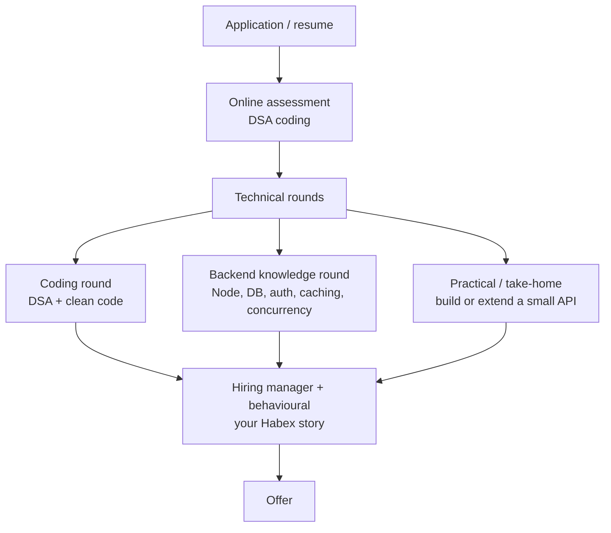
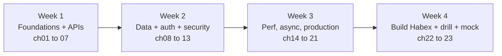

# 23. Backend Interview Prep

> **One-liner:** The whole backend track, distilled into an interview weapon — a per-topic question bank with crisp model-answer pointers, the fintech money questions CRED/Razorpay/Groww love, per-company focus, and the 60-second Habex story that closes the offer.
> **Who it's for:** You, **Santhosh** — a strong React/TypeScript dev who was weak on backend and has now read chapters 01–22 and *built* Habex. This is the chapter you re-read the night before a full-stack or backend round. Everything points back to a chapter where you can go deep; this is where those chapters become **answers**.

---

## 1. How Backend Shows Up in Interviews

Even for roles labelled "frontend" or "full-stack," product companies test whether you understand the server. There are three distinct arenas, and you prepare for them differently:

| Round | What it tests | How you prep |
|---|---|---|
| **Coding round (DSA)** | Problem-solving, data structures, clean code under pressure | The [../dsa/](../dsa/00-README.md) track — separate muscle, never skip it |
| **Backend / system-knowledge round** | Do you *understand* Node, HTTP, SQL, auth, caching, concurrency? | **This chapter** — the question bank in §2, out loud |
| **Practical / take-home** | Can you actually build a small, correct, tested API? | You already did — **Habex** ([22](22-capstone-habex-backend.md)) is your proof |

**Where backend gets tested even for "frontend" roles:** "what happens when you type a URL and hit enter?", "how does your React app authenticate?", "why is this API slow and how would you fix it?", "where does the JWT live and why?". A frontend dev who can answer these — and say *"I built the backend too, here's how"* — is a full-stack hire, not a frontend one. That gap is your biggest opportunity, and this track closed it.

**The meta-strategy:** in a knowledge round, every answer should (a) give the crisp correct answer, then (b) **ground it in Habex** — *"…which is exactly what I did for the dashboard cache."* Real beats theoretical every time.

---

## 2. Core Question Bank

Grouped to match the track. Each answer is a **pointer**, not an essay — enough to trigger the full answer you already know, plus the chapter to go deep. Practice these **out loud**; reading them silently feels like learning and isn't.

> **How to use it:** for each question, say the pointer, then add one sentence grounding it in Habex — that pairing (correct answer + real experience) is exactly what a knowledge round scores. If a whole group feels shaky, that's your signal to re-read its chapter, not to memorize the row.

### Node & the event loop — [02](02-nodejs-runtime-and-event-loop.md)

| Question | Model-answer pointer |
|---|---|
| What is the event loop? | A single-threaded loop that pulls callbacks off queues and runs them one at a time; blocking I/O is offloaded to libuv's thread pool / the OS, so JS never waits. |
| Is Node single-threaded? | *JS execution* is single-threaded; I/O and some CPU work (crypto, fs, zlib) run on libuv's thread pool. So it's concurrent without being multi-threaded for your code. |
| How does one thread serve thousands of connections? | Non-blocking I/O: start the I/O, register a callback, move on. No thread-per-request, so no per-connection memory blowup. |
| `process.nextTick` vs `setImmediate` vs `setTimeout`? | `nextTick` + promise microtasks drain fully *between* each loop phase; `setTimeout` fires in the timers phase; `setImmediate` in the check phase. Microtasks beat macrotasks. |
| What blocks the event loop, and why is that bad? | Synchronous CPU work (huge `JSON.parse`, sync crypto, tight loops) stalls **every** request. Offload to `worker_threads`, stream, or paginate. |
| When would you reach for `worker_threads` or `cluster`? | CPU-bound work → `worker_threads`; using all cores → `cluster`/PM2 or just run N container replicas behind a load balancer. |
| What are streams and backpressure? | Streams process data in chunks instead of buffering it all in memory; backpressure lets a slow consumer pause a fast producer — how you handle big uploads/exports without blowing up RAM. |
| What commonly causes a memory leak in Node? | Unbounded caches/arrays, listeners never removed, closures holding big objects, or globals that only grow. Watch heap growth; profile with `--inspect`. |

### Async & promises — [02](02-nodejs-runtime-and-event-loop.md)

| Question | Model-answer pointer |
|---|---|
| Callbacks vs promises vs async/await? | Same async model; async/await is syntax sugar over promises that reads like sync code. It doesn't block — `await` yields to the event loop. |
| `Promise.all` vs `allSettled` vs `race`? | `all` rejects on first failure; `allSettled` waits for all and reports each; `race` settles with the first to finish. Use `all` for independent parallel work. |
| Sequential vs parallel awaits? | `await`-ing in a loop serializes independent calls. Fire them together with `Promise.all` when they don't depend on each other — a common perf bug. |
| How do you handle errors in async/await? | `try/catch`; wrap Express handlers so rejections reach the error middleware; never leave a floating promise (unhandled rejection can crash the process). |
| What's a "floating promise"? | A promise you forgot to `await` or `.catch()` — its rejection is silent and its ordering is wrong. Lint for it. |
| What actually happens on `await`? | The function suspends, control returns to the event loop, and the continuation is queued as a microtask when the awaited promise settles. |
| How do you catch errors you'd otherwise miss? | Wrap async handlers so rejections reach the error middleware, and register `process.on('unhandledRejection')` / `'uncaughtException'` to log and exit cleanly as a last resort. |
| How do you cancel or time out an async call? | `AbortController` + `signal` (fetch, many libs) or `Promise.race` against a timeout — never let a hung upstream call pin a request forever. |

### Express & middleware — [04](04-http-servers-and-express-basics.md), [05](05-middleware-and-request-lifecycle.md)

| Question | Model-answer pointer |
|---|---|
| What is middleware? | A function `(req, res, next)` in an ordered chain; each can read/modify req/res, end the response, or call `next()` to pass control. Auth, logging, validation, errors are all middleware. |
| Why does middleware order matter? | It runs top-to-bottom. `helmet`/`cors` before routes, body parser before handlers, the error handler **last**. Wrong order = auth bypassed or errors uncaught. |
| Error-handling middleware signature? | Four args: `(err, req, res, next)`. Express routes errors here when you `next(err)` or throw in an async handler that's wrapped. |
| `app.use` vs a `Router`? | `Router` is a mini-app you mount under a path (`/v1/transactions`) to keep modules isolated — the structure Habex uses. |
| How does auth middleware work? | It reads the `Authorization` header, verifies the JWT, sets `req.user`, and calls `next()` — or throws 401. Downstream handlers trust `req.user`. |
| `next()` vs `next(err)`? | `next()` = go to the next middleware; `next(err)` (or throwing) = skip to the error handler. |
| How do you handle errors in an async route? | Express 4 doesn't catch rejected promises, so wrap handlers in an `asyncHandler` that forwards rejections to `next(err)` — or use Express 5, which does it for you. |
| What is `express.json()` doing, and why cap it? | It parses a JSON body into `req.body`; set a size limit (e.g. `100kb`) so a giant payload can't exhaust memory. |

### REST & API design — [06](06-rest-api-design-in-practice.md)

| Question | Model-answer pointer |
|---|---|
| What makes an API RESTful? | Resources as nouns (`/transactions`), HTTP verbs for actions, stateless requests, correct status codes, representations in JSON. |
| Which status codes and when? | 200 ok, 201 created, 204 no-content, 400 bad input, 401 unauth, 403 forbidden, 404 not found, 409 conflict, 422 unprocessable, 429 rate-limited, 500 server error. |
| Which HTTP methods are idempotent? | GET, PUT, DELETE are idempotent; POST is not. Matters for safe retries — retrying a POST can double-create without an idempotency key. |
| PUT vs PATCH? | PUT replaces the whole resource; PATCH updates fields. PATCH is what Habex uses for edits. |
| Offset vs cursor pagination? | Offset (`LIMIT/OFFSET`) is simple but slow and drifts on inserts; cursor (keyset, "after id X") is stable and fast at scale. Cursor for big lists. |
| How do you version an API? | URL prefix (`/v1`) is simplest and interview-standard; header-based is cleaner but fussier. Version so you can evolve without breaking clients. |
| How do you signal rate limiting to a client? | Return `429 Too Many Requests` with a `Retry-After` header, and expose `X-RateLimit-*` headers so a well-behaved client can back off. |
| Where does an idempotency key go in REST? | A client-supplied `Idempotency-Key` header on non-idempotent POSTs; the server stores it and returns the original result on any retry. |

### SQL & PostgreSQL — [08](08-sql-and-postgresql-fundamentals.md)

| Question | Model-answer pointer |
|---|---|
| INNER vs LEFT JOIN? | INNER keeps only matching rows; LEFT keeps all left rows, NULLs where no match. "Users and their transactions, including users with none" → LEFT. |
| `WHERE` vs `HAVING`? | `WHERE` filters rows before grouping; `HAVING` filters *after* aggregation (e.g. `HAVING SUM(amount_cents) > 100000`). |
| Normalization vs denormalization? | Normalize to remove duplication and keep integrity (default); denormalize deliberately for read speed, accepting update complexity. |
| What constraints do you use and why? | PK (identity), FK (referential integrity — no orphan transactions), UNIQUE (email, one budget/category/month), NOT NULL, CHECK. Let the DB enforce correctness. |
| What is a transaction in SQL? | A group of statements that commit all-or-nothing — `BEGIN … COMMIT/ROLLBACK`. The basis of ACID. |
| How does NULL behave in comparisons? | `NULL = NULL` is *unknown*, not true. Use `IS NULL`; watch out in `NOT IN` and aggregates. |
| `COUNT(*)` vs `COUNT(col)`? | `COUNT(*)` counts rows; `COUNT(col)` skips NULLs. Small trap that shows you know SQL semantics. |
| DELETE vs TRUNCATE vs DROP? | DELETE removes rows (logged, fires triggers, rollback-able); TRUNCATE fast-empties a table; DROP removes the table itself. Know the blast radius before you run one. |
| How do you upsert (insert-or-update)? | `INSERT … ON CONFLICT (key) DO UPDATE/NOTHING` — atomic, and the basis of idempotent writes against a unique constraint. |

### Transactions & consistency — [11](11-transactions-and-query-performance.md)

| Question | Model-answer pointer |
|---|---|
| What does ACID stand for? | Atomicity (all-or-nothing), Consistency (constraints hold), Isolation (concurrent txns don't corrupt each other), Durability (survives crashes). |
| When do you *need* a transaction? | When multiple writes must succeed together — e.g. Habex inserts a transaction *and* recomputes the budget in one unit, so a crash never leaves a half-update. |
| What are isolation levels / anomalies? | Read-uncommitted → serializable trade concurrency for safety; anomalies are dirty reads, non-repeatable reads, phantoms. Postgres defaults to read-committed. |
| Optimistic vs pessimistic locking? | Optimistic: a `version` column, retry on conflict — good for low contention. Pessimistic: `SELECT … FOR UPDATE` locks rows — good for hot contended rows. |
| What causes a deadlock and how do you avoid it? | Two txns lock rows in opposite order and wait forever. Avoid by locking in a consistent order and keeping transactions short. |
| Where do you enforce "budget can't be exceeded"? | In a transaction in the service layer, reading the current spend and applying the rule atomically — never trusting a value the client sent. |
| How does Postgres isolate concurrent readers and writers? | MVCC: each transaction sees a consistent snapshot, so readers don't block writers or vice versa. Default isolation is read-committed. |
| What's the risk of a long-running transaction? | It holds locks and bloats MVCC (stops vacuum reclaiming rows), hurting concurrency. Keep transactions short; do slow work outside them. |

### Indexing & query performance — [11](11-transactions-and-query-performance.md)

| Question | Model-answer pointer |
|---|---|
| What is an index and what does it cost? | Usually a B-tree that turns a full scan into a lookup; costs extra storage and slows writes (every insert updates the index). Index for reads you actually run. |
| How does a composite index work? | Leftmost-prefix: `(user_id, occurred_at)` serves filters on `user_id` and `user_id + occurred_at`, but **not** `occurred_at` alone. Order columns by your query shape. |
| What's a covering index? | One that contains every column a query needs, so the DB answers from the index without touching the table — an "index-only scan." |
| How do you diagnose a slow query? | `EXPLAIN ANALYZE`. Look for `Seq Scan` on a big table, bad row estimates, or a missing index on the filter/join column. |
| Why is my endpoint slow even with an index? | The index isn't on the filtered/sorted column, the query isn't sargable (function wrapping the column), or it's an N+1 problem, not the DB. |
| When should you *not* add an index? | On write-heavy, rarely-filtered columns, or tiny tables — the write cost and storage outweigh a scan you rarely do. |
| What is a partial or expression index? | An index over a subset of rows (`WHERE active`) or a computed value (`lower(email)`) — smaller and aimed at one specific hot query. |

### ORMs & the N+1 problem — [10](10-connecting-node-to-postgres.md), [11](11-transactions-and-query-performance.md)

| Question | Model-answer pointer |
|---|---|
| What is the N+1 query problem? | Fetch N rows, then loop and query once per row (1 + N queries). Fix with a join / eager-load (Prisma `include`) or batching (DataLoader) — one query instead of N+1. |
| ORM vs raw SQL — trade-offs? | ORM: type-safety, less boilerplate, migrations, portability; costs some control and can hide N+1s. Drop to raw SQL for complex analytics or hot paths. |
| Why connection pooling? | Opening a DB connection is expensive and Postgres caps them. A pool reuses a fixed set; serverless needs an external pooler like PgBouncer. |
| What are migrations and why version them? | Versioned, committed schema changes applied identically in every environment (`prisma migrate deploy`) — reproducible, reviewable, rollback-friendly. |
| How do you spot an N+1 in an ORM? | Log the queries in dev; if one request fires dozens of similar `SELECT`s, that's it. Prisma's query logging or a `include`/`select` fixes it. |
| When would you bypass the ORM? | Heavy aggregation, window functions, bulk upserts, or a query the ORM generates badly — write parameterized raw SQL. |
| How do you avoid loading huge result sets? | Paginate with a cursor, `select` only the columns you need, and stream/batch large exports — never materialize a million rows in memory. |

### Auth — [12](12-authentication.md)

| Question | Model-answer pointer |
|---|---|
| JWT vs sessions? | Sessions: server stores state, easy to revoke, needs a store. JWT: stateless, self-contained, scales horizontally, but hard to revoke before expiry. Habex uses short JWT + a refresh token in Redis to get both. |
| Is a JWT encrypted? | No — it's **signed**, not encrypted. Anyone can decode the payload; the signature proves it wasn't tampered with. Never put secrets in it. |
| Explain the access + refresh flow. | Short-lived access token (≈15m) on each request; long-lived refresh token (≈7d) exchanges for a new access token. Store the refresh token id server-side (Redis) so you can revoke it. |
| Where should tokens live in the browser? | Refresh token in an `httpOnly`, `Secure`, `SameSite` cookie (JS can't read it → XSS-safe); access token in memory. `localStorage` is XSS-exposed. |
| Why bcrypt and not SHA-256? | bcrypt is *deliberately slow* and salted, so brute-forcing stolen hashes is expensive. Fast hashes (SHA) are wrong for passwords. Use a cost factor ≈12. |
| How do you revoke a JWT? | You can't directly — mitigate with short expiry + a server-side refresh-token store you can delete, or a token denylist keyed by `jti`. |
| What does the `Authorization` header look like? | `Authorization: Bearer <access-token>`; the server verifies the signature and expiry, then trusts the claims (like `sub` = user id). |
| What is OAuth / "Sign in with Google" doing? | Delegated auth: the user authenticates with a provider that returns a token/identity your server trusts — you never see or store their password. |

### Security — [13](13-authorization-and-security.md)

| Question | Model-answer pointer |
|---|---|
| What is IDOR / broken access control? | Acting on someone else's resource by guessing its id (`GET /transactions/<their id>`). Fix: scope every query by `user_id` from the token — the #1 web risk. |
| How do you prevent SQL injection? | Parameterized queries / prepared statements (what Prisma and `pg` do). Never string-concatenate user input into SQL. |
| What problem does CORS solve? | The browser blocks cross-origin requests by default; CORS headers let your API explicitly allow your frontend's origin. It's browser-enforced, not a server firewall. |
| How do you manage secrets? | Environment variables, never in code or the repo; validated on boot; injected by the platform (Railway/Render) in prod. Rotate on leak. |
| XSS vs CSRF (backend angle)? | XSS: injected script runs in the user's page (sanitize output, `httpOnly` cookies). CSRF: forged request rides the user's cookie (SameSite cookies, CSRF tokens). |
| How do you defend auth endpoints? | Rate-limit login (blunt credential stuffing), generic error messages (don't reveal which accounts exist), lockout/backoff, strong hashing. |
| How would you implement rate limiting? | A Redis counter per key (IP or user) with a TTL window, or a token bucket; reject over the limit with 429. Redis makes the limit shared across instances. |
| Why HTTPS/TLS everywhere? | Encrypts data in transit so tokens and money data can't be sniffed or tampered with. Terminate TLS at the load balancer and redirect HTTP→HTTPS. |

### Caching & Redis — [14](14-caching-with-redis.md)

| Question | Model-answer pointer |
|---|---|
| Explain cache-aside. | On read, check cache; on miss, load from DB and populate cache with a TTL. Habex caches the dashboard summary this way. |
| The two hard problems of caching? | Invalidation (keeping cache fresh) and staleness. Habex invalidates `dashboard:{user}:{month}` on every write to that month + a TTL safety net. |
| What is a cache stampede and how do you avoid it? | Many misses recompute the same key at once when it expires; avoid with locks/single-flight, jittered TTLs, or refresh-ahead. |
| What else is Redis good for? | Sessions/refresh tokens, rate-limit counters, the BullMQ job queue, leaderboards — an in-memory Swiss army knife, sub-millisecond. |
| Write-through vs write-back? | Write-through updates cache + DB together (consistent, slower writes); write-back updates cache first, DB later (fast, risk of loss). |
| How do you guarantee a user sees their own write? | Read-your-writes: on a write, invalidate/refresh that user's cached key so their next read is fresh, even if others get slightly stale data. |
| When should you NOT cache? | Rarely-read data, or values that must be perfectly fresh (a live balance), or when invalidation is harder than the query is slow. Cache the hot, staleness-tolerant reads. |
| How do you pick a TTL? | By how stale the data may be and how expensive it is to recompute; add jitter so keys don't all expire at once and stampede the DB. |

### Queues & idempotency — [15](15-background-jobs-and-queues.md)

| Question | Model-answer pointer |
|---|---|
| Why use a background queue? | Move slow/failable work (emails, recurring posts, exports) off the request path so the API stays fast and the work can retry independently. |
| At-least-once vs exactly-once delivery? | Real queues are at-least-once (a job may be delivered twice). "Exactly-once" is achieved by making the *consumer* idempotent, not by the transport. |
| How do you make a worker idempotent? | A deterministic key per unit of work + a unique constraint / dedupe store, so re-processing is a harmless no-op. Habex uses `(rule_id, scheduled_for)` UNIQUE. |
| How do retries and DLQs work? | Failed jobs retry with exponential backoff; after N attempts they go to a dead-letter queue for inspection instead of looping forever. |
| How do you schedule recurring work? | A repeatable/cron job enqueues due work; workers process it. Keep enqueue and processing separate so processing stays idempotent. |
| Does a queue guarantee ordering? | Not globally by default. Use per-key ordering or a single partition if you need it — but prefer commutative, idempotent jobs. |
| How do you ensure a daily job runs exactly once? | A repeatable/cron schedule enqueues it, plus an idempotency key on the date so a duplicate enqueue or retry is a no-op — keep enqueue and processing separate. |
| What's a poison message and how do you handle it? | A job that always fails and would loop forever; cap retries and route it to a dead-letter queue for inspection instead of blocking the queue. |

### Testing — [18](18-testing-backend.md)

| Question | Model-answer pointer |
|---|---|
| Unit vs integration vs e2e? | Unit: one function, mocked deps. Integration: real DB/HTTP across layers (supertest + test Postgres). E2e: the whole system. Most value is in integration for a backend. |
| What's the test pyramid? | Many fast unit tests, fewer integration, fewest e2e. Invert it and your suite is slow and flaky. |
| How do you test an Express API? | `supertest` fires real HTTP at the app; assert status + body; run against a real test DB (Docker) so query bugs surface. |
| Mock the DB or use a test DB? | Prefer a real test DB for anything with a query — mocks hide the bugs that matter (a wrong `WHERE`, a bad join). Mock only true externals (email, payment). |
| What must a money app test? | Exact cents (no float drift), ownership (user A can't touch B's data), validation (bad input → 400), and the transactional invariant (budget check). |
| How do you keep tests deterministic? | Isolate state per test (truncate/transaction rollback), no shared clocks/randomness, no network to real services. |

### Docker — [19](19-docker-and-containers.md)

| Question | Model-answer pointer |
|---|---|
| Container vs VM? | A VM virtualizes hardware + a full OS; a container shares the host kernel and isolates the process — far lighter, starts in ms, same everywhere. |
| What's in a Dockerfile? | Layered build steps (base image, deps, copy code, build, command). Order layers so caching works — install deps before copying source. |
| Why multi-stage builds? | Build with the full toolchain, then copy only the artefacts into a slim runtime image — smaller, fewer vulnerabilities. Habex's image does this. |
| What does docker-compose give you? | One command to run app + Postgres + Redis + worker together locally, wired by service name — reproducible dev/CI environments. |
| How do you keep images small & safe? | Slim base (alpine/distroless), multi-stage, `.dockerignore`, no secrets baked in, pinned versions, non-root user. |

### Deployment & CI/CD — [20](20-deployment-and-devops.md)

| Question | Model-answer pointer |
|---|---|
| What is CI/CD? | CI runs typecheck + tests on every push; CD deploys green builds automatically. Nothing ships that isn't checked. Habex uses GitHub Actions → Railway. |
| What's the 12-factor idea you use most? | Config in the environment — same image everywhere, secrets/URLs injected per environment, never committed. |
| How do you run DB migrations on deploy? | `prisma migrate deploy` as a release step, before the new code serves traffic; keep migrations backward-compatible for zero-downtime. |
| What's a health check for? | A cheap `/healthz` the platform/load-balancer polls to know an instance is alive and route traffic (or restart it). |
| How do you roll back a bad deploy? | Redeploy the previous image/build; keep migrations reversible or additive so the old code still runs against the new schema. |
| How do you get zero-downtime deploys? | Rolling deploy behind a load balancer + health checks + backward-compatible migrations, so old and new run side by side briefly. |

---

## 3. Money & Correctness Questions

The fintech favourites — **CRED, Razorpay, Groww**. These separate people who've *thought* about money from people who haven't. Answer them and steer toward Habex's ledger and recurring jobs.

| Question | Model-answer pointer | Chapter |
|---|---|---|
| Why store money as integer cents, not a float? | Floats can't represent `0.1 + 0.2` exactly, so sums drift and reconciliation breaks. Integer cents are exact. It's a correctness bug, not a style choice. | [11](11-transactions-and-query-performance.md) |
| How do you keep a multi-step money operation correct? | Wrap the writes in one **ACID transaction** — all-or-nothing — so a crash never leaves a half-applied state (Habex: insert txn + budget recompute together). | [11](11-transactions-and-query-performance.md) |
| A payment webhook is delivered twice — how do you not charge twice? | Idempotency: the caller sends an **idempotency key**; you record it and, on a duplicate, return the original result instead of re-processing. A unique constraint is the referee. | [15](15-background-jobs-and-queues.md), [../system-design/16-kafka-and-webhooks.md](../system-design/16-kafka-and-webhooks.md) |
| At-least-once vs exactly-once — which do you get, which do you want? | Transports are **at-least-once**; you *achieve* exactly-once by making the consumer **idempotent**. Habex's recurring worker uses `(rule_id, scheduled_for)` UNIQUE so a retry is a no-op. | [15](15-background-jobs-and-queues.md), [../system-design/19-reliability-patterns.md](../system-design/19-reliability-patterns.md) |
| How do you design a webhook receiver that survives retries and failures? | Verify the signature, dedupe by event id (idempotency), ack fast + process async, retry with backoff, dead-letter persistent failures. | [../system-design/16-kafka-and-webhooks.md](../system-design/16-kafka-and-webhooks.md), [../system-design/19-reliability-patterns.md](../system-design/19-reliability-patterns.md) |
| How do you prevent a double-submit from the client (flaky mobile)? | An `Idempotency-Key` header on the POST; the server stores it and returns the first result on any retry — no duplicate transaction. | [15](15-background-jobs-and-queues.md), [../system-design/19-reliability-patterns.md](../system-design/19-reliability-patterns.md) |
| Two requests spend from the same budget at once — race condition? | Serialize with a transaction + row lock (`SELECT … FOR UPDATE`) or an optimistic `version` check, so the budget rule is evaluated on consistent state. | [11](11-transactions-and-query-performance.md) |
| Why SQL over NoSQL for a ledger? | Money needs ACID, strong consistency, foreign-key integrity, and rich `GROUP BY` analytics — relational's home turf. Scale is modest, so no NoSQL write-scale needed. | [../system-design/25-case-study-expense-tracker.md](../system-design/25-case-study-expense-tracker.md) |

> **The one-liner that wins these rounds:** *"For anything involving money I default to integer cents, an ACID transaction around multi-step writes, and idempotency on anything that can be retried — because at-least-once delivery is the reality, so exactly-once has to come from the consumer."* Say it, then point to the Habex recurring-job design.

---

## 4. Company-Specific Focus

Same fundamentals, different emphasis. Classify the company in the first minute — **"scale & reads" (Zepto/Swiggy)** vs **"correctness & money" (CRED/Razorpay/Groww)** — and lead with what they care about.

| Company | Axis | Probes hardest on | Lead chapters |
|---|---|---|---|
| **Zepto** | Scale & reads | High-throughput APIs, caching, DB **indexing**, queues for order/event flows, hot-path latency | [11](11-transactions-and-query-performance.md) · [14](14-caching-with-redis.md) · [15](15-background-jobs-and-queues.md) |
| **Swiggy** | Scale & reads | Caching, read-heavy feeds/search, queues + events for the order lifecycle, notifications | [14](14-caching-with-redis.md) · [15](15-background-jobs-and-queues.md) · [16](16-realtime-websockets.md) |
| **CRED** | Correctness & money | **Idempotency**, ACID **transactions**, auth/security, **webhooks**, reconciliation | [11](11-transactions-and-query-performance.md) · [12](12-authentication.md) · [13](13-authorization-and-security.md) · [15](15-background-jobs-and-queues.md) |
| **Razorpay** | Correctness & money | Payment **idempotency**, **webhooks** with retries + signatures, rate limiting, security, reliability | [13](13-authorization-and-security.md) · [15](15-background-jobs-and-queues.md) · [../system-design/16-kafka-and-webhooks.md](../system-design/16-kafka-and-webhooks.md) · [../system-design/19-reliability-patterns.md](../system-design/19-reliability-patterns.md) |
| **Groww** | Correctness & consistency | Data **consistency**, transactions, clean **REST**, reliability, low latency | [06](06-rest-api-design-in-practice.md) · [11](11-transactions-and-query-performance.md) · [../system-design/19-reliability-patterns.md](../system-design/19-reliability-patterns.md) |

**How to read it:**

- **Zepto / Swiggy** think in *dinner rushes*. Expect "this endpoint is slow at 8pm — fix it." Lead with **caching, indexing, read replicas, and queues** to smooth spikes. Your Habex dashboard cache is the perfect anecdote.
- **CRED / Razorpay** barely care about pretty feeds; they care a payment is **charged exactly once**. Lead with **idempotency keys, ACID transactions, webhooks with retries + signatures, and security**. Your Habex recurring-job "never double-charge rent" story is payment-idempotency in disguise — *tailor-made* for them.
- **Groww** wants **consistent transactions + clean APIs**. Lead with ACID, ownership, and tidy REST. Say *"it's money, so I need strong consistency"* early.

---

## 5. Telling Your Habex Story

Almost no candidate has *built and can defend* a real, multi-feature backend. **You have.** Habex is your unfair advantage — use it in every round.

**"Walk me through a project."** Don't list features; narrate **decisions and trade-offs** in a 60–90 second arc:

> "I built Habex, a personal finance tracker — a React/TypeScript frontend and a backend I wrote in Node, TypeScript, and Express. The backend is layered: controllers handle HTTP, services hold the business rules, repositories talk to Postgres through Prisma. Because it's money, I store every amount as **integer cents**, never a float, and I wrap the risky operations — like recording a transaction *and* re-checking the monthly budget — in a **single ACID transaction**, so the ledger is always exactly what the user entered. Auth is **JWT with a short access token plus a rotating refresh token I keep in Redis** so I can revoke it, and every query is scoped to the user id from the token, which closes off IDOR. Dashboards are the read-heavy path, so I **cache them in Redis with cache-aside and invalidate on write**. Recurring transactions — rent, salary — run on a **BullMQ worker** that's **idempotent**: a unique constraint per occurrence means even if a job is retried or delivered twice, it can never post rent twice. It's tested with Vitest and supertest against a real Postgres, containerized with docker-compose, and deployed on Railway behind a GitHub Actions pipeline that runs migrations, typecheck, and tests before every deploy."

That single paragraph name-drops **integer cents, ACID transactions, JWT + refresh, Redis cache-aside, idempotent BullMQ jobs, testing, Docker, and CI/CD** — most of this track — and every clause is **true**, so you can go as deep as they push.

**How to steer questions toward Habex:**

| They ask… | You bridge… |
|---|---|
| "Design a payments/ledger feature" | "That's close to Habex's transaction ledger — same idempotency and consistency issues. Let me draw on that." |
| "How do you prevent double-charging?" | "Exactly the problem I solved for recurring transactions — deterministic key + unique constraint." |
| "How would you make this endpoint fast?" | "Same as my dashboard: cache-aside in Redis, invalidate on write." |
| "How does your frontend authenticate?" | "JWT access + refresh; I built both sides — here's the token flow." |
| "Tell me about a hard bug / decision" | The money-as-float trap, or getting recurring-job idempotency right. |

**Be honest about its size** — *"it's one server, one Postgres, one Redis today; here's the exact order I'd scale it"* (see the at-scale design in [../system-design/25-case-study-expense-tracker.md](../system-design/25-case-study-expense-tracker.md)). Right-sizing beats fake scale every time.

---

## 6. Common Mistakes & Red Flags

Every one of these sinks backend candidates. Learn the **fix**, and make sure Habex demonstrates the right-hand column.

| Red flag | Why it sinks you | The fix (and where Habex does it right) |
|---|---|---|
| **No input validation** | Trusting the client → corrupt data, injection, crashes | Zod-validate every request body at the edge ([07](07-input-validation-and-error-handling.md)) |
| **Money as a float** | `0.1 + 0.2 !== 0.3` → balances drift; instant credibility loss at fintech | **Integer cents** everywhere ([11](11-transactions-and-query-performance.md)) |
| **String-concatenated SQL** | SQL injection — a critical, resume-ending bug | Parameterized queries / Prisma ([13](13-authorization-and-security.md)) |
| **Logging secrets or PII** | Tokens/passwords in logs = a breach waiting | Redact `authorization`/`password` in pino ([17](17-logging-monitoring-observability.md)) |
| **No error handling** | Unhandled rejections crash the process; users get 500s with stack traces | Central error middleware + wrapped async handlers ([05](05-middleware-and-request-lifecycle.md), [07](07-input-validation-and-error-handling.md)) |
| **Ignoring idempotency** | Retries double-charge; the #1 fintech miss | Deterministic key + unique constraint on retryable work ([15](15-background-jobs-and-queues.md)) |
| **No ownership scoping** | IDOR — user A reads user B's data | `WHERE user_id = req.user.id` on **every** query ([13](13-authorization-and-security.md)) |
| **Over-engineering** | Kafka + microservices for a CRUD app = premature-scaling red flag | Right-size: one Postgres, add complexity only when a bottleneck demands it |
| **Blocking the event loop** | Sync CPU work freezes all requests | Offload to workers / stream / paginate ([02](02-nodejs-runtime-and-event-loop.md)) |
| **N+1 queries** | Dozens of queries per request → slow endpoints | Eager-load / join / batch ([11](11-transactions-and-query-performance.md)) |

> **The meta-red-flag is trusting the client.** Validation, auth, ownership, money math, and business rules all belong on the server. Say *"the client is untrusted"* and back it with how Habex enforces each — you're instantly ahead.

---

## 7. A 4-Week Backend Prep Plan

Maps chapters 01–23 + building Habex + this question bank into a schedule, alongside your DSA and system-design tracks. Aim for ~1–1.5 hrs/day on backend; keep **DSA** ([../dsa/22-the-150-problem-plan.md](../dsa/22-the-150-problem-plan.md)) and **system design** ([../system-design/26-interview-playbook.md](../system-design/26-interview-playbook.md)) warm in parallel — the interview gates never sleep.

| Week | Chapters | Focus | Milestone — do it out loud |
|---|---|---|---|
| **1 — Foundations & APIs** | [01](01-what-is-backend.md)–[07](07-input-validation-and-error-handling.md) | The round trip, the event loop, Express, middleware, REST, validation | Explain the event loop and a request's full lifecycle in 3 min; answer §2 groups 1–4 cold |
| **2 — Data, auth & security** | [08](08-sql-and-postgresql-fundamentals.md)–[13](13-authorization-and-security.md) | SQL, modelling, Prisma, transactions, indexing, JWT, security | Defend a DB choice, design an index, explain JWT + refresh + IDOR; §2 groups 5–10 |
| **3 — Performance, async & prod** | [14](14-caching-with-redis.md)–[21](21-architecture-and-project-structure.md) | Caching, queues + idempotency, realtime, logging, testing, Docker, deploy, architecture | Explain cache-aside + idempotency + the layered architecture; §2 groups 11–15 + §3 money questions |
| **4 — Build, drill & mock** | [22](22-capstone-habex-backend.md)–[23](23-backend-interview-prep.md) | Finish/polish Habex; run the whole question bank; rehearse the pitch | **Ship Habex** green in CI; deliver the §5 pitch from memory; 2–3 mock knowledge rounds |

**Daily rhythm:** read/skim the chapter → do its Interview Questions **out loud** → add one real piece to Habex. **The night before an interview:** re-read only the **TL;DRs**, this chapter's **§4 row for that company**, the **§3 money questions**, and your **§5 Habex pitch**. Don't cram new material — trust the reps.

**If you only have 1 week:** skim TL;DRs of every chapter, drill §2 groups for the target company's axis (§4), memorize the §5 pitch, and make sure Habex runs and is deployed. That's the "dangerous in a week" path.

---

## 8. TL;DR

- **Three arenas:** DSA coding round, backend **knowledge** round (this chapter), and practical/take-home (**Habex is your proof**). Backend is tested even for "frontend" roles.
- **Work the §2 question bank out loud** — 15 groups from the event loop to CI/CD, each with a crisp pointer and a chapter to go deep. Reading silently ≠ prep.
- **Money questions win fintech rounds:** integer cents, ACID transactions for multi-step writes, idempotency for anything retried, at-least-once reality → make the **consumer** idempotent.
- **Classify the company fast:** Zepto/Swiggy = **scale & reads** (caching, indexing, queues); CRED/Razorpay/Groww = **correctness & money** (idempotency, transactions, consistency, webhooks, security).
- **Every answer bridges to Habex** — integer cents, JWT + refresh, Prisma/Postgres, Redis cache-aside, idempotent BullMQ jobs, Docker, CI/CD. Real beats theoretical; you built it.
- **Avoid the red flags:** no validation, money as float, string-SQL, logged secrets, no error handling, ignored idempotency, no ownership scoping, over-engineering. Each has a one-line fix Habex already applies.
- **Follow the 4-week plan**, keep DSA + system design warm, and the night before re-read only TL;DRs + your pitch.

You went from backend-weak to having **read the whole track and shipped a real, correct, deployed API**. Walk in, answer crisply, and steer every opening toward Habex. That story — true and defensible — is what turns a full-stack interview into an offer. Good luck, Santhosh.
