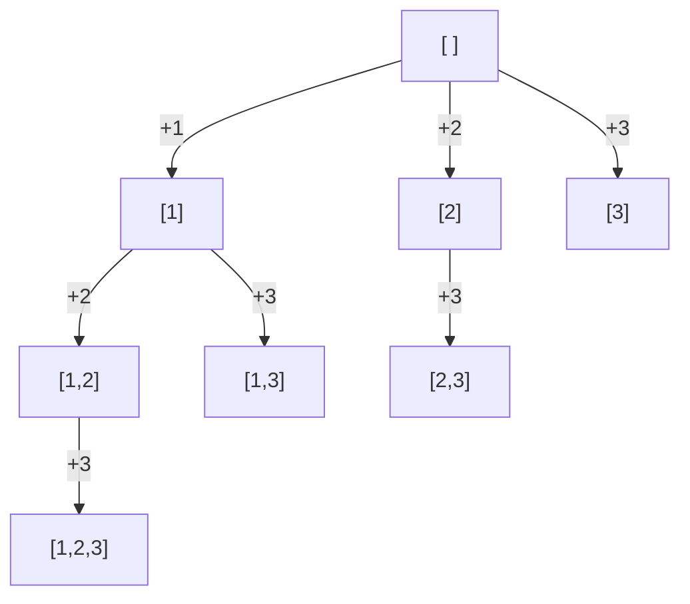

# 11. Recursion & Backtracking

> **One-liner:** Recursion is a function that solves a big problem by calling itself on a smaller version of the same problem; backtracking is recursion that *tries every choice*, undoing each one before trying the next — the way you generate all subsets, permutations, and solutions to puzzles like N-Queens.
> **Pattern power:** This one pattern unlocks a whole family of "generate/find **all** the ways" problems. Master the choose → explore → un-choose skeleton once and Subsets, Permutations, Combination Sum, Generate Parentheses, Word Search, and N-Queens all become the *same* problem with different rules.

---

## 1. The Idea in Plain Words

### Recursion = a function that calls itself on a smaller input

You already use recursion in React without naming it — a component that renders a tree of children is recursion. Let's make it precise.

> **Recursion** is when a function solves a problem by calling *itself* on a **smaller** version of the same problem, until the problem gets so small the answer is obvious.

Every recursive function has exactly two parts:

- **Base case** — the smallest input, where you *know* the answer outright and stop. Without it, the function calls itself forever (a stack overflow — the program crashes).
- **Recursive case** — you shrink the problem by one step and call yourself, then combine that result with the current step.

Here is the classic: factorial (`5! = 5 × 4 × 3 × 2 × 1`).

```typescript
function factorial(n: number): number {
  if (n <= 1) return 1;            // base case: 1! and 0! are just 1
  return n * factorial(n - 1);     // recursive case: n! = n × (n-1)!
}
// factorial(5) === 120
```

### The "leap of faith" — trust the recursion

Here is the single most important mental shift for the whole chapter, and the thing that makes recursion suddenly *click*:

> **Do NOT trace the whole thing in your head. Assume the recursive call already works.**

When you write `factorial(n - 1)`, don't try to follow it all the way down. **Trust** that `factorial(4)` correctly returns `24`. Your only job is: *given a correct answer for the smaller problem, how do I build the answer for the current problem?* Here, `n * (answer for n-1)`. That's it.

This is called the **leap of faith** (or "the recursive leap of faith"). You only ever have to reason about **one level**:

1. What's the base case (when do I stop)?
2. Assuming the smaller call is correct, how do I use its result?

Get those two right and the whole tower of calls is automatically correct — by induction, like dominoes falling. You are not tracing 100 calls; you are trusting 1.

### The call stack — where recursion actually runs

When function A calls function B, the computer saves A's state on a **stack** (a pile of "we'll come back to this" notes called *stack frames*) and jumps into B. When B finishes, its frame is popped off and A resumes. Recursion just means the function that gets stacked is *itself*.

`factorial(3)` builds this pile, then unwinds it:

```
push factorial(3)  → needs 3 * factorial(2)
push factorial(2)  → needs 2 * factorial(1)
push factorial(1)  → base case, returns 1   ── deepest point
pop  → factorial(2) returns 2 * 1 = 2
pop  → factorial(3) returns 3 * 2 = 6
```

**JS/TS gotcha — the call stack is finite (~10,000–15,000 frames).** Node/V8 lets recursion go only so deep before it throws `RangeError: Maximum call stack size exceeded`. For most interview inputs you're fine, but a **deeply skewed structure** (a linked list of 100,000 nodes, or a degenerate tree — see [12 — Trees](12-trees.md)) can blow the stack. When depth can be huge, convert to an **iterative** solution with your own explicit stack.

### Converting recursion ↔ iteration

Any recursion can become a loop, and vice-versa. Two cases:

**1. Tail-style / linear recursion → a simple loop.** Factorial is really just a running product:

```typescript
function factorialIterative(n: number): number {
  let result = 1;
  for (let i = 2; i <= n; i++) result *= i;   // no stack, no depth limit
  return result;
}
```

**2. Branching recursion → an explicit stack.** When a function calls itself *more than once* (like tree/graph traversal), you replace the call stack with an array you `push`/`pop` yourself:

```typescript
// Recursive
function printTree(node: TreeNode | null): void {
  if (node === null) return;
  console.log(node.val);
  printTree(node.left);
  printTree(node.right);
}

// Iterative — same visit order, no recursion depth limit
function printTreeIterative(root: TreeNode | null): void {
  if (root === null) return;
  const stack: TreeNode[] = [root];
  while (stack.length > 0) {
    const node = stack.pop()!;
    console.log(node.val);
    if (node.right) stack.push(node.right); // push right first so left pops first
    if (node.left) stack.push(node.left);
  }
}
```

Rule of thumb: **recursion is easier to write and read; iteration is safer for huge depth.** Interviewers accept recursion unless they specifically ask for iterative or the input is huge.

### Backtracking = recursion that tries, then undoes

**Backtracking** is a special use of recursion for building up a solution one *choice* at a time, exploring **every** possibility:

> **Try a choice → recurse to explore where it leads → undo the choice (backtrack) → try the next choice.**

The "undo" is the whole trick. You share one working list (the `path`) across all the recursion. You add a choice, dive deeper, and when you come back you **remove** it so the list is clean for the next sibling choice. This walks a **decision tree**: at each node you branch on the choices, and each leaf is a completed candidate.

**Pruning** = cutting off a branch early when you can already prove it can't lead to a valid answer (e.g. the running sum already exceeds the target). Pruning is what keeps backtracking from being hopelessly slow.

---

## 2. When to Use It — Pattern Triggers

Backtracking is the "brute force, but organized" pattern. Reach for it when the problem asks you to **enumerate or search a space of choices**.

| If the problem says… | Think | Example |
|---|---|---|
| "generate **all** subsets / the power set" | Backtracking (include/exclude each element) | Subsets (LC 78) |
| "all **permutations** / orderings" | Backtracking with a `used[]` array | Permutations (LC 46) |
| "all **combinations** that sum to / satisfy X" | Backtracking with a `start` index | Combination Sum (LC 39) |
| "find **all** ways / paths / arrangements" | Backtracking (enumerate the decision tree) | Generate Parentheses (LC 22) |
| "**constraint satisfaction** — place pieces so rules hold" | Backtracking + pruning | N-Queens (LC 51), Sudoku (LC 37) |
| "does a **path exist** in a grid spelling…" | Backtracking / DFS with undo | Word Search (LC 79) |
| "the smallest input is trivially solvable" | Plain **recursion** | factorial, Fibonacci, tree depth |

> **Trigger phrases:** "all", "every", "generate", "enumerate", "list all possible". If a problem wants *the count of ways* or *the optimal way* (not the list itself) and choices **overlap**, that's often **Dynamic Programming** instead — backtracking that reuses answers. See [18 — Dynamic Programming I](18-dynamic-programming-1.md).

Related recursion-powered patterns: tree **DFS** ([12 — Trees](12-trees.md)) and graph **DFS** ([16 — Graphs: BFS & DFS](16-graphs-bfs-dfs.md)) are recursion; memoized recursion is the gateway to **DP** ([18](18-dynamic-programming-1.md)).

---

## 3. Picture It (Diagram)

Backtracking explores a **decision tree**. Here's the tree for generating all subsets of `[1, 2, 3]` using a `start` index (at each node you decide which *later* element to add next). Every node you visit — not just the leaves — is a valid subset.



Read it top-down: start empty, then branch on each element you're still allowed to add. Going **down** an edge = "choose" (push). Coming back **up** = "un-choose" (pop). Collecting every node gives the 8 subsets: `[]`, `[1]`, `[1,2]`, `[1,2,3]`, `[1,3]`, `[2]`, `[2,3]`, `[3]`.

The magic of backtracking: you don't build 8 separate lists. You keep **one** `path` and mutate it as you walk the tree — push on the way down, pop on the way back up.

---

## 4. The Template (TypeScript)

Memorize this skeleton. Almost every backtracking answer is a renaming of it.

```typescript
function solve(input: number[]): number[][] {
  const results: number[][] = [];
  const path: number[] = [];          // the candidate we're building

  function backtrack(/* state, e.g. a start index */ start: number): void {
    // 1. GOAL CHECK — is `path` a complete/valid answer?
    if (/* goal reached */ true) {
      results.push([...path]);         // COPY! (see Pitfalls — never push `path` directly)
      // return here if a complete answer can't be extended further
    }

    // 2. EXPLORE each remaining choice
    for (let i = start; i < input.length; i++) {
      // 2a. PRUNE — skip choices that can't lead to a valid answer
      if (/* invalid */ false) continue;

      path.push(input[i]);             // CHOOSE
      backtrack(i + 1);                // EXPLORE with the choice applied
      path.pop();                      // UN-CHOOSE (backtrack) — restore state
    }
  }

  backtrack(0);
  return results;
}
```

The three-line heart — **choose / explore / un-choose** — is the entire pattern:

```typescript
path.push(x);      // choose
backtrack(...);    // explore
path.pop();        // un-choose  ← the "backtrack"
```

Whatever state you mutate before recursing (a `path`, a `used[]` flag, a cell on a grid, a running sum), you must **restore it after**. That symmetry is the discipline that makes backtracking correct.

---

## 5. Complexity

Backtracking explores a decision tree, so cost ≈ **(number of nodes/leaves) × (work per leaf to copy the answer)**. It's usually exponential — that's expected, because the *output itself* is exponentially large.

| Problem | Time | Space (excl. output) | Why |
|---|---|---|---|
| Subsets | `O(n · 2ⁿ)` | `O(n)` | `2ⁿ` subsets, each up to `n` long to copy |
| Permutations | `O(n · n!)` | `O(n)` | `n!` orderings, each length `n` |
| Combination Sum | `O(exponential)` | `O(target / min)` | depends on target & candidates |
| Generate Parentheses | `O(4ⁿ / √n)` | `O(n)` | the nth Catalan number of valid strings |
| N-Queens | `O(n!)` | `O(n)` | one queen per row, prune columns/diagonals |

- The **recursion depth** (height of the tree) sets the extra stack/space — usually `O(n)`, well within the call-stack limit for interview sizes.
- **Pruning doesn't change the Big-O in the worst case**, but in practice it's the difference between "runs instantly" and "times out." Always prune when you can.
- If the problem only wants a **count** or a **min/max** (not every arrangement) and subproblems repeat, memoize → this drops to polynomial and becomes **DP** ([18](18-dynamic-programming-1.md)).

---

## 6. Worked Example (a classic LeetCode problem)

### Subsets — LeetCode 78

> Given an array `nums` of **distinct** integers, return **all possible subsets** (the power set). Example: `nums = [1, 2, 3]` → `[[], [1], [2], [1,2], [3], [1,3], [2,3], [1,2,3]]` (any order).

**Recognize the trigger:** "all possible subsets" → generate everything → backtracking.

**The idea:** walk the decision tree from Section 3. A `start` index guarantees we only ever add elements to the *right* of what we've already picked, so we never produce `[2,1]` and `[1,2]` as different subsets. **Every node is a valid subset**, so we record `path` at the *top* of every call.

```typescript
function subsets(nums: number[]): number[][] {
  const results: number[][] = [];
  const path: number[] = [];

  function backtrack(start: number): void {
    results.push([...path]);              // every node is a subset — COPY it in

    for (let i = start; i < nums.length; i++) {
      path.push(nums[i]);                 // choose nums[i]
      backtrack(i + 1);                   // explore: only elements AFTER i
      path.pop();                         // un-choose — restore path for the next i
    }
  }

  backtrack(0);
  return results;
}
```

**Trace for `[1, 2, 3]`** (indent = recursion depth; `→ record` = we copied `path` into `results`):

```
backtrack(0)  path=[]        → record []
  i=0 push 1  path=[1]
    backtrack(1)             → record [1]
      i=1 push 2 path=[1,2]
        backtrack(2)         → record [1,2]
          i=2 push 3 path=[1,2,3]
            backtrack(3)     → record [1,2,3]   (loop doesn't run: start=3)
          pop 3  path=[1,2]
      pop 2     path=[1]
      i=2 push 3 path=[1,3]
        backtrack(3)         → record [1,3]
      pop 3     path=[1]
  pop 1         path=[]
  i=1 push 2    path=[2]
    backtrack(2)             → record [2]
      i=2 push 3 path=[2,3]
        backtrack(3)         → record [2,3]
      pop 3     path=[2]
  pop 2         path=[]
  i=2 push 3    path=[3]
    backtrack(3)             → record [3]
  pop 3         path=[]
```

Result: `[], [1], [1,2], [1,2,3], [1,3], [2], [2,3], [3]` — all 8 subsets. Watch how `path` is pushed then popped so it's always clean for the next sibling. That push/pop symmetry **is** backtracking.

### Two close cousins (same skeleton, different rules)

**Permutations (LC 46)** — order matters, so there's no `start` index; instead a `used[]` array marks which numbers are already in the path (that's the pruning):

```typescript
function permute(nums: number[]): number[][] {
  const results: number[][] = [];
  const path: number[] = [];
  const used: boolean[] = new Array(nums.length).fill(false);

  function backtrack(): void {
    if (path.length === nums.length) {   // goal: a full-length ordering
      results.push([...path]);           // COPY
      return;
    }
    for (let i = 0; i < nums.length; i++) {
      if (used[i]) continue;             // prune: can't reuse a number
      used[i] = true;  path.push(nums[i]);      // choose
      backtrack();                               // explore
      path.pop();      used[i] = false;          // un-choose (BOTH pieces of state)
    }
  }

  backtrack();
  return results;
}
```

**Combination Sum (LC 39)** — numbers may be reused, so recurse with `i` (not `i + 1`); prune when the remaining target goes negative:

```typescript
function combinationSum(candidates: number[], target: number): number[][] {
  const results: number[][] = [];
  const path: number[] = [];

  function backtrack(start: number, remaining: number): void {
    if (remaining === 0) { results.push([...path]); return; }  // exact hit
    if (remaining < 0) return;                                  // prune: overshot

    for (let i = start; i < candidates.length; i++) {
      path.push(candidates[i]);
      backtrack(i, remaining - candidates[i]);   // i, not i+1 → element can repeat
      path.pop();
    }
  }

  backtrack(0, target);
  return results;
}
```

Notice all three are the **same** template. Only the goal check, the pruning, and "what `start`/`used` means" change.

---

## 7. Practice Set (curated LeetCode)

Do them in this order — each adds exactly one new idea.

| # | Problem | LC | Difficulty | New idea it teaches |
|---|---------|----|-----------|--------------------|
| 1 | **Subsets** | 78 | Medium | The base template; record at every node |
| 2 | **Subsets II** | 90 | Medium | Skip duplicates (sort, then `if (i>start && a[i]===a[i-1]) continue`) |
| 3 | **Permutations** | 46 | Medium | `used[]` array; goal = full length |
| 4 | **Combinations** | 77 | Medium | Fixed-size combos with a `start` index |
| 5 | **Combination Sum** | 39 | Medium | Reuse elements (`i`, not `i+1`); prune on target |
| 6 | **Generate Parentheses** | 22 | Medium | Constraint pruning (`open`/`close` counts) |
| 7 | **Letter Combinations of a Phone Number** | 17 | Medium | Backtracking over a mapping |
| 8 | **Word Search** | 79 | Medium | Backtracking on a **grid**; mark/unmark visited cells |
| 9 | **Palindrome Partitioning** | 131 | Medium | Choose where to cut a string |
| 10 | **N-Queens** | 51 | Hard | Constraint satisfaction + diagonal pruning |
| 11 | **Sudoku Solver** | 37 | Hard | Backtracking that returns `true` to stop early |

> Start with **Subsets** and **Permutations** until the choose/explore/un-choose rhythm is automatic. **Generate Parentheses** and **Word Search** show up constantly in Zepto/Swiggy/CRED-style rounds.

---

## 8. Common Pitfalls & Interview Tips

- **Forgetting to copy the path — the #1 bug.** Arrays are passed **by reference** in JS/TS. If you do `results.push(path)` instead of `results.push([...path])`, every entry in `results` points to the **same** array, which you then keep mutating — so at the end they're all identical (usually all empty). **Always snapshot with `[...path]`** (or `path.slice()`) when saving a result.

  ```typescript
  results.push(path);        // 🐛 BUG: stores a live reference — all rows end up identical
  results.push([...path]);   // ✅ stores an independent copy
  ```

- **Not undoing state (asymmetry).** Every mutation before the recursive call needs a matching undo after it. If you set `used[i] = true`, you must reset `used[i] = false`. If you mark a grid cell visited, unmark it. Miss one and later branches see a corrupted state.

- **Undo *all* the state.** In Permutations you change **two** things (`path` and `used[]`) — you must revert **both**. A half-undo is a subtle, maddening bug.

- **Exponential blow-up without pruning.** Backtracking is exponential by nature; without pruning it may time out. Prune the instant a branch is provably hopeless (sum exceeds target, column already has a queen, string can't become a palindrome). Pruning is often the difference between Accepted and TLE.

- **`start` vs `i` vs `i + 1` — the reuse rule.** `i + 1` = each element used at most once (Subsets, Combinations). `i` = element may repeat (Combination Sum). No `start` at all, using `used[]` = order matters (Permutations). Say which one you're using and *why* out loud.

- **Recursion depth on huge inputs.** The call stack caps around 10k–15k frames. Backtracking depth is usually small (≤ `n`), so this rarely bites here — but for deep linear recursion (long lists, skewed trees) prefer the **iterative + explicit stack** conversion from Section 1.

- **Interview move:** before coding, **draw the decision tree** for a tiny input (like `[1,2]`) on the whiteboard. It proves you understand the structure, and the code practically writes itself from the picture. Then state the three lines: choose, explore, un-choose.

---

## 9. TL;DR

- **Recursion** = a function that calls itself on a **smaller** input. It needs a **base case** (where it stops) and a **recursive case** (shrink + combine).
- **Leap of faith:** don't trace the whole tree — **trust** that the recursive call on the smaller input is correct, and just combine its result. Reason about one level only.
- The **call stack** powers recursion; it's finite (~10k–15k frames in JS/TS). For huge depth, convert to **iteration with an explicit stack**.
- **Backtracking** = recursion that explores a **decision tree**: **choose → explore → un-choose**. Share one `path` and push/pop it as you walk.
- **Prune** dead branches early to survive the exponential blow-up.
- Two forever-rules: **copy the path with `[...path]`** when saving, and **undo every mutation** after each recursive call.
- Triggers: "generate/find **all** subsets/permutations/combinations/ways," and constraint puzzles (N-Queens, Sudoku, Word Search).

**Next:** apply recursion to real structures in [12 — Trees](12-trees.md) (DFS is recursion), then see recursion power search in [16 — Graphs: BFS & DFS](16-graphs-bfs-dfs.md), and learn to *cache* recursive results in [18 — Dynamic Programming I](18-dynamic-programming-1.md).
