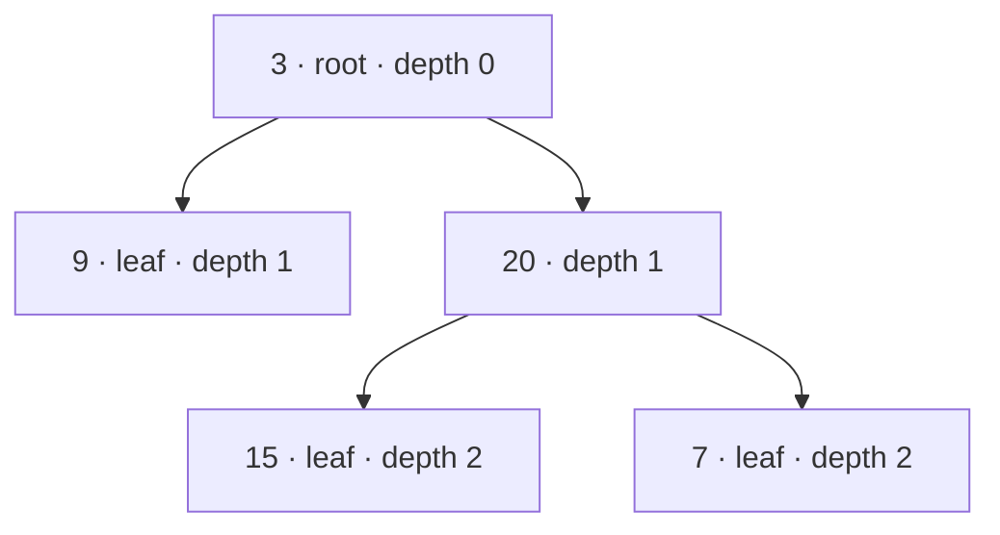
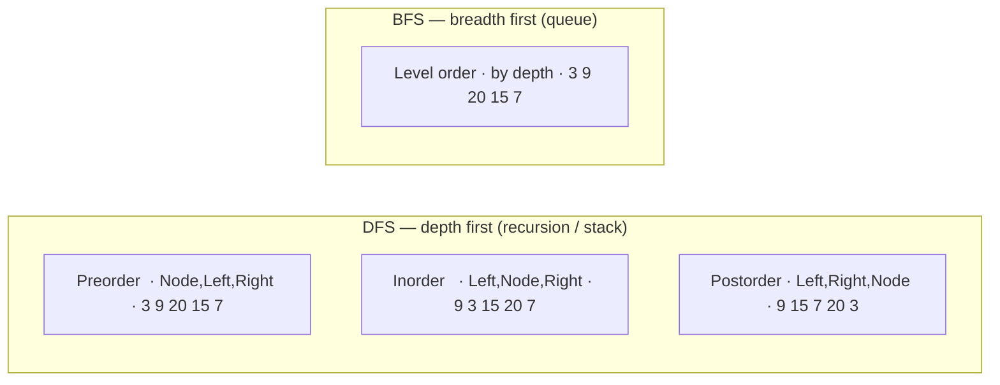

# 12. Trees & Binary Trees

> **One-liner:** A binary tree is a branching structure where each node points to up to two children (left and right); nearly every tree problem is solved by one of two moves — **DFS** (recurse down, return an answer *up* from the children) or **BFS** (sweep the tree *level by level* with a queue).
> **Pattern power:** Trees are where the recursion "leap of faith" from [11 — Recursion & Backtracking](11-recursion-and-backtracking.md) pays off hugely. Once you see that *"solve the whole tree" = "combine the answers from my two subtrees,"* depth, balance, symmetry, path sums, and diameter all collapse into ~10 lines each.

---

## 1. The Idea in Plain Words

A **tree** is a structure of **nodes** connected by edges, with no cycles, that branches out from a single starting node. It looks like a family tree or a folder hierarchy — or the React component tree you render every day.

The vocabulary (learn these once, they're used everywhere):

| Term | Meaning |
|---|---|
| **Node** | One element; holds a value plus links to its children |
| **Root** | The single node at the very top (no parent) — where you start |
| **Child** | A node directly below another |
| **Parent** | The node directly above a child |
| **Leaf** | A node with **no** children (the tips) |
| **Edge** | A link between a parent and a child |
| **Subtree** | Any node together with *all* its descendants — itself a valid tree |
| **Height (of a node)** | Number of edges on the **longest path down** to a leaf. A leaf has height 0 |
| **Depth (of a node)** | Number of edges from the **root down** to that node. The root has depth 0 |
| **Height of the tree** | The height of the root = the depth of the deepest leaf |

> **Binary tree** = every node has **at most two** children, named `left` and `right`. That's the kind interviews care about most. (A *Binary Search Tree*, covered in [13](13-binary-search-trees.md), adds an ordering rule on top.)

**Height vs depth — the one that confuses everyone.** Depth counts *downward from the root* ("how far in am I?"). Height counts *upward from the leaves* ("how far can I still go down?"). They're mirror measurements. In the diagram below, node `20` has **depth 1** (one edge below the root) and **height 1** (one edge above its deepest leaf).

### The two moves that solve almost everything

Here's the insight that makes trees easy — memorize it:

> **Most tree problems are either "DFS: recurse down and return info *up* from the children" or "BFS: process the tree level by level."**

- **DFS (Depth-First Search)** = go **deep** first, following one branch all the way down before backtracking. It's just recursion. Perfect leap-of-faith territory: *assume my left and right subtrees already gave me their answer, then combine.* This is how you compute height, check balance/symmetry, sum paths, and find a lowest common ancestor.
- **BFS (Breadth-First Search)** = go **wide** first, visiting all nodes at depth 0, then all at depth 1, then depth 2… Powered by a **queue**. This is how you do "level order" output, "right side view," or "minimum depth."

Nail these two and the rest is variation.

---

## 2. When to Use It — Pattern Triggers

| If the problem says… | Reach for | Why |
|---|---|---|
| anything with a **tree / root node** | DFS or BFS | it's a tree problem by definition |
| "**depth** / **height** / **max depth**" | **DFS** returning a number up | height = `1 + max(left, right)` |
| "**level order**", "level by level", "**right side view**", "average of each level" | **BFS** with a queue | levels = queue snapshots |
| "**minimum depth**", "**shortest** path to a leaf" | **BFS** (stops at the first leaf) | closest leaf found first |
| "**path** sum", "**root-to-leaf**", "count paths" | **DFS** carrying a running value down | paths go top→bottom |
| "**diameter**", "longest path between any two nodes" | **DFS** returning height, tracking a global max | path bends through a node |
| "**balanced?**", "**symmetric?**", "**same tree?**", "**invert**" | **DFS** comparing/combining subtrees | structural recursion |
| "**lowest common ancestor**" (general tree) | **DFS** returning which subtree found the targets | info bubbles up |

> **Rule of thumb:** if the answer depends on **how deep** things are or **combining child results**, use **DFS**. If it depends on **which level** a node is on, use **BFS**. Trees are a special case of graphs — the same DFS/BFS ideas scale up in [16 — Graphs: BFS & DFS](16-graphs-bfs-dfs.md).

---

## 3. Picture It (Diagram)

A small binary tree — the one used in the LeetCode traversal examples:



- **Root:** `3`. **Leaves:** `9`, `15`, `7`. 
- **Height of the tree** = 2 (longest root-to-leaf path: `3 → 20 → 15` has 2 edges).
- **Subtree of `20`** = the little tree `{20, 15, 7}`.

The four ways to visit every node, and the order they produce on this tree:



The three DFS orders differ **only** in *when you record the current node* — before its children (pre), between them (in), or after them (post). Same recursion, one line moved.

---

## 4. The Template (TypeScript)

### The TreeNode class (use this everywhere)

```typescript
class TreeNode {
  val: number;
  left: TreeNode | null;
  right: TreeNode | null;
  constructor(val: number = 0, left: TreeNode | null = null, right: TreeNode | null = null) {
    this.val = val;
    this.left = left;
    this.right = right;
  }
}
```

### DFS — the recursive helper that returns info *up* (your workhorse)

```typescript
// Generic shape: base case handles null, then combine child results.
function dfs(node: TreeNode | null): number {
  if (node === null) return 0;          // BASE CASE — empty subtree
  const left = dfs(node.left);          // trust it: answer for the left subtree
  const right = dfs(node.right);        // trust it: answer for the right subtree
  return /* combine */ 1 + Math.max(left, right);  // e.g. height
}
```

### The three DFS traversals (recursive)

```typescript
function preorder(node: TreeNode | null, out: number[] = []): number[] {
  if (node === null) return out;
  out.push(node.val);          // 1. node  ── record BEFORE children
  preorder(node.left, out);    // 2. left
  preorder(node.right, out);   // 3. right
  return out;
}

function inorder(node: TreeNode | null, out: number[] = []): number[] {
  if (node === null) return out;
  inorder(node.left, out);     // 1. left
  out.push(node.val);          // 2. node  ── record BETWEEN children
  inorder(node.right, out);    // 3. right
  return out;
}

function postorder(node: TreeNode | null, out: number[] = []): number[] {
  if (node === null) return out;
  postorder(node.left, out);   // 1. left
  postorder(node.right, out);  // 2. right
  out.push(node.val);          // 3. node  ── record AFTER children
  return out;
}
```

### DFS iterative (with your own stack) — for very deep trees

Recursion can blow the ~10k–15k call-stack limit on a deeply skewed tree; an explicit stack has no such limit.

```typescript
// Preorder iterative
function preorderIterative(root: TreeNode | null): number[] {
  if (root === null) return [];
  const out: number[] = [];
  const stack: TreeNode[] = [root];
  while (stack.length > 0) {
    const node = stack.pop()!;                 // LIFO
    out.push(node.val);
    if (node.right) stack.push(node.right);    // push RIGHT first…
    if (node.left) stack.push(node.left);      // …so LEFT is popped first
  }
  return out;
}

// Inorder iterative — go all the way left, then process, then go right
function inorderIterative(root: TreeNode | null): number[] {
  const out: number[] = [];
  const stack: TreeNode[] = [];
  let curr: TreeNode | null = root;
  while (curr !== null || stack.length > 0) {
    while (curr !== null) { stack.push(curr); curr = curr.left; } // dive left
    curr = stack.pop()!;                                          // leftmost unvisited
    out.push(curr.val);
    curr = curr.right;                                            // then its right subtree
  }
  return out;
}
```

### BFS — level order with a queue

```typescript
function levelOrder(root: TreeNode | null): number[][] {
  const result: number[][] = [];
  if (root === null) return result;

  const queue: TreeNode[] = [root];
  while (queue.length > 0) {
    const levelSize = queue.length;         // ★ snapshot: nodes on THIS level only
    const level: number[] = [];
    for (let i = 0; i < levelSize; i++) {
      const node = queue.shift()!;          // dequeue from the FRONT (FIFO)
      level.push(node.val);
      if (node.left) queue.push(node.left); // enqueue children for the NEXT level
      if (node.right) queue.push(node.right);
    }
    result.push(level);
  }
  return result;
}
```

The `levelSize` snapshot is the trick that separates one level from the next: you process exactly the nodes that were in the queue *before* you start adding the next level's children.

> **JS/TS perf note:** `array.shift()` is `O(n)` because it re-indexes the whole array, so a naive queue is `O(n²)` overall. Fine for interview-sized trees, but for large inputs use a **head pointer** (`let head = 0; const node = queue[head++];`) or a linked-list/deque to get true `O(1)` dequeues. See [10 — Stacks & Queues](10-stacks-and-queues.md).

---

## 5. Complexity

Let `n` = number of nodes, `h` = height of the tree.

| Operation | Time | Space | Notes |
|---|---|---|---|
| Any traversal (DFS or BFS) | `O(n)` | — | you touch every node once |
| DFS recursion | `O(n)` | `O(h)` stack | `h = log n` if balanced, `h = n` if skewed |
| BFS | `O(n)` | `O(w)` | `w` = max width; up to `n/2` at the bottom level |

- **Balanced tree:** `h ≈ log₂ n`, so DFS stack space is tiny (`O(log n)`).
- **Skewed tree** (every node has one child — basically a linked list): `h = n`, so recursion uses `O(n)` stack and can approach the **call-stack limit**. This is exactly when you switch to iterative DFS.
- **DFS space** is bounded by the tree's *height*; **BFS space** by its *width*. On a wide, shallow tree BFS costs more memory; on a deep, narrow tree DFS costs more. Pick accordingly if memory is tight.

---

## 6. Worked Example (a classic LeetCode problem)

### Part A — Maximum Depth of Binary Tree (LC 104): DFS returning info up

> Return the number of nodes along the longest path from the root down to the farthest leaf. For the tree in Section 3, the answer is **3** (`3 → 20 → 15`).

**Leap of faith:** *if I already know the max depth of my left subtree and of my right subtree, my depth is `1 + the bigger of the two`.* The base case: an empty tree (null) has depth `0`.

```typescript
function maxDepth(root: TreeNode | null): number {
  if (root === null) return 0;                      // base case: no node, depth 0
  const left = maxDepth(root.left);                 // trust: depth of left subtree
  const right = maxDepth(root.right);               // trust: depth of right subtree
  return 1 + Math.max(left, right);                 // +1 for THIS node
}
```

**Trace** (tree `[3, 9, 20, null, null, 15, 7]`):

```
maxDepth(3)
├─ maxDepth(9)  → left null=0, right null=0 → 1 + max(0,0) = 1
└─ maxDepth(20)
   ├─ maxDepth(15) → 1 + max(0,0) = 1
   └─ maxDepth(7)  → 1 + max(0,0) = 1
   → 1 + max(1,1) = 2
→ 1 + max(1, 2) = 3   ✅
```

Notice the answer is *built up* from the leaves as each call returns. That upward flow is the DFS pattern; most tree DFS problems are this template with a different "combine" line.

**Diameter (LC 543)** is the same DFS with a twist: it returns height, but along the way it also tracks the longest path that *bends through* each node (`left + right`) in an outer variable:

```typescript
function diameterOfBinaryTree(root: TreeNode | null): number {
  let best = 0;
  function height(node: TreeNode | null): number {
    if (node === null) return 0;
    const left = height(node.left);
    const right = height(node.right);
    best = Math.max(best, left + right);   // path THROUGH this node (in edges)
    return 1 + Math.max(left, right);      // height reported to my parent
  }
  height(root);
  return best;
}
```

**Invert Tree (LC 226)** — the famous one — is a three-liner: swap children, recurse:

```typescript
function invertTree(root: TreeNode | null): TreeNode | null {
  if (root === null) return null;
  [root.left, root.right] = [invertTree(root.right), invertTree(root.left)];
  return root;
}
```

### Part B — Binary Tree Level Order Traversal (LC 102): BFS

> Return the node values **grouped by level**, top to bottom. For our tree: `[[3], [9, 20], [15, 7]]`.

This one is about *levels*, not depth-combining — so **BFS with a queue** (the `levelOrder` template from Section 4).

**Trace** (queue shown front→back, `L` = the level being built):

```
start   queue=[3]
level 1 size=1 → dequeue 3, enqueue 9,20   L=[3]       result=[[3]]
level 2 size=2 → dequeue 9 (no kids), dequeue 20 → enqueue 15,7   L=[9,20]  result=[[3],[9,20]]
level 3 size=2 → dequeue 15, dequeue 7 (no kids)   L=[15,7]  result=[[3],[9,20],[15,7]]
queue empty → done ✅
```

The `size = queue.length` snapshot at the start of each round is what cleanly separates `[9, 20]` from `[15, 7]`: you only process the nodes that were already queued, and the children you add wait for the next round.

---

## 7. Practice Set (curated LeetCode)

| # | Problem | LC | Difficulty | Pattern |
|---|---------|----|-----------|---------|
| 1 | **Maximum Depth of Binary Tree** | 104 | Easy | DFS returning a number up |
| 2 | **Invert Binary Tree** | 226 | Easy | DFS swap children |
| 3 | **Same Tree** | 100 | Easy | DFS comparing two trees in lockstep |
| 4 | **Symmetric Tree** | 101 | Easy | DFS mirror: `left.left` vs `right.right` |
| 5 | **Balanced Binary Tree** | 110 | Easy | DFS returning height, flag if diff > 1 |
| 6 | **Diameter of Binary Tree** | 543 | Easy | DFS height + global max path |
| 7 | **Binary Tree Level Order Traversal** | 102 | Medium | BFS with a queue |
| 8 | **Binary Tree Right Side View** | 199 | Medium | BFS, take the **last** node per level |
| 9 | **Path Sum** | 112 | Easy | DFS carrying a running sum down |
| 10 | **Path Sum II** | 113 | Medium | DFS + **backtracking** (copy path with `[...path]`) |
| 11 | **Lowest Common Ancestor of a Binary Tree** | 236 | Medium | DFS returning which subtree found the targets |
| 12 | **Binary Tree Maximum Path Sum** | 124 | Hard | Diameter idea with values (clamp negatives to 0) |

> **LCA intuition (LC 236):** DFS each subtree; if `p` is found on one side and `q` on the other, the *current* node is their lowest common ancestor. If both are on the same side, the answer is deeper down that side. The answer "bubbles up" from wherever the two targets first split. (For a **BST**, there's a shortcut using the ordering — see [13](13-binary-search-trees.md).)

Do **104 → 226 → 100 → 101** first (they build DFS confidence), then **102 → 199** for BFS, then the path/LCA problems.

---

## 8. Common Pitfalls & Interview Tips

- **Null handling is the base case — always check it first.** `if (node === null) return …` must be line one of every DFS. Forget it and you'll read `.left` of `null` → `TypeError: Cannot read properties of null`. In TS, typing children as `TreeNode | null` makes the compiler *force* you to handle it — lean on that.

- **BFS needs a queue, not recursion.** Level-order is inherently *iterative*; there's no natural recursion for "all nodes at this depth." Reach for a queue and the `levelSize` snapshot. (You *can* fake levels with DFS by passing a `depth` argument and indexing into `result[depth]`, but plain BFS is clearer — mention both.)

- **Iterative DFS stack order.** With an explicit stack (LIFO), push the child you want to process **last** *first*. For preorder you want left before right, so push **right first, then left**. Get this backwards and your traversal mirrors.

- **Queue = FIFO, Stack = LIFO.** BFS uses a **queue** (`push` to back, `shift`/head-pointer from front). DFS uses a **stack** (`push`/`pop` from the same end). Swapping them silently turns BFS into DFS and vice-versa.

- **`shift()` is O(n).** Fine for interview sizes, but call it out and offer the head-pointer fix (`queue[head++]`) — it shows you know the JS internals.

- **Recursion depth on skewed trees.** A tree that degrades into a chain of `n` nodes gives recursion depth `n`; past ~10k–15k that throws `Maximum call stack size exceeded`. If the constraints allow `n` up to `10⁵`, prefer **iterative** traversal.

- **Backtracking in path problems.** In "collect all root-to-leaf paths," you reuse one `path` array — push on the way down, **pop on the way back up**, and **copy with `[...path]`** when you save a completed path. That's the [11 — Backtracking](11-recursion-and-backtracking.md) discipline applied to trees.

- **Interview move:** state your plan in one sentence first — *"This depends on child results, so DFS returning height,"* or *"This is level-by-level, so BFS with a queue."* Choosing the right traversal out loud is half the score.

---

## 9. TL;DR

- A **binary tree** has nodes with up to two children (`left`, `right`); **root** at top, **leaves** at the tips. **Depth** counts down from the root; **height** counts up from the leaves.
- **Two moves solve almost everything:** **DFS** (recurse down, return/combine info *up* from children) and **BFS** (queue, process **level by level**).
- **DFS traversals** differ by *when you record the node*: **pre** (before children), **in** (between), **post** (after). Recursive is 4 lines; iterative uses an explicit **stack** for deep trees.
- **BFS** uses a **queue** and a `levelSize = queue.length` snapshot to separate levels.
- Use **DFS** when the answer depends on depth/combining subtrees; use **BFS** when it depends on which level a node sits on.
- All traversals are `O(n)` time; DFS space is `O(h)`, BFS space is `O(width)`.
- Watch out for: **null base case**, **`shift()` being O(n)**, **iterative stack order**, and **recursion depth** on skewed trees.

**Next:** add an ordering rule to get fast search in [13 — Binary Search Trees](13-binary-search-trees.md); reuse this DFS/BFS thinking on general graphs in [16 — Graphs: BFS & DFS](16-graphs-bfs-dfs.md); and meet the heap — a tree kept as an array — in [14 — Heaps & Priority Queues](14-heaps-and-priority-queues.md).
