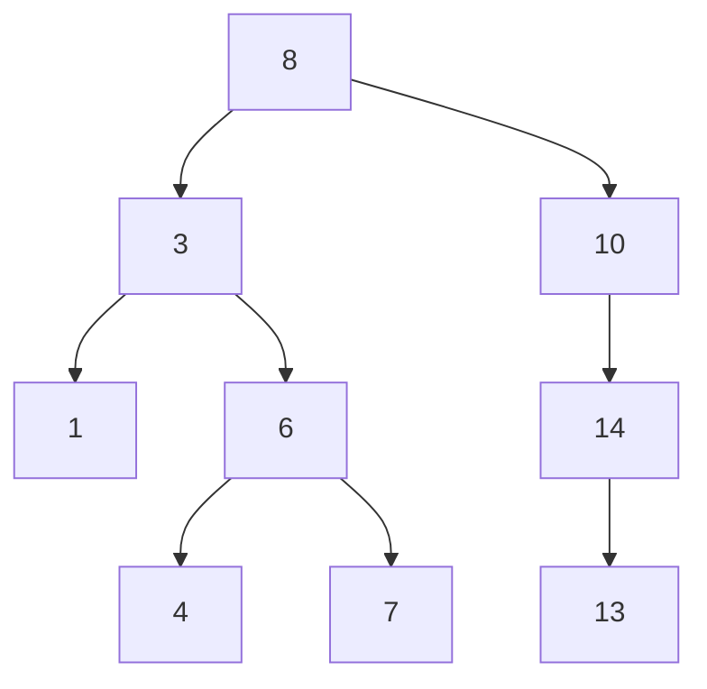
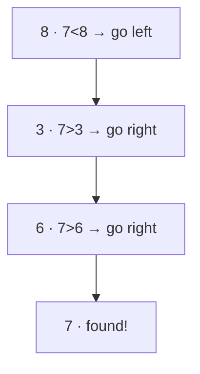
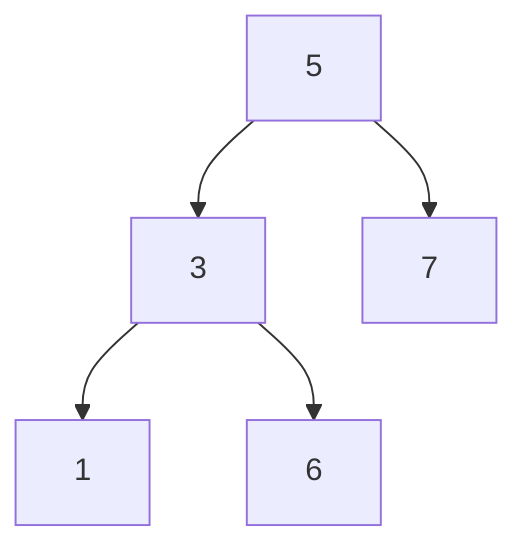

# 13. Binary Search Trees

> **One-liner:** A Binary Search Tree (BST) is a binary tree with one rule — *everything in a node's left subtree is smaller, everything in its right subtree is larger* — and that single rule turns search, insert, and delete into `O(h)` operations that halve the problem at every step.
> **Pattern power:** The BST ordering is really [07 — Binary Search](07-binary-search.md) baked into a tree. Two facts do 90% of the work: (1) at any node you can throw away a whole subtree, and (2) an **in-order traversal of a BST visits values in sorted order** — the key that unlocks "kth smallest," "validate," and range queries.

---

## 1. The Idea in Plain Words

A plain binary tree ([12 — Trees](12-trees.md)) has no rule about *where* values go. A **Binary Search Tree** adds exactly one invariant, enforced at **every** node:

> **For every node:** all values in its **left subtree** are **less than** the node, and all values in its **right subtree** are **greater than** the node.

Read that carefully: it's not just about a node's immediate children — it's about its **entire** left and right subtrees. Every value down-left must be smaller; every value down-right must be larger. (We'll assume no duplicates, the common interview default. Real implementations pick a side — say "equal goes right" — and stick to it.)

**Why that rule is powerful.** At any node, comparing your target to the node's value tells you which *whole half* to keep and which to discard:

- target **equals** node → found it.
- target **less than** node → it can only be in the **left** subtree; ignore the entire right subtree.
- target **greater than** node → go **right**; ignore the entire left subtree.

Each step throws away a whole branch — exactly like binary search halving an array. So search costs `O(h)`, where `h` is the tree's **height**.

**The catch — `h` depends on shape.** `O(h)` is only fast if the tree is *bushy*:

- **Balanced** (both sides stay roughly even): `h ≈ log₂ n` → search/insert/delete are `O(log n)`. For a million nodes that's ~20 steps.
- **Skewed** (you insert already-sorted data, so every node has only a right child): the tree degrades into a **linked list**, `h = n`, and everything becomes `O(n)`. No better than scanning an array.

```
Balanced (good, h≈log n)        Skewed (bad, h=n)
        4                        1
      /   \                       \
     2     6                       2
    / \   / \                       \
   1   3 5   7                       3
                                      \
                                       4   ← insert 1,2,3,4 in order → a chain
```

**Self-balancing trees fix this (conceptual only).** Structures like **AVL trees** and **Red-Black trees** do small rotations on every insert/delete to *guarantee* `h = O(log n)` no matter the input order. You almost never implement one in an interview, but you should be able to **name** them and say *why* they exist: to keep `h` logarithmic so operations stay `O(log n)` even on adversarial input. (Java's `TreeMap`, C++'s `std::map` are Red-Black trees. JavaScript has no built-in balanced BST — another reason `Map`/`Set` are your go-to; see [03 — Hashing](03-hashing-maps-and-sets.md).)

### The one property you'll use constantly: in-order = sorted

Recall the **in-order** traversal from [12 — Trees](12-trees.md): *left → node → right*. Run it on a BST and — because left is always smaller and right always larger — you visit values in **ascending sorted order**.

> **In-order traversal of a BST yields its values in sorted order.** 

This single fact solves a surprising number of problems: "kth smallest element" (stop at the kth in-order node), "validate a BST" (check the in-order sequence is strictly increasing), "range queries," "convert BST to sorted list," and more.

---

## 2. When to Use It — Pattern Triggers

| If the problem says… | Reach for | Why |
|---|---|---|
| "**binary search tree**", "BST" | BST ordering | the rule is handed to you — exploit it |
| "**search / insert / delete** in a BST" | Walk left/right by comparing | `O(h)` — halve at each node |
| "**kth smallest / largest** in a tree" | **In-order** traversal, stop at k | in-order = sorted |
| "**validate** / is this a valid BST" | DFS with **min/max bounds** | per-node checks aren't enough (see §6) |
| "**range** sum / count between L and R in a tree" | In-order, or prune subtrees out of range | ordering lets you skip branches |
| "**LCA** in a **BST**" | Compare both targets to the node | ordering gives an O(h) shortcut |
| "**sorted array → balanced BST**" | Recurse on the **middle** element | middle = root keeps it balanced |
| "**floor / ceiling** / closest value" | Walk down tracking the best candidate | ordering guides the search |

> **Key tell:** the moment a problem says "BST" (not just "tree"), stop and ask *"how does the ordering help me skip work?"* If it's about *k-th* or *sorted order* or *validation*, think **in-order**. If it's about finding/placing a value, think **walk left/right**. General (non-BST) tree techniques still apply — this chapter just adds shortcuts on top of [12 — Trees](12-trees.md).

---

## 3. Picture It (Diagram)

A valid BST. For **every** node, the whole left subtree is smaller and the whole right subtree is larger:



- Searching for **7**: `7 < 8` → go left to `3`; `7 > 3` → go right to `6`; `7 > 6` → go right to `7` → found in **3 steps** (not 8).
- **In-order** (left → node → right) reads out: `1, 3, 4, 6, 7, 8, 10, 13, 14` — perfectly **sorted**. That's the property in action.

The search path for `7` — notice you only ever visit one node per level, discarding the rest:



---

## 4. The Template (TypeScript)

Reusing the `TreeNode` class from [12 — Trees](12-trees.md):

```typescript
class TreeNode {
  val: number;
  left: TreeNode | null;
  right: TreeNode | null;
  constructor(val: number = 0, left: TreeNode | null = null, right: TreeNode | null = null) {
    this.val = val;
    this.left = left;
    this.right = right;
  }
}
```

### Search — walk left or right (iterative, O(h), O(1) space)

```typescript
function searchBST(root: TreeNode | null, target: number): TreeNode | null {
  let node = root;
  while (node !== null) {
    if (target === node.val) return node;                 // found
    node = target < node.val ? node.left : node.right;    // go ONE way, never both
  }
  return null;                                            // fell off the tree → absent
}
```

### Insert — search for the empty slot, then attach

```typescript
function insertIntoBST(root: TreeNode | null, val: number): TreeNode {
  if (root === null) return new TreeNode(val);   // reached an empty spot → put it here
  if (val < root.val) {
    root.left = insertIntoBST(root.left, val);   // belongs in the left subtree
  } else {
    root.right = insertIntoBST(root.right, val); // belongs in the right subtree
  }
  return root;                                    // return (unchanged) root back up
}
```

### Validate — DFS carrying a `(low, high)` range each node must fit inside

```typescript
function isValidBST(root: TreeNode | null): boolean {
  function validate(node: TreeNode | null, low: number, high: number): boolean {
    if (node === null) return true;                     // empty tree is valid
    if (node.val <= low || node.val >= high) return false; // out of allowed range
    return (
      validate(node.left, low, node.val) &&   // left subtree: new upper bound = node.val
      validate(node.right, node.val, high)    // right subtree: new lower bound = node.val
    );
  }
  return validate(root, -Infinity, Infinity); // root may be any value
}
```

### Kth smallest — in-order traversal, stop at the kth node

```typescript
function kthSmallest(root: TreeNode | null, k: number): number {
  const stack: TreeNode[] = [];
  let curr: TreeNode | null = root;
  let count = 0;
  while (curr !== null || stack.length > 0) {
    while (curr !== null) { stack.push(curr); curr = curr.left; } // dive all the way left
    curr = stack.pop()!;                    // smallest unvisited node
    if (++count === k) return curr.val;     // the kth in sorted order — done
    curr = curr.right;                      // then explore its right subtree
  }
  return -1; // k was larger than the number of nodes
}
```

Iterative in-order lets you **stop early** at the kth node instead of traversing the whole tree — important when `k` is small.

---

## 5. Complexity

Let `n` = nodes, `h` = height (`log n` if balanced, `n` if skewed).

| Operation | Balanced | Skewed (worst) | Space |
|---|---|---|---|
| Search | `O(log n)` | `O(n)` | `O(1)` iterative / `O(h)` recursive |
| Insert | `O(log n)` | `O(n)` | `O(h)` |
| Delete | `O(log n)` | `O(n)` | `O(h)` |
| Validate | `O(n)` | `O(n)` | `O(h)` (must visit all nodes) |
| Kth smallest | `O(h + k)` | `O(n)` | `O(h)` |
| In-order traversal | `O(n)` | `O(n)` | `O(h)` |

- Search/insert/delete are `O(h)` — **great when balanced, bad when skewed.** That gap is the whole reason self-balancing trees (AVL/Red-Black) exist: they keep `h = O(log n)` guaranteed.
- Validate must confirm *every* node, so it's `O(n)` regardless — you can't skip anyone.
- **JS/TS gotcha:** recursive versions use `O(h)` call-stack. On a skewed tree `h = n`; if `n` can reach ~10⁵ you risk `Maximum call stack size exceeded`. Prefer the **iterative** search/in-order shown above when depth could be huge.

---

## 6. Worked Example (a classic LeetCode problem)

### Validate Binary Search Tree — LeetCode 98

> Given the root of a binary tree, determine whether it is a **valid BST**.

**First, the tempting WRONG approach — and exactly why it fails.** The naive idea is to check, at each node, only its *immediate* children:

```typescript
// 🐛 WRONG — checks only parent vs. immediate children
function isValidBST_wrong(node: TreeNode | null): boolean {
  if (node === null) return true;
  if (node.left && node.left.val >= node.val) return false;
  if (node.right && node.right.val <= node.val) return false;
  return isValidBST_wrong(node.left) && isValidBST_wrong(node.right);
}
```

This passes some invalid trees. Consider:



Check each node with the naive rule:
- Node **3**: left `1 < 3` ✓, right `6 > 3` ✓ — *looks* fine locally.
- Node **5**: left `3 < 5` ✓, right `7 > 5` ✓ — *looks* fine locally.
- Node **7**, **1**, **6**: leaves, trivially fine.

Every immediate parent-child check passes — yet this is **NOT a valid BST**. The value **6** sits in the **left subtree of 5**, so by the BST rule it must be **less than 5**. But `6 > 5`. The naive check never compares `6` against its *ancestor* `5`, only against its parent `3`. **A node must respect the bounds set by *all* its ancestors, not just its parent.**

**The correct approach — carry a valid `(low, high)` range down.** The root may be anything: `(-∞, +∞)`. Every time you go **left**, the current node becomes the new **upper** bound (everything left must be smaller). Every time you go **right**, it becomes the new **lower** bound. A node is valid only if it fits strictly inside its inherited range.

```typescript
function isValidBST(root: TreeNode | null): boolean {
  function validate(node: TreeNode | null, low: number, high: number): boolean {
    if (node === null) return true;
    if (node.val <= low || node.val >= high) return false;
    return validate(node.left, low, node.val) &&   // shrink the high bound
           validate(node.right, node.val, high);   // shrink the low bound
  }
  return validate(root, -Infinity, Infinity);
}
```

**Trace on the invalid tree above** (`(low, high)` shown per call):

```
validate(5, -∞, +∞)   5 ∈ (-∞, +∞) ✓
├─ validate(3, -∞, 5)  3 ∈ (-∞, 5) ✓          ← left of 5 → high becomes 5
│  ├─ validate(1, -∞, 3)  1 ∈ (-∞, 3) ✓  → true
│  └─ validate(6, 3, 5)   6 ∈ (3, 5)?  6 ≥ 5 → FALSE   ← caught! 6 can't exceed ancestor 5
│     → false
└─ (short-circuits; whole thing is false) ✅
```

The bounds method catches `6` precisely because, as we descended left from `5`, we tightened the upper bound to `5` and carried it *all the way down* to `6`. That's the ancestor constraint the naive check missed.

> **JS/TS note on bounds:** using `-Infinity` / `Infinity` is clean because JS numbers are 64-bit floats and these compare correctly against any real value. In languages with fixed-width ints (Java/C++), a node value of `Integer.MAX_VALUE` breaks a naive `Integer` bound — you'd use `Long`, nullable bounds, or the in-order technique instead. An equally valid alternative: **in-order traverse and check each value is strictly greater than the previous** (since in-order of a valid BST is strictly increasing).

### Kth Smallest Element in a BST — LeetCode 230

> Return the `k`th **smallest** value (1-indexed) in a BST.

Because **in-order visits values in sorted order**, the `k`th node visited in-order *is* the answer — and iterative in-order lets you **stop the moment you reach it**:

```typescript
function kthSmallest(root: TreeNode | null, k: number): number {
  const stack: TreeNode[] = [];
  let curr: TreeNode | null = root;
  let count = 0;
  while (curr !== null || stack.length > 0) {
    while (curr !== null) { stack.push(curr); curr = curr.left; }
    curr = stack.pop()!;
    if (++count === k) return curr.val;   // kth in sorted order
    curr = curr.right;
  }
  return -1;
}
```

On the tree from Section 3, in-order is `1, 3, 4, 6, 7, 8, 10, 13, 14`, so `kthSmallest(root, 3)` returns `4` — and we stop after visiting just the first three nodes.

---

## 7. Practice Set (curated LeetCode)

| # | Problem | LC | Difficulty | Technique |
|---|---------|----|-----------|-----------|
| 1 | **Search in a BST** | 700 | Easy | Walk left/right by comparison |
| 2 | **Insert into a BST** | 701 | Medium | Search for the empty slot, attach |
| 3 | **Validate Binary Search Tree** | 98 | Medium | Min/max bounds (the classic trap) |
| 4 | **Kth Smallest Element in a BST** | 230 | Medium | In-order, stop at k |
| 5 | **Lowest Common Ancestor of a BST** | 235 | Medium | Compare both targets to the node → O(h) |
| 6 | **Convert Sorted Array to BST** | 108 | Easy | Middle element = root → balanced |
| 7 | **Minimum Absolute Difference in BST** | 530 | Easy | In-order, compare adjacent values |
| 8 | **Range Sum of BST** | 938 | Easy | Prune subtrees fully out of `[L, R]` |
| 9 | **Delete Node in a BST** | 450 | Medium | Replace with in-order successor |
| 10 | **Trim a Binary Search Tree** | 669 | Medium | Ordering lets you drop whole subtrees |

Two templates worth memorizing from this set:

**LCA of a BST (LC 235)** — the ordering gives an elegant `O(h)` walk (no need for the general-tree DFS from [12](12-trees.md)):

```typescript
function lowestCommonAncestor(root: TreeNode | null, p: TreeNode, q: TreeNode): TreeNode | null {
  let node = root;
  while (node !== null) {
    if (p.val < node.val && q.val < node.val) node = node.left;       // both smaller → left
    else if (p.val > node.val && q.val > node.val) node = node.right; // both larger → right
    else return node;   // they split here (or one equals node) → this is the LCA
  }
  return null;
}
```

**Sorted Array → Balanced BST (LC 108)** — pick the **middle** as the root so both sides stay even (this is literally binary search building a tree):

```typescript
function sortedArrayToBST(nums: number[]): TreeNode | null {
  function build(lo: number, hi: number): TreeNode | null {
    if (lo > hi) return null;
    const mid = Math.floor((lo + hi) / 2);      // middle → root keeps height ≈ log n
    const node = new TreeNode(nums[mid]);
    node.left = build(lo, mid - 1);             // left half → left subtree
    node.right = build(mid + 1, hi);            // right half → right subtree
    return node;
  }
  return build(0, nums.length - 1);
}
```

---

## 8. Common Pitfalls & Interview Tips

- **The classic validate bug (most common of all).** Checking only `node.left.val < node.val < node.right.val` at each node is **wrong** — it ignores ancestor constraints (the `6` example in §6). Use **min/max bounds** carried down, or **in-order strictly increasing**. If you remember one thing from this chapter, make it this.

- **Strict vs. non-strict comparisons.** Standard BSTs forbid duplicates, so validation uses **strict** `<` / `>` (`node.val <= low` fails). If the problem *allows* duplicates, clarify which side they go on and adjust — an off-by-one on `<=` vs `<` flips correctness.

- **Integer bound edge cases.** In JS/TS, `-Infinity`/`Infinity` sidestep overflow (numbers are floats). Mention that in Java/C++ you'd use `Long`/nullable bounds so a node holding `INT_MAX`/`INT_MIN` doesn't produce a false positive — it signals you've seen the trap.

- **Unbalanced = worst case.** Inserting **sorted** data builds a skewed, linked-list-shaped tree where every operation is `O(n)`. If asked "what if inputs arrive sorted?", the answer is: rebalance, or use a **self-balancing** BST (AVL / Red-Black) to keep `h = O(log n)`. Name-drop them; you won't be asked to code one.

- **Recursion depth on skewed trees.** `h` can be `n`; recursive search/validate then use `O(n)` stack and may hit the ~10k–15k call-stack limit. Prefer **iterative** search and in-order when `n` can be large.

- **BST ≠ heap.** Both are binary trees, but a BST is **left-to-right ordered** (in-order = sorted); a heap ([14 — Heaps & Priority Queues](14-heaps-and-priority-queues.md)) is only **top-to-bottom ordered** (parent ≤ children) and is *not* sorted left-to-right. Don't confuse "get the min" (heap) with "get the kth smallest / search" (BST).

- **Interview move:** the second you hear "BST," say *"in-order gives me sorted order, and I can discard a whole subtree at each comparison."* That one sentence frames almost every BST problem correctly.

---

## 9. TL;DR

- A **BST** is a binary tree where, for **every** node, the **entire left subtree < node < entire right subtree** (not just immediate children).
- That ordering makes search/insert/delete **`O(h)`** — halving the problem at each node, just like [07 — Binary Search](07-binary-search.md): **`O(log n)` when balanced, `O(n)` when skewed**.
- **The property you'll use constantly:** an **in-order traversal of a BST yields sorted order** — the key to *kth smallest*, *validate*, *range*, and *min-diff* problems.
- **Validate correctly with min/max bounds** (or in-order strictly increasing). The naive per-node "left < root < right" check is the classic **wrong** answer because it ignores ancestor constraints.
- **Self-balancing trees (AVL, Red-Black)** rotate on updates to *guarantee* `h = O(log n)` even on sorted input — conceptual only; name them, don't code them.
- JS/TS gotchas: use `±Infinity` bounds; prefer **iterative** search/in-order on possibly-skewed trees to dodge the call-stack limit.

**Next:** revisit the general (unordered) tree techniques in [12 — Trees](12-trees.md), and see the array-based "halve it" idea in its purest form in [07 — Binary Search](07-binary-search.md). For a different tree-shaped structure optimized for min/max, continue to [14 — Heaps & Priority Queues](14-heaps-and-priority-queues.md).
