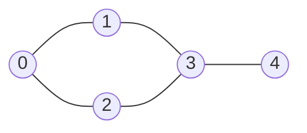
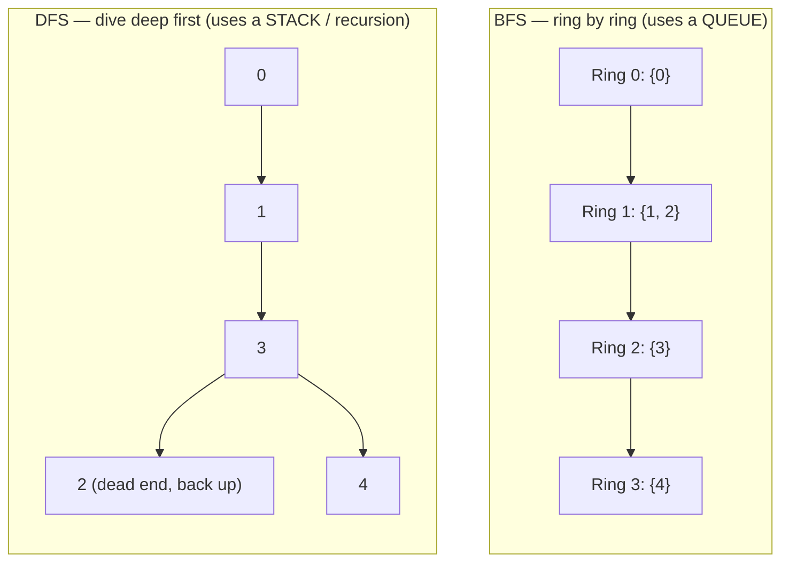

# 16. Graphs: BFS & DFS

> **One-liner:** A graph is just dots (**nodes**) joined by lines (**edges**); **BFS** explores it ring-by-ring while **DFS** dives deep down one path first — and these two walks unlock a huge slice of interview questions, most of them hiding inside a 2D grid.
> **Pattern power:** A large share of "graph" questions at Zepto/Swiggy/CRED/Razorpay are really just BFS or DFS with a `visited` set. Learn the two templates cold and you can *recognize and solve* islands, flood-fill, reachability, connected components, shortest-path-on-a-grid, and graph-cloning — all variations of the same walk.

---

## 1. The Idea in Plain Words

A **graph** is the most general way to say "some things, and connections between them."

- A **node** (also called a **vertex**) is a thing: a delivery location, a user, a course, a grid cell.
- An **edge** is a connection between two nodes: a road between two locations, a "follows" relationship, a prerequisite.

That's the whole model. Think of the **Zepto/Swiggy delivery map**: each *location* is a node, each *road* between two locations is an edge. Almost every graph problem is a question about *walking* this map.

Graphs come in flavours. You must classify a problem's graph before you code, because it changes the algorithm:

| Property | Two options | What it means | Food-delivery analogy |
|---|---|---|---|
| **Direction** | **Undirected** vs **Directed** | Edge goes both ways, or one way only | A two-way street vs a one-way street |
| **Weight** | **Unweighted** vs **Weighted** | Every edge costs 1 hop, or each edge has a number (distance/time/cost) | "how many roads" vs "how many minutes" |
| **Cycles** | **Cyclic** vs **Acyclic** | You can loop back to where you started, or you can't | A roundabout vs a strict one-way delivery funnel |

Two more terms interviewers use casually:

- **Degree** — how many edges touch a node (how many roads meet at a junction).
- **Connected component** — a maximal island of nodes all reachable from each other. A city map might be one connected component; add an island with no bridge and you have two.

> **Key mental model:** a **tree** (see [12-trees.md](12-trees.md)) is just a special graph — connected, undirected, and **acyclic**, with exactly one path between any two nodes. Everything you learned about tree BFS/DFS transfers here; the *only* new thing a general graph adds is **cycles**, and cycles are exactly why we need a `visited` set. Without it, you loop forever.

### Representing a graph in code

Two standard representations. You will use the first one ~95% of the time.

| | **Adjacency list** | **Adjacency matrix** |
|---|---|---|
| Shape | `Map<node, node[]>` — each node lists its neighbours | `boolean[][]` — `m[u][v] = true` if edge u→v |
| Space | **O(V + E)** — only stores real edges | **O(V²)** — even for a sparse graph |
| "Are u and v connected?" | O(degree of u) | **O(1)** |
| List all neighbours of u | **O(degree)** — direct | O(V) — scan a whole row |
| Best for | **Sparse** graphs (most real ones) | Dense graphs, or O(1) edge lookups |

**Why the adjacency list is the default:** real interview graphs are *sparse* — a delivery map has far fewer roads than the V² theoretically possible. The list stores only what exists, and BFS/DFS want "give me the neighbours of this node," which the list answers directly. Reach for a matrix only when the graph is dense or you need constant-time "is there an edge?" checks.

---

## 2. When to Use It — Pattern Triggers

Scan the problem statement for these signals:

| If the problem says… | Reach for | Why |
|---|---|---|
| "**grid** / **matrix**" + "connected", "**regions**", "**islands**", "flood fill" | **Grid DFS/BFS** | Each cell is a node; 4 neighbours are edges |
| "**shortest path**" in an **unweighted** graph / grid ("fewest steps/moves") | **BFS** | BFS visits in ring order → first time you reach a node is the shortest |
| "**can you reach** X from Y?", "is there a path?" | **DFS or BFS** | Either walk; just check if you ever land on the target |
| "**number of connected components**", "how many groups/islands" | **DFS/BFS count** | Loop all nodes; each unvisited start = one new component |
| "**clone** / deep-copy a graph", "traverse every node" | **DFS/BFS + Map** | Walk once, mapping original → copy |
| "shortest path with **weights** (time/cost)" | **NOT plain BFS** → Dijkstra | See [17-graphs-advanced.md](17-graphs-advanced.md) |
| "prerequisites", "ordering", "cycle in a **directed** graph" | **Topological sort** | See [17-graphs-advanced.md](17-graphs-advanced.md) |

> **The single most important trigger to memorize:** *"shortest path in an unweighted graph/grid" → BFS.* We prove why below.

---

## 3. Picture It (Diagram)

An abstract undirected graph — 5 locations, some roads:



As an **adjacency list** this is:

```
0 → [1, 2]
1 → [0, 3]
2 → [0, 3]
3 → [1, 2, 4]
4 → [3]
```

**BFS vs DFS from node 0** — same graph, two different walk orders:



**BFS** discovers nodes in order of *distance* from the start: ring 0 is the start, ring 1 is everything 1 hop away, ring 2 is 2 hops away, and so on. That ordering is the whole reason BFS gives shortest paths in an unweighted graph — **the first time you touch a node, you've reached it by the fewest edges possible.**

**DFS** commits to one neighbour and follows it as far as it goes before backtracking — like walking a maze always taking the leftmost corridor.

The **grid-as-a-graph** insight — every cell is a node, its up/down/left/right neighbours are edges:

```
  grid                cell (r,c) connects to
  1 1 0                    (r-1, c)
  1 0 0          (r, c-1)  (r, c)  (r, c+1)
  0 0 1                    (r+1, c)
```

The two `1`s in the top-left touch each other → one island. The lone `1` in the bottom-right is its own island → **2 islands** total.

---

## 4. The Template (TypeScript)

### 4a. Build an adjacency list

```typescript
// n nodes labelled 0..n-1, edges as [u, v] pairs.
function buildAdjList(
  n: number,
  edges: number[][],
  directed = false,
): Map<number, number[]> {
  const adj = new Map<number, number[]>();
  for (let i = 0; i < n; i++) adj.set(i, []); // pre-seed so every node exists
  for (const [u, v] of edges) {
    adj.get(u)!.push(v);
    if (!directed) adj.get(v)!.push(u); // undirected = add both directions
  }
  return adj;
}
```

> **TS gotcha:** `adj.get(u)` is typed `number[] | undefined`. The `!` non-null assertion is safe here *only because* we pre-seeded every node in the first loop. Pre-seeding is the habit that avoids `Cannot read properties of undefined`.

### 4b. DFS — recursive (cleanest)

```typescript
function dfs(node: number, adj: Map<number, number[]>, visited: Set<number>): void {
  visited.add(node);        // mark on entry — before touching neighbours
  // ...process `node` here...
  for (const next of adj.get(node) ?? []) {
    if (!visited.has(next)) dfs(next, adj, visited);
  }
}
```

### 4c. DFS — iterative (when recursion depth is a risk)

```typescript
function dfsIterative(start: number, adj: Map<number, number[]>): void {
  const visited = new Set<number>();
  const stack: number[] = [start];
  while (stack.length > 0) {
    const node = stack.pop()!;          // LIFO — pop from the end = deep-first
    if (visited.has(node)) continue;    // may be pushed more than once; skip dupes
    visited.add(node);
    // ...process `node` here...
    for (const next of adj.get(node) ?? []) {
      if (!visited.has(next)) stack.push(next);
    }
  }
}
```

> **Why an iterative DFS exists:** JavaScript's call stack is ~10k–15k deep. A recursive DFS on a 200×200 grid that is one giant snake can blow the stack with `Maximum call stack size exceeded`. On huge inputs, prefer the explicit-stack version. (More on recursion depth in [11-recursion-and-backtracking.md](11-recursion-and-backtracking.md).)

### 4d. BFS — with a queue (and the index-pointer trick)

```typescript
function bfs(start: number, adj: Map<number, number[]>): void {
  const visited = new Set<number>([start]);
  const queue: number[] = [start];
  let head = 0;                          // index pointer instead of shift()
  while (head < queue.length) {
    const node = queue[head++];          // "dequeue" in O(1)
    // ...process `node` here...
    for (const next of adj.get(node) ?? []) {
      if (!visited.has(next)) {
        visited.add(next);               // mark at ENQUEUE time (see pitfalls)
        queue.push(next);
      }
    }
  }
}
```

> **The #1 JS BFS gotcha:** `queue.shift()` looks like a dequeue but is **O(n)** — it re-indexes the whole array every call, making your BFS **O(V²)** and timing out on big inputs. Use a **head index pointer** (above) or the layer-swap trick (below). See [10-stacks-and-queues.md](10-stacks-and-queues.md) for the deep dive.

### 4e. BFS for SHORTEST PATH (unweighted) — layer by layer

```typescript
function shortestHops(
  start: number,
  target: number,
  adj: Map<number, number[]>,
): number {
  if (start === target) return 0;
  const visited = new Set<number>([start]);
  let level: number[] = [start];
  let dist = 0;
  while (level.length > 0) {
    const nextLevel: number[] = [];      // build the next ring in full
    for (const node of level) {
      for (const nb of adj.get(node) ?? []) {
        if (nb === target) return dist + 1;
        if (!visited.has(nb)) {
          visited.add(nb);
          nextLevel.push(nb);
        }
      }
    }
    level = nextLevel;                    // swap rings — no shift(), no head pointer
    dist++;
  }
  return -1;                             // unreachable
}
```

### 4f. Grid traversal with direction vectors

```typescript
const DIRS: ReadonlyArray<readonly [number, number]> = [
  [-1, 0], // up
  [1, 0],  // down
  [0, -1], // left
  [0, 1],  // right
];

function gridDFS(grid: number[][], r: number, c: number, visited: boolean[][]): void {
  const rows = grid.length, cols = grid[0].length;
  // BOUNDARY CHECK FIRST — never index out of the grid
  if (r < 0 || r >= rows || c < 0 || c >= cols) return;
  if (visited[r][c] || grid[r][c] === 0) return; // seen, or a wall/water
  visited[r][c] = true;
  for (const [dr, dc] of DIRS) gridDFS(grid, r + dr, c + dc, visited);
}
```

> **Direction vectors** turn "look at my 4 neighbours" into a clean loop instead of four copy-pasted blocks. Want 8-directional (including diagonals)? Add `[-1,-1], [-1,1], [1,-1], [1,1]` to `DIRS`.

---

## 5. Complexity

Let **V** = number of nodes (vertices), **E** = number of edges. For a grid, V = rows × cols and E ≈ 4V (each cell has ≤ 4 neighbours).

| Operation | Time | Space | Note |
|---|---|---|---|
| Build adjacency list | O(V + E) | O(V + E) | Store every node + every edge once |
| BFS (list) | **O(V + E)** | O(V) | Each node dequeued once; each edge scanned once |
| DFS (list) | **O(V + E)** | O(V) | Same total work; O(V) recursion/stack depth |
| BFS/DFS on a grid | **O(rows × cols)** | O(rows × cols) | Every cell visited once |
| BFS (matrix) | O(V²) | O(V²) | Listing neighbours scans a whole row |
| `queue.shift()` BFS | ⚠️ **O(V²)** | O(V) | The accidental blow-up — avoid |

The headline number to say in an interview: **"BFS and DFS are both O(V + E)."** They do the same total work; they differ only in the *order* they visit nodes.

---

## 6. Worked Example (a classic LeetCode problem)

### Number of Islands — LeetCode 200 (Medium)

> Given a grid of `'1'` (land) and `'0'` (water), count the islands. An island is land connected 4-directionally (up/down/left/right).

**Recognize the trigger:** "grid" + "islands"/"connected" → grid DFS/BFS. Each `'1'` cell is a node; adjacent `'1'`s are edges.

**Plan:** scan every cell. When you hit an unvisited `'1'`, that's a *new* island — so `count++`, then **flood-fill** (DFS/BFS) the entire island so you never count its cells again. We flood-fill by "sinking" land to `'0'` (mutating the grid *is* our visited marker — no extra Set needed).

```typescript
function numIslands(grid: string[][]): number {
  if (grid.length === 0 || grid[0].length === 0) return 0;
  const rows = grid.length, cols = grid[0].length;
  const DIRS: readonly [number, number][] = [[-1, 0], [1, 0], [0, -1], [0, 1]];
  let count = 0;

  function sink(r: number, c: number): void {
    if (r < 0 || r >= rows || c < 0 || c >= cols || grid[r][c] !== '1') return;
    grid[r][c] = '0';                              // mark visited by sinking it
    for (const [dr, dc] of DIRS) sink(r + dr, c + dc);
  }

  for (let r = 0; r < rows; r++) {
    for (let c = 0; c < cols; c++) {
      if (grid[r][c] === '1') {
        count++;                                   // found a fresh island
        sink(r, c);                                // erase all of it
      }
    }
  }
  return count;
}
```

**Trace on this grid** (`1`=land, `0`=water):

```
col:  0 1 2 3
row0: 1 1 0 0
row1: 1 0 0 1
row2: 0 0 1 1
```

| Scan reaches | Cell value | Action | `count` | Cells sunk this fill |
|---|---|---|---|---|
| (0,0) | `1` | new island → `sink` | **1** | (0,0),(0,1),(1,0) |
| (0,1)…(1,0) | already `0` | skip (sunk above) | 1 | — |
| (1,3) | `1` | new island → `sink` | **2** | (1,3),(2,3),(2,2) |
| (2,2) | already `0` | skip | 2 | — |
| rest | `0` | skip | 2 | — |

**Answer: 2 islands.** The first `sink` chews through the connected L-shape in the top-left; the second chews through the connected blob on the right. Because sunk cells become `'0'`, the outer scan never double-counts. Time **O(rows × cols)**, space O(rows × cols) worst-case for the recursion stack (swap to the iterative stack for giant grids).

**BFS variant** (identical result, no recursion — safer on huge inputs): push the starting cell, mark it `'0'`, then repeatedly dequeue a cell and enqueue+sink its `'1'` neighbours, using the head-pointer queue from 4d.

### Two cousins worth knowing

- **Rotting Oranges — LeetCode 994 (multi-source BFS).** A grid of fresh (`1`) and rotten (`2`) oranges; each minute, rotten oranges rot their 4 neighbours. Return minutes until none are fresh. Trick: seed the BFS queue with **all** rotten oranges at once (multi-source), then count layers — each BFS ring is one minute. This is the "shortest time = BFS layers" idea applied to many starting points.

```typescript
function orangesRotting(grid: number[][]): number {
  const rows = grid.length, cols = grid[0].length;
  const DIRS: readonly [number, number][] = [[-1, 0], [1, 0], [0, -1], [0, 1]];
  let level: [number, number][] = [];
  let fresh = 0;
  for (let r = 0; r < rows; r++)
    for (let c = 0; c < cols; c++) {
      if (grid[r][c] === 2) level.push([r, c]); // ALL sources seed the queue
      else if (grid[r][c] === 1) fresh++;
    }
  let minutes = 0;
  while (level.length > 0 && fresh > 0) {
    const next: [number, number][] = [];
    for (const [r, c] of level) {
      for (const [dr, dc] of DIRS) {
        const nr = r + dr, nc = c + dc;
        if (nr >= 0 && nr < rows && nc >= 0 && nc < cols && grid[nr][nc] === 1) {
          grid[nr][nc] = 2;                       // rot it (= mark visited)
          fresh--;
          next.push([nr, nc]);
        }
      }
    }
    level = next;
    minutes++;
  }
  return fresh === 0 ? minutes : -1;              // leftover fresh = unreachable
}
```

- **Clone Graph — LeetCode 133 (DFS + Map).** Deep-copy a graph. The trick is a `Map<original, copy>`: create a node's copy and **register it in the Map *before* recursing into neighbours**, so when a cycle leads back to it you return the existing copy instead of looping forever.

```typescript
class GNode {
  val: number;
  neighbors: GNode[];
  constructor(val = 0, neighbors: GNode[] = []) {
    this.val = val;
    this.neighbors = neighbors;
  }
}

function cloneGraph(node: GNode | null): GNode | null {
  if (node === null) return null;
  const clones = new Map<GNode, GNode>();
  function dfs(cur: GNode): GNode {
    const existing = clones.get(cur);
    if (existing) return existing;                // already cloned → break cycle
    const copy = new GNode(cur.val);
    clones.set(cur, copy);                         // register BEFORE recursing
    for (const nb of cur.neighbors) copy.neighbors.push(dfs(nb));
    return copy;
  }
  return dfs(node);
}
```

---

## 7. Practice Set (curated LeetCode)

Do them in order — each adds one new twist.

| # | Problem | Difficulty | Tool | New idea it teaches |
|---|---|---|---|---|
| 200 | Number of Islands | Medium | Grid DFS/BFS | The core flood-fill count |
| 733 | Flood Fill | Easy | Grid DFS | Simplest possible flood-fill (warm-up) |
| 695 | Max Area of Island | Medium | Grid DFS | Return a value up the recursion (size) |
| 994 | Rotting Oranges | Medium | Multi-source BFS | Many sources; layers = time |
| 133 | Clone Graph | Medium | DFS + Map | Copy while breaking cycles |
| 130 | Surrounded Regions | Medium | DFS from borders | Invert the search: start from the edges |
| 1091 | Shortest Path in Binary Matrix | Medium | BFS (8-dir) | Shortest path = BFS; diagonal moves |
| 127 | Word Ladder | Hard | BFS on implicit graph | Words are nodes; edges = "1 letter apart" |
| 417 | Pacific Atlantic Water Flow | Medium | DFS from two sides | Two multi-source floods, intersect |
| 542 | 01 Matrix | Medium | Multi-source BFS | Distance from nearest source |

> **Word Ladder is the "aha" problem.** There's no grid and no explicit edge list — the *graph is implicit*. Two words are neighbours if they differ by exactly one letter, and "fewest transformations" screams shortest-path-unweighted → **BFS**. Learning to *see a hidden graph* is the real interview skill.

---

## 8. Common Pitfalls & Interview Tips

| Pitfall | What goes wrong | Fix |
|---|---|---|
| **Forgetting `visited`** | Cycles make you loop **forever** (or infinite recursion) | Always carry a `Set`/`boolean[][]`; a graph is not a tree |
| **Marking visited at *dequeue* time in BFS** | The same node gets enqueued by several neighbours before it's popped → duplicated work, wrong distances, TLE | Mark visited **the instant you enqueue** (template 4d) |
| **`queue.shift()`** | Silent O(n) dequeue → O(V²) BFS → time-limit-exceeded | Head-index pointer or layer-swap (4d/4e) |
| **No boundary check on the grid** | `grid[r][c]` throws / reads `undefined` at the edges | Check `0 ≤ r < rows && 0 ≤ c < cols` **before** indexing |
| **Deep recursive DFS** | `Maximum call stack size exceeded` on a huge/snakey grid | Switch to the iterative explicit-stack DFS (4c) |
| **Undirected edge added once** | Half your graph is unreachable | Push **both** `u→v` and `v→u` when building (4a) |
| **Counting nodes as edges** | Off-by-one in component/level counting | Increment `count` only when you *start* a brand-new component |

**Interview tips**

- **Say the classification out loud:** "directed or undirected? weighted? can there be cycles?" It shows structured thinking and picks your algorithm for you.
- **BFS ⇔ shortest path (unweighted); DFS ⇔ reachability / connectivity / counting components.** Weighted shortest path is a *different* tool (Dijkstra, [17-graphs-advanced.md](17-graphs-advanced.md)).
- **Grid problems ARE graph problems.** State it explicitly — "each cell is a node, its 4 neighbours are edges" — then reuse the template.
- **Mutating the input as your `visited` marker** (sinking `'1'`→`'0'`) is elegant and saves space, but *ask the interviewer* whether mutating the input is allowed. If not, use a separate `visited` grid.

---

## 9. TL;DR

- A **graph** = nodes + edges. Classify it: **directed?** **weighted?** **cyclic?** A **tree** is just an acyclic connected graph.
- Default representation is the **adjacency list** (`Map<number, number[]>`) — O(V+E) space, direct neighbour access. Use a matrix only for dense graphs / O(1) edge checks.
- **DFS** dives deep (recursion or an explicit **stack**); **BFS** goes ring-by-ring (a **queue**). Both are **O(V+E)**. The only thing a general graph adds over a tree is cycles → always carry a **`visited` set**.
- **BFS gives the shortest path in an *unweighted* graph** — the first time you reach a node is via the fewest edges. This is *the* fact to memorize.
- The **grid-as-a-graph** pattern (Number of Islands, Flood Fill, Rotting Oranges) is the most common interview form: cell = node, 4 neighbours = edges, direction-vector loop.
- JS traps: `queue.shift()` is **O(n)** (use a head pointer), mark visited at **enqueue** time, guard grid **boundaries**, and watch **recursion depth** on giant DFS.

**Next:** weighted shortest paths, ordering with prerequisites, and grouping — [17-graphs-advanced.md](17-graphs-advanced.md). Related: [10-stacks-and-queues.md](10-stacks-and-queues.md) (the queue/stack these walks run on), [11-recursion-and-backtracking.md](11-recursion-and-backtracking.md) (recursive DFS), and [12-trees.md](12-trees.md) (the special-case graph you already know).
