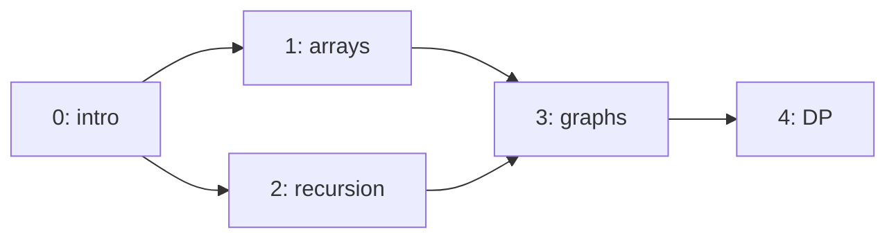
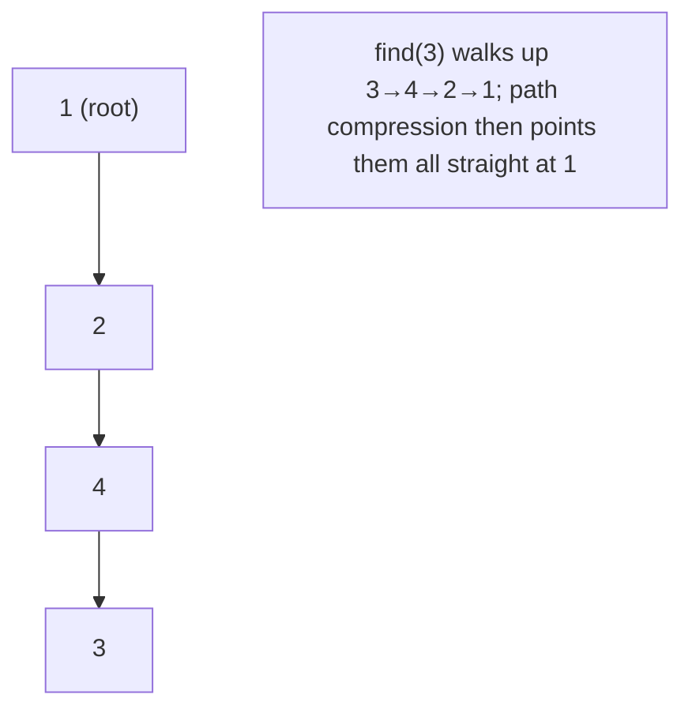
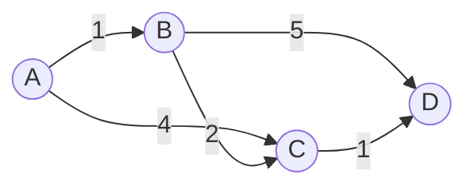

# 17. Graphs: Advanced — Topological Sort, Union-Find & Dijkstra

> **One-liner:** Three specialized graph tools that each own a whole category of interview questions — **topological sort** (order things with dependencies), **union-find** (group things and ask "are they connected?"), and **Dijkstra** (shortest path when edges have *weights*).
> **Pattern power:** Once plain BFS/DFS ([16-graphs-bfs-dfs.md](16-graphs-bfs-dfs.md)) is in your hands, these three cover almost everything else companies like CRED, Razorpay and FAANG throw at you: "course schedule", "build order", "number of provinces", "redundant connection", "accounts merge", "network delay time", "cheapest flights".

---

## 1. The Idea in Plain Words

Three tools, three questions. Learn to map the *question* to the *tool*:

**(a) Topological Sort — "in what order can I do these, respecting dependencies?"**
Given tasks where some must come before others (course → its prerequisite, build step → its input), produce a linear order where every task appears *after* everything it depends on. This only makes sense on a **DAG** — a **D**irected **A**cyclic **G**raph. If there's a cycle (A needs B needs A), no valid order exists — so topo sort *also detects cycles in a directed graph*. Picture getting dressed: socks before shoes, shirt before jacket; a topological sort is any valid dressing order.

**(b) Union-Find (Disjoint Set Union / DSU) — "are these two things in the same group? how many groups are there?"**
Maintain a collection of disjoint groups with two ultra-fast operations: **`union(a, b)`** (merge two groups) and **`find(x)`** (which group is x in?). Think friend circles: if A knows B and B knows C, they're one circle — union-find tracks that as you add friendships, and instantly answers "are A and C in the same circle?" It's the specialist for **connectivity in an *undirected* graph** and for **detecting a cycle as you add edges**.

**(c) Dijkstra's Shortest Path — "cheapest/fastest route when edges have weights?"**
BFS finds the path with the *fewest edges*. But on a **Zepto delivery map** the roads have *weights* — minutes, distance, cost — and the fewest-roads route isn't the fastest. **Dijkstra** finds the minimum-*weight* path from a source to every node, as long as **all weights are non-negative**. It's greedy BFS: always expand the closest-so-far node next, using a **min-heap** ([14-heaps-and-priority-queues.md](14-heaps-and-priority-queues.md)) to pick it.

| Tool | The question | Graph type | Engine |
|---|---|---|---|
| **Topological sort** | Valid order under dependencies? Any cycle? | Directed (DAG) | BFS (Kahn) or DFS |
| **Union-Find** | Same group? How many groups? Cycle while adding? | Undirected | Array + tiny tree tricks |
| **Dijkstra** | Cheapest weighted path? | Weighted, non-negative | Min-heap (greedy BFS) |

---

## 2. When to Use It — Pattern Triggers

| If the problem says… | Reach for | Tell-tale sign |
|---|---|---|
| "**prerequisites**", "**order** of courses/tasks", "**build order**", "compile order" | **Topological sort** | Directed "must come before" relationships |
| "can you **finish all** courses?", "is there a **cycle** in a directed graph?" | **Topological sort** (Kahn) | If a valid order covers all nodes → no cycle |
| "**are X and Y connected**?", "same group/component?" | **Union-Find** | Repeated connectivity queries |
| "**number of** connected **components** / **provinces** / friend circles" | **Union-Find** (or DFS) | Count groups after all unions |
| "**redundant connection**", "the edge that creates a **cycle**" (undirected) | **Union-Find** | `union` returns false → both ends already linked |
| "**accounts merge**", "merge emails/items into groups" | **Union-Find** | Merge-by-shared-key |
| "**shortest / cheapest / fastest** path" with **weighted** edges (≥ 0) | **Dijkstra** | Weights = time/cost/distance |
| "shortest path" but weights can be **negative** | **Bellman-Ford** (not Dijkstra) | See the one-liner in §4c |
| "shortest path" but **unweighted** | **plain BFS** ([16](16-graphs-bfs-dfs.md)) | Every edge costs 1 → don't over-engineer |

> **Decision shortcut:** *dependencies/ordering* → **topo**; *grouping/connectivity* → **union-find**; *weighted shortest path* → **Dijkstra**; *unweighted shortest path* → **BFS**.

---

## 3. Picture It (Diagram)

**(a) A DAG and one valid topological order.** Edge `u → v` means "u must come before v":



A valid order: `0, 1, 2, 3, 4` (or `0, 2, 1, 3, 4`). Node **3** must wait for **both** 1 and 2 — that's its *indegree* of 2, the heart of Kahn's algorithm below. Add an edge `4 → 0` and you'd create a cycle — no order could exist.

**(b) Union-Find as a forest of "who's my boss" pointers.** After `union(1,2)`, `union(3,4)`, `union(2,4)`:



Everyone in a group points (eventually) at one **root**. Same root = same group.

**(c) Dijkstra on a weighted graph** — numbers are edge weights (minutes):



From A: the fewest-*edges* path to C is direct (weight 4), but the cheapest-*weight* path is A→B→C = 1+2 = **3**. BFS would pick the wrong one; Dijkstra picks 3. Then A→B→C→D = 1+2+1 = **4** beats A→B→D = 6.

---

## 4. The Template (TypeScript)

### 4a. Topological Sort — Kahn's algorithm (BFS with indegrees)

**Idea:** a node with **indegree 0** has no unmet prerequisites → it's safe to output now. Output it, remove its outgoing edges (decrement neighbours' indegrees), and any neighbour that drops to 0 becomes ready. If you can't output all nodes, the leftovers are stuck in a **cycle**.

```typescript
// edges as [u, v] meaning "u must come before v".
function topoSortKahn(n: number, edges: number[][]): number[] {
  const adj = new Map<number, number[]>();
  const indegree = new Array<number>(n).fill(0);
  for (let i = 0; i < n; i++) adj.set(i, []);
  for (const [u, v] of edges) {
    adj.get(u)!.push(v);
    indegree[v]++;                       // v gains one unmet prerequisite
  }

  const queue: number[] = [];
  for (let i = 0; i < n; i++) if (indegree[i] === 0) queue.push(i);

  const order: number[] = [];
  let head = 0;                          // index pointer — NOT queue.shift() (O(n)!)
  while (head < queue.length) {
    const node = queue[head++];
    order.push(node);
    for (const next of adj.get(node)!) {
      if (--indegree[next] === 0) queue.push(next); // now unblocked
    }
  }
  return order.length === n ? order : []; // fewer than n → cycle → no valid order
}
```

### 4b. Topological Sort — DFS-based (post-order + reverse)

**Idea:** run DFS; a node is only fully "done" after all its descendants are done, so pushing each node **after** its recursion (post-order) and then **reversing** yields a topological order. Track three colours to catch a cycle: a "back edge" to a node still *in progress* means a cycle.

```typescript
function topoSortDFS(n: number, edges: number[][]): number[] {
  const adj = new Map<number, number[]>();
  for (let i = 0; i < n; i++) adj.set(i, []);
  for (const [u, v] of edges) adj.get(u)!.push(v);

  const state = new Array<number>(n).fill(0); // 0=unseen, 1=in-progress, 2=done
  const order: number[] = [];
  let hasCycle = false;

  function dfs(node: number): void {
    state[node] = 1;                              // in progress
    for (const next of adj.get(node)!) {
      if (state[next] === 1) { hasCycle = true; return; } // back edge → cycle
      if (state[next] === 0) dfs(next);
    }
    state[node] = 2;                              // done
    order.push(node);                             // post-order
  }

  for (let i = 0; i < n; i++) if (state[i] === 0) dfs(i);
  return hasCycle ? [] : order.reverse();
}
```

> **Which to use?** Prefer **Kahn's** in interviews — it's iterative (no recursion-depth risk, see [11-recursion-and-backtracking.md](11-recursion-and-backtracking.md)) and the cycle check ("did I output all n?") is dead simple.

### 4c. Union-Find (DSU) — path compression + union by rank

```typescript
class DSU {
  private parent: number[];
  private rank: number[];       // upper bound on tree height
  count: number;                // number of disjoint sets right now

  constructor(n: number) {
    this.parent = Array.from({ length: n }, (_, i) => i); // each node is its own root
    this.rank = new Array<number>(n).fill(0);
    this.count = n;
  }

  find(x: number): number {
    if (this.parent[x] !== x) {
      this.parent[x] = this.find(this.parent[x]); // PATH COMPRESSION: flatten on the way up
    }
    return this.parent[x];
  }

  // returns false if x and y were ALREADY in the same set (→ a cycle, in undirected graphs)
  union(x: number, y: number): boolean {
    const rx = this.find(x), ry = this.find(y);
    if (rx === ry) return false;
    // UNION BY RANK: attach the shorter tree under the taller one
    if (this.rank[rx] < this.rank[ry]) this.parent[rx] = ry;
    else if (this.rank[rx] > this.rank[ry]) this.parent[ry] = rx;
    else { this.parent[ry] = rx; this.rank[rx]++; }
    this.count--;
    return true;
  }

  connected(x: number, y: number): boolean {
    return this.find(x) === this.find(y);
  }
}
```

Usage patterns fall out immediately:
- **Number of components:** `union` every edge, read `dsu.count`.
- **Detect a cycle (undirected):** if any `union(u, v)` returns `false`, the edge closes a cycle.
- **"Are X and Y connected?":** `dsu.connected(x, y)`.

### 4d. Dijkstra — weighted shortest path with a min-heap

```typescript
// A tiny min-heap of [distance, node]. Chapter 14 has the reusable generic version —
// import that in real code; this inline copy keeps the template self-contained.
class MinHeap {
  private h: [number, number][] = [];
  get size(): number { return this.h.length; }
  push(item: [number, number]): void {
    this.h.push(item);
    let i = this.h.length - 1;
    while (i > 0) {
      const p = (i - 1) >> 1;
      if (this.h[p][0] <= this.h[i][0]) break;
      [this.h[p], this.h[i]] = [this.h[i], this.h[p]];
      i = p;
    }
  }
  pop(): [number, number] | undefined {
    if (this.h.length === 0) return undefined;
    const top = this.h[0];
    const last = this.h.pop()!;
    if (this.h.length > 0) {
      this.h[0] = last;
      let i = 0; const n = this.h.length;
      while (true) {
        let s = i; const l = 2 * i + 1, r = 2 * i + 2;
        if (l < n && this.h[l][0] < this.h[s][0]) s = l;
        if (r < n && this.h[r][0] < this.h[s][0]) s = r;
        if (s === i) break;
        [this.h[s], this.h[i]] = [this.h[i], this.h[s]];
        i = s;
      }
    }
    return top;
  }
}

// edges: [u, v, w] directed. dist[i] = min weight from src to i (Infinity if unreachable).
function dijkstra(n: number, edges: number[][], src: number): number[] {
  const adj = new Map<number, [number, number][]>(); // node -> [neighbour, weight][]
  for (let i = 0; i < n; i++) adj.set(i, []);
  for (const [u, v, w] of edges) adj.get(u)!.push([v, w]);

  const dist = new Array<number>(n).fill(Infinity);
  dist[src] = 0;
  const pq = new MinHeap();
  pq.push([0, src]);

  while (pq.size > 0) {
    const [d, node] = pq.pop()!;         // always expand the closest-so-far node
    if (d > dist[node]) continue;        // stale entry — we already did better
    for (const [next, w] of adj.get(node)!) {
      const nd = d + w;
      if (nd < dist[next]) {             // "relax" the edge
        dist[next] = nd;
        pq.push([nd, next]);
      }
    }
  }
  return dist;
}
```

> **Contrast with BFS:** BFS is Dijkstra where every weight is 1 — a plain queue suffices because nodes naturally come out in distance order. The moment weights differ, you need the **heap** to always pull the closest node next. **Negative weights break Dijkstra** (a later cheap-but-negative edge can undercut a node you already "finalized"). For negative edges use **Bellman-Ford** — O(V·E), relaxes every edge V−1 times, and also detects negative cycles.

---

## 5. Complexity

Let **V** = nodes, **E** = edges. For Union-Find, **α** is the inverse-Ackermann function — effectively a constant (≤ 4) for any input you'll ever see.

| Tool | Time | Space | Notes |
|---|---|---|---|
| Topo sort (Kahn / DFS) | **O(V + E)** | O(V + E) | One pass; each edge relaxed once |
| DSU `find` / `union` | **~O(α(V)) ≈ O(1)** amortized | O(V) | *With* path compression **and** union by rank |
| DSU without both optimizations | up to **O(V)** per op | O(V) | Degenerates to a linked list — the classic mistake |
| Dijkstra (binary heap) | **O((V + E) log V)** | O(V + E) | `log V` from heap push/pop |
| Bellman-Ford | O(V · E) | O(V) | Handles negative edges; slower |

---

## 6. Worked Example (a classic LeetCode problem)

### Course Schedule — LeetCode 207 (Medium)

> `numCourses` courses labelled `0..n-1`. `prerequisites[i] = [a, b]` means you must take **b before a**. Return `true` if you can finish every course.

**Recognize the trigger:** "prerequisites" + "can you finish all" → topological sort / directed-cycle detection. You *can* finish iff the prerequisite graph is a **DAG** (no cycle). Use **Kahn's**: if we manage to output all `n` courses, there's no cycle.

**Build the graph:** `[a, b]` means `b → a` (b unlocks a). So a's indegree counts its prerequisites.

```typescript
function canFinish(numCourses: number, prerequisites: number[][]): boolean {
  const adj = new Map<number, number[]>();
  const indegree = new Array<number>(numCourses).fill(0);
  for (let i = 0; i < numCourses; i++) adj.set(i, []);
  for (const [a, b] of prerequisites) {  // b before a  →  edge b -> a
    adj.get(b)!.push(a);
    indegree[a]++;
  }

  const queue: number[] = [];
  for (let i = 0; i < numCourses; i++) if (indegree[i] === 0) queue.push(i);

  let head = 0, taken = 0;
  while (head < queue.length) {
    const node = queue[head++];
    taken++;                             // this course is now completed
    for (const next of adj.get(node)!) {
      if (--indegree[next] === 0) queue.push(next);
    }
  }
  return taken === numCourses;           // all taken → no cycle → can finish
}
```

**Trace** `numCourses = 4`, `prerequisites = [[1,0],[2,0],[3,1],[3,2]]` (edges `0→1, 0→2, 1→3, 2→3`):

| Step | Queue (from `head`) | Pop | `taken` | Indegree updates |
|---|---|---|---|---|
| init | `[0]` | — | 0 | indeg = {0:0, 1:1, 2:1, 3:2} |
| 1 | `[0]` | **0** | 1 | 1→0 (enqueue), 2→0 (enqueue) → `[0,1,2]` |
| 2 | `[0,1,2]` | **1** | 2 | 3→1 |
| 3 | `[0,1,2]` | **2** | 3 | 3→0 (enqueue) → `[0,1,2,3]` |
| 4 | `[0,1,2,3]` | **3** | 4 | — |

`taken (4) === numCourses (4)` → **true**. Course 0 unblocks 1 and 2, which together unblock 3. Now imagine adding `[0,3]` (i.e. `3→0`): that creates the cycle `0→1→3→0`. No node would ever hit indegree 0 to start, `taken` stalls below 4, and we correctly return **false**. Its sibling **Course Schedule II (LeetCode 210)** asks for the *actual order* — just return `order` instead of the count.

### Two cousins worth knowing

- **Number of Provinces — LeetCode 547 (Union-Find).** An `n×n` matrix where `isConnected[i][j] = 1` means city i and j are directly linked; return the number of provinces (connected components). Feed every `1` into `dsu.union(i, j)` and the answer is `dsu.count`:

```typescript
function findCircleNum(isConnected: number[][]): number {
  const n = isConnected.length;
  const dsu = new DSU(n);
  for (let i = 0; i < n; i++)
    for (let j = i + 1; j < n; j++)
      if (isConnected[i][j] === 1) dsu.union(i, j);
  return dsu.count;
}
```

- **Redundant Connection — LeetCode 684 (Union-Find cycle detection).** A tree had one extra edge added, creating exactly one cycle; return that edge. Union edges in order — the **first `union` that returns `false`** is the redundant one, because both endpoints were already connected:

```typescript
function findRedundantConnection(edges: number[][]): number[] {
  const dsu = new DSU(edges.length + 1); // nodes are 1-indexed
  for (const [u, v] of edges) if (!dsu.union(u, v)) return [u, v];
  return [];
}
```

- **Network Delay Time — LeetCode 743 (Dijkstra).** Signals travel weighted edges from a source `k`; return the time for *all* nodes to receive it (or −1). Run `dijkstra`, then the answer is the **maximum** finite `dist` (−1 if any node is still `Infinity`). Classic single-source weighted shortest path.

---

## 7. Practice Set (curated LeetCode)

| # | Problem | Difficulty | Tool | New idea |
|---|---|---|---|---|
| 207 | Course Schedule | Medium | Topo (Kahn) | Cycle detection via "took all n?" |
| 210 | Course Schedule II | Medium | Topo | Return the order, not just yes/no |
| 269 | Alien Dictionary | Hard | Topo | Derive edges from word ordering |
| 547 | Number of Provinces | Medium | Union-Find | Count components with `dsu.count` |
| 684 | Redundant Connection | Medium | Union-Find | First failing `union` = the cycle edge |
| 721 | Accounts Merge | Medium | Union-Find | Union by a shared key (email) |
| 1319 | Number of Operations to Make Network Connected | Medium | Union-Find | Count spare edges vs components |
| 743 | Network Delay Time | Medium | Dijkstra | Answer = max of all shortest dists |
| 787 | Cheapest Flights Within K Stops | Medium | Dijkstra / Bellman-Ford | Shortest path with a hop budget |
| 1631 | Path With Minimum Effort | Medium | Dijkstra on a grid | "Weight" = max step along the path |

> **Pattern-spotting drill:** before coding any of these, say the trigger out loud — *ordering → topo, grouping → union-find, weighted shortest path → Dijkstra*. Recognition is 80% of the battle.

---

## 8. Common Pitfalls & Interview Tips

| Pitfall | What goes wrong | Fix |
|---|---|---|
| **Kahn's indegree bookkeeping** | Building indegree on the wrong edge direction, or decrementing at the wrong time | `[a,b]`="b before a" → edge `b→a`, so `indegree[a]++`. Decrement a neighbour *only* when you pop its source |
| **Forgetting the cycle check in topo** | You return a partial "order" that silently drops stuck nodes | Assert `order.length === n` (Kahn) or track the in-progress colour (DFS) |
| **DSU without path compression *or* union by rank** | Trees degrade into O(V) chains → O(V·E) overall → TLE | Keep **both** optimizations (template 4c) |
| **`find` without compression** | Re-walking long parent chains every query | Compress on the way up: `parent[x] = find(parent[x])` |
| **Dijkstra without a heap** | Scanning for the min node each step is O(V²); on big sparse graphs it's slow/awkward | Use the **min-heap** ([14-heaps-and-priority-queues.md](14-heaps-and-priority-queues.md)) |
| **Dijkstra on negative edges** | Silently returns wrong distances (a "finalized" node can be beaten later) | Detect negatives → switch to **Bellman-Ford** |
| **Not skipping stale heap entries** | Re-processing outdated `[d, node]` pairs wastes time | `if (d > dist[node]) continue;` right after popping |
| **`queue.shift()` in Kahn** | O(n) dequeue → O(V²) | Head-index pointer, like in [16-graphs-bfs-dfs.md](16-graphs-bfs-dfs.md) |

**Interview tips**

- **Announce the tool from the trigger.** "This is ordering-under-dependencies, so topological sort" earns points before you write a line.
- **Kahn's doubles as a cycle detector for free** — most "can you finish / is it possible" directed-graph questions are secretly topo sort.
- **Union-Find is for *undirected* connectivity;** topo/DFS-colours is for *directed* cycles. Don't cross the streams.
- **Memorize the DSU class.** It's ~20 lines, appears constantly, and interviewers love that you know path compression + union by rank by name.
- **State Dijkstra's precondition:** "assuming non-negative weights." If they hint at negatives, name-drop Bellman-Ford.

---

## 9. TL;DR

- **Topological sort** orders a **DAG** so every node follows its dependencies. **Kahn's** (BFS on indegrees) is the go-to — output indegree-0 nodes, decrement neighbours, and *"took all n?"* is a free **directed-cycle check**. DFS post-order + reverse also works. **O(V+E)**.
- **Union-Find (DSU)** answers "same group?" and "how many groups?" in ~**O(1)** amortized *with* **path compression + union by rank**. A `union` that returns `false` means the edge closes a **cycle** (undirected). Memorize the ~20-line class.
- **Dijkstra** finds the minimum-**weight** path from a source using a **min-heap** to always expand the closest node — **O((V+E) log V)**. It needs **non-negative** weights; for negatives use **Bellman-Ford** (one line: O(V·E), handles negative cycles).
- **Pick by trigger:** dependencies/ordering → **topo**; grouping/connectivity → **union-find**; weighted shortest path → **Dijkstra**; unweighted shortest path → plain **BFS** ([16-graphs-bfs-dfs.md](16-graphs-bfs-dfs.md)).

**Related:** [16-graphs-bfs-dfs.md](16-graphs-bfs-dfs.md) (the BFS/DFS foundation) and [14-heaps-and-priority-queues.md](14-heaps-and-priority-queues.md) (the min-heap Dijkstra runs on).
