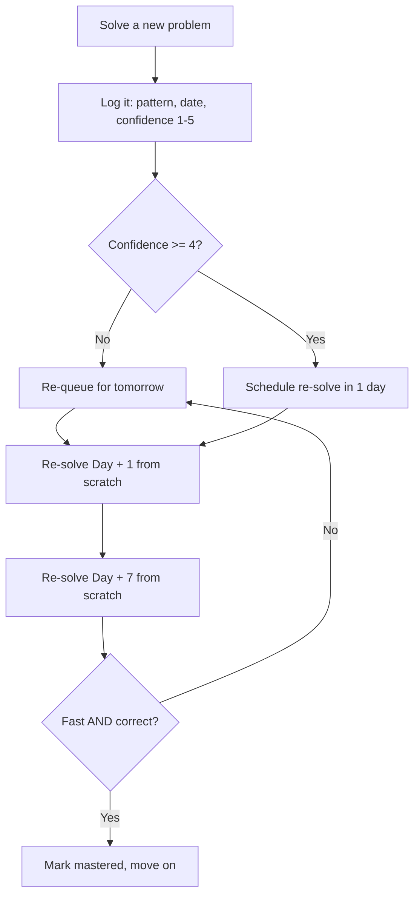
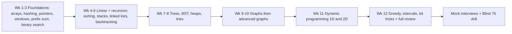
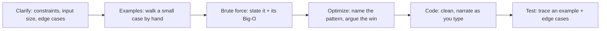

# 22. The 150-Problem Plan & Revision System

> **One-liner:** Your curated, sequenced roadmap from zero DSA to interview-ready — the exact ~150 problems to solve, in what order, over ~12 weeks, plus a revision system so they actually *stick*.

This is the capstone. Everything in chapters [01](01-big-o-and-problem-solving-framework.md)–[21](21-bit-manipulation-and-math.md) taught you the **patterns**. This chapter turns them into an **executable plan** you can start tomorrow and finish before your interviews.

---

## 1. How This Plan Works

**Patterns over volume.** There are 2,000+ LeetCode problems and you will never memorise them. You don't need to. ~15–20 patterns cover the vast majority of interview questions (that's the whole thesis of [00-README.md](00-README.md)). This plan gives you a **curated 150** that *cover every pattern* — not a random grind. Each problem earns its place by teaching a pattern or a reusable variation.

**The volume targets:**

| Milestone | Problems | You can… |
|---|---|---|
| **Dangerous** | ~50 | recognise most patterns, solve Easy/early-Medium confidently |
| **Interview-ready** | ~150 | this plan — handle the standard Medium spread these companies ask |
| **Comfortable** | ~200+ | walk into FAANG-tier rounds without surprises |

**Do easy → medium *per pattern*.** Don't do all Easies then all Mediums. Within each pattern, do the Easy problems first to lock the *mechanics*, then the Mediums that *combine* the pattern with something else. You want to master one pattern's full range before moving on — that's how recognition gets automatic.

**The spaced-repetition rule (non-negotiable).** Reading a solution feels like learning; it isn't. Re-solving is. For every problem:

1. Solve it (Day 0).
2. **Re-solve it Day +1** — from a blank editor, no notes.
3. **Re-solve it Day +7** — again from scratch.

The metric that matters is not "have I seen this?" but **"can I re-solve it from scratch, fast, today?"** Track exactly that (section 4). A problem you solved once and forgot is a problem you don't have.

---

## 2. The Weekly Schedule

A realistic **~10–12 hrs/week** plan (say 1.5 hrs on 5 weekdays + a longer weekend block) for someone with a full-time job — which is you. It maps the 20 pattern chapters across **12 weeks**. Each week: read the chapter(s), solve the **new** problems below, and fold in the Day+1 / Day+7 re-solves from prior weeks (that's what your weekend block is partly for).

| Week | Chapters / patterns | New problems | Milestone — solve these from scratch |
|---|---|---|---|
| 1 | [01](01-big-o-and-problem-solving-framework.md) Big-O · [02](02-arrays-and-strings.md) Arrays & Strings · [03](03-hashing-maps-and-sets.md) Hashing | 10 | Two Sum, Contains Duplicate, Group Anagrams |
| 2 | [04](04-two-pointers.md) Two Pointers · [05](05-sliding-window.md) Sliding Window | 13 | 3Sum, Longest Substring Without Repeat |
| 3 | [06](06-prefix-sum.md) Prefix Sum · [07](07-binary-search.md) Binary Search | 12 | Subarray Sum = K, Search in Rotated Array |
| 4 | [08](08-sorting.md) Sorting · [10](10-stacks-and-queues.md) Stacks & Queues | 11 | Valid Parentheses, Daily Temperatures |
| 5 | [09](09-linked-lists.md) Linked Lists | 9 | Reverse List, LRU Cache, Merge K Lists |
| 6 | [11](11-recursion-and-backtracking.md) Recursion & Backtracking | 9 | Subsets, Combination Sum, Word Search |
| 7 | [12](12-trees.md) Trees · [13](13-binary-search-trees.md) BST | 11 | Level Order, Validate BST, LCA |
| 8 | [14](14-heaps-and-priority-queues.md) Heaps · [15](15-tries.md) Tries | 11 | Top K Frequent, Find Median, Implement Trie |
| 9 | [16](16-graphs-bfs-dfs.md) Graphs BFS/DFS | 9 | Number of Islands, Course Schedule |
| 10 | [17](17-graphs-advanced.md) Advanced Graphs | 7 | Network Delay Time, Alien Dictionary |
| 11 | [18](18-dynamic-programming-1.md) DP I · [19](19-dynamic-programming-2.md) DP II | 14 | Coin Change, LIS, Unique Paths, Edit Distance |
| 12 | [20](20-greedy-and-intervals.md) Greedy & Intervals · [21](21-bit-manipulation-and-math.md) Bit Manipulation · full review | 15 | Merge Intervals, Jump Game, Single Number |

That's ~130 must-do problems in 12 weeks (~2/day). The remaining ~20 in section 3 (mostly Hards and premium locks) are **stretch goals** for your revision weeks. Behind on a week? Drop the Hards, never the ⭐ Blind-75 items.

> **If you only have 8 weeks:** do the ⭐ problems in each group and skip the Hards. That's the "~50 to be dangerous" path, compressed.

---

## 3. The 150 Problems (organized by pattern)

The core deliverable. Grouped by pattern to match the chapters. **⭐ = Blind 75 core** — the absolute must-dos; if you do nothing else, do every ⭐. Everything is a real, findable LeetCode problem (Blind-75 / NeetCode-150 staples).

### 3.1 Arrays & Hashing — [02](02-arrays-and-strings.md), [03](03-hashing-maps-and-sets.md)

| # | Problem | Difficulty | Pattern / why |
|---|---|---|---|
| 1 | ⭐ Contains Duplicate (LC 217) | Easy | set for "seen it?" |
| 2 | ⭐ Valid Anagram (LC 242) | Easy | frequency count / char map |
| 3 | ⭐ Two Sum (LC 1) | Easy | complement in a hash map |
| 4 | ⭐ Group Anagrams (LC 49) | Medium | sorted-string key → bucket |
| 5 | ⭐ Top K Frequent Elements (LC 347) | Medium | count map + bucket sort |
| 6 | ⭐ Product of Array Except Self (LC 238) | Medium | prefix/suffix products, no division |
| 7 | ⭐ Encode and Decode Strings (LC 271) | Medium | length-prefix serialization |
| 8 | ⭐ Longest Consecutive Sequence (LC 128) | Medium | set + only-start-of-run scan |
| 9 | Valid Sudoku (LC 36) | Medium | sets per row/col/box |

### 3.2 Two Pointers — [04](04-two-pointers.md)

| # | Problem | Difficulty | Pattern / why |
|---|---|---|---|
| 10 | ⭐ Valid Palindrome (LC 125) | Easy | opposite ends, skip non-alnum |
| 11 | Remove Duplicates from Sorted Array (LC 26) | Easy | slow/fast in-place write |
| 12 | Move Zeroes (LC 283) | Easy | slow/fast, keep order |
| 13 | Two Sum II — Sorted (LC 167) | Medium | converging on a sorted array |
| 14 | Squares of a Sorted Array (LC 977) | Easy | biggest square sits at an end |
| 15 | ⭐ 3Sum (LC 15) | Medium | sort + fix anchor + two pointers |
| 16 | ⭐ Container With Most Water (LC 11) | Medium | move the shorter wall |
| 17 | Merge Sorted Array (LC 88) | Easy | two pointers from the back |
| 18 | Trapping Rain Water (LC 42) | Hard | two pointers + running max walls |

### 3.3 Sliding Window — [05](05-sliding-window.md)

| # | Problem | Difficulty | Pattern / why |
|---|---|---|---|
| 19 | ⭐ Best Time to Buy and Sell Stock (LC 121) | Easy | min-so-far window |
| 20 | ⭐ Longest Substring Without Repeating Characters (LC 3) | Medium | shrink on duplicate |
| 21 | ⭐ Longest Repeating Character Replacement (LC 424) | Medium | window − maxfreq ≤ k |
| 22 | Permutation in String (LC 567) | Medium | fixed-size window + count match |
| 23 | Find All Anagrams in a String (LC 438) | Medium | fixed window frequency |
| 24 | ⭐ Minimum Window Substring (LC 76) | Hard | grow to satisfy, shrink to minimise |
| 25 | Sliding Window Maximum (LC 239) | Hard | monotonic deque |

### 3.4 Prefix Sum — [06](06-prefix-sum.md)

| # | Problem | Difficulty | Pattern / why |
|---|---|---|---|
| 26 | Range Sum Query — Immutable (LC 303) | Easy | precompute prefix sums |
| 27 | Find Pivot Index (LC 724) | Easy | left sum vs right sum |
| 28 | Subarray Sum Equals K (LC 560) | Medium | prefix sum + count map |
| 29 | Contiguous Array (LC 525) | Medium | map 0→−1, prefix balance |
| 30 | Continuous Subarray Sum (LC 523) | Medium | prefix mod k in a map |
| 31 | Range Sum Query 2D — Immutable (LC 304) | Medium | 2D prefix (integral image) |

### 3.5 Binary Search — [07](07-binary-search.md)

| # | Problem | Difficulty | Pattern / why |
|---|---|---|---|
| 32 | Binary Search (LC 704) | Easy | the canonical template |
| 33 | Search a 2D Matrix (LC 74) | Medium | treat grid as one sorted array |
| 34 | Koko Eating Bananas (LC 875) | Medium | binary search on the answer |
| 35 | ⭐ Find Minimum in Rotated Sorted Array (LC 153) | Medium | pivot detection |
| 36 | ⭐ Search in Rotated Sorted Array (LC 33) | Medium | which half is sorted? |
| 37 | Time Based Key-Value Store (LC 981) | Medium | binary search on timestamps |
| 38 | Median of Two Sorted Arrays (LC 4) | Hard | partition search, `O(log)` |

### 3.6 Stacks & Queues — [10](10-stacks-and-queues.md)

| # | Problem | Difficulty | Pattern / why |
|---|---|---|---|
| 39 | ⭐ Valid Parentheses (LC 20) | Easy | stack of expected closers |
| 40 | Min Stack (LC 155) | Medium | pair each value with running min |
| 41 | Evaluate Reverse Polish Notation (LC 150) | Medium | operand stack |
| 42 | Next Greater Element I (LC 496) | Easy | monotonic stack intro |
| 43 | Generate Parentheses (LC 22) | Medium | stack/recursion validity |
| 44 | Daily Temperatures (LC 739) | Medium | monotonic decreasing stack |
| 45 | Car Fleet (LC 853) | Medium | sort by position + stack |
| 46 | Largest Rectangle in Histogram (LC 84) | Hard | monotonic stack, pop to compute |

### 3.7 Linked Lists — [09](09-linked-lists.md)

| # | Problem | Difficulty | Pattern / why |
|---|---|---|---|
| 47 | ⭐ Reverse Linked List (LC 206) | Easy | prev/curr/next re-pointing |
| 48 | ⭐ Merge Two Sorted Lists (LC 21) | Easy | dummy head + splice |
| 49 | ⭐ Linked List Cycle (LC 141) | Easy | fast & slow pointers |
| 50 | ⭐ Remove Nth Node From End (LC 19) | Medium | two pointers, n-gap |
| 51 | ⭐ Reorder List (LC 143) | Medium | mid + reverse + merge |
| 52 | Add Two Numbers (LC 2) | Medium | digit carry over two lists |
| 53 | Copy List with Random Pointer (LC 138) | Medium | clone with a map |
| 54 | LRU Cache (LC 146) | Medium | hash map + doubly linked list |
| 55 | ⭐ Merge k Sorted Lists (LC 23) | Hard | heap or pairwise merge |

### 3.8 Trees & BST — [12](12-trees.md), [13](13-binary-search-trees.md)

| # | Problem | Difficulty | Pattern / why |
|---|---|---|---|
| 56 | ⭐ Invert Binary Tree (LC 226) | Easy | swap children recursively |
| 57 | ⭐ Maximum Depth of Binary Tree (LC 104) | Easy | DFS depth |
| 58 | ⭐ Same Tree (LC 100) | Easy | parallel DFS |
| 59 | ⭐ Subtree of Another Tree (LC 572) | Easy | same-tree at each node |
| 60 | ⭐ Binary Tree Level Order Traversal (LC 102) | Medium | BFS by level |
| 61 | ⭐ Validate Binary Search Tree (LC 98) | Medium | min/max bounds DFS |
| 62 | ⭐ Lowest Common Ancestor of a BST (LC 235) | Medium | walk using BST order |
| 63 | ⭐ Kth Smallest Element in a BST (LC 230) | Medium | in-order traversal |
| 64 | ⭐ Construct Tree from Preorder & Inorder (LC 105) | Medium | root split recursion |
| 65 | ⭐ Binary Tree Maximum Path Sum (LC 124) | Hard | DFS returning best downward gain |
| 66 | ⭐ Serialize and Deserialize Binary Tree (LC 297) | Hard | pre-order with null markers |

### 3.9 Tries — [15](15-tries.md)

| # | Problem | Difficulty | Pattern / why |
|---|---|---|---|
| 67 | Longest Common Prefix (LC 14) | Easy | character-by-character compare |
| 68 | ⭐ Implement Trie / Prefix Tree (LC 208) | Medium | node-per-char tree |
| 69 | ⭐ Add and Search Word (LC 211) | Medium | trie + `.` wildcard DFS |
| 70 | ⭐ Word Search II (LC 212) | Hard | trie + grid backtracking |

### 3.10 Heaps & Priority Queues — [14](14-heaps-and-priority-queues.md)

| # | Problem | Difficulty | Pattern / why |
|---|---|---|---|
| 71 | Kth Largest Element in a Stream (LC 703) | Easy | min-heap of size k |
| 72 | Last Stone Weight (LC 1046) | Easy | max-heap simulation |
| 73 | K Closest Points to Origin (LC 973) | Medium | heap by distance |
| 74 | Kth Largest Element in an Array (LC 215) | Medium | heap or quickselect |
| 75 | Task Scheduler (LC 621) | Medium | greedy + max-heap / counting |
| 76 | Design Twitter (LC 355) | Medium | merge feeds with a heap |
| 77 | ⭐ Find Median from Data Stream (LC 295) | Hard | two heaps balanced |

### 3.11 Backtracking — [11](11-recursion-and-backtracking.md)

| # | Problem | Difficulty | Pattern / why |
|---|---|---|---|
| 78 | ⭐ Subsets (LC 78) | Medium | include/exclude tree |
| 79 | ⭐ Combination Sum (LC 39) | Medium | reuse allowed, prune on sum |
| 80 | Permutations (LC 46) | Medium | used-set / swap |
| 81 | Subsets II (LC 90) | Medium | sort + skip duplicates |
| 82 | Combination Sum II (LC 40) | Medium | each used once + skip dups |
| 83 | ⭐ Word Search (LC 79) | Medium | grid DFS + backtrack |
| 84 | Palindrome Partitioning (LC 131) | Medium | cut + recurse on suffix |
| 85 | Letter Combinations of a Phone Number (LC 17) | Medium | map digits, cartesian build |
| 86 | N-Queens (LC 51) | Hard | column/diagonal constraint sets |

### 3.12 Graphs (BFS/DFS) — [16](16-graphs-bfs-dfs.md)

| # | Problem | Difficulty | Pattern / why |
|---|---|---|---|
| 87 | ⭐ Number of Islands (LC 200) | Medium | grid flood fill |
| 88 | ⭐ Clone Graph (LC 133) | Medium | DFS/BFS + visited map |
| 89 | Max Area of Island (LC 695) | Medium | flood fill returning size |
| 90 | ⭐ Pacific Atlantic Water Flow (LC 417) | Medium | multi-source reverse BFS |
| 91 | Rotting Oranges (LC 994) | Medium | multi-source BFS by time |
| 92 | ⭐ Course Schedule (LC 207) | Medium | cycle detection / topo sort |
| 93 | Course Schedule II (LC 210) | Medium | topo order output |
| 94 | ⭐ Graph Valid Tree (LC 261) | Medium | connected + no cycle |
| 95 | ⭐ Number of Connected Components (LC 323) | Medium | union-find / DFS count |

### 3.13 Advanced Graphs — [17](17-graphs-advanced.md)

| # | Problem | Difficulty | Pattern / why |
|---|---|---|---|
| 96 | Network Delay Time (LC 743) | Medium | Dijkstra shortest path |
| 97 | Cheapest Flights Within K Stops (LC 787) | Medium | Bellman-Ford / BFS with k |
| 98 | Min Cost to Connect All Points (LC 1584) | Medium | MST (Prim / Kruskal) |
| 99 | Redundant Connection (LC 684) | Medium | union-find cycle edge |
| 100 | Reconstruct Itinerary (LC 332) | Hard | Hierholzer Eulerian path |
| 101 | Swim in Rising Water (LC 778) | Hard | Dijkstra / binary search + BFS |
| 102 | ⭐ Alien Dictionary (LC 269) | Hard | build graph + topological sort |

### 3.14 1-D Dynamic Programming — [18](18-dynamic-programming-1.md)

| # | Problem | Difficulty | Pattern / why |
|---|---|---|---|
| 103 | ⭐ Climbing Stairs (LC 70) | Easy | Fibonacci recurrence |
| 104 | ⭐ House Robber (LC 198) | Medium | take-vs-skip |
| 105 | ⭐ House Robber II (LC 213) | Medium | circular → two linear runs |
| 106 | ⭐ Longest Palindromic Substring (LC 5) | Medium | expand around center / DP |
| 107 | ⭐ Decode Ways (LC 91) | Medium | count paths, 1- vs 2-digit |
| 108 | ⭐ Coin Change (LC 322) | Medium | unbounded knapsack, min coins |
| 109 | ⭐ Maximum Product Subarray (LC 152) | Medium | track min & max together |
| 110 | ⭐ Word Break (LC 139) | Medium | DP over prefixes + dict |
| 111 | ⭐ Longest Increasing Subsequence (LC 300) | Medium | `O(n²)` DP or patience `O(n log n)` |
| 112 | Partition Equal Subset Sum (LC 416) | Medium | subset-sum knapsack |

### 3.15 2-D Dynamic Programming — [19](19-dynamic-programming-2.md)

| # | Problem | Difficulty | Pattern / why |
|---|---|---|---|
| 113 | ⭐ Unique Paths (LC 62) | Medium | grid path counting |
| 114 | ⭐ Longest Common Subsequence (LC 1143) | Medium | classic 2D table |
| 115 | Best Time to Buy/Sell with Cooldown (LC 309) | Medium | state machine DP |
| 116 | Coin Change II (LC 518) | Medium | count combinations |
| 117 | Target Sum (LC 494) | Medium | subset-sum reframing |
| 118 | Uncrossed Lines (LC 1035) | Medium | LCS in disguise |
| 119 | Interleaving String (LC 97) | Medium | 2D grid over two strings |
| 120 | Edit Distance (LC 72) | Medium | insert/delete/replace DP |
| 121 | Distinct Subsequences (LC 115) | Hard | count matches DP |

### 3.16 Greedy — [20](20-greedy-and-intervals.md)

| # | Problem | Difficulty | Pattern / why |
|---|---|---|---|
| 122 | ⭐ Maximum Subarray (LC 53) | Medium | Kadane's running max |
| 123 | ⭐ Jump Game (LC 55) | Medium | furthest-reach greedy |
| 124 | Jump Game II (LC 45) | Medium | greedy level BFS |
| 125 | Gas Station (LC 134) | Medium | running tank + reset |
| 126 | Hand of Straights (LC 846) | Medium | greedy from smallest |
| 127 | Partition Labels (LC 763) | Medium | last-occurrence sweep |
| 128 | Valid Parenthesis String (LC 678) | Medium | greedy open-count range |

### 3.17 Intervals — [20](20-greedy-and-intervals.md)

| # | Problem | Difficulty | Pattern / why |
|---|---|---|---|
| 129 | ⭐ Insert Interval (LC 57) | Medium | merge into sorted intervals |
| 130 | ⭐ Merge Intervals (LC 56) | Medium | sort by start, coalesce |
| 131 | ⭐ Non-overlapping Intervals (LC 435) | Medium | greedy keep earliest end |
| 132 | ⭐ Meeting Rooms (LC 252) | Easy | sort + overlap check |
| 133 | ⭐ Meeting Rooms II (LC 253) | Medium | min-heap of end times |
| 134 | Minimum Arrows to Burst Balloons (LC 452) | Medium | greedy interval stabbing |
| 135 | Minimum Interval to Include Each Query (LC 1851) | Hard | sort + heap by size |

### 3.18 Bit Manipulation — [21](21-bit-manipulation-and-math.md)

| # | Problem | Difficulty | Pattern / why |
|---|---|---|---|
| 136 | Single Number (LC 136) | Easy | XOR cancellation |
| 137 | ⭐ Number of 1 Bits (LC 191) | Easy | Brian Kernighan `x & (x-1)` |
| 138 | ⭐ Counting Bits (LC 338) | Easy | `dp[i] = dp[i>>1] + (i&1)` |
| 139 | ⭐ Reverse Bits (LC 190) | Easy | shift-in + `>>>` unsigned |
| 140 | ⭐ Missing Number (LC 268) | Easy | XOR indices vs values |
| 141 | ⭐ Sum of Two Integers (LC 371) | Medium | XOR sum + carry shift |
| 142 | Reverse Integer (LC 7) | Medium | pop/push digits, overflow guard |

### 3.19 Math & Geometry — [21](21-bit-manipulation-and-math.md)

| # | Problem | Difficulty | Pattern / why |
|---|---|---|---|
| 143 | Plus One (LC 66) | Easy | carry propagation |
| 144 | Happy Number (LC 202) | Easy | cycle detection on digits |
| 145 | ⭐ Rotate Image (LC 48) | Medium | transpose + reverse rows |
| 146 | ⭐ Spiral Matrix (LC 54) | Medium | shrinking boundary walk |
| 147 | ⭐ Set Matrix Zeroes (LC 73) | Medium | first row/col as markers |
| 148 | Pow(x, n) (LC 50) | Medium | fast exponentiation |
| 149 | Multiply Strings (LC 43) | Medium | grade-school digit multiply |
| 150 | Detect Squares (LC 2013) | Medium | hashing point counts |

> **Totals:** 150 problems across 19 groups; the **~75 ⭐ are the Blind-75 tier** — the famous must-do core, and half of this list. Do the ⭐ first within each group. If a company round is a week away, the ⭐ list *is* your revision list.

---

## 4. The Revision System

Solving 150 problems once is worth far less than being able to **re-solve 100 from scratch** on demand. Track it with a lightweight sheet — a Google Sheet, Notion table, or even a markdown table in your repo. (You could even log it in **Habex** as a recurring "DSA re-solve" habit — the whole point of that app is streaks, and this is the streak that gets you hired.)

**The tracking columns:**

| Problem | Pattern | First solved | Re-solve +1d | Re-solve +7d | Confidence 1-5 | Error tag |
|---|---|---|---|---|---|---|
| Two Sum (LC 1) | Hashing | 2026-07-08 | ✅ 07-09 | ✅ 07-15 | 5 | — |
| 3Sum (LC 15) | Two Pointers | 2026-07-10 | ✅ 07-11 | ⬜ due 07-17 | 3 | forgot dup-skip |
| Course Schedule (LC 207) | Graphs | 2026-07-20 | ❌ re-queue | — | 2 | didn't spot topo-sort |

**The rules:**

1. **Confidence < 4 → re-queue it.** Any problem you rate 1–3 goes back into tomorrow's queue, no exceptions. Confidence 4–5 graduates to the +7d slot.
2. **Re-solve from a blank editor.** If you peeked at your old solution, it doesn't count as a re-solve — reset the confidence.
3. **Keep an error log — *why* you got stuck.** This is the highest-leverage habit in the whole system. Tag every miss with a category:

| Error tag | Meaning | Fix |
|---|---|---|
| `no-pattern` | didn't recognise which pattern applied | re-read the trigger map in [00-README.md](00-README.md) |
| `edge-case` | empty input, single element, duplicates, overflow | build an edge-case checklist |
| `off-by-one` | loop bounds, `<` vs `<=`, index slips | trace on paper first |
| `ts-syntax` | `sort()` comparator, `Map` vs object, no built-in heap | review the chapter's TS traps |
| `complexity` | got it working but not optimal | revisit the pattern's optimal template |
| `stuck-silent` | froze, didn't talk out loud | practice narrating (section 6) |

After ~2 weeks your error log tells you *exactly* where your gaps are — and that's what you drill, instead of grinding random new problems.

---

## 5. Two Weeks Before an Interview

Switch from **learning** to **sharpening**. Do **not** start new topics — you'll only shake your confidence. The plan:

- **Re-solve the entire ⭐ Blind-75 list** (the ~75 starred problems above), from scratch, timed. These are the highest-probability questions.
- **Do 2–3 full timed mocks** (section 6) — the real skill being tested is solving *under pressure while talking*, which you can't cram the night before.
- **Review the pattern → trigger map** in [00-README.md](00-README.md) until recognition is instant. In an interview you have ~60 seconds to identify the pattern; that map is what makes it automatic.
- **Skim your error log** and re-solve the 5–10 problems with your lowest confidence scores.
- **Sleep and taper.** The two days before, do light review only. A rested brain out-solves a crammed one every time.

| Days out | Focus |
|---|---|
| 14 → 8 | ⭐ list re-solves + lowest-confidence problems from the error log |
| 7 → 3 | 2–3 timed mocks; refresh company-specific patterns (section 7) |
| 2 → 1 | light review of the trigger map; no new problems; rest |

---

## 6. Mock Interview Protocol

Solving alone ≠ interviewing. The interview scores your **communication and process** as much as the answer. Simulate it:

- **Time-box: 35–45 minutes per problem.** That's the real budget for one Medium.
- **Talk out loud the entire time.** Silence reads as "stuck." Narrate your thinking even while typing.
- **Use a plain editor with no autocomplete** — a blank file, LeetCode's editor, or a shared doc. No Copilot, no IntelliSense. You want to feel the friction of writing TS by hand.
- **Follow the 6-step loop** (from [01](01-big-o-and-problem-solving-framework.md)):

1. **Clarify** — restate the problem, ask about input size, duplicates, empty input, negatives. (Shows maturity.)
2. **Examples** — hand-walk a small case so you and the interviewer share a picture.
3. **Brute force** — say the naive approach and its complexity *first*. Never jump to optimal silently.
4. **Optimize** — name the pattern ("this is sliding window because…") and argue why it's faster.
5. **Code** — write it cleanly, narrating. Use good names; handle the edge cases you raised.
6. **Test** — trace your code on the example, then the edge cases. Catch your own bug before they do.

**Where to find mocks:**

| Source | What you get |
|---|---|
| **Pramp / interviewing.io** | free peer mocks with strangers — closest to the real thing |
| **A peer / friend** who also interviews | trade mocks weekly; you learn by interviewing *them* too |
| **Yourself, out loud, on a timer** | better than nothing; record and rewatch for filler words and silence |

> Do at least **4–5 real mocks** before your first onsite. The first one will feel terrible. That's the point — better here than in the room.

---

## 7. Company Notes

What your target companies tend to weight in DSA rounds, mapped to chapters. This expands the table from [00-README.md](00-README.md).

| Company | DSA flavor | Lean into these chapters |
|---|---|---|
| **Zepto** | Arrays, strings, hashing, sliding window, heaps; fast "high-scale" framing; **speed** and clean code | [02](02-arrays-and-strings.md), [03](03-hashing-maps-and-sets.md), [05](05-sliding-window.md), [14](14-heaps-and-priority-queues.md) |
| **Swiggy** | Arrays, strings, hashing, two pointers, trees, some DP; practical, real-world framing | [02](02-arrays-and-strings.md), [03](03-hashing-maps-and-sets.md), [04](04-two-pointers.md), [12](12-trees.md), [18](18-dynamic-programming-1.md) |
| **CRED** | Solid Mediums: arrays, DP, graphs, intervals; **code quality + edge cases** matter (fintech = correctness) | [02](02-arrays-and-strings.md), [16](16-graphs-bfs-dfs.md), [18](18-dynamic-programming-1.md), [19](19-dynamic-programming-2.md), [20](20-greedy-and-intervals.md) |
| **Razorpay** | Arrays, hashing, DP, graphs, intervals; strong on **correctness + stated complexity** | [02](02-arrays-and-strings.md), [03](03-hashing-maps-and-sets.md), [16](16-graphs-bfs-dfs.md), [18](18-dynamic-programming-1.md), [20](20-greedy-and-intervals.md) |
| **Groww** | Arrays, hashing, DP, trees; consistency, clarity, **communication** valued | [02](02-arrays-and-strings.md), [03](03-hashing-maps-and-sets.md), [12](12-trees.md), [18](18-dynamic-programming-1.md) |
| **FAANG (stretch)** | Full spread incl. graphs + hard DP; **optimal complexity expected**, follow-ups probe depth | [16](16-graphs-bfs-dfs.md), [17](17-graphs-advanced.md), [14](14-heaps-and-priority-queues.md), [19](19-dynamic-programming-2.md) |

**Reading it:** every company here leans on **arrays + hashing** ([02](02-arrays-and-strings.md), [03](03-hashing-maps-and-sets.md)) — so those are never optional. Fintech (CRED, Razorpay) rewards **airtight edge cases and clean code** over cleverness, so slow down and handle empties/duplicates/overflow out loud. Q-commerce (Zepto, Swiggy) likes **fast, practical** solutions with a scale story. Everyone weights **DP** ([18](18-dynamic-programming-1.md), [19](19-dynamic-programming-2.md)) — if you're short on time, that's the pattern with the best return per hour after arrays/hashing.

> Since you're building [santhu.site](https://santhu.site) and [Habex](https://habex.santhu.site), you already have real projects to discuss in the behavioural rounds — that's a genuine edge over candidates who only grind LeetCode. DSA opens the door; your projects and communication close the offer.

---

## 8. TL;DR

- **Patterns over volume.** 150 curated problems covering every pattern beat 500 random ones. ~50 = dangerous, ~150 = interview-ready.
- **The schedule:** ~12 weeks at ~10–12 hrs/week maps all 20 pattern chapters. Do **easy → medium within each pattern**, ~2 problems/day.
- **Spaced repetition is the whole game:** re-solve every problem **Day +1** and **Day +7**, from a blank editor. The metric is "can I re-solve it from scratch *today*," not "have I seen it."
- **Track it:** Problem · Pattern · dates · Confidence 1–5 · error tag. **Confidence < 4 → re-queue.** Keep an **error log of *why* you got stuck** — it tells you exactly what to drill.
- **⭐ Blind-75 tier (~75 problems, the starred half) is your must-do core** and your two-weeks-out revision list. Don't learn new topics before an interview — sharpen, mock, rest.
- **Mock like it's real:** 35–45 min, talk out loud, plain editor, clarify → examples → brute → optimize → code → test. Do 4–5 before your first onsite.
- **Arrays + hashing + DP** carry the most weight across Zepto/Swiggy/CRED/Razorpay/Groww. Fintech rewards clean, edge-case-proof code.
- **Start now:** open week 1, solve Two Sum, log it, and keep the daily habit going. That's the whole track, made executable. Good luck, Santhosh — you've got this.
