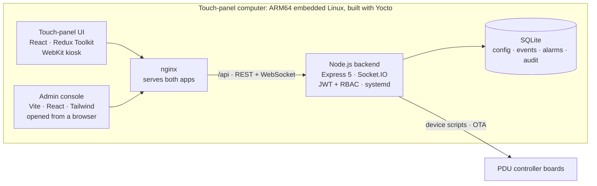

<h1 align="center">Hi, I'm Santhosh 👋</h1>

  

  
  
  
  

I'm a **full stack engineer** in Bengaluru. For the past 2.5+ years at **Delta Electronics** I've built the software that runs on industrial power distribution units. That covers the React touch screen an operator taps, the Node.js service behind it, and the embedded Linux it boots on.

- 🏭 **At work:** Senior Software Engineer and primary developer of **PDU Gen-3**, covering the touch-panel UI, the admin console, the backend and the installer
- 📱 **On the side:** **Jourvia**, a React Native app for group trips, and **Habex**, a finance and habit tracker that's live on my domain
- 🌱 **Learning now:** deeper backend (PostgreSQL, Redis, queues, Docker), system design and DSA
- 💬 **Ask me about:** React performance on low-power hardware, JWT auth with RBAC, or getting a web stack running on an embedded board
- 🏍️ **Off the keyboard:** motorcycles

## 🚀 What I've built

### ⚡ PDU Gen-3: software for industrial power distribution units
**Delta Electronics · in production** · `React 18` `Redux Toolkit` `TypeScript` `Node.js` `Express 5` `Socket.IO` `SQLite` `nginx` `Yocto`

Three apps ship together on every unit. Operators use a touch-panel UI, an admin console handles configuration, and a backend runs on the device itself. The code is proprietary, so here is how it fits together:

- **Instant revocation:** 15-minute access tokens are held in memory and renewed with an httpOnly refresh cookie. Roles and menu permissions are looked up again on every refresh, so changes reach sessions that are already logged in. 3 roles and 19 permission keys are enforced in both the UI and server middleware.
- **Kiosk resilience:** an energy sampler records power every 5 s into a rolling one-hour window that survives restarts. A boot self-test reports *ready*, *degraded* or *offline*, and the debounced "backend disconnected" banner never blocks the screen.
- **Low-power performance:** memoized rows and paged rendering keep tables of up to 216 branch circuits smooth. The UI also avoids blur effects, which tear on the board's GPU.
- **One-file deploys:** `build.sh` versions the backend and compiles it into an ARM64 binary with `pkg`, then bundles it with both web apps into a self-extracting installer. The installer sets up systemd, validates and reloads nginx, and configures udev USB automount. It backs up the previous build before replacing it. OTA updates cover the panel and its controller boards.
- **Embedded Linux:** customised the board's Yocto image (U-Boot, kernel config, device tree).

### 🧭 Jourvia: a travel companion for group trips
**Android app** · `React Native 0.85 (New Architecture)` `TypeScript` `Zustand` `Firebase` `Kotlin` `Jest` `GitHub Actions` · 🔒 *source is private for now*

Plan a trip with friends, follow the route together, and settle up at the end. About 36k lines of TypeScript and 1.3k of Kotlin.

- **Live trip mode:** GPS auto check-in at every stop (300 m radius, 2-minute dwell) runs in an Android foreground service. Live location sharing and "X reached Y" alerts keep the group in sync.
- **Routes and weather:** paste a Google Maps link and get geocoded stops, real road distance (OSRM), a route map and a forecast for each stop.
- **Group tools:** chat with voice notes, packing lists, expense splitting that settles up in the fewest payments, and a hold-to-trigger SOS that texts your location to emergency contacts.
- **Native Android:** 5 home-screen widgets and a voice recorder written in Kotlin. The UI ships in English and 9 Indian languages through a type-safe i18n engine I wrote.
- **Security and tests:** deny-by-default Firestore rules for owner, editor and member roles. 65 Jest tests run in CI, which also typechecks and lints. Each version tag publishes a signed APK.

### 💸 Habex: expense, habit and investment tracker
**[habex.santhu.site ↗](https://habex.santhu.site)** · [code](https://github.com/Santhu32144/habex) · `React 18` `TypeScript` `Vite` `Supabase` `PostgreSQL` `Tailwind` `shadcn/ui` `Recharts`

A finance and habits app on my own domain. It tracks expenses with budgets and recurring rules, habit streaks with a calendar heatmap and a 21-day challenge, and shared investment groups. It also has an admin dashboard.

- **Database-side security:** row-level security on every table (41 policies). Group roles from `view` up to `admin` are enforced by `SECURITY DEFINER` functions, and receipts go to a private storage bucket.
- **PIN login:** 6-digit PINs are hashed with bcrypt. The database enforces a 15-minute lockout after 5 wrong tries, and an edge function then issues a real Supabase session.
- **Under the hood:** 12 versioned SQL migrations and 3 Deno edge functions (PIN login, admin user list, activity feed). CSV and PDF export works without a PDF library.

### 🌐 santhu.site: my portfolio
**[santhu.site ↗](https://santhu.site)** · [code](https://github.com/Santhu32144/about_me) · `React` `TypeScript` `Vite` `Tailwind` `Framer Motion` `Recharts`

An animated personal site with projects, an experience timeline and a blog of React Native setup guides. A command palette jumps between sections, and there's a Konami-code easter egg if you know the sequence 🎮

## 🧰 Tech stack

<table>
  <tr>
    <td><b>Languages</b></td>
    <td></td>
  </tr>
  <tr>
    <td><b>Frontend &amp; mobile</b></td>
    <td> React Native (New Architecture) · Redux Toolkit · Zustand · shadcn/ui · Recharts · Framer Motion</td>
  </tr>
  <tr>
    <td><b>Backend</b></td>
    <td> REST API design · Socket.IO · JWT + refresh tokens · RBAC · Winston · SQLAlchemy · Pydantic</td>
  </tr>
  <tr>
    <td><b>Data</b></td>
    <td> Row-level security · SQL migrations · Firestore security rules</td>
  </tr>
  <tr>
    <td><b>Embedded &amp; DevOps</b></td>
    <td> Yocto · BitBake · U-Boot · device tree · systemd · udev · Modbus · CAN · I²C</td>
  </tr>
  <tr>
    <td><b>Tools</b></td>
    <td></td>
  </tr>
</table>

## 📊 GitHub activity

  <picture>
    <source media="(prefers-color-scheme: dark)" srcset="https://github-readme-stats.vercel.app/api?username=Santhu32144&show_icons=true&hide_border=true&theme=github_dark&custom_title=Santhosh%27s%20GitHub%20Stats" />
    
  </picture>
  <picture>
    <source media="(prefers-color-scheme: dark)" srcset="https://github-readme-stats.vercel.app/api/top-langs/?username=Santhu32144&layout=compact&hide_border=true&langs_count=6&theme=github_dark" />
    
  </picture>

  <picture>
    <source media="(prefers-color-scheme: dark)" srcset="https://streak-stats.demolab.com/?user=Santhu32144&hide_border=true&theme=github-dark-blue" />
    
  </picture>

  

