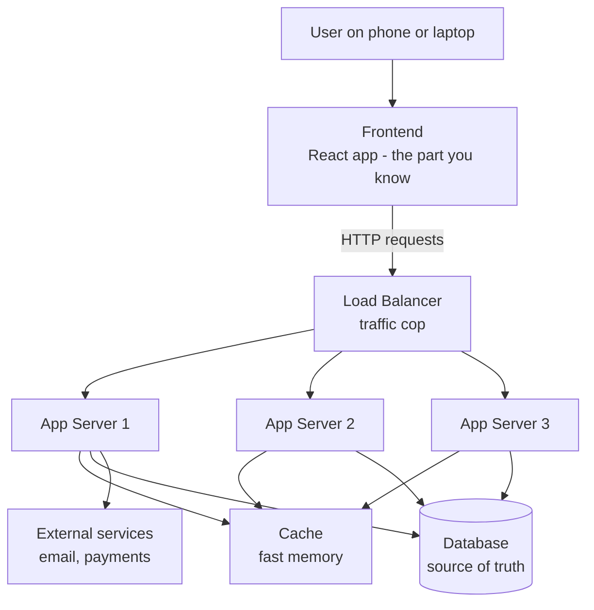
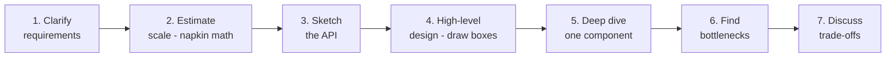

# 01. What Is System Design?

> **One-liner:** System design is the craft of deciding how the pieces of a software system fit together so it stays fast, correct, and up while lots of people use it.
> **Where this fits:** This is chapter one. It gives you the vocabulary and the mental checklist that every later chapter (client-server, DNS, HTTP, load balancers, databases, caching...) plugs into.

## 1. The Idea in Plain Words

You already build systems.

When you built **habex.santhu.site**, you did not just write one file.

You had a React frontend, a backend API, a database, an auth flow, and a chart component.

You already made a hundred design decisions: which state lives in React vs the server, what shape your API responses take, when to show a loading spinner.

**System design is that same skill, zoomed out and pointed at the backend.** Instead of "which component owns this piece of state," the questions become "which _server_ owns this data," "what happens when 10,000 people hit this endpoint at once," and "what breaks if the database machine catches fire?"

Let me define the two words up front, because everything else builds on them:

- A **backend** is the part of your app the user never sees directly: the programs running on machines somewhere in a data center that store data, enforce rules, and answer requests from the frontend.
- A **system** here just means "your backend plus all the moving parts it depends on" — the API servers, the database, the cache, the network in between, and the third-party services (email, payments) hanging off the side.

Here is the honest truth that makes this learnable: **as a frontend dev you already understand the hardest part — thinking about state, edge cases, and user experience.** What you are missing is a vocabulary and a set of standard building blocks.

This whole curriculum is that vocabulary.

By the end you will look at "design Instagram" the way you now look at "build a settings page" — as a known shape with known pieces.

**Why does system design matter enough to have its own interview round?**

1. **Scale changes everything.** Code that works for 10 users can fall over at 10 million. A single database that happily serves your portfolio's contact form will melt if Habex suddenly has a million users logging expenses every evening at 9pm.
2. **Failure is normal, not exceptional.** At scale, _something_ is always broken — a disk, a network cable, a whole data center. Good design assumes parts will fail and keeps working anyway.
3. **Money and speed.** Every design choice has a cost in servers, latency, and engineering time. Companies like Razorpay and Groww live or die on being fast and correct with people's money, so they interview hard for this.
4. **Blast radius.** In a well-designed system, one broken piece degrades _one_ feature; in a badly-designed one, a single failure takes down _everything_. A lot of the craft is drawing boundaries so failures stay contained — the way a ship has watertight compartments so one leak does not sink it.

**The one mindset shift to make right now:** in frontend, a bug usually means one user sees something wrong.

In backend system design, a bad decision can mean _every_ user is slow, or data is silently lost, or the whole site is down during your biggest traffic spike.

The stakes are collective.

That is why we obsess over trade-offs instead of "the right answer."

**How this round differs from the coding interview you already know.** A data-structures round has a hidden correct answer and test cases that go green.

A system-design round deliberately does _not_.

It is an open conversation where the interviewer acts like a teammate at a whiteboard.

They are watching _how you think_: do you clarify requirements before designing, do you reason about scale with rough numbers, do you name trade-offs out loud, can you go deeper when pushed on one piece?

There is no "Accepted" checkmark.

That feels unsettling at first, but it is good news for you.

It rewards clear thinking and communication — which you already do every day shipping features to real users.

You are less behind than you feel.

**The quality words, defined once so the whole curriculum shares a vocabulary.** These are the "non-functional" properties every design is judged on.

Learn them now; we use them constantly:

| Word                      | Plain meaning                                | Measured / expressed as                   |
| ------------------------- | -------------------------------------------- | ----------------------------------------- |
| **Scalability**     | Can it handle more load by adding resources? | Requests/sec at a target latency          |
| **Reliability**     | Does it keep working_correctly_ over time?   | Error rate, mean time between failures    |
| **Availability**    | Is it up and answering right now?            | "Nines" — 99.9% ≈ 8.7h down/year        |
| **Latency**         | How long does_one_ request take?             | Milliseconds (p50, p99)                   |
| **Throughput**      | How many requests overall per unit time?     | Requests or bytes per second              |
| **Consistency**     | Do all users see the same data at once?      | Strong vs eventual (see`13`, `14`)    |
| **Durability**      | Once saved, does data survive crashes?       | "Saved means saved" — on replicated disk |
| **Fault tolerance** | Does it survive parts failing?               | Keeps working with N components down      |

Two nuances interviewers love to probe.

First, **latency and throughput are different** and don't always move together — a system can have low latency (each request fast) yet low throughput (few at a time), or high throughput with high latency (batch jobs).

Second, **availability is measured in "nines":** 99% is ~3.65 days of downtime a year (bad), 99.9% is ~8.7 hours, 99.99% is ~52 minutes.

Each extra nine costs real money and engineering.

## 2. Picture It (Diagram)

Here is the mental model of a "system" — the thing you are learning to design. Notice how much lives behind the frontend you already know.

Everything below the dashed line "Frontend" is what these chapters teach.

Each box gets its own chapter.

Right now you do not need to know how any single box works — just that a real system is many cooperating pieces, and system design is choosing which boxes you need and how they talk.

## 3. Real-World Analogy

Think of designing a **restaurant**, not just cooking one dish.

- Cooking one great dish = writing one good function. Necessary, but not the job.
- **System design = designing the whole restaurant so it survives a Friday-night rush.** How many chefs (servers)? One giant kitchen or several stations (scaling)? A host who seats people evenly so no waiter is overloaded (load balancer)? Pre-chopped ingredients ready to go (cache)? What happens when a chef calls in sick (fault tolerance)? Can you take 500 orders an hour without the kitchen collapsing (throughput)?

A home cook optimizes one plate.

A restaurant designer optimizes the _flow of hundreds of plates under pressure, when things go wrong._ That second thing is system design.

## 4. Concrete Example

Let's ground the vocabulary in a **URL shortener** (like bit.ly) — the "hello world" of system design, and a real interview warm-up (we build it fully in `22-case-study-url-shortener.md`).

The product: paste a long URL, get back a short one like `sho.rt/x7Kd9`. Click the short one, get redirected.

Sounds trivial. Now apply the system-design lens with rough numbers:

- Say **100 million** new short links per month. That is about **40 writes per second** on average — but traffic is spiky, so peaks might be **200+ per second**.
- **Reads** (people clicking links) dwarf writes — maybe **100x** more, so **thousands of redirects per second**.
- Every redirect must be **fast** (a slow redirect feels broken) and the service must be **always up** (a dead link shortener is worthless).

Suddenly the "trivial" app raises real questions: Where do you store billions of mappings?

How do you make a redirect return in a few milliseconds?

How do you keep serving links if one server dies?

Do two users ever get the same short code (a **consistency** question)?

This is the whole point — **system design is finding the hard questions hiding inside simple-sounding products.**

**Napkin math — watch how estimation redirects the design.** Let's size storage.

Roughly 100M new links/month, kept for 5 years: that's 100M x 12 x 5 = 6 billion mappings.

Each mapping is small — a ~7-character short code, the long URL (~100 bytes), plus a little metadata — call it ~500 bytes to be safe.

So 6B x 500 bytes ≈ **3 TB total**.

That is... not much — it fits comfortably on a single modern disk.

The surprise conclusion: for a URL shortener, _storage is not the hard part_.

The hard parts are serving thousands of redirects per second with tiny latency and never going down.

**That is exactly why we estimate: the math tells you which problem deserves your design effort** — and stops you over-engineering the easy parts.

**One more lens: the read/write ratio.** We said reads outnumber writes ~100:1 here.

That single fact shapes everything — it means you optimize hard for fast reads (heavy caching in `07-caching.md`; maybe a CDN in `08-cdn.md`; read replicas in `11-replication.md`) and can let writes be a little slower.

A write-heavy system, like an analytics ingester, would push you toward completely different choices.

Always ask "read-heavy or write-heavy?" early — it is one of the highest-leverage questions in the whole interview.

## 5. Tie-Back to Your Projects

**santhu.site** (your portfolio) is a system with almost no backend needs — mostly static files plus a contact form.

Its "design" is basically: put files on a CDN (see `08-cdn.md`), done.

That is a completely valid design.

**Not every project needs the fancy boxes** — matching effort to need _is_ the skill.

**habex.santhu.site** is where it gets interesting, and it is your best interview story.

Today Habex probably runs as: one backend server, one database.

That is fine for you and a few friends.

But interviewers love "how would this grow?" so map it out:

| Habex feature                  | System-design concept it touches | Chapter    |
| ------------------------------ | -------------------------------- | ---------- |
| Login / accounts               | Auth, statelessness, tokens      | 02, 04, 20 |
| Saving an expense              | Writes, database durability      | 09, 14     |
| Dashboard charts               | Reads, caching, aggregation      | 07         |
| Recurring entries              | Background jobs, queues          | 15, 16     |
| "9pm everyone logs expenses"   | Scaling, load balancing          | 05, 06     |
| Never lose a user's money data | Durability, replication          | 11         |

You do not need to build all this.

But being able to say _"Habex is one server and one DB today; here's exactly what I'd add first when it grows, and why"_ is a fantastic, honest interview answer.

To make that answer concrete, here is the order I'd actually add things to Habex as load grows, and the _trigger_ for each — never "because it's fancy":

1. **A cache in front of the dashboard** (`07-caching.md`) — the first thing to hurt is those chart aggregations recomputed on every load. Trigger: dashboard feels slow.
2. **A second app server + a load balancer** (`05-load-balancers.md`) — once one machine can't keep up at the 9pm rush, or you can't afford the downtime if it crashes. Trigger: CPU pegged, or "we cannot go down."
3. **A read replica of the database** (`11-replication.md`) — when reads (viewing expenses and dashboards) strain the single DB. Trigger: the DB is the bottleneck.

Each step is triggered by a _named_ problem.

That discipline — add a box only when you can point at the pain it removes — is the whole game.

We will keep returning to Habex to make every abstract idea concrete.

## 6. Interview Questions (with answer pointers)

**Q1. "Walk me through how you'd approach designing [X]."**
They are testing your _process_, not trivia.

Answer with the flow in section 7's mindset: clarify requirements first, estimate scale, sketch the API, draw a high-level design, then go deep on one piece.

Never jump straight to "use Kafka."

*(Every one of Zepto, Swiggy, CRED, Razorpay, Groww opens with some version of this.)*

**Q2. "What are functional vs non-functional requirements?"**
Functional = _what the system does_ (user can log an expense, view a dashboard).

Non-functional = _how well it does it_ (fast, available, handles N users, never loses data).

Say: "I always list both, because non-functional requirements drive most of the hard design choices."

**Q3. "What's the difference between latency and throughput?"**
Latency = time for **one** request (e.g., 50ms per redirect).

Throughput = how many requests per second the system handles overall.

Analogy: latency is how long one car takes to cross the bridge; throughput is how many cars cross per minute.

You can improve one without the other.

**Q4. "Difference between availability and reliability?"**
Availability = the system is _up and answering_ (measured in "nines," e.g. 99.9%).

Reliability = it answers _correctly and consistently_ over time.

A system can be available but unreliable (up, but returning wrong balances) — deadly for a fintech like Razorpay or Groww.

**Q5. "There's a right answer to this design, correct?"**
Trap question.

"No — system design is trade-offs.

The right choice depends on read/write ratio, scale, consistency needs, budget, and team size.

I'd state my assumptions and justify each choice."

Interviewers _want_ to hear "it depends, and here's what it depends on."

**Q6. "How do you do back-of-the-envelope estimation, and why?"**
It is rough math to size the system: users x requests x data-per-request → requests/sec, storage/year, bandwidth.

Why: it tells you whether one machine suffices or you need 100, which changes the whole design.

*(CRED/Razorpay like this because payment volume math drives capacity planning.)*

**Q7. "What does it mean for a system to be fault tolerant?"**
It keeps working (maybe degraded) when parts fail — because at scale, parts _always_ fail.

Achieved via redundancy: more than one of everything, no single point of failure.

Contrast with a single server whose crash takes the whole app down.

**Q8. "What is durability?"**
Once the system says "saved," the data survives crashes, restarts, and power loss — it is on disk (usually replicated), not just in memory.

For Habex, when a user sees "expense saved," it must _stay_ saved even if the server dies one second later.

## 7. Trade-offs & "Why Not Just X?"

**"Why not just put everything on one big powerful server?"** This is the naive design, and honestly it is the _correct_ starting point for a small app.

It is simple, cheap, and easy to reason about.

It breaks when:

- Traffic outgrows the biggest machine you can buy (you hit a ceiling — see vertical scaling in `06-scaling-vertical-vs-horizontal.md`).
- That one machine dies → **100% downtime**. No redundancy = single point of failure.
- You cannot deploy without downtime.

So the "better" answer is usually _more, smaller, redundant machines behind a load balancer_.

But that adds complexity: now you need the load balancer, stateless servers, a shared database, coordination.

**For your portfolio or an early-stage Habex, that complexity is overkill** — you'd be adding failure modes to solve a problem you don't have yet.

The core judgement every chapter reinforces:

| Axis        | Cheap/simple side        | Robust/complex side         | You pay for robustness with...     |
| ----------- | ------------------------ | --------------------------- | ---------------------------------- |
| Servers     | One machine              | Many behind a load balancer | Complexity, coordination           |
| Data safety | Single database          | Replicated copies           | Cost, consistency headaches        |
| Speed       | Hit the DB every time    | Add a cache                 | Stale-data risk, more moving parts |
| Consistency | Always perfectly correct | "Eventually" correct        | Simplicity vs scale                |

There is no free lunch.

**Every "better" buys one property (scale, safety, speed) by spending another (simplicity, cost, consistency).** Naming that exchange out loud is what separates a junior answer from a senior one.

**The standard interview flow** — memorize this, it is your safety rail for every design question:

1. **Clarify requirements** — functional and non-functional. Ask: how many users? read- or write-heavy? how consistent must it be? Never design the wrong thing fast.
2. **Estimate scale** — back-of-envelope requests/sec, storage, bandwidth. Decides "one box vs a fleet."
3. **Sketch the API** — the handful of endpoints. Forces you to nail down _what the system actually does_ (see `17-api-design-rest-graphql.md`).
4. **High-level design** — draw the boxes (client, LB, servers, DB, cache) and arrows.
5. **Deep dive** — pick the interesting component (the database schema, the ID generation) and go deep.
6. **Identify bottlenecks** — where does it break under load? The DB? A hot key? Single points of failure?
7. **Discuss trade-offs** — name what you optimized for and what you gave up.

**The flow in action (30-second version), on "design a link shortener":** (1) _Clarify_ — how many links/month, read-heavy?, custom aliases? (2) _Estimate_ — ~100M/month ≈ 40 writes/sec, ~4,000 reads/sec, ~3 TB over 5 years. (3) _API_ — `POST /shorten` and `GET /{code}`. (4) _High-level_ — client → load balancer → app servers → cache → database. (5) _Deep dive_ — how to generate a unique short code without collisions. (6) _Bottleneck_ — the redirect read path, so put a cache in front. (7) _Trade-off_ — cache buys speed at the cost of slight staleness; fine, because links rarely change.

Seven steps and you have a credible design.

We build it for real in `22-case-study-url-shortener.md`.

**Numbers worth memorizing for estimation.** You do not need precision — you need the right order of magnitude and a sense of "fast" vs "slow."

Keep these rough anchors in your head:

| Operation                            | Rough time              | Mental note                          |
| ------------------------------------ | ----------------------- | ------------------------------------ |
| Read from memory (RAM)               | ~100 nanoseconds        | Basically free                       |
| Read from an SSD                     | ~100 microseconds       | ~1000x slower than RAM               |
| Read from a spinning disk            | ~10 milliseconds        | Keep off the hot path                |
| Network round trip, same data center | ~0.5 milliseconds       | Cheap                                |
| Network round trip, across the world | ~100+ milliseconds      | Physics — speed of light; use a CDN |
| A "feels instant" web response       | under ~100 milliseconds | Your latency budget                  |

A couple of handy quantities: a day is ~86,400 seconds (round to ~100k), and "per second x ~2.5 million ≈ per month."

Those let you convert "40 writes/sec" into "~100M/month" in your head — exactly the move interviewers want to see.

**Five mistakes that sink system-design interviews.** Avoid these and you're already ahead of most candidates:

- **Jumping to a solution before clarifying** — designing the wrong thing quickly. Ask requirements first, always.
- **Name-dropping tech without justification** — "I'd use Kafka and Redis and Cassandra" with no reason. Earn each box.
- **Ignoring scale** — the same design for 100 users and 100M users signals you didn't think about growth.
- **Never mentioning trade-offs** — presenting a choice as obviously correct instead of "this vs that; I picked X because."
- **Going silent** — designing in your head. Narrate constantly; it's a communication test as much as a technical one.

Following this flow calmly, out loud, is worth more than knowing every buzzword. It shows you think like an engineer, not a flashcard.

## 8. TL;DR

- **System design = arranging backend pieces** (servers, DB, cache, network) so the system stays fast, correct, and up at scale. You already do a frontend version of this daily.
- **Functional requirements** = what it does; **non-functional** = how well (fast, available, scalable, durable). Non-functional drives the hard choices.
- **Know the quality words cold:** scalability (grows with load), reliability (correct over time), availability (up now, "nines"), latency (one request's time) vs throughput (requests/sec), consistency (everyone sees the same data), durability (saved means saved), fault tolerance (survives failures).
- **There is no single right answer — only trade-offs.** Every gain (scale/safety/speed) costs something (simplicity/money/consistency). Say this out loud in interviews.
- **The flow:** clarify → estimate → API → high-level → deep dive → bottlenecks → trade-offs. This is your rail for every question.
- **Match effort to need:** santhu.site needs almost none of this; Habex needs more as it grows. Knowing _when not_ to add a box is part of the skill.
- Start simple (one server, one DB), then add complexity only to solve a real problem you can name.
