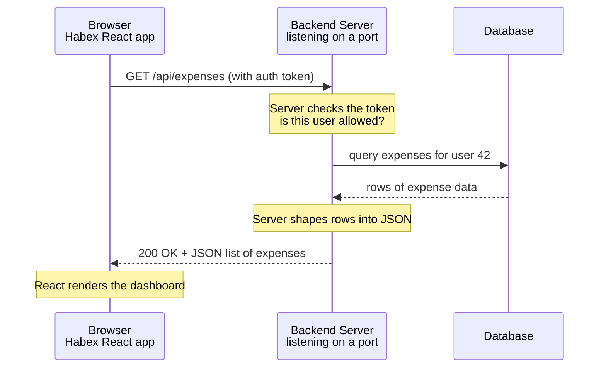

# 02. Client-Server Basics

> **One-liner:** Almost every app you use is one program asking another program for things over a network — a client talking to a server — and this chapter makes that picture crystal clear.
> **Where this fits:** Builds directly on `01-what-is-system-design.md`. It is the foundation for everything: DNS (03), HTTP (04), and load balancers (05) all describe how this client-server conversation actually happens.

## 1. The Idea in Plain Words

Let's define the two words that name the whole model:

- A **client** is the program that _asks_ for something. Your React app running in a browser is a client. A mobile app is a client. Even code on another server can be a client when it calls out.
- A **server** is the program that _answers_. Here is the part that surprises frontend devs: **a server is not a special magic machine. It is just a program** — a normal process, like your React dev server — that (a) runs continuously and (b) sits waiting for incoming requests, then sends back responses.

Say it plainly: **a "server" is a program that listens for requests and replies.** That's it.

The Node/Express (or Python/Go/Java) process powering Habex's backend is a server.

When people say "we have 3 servers," they usually mean 3 machines each running a copy of that program — but the _server_ is fundamentally the program, not the metal.

**What does "listening" actually mean?** When your backend starts, it asks the operating system for a **port** (say 8080) and says "any request that arrives here, hand to me" — this is called _binding_ to a port and _listening_.

The program then sits in a loop: wait for a connection, accept it, read the request, send a response, repeat.

You've seen this every time your terminal prints `Server running on http://localhost:3000` — that line literally means "I've bound to port 3000 and I'm now listening."

A **socket** is just the technical name for one such open connection between a client and a server.

You don't manage sockets by hand — your framework (Express, etc.) does — but knowing that "listening on a port" is a real, concrete OS operation demystifies what a server _is_.

**The request/response cycle** is the heartbeat of the whole thing:

1. The client sends a **request** ("give me user 42's expenses").
2. The server receives it, does work (checks who you are, queries the database), and builds a **response**.
3. The server sends the response back ("here's the JSON list of expenses").
4. The connection's job is done. For the next thing you need, you send another request.

That is the entire model. Everything else in these chapters is detail layered on top of "client asks, server answers."

**Frontend vs backend — who is responsible for what?** This matters because as a React dev you have been doing _some_ of the server's old jobs (rendering, routing) on the client, which can blur the line:

| Concern                                     | Frontend (client)                    | Backend (server)                     |
| ------------------------------------------- | ------------------------------------ | ------------------------------------ |
| What the user sees                          | Yes — layout, styling, interactions | No                                   |
| Input validation for UX                     | Yes (instant feedback)               | Also yes (never trust the client)    |
| Business rules (can this user afford this?) | No                                   | Yes — the source of truth           |
| Storing data permanently                    | No                                   | Yes — the database lives here       |
| Secrets (API keys, DB passwords)            | Never                                | Yes — safe on the server            |
| Who to trust                                | Trusts no one                        | Trusts no one, especially the client |

The golden rule: **never trust the client.** Anyone can open dev tools, edit your React code, and send whatever request they like.

So even if Habex's frontend blocks a negative expense amount, the backend _must_ re-check it.

The server is the bouncer; the frontend is just polite signage.

## 2. Picture It (Diagram)

Here is a real request from your Habex frontend, start to finish, as a sequence diagram. Read it top to bottom like a conversation.

Notice: the browser _asks once_ and _waits_ for one answer.

The server does several steps internally (auth check, DB query, formatting) but the client only sees "I asked, I got a response."

That hidden work is exactly what backend design is about.

## 3. Real-World Analogy

A server is a **restaurant kitchen with a serving window**, and you are the customer (client).

- You walk to the window and place an order (**request**). You don't walk into the kitchen — there is a defined window for this.
- The window is at a fixed, known location so you can find it — that's the **port** (more below). The kitchen "listens" at that window for orders.
- The kitchen cooks (queries the DB, runs logic) and hands you a plate (**response**).
- You take your food and leave. Want dessert? You place a _new_ order at the window. The kitchen didn't hold your table — each order is its own trip. That "each trip stands alone" idea is **statelessness**, coming up in section 7.

The kitchen can serve many customers because it just keeps handling orders that arrive at the window.

It doesn't need to know you personally — your order (request) carries everything needed: what you want, and your loyalty card (auth token) proving who you are.

## 4. Concrete Example

Let's trace what happens when you open **WhatsApp Web** and it loads your chats — a familiar client-server round trip.

1. The WhatsApp Web page (a **client**, JavaScript in your browser) needs your chat list.
2. It sends a **request** to WhatsApp's backend: essentially "GET my recent chats," attaching a token that proves you're logged in.
3. Somewhere in a data center, a **server program** — one of thousands of identical copies — is listening for requests on a specific **port**. One of them picks up yours.
4. That server verifies your token, asks the database (and other services) for your chats, and assembles a **response** — a chunk of JSON listing chats, names, last messages.
5. It sends `200 OK` plus that JSON back. Your browser's JavaScript turns it into the chat list you see.

Every "pull to refresh," every message send, every "typing..." indicator is another request/response (or a longer-lived connection — we cover that in `24-case-study-chat-app.md`).

At WhatsApp's scale, that's _millions of these conversations per second_, which is why they don't run one server — they run a fleet, fronted by a load balancer (`05-load-balancers.md`) that spreads requests across them.

But each individual request is still the same simple "client asks, one server answers" pattern you just saw.

**A subtlety worth knowing:** "each request is its own trip" does not mean each request rebuilds the road.

Opening a fresh network connection is expensive (there's a handshake — see `04-http-and-https.md`), so browsers _reuse_ one open connection for many requests (this is called keep-alive), and HTTP/2 can even carry many requests over a single connection at once.

The _logical_ model stays "ask, answer, done"; the _physical_ connection is often kept warm underneath for efficiency.

Don't conflate the two — statelessness is about the server not _remembering_ you between requests, not about tearing down the wire every time.

## 5. Tie-Back to Your Projects

**santhu.site**: mostly static, but your **contact form** is a perfect minimal client-server example.

The form (client) sends a POST request with name/message to a small backend endpoint (server), which emails you or stores the message.

Even this tiny thing must not trust the client — validate and rate-limit on the server, or bots will spam you (see `18-rate-limiting-pagination-versioning.md`).

**habex.santhu.site** is client-server through and through. Let's name the pieces concretely:

- Your **React/TS app** is the client.
- Your **backend API** (Express/Node or whatever you used) is the server — a program running on a machine, listening on a port (say 8080 internally), waiting for requests.
- The frontend never touches the database directly. It _cannot_ — the DB password is a server-only secret. It always goes: React → your API → database → back.

An **API endpoint** is a specific address on your server that does one job. Habex's endpoints probably look like:

| Endpoint                       | What it does                  |
| ------------------------------ | ----------------------------- |
| `POST /api/auth/login`       | Log in, get a token           |
| `GET /api/expenses`          | List my expenses              |
| `POST /api/expenses`         | Add a new expense             |
| `GET /api/budgets`           | Get my budgets                |
| `GET /api/dashboard/summary` | Aggregated numbers for charts |

Each endpoint is a "window" the client can order from.

Designing these well is its own topic (`17-api-design-rest-graphql.md`), but notice the shape already: a **method** (GET/POST) plus a **path** (`/api/expenses`).

That combo is the address of a specific job.

**The full lifecycle of one Habex request**, so the abstract becomes concrete. When you tap "Add expense" in the Habex UI:

1. Your React code calls `fetch('/api/expenses', { method: 'POST', body, headers })` — building a request with the auth token in the `Authorization` header.
2. The request travels over HTTPS to your backend's address (found via DNS — see `03-ip-and-dns.md`).
3. Your server, listening on its port, accepts the connection and routes `POST /api/expenses` to the right handler function.
4. The handler checks the token ("who is this, and are they allowed?"), validates the amount and category (never trust the client), and inserts a row into the database.
5. It builds a response — `201 Created` plus the new expense as JSON — and sends it back.
6. Your React code receives it, updates state, and the new expense appears in the list. Spinner off.

Six steps, one round trip. Every feature in Habex — logging in, editing a budget, loading the dashboard — is a variation on this exact lifecycle.

**Statelessness in Habex, plainly:** your backend should _not_ remember "this browser is Santhosh" between requests in its own memory.

Instead, every request carries the auth token, and the server re-identifies you each time from that token.

Why this matters: if Habex grows to 3 servers behind a load balancer, request #1 might hit server A and request #2 might hit server C.

If server A had secretly remembered you, server C wouldn't know you — you'd appear logged out randomly.

Because each request is self-contained, _any_ server can handle _any_ request.

We go deep on this in `05-load-balancers.md`; for now just plant the flag: **stateless = each request carries what it needs; the server keeps no per-user memory between requests.**

## 6. Interview Questions (with answer pointers)

**Q1. "What actually _is_ a server?"**
A program that runs continuously and listens for incoming requests on a port, then sends responses.

Emphasize it's software, not necessarily special hardware — "server" the machine just runs "server" the program.

Bonus: one machine can run several server programs on different ports.

**Q2. "Walk me through what happens when the browser calls your API."**
Client builds a request (method, path, headers, maybe body) → sends over the network to the server's IP and port → server authenticates, does logic, queries the DB → builds a response (status + headers + body) → sends it back → client renders.

Basically narrate the section 2 diagram.

*(A very common warm-up at Swiggy/Zepto before harder questions.)*

**Q3. "What's a port and why do we need it?"**
A machine has one IP address (see `03-ip-and-dns.md`) but can run many server programs.

A port is a number (0–65535) that says _which program_ on that machine a request is for — like apartment numbers at one street address.

HTTP defaults to 80, HTTPS to 443.

Your dev server on `localhost:3000` — 3000 is the port.

**Q4. "Why must you validate on the backend if the frontend already validates?"**
Because you never trust the client.

The frontend can be bypassed — users edit JS, or hit your API directly with curl/Postman.

Frontend validation is for UX (fast feedback); backend validation is for _security and correctness_.

Both, always.

*(CRED/Razorpay care a lot — money.)*

**Q5. "What does 'stateless server' mean?"**
The server keeps no per-client memory between requests; each request carries everything needed to handle it (like an auth token).

This lets any server handle any request, which is what makes horizontal scaling behind a load balancer work.

*(Setup for 05 and 06 — expect a follow-up.)*

**Q6. "What's the difference between frontend and backend responsibilities?"**
Frontend owns presentation and UX; backend owns business rules, the source-of-truth data, and secrets.

Overlap exists (validation happens both places) but the _authority_ is on the backend.

The frontend is a view onto server-owned truth.

**Q7. "Can the frontend talk to the database directly?"**
Almost never, and you shouldn't.

The DB credentials would be exposed, and you'd lose the server's chance to enforce rules, auth, and rate limits.

The backend is a deliberate gatekeeper between client and data. (Exceptions like Firebase push the "server" into a managed service, but the gatekeeper still exists.)

**Q8. "What is an API endpoint?"**
A specific address (method + path, e.g. `POST /api/expenses`) on a server that performs one defined operation.

The client calls endpoints; the collection of endpoints is the API — the contract for how clients talk to the server.

## 7. Trade-offs & "Why Not Just X?"

**"Why not just let the React app hold everything in the browser — why have a backend at all?"** Some apps genuinely don't need one (your static portfolio nearly qualifies).

But the moment you need any of these, you need a server:

| Need                               | Why the browser alone can't do it         |
| ---------------------------------- | ----------------------------------------- |
| Shared data across users/devices   | Browser storage is local to one device    |
| Trustworthy rules (auth, payments) | Client code can be edited by the user     |
| Secrets (API keys, DB passwords)   | Anything shipped to the browser is public |
| Permanent storage                  | Clearing the browser wipes local data     |

So for Habex, a backend isn't optional — your expenses must sync across your phone and laptop, and the rules must be enforceable.

**"Why not make the server remember each user (stateful) — isn't that simpler?"** It _feels_ simpler at first (just keep a session in memory).

But it quietly bites you:

|                      | Stateful server (remembers you)                   | Stateless server (you carry a token) |
| -------------------- | ------------------------------------------------- | ------------------------------------ |
| Single server        | Simple, works fine                                | Also fine                            |
| Multiple servers     | Breaks — other servers don't know you            | Works — any server can serve you    |
| Server restart/crash | Users get logged out                              | No impact — token still valid       |
| Scaling out          | Hard (need sticky sessions, shared session store) | Easy                                 |

The naive stateful approach is _fine for one server_ and genuinely simpler there.

It becomes a real liability the instant you scale to more than one server — which is exactly when your app is succeeding.

That's why the industry defaults to stateless.

But note the honest trade-off: stateless means re-verifying the token on every request (a little repeated work) and figuring out where _some_ state (like a shopping cart) lives — usually a shared cache or DB.

We unpack all of this in `05-load-balancers.md` and `20-security-basics.md`.

For now: start stateless, and you'll thank yourself when Habex grows.

## 8. TL;DR

- **Client asks, server answers.** That request/response cycle is the whole model; everything else is detail on top.
- **A server is just a program** that runs continuously and listens on a port for requests. Not magic hardware — software.
- **A port** (like 3000, 80, 443) picks _which program_ on a machine gets the request — apartment numbers for one IP address.
- **An API endpoint** = method + path (e.g. `POST /api/expenses`), the address of one specific server job. The set of endpoints is your API contract.
- **Frontend owns the view; backend owns the truth, the rules, and the secrets.** Never trust the client — validate on the server too.
- **Stateless servers keep no per-user memory between requests;** each request carries its own auth token. This is what lets you scale to many servers later.
- For Habex: React (client) → your API (server) → database, always in that order. The frontend never touches the DB directly.
