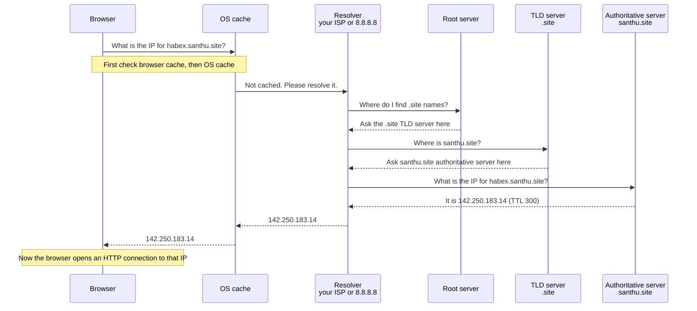

# 03. IP Addresses and DNS

> **One-liner:** Every machine on the internet has a number called an IP address, and DNS is the phonebook that turns human names like `habex.santhu.site` into that number.
> **Where this fits:** Builds on `02-client-server-basics.md` — before a client can talk to a server, it has to _find_ it. This chapter explains that "finding" step. HTTP (`04-http-and-https.md`) is what happens _after_ the connection is made.

## 1. The Idea in Plain Words

When your Habex frontend sends a request to your backend, how does it know _where_ on the entire planet that server is?

Two mechanisms make this work: **IP addresses** and **DNS**.

**An IP address** (Internet Protocol address) is a machine's numeric address on a network — like a house's street address.

Every device that talks on the internet has one.

There are two flavors:

- **IPv4**: looks like `142.250.183.14` — four numbers (0–255) separated by dots. It's the old, still-dominant format. Problem: there are only about **4.3 billion** possible IPv4 addresses, and we have _way_ more devices than that now. We ran out.
- **IPv6**: the newer, roomier format, looks like `2404:6800:4009:82f::200e` — longer, hexadecimal, separated by colons. It has an absurdly huge address space (enough for every grain of sand to have trillions). It exists to solve the IPv4 shortage. Both coexist today; you rarely have to care which one is used.

There's also a **public vs private** distinction:

- A **public IP** is globally unique and reachable from anywhere on the internet — that's what your server needs so clients worldwide can find it.
- A **private IP** (like `192.168.1.5` or `10.0.0.3`) is only meaningful _inside_ a local network — your home Wi-Fi, or a company's internal cloud network. Many devices can share the same private ranges because they're walled off. Your laptop at home has a private IP on your Wi-Fi; your router has one public IP that all your devices share to reach the outside world.

Now the problem DNS solves: **humans are terrible at remembering numbers.** You type `habex.santhu.site`, not `142.250.183.14`.

And the number can _change_ (you move servers, switch hosts) — you don't want to reprint business cards every time.

So we need a translation layer from friendly names to IP addresses.

**DNS (Domain Name System)** is that translation layer — the internet's phonebook.

You give it a **domain name** (`habex.santhu.site`) and it gives you back an **IP address**.

It's a massive, distributed, cached lookup system that runs quietly before basically every connection you make.

When it's slow, the whole internet feels slow; when it's down, sites are unreachable even though the servers are perfectly healthy.

One distinction you'll hear: the **resolver** does the legwork o n your behalf — it makes a series of queries (to root, then TLD, then the domain's own server) and hands you back the single final answer.

That "you ask once, it does all the chasing" behavior is a **recursive** query.

The individual hops the resolver makes, each name server just pointing it one step further, are **iterative** queries.

In short: your device asks the resolver _recursively_ ("just get me the answer"), and the resolver works _iteratively_ down the hierarchy to find it.

You'll see exactly this split in the diagram below.

Why is DNS built as this sprawling hierarchy instead of one big lookup table?

Because no single database could hold every name on earth, stay updated, and answer trillions of queries a day without melting.

Splitting the job — root delegates to TLDs, TLDs delegate to domain owners — means each party only manages its own slice, and caching absorbs almost all the traffic.

It's a masterclass in the "no single point that must know everything" principle from `01-what-is-system-design.md`.

## 2. Picture It (Diagram)

Here's the DNS **resolution flow** — what actually happens when your browser needs the IP for `habex.santhu.site` and doesn't already know it.

Read it as a sequence of "does anyone know this name?" questions rippling outward.

The key insight: no single computer knows every name on the internet.

Instead the job is **delegated in layers** — root knows who handles each ending (`.site`, `.com`), the TLD knows who handles each domain (`santhu.site`), and the domain's own authoritative server knows the actual IPs.

Each layer points you one step closer.

## 3. Real-World Analogy

DNS is like **finding a friend's phone number through directory assistance.**

- You know the _name_ ("Santhosh's Habex") but not the _number_ (IP). Useless to dial a name.
- You call directory assistance (**the resolver**). If they've looked it up recently, they just tell you (**cache hit**).
- If not, they escalate: "For that whole region, ask this regional office" (**root** → "for `.site` names, go here"). The regional office says "for that town, ask this local branch" (**TLD** → "for `santhu.site`, go here"). The local branch has the actual number (**authoritative server** → "here's the IP").
- Directory assistance jots the number on a sticky note that's good for 5 minutes (**TTL**), so the next person asking gets an instant answer.

Nobody holds the entire world's phonebook. The system works by _delegation_ and _caching_ — exactly like DNS.

## 4. Concrete Example

Type `www.google.com` and hit enter. Here's the real sequence, most of which you never notice because it takes milliseconds:

1. **Browser cache**: "Have I looked this up in the last few minutes?" Chrome keeps its own small DNS cache. If yes — done instantly.
2. **OS cache**: If the browser doesn't know, it asks the operating system, which has its own cache (and a `hosts` file — a manual override list). Hit? Done.
3. **Resolver**: Still unknown, so the OS asks a **DNS resolver** — usually run by your ISP, or a public one like Google's `8.8.8.8` or Cloudflare's `1.1.1.1`. The resolver does the heavy lifting from here and caches aggressively for everyone who uses it.
4. **Root server**: The resolver asks a **root server**, "who handles `.com`?" There are 13 logical root server clusters worldwide. It answers: "ask the `.com` TLD servers."
5. **TLD server**: The resolver asks the **`.com` TLD** (Top-Level Domain) server, "who's authoritative for `google.com`?" It answers with Google's authoritative name servers.
6. **Authoritative server**: The resolver asks **Google's authoritative server**, "what's the IP for `www.google.com`?" It returns the actual IP (and a TTL).
7. The resolver caches the answer and hands it back up the chain to your browser, which _now finally_ opens a connection to that IP and makes its HTTP request (`04-http-and-https.md`).

In practice steps 4–6 happen rarely because resolvers cache `.com`'s and Google's servers for a long time.

Most lookups are answered from a cache in a millisecond or two.

This layered caching is what lets DNS handle _trillions_ of queries a day.

**Want to see it yourself?** On any machine, run `nslookup habex.santhu.site` (Windows) or `dig habex.santhu.site` (Mac/Linux) — it performs this exact lookup and prints the answer: the IP, and often the TTL remaining. 

Running `dig +trace habex.santhu.site` even shows the root → TLD → authoritative walk step by step, one delegation at a time.

It's the fastest way to make this chapter feel real — you can literally watch the phonebook get flipped through.

A typical answer looks like `habex.santhu.site.  300  IN  A  142.250.183.14`, which reads as: this name, cacheable for 300 seconds, is an **A** record pointing at that IPv4.

## 5. Tie-Back to Your Projects

When you set up **habex.santhu.site**, you did DNS configuration whether you realized it or not — probably in your domain registrar's or host's dashboard.

Let's decode it:

- `santhu.site` is your **domain**. You own it via a registrar.
- `habex` is a **subdomain** of it. `www` and the bare `santhu.site` are also (sub)domains you control.
- To make `habex.santhu.site` load your app, you created a DNS **record** pointing that name at your host. If your host gave you an IP, you used an **A record** (name → IPv4). If they gave you a hostname like `myapp.vercel.app`, you used a **CNAME record** (name → another name).

Here's the concrete resolution for your app: someone types `habex.santhu.site` → their resolver walks root → `.site` TLD → your domain's authoritative name servers (whoever hosts your DNS) → gets back the A record IP (or follows the CNAME) → connects.

That's your section 2 diagram, but it's _your_ domain.

**Why TTL matters to you practically:** suppose you migrate Habex to a new server with a new IP.

You update the A record.

But resolvers around the world cached the _old_ IP for however long the **TTL** (Time To Live — how many seconds a record may be cached) says.

If your TTL was 24 hours, some users hit the old (now dead) server for up to a day.

The pro move: _before_ a planned migration, lower the TTL to 60–300 seconds a day ahead, migrate, then raise it back.

This is a real, common interview-worthy operational detail — and you've now lived it.

DNS record types you'll actually touch for Habex and santhu.site:

| Record          | Maps...                      | Example use for you                                                  |
| --------------- | ---------------------------- | -------------------------------------------------------------------- |
| **A**     | name → IPv4 address         | `santhu.site` → `142.250.183.14`                                |
| **AAAA**  | name → IPv6 address         | same, but the IPv6 form                                              |
| **CNAME** | name → another name (alias) | `habex.santhu.site` → `cname.yourhost.com`                      |
| **MX**    | domain → mail server        | so email to`you@santhu.site` routes correctly                      |
| **TXT**   | arbitrary text               | domain verification, SPF/DKIM for email, "prove you own this" checks |

## 6. Interview Questions (with answer pointers)

**Q1. "What happens, in order, when you type a URL and press enter?"**
The classic.

Start with DNS: check browser cache → OS cache → resolver → root → TLD → authoritative → get IP. _Then_ TCP connect + TLS handshake, _then_ the HTTP request, server responds, browser renders.

This chapter owns the DNS half; `04` owns the HTTP half.

Narrating this end-to-end confidently is a strong signal.

*(Asked everywhere — Swiggy, Zepto, Groww love it as an opener.)*

**Q2. "What's the difference between IPv4 and IPv6, and why does IPv6 exist?"**
IPv4 = 32-bit, ~4.3 billion addresses, dotted decimal, and we ran out.

IPv6 = 128-bit, effectively unlimited, hex with colons, created specifically to solve exhaustion.

They coexist; most software handles both transparently.

**Q3. "Public vs private IP?"**
Public = globally unique, reachable from the internet (your server needs one).

Private = only valid inside a local network (`10.x`, `192.168.x`, `172.16–31.x`), reused everywhere, walled off.

Home devices share one public IP via the router (NAT).

*(Sometimes probed when discussing cloud VPCs — CRED/Razorpay run big private networks.)*

**Q4. "Why do we need DNS at all? Why not use IPs directly?"**
Humans can't remember numbers; names are memorable and brandable.

Crucially, DNS adds a layer of _indirection_ — the IP can change (new server, load balancing, failover) without the name changing.

That decoupling is a design superpower, not just convenience.

**Q5. "Explain the DNS resolution steps."**
Browser cache → OS cache → recursive resolver → root server (who handles this TLD?) → TLD server (who's authoritative for this domain?) → authoritative server (the actual IP).

Emphasize caching at every layer and that no one server knows everything — it's delegated.

**Q6. "What is TTL in DNS and why does it matter?"**
TTL = seconds a record may be cached before re-fetching.

High TTL = fewer lookups, faster, but slow to propagate changes.

Low TTL = fast changes (good before migrations/failover) but more DNS traffic.

It's a caching trade-off (ties to `07-caching.md`).

Mention the "lower TTL before migrating" trick — it shows operational maturity.

**Q7. "A record vs CNAME?"**
A record maps a name straight to an IPv4 (AAAA for IPv6).

CNAME maps a name to _another name_ (an alias), which then has to be resolved further.

Use A when you have an IP; use CNAME to point at a provider's hostname so they can change the underlying IP freely.

Note: you generally can't put a CNAME on the root/bare domain (`santhu.site`) — a common gotcha.

**Q8. "How can DNS help with load balancing or high availability?"**
DNS can return multiple IPs (round-robin DNS), or use geo/latency-based routing to send users to the nearest healthy data center, and can fail over by swapping records.

It's a coarse first layer of load distribution — real per-request balancing happens at the load balancer (`05-load-balancers.md`).

*(Good bridge answer; Groww/Swiggy run multi-region.)*

## 7. Trade-offs & "Why Not Just X?"

**"Why not just hardcode the server's IP in the frontend and skip DNS?"** You _could_, technically.

It even resolves faster (no lookup).

But it's brittle in ways that bite hard:

|                                 | Hardcoded IP                          | DNS name                               |
| ------------------------------- | ------------------------------------- | -------------------------------------- |
| Move to a new server            | Must redeploy every client            | Just update one DNS record             |
| Use multiple servers / failover | Nearly impossible                     | Return multiple IPs, swap on failure   |
| Human-friendly / brandable      | No — nobody types`142.250.183.14`  | Yes —`habex.santhu.site`            |
| HTTPS certificates              | Awkward — certs are issued for names | Standard — certs bind to domain names |

The indirection DNS gives you — _name stays fixed, IP can change freely_ — is exactly the kind of decoupling good system design loves.

Hardcoding trades a tiny speed win for enormous inflexibility.

**"Why not set a super-long TTL so DNS is always cached and fast?"** Tempting — caching is good, right? But TTL is a genuine trade-off:

- **Long TTL** (e.g. 24h): great performance, minimal lookups, cheaper — but if your server IP changes or a server dies, users keep hitting the stale/dead IP for up to a day. Slow to react to failure.
- **Short TTL** (e.g. 60s): changes and failovers propagate fast — but more DNS queries, slightly more latency, more load on name servers.

The right answer is "it depends on how often the target changes and how fast you need failover."

Stable production site?

Longer TTL.

About to migrate or running active-passive failover?

Short TTL.

There's no universally correct number — which is the recurring theme of this whole curriculum (`01-what-is-system-design.md`).

**"Why not run my own single DNS server for my domain?"** You can, but a single DNS server is a single point of failure — if it's down, your domain is _unreachable even though your app is fine_.

That's why authoritative DNS is always run redundantly (multiple name servers, often across providers).

For your projects, letting a managed DNS provider handle this is the sane, overkill-avoiding choice.

## 8. TL;DR

- **IP address = a machine's numeric address.** IPv4 (`142.250.183.14`, ran out) vs IPv6 (`2404:6800::200e`, huge, fixes the shortage).
- **Public IP** = reachable from the internet (servers need one). **Private IP** (`192.168.x`, `10.x`) = local network only, reused everywhere.
- **DNS = the internet's phonebook:** turns names (`habex.santhu.site`) into IPs, because humans can't remember numbers and IPs change.
- **Resolution flow:** browser cache → OS cache → resolver → root → TLD → authoritative server → IP. No one server knows everything; it's delegated and cached at every layer.
- **Record types:** A (→IPv4), AAAA (→IPv6), CNAME (→another name), MX (→mail server), TXT (verification/email auth).
- **TTL = how long a record is cached.** Long = fast but slow to change; short = agile but chattier. Lower it before migrations.
- **DNS's superpower is indirection:** the name stays fixed while the IP behind it can change — enabling failover, load balancing, and server moves without touching clients.
