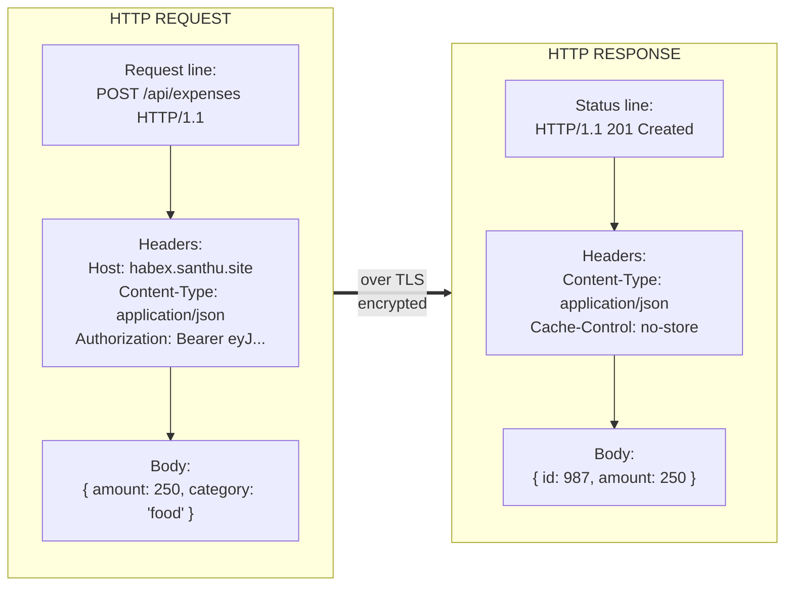

# 04. HTTP and HTTPS

> **One-liner:** HTTP is the simple text-based language clients and servers use to talk; HTTPS is that same language spoken inside a locked, tamper-proof envelope.
> **Where this fits:** Builds on `02-client-server-basics.md` (client asks, server answers) and `03-ip-and-dns.md` (how the client found the server). This chapter is _what they actually say_ once connected. It underpins API design (`17`), rate limiting (`18`), and security (`20`).

## 1. The Idea in Plain Words

Once DNS gives your browser the server's IP and a connection opens, the two sides need a shared _language_.

That language is **HTTP** — HyperText Transfer Protocol.

Don't let the fancy name scare you: **HTTP is basically structured text.** A request is a little text message with a defined shape; a response is another.

That's it.

Every HTTP **request** has four parts:

1. **Method** — the _verb_, what you want to do: `GET` (read), `POST` (create), etc.
2. **Path** — the _address_ of the resource: `/api/expenses`.
3. **Headers** — key-value _metadata_ about the request: who you are, what format you want, etc.
4. **Body** (optional) — the _payload_, usually JSON, present on POST/PUT/PATCH.

Every HTTP **response** has three parts:

1. **Status line** — a **status code** saying how it went: `200 OK`, `404 Not Found`, `500 Internal Server Error`.
2. **Headers** — metadata about the response: content type, caching rules, cookies.
3. **Body** (optional) — the actual data, usually JSON (or HTML, an image, etc.).

You've _seen_ all of this — open your browser's Network tab on Habex and every row is one request/response with exactly these parts.

This chapter just names them precisely.

**A crucial property: HTTP is stateless.** Each request is independent; the protocol itself remembers nothing about previous requests.

That's why every request must carry its own identity (an auth token or cookie) — the server can't assume it "knows you" from last time. (This is the statelessness idea from `02-client-server-basics.md`, now you see _where_ it comes from — the protocol.)

**Now, HTTPS.** Plain HTTP is sent in the clear — anyone between you and the server (on the same Wi-Fi, your ISP, a hacked router) can _read_ and even _modify_ it.

Unacceptable for logins, expenses, or payments.

**HTTPS is HTTP wrapped in TLS** (Transport Layer Security), a layer that adds three guarantees:

- **Encryption** — outsiders see gibberish, not your data.
- **Integrity** — if anyone tampers with the bytes in transit, it's detected and rejected.
- **Identity** — you're provably talking to the real `santhu.site`, not an impostor (via a certificate).

The little padlock in the browser means all three are in effect. Today HTTPS is the default and non-negotiable — browsers actively warn on plain HTTP.

**What actually happens in the TLS handshake (plain words).** Before any real data flows, client and server do a quick setup dance:

1. The client says hello and lists the encryption methods it supports.
2. The server picks one and sends its **certificate** — a document, signed by a trusted authority, proving "I really am santhu.site." The browser checks that signature against the authorities it already trusts. This is the _identity_ guarantee: a fake site can't produce a valid certificate for your domain.
3. Using the certificate, the two sides agree on a shared secret key — without ever sending the key itself over the wire (clever math makes this possible).
4. From then on, everything is encrypted with that key.

Modern TLS does this in about one network round trip (sometimes zero, on resumption), so the cost is tiny.

You don't implement any of this — your host and browser do — but "certificate proves identity, both sides agree on a key, then everything is encrypted" is the exact 15-second answer interviewers want.

## 2. Picture It (Diagram)

Here's the anatomy of a real request/response pair for adding an expense in Habex. This is literally what travels over the wire (simplified).

Read the request top-to-bottom: verb + path + version, then headers, then body.

The response mirrors it: status + version, then headers, then body.

The `==>` arrow is the TLS envelope — same messages, just encrypted so no one in between can read or alter them.

## 3. Real-World Analogy

HTTP is **sending a letter with a standard form**, and HTTPS is **sending that letter in a sealed, tamper-evident, verified-courier envelope.**

- The **method** is the intent stamped on the envelope: "PICK UP" (GET) vs "DELIVER THIS" (POST).
- The **path** is the address on the front.
- **Headers** are the notes in the margins: "Fragile," "I speak JSON," "Here's my ID card" (Authorization).
- The **body** is the letter's actual contents.
- The **status code** is the reply slip: "Delivered ✓" (200), "No such address" (404), "Our office caught fire" (500).

Plain HTTP is a postcard — anyone handling it can read and scribble on it.

HTTPS is a sealed security envelope from a courier who checks the recipient's ID (identity), seals it so reading is impossible (encryption), and uses tamper-evident tape so any interference shows (integrity).

Same letter inside — just protected in transit.

## 4. Concrete Example

Let's walk a real interaction: **logging into Instagram and loading your feed**, in HTTP terms.

1. **Login — a POST.** You submit username/password. The browser sends `POST /accounts/login` with a JSON body containing your credentials, over HTTPS (so the password is encrypted). Method is POST because it _creates_ a session and _changes_ state on the server.
2. **Response — 200 + a token/cookie.** The server verifies you and replies `200 OK`, setting a cookie (via the `Set-Cookie` header) or returning a token. That credential is now your ID card for future requests.
3. **Load feed — a GET.** The browser sends `GET /api/feed`, attaching the cookie/token in headers so the server knows it's you. GET because you're _reading_, not changing anything.
4. **Response — 200 + JSON.** Server returns `200 OK` with a JSON body of posts. The `Content-Type: application/json` header tells the browser how to parse it. A `Cache-Control` header might say how long images can be cached (ties to `07-caching.md` and `08-cdn.md`).
5. **Like a post — a POST (or PUT).** Tapping like sends `POST /api/posts/123/like`. State changes on the server. If you double-tap by accident and it fires twice, idempotency (section 7) decides whether you get one like or a mess.

Every screen you see is a choreography of these methods and status codes. Learn to read them and you can debug almost anything from the Network tab.

## 5. Tie-Back to Your Projects

Every Habex feature maps cleanly onto HTTP methods and status codes. This table is basically your Habex API in HTTP terms:

| Action in Habex | Method + Path | Success status | Notes |
|---|---|---|---|
| Log in | `POST /api/auth/login` | `200 OK` | Returns a token; must be HTTPS |
| List expenses | `GET /api/expenses` | `200 OK` | Safe, cacheable, no body |
| Add an expense | `POST /api/expenses` | `201 Created` | Creates a new resource |
| Fully edit an expense | `PUT /api/expenses/42` | `200 OK` | Replaces the whole entry |
| Change just the category | `PATCH /api/expenses/42` | `200 OK` | Partial update |
| Delete an expense | `DELETE /api/expenses/42` | `200 OK` / `204 No Content` | Idempotent — deleting twice is fine |
| Wrong password | `POST /api/auth/login` | `401 Unauthorized` | Client error, not server error |
| Ask for someone else's data | `GET /api/expenses/999` | `403 Forbidden` | You're known but not allowed |
| Server bug | any | `500 Internal Server Error` | _Your_ fault, not the client's |

**Headers you're already using in Habex, decoded:**

- `Content-Type: application/json` — "this body is JSON." Your React `fetch` sets it on POSTs; your server sets it on responses.
- `Authorization: Bearer <token>` — how Habex proves who the user is on every request (the stateless identity from `02`). More in `20-security-basics.md`.
- `Cache-Control` — tells browsers/CDNs whether and how long to cache. Set `no-store` on private data (your expenses!) and long caching on static assets (`08-cdn.md`).
- `Cookie` / `Set-Cookie` — an alternative to tokens for carrying identity.

**HTTPS for your sites:** both `santhu.site` and `habex.santhu.site` should be HTTPS-only.

Most hosts (Vercel, Netlify, Cloudflare) issue free certificates automatically.

Never send a login or an expense over plain HTTP — the whole point of a finance app is that the data stays private and unaltered.

**A practical habit:** open your browser's Network tab while using Habex.

Every row is one request — click it and you'll see the exact method, path, status code, request headers (there's your `Authorization`), and the JSON body.

When something breaks, this is where you look first: a `401` means your token is missing or expired; a `403` means you're hitting data that isn't yours; a `500` means the bug is on _your server_, not the client; a **CORS** error means your API didn't send the headers that let the browser accept a cross-origin response.

Reading these fluently will make you faster at debugging than many backend devs — it's a real edge you have as a frontend-strong engineer.

**Cookies vs sessions vs tokens — the 20-second intro** (full treatment in `20-security-basics.md`):

- **Cookie**: a small piece of data the server tells the browser to store and send back automatically on every request to that domain.
- **Session**: the server keeps a record of "who's logged in" and hands the browser a cookie holding just a session ID pointing to that record. Simple, but the server has to store sessions (state — awkward when scaling to many servers, per `02`/`05`).
- **Token (e.g. JWT)**: a self-contained, signed credential the client stores and sends in the `Authorization` header. The server verifies the signature without storing anything — stateless, scales cleanly. Habex most likely uses tokens.

## 6. Interview Questions (with answer pointers)

**Q1. "What are the parts of an HTTP request and response?"**
Request = method + path + headers + optional body.

Response = status code + headers + optional body.

Being able to rattle this off precisely (and give an example header for each) is table stakes.

*(Common opener at Zepto/Swiggy.)*

**Q2. "Difference between GET, POST, PUT, PATCH, DELETE — and what are safe vs idempotent methods?"**
GET reads, POST creates, PUT replaces whole, PATCH partially updates, DELETE removes.

**Safe** = doesn't change server state (GET, HEAD).

**Idempotent** = doing it N times has the same effect as once (GET, PUT, DELETE — yes; POST — no).

Idempotency matters for retries: if a network blip makes the client retry, an idempotent call is safe to repeat.

*(CRED/Razorpay probe this hard — retrying a payment must not double-charge.)*

**Q3. "Walk me through the HTTP status code families."**
1xx informational (rare), **2xx success** (200 OK, 201 Created, 204 No Content), **3xx redirect** (301 permanent, 302 temporary, 304 Not Modified — cached), **4xx client error** (400 bad request, 401 unauthenticated, 403 forbidden, 404 not found, 429 too many requests), **5xx server error** (500 internal, 502 bad gateway, 503 unavailable, 504 timeout).

Key nuance: 4xx = _client's_ fault, 5xx = _server's_ fault.

Mixing these up is a red flag.

**Q4. "401 vs 403?"**
401 Unauthorized = "I don't know who you are" (not authenticated — log in). 403 Forbidden = "I know who you are, but you're not allowed" (authenticated but lacks permission).

Classic gotcha; get it right.

**Q5. "What does HTTPS actually give you, and how — briefly?"**
Three things: encryption (privacy), integrity (tamper detection), and identity (you're really talking to the claimed site).

It's HTTP over TLS.

The TLS handshake: the server presents a certificate proving its identity, both sides agree on keys, then everything is encrypted.

You don't need the crypto math — you need the three guarantees and "certificate proves identity."

*(Fintechs — Razorpay, Groww, CRED — care.)*

**Q6. "Why is HTTP called stateless, and how do we handle logged-in users then?"**
The protocol keeps no memory between requests — each is independent.

We add identity per-request via cookies (session) or tokens (JWT in the Authorization header).

This statelessness is exactly what lets any server handle any request behind a load balancer (`05-load-balancers.md`).

**Q7. "HTTP/1.1 vs HTTP/2 vs HTTP/3 — what changed and why care?"**
1.1: one request at a time per connection (head-of-line blocking); browsers open many connections to compensate. 2: multiplexing — many requests over one connection at once, plus header compression → faster page loads. 3: runs over QUIC (built on UDP) instead of TCP, so a lost packet doesn't stall _all_ streams and connections set up faster, great on flaky mobile networks. You rarely configure this, but knowing the progression (fewer round trips, less blocking) shows depth. *(Zepto/Swiggy mobile-heavy → 3 matters.)*

**Q8. "Which methods are cacheable, and how do headers control caching?"**
GET responses are cacheable; POST/PUT/DELETE generally aren't.

`Cache-Control` (e.g. `max-age`, `no-store`, `private`) and `ETag`/`304 Not Modified` drive it.

For private data (expenses) use `no-store`; for static assets use long `max-age`.

Bridges into `07-caching.md` and `08-cdn.md`.

## 7. Trade-offs & "Why Not Just X?"

**"Why not just use GET for everything — it's simpler?"** Because the method is a _contract_, and breaking it breaks the whole ecosystem:

- GET is **safe** (read-only) and **cacheable**. If you do a state change with GET (`GET /deleteExpense?id=42`), a browser prefetch, a crawler, or a proxy cache can trigger it _without the user clicking_ — silently deleting data. Real bugs have shipped this way.
- Correct methods let infrastructure help you: caches cache GETs, proxies retry idempotent calls, tools reason about intent.

So use the verb that matches the intent. The "simplicity" of all-GET is a trap that removes safety guarantees you didn't know you were relying on.

**"Why not skip HTTPS on the parts that aren't sensitive — isn't encryption slow?"**

| | Plain HTTP | HTTPS |
|---|---|---|
| Privacy | None — readable by anyone in the path | Encrypted |
| Tampering | Undetectable (ISPs have injected ads!) | Detected and rejected |
| Identity | You might be talking to an impostor | Certificate-verified |
| Speed cost | "Faster" | Tiny handshake overhead, negligible with HTTP/2/3 |
| Browser treatment | Marked "Not Secure," features disabled | Normal, padlock |

The old "HTTPS is slow" concern is basically dead — modern TLS plus HTTP/2/3 makes the overhead trivial, and you often come out _ahead_ because HTTP/2 requires HTTPS.

There's no real "not sensitive enough" bucket anymore; mixed HTTP/HTTPS also creates security holes.

HTTPS everywhere is the settled answer.

**"Why not build my own custom protocol instead of HTTP?"** Occasionally justified (gRPC for internal service-to-service calls, WebSockets for real-time chat — see `24-case-study-chat-app.md`).

But for a normal client-to-API app, HTTP is a massive win: every browser, proxy, CDN, cache, load balancer, and debugging tool already speaks it.

Rolling your own means rebuilding that entire ecosystem.

Reach for alternatives only when HTTP genuinely can't do the job (true real-time push, or extreme internal performance) — otherwise it's over-engineering.

## 8. TL;DR

- **HTTP is structured text.** Request = **method + path + headers + body**; response = **status code + headers + body**. The Network tab shows you exactly this.
- **Methods carry intent:** GET reads, POST creates, PUT replaces, PATCH partially updates, DELETE removes. **Safe** = no state change; **idempotent** = repeating it is harmless (matters for retries — huge for payments).
- **Status families:** 2xx success, 3xx redirect, 4xx client error, 5xx server error. **4xx is the client's fault, 5xx is the server's.** 401 = unauthenticated, 403 = not allowed.
- **Key headers:** `Content-Type` (body format), `Authorization` (who you are), `Cache-Control` (caching rules), `Cookie`/`Set-Cookie` (carry identity).
- **HTTP is stateless** — each request stands alone, so identity rides along per-request via cookies or tokens.
- **HTTPS = HTTP over TLS**, giving **encryption + integrity + identity**. It's the non-negotiable default; use it everywhere on both your sites.
- **HTTP versions:** 1.1 (one-at-a-time), 2 (multiplexed, faster), 3 (over QUIC/UDP, best on flaky mobile).
- **Cookies vs sessions vs tokens:** sessions store state server-side (a cookie holds the ID); tokens are self-contained and stateless (scale better). Deep dive in `20-security-basics.md`.
