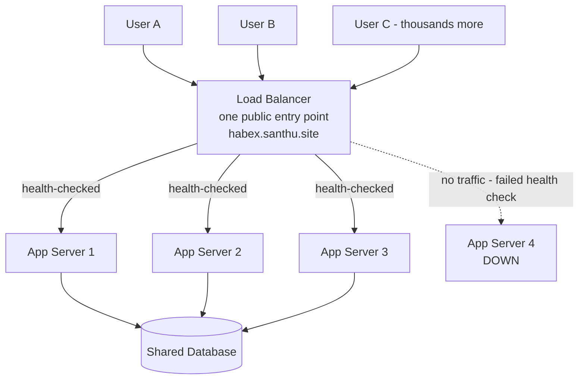

# 05. Load Balancers

> **One-liner:** A load balancer is a traffic cop that sits in front of your servers and spreads incoming requests across them, so no single server drowns and the app stays up even when one server dies.
> **Where this fits:** This is where `02-client-server-basics.md` (one server) grows up into _many_ servers. It relies on statelessness (02), DNS (03), and HTTP (04), and it's the gateway to scaling (`06-scaling-vertical-vs-horizontal.md`).

## 1. The Idea in Plain Words

In `02-client-server-basics.md` we had one server: client asks, that one server answers.

Fine for you and a few friends.

But picture **Zepto at 8pm** or **Swiggy on a rainy Sunday** — millions of people opening the app at once.

No single machine on earth can handle that.

You need _many_ identical servers sharing the work.

That immediately raises a question: when a request arrives, **which** of your 10 (or 1,000) servers should handle it?

And how does the client even know they exist?

You don't want clients picking servers — they'd pick unevenly, and they can't know which servers are healthy.

Enter the **load balancer** (LB): a piece of infrastructure that sits _in front_ of your servers.

All client traffic hits the load balancer first, and _it_ decides which backend server gets each request.

To the outside world, there's one address (your load balancer); behind it, a hidden fleet does the actual work.

Let me define the terms cleanly:

- **Load balancer**: a program/appliance that receives incoming requests and distributes ("balances") them across a pool of backend servers.
- **Backend server / app server**: one of the identical copies of your application doing the real work. Also called a "node" or "instance."
- **Server pool / fleet**: the group of backend servers the LB distributes across.

The load balancer solves several problems at once:

1. **Distribute load** — no single server gets overwhelmed; work is spread evenly.
2. **High availability** — if a server crashes, the LB stops sending it traffic and routes around it. Users never notice. This is fault tolerance from `01-what-is-system-design.md` made real.
3. **Scalability** — need more capacity? Add servers to the pool; the LB starts using them. Remove them when the surge passes.
4. **One stable entry point** — clients hit one address; you can add/remove/replace servers behind it freely.

That last point connects to DNS (`03`): your domain `habex.santhu.site` points at the load balancer, not at any individual server.

The servers behind it can come and go all day and no DNS change is needed.

**Two mental clarifications.** First, a load balancer is a kind of **reverse proxy** — a "proxy" sits between client and server and forwards traffic; a _reverse_ proxy specifically fronts your servers and represents them to the world (a _forward_ proxy would represent clients).

So when you read "reverse proxy" (Nginx, HAProxy), think "the load balancer's close cousin — often literally the same box."can 

Second, balancing happens at two zoom levels: a **global** load balancer (often DNS- or anycast-based, see `03-ip-and-dns.md`) first sends you to the _nearest healthy data center_; then a **local** load balancer inside that data center picks the specific server.

Zepto routing a Delhi user to a Delhi data center is global; spreading that user across Delhi's app servers is local.

Naming both layers in an interview signals real depth.

## 2. Picture It (Diagram)

Here's the core picture: one load balancer fronting several app servers, which share a database.

This is the single most common shape in all of system design — internalize it.

Notice three things.

**One** entry point (the LB) hides many servers.

Server 4 has failed its **health check**, so the LB has stopped routing to it (dotted line) — users are unaffected.

And all servers share **one database**, which is why they can be interchangeable: any server can serve any user because the real state lives in the shared DB, not in the servers (that's statelessness from `02` paying off).

## 3. Real-World Analogy

A load balancer is the **host at a busy restaurant** (or the person managing queues at a Zepto pickup counter).

- Customers (requests) pour in through one entrance. They don't wander in and pick a waiter — chaos. The **host (LB)** stands at the door and assigns each party to a waiter (server).
- The host spreads people out: not everyone to one poor waiter. Some hosts just go in rotation (**round robin**); a smarter host notices "waiter 3 already has 5 tables, send this party to waiter 1 who's free" (**least connections**).
- If a waiter goes on break or calls in sick (**server crashes / fails health check**), the host simply stops seating them — customers never know a waiter is missing.
- Friday night rush? Call in extra waiters (**add servers**); the host starts seating them immediately. Quiet Tuesday? Send some home (**remove servers**).

One host, many waiters, smooth flow even when a waiter drops out. That's load balancing.

## 4. Concrete Example

Let's make it concrete with **Swiggy during an IPL match dinner rush** — a textbook surge scenario, and exactly the kind of thing they'd ask you about.

Normal evening: say the app handles 50,000 requests/second, comfortably served by, say, 40 app servers behind a load balancer.

Then the match ends and _everyone_ orders dinner at once — traffic spikes to 200,000 requests/second in minutes.

Here's how the load-balancer setup absorbs it:

1. **Autoscaling adds servers.** Monitoring sees CPU climbing and spins up more app servers — from 40 to, say, 160. As each new one passes its **health check**, the LB starts routing traffic to it. No DNS change, no client change — the LB's pool just grew.
2. **The LB spreads the surge.** Using an algorithm like **least connections**, it sends each new request to whichever server is least busy, so no single server tips over even under 4x load.
3. **A server crashes under pressure.** One server OOMs and dies. Its health checks start failing; within seconds the LB **stops routing to it** and redistributes its share to the healthy ones. Users on that server just get retried onto another — most never notice.
4. **The surge passes.** Traffic drops back to normal; autoscaling removes the extra servers to save money; the LB shrinks its pool.

Without a load balancer, you'd be stuck: one giant server would have melted at 200k rps, and if it died, Swiggy would be _fully down_ during its highest-revenue hour.

With the LB + a fleet, the system flexes with demand and survives individual failures.

**This elasticity under surge is the entire reason quick-commerce and food-delivery companies drill load balancing in interviews.**

**One more job the LB quietly does:** _SSL/TLS termination_.

Rather than making every app server handle the encryption handshake from `04-http-and-https.md`, the load balancer often decrypts incoming HTTPS once, then talks plain HTTP to the app servers over the trusted internal network.

This centralizes certificate management (one place to renew certs) and frees the app servers from crypto work.

Small detail, but mentioning it shows you know what an L7 load balancer really does beyond "spread requests."

## 5. Tie-Back to Your Projects

**santhu.site**: your static portfolio almost certainly doesn't need a load balancer you manage — it's served from a CDN (`08-cdn.md`), which is itself a globally distributed system with load balancing baked in.

Good example of "don't add the box you don't need" (`01`).

**habex.santhu.site — the growth story that makes a great interview answer:**

- **Today:** Habex is likely _one_ app server + one database. Simple, cheap, correct for your user count. No load balancer needed yet. Say this honestly in interviews — knowing when you _don't_ need something is senior-level judgment.
- **The problem that forces an LB:** Suppose Habex takes off and it's 9pm — the classic "everyone logs today's expenses before bed" spike. Your one server pegs at 100% CPU; requests queue; the dashboard takes 8 seconds to load; some time out. Worse, if that single server crashes, Habex is _100% down_ — a single point of failure.
- **The fix:** Run 3 identical Habex app servers behind a load balancer. Point `habex.santhu.site` at the LB. Now the 9pm load spreads across 3 servers, and if one dies the other two carry on.

**The catch — and why the earlier chapters matter:** this only works because Habex servers are **stateless** (`02-client-server-basics.md`).

Each request carries the user's auth token; any server can handle any request because the real state (expenses, budgets) lives in the shared **database**, not in server memory.

But watch out for hidden state:

- If Habex kept login sessions _in server memory_, then a user who logged in via server 1 would appear logged out when the LB sent their next request to server 2. You'd be tempted to reach for **sticky sessions** (section 7) — but the better fix is to keep no session in server memory at all: use a signed **token** (`04-http-and-https.md`, `20-security-basics.md`) or a shared session store (a cache like Redis, `07-caching.md`). Then any server can serve anyone, and the LB is free to route however it likes.
- Same lesson for anything server-local: file uploads, in-memory caches, temp state. Push shared state into the DB or a shared cache so your servers stay interchangeable.

So the Habex interview arc is: _"one server today → 9pm surge and single-point-of-failure risk → add a load balancer + more stateless servers → make sure sessions are token-based or in a shared store so any server can handle any request."_ That's a complete, credible scaling narrative.

## 6. Interview Questions (with answer pointers)

**Q1. "What is a load balancer and what problem does it solve?"**
A component in front of a server pool that distributes incoming requests across them.

It solves three things: spreads load (no server overwhelmed), provides high availability (routes around dead servers via health checks), and enables scaling (add/remove servers behind one stable entry point).

*(Universal opener — Zepto, Swiggy, Groww all start here.)*

**Q2. "L4 vs L7 load balancing?"**
**L4** (transport layer) balances based on IP address and port — it just forwards TCP/UDP connections without looking inside.

Fast, cheap, protocol-agnostic, but "dumb."

**L7** (application layer) understands HTTP — it can route by URL path, headers, cookies (e.g. send `/api/*` to API servers, `/images/*` to image servers), do SSL termination, and make smarter decisions.

Trade-off: L7 is more capable but does more work per request.

Most web apps use L7.

*(A favorite deeper follow-up at CRED/Razorpay.)*

**Q3. "What load-balancing algorithms do you know, and when would you use each?"**

- **Round robin**: rotate through servers in order. Simple; good when servers are equal and requests are similar.
- **Weighted round robin**: give beefier servers more traffic (weights). Good for mixed hardware.
- **Least connections**: send to the server with the fewest active connections. Good when request durations vary (some requests are slow).
- **IP hash**: hash the client's IP to always route them to the same server. Gives a form of stickiness without cookies.
  Name the trade-off: round robin ignores actual load; least connections adapts but needs the LB to track connection counts.

**Q4. "What are health checks and why do they matter?"**
The LB periodically pings each server (e.g. `GET /health`) to confirm it's alive and able to serve.

If a server fails N checks in a row, the LB stops routing to it until it recovers.

This is what turns "a server died" into a non-event for users — it's the mechanism behind high availability.

Mention active (LB probes) vs passive (LB notices failing real requests) checks.

**Q5. "What are sticky sessions, and why are stateless servers preferred?"**
Sticky sessions (session affinity) pin a given user to the same backend server (via a cookie or IP hash) so server-local session state stays valid.

It's a crutch for stateful servers.

It's discouraged because it defeats even load distribution (one server can get overloaded), and if that server dies, those users lose their sessions.

The better design: make servers **stateless** — store sessions in a token or a shared cache — so any server can serve any request.

*(Strong signal; ties to 02, 04, 20.)*

**Q6. "The load balancer sounds like a single point of failure. Isn't it?"**
Yes — a single LB would be one.

In production you run the LB **redundantly**: typically **active-passive** (a standby LB takes over via a floating/virtual IP if the active one dies), or multiple active LBs behind **DNS round-robin / anycast** so traffic spreads across several LB instances across data centers.

Cloud LBs (AWS ELB, GCP LB) are managed and internally redundant.

The principle from `01`: no single point of failure — including the thing whose job is availability.

**Q7. "How does a load balancer help during a traffic surge like a flash sale or dinner rush?"**
Combined with autoscaling: as load rises, new servers spin up and (once healthy) join the LB's pool, so capacity grows elastically; as load falls, servers are removed to save cost.

The LB spreads the surge across all healthy servers and routes around any that fail.

Use the Swiggy/Zepto surge example.

*(Very common at Zepto/Swiggy given their spiky quick-commerce traffic.)*

**Q8. "Where does the load balancer sit relative to DNS and the servers?"**
DNS (`03`) resolves your domain to the load balancer's IP; the client connects to the LB; the LB forwards to a chosen backend server; the server may hit a shared cache/DB and returns a response back through the LB.

Big picture: DNS is coarse geographic/entry-point routing; the LB is fine per-request routing within a location.

## 7. Trade-offs & "Why Not Just X?"

**"Why not just buy one gigantic server instead of many small ones + a load balancer?"** This is **vertical scaling** (make one machine bigger) vs **horizontal scaling** (add more machines) — the full topic of `06-scaling-vertical-vs-horizontal.md`.

Quick version:

|                       | One big server (vertical)                          | Many servers + LB (horizontal)       |
| --------------------- | -------------------------------------------------- | ------------------------------------ |
| Simplicity            | Very simple — no LB, no coordination              | More moving parts                    |
| Ceiling               | Hard limit — biggest machine you can buy          | Practically unlimited — keep adding |
| Failure               | It dies → 100% downtime (single point of failure) | One dies → others carry on          |
| Cost curve            | Gets very expensive at the top end                 | More linear, commodity hardware      |
| Zero-downtime deploys | Hard                                               | Easy — roll servers one at a time   |

The one-big-server approach is genuinely the right _starting_ choice (it's where Habex is now).

It breaks on two things: a hard capacity ceiling, and being a single point of failure.

Horizontal scaling behind an LB fixes both — but adds the complexity of the LB, stateless servers, and shared state.

**For a small app, adding a load balancer is overkill** — you'd introduce coordination problems to solve a scale problem you don't have.

Add it when you can point at a real reason: "we've outgrown one machine" or "we can't tolerate the downtime of a single server."

**"Why not let clients pick a server directly (or DNS round-robin alone)?"**

- Clients can't know which servers are healthy or how loaded they are, so distribution is poor and a dead server keeps getting picked.
- **DNS round-robin** (returning several server IPs and letting clients rotate) is a _coarse_ load-balancing technique and does help, but it has weaknesses: DNS caching (`03`, TTL) means clients cling to one IP, and DNS has no idea if a server just died (it'll keep handing out the dead IP until the record and caches update). A real load balancer does per-request routing with live health checks — far more responsive. In practice you often use _both_: DNS to spread across regions/LBs, and an LB for precise routing within a region.

**"Why not use sticky sessions everywhere so I don't have to bother making servers stateless?"** Because stickiness quietly reintroduces the problems the LB was supposed to solve:

|                   | Sticky sessions (stateful)                           | Stateless + token/shared store           |
| ----------------- | ---------------------------------------------------- | ---------------------------------------- |
| Load distribution | Uneven — a "hot" server gets stuck with heavy users | Even — LB routes freely                 |
| Server dies       | Its users lose sessions / get logged out             | No impact — any server serves them      |
| Scaling out       | New servers only help new users                      | New servers immediately share all load   |
| Complexity        | Feels easy up front                                  | A bit more up front, far less pain later |

Stickiness is occasionally pragmatic (e.g. legacy apps you can't refactor), but the industry default is **stateless servers** precisely so the load balancer stays free to do its job.

This is the direct payoff of the statelessness you learned in `02-client-server-basics.md` — it's not academic; it's what makes horizontal scaling actually work.

## 8. TL;DR

- **A load balancer sits in front of many servers and spreads requests across them** — one public entry point hiding a fleet.
- It buys three things: **even load distribution, high availability** (routes around dead servers), and **easy scaling** (add/remove servers behind a stable address).
- **L4** balances on IP/port (fast, dumb); **L7** understands HTTP and routes by path/headers/cookies (smarter, does more work). Most web apps use L7.
- **Algorithms:** round robin (simple, equal servers), weighted round robin (mixed hardware), least connections (varying request times), IP hash (stickiness by client IP).
- **Health checks** let the LB detect and route around failed servers automatically — that's how one server dying becomes a non-event.
- **Sticky sessions pin users to one server** as a crutch for stateful servers; prefer **stateless servers** (token auth or a shared session store) so any server can serve anyone.
- **The LB itself must not be a single point of failure** — make it redundant via active-passive failover or multiple LBs behind DNS/anycast.
- **For Habex:** one server today is fine; add an LB + more stateless servers when the 9pm surge or single-point-of-failure risk becomes real. Leads into `06-scaling-vertical-vs-horizontal.md`.
