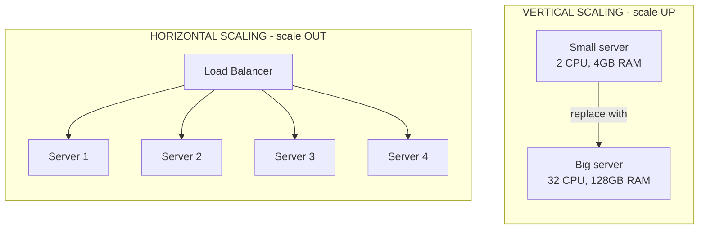

# 06. Scaling: Vertical vs Horizontal

> **One-liner:** How to make your app survive *more* users and *more* traffic — either by renting a bigger machine ("up") or by adding more machines ("out").
> **Where this fits:** Builds directly on [05 — Load Balancers](05-load-balancers.md) (a load balancer is the thing that makes "more machines" actually work) and sets up everything that follows — [07 — Caching](07-caching.md), [08 — CDN](08-cdn.md), and the database chapters [11 — Replication](11-replication.md) and [12 — Sharding &amp; Partitioning](12-sharding-and-partitioning.md), which are really just "scaling, applied to data."

---

## 1. The Idea in Plain Words

First, let's nail down some words, because everything in this chapter depends on them.

- **Server** = a computer that runs your backend code. It's not magic — it's a regular computer (usually rented from a cloud like AWS, GCP, or Azure) with a **CPU** (the brain that does the calculations), **RAM** (fast short-term memory for things it's actively working on), and **disk** (slower long-term storage). When someone opens Habex and their browser asks for the dashboard, *a server* runs the code that builds that response.
- **Load** = how much work is arriving. Usually measured as **requests per second (RPS)** — how many browser requests hit your server each second. (You'll also see "QPS", queries per second — same idea.)
- **Throughput** = how much work your system can *finish* per second. Think of it as the system's top speed.
- **Latency** = how long *one* request takes, from "browser asked" to "browser got the answer." Usually milliseconds (ms). Low latency = feels instant.

Now the one-sentence definition:

> **Scaling = increasing your system's capacity so it can handle more load without getting slow or falling over.**

When a server gets too much load, bad things happen in a predictable order: the CPU hits 100%, RAM fills up, requests start queuing, latency climbs (200ms → 3s), and eventually requests time out or the server crashes. Scaling is how you stop that.

There are exactly **two directions** you can scale, and knowing the difference is a genuine interview filter:

|                | **Vertical Scaling ("scale UP")**         | **Horizontal Scaling ("scale OUT")**              |
| -------------- | ----------------------------------------------- | ------------------------------------------------------- |
| What you do    | Replace your machine with a**bigger** one | Add**more** machines alongside it                 |
| Analogy        | Upgrade from a hatchback to a truck             | Buy a fleet of hatchbacks                               |
| Example change | 2 CPU / 4 GB RAM → 32 CPU / 128 GB RAM         | 1 server → 10 identical servers behind a load balancer |
| You get more   | CPU, RAM, disk*per box*                       | Total CPU, RAM, disk*across boxes*                    |

That's the whole idea. The rest of this chapter is *when* to pick each, *why* horizontal scaling is harder than it looks, and how real apps combine both.

---

## 2. Picture It (Diagram)



The mental picture to lock in:

- **Vertical** = the box gets *taller and fatter*. Same single box, just more powerful. Users still talk to one machine.
- **Horizontal** = the row gets *wider*. Many identical boxes, and a **load balancer** (see [05 — Load Balancers](05-load-balancers.md)) sits in front deciding which box each request goes to.

```
VERTICAL                         HORIZONTAL

   [ tiny ]                       [LB]
      |                          / | | \
      v                        s1  s2 s3 s4
 [  BIGGER  ]                 (add s5, s6... as needed)
```

---

## 3. Real-World Analogy

**A restaurant kitchen during a rush.**

You run a small kitchen with one chef. Orders are piling up. You have two options:

1. **Vertical scaling — get one super-chef.** Hire the fastest chef in the country, give them a bigger stove with more burners, sharper knives, a faster oven. One person, way more powerful. This works great... until even the super-chef has two hands and can only stand in one place. And if that one chef calls in sick, your kitchen is *closed*. There's a ceiling, and there's a single point of failure.
2. **Horizontal scaling — hire more chefs.** Add a second chef, a third, a tenth. Now you need a **head waiter** (the load balancer) standing at the pass, handing each incoming order to whichever chef is free. No single chef is a bottleneck, and if one goes home sick, the other nine keep cooking. But now you have a *coordination* problem: the chefs must not each assume they own "the salt station" or keep private notes only they can read. They have to be interchangeable.

That "chefs must be interchangeable" requirement is the single most important idea in this chapter. In software we call it **stateless**, and it's coming up in section 4.

---

## 4. Concrete Example

**A food-delivery app coping with the 7–9pm dinner rush.** (Very Zepto / Swiggy — expect exactly this scenario in interviews.)

### The traffic shape

Food delivery is *spiky*. A normal Tuesday afternoon might be **100 orders/min**. Then dinner happens:

```
orders/min
2000 |                       ####
     |                    ###########
1500 |                  ###############
     |                 #################
1000 |               #####################
     |            ##########################
 500 |        ###############################
 100 |########                              #####____
     +-----------------------------------------------
      12pm     3pm     6pm   7pm  8pm  9pm   10pm
                              ^dinner rush^
```

Between 7pm and 9pm, load jumps **20×** — from 100 to ~2000 orders/min — then falls back off. Now watch what a single server does under that.

### Stage 1 — one server (no scaling)

At 100 orders/min it's fine: CPU at 15%, responses in 120ms. At 7:15pm, load is 15×. CPU pins at 100%, requests queue, latency climbs to 4s, and users see spinners and "Order failed, try again" — which makes them *retry*, adding **even more** load. This is a classic overload spiral.

### Stage 2 — scale UP (vertical)

Quick fix: move the app to a machine with 8× the CPU and RAM. Now it handles ~800 orders/min before struggling. Great for a Tuesday. But two problems remain:

1. At 2000 orders/min it *still* falls over — one box has a ceiling.
2. It's one box. If it dies at 8:05pm on a Friday, **every** customer is down. No redundancy.

Vertical scaling bought time. It did not solve the problem.

### Stage 3 — scale OUT (horizontal) + a load balancer

Run **8 identical app servers** behind a load balancer. Each handles ~250 orders/min, so together they absorb 2000/min with headroom, and if one crashes the load balancer routes around it. This is the real answer — but it *only works* if the servers are **stateless**. Here's why that matters.

### The stateless requirement (the crux)

- **State** = data your server remembers *between* requests. Example: "this user is logged in," or "this user has 3 items in their cart."
- **Stateful server** = it stores that in its own local memory. Problem: request #1 (add to cart) lands on Server 3, which remembers the cart in *its* RAM. Request #2 (checkout) gets routed by the load balancer to Server 7 — which has never heard of this cart. Cart looks empty. Checkout fails. Horizontal scaling is now broken.
- **Stateless server** = it keeps *nothing* important in local memory. Every request carries what's needed (like a signed token proving who you are — see [20 — Security Basics](20-security-basics.md)), and shared state lives in a place *all* servers can reach: a database, or a shared cache like Redis (see [07 — Caching](07-caching.md)).

> **This is the punchline:** horizontal scaling is only possible when your servers are stateless. Statelessness is what makes any server able to answer any request — which is exactly what lets a load balancer spread traffic freely. If you remember one sentence from this chapter, remember that one.

This ties straight back to [05 — Load Balancers](05-load-balancers.md): "session affinity" / "sticky sessions" (pinning a user to one server) is the workaround people use when they're stuck with stateful servers — but it's a crutch. It hurts load balancing and breaks when that one server dies. The clean design is stateless servers + shared state store.

### Stage 4 — auto-scaling (don't pay for 8 servers at 3am)

You don't want 8 servers running all night when you need 1. **Auto-scaling** = a rule that automatically adds servers when load rises and removes them when it falls. **Elasticity** = the property of stretching up and shrinking down on demand, so you pay for roughly what you use.

A typical rule: *"If average CPU across servers stays above 65% for 3 minutes, add 2 servers. If it stays below 25% for 10 minutes, remove 1."*

```
servers running
  8 |                 ______
  6 |               _/      \_
  4 |             _/          \_
  2 |___________/              \________
  1 |
    +------------------------------------
     3pm    6pm   7pm  8pm  9pm   11pm
     scale out BEFORE the rush, scale in after
```

Two real-world gotchas interviewers love:

1. **New servers aren't instant.** Booting a machine + starting your app can take 1–5 minutes. For a *predictable* spike like dinner, you **pre-scale** on a schedule (scale out at 6:45pm, before the wave) instead of reacting after CPU is already on fire.
2. **The database usually can't auto-scale the same way.** You can add app servers in seconds, but you can't casually add "more primary database." That's why databases get their own scaling chapters — [11 — Replication](11-replication.md) and [12 — Sharding &amp; Partitioning](12-sharding-and-partitioning.md). More on this next.

---

### Scaling reads vs scaling writes (the part most beginners miss)

Not all load is equal. **Reads** (fetching data — "show me the restaurant menu," "show my past orders") and **writes** (changing data — "place this order," "update my address") scale *very* differently.

|                            | Reads                                                                          | Writes                                                      |
| -------------------------- | ------------------------------------------------------------------------------ | ----------------------------------------------------------- |
| Typical ratio in most apps | The large majority (often 80–99%)                                             | The minority                                                |
| Easy to scale?             | **Yes** — copy the data to many machines and read from any copy         | **Hard** — everyone must agree on the one true value |
| Main technique             | **Read replicas** (extra read-only copies of the DB) + **caching** | **Sharding** (split writes across machines by key)    |
| Why the asymmetry          | Copies of read-only data never disagree                                        | Two servers accepting the same write can conflict           |

- **Scaling reads** is comparatively easy. Put a cache in front (see [07 — Caching](07-caching.md)) so most reads never touch the database at all, and add **read replicas** — full copies of the database that serve reads only ([11 — Replication](11-replication.md)). Ten replicas = roughly 10× read capacity.
- **Scaling writes** is the genuinely hard problem. You can't just copy your way out, because if two machines both accept "the new balance is X," they can disagree. The main tool is **sharding** — splitting the data so, e.g., users A–M write to shard 1 and N–Z write to shard 2 ([12 — Sharding &amp; Partitioning](12-sharding-and-partitioning.md)). This is where the [13 — CAP Theorem](13-cap-theorem.md) trade-offs start to bite.

Interview reflex: when someone says "scale the system," your first question should be **"scale reads or writes?"** They are different problems with different answers.

---

## 5. Tie-Back to Your Projects

**santhu.site (your portfolio).**
Mostly static pages. Honestly, this needs *almost no* scaling on the server side — the right move isn't more servers at all, it's putting the whole thing on a **CDN** so it's served from the edge and your origin barely gets touched (see [08 — CDN](08-cdn.md)). The one dynamic bit — the **contact form** — does a tiny write when someone submits. Even at "I went viral on LinkedIn" traffic, a single small server (vertical, the cheapest tier) handles it forever. This is the honest interview answer: **not everything needs to scale.** Recognizing that is a *strength*.

**Habex (your habit + expense tracker).**
This is where the concepts show up for real. Map them:

- **Make the API stateless first.** Your Habex backend should hold no per-user state in local memory — the logged-in user is proven by a token on each request, and all data (transactions, categories, budgets) lives in the database. Do this and you can run 1 server or 20 with zero code changes. Do this *before* you ever need to scale, because retrofitting statelessness under load is painful.
- **Reads dominate, massively.** Users open the dashboard, flip between months, and stare at charts far more often than they add an expense. So Habex is a *read-heavy* app → the biggest wins are **caching the monthly-summary** ([07 — Caching](07-caching.md)) and, if you ever grow, **read replicas** for the dashboard queries.
- **Writes are the minority and are naturally partitionable.** Adding an expense is a write, but each user only ever writes their *own* data. That means Habex would shard beautifully **by user_id** if it ever got huge — user 42's data all lives together, and no two users' writes conflict. (You won't need this at your scale — but saying it out loud in an interview shows you understand write-scaling.)
- **Recurring entries = a scheduled spike.** If Habex posts everyone's recurring entries (rent, subscriptions) at midnight on the 1st of the month, that's a *predictable burst* of writes — exactly the "pre-scale before the known spike" pattern from the dinner-rush example, just monthly instead of nightly.
- **Right-sizing today:** Habex almost certainly runs fine on **one modest server (vertical)** right now. The skill isn't scaling it prematurely — it's knowing the *exact* order of moves you'd make as load grew (below).

---

## 6. Interview Questions (with answer pointers)

**Q1. What's the difference between vertical and horizontal scaling? (warm-up — Groww, Swiggy)**

> Vertical = bigger single machine (more CPU/RAM). Horizontal = more machines behind a load balancer. Vertical is simpler but has a hard ceiling and a single point of failure; horizontal scales nearly without limit and adds redundancy, but requires stateless services and introduces distributed-systems complexity.

**Q2. Why do services need to be *stateless* to scale horizontally? (CRED, Razorpay)**

> Because a load balancer can send any request to any server. If a server keeps session/cart state in its own memory, a follow-up request routed elsewhere won't find it. Stateless servers keep no per-user state locally — identity travels in a token, shared state lives in a DB or Redis — so every server can serve every request interchangeably. Sticky sessions are a workaround, but they hurt balancing and break on server death.

**Q3. Your app is fine all day but falls over at 7–9pm every night. Walk me through fixing it. (Zepto, Swiggy — the signature question)**

> Confirm it's a predictable spike (dinner rush). Short term: scale up. Real fix: make the app stateless and run multiple instances behind a load balancer, then add **auto-scaling** — and because new instances take minutes to boot, **pre-scale on a schedule** before 7pm rather than reacting after CPU pegs. Separately check the DB, which won't autoscale like app servers — add read replicas / caching for the read-heavy parts.

**Q4. Reads or writes — which is harder to scale, and why? (Groww, CRED)**

> Writes. Reads scale by copying data (replicas) and caching, and copies of read-only data never disagree. Writes require agreement on a single source of truth, so you can't just copy — you shard (split by key) and accept CAP-theorem trade-offs. First question to ask on any "scale this" prompt: reads or writes?

**Q5. What are auto-scaling and elasticity? What can go wrong? (Swiggy, Razorpay)**

> Auto-scaling automatically adds/removes servers based on a metric (usually CPU or RPS); elasticity is the resulting stretch-up/shrink-down so you pay for ~what you use. Pitfalls: boot time lag (react too late and you're already overloaded → pre-scale for known spikes), flapping (add/remove repeatedly — fix with cooldowns), scaling app servers while the DB stays a bottleneck, and cost blowups if a retry storm inflates the scaling metric.

**Q6. When is vertical scaling the *right* call — not a compromise? (CRED)**

> Small or early-stage apps where one box has plenty of headroom (like your portfolio or early Habex); workloads that are genuinely hard to distribute (a single primary database early on, or something needing lots of shared in-memory state); and when simplicity/operational cost matters more than limitless scale. Vertical is often the correct *first* move — scale up until it hurts, then scale out.

**Q7. Can you scale a database the same way you scale stateless app servers? (Razorpay, Groww)**

> No. App servers are stateless, so you clone them freely. A database *holds the state*, so you can't just add clones for writes. You scale DB **reads** with replicas + caching, and DB **writes** with sharding — both more involved than adding app servers, and both come with consistency trade-offs ([11](11-replication.md), [12](12-sharding-and-partitioning.md), [13](13-cap-theorem.md)).

**Q8. There's a limit to horizontal scaling too, right? (senior probe — CRED, Razorpay)**

> Yes. Adding servers helps only until a *shared* component becomes the bottleneck — usually the database, sometimes a lock, a queue, or a third-party API. This is Amdahl's Law in spirit: the un-parallelizable part caps your gains. Beyond a point, "add a server" does nothing and you must scale the bottleneck itself (shard the DB, remove the lock, cache the hot path).

---

## 7. Trade-offs & "Why Not Just X?"

**"Why not just scale up forever? Buy the biggest machine and be done."**
Three walls. (1) **A hard ceiling** — the biggest cloud machine is finite; past it there's nowhere to go. (2) **Single point of failure** — one box means one crash = total outage, no redundancy. (3) **Cost curve** — the top-tier machines are priced *super-linearly*: the last 2× of power can cost 4–8×. Scaling up is the right *first* move, not the *last* one.

**"Why not go straight to horizontal + microservices + auto-scaling on day one?"**
Because it's a tax you pay before you have the problem. Horizontal scaling forces statelessness, a load balancer, shared state stores, health checks, and distributed debugging (a bug might be on 1 of 20 servers). For a portfolio site or an early tracker, that's pure overhead with no benefit. **Premature scaling is a classic interview red flag** — it signals you optimize before measuring.

**The pragmatic progression (say this in interviews):**

> **Scale up first, then scale out.** Start on one right-sized machine. When it strains, scale *up* (bigger box) — cheap, simple, no code changes. When up starts hitting the ceiling, the cost curve, or you need redundancy, *then* scale *out* (stateless app servers + load balancer + auto-scaling). Only after that do you tackle the database (caching → read replicas → sharding). Match the move to the actual bottleneck; don't skip ahead.

| Situation                                    | Right move                                      | Why                                              |
| -------------------------------------------- | ----------------------------------------------- | ------------------------------------------------ |
| Small app, one box at 20% CPU                | Do nothing                                      | No problem to solve                              |
| One box getting busy, no redundancy need yet | **Scale up**                              | Simplest, no code change                         |
| Need redundancy, or up is near the ceiling   | **Scale out** (stateless + LB)            | Removes single point of failure, near-limitless  |
| Traffic is spiky/predictable                 | **Auto-scale**, pre-scale for known peaks | Handle peaks without paying 24/7                 |
| Read-heavy and DB is the bottleneck          | **Cache + read replicas**                 | Reads scale by copying                           |
| Write-heavy and DB is the bottleneck         | **Shard** the DB                          | Only way to spread writes; accept CAP trade-offs |

**"Why not sticky sessions instead of the hassle of statelessness?"**
Sticky sessions pin each user to one server so stateful code "works." But you lose even load distribution (a server can get stuck with all the heavy users), you can't drain/restart a server without dropping their state, and if that server dies those users are logged out. It's a patch. Stateless-from-the-start is the design that actually scales.

---

## 8. TL;DR

- **Scaling** = adding capacity so more load doesn't make you slow or crash. Two directions: **up** (bigger machine) and **out** (more machines).
- **Vertical (up):** dead simple, no code changes, but has a hard ceiling, a super-linear cost curve, and a single point of failure. **The right *first* move.**
- **Horizontal (out):** near-limitless and adds redundancy, but needs a load balancer and — critically — **stateless services**.
- **Stateless services are the key that unlocks horizontal scaling:** keep no per-user state in local memory (token for identity, DB/Redis for shared state) so any server can serve any request. This is the direct link to [05 — Load Balancers](05-load-balancers.md).
- **Reads vs writes scale differently:** reads scale easily by *copying* (caching + read replicas); writes are hard and need **sharding**. Always ask "reads or writes?" first.
- **Auto-scaling + elasticity** = add/remove servers automatically to match load and pay for ~what you use. Watch boot-time lag → **pre-scale before known spikes** (the 7–9pm dinner rush).
- **Databases don't scale like app servers** — they hold the state. That's why they get their own chapters: [11 — Replication](11-replication.md), [12 — Sharding &amp; Partitioning](12-sharding-and-partitioning.md).
- **Mantra:** *scale up first, then scale out,* and match the move to the real bottleneck. Premature scaling is a red flag; so is not knowing what to do when one box runs out.
