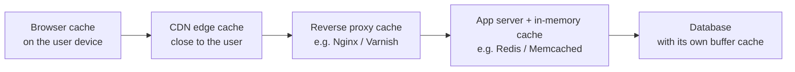
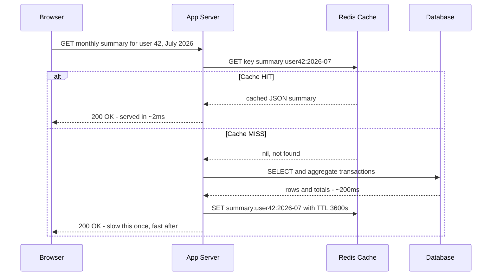

# 07. Caching

> **One-liner:** Keep a copy of expensive-to-get data somewhere fast and close, so you rarely have to do the expensive work twice — the single biggest performance lever in system design.
> **Where this fits:** This is the "scale reads by copying" idea from [06 — Scaling: Vertical vs Horizontal](06-scaling-vertical-vs-horizontal.md), made concrete. Caching is *how* stateless servers stay fast without hammering the database, and it's the engine behind [08 — CDN](08-cdn.md) (a CDN is just a cache near the user). It also sets up the consistency questions in [13 — CAP Theorem](13-cap-theorem.md) and [14 — ACID vs BASE](14-acid-vs-base-and-consistency.md).

---

## 1. The Idea in Plain Words

Let's define the word before anything else.

> **A cache is a small, fast store that holds copies of data you've already computed or fetched, so the next time you need it you can grab it instantly instead of doing the slow work again.**

"Slow work" usually means: a database query that scans lots of rows, a call to another service over the network, or a heavy calculation (like summing a year of expenses by category). Doing that once and *remembering the answer* is caching.

Two words you'll use constantly:

- **Cache hit** = the data you wanted was already in the cache. Fast. Cheap. Happy.
- **Cache miss** = it wasn't there, so you have to do the slow work (hit the database), and usually *store the result in the cache* so next time is a hit.

The whole game is **maximizing the hit rate**. If 95% of requests are hits, your database only sees 5% of the traffic — and reads, remember from [06](06-scaling-vertical-vs-horizontal.md), are the easy thing to scale precisely *because* you can cache and copy them.

**A tiny numbers example.** Say a database query for the Habex monthly summary takes **200ms**, but reading the pre-computed answer from an in-memory cache takes **1ms**.

|             | No cache         | With cache at 95% hit rate                       |
| ----------- | ---------------- | ------------------------------------------------ |
| Avg latency | 200ms            | (0.95 × 1ms) + (0.05 × 200ms) ≈**11ms** |
| DB load     | 100% of requests | **5%** of requests                         |

Same data, ~18× faster on average, and the database does 1/20th of the work. That's why caching is the *first* performance lever people reach for.

**The catch (the whole reason this chapter is long):** a cache holds a *copy*. The moment the real data changes, the copy can be **stale** (out of date). Managing that — deciding *when to store, when to expire, when to update* — is where all the difficulty lives. There's a famous line in computer science: *"There are only two hard things: cache invalidation and naming things."* This chapter is mostly about the first one.

---

## 2. Picture It (Diagram)

Caches don't live in one place — they live at *every layer* between the user's eyeball and your database. Here's the stack a single request can pass through:

Read it left to right: the closer the cache is to the user, the faster it is and the less of your infrastructure it touches. A request served by the **browser cache** never even leaves the user's laptop. One served by the **CDN** never reaches your servers. One served by **Redis** never reaches your database. Every layer that catches the request is work your backend didn't have to do.

| Cache layer                       | Lives where                               | Typical latency | Caches what                              |
| --------------------------------- | ----------------------------------------- | --------------- | ---------------------------------------- |
| **Browser cache**           | On the user's device                      | ~0ms            | JS/CSS/images, some API responses        |
| **CDN / edge**              | Servers near the user (see[08](08-cdn.md)) | 5–30ms         | Static files, cacheable API responses    |
| **Reverse proxy**           | In front of your app (Nginx, Varnish)     | 1–5ms          | Full HTML pages, common responses        |
| **Application / in-memory** | Redis / Memcached, beside your app        | ~1ms            | Query results, computed values, sessions |
| **Database buffer cache**   | Inside the DB itself                      | low ms          | Recently-read rows/pages (automatic)     |

When people say "add a cache" in an interview, they usually mean the **application/in-memory** layer (Redis). But knowing all five layers exist — and that they stack — is what separates a beginner answer from a strong one.

---

## 3. Real-World Analogy

**Your kitchen counter vs. the supermarket.**

The **supermarket** is your database: it has *everything*, but going there takes 30 minutes round-trip. Your **kitchen counter and fridge** are your cache: tiny, but grabbing salt from the counter takes 2 seconds.

- You keep salt, oil, and the things you use constantly *on the counter* (cache the hot data).
- The counter is small, so you can't keep everything there — you keep what you use most (**eviction:** when it's full, something has to go).
- Milk has an expiry date. After that you throw it out even if it looks fine, because it *might* be bad (**TTL / time-to-live:** data expires after a set time whether or not it changed).
- Here's the hard part: the store changes its milk *price* and your fridge has no idea. The carton on your counter says ₹50; the store now charges ₹60. Your copy is **stale**. You won't find out until you go back. Deciding how long you're willing to act on possibly-old info is **cache invalidation**, and it's genuinely hard — that's why milk has a printed date (a TTL) instead of the store phoning every fridge in the city.

Keep this analogy in mind; every strategy and pitfall below maps onto it.

---

## 4. Concrete Example

**Caching the Habex monthly-summary dashboard** (with an Instagram-feed comparison, because interviewers ask about feeds).

### The expensive operation

When Santhosh opens Habex and lands on "July 2026," the backend has to:

1. Fetch every transaction for user 42 in that month.
2. Group them by category (Food, Rent, Transport, ...).
3. Sum each group, compute the total, compare against the budget, and shape it for the charts.

For a heavy month that's a query over hundreds of rows plus aggregation — say **200ms**. And here's the thing: Santhosh reloads that same dashboard *dozens* of times, flipping between months, refreshing after adding one expense. The underlying answer barely changes, yet we recompute it every single time. **Perfect caching candidate.**

### The cache-aside pattern (the default you'll use 90% of the time)

The idea: the **application** manages the cache "on the side." On a read, look in the cache first; if it's a miss, get it from the DB and *put it in the cache* for next time.

In words:

1. Request comes in. App asks Redis for key `summary:user42:2026-07`.
2. **Hit?** Return it. Done in ~2ms. The database never wakes up.
3. **Miss?** App queries the database, computes the summary, **writes it into Redis with a TTL** (say 1 hour), and returns it. The *next* reload within that hour is a hit.

That's cache-aside. The app is in charge; the cache is a dumb fast box on the side.

### The Instagram-feed version (same idea, bigger stakes)

When you open Instagram, building your feed — pulling recent posts from everyone you follow, ranking them — is *very* expensive. Instagram doesn't recompute it on every scroll. It **caches your assembled feed** (in Redis-like stores) so opening the app is a fast cache read, and only refreshes it periodically or when something important changes. Same cache-aside instinct as Habex, just at planetary scale and with much more effort spent on *when to invalidate* (a new post from someone you follow should show up "soon" but need not be instant). The media itself — the actual photos and videos — is a separate caching problem solved by the CDN in [08 — CDN](08-cdn.md).

---

### Caching strategies (know these cold — they're a favorite interview table)

There are two families: **read strategies** (how data gets *into* the cache) and **write strategies** (what happens to the cache when data *changes*).

**Read strategies**

| Strategy                                    | How it works                                                                         | Best for                                       | Watch out for                                                                   |
| ------------------------------------------- | ------------------------------------------------------------------------------------ | ---------------------------------------------- | ------------------------------------------------------------------------------- |
| **Cache-aside** (a.k.a. lazy loading) | App checks cache; on miss, app loads from DB and populates cache                     | The default for read-heavy apps (Habex, feeds) | First request per key is always a miss ("cold cache"); risk of stampede (below) |
| **Read-through**                      | App only ever talks to the cache; the*cache library* fetches from the DB on a miss | Clean code, uniform access; managed caches     | Cache becomes a dependency; still cold on first read                            |

Cache-aside vs read-through is mostly *"who fetches on a miss — your app, or the cache layer?"* Cache-aside = your app. Read-through = the cache does it for you. Behavior is nearly identical; cache-aside is more common and more flexible.

**Write strategies** (what to do with the cache when data changes)

| Strategy                            | On a write, you...                                        | Consistency                                                | Best for                                                                    |
| ----------------------------------- | --------------------------------------------------------- | ---------------------------------------------------------- | --------------------------------------------------------------------------- |
| **Write-through**             | Write to cache**and** DB together, synchronously    | Strong — cache never stale vs DB                          | Data you'll read again immediately after writing                            |
| **Write-back** (write-behind) | Write to cache now, flush to DB**later** in batches | Fast writes, but risk data loss if cache dies before flush | Write-heavy, loss-tolerant (metrics, counters, likes)                       |
| **Write-around**              | Write straight to DB,**skip** the cache             | Cache only fills on later reads                            | Write-once-read-rarely data; avoids polluting cache with stuff nobody reads |

How to reason about them without memorizing:

- **Write-through** keeps the cache correct at the cost of slower writes (two writes per change). Pair it with cache-aside reads and your cache is both warm and fresh.
- **Write-back** is the fastest for writes because the user doesn't wait for the database — but if the cache crashes before flushing, you can *lose data*. Only for things you can afford to lose (a "like" count that's off by 3 is fine; a bank balance is not — very relevant for **CRED/Razorpay** answers).
- **Write-around** avoids filling the cache with data nobody re-reads. Good for, e.g., writing an audit log you rarely read back.

Most real systems = **cache-aside reads + write-through (or explicit invalidation) on writes.** Start there.

---

### Eviction policies (the cache is full — who gets kicked out?)

A cache is small on purpose (RAM is expensive). When it fills, it must evict something. The policy decides who:

| Policy                                | Evicts...                          | Intuition                                                | Good when                                    |
| ------------------------------------- | ---------------------------------- | -------------------------------------------------------- | -------------------------------------------- |
| **LRU** (Least Recently Used)   | The item untouched for the longest | "If you haven't used it lately, you probably won't soon" | The default — great general choice          |
| **LFU** (Least Frequently Used) | The item used the*fewest times*  | "Keep the popular stuff even if it went quiet briefly"   | Clear hot/cold popularity split              |
| **TTL / expiry**                | Anything older than its time limit | "This data goes stale after N seconds regardless"        | Data that naturally ages (summaries, prices) |
| **FIFO**                        | The oldest-inserted item           | Simple, ignores usage                                    | Rarely ideal; mentioned for completeness     |

**LRU is the sensible default** and what you should name first. **TTL is not really a competitor** — it's usually layered *on top* of LRU: every cached item gets a TTL so it can't be infinitely stale, *and* LRU evicts under memory pressure. In Habex you'd give `summary:user42:2026-07` a TTL of, say, 1 hour so even if nothing invalidates it, it self-corrects within an hour.

---

### Cache invalidation — the genuinely hard part

Invalidation = **removing or updating a cached copy when the real data changes**, so nobody reads stale data. It's hard because your app changes data in one place (the DB) while copies of it may be sitting in five caches that don't automatically know.

Three broad approaches, worst to best-effort:

1. **TTL / expiry (time-based).** Let copies expire after N seconds; accept being stale for *up to* N seconds. Dead simple, no coordination — you just tolerate a bounded staleness window. Great for dashboards ("summary can be up to 60s old — nobody cares"). This is what "eventual consistency" ([14](14-acid-vs-base-and-consistency.md)) feels like in practice.
2. **Explicit invalidation (event-based).** When you write, actively **delete** (or update) the affected cache keys. In Habex: when Santhosh adds a July expense, `DELETE summary:user42:2026-07` from Redis so the next read recomputes fresh. Precise, but *you* must remember to invalidate every key a change affects — miss one and it's stale forever.
3. **Write-through.** As above — update the cache on every write so it's never behind. Strongest, but slower writes and only covers data you route through that path.

The recurring interview trap: **the harder your data changes, the harder caching gets.** A blog post (rarely changes) is trivial to cache. A live stock price (changes constantly) is nearly pointless to cache for long. Habex's monthly summary is in the sweet spot: it changes *occasionally* (a new expense) and staleness of a few seconds is harmless — so TTL + delete-on-write is perfect.

---

### The tools (one line each)

- **Redis** — an in-memory data store, the industry-default application cache. More than a cache: it also does data structures (lists, sorted sets, counters), pub/sub, and optional persistence. Reach for this by name in interviews.
- **Memcached** — an older, simpler in-memory key→value cache. Very fast and lean, but no rich data types or persistence. Fine for pure "cache blobs by key"; most new systems pick Redis for the extra features.

---

### Pitfalls interviewers probe

- **Stale data.** The core hazard — a cached copy no longer matches the DB. Bounded by TTL and/or fixed by explicit invalidation. Always state your staleness tolerance out loud.
- **Thundering herd / cache stampede.** A popular key expires (or the cache restarts), and *thousands* of requests miss **at the same instant** and all slam the database together — which can crush it. Fixes: a **lock/single-flight** so only *one* request rebuilds the key while others wait, **staggered/jittered TTLs** so keys don't all expire together, and **serving slightly-stale data** while one worker refreshes in the background. (In the Habex dinner-rush spirit from [06](06-scaling-vertical-vs-horizontal.md): don't let one expiry become a self-inflicted DDoS.)
- **Cache penetration.** Requests for data that **doesn't exist** (e.g. `summary:user999999` — no such user). It's never in the cache (nothing to cache) *and* never in the DB, so every such request punches straight through to the database. If an attacker spams random keys, your DB takes the full hit. Fix: **cache the "not found" result too** (a short-TTL empty marker), or use a **Bloom filter** to reject keys that definitely don't exist before touching the DB.
- **Cache avalanche.** A cousin of the herd: a *large batch* of keys expire together (or the whole cache goes down), and load avalanches onto the DB. Fix: jittered TTLs, replication for the cache, and graceful degradation.
- **Over-caching / wrong thing cached.** Caching data that changes every second (stale immediately) or that nobody re-reads (wasted memory) is worse than not caching. Cache the *read-heavy, change-rarely* stuff.

---

## 5. Tie-Back to Your Projects

**Habex (your habit + expense tracker).** Habex is **read-heavy** — people stare at dashboards far more than they add expenses — which makes it a textbook caching target:

- **Cache the monthly summary** with cache-aside + Redis, keyed `summary:{userId}:{yyyy-mm}`, TTL ~1 hour. Opening the dashboard becomes a ~2ms cache read instead of a 200ms aggregation.
- **Invalidate precisely on write.** When a transaction is added/edited/deleted for July, `DELETE summary:{userId}:2026-07`. Only that user's, only that month's — cheap and surgical. The next dashboard load recomputes once and re-warms the cache.
- **Recurring entries + stampede risk.** If Habex posts everyone's recurring entries at midnight on the 1st, a *lot* of summary keys become invalid at once and everyone's morning refresh misses together — a mini stampede/avalanche. Mitigate with jittered TTLs and single-flight rebuilds. (Notice how this reuses the "predictable spike" thinking from [06](06-scaling-vertical-vs-horizontal.md).)
- **Sessions in a shared cache = statelessness.** Storing login/session data in Redis (not in one server's memory) is exactly what lets Habex run multiple stateless app servers behind a load balancer ([05](05-load-balancers.md), [06](06-scaling-vertical-vs-horizontal.md)). Caching and horizontal scaling are the same story from two angles.
- **What *not* to cache:** the exact current account balance if you ever show it as authoritative — a wrong-by-a-bit balance erodes trust. Reads that must be exact-to-the-rupee should skip the cache or use write-through.

**santhu.site (your portfolio).** Almost nothing dynamic to cache at the app layer — but the *static* assets (JS/CSS/images) are the ideal browser + CDN caching case, which is exactly [08 — CDN](08-cdn.md). Set long `Cache-Control` on hashed asset filenames and the browser/CDN serves your whole portfolio without touching your origin. The contact form is a write, and there's nothing to cache about it.

---

## 6. Interview Questions (with answer pointers)

**Q1. What is a cache, and what are a hit and a miss? (warm-up — everyone)**

> A small fast store of copies of expensive-to-produce data. Hit = wanted data was present (fast, no DB). Miss = absent, so you do the slow work and usually populate the cache for next time. Goal is a high hit rate so the DB sees a fraction of read traffic.

**Q2. Walk me through cache-aside. Why is it the default? (Swiggy, Groww)**

> On read: check cache; hit → return; miss → load from DB, write into cache with a TTL, return. The app owns the cache "on the side." It's the default because it's simple, only caches data actually requested (no wasted memory), and degrades gracefully — if the cache is down, you just hit the DB. Downsides: first request per key is a cold miss, and it's vulnerable to stampede on hot-key expiry.

**Q3. Compare write-through, write-back, and write-around. When would you pick each? (CRED, Razorpay — they love this)**

> Write-through: write cache+DB together → cache always fresh, but slower writes; use for data re-read right after writing. Write-back: write cache now, flush to DB later → fastest writes but can lose data if the cache dies before flush → only for loss-tolerant data like counters/likes. Write-around: write DB, skip cache → good for write-once-read-rarely data so you don't pollute the cache. For money/financial data, avoid write-back's data-loss window.

**Q4. Explain LRU vs LFU vs TTL. Which is your default? (Zepto, Groww)**

> LRU evicts the least-recently-used (default, good general choice). LFU evicts the least-frequently-used (better with a stable hot set). TTL isn't really a competitor — it's a per-item expiry usually layered on top of LRU so nothing stays infinitely stale. I'd default to LRU + a sane TTL per key.

**Q5. Why is cache invalidation considered hard? How do you handle it? (CRED, Razorpay)**

> Because data changes in one place (DB) while copies sit in many caches that don't automatically hear about it — miss one and it's stale forever. Approaches: TTL (accept bounded staleness, zero coordination), explicit delete-on-write (precise but you must invalidate every affected key), and write-through (never behind, slower writes). Pick based on how much staleness the feature tolerates — state that tolerance explicitly.

**Q6. What is a cache stampede / thundering herd, and how do you prevent it? (Zepto, Swiggy — the scale question)**

> A hot key expires and thousands of simultaneous misses all hit the DB at once, possibly crashing it. Prevent with single-flight locking (one request rebuilds, others wait or get stale), jittered TTLs so keys don't expire in lockstep, and serving slightly-stale data while a background worker refreshes. Add cache replication so a cache restart doesn't avalanche onto the DB.

**Q7. What's cache penetration and how is it different from a stampede? (senior probe — Razorpay, CRED)**

> Penetration = requests for data that doesn't exist anywhere, so they bypass the cache (nothing to store) and hit the DB every time — dangerous if attacker-driven. Fix by caching the negative/"not found" result with a short TTL, or a Bloom filter to reject impossible keys. Different from a stampede, which is about *existing* hot data all missing at the same moment.

**Q8. Where can caches live in a full request path? (architecture breadth — Groww, Swiggy)**

> Browser → CDN/edge → reverse proxy → application/in-memory (Redis) → the DB's own buffer cache. They stack: the closer to the user a request is served, the less infrastructure it touches. Naming all five layers signals you see the whole system, not just Redis.

**Q9. Redis or Memcached? (quick-fire — Groww)**

> Both are in-memory key-value caches. Memcached is leaner and simpler; Redis adds rich data structures, pub/sub, and optional persistence. Default to Redis unless you specifically need only the simplest fastest blob cache.

---

## 7. Trade-offs & "Why Not Just X?"

**"Why not cache *everything* and never touch the DB?"**
Because caches hold copies, and copies go stale. Cache fast-changing data and you serve wrong answers; cache data nobody re-reads and you waste expensive RAM and evict the stuff that matters. Caching trades **freshness and memory** for **speed**. You cache the *read-heavy, change-rarely, staleness-tolerant* slice — not everything.

**"Why not just make the database faster instead of adding a cache?"**
You should do both, but they have ceilings. Indexing ([10](10-database-indexing.md)) and a bigger DB box ([06](06-scaling-vertical-vs-horizontal.md)) help — up to a point (vertical scaling's hard ceiling). A cache is often **100–200× faster** than even a well-tuned query because it skips the query *entirely* and lives in RAM. And crucially, caching *reduces DB load*, which protects writes too. Cache first for read-heavy hot paths; tune the DB underneath.

**"Why not just set a very long TTL everywhere so hit rates are huge?"**
Longer TTL = higher hit rate *and* more staleness. It's a dial, not a free win. A 24-hour TTL on a stock ticker is useless; a 1-second TTL on a blog post wastes the cache. Set each key's TTL to its real staleness tolerance — and for anything that must be fresh-on-change, use explicit invalidation instead of hoping a short TTL saves you.

| Concern                     | Cache helps             | Cache hurts / doesn't help                |
| --------------------------- | ----------------------- | ----------------------------------------- |
| Read-heavy, repeated reads  | Huge win                | —                                        |
| Data changes constantly     | —                      | Stale immediately; low value              |
| Data must be exact (money)  | Risky                   | Prefer write-through or skip              |
| Data read once, never again | —                      | Pollutes cache, wasted memory             |
| Protecting the DB from load | Big win (fewer queries) | Stampede can*invert* this if mishandled |

**"Why not put the cache inside each app server's memory (local cache) instead of a shared Redis?"**
A local in-process cache is even faster (no network hop) — but with N stateless servers you now have N *different* copies that can disagree, and invalidation must fan out to all of them. That reintroduces the state problem from [06](06-scaling-vertical-vs-horizontal.md). Common real answer: a small local cache for ultra-hot immutable data + a shared Redis for everything that must be consistent across servers.

---

## 8. TL;DR

- **A cache** is a small, fast store of copies of expensive data. **Hit** = found it (fast); **miss** = fetch it slowly and store it. Maximize hit rate → DB sees a fraction of reads.
- Caches live at **many layers** — browser, CDN, reverse proxy, application/Redis, DB buffer. They stack; the closer to the user, the cheaper the hit. "Add a cache" usually means the Redis layer.
- **Read strategies:** cache-aside (app fetches on miss — the default) and read-through (cache fetches on miss). **Write strategies:** write-through (fresh, slower), write-back (fast, can lose data — loss-tolerant only), write-around (skip cache on write).
- **Eviction:** LRU (default), LFU (stable popularity), and TTL/expiry layered on top so nothing is infinitely stale.
- **Cache invalidation is the hard part:** TTL (bounded staleness, zero coordination), explicit delete-on-write (precise but easy to miss a key), or write-through. Match the method to how much staleness the feature tolerates.
- **Pitfalls:** stale data, **stampede/thundering herd** (hot key expires → simultaneous misses crush the DB → fix with single-flight + jittered TTL + serve-stale), **penetration** (requests for non-existent data bypass the cache → cache negatives / Bloom filter), and avalanche.
- **Tools:** **Redis** (default, rich features) and **Memcached** (simpler, leaner).
- **Habex:** cache the monthly summary (cache-aside, Redis, TTL ~1h), delete the key on any transaction write, watch for the midnight-recurring stampede. Sessions in Redis = the statelessness that enables horizontal scaling ([06](06-scaling-vertical-vs-horizontal.md)). Static assets belong on the [08 — CDN](08-cdn.md).
