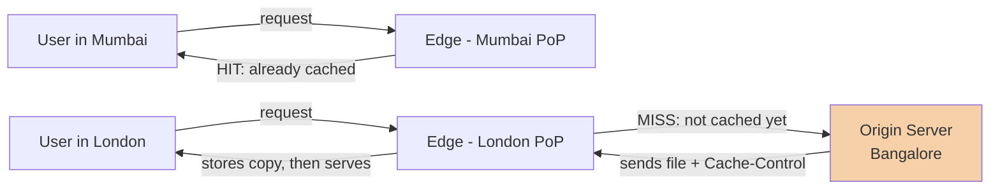

# 08. CDN (Content Delivery Network)

> **One-liner:** A worldwide network of caching servers that keeps copies of your content *physically close* to your users, so downloads are fast no matter where on Earth they are.
> **Where this fits:** A CDN is [07 — Caching](07-caching.md) applied at the *geographic* edge — the "browser → CDN → origin" top of that cache stack. It leans on [03 — IP & DNS](03-ip-and-dns.md) (DNS is how you get routed to the nearest edge), [04 — HTTP & HTTPS](04-http-and-https.md) (`Cache-Control` headers drive it), and it's a specialized form of the "scale reads by copying" idea from [06 — Scaling: Vertical vs Horizontal](06-scaling-vertical-vs-horizontal.md). It shows up again when we design [23 — Instagram](23-case-study-instagram.md).

---

## 1. The Idea in Plain Words

Start with the problem a CDN exists to solve: **distance costs time.**

Your server — the **origin** (the one true home of your content, where your app actually runs) — lives in *one* place. Say it's in a Bangalore data center. When someone in Bangalore loads santhu.site, the data travels a few hundred kilometers: fast. But when someone in **London** loads it, every byte has to travel ~8,000 km to Bangalore and back. Data isn't instant — it moves near the speed of light through cables — so that round trip alone adds **~100–200ms**, *before* your server even does any work. Load a page with 40 images and that distance tax is paid over and over. The site feels sluggish, and it's not your code's fault — it's **geography**.

Now the definition:

> **A CDN (Content Delivery Network) is a large, distributed fleet of caching servers spread across the globe. It stores copies of your content in many locations so each user is served from a nearby one instead of from your single far-away origin.**

The nearby servers are called **edge servers**, and the locations they sit in are **PoPs — Points of Presence** (a data center full of edge servers in, say, Mumbai, London, Singapore, São Paulo...). A big CDN has hundreds of PoPs worldwide.

So instead of *everyone on Earth → Bangalore*, it becomes:

- London user → London edge (a few ms away)
- Mumbai user → Mumbai edge
- Singapore user → Singapore edge

Each edge holds a cached copy of your content. Your origin in Bangalore is only contacted when an edge *doesn't have* a copy yet (a miss — the same hit/miss idea from [07](07-caching.md), just geographic). Result: users everywhere get near-local speed, and your origin's load drops dramatically because most requests never reach it.

**One more term you'll see:** **static content** = files that are the same for everyone and don't change per request — images, videos, CSS, JavaScript bundles, fonts, PDFs. This is the bread and butter of a CDN. (**Dynamic content** = personalized/changing-per-request, like your Habex dashboard — more nuanced, covered in section 4.)

---

## 2. Picture It (Diagram)

The core flow: **user → nearest edge → (only on a miss) origin fallback.**



Read it as two stories:
- **Mumbai user (cache HIT):** the Mumbai edge already has the file, serves it in a few milliseconds, origin never touched.
- **London user (cache MISS):** the London edge doesn't have it yet, so it fetches once from the far origin, **stores a copy**, and serves it. Every *next* London user is now a hit. The origin paid the long-distance cost exactly once, not once per user.

```
        WITHOUT a CDN                         WITH a CDN
   everyone -> one origin              users -> nearest edge -> origin only on miss

   [London]---8000km--->[BLR]          [London]->[London edge]  (fast, local)
   [Mumbai]---900km---->[BLR]          [Mumbai]->[Mumbai edge]  (fast, local)
   [Tokyo]----6000km--->[BLR]          [Tokyo]-->[Tokyo edge]   (fast, local)
        (origin drowns, far = slow)         (origin sipped, near = fast)
```

---

## 3. Real-World Analogy

**A national bookstore chain vs. one giant warehouse.**

Imagine a publisher with a single **warehouse** in Bangalore (your origin). If every reader in India had to order directly from that warehouse, someone in Delhi waits days for shipping, and the warehouse is swamped with orders.

Instead, the publisher stocks **local bookstores** in every city (edge servers / PoPs). Now a Delhi reader walks to the Delhi store and gets the book in minutes. The store only calls the central warehouse when it *doesn't stock* a title yet (a cache miss) — it orders one copy, puts it on the shelf, and every future Delhi customer gets it instantly.

The mapping is exact:
- Warehouse = **origin**. Local bookstores = **edge servers / PoPs**.
- Book already on the shelf = **cache hit**. Store has to order it = **cache miss**.
- "This edition expires next month, pull it then" = **TTL**.
- Publisher issues a recall: "pull this book from every store *now*" = **cache invalidation / purge**.

And note *what* the stores stock well: mass-market books everyone wants (static content). A **custom, personalized book printed with your name in it** (dynamic, per-user content) can't just sit on a shelf for the next customer — that needs special handling, which is the static-vs-dynamic story below.

---

## 4. Concrete Example

**Serving Instagram media and santhu.site's asset bundle from a CDN.**

### santhu.site — the ideal CDN case

Your portfolio is mostly **static**: an HTML shell, a JavaScript bundle (`main.a1b2c3.js`), a CSS bundle, and images. These files are *identical for every visitor on Earth*. That's the perfect CDN payload.

- You put santhu.site behind a CDN (Cloudflare, AWS CloudFront, Fastly — most static hosts like Vercel/Netlify bundle one in automatically).
- A recruiter in **San Francisco** opens your site. The SF edge serves your JS/CSS/images from a few ms away. Your Bangalore origin isn't touched at all.
- Because your build tools put a **content hash in the filename** (`main.a1b2c3.js`), you can tell the CDN "cache this *forever*" (`Cache-Control: max-age=31536000, immutable`) — the file at that URL will never change, and when you deploy new code, the filename changes to `main.d4e5f6.js`, which is simply a new URL the CDN fetches fresh. This is the standard, elegant way to cache static front-end assets: **immutable, hashed filenames + long TTL.**
- Net effect: your portfolio loads fast worldwide, and your origin does almost nothing. (The only non-static bit — the contact form POST — bypasses the CDN cache and goes to your origin, which is correct; you never cache a form submission.)

### Instagram — the heavy-media case

Instagram is *photos and videos* — huge files, viewed by millions, from everywhere. Without a CDN this is impossible: serving a viral reel to 10 million people from one origin would saturate its network instantly, and users far from the origin would buffer forever.

- When a photo is uploaded, it's processed into several sizes (thumbnail, feed size, full) and pushed toward the CDN. When people in a region first view it, the nearby edges cache it.
- A reel going viral in Brazil is served from **São Paulo edges**, not from a US origin — so it's fast *and* the origin's bandwidth is protected no matter how viral it goes. The CDN absorbs the crowd. (This is the read-scaling-by-copying idea from [06](06-scaling-vertical-vs-horizontal.md), taken global.)
- **Video** adds streaming: the CDN delivers it in small chunks (adaptive bitrate), each chunk cached at the edge, so playback starts fast and adjusts to the viewer's connection. Same caching principle, chunked.

The dividing line in both examples: **the media/assets go through the CDN; the personalized logic does not.** Your Instagram *feed order* (who's posts, ranked for you) is computed at the origin/app layer and cached in Redis ([07](07-caching.md)); the *images in that feed* are served by the CDN. Two different caches doing two different jobs.

---

### Static vs dynamic content

| | Static content | Dynamic content |
|---|---|---|
| Examples | JS/CSS bundles, images, video, fonts, PDFs | Habex dashboard, your feed, account page, search results |
| Same for everyone? | **Yes** — identical bytes for all users | **No** — personalized / changes per request |
| CDN-cacheable? | Easily, aggressively | Not by default; needs care |
| How to handle | Long TTL, hashed filenames | Cache at origin (Redis), or use edge tricks below |

Dynamic content isn't *un*-CDN-able, it's just harder. Modern CDNs offer:
- **Short-TTL / micro-caching** — cache a "dynamic" but not-truly-personalized page for even a few seconds to absorb spikes (e.g. a trending-restaurants list that's the same for a whole city).
- **Edge compute** (Cloudflare Workers, Lambda@Edge) — run small bits of *code* at the edge, so some personalization happens near the user without a round trip to origin.
- **Route-splitting** — serve the static shell from the CDN and fetch only the dynamic JSON from the origin (exactly how a React app like Habex naturally works).

---

### Push vs Pull CDNs — how content gets to the edge

There are two ways an edge ends up holding your file:

| | **Pull CDN** (origin pull) | **Push CDN** |
|---|---|---|
| How content arrives | Edge **pulls** from origin on the *first* request (a miss), then caches it | You **push/upload** content to the CDN ahead of time |
| First user for a file | Slightly slow (one miss → origin fetch), then fast for everyone after | Always fast (already there) |
| Who manages what's stored | The CDN, automatically, by demand + TTL | You, explicitly |
| Best for | Most sites; frequently-updated or huge catalogs where you only want popular items cached | Large files you *know* will be hot (a big launch video, a game download) where you can't afford a slow first hit |
| Effort | Low — "set origin, done" | Higher — you manage uploads/removal |

**Pull is the default** and what you'll describe 90% of the time: point the CDN at your origin, and it lazily caches on demand. **Push** is for when you want to pre-load specific big/known-hot assets so *nobody* eats the first-request miss. (Notice the parallel to [07](07-caching.md): pull ≈ lazy/cache-aside, push ≈ pre-warming the cache.)

---

### Cache-Control, TTL, and invalidation at the edge

How does an edge know how long to keep a copy? **Your origin tells it, using HTTP headers** (from [04 — HTTP & HTTPS](04-http-and-https.md)). This is the control panel for edge caching:

- **`Cache-Control: max-age=3600`** — "this is fresh for 3600 seconds (1 hour)." That's the **TTL** at the edge. After it expires, the edge re-checks with origin.
- **`Cache-Control: public`** vs **`private`** — `public` = shared caches like CDNs may store it; `private` = only the user's browser may (use for personalized responses).
- **`Cache-Control: no-store`** — never cache this (login responses, anything sensitive/personalized).
- **`Cache-Control: max-age=31536000, immutable`** — "keep for a year, it will never change" — the hashed-filename pattern for static assets.
- **`ETag` / `Last-Modified`** — a version fingerprint; on expiry the edge asks origin "still valid?" and origin can reply "304 Not Modified" (cheap) instead of re-sending the whole file.

**Invalidation at the edge** (getting a *new* version out before its TTL expires) has two tools:

1. **Purge / invalidate** — explicitly tell the CDN "drop this URL from all edges now." Use for an urgent fix ("we published a wrong price, kill the cached page globally"). It's powerful but propagating a purge to hundreds of PoPs takes seconds-to-minutes, and mass purges can briefly stampede your origin (the [07](07-caching.md) thundering-herd problem, at global scale).
2. **Versioned URLs (the preferred way)** — never update a file in place; ship a *new URL*. `main.a1b2c3.js` → `main.d4e5f6.js`. The old URL keeps its long TTL harmlessly; the new URL is fetched fresh. **No purge needed** — this is why hashed filenames are the gold standard for static assets and why you should reach for this pattern first.

---

### When a CDN does NOT help (interviewers love this)

A CDN is not a magic "make everything faster" button. It does little or nothing when:

- **Highly personalized, uncacheable content.** Your Habex dashboard is different for every user and changes on every write — an edge can't serve one cached copy to many people. The fix is origin-side caching (Redis), not a CDN.
- **Write / mutation traffic.** Submitting an expense, placing an order, sending a message — these *change* state and must reach the origin. CDNs cache reads, not writes.
- **Truly real-time data.** Live scores, live chat, a stock ticker — anything that must be current-to-the-second can't tolerate edge caching (or only with sub-second TTLs of limited value).
- **Low, local traffic.** If all your users are in one city right next to your origin, the distance problem you're paying the CDN to solve barely exists.
- **A tiny site with no static assets.** Nothing cacheable = little to gain.

Interview reflex: when you propose a CDN, immediately say *what it's caching* (the static assets / media) and acknowledge the dynamic/personalized parts still hit the origin. That precision is what separates a memorized answer from an understood one.

---

### Security bonus (real, and worth naming)

Beyond speed, sitting a CDN in front of your origin gives you security wins for free — because *all* traffic now flows through the CDN's giant, hardened network before reaching you:

- **DDoS absorption.** A DDoS (Distributed Denial of Service) attack floods you with junk traffic to knock you offline. A big CDN has enormous global capacity and can **soak up and filter** attack traffic across its PoPs long before it reaches your single origin — the CDN acts as a shield. (More in [20 — Security Basics](20-security-basics.md).)
- **TLS termination at the edge.** The CDN edge can handle the HTTPS handshake (from [04](04-http-and-https.md)) near the user, so the expensive encryption setup happens close by (faster) and your origin is offloaded. It also centralizes certificate management.
- **Origin hiding + WAF.** Users only ever see the CDN's IPs; your origin's real address is hidden, so attackers can't target it directly. Most CDNs also bundle a **WAF (Web Application Firewall)** to block common attacks (SQL injection, etc.) at the edge.

So a CDN is simultaneously a *performance* tool and a *first line of defense*.

---

## 5. Tie-Back to Your Projects

**santhu.site (your portfolio) — pure CDN win.** This is the cleanest example in the whole curriculum:
- Host it on a platform with a built-in CDN (Vercel/Netlify/Cloudflare Pages) or put CloudFront/Cloudflare in front. Every JS/CSS/image byte is served from an edge near each visitor.
- Rely on **hashed, immutable filenames + `max-age=31536000, immutable`** — the CDN caches your bundle forever, and each deploy ships new hashed URLs, so you never purge. Instant global loads for recruiters in any city, and your origin barely runs — which also means you can host it on the cheapest possible box ([06](06-scaling-vertical-vs-horizontal.md)).
- Bonus: free HTTPS (TLS termination) and DDoS protection from the CDN, with zero extra work.

**Habex (your habit + expense tracker) — split the traffic.** Habex is a React app talking to an API, so it has *both* kinds of content, and the skill is routing each correctly:
- **Static side → CDN.** The React app itself — JS/CSS/images/fonts — is static and should be served from the CDN exactly like santhu.site. Even though Habex is a "dynamic app," the *code that runs it* is static files.
- **Dynamic side → origin + Redis.** The API responses (dashboard summary, transactions, budgets) are personalized per user and change on writes → **not** CDN-cached. These are the [07 — Caching](07-caching.md) Redis targets. Marking these responses `Cache-Control: private, no-store` keeps a shared CDN from ever caching one user's financial data and showing it to another — a subtle but important correctness/security point.
- **Interview soundbite for Habex:** *"The front-end bundle is served from a CDN for fast global loads; the API is dynamic and per-user, so it hits the origin, where I cache the read-heavy summaries in Redis and skip the CDN entirely for anything financial."* That one sentence shows you understand the static/dynamic split cold.

---

## 6. Interview Questions (with answer pointers)

**Q1. What is a CDN and what problem does it solve? (warm-up — everyone)**
> A globally distributed fleet of caching (edge) servers that store copies of your content near users. It solves the *distance = latency* problem: instead of everyone hitting one far origin, each user is served from a nearby edge (PoP), so downloads are fast worldwide and origin load drops because most requests never reach it.

**Q2. Static vs dynamic content — what belongs on a CDN? (Swiggy, Groww)**
> Static (same for everyone: JS/CSS/images/video/fonts) caches beautifully with long TTLs. Dynamic/personalized (a user's dashboard, feed, account) can't be served as one shared copy, so it stays at the origin — cached there in Redis if read-heavy. Modern CDNs stretch to dynamic via micro-caching and edge compute, but the default rule is: static → CDN, personalized → origin.

**Q3. Push vs pull CDN — which and why? (CRED, Razorpay)**
> Pull: the edge fetches from origin on the first request (a miss) then caches — low effort, the default, great for most sites and large catalogs where only popular items get cached. Push: you pre-upload assets so they're already at the edge — best for large, known-hot files (a launch video) where you can't afford a slow first hit. Pull is lazy/on-demand; push is pre-warming.

**Q4. How do `Cache-Control` and TTL control edge caching? How do you push out a new version? (Zepto, Swiggy)**
> The origin sets `Cache-Control` headers: `max-age` is the edge TTL, `public/private` decides if shared caches may store it, `no-store` forbids caching. To ship a new version before TTL expiry, either **purge/invalidate** the URL across PoPs (fast but can stampede the origin) or — preferred — use **versioned/hashed filenames** so a new build is simply a new URL that's fetched fresh, no purge needed.

**Q5. When does a CDN NOT help? (senior probe — CRED, Razorpay)**
> Highly personalized/uncacheable responses (per-user dashboards), write/mutation traffic (must reach origin), truly real-time data (live scores/chat), audiences all located next to the origin, and sites with no static assets. Naming these shows you won't reflexively bolt a CDN onto everything.

**Q6. How does a user actually get routed to the nearest edge? (Groww, Swiggy — ties to DNS)**
> Mostly via DNS ([03](03-ip-and-dns.md)) and Anycast: when the browser resolves your CDN hostname, the CDN's DNS returns the IP of a nearby PoP (geo/latency-based), or many PoPs share one Anycast IP and the network routes you to the closest one. Either way, "nearest edge" is chosen at connection time, transparently.

**Q7. What security benefits does a CDN give? (Razorpay, CRED — security-minded)**
> It fronts your origin, so it can absorb and filter DDoS traffic across its huge global capacity before it reaches you, terminate TLS at the edge (faster handshakes, offloaded origin, centralized certs), hide your origin's real IP so it can't be targeted directly, and often bundle a WAF to block common attacks at the edge. It's a performance tool *and* a first line of defense.

**Q8. A user in Australia says your India-hosted app is slow. Walk me through it. (Zepto, Swiggy — scenario)**
> First separate distance-latency from server-slowness. If it's static assets, a CDN fixes it — Australian edges serve the bundle locally. If it's dynamic API calls, a CDN won't help the personalized parts; options are origin-side caching, read replicas nearer the user ([11](11-replication.md)), or edge compute. Diagnose *which* content is slow before prescribing the CDN.

**Q9. How is a CDN related to a regular cache? (concept check — Groww)**
> It *is* a cache — the geographic, top-of-stack layer from [07](07-caching.md). Same hit/miss, TTL, and invalidation ideas, just distributed across the globe and keyed by URL. A Redis cache reduces *database* work at your origin; a CDN reduces *network distance and origin* work for the user. They complement, not replace, each other.

---

## 7. Trade-offs & "Why Not Just X?"

**"Why not just put my server closer to users / rent a bigger server?"**
A bigger server ([06](06-scaling-vertical-vs-horizontal.md)) is *still in one place* — it does nothing about the 8,000 km to a London user; that's a physics problem, not a CPU problem. And "put a server in every country yourself" is exactly what a CDN already is, except a CDN gives you hundreds of PoPs, routing, and security for a fraction of the cost and none of the ops. You'd be rebuilding a CDN, badly.

**"Why not cache dynamic, personalized pages on the CDN too — bigger hit rate!"**
Because a shared edge serves *one* cached copy to *many* people. Cache a personalized page and you risk showing user A's data to user B — a serious correctness and privacy bug (imagine one Habex user's expenses served to another). Personalized responses must be `private`/`no-store` and handled at the origin. The CDN's job is content that's *identical for everyone*.

**"Why not just purge the whole CDN on every deploy to be safe?"**
Mass purges are a blunt instrument: propagating to hundreds of PoPs takes time, and right after a purge *every* edge misses at once and stampedes your origin ([07](07-caching.md) thundering herd, globally). Versioned/hashed filenames avoid purging entirely — new build = new URLs = automatically fresh, old URLs harmlessly expire. Reach for versioning first; keep purge for genuine emergencies.

| Concern | CDN helps a lot | CDN helps little / can hurt |
|---|---|---|
| Static assets, images, video | Huge win globally | — |
| Geographically spread users | Huge win | — |
| Per-user personalized data | — | Wrong to cache; privacy risk |
| Writes / real-time data | — | Must reach origin; don't cache |
| Absorbing traffic spikes / DDoS | Big win (edge soaks it up) | Mass purge can invert this briefly |
| Users all next to the origin | Marginal | Little distance to remove |

**"Isn't a CDN just extra cost and complexity for a small site?"**
For a static site it's often *free* (bundled with Vercel/Netlify/Cloudflare) and strictly a win — faster loads, less origin load, free TLS and DDoS shielding. The judgment call is only for **dynamic/real-time** systems, where you must be deliberate about *what* is cacheable. The failure mode isn't "used a CDN," it's "cached the wrong (personalized) thing on it."

---

## 8. TL;DR

- A **CDN** is a global fleet of **edge servers** at **PoPs (Points of Presence)** that cache copies of your content near users. It's [07 — Caching](07-caching.md) applied to *geography*.
- It solves **distance = latency**: serve from a nearby edge instead of one far **origin**. Same hit/miss model — miss → edge fetches from origin once, caches, then serves everyone locally.
- **Static content** (JS/CSS/images/video — identical for all) is the ideal payload; cache it hard with long TTLs. **Dynamic/personalized** content stays at the origin (cache it in Redis), though micro-caching and edge compute can stretch the CDN toward it.
- **Pull CDN** (edge fetches on first miss — the default, low effort) vs **Push CDN** (you pre-upload known-hot files so nobody eats the first miss).
- Control the edge with **`Cache-Control`/TTL** headers ([04](04-http-and-https.md)). Ship new versions via **hashed/versioned URLs** (preferred — no purge needed) rather than mass **purges** (which can stampede the origin).
- **CDN does NOT help** with per-user personalized data, writes, true real-time data, single-region audiences, or asset-less sites. Always say *what* it's caching.
- **Security bonus:** DDoS absorption, TLS termination at the edge, origin-IP hiding, and often a WAF — a performance tool *and* a first line of defense ([20](20-security-basics.md)).
- **Your projects:** santhu.site is a pure CDN win (hashed assets, long TTL, free HTTPS + DDoS shield). Habex = split traffic — front-end bundle on the CDN, per-user API on the origin with Redis, and never CDN-cache financial data.
