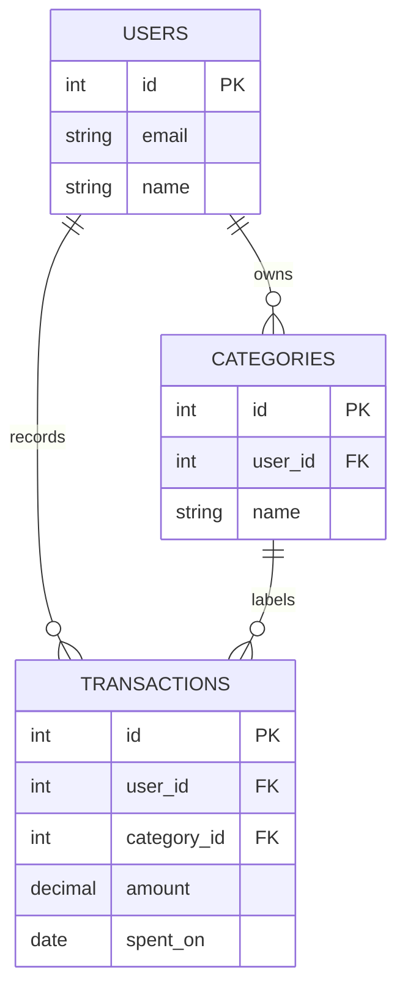

# 09. SQL vs NoSQL

> **One-liner:** SQL databases store data in strict, related tables with a fixed shape, while NoSQL databases trade some of that structure for flexibility and specific access patterns, and the right choice is almost always decided by *how you read and write data*, not by how "big" your data is.
> **Where this fits:** You now know how clients talk to servers ([02-client-server-basics.md](02-client-server-basics.md)) and how requests reach them ([04-http-and-https.md](04-http-and-https.md)). Behind almost every server sits a **database** — the thing that actually remembers your data between requests. This chapter is your first real look inside one. It sets up the next four chapters: indexing ([10-database-indexing.md](10-database-indexing.md)), replication ([11-replication.md](11-replication.md)), sharding ([12-sharding-and-partitioning.md](12-sharding-and-partitioning.md)), and the deeper consistency theory ([13-cap-theorem.md](13-cap-theorem.md), [14-acid-vs-base-and-consistency.md](14-acid-vs-base-and-consistency.md)).

---

## 1. The Idea in Plain Words

A **database** is just a program whose whole job is to store data safely and hand it back to you quickly. Your React app forgets everything on refresh; a database is the memory that survives.

There are two big families.

### The relational model (SQL)

A **relational database** stores data in **tables**. If you have ever used a spreadsheet or an HTML `<table>`, you already understand 80% of it. Let me define every word, because these terms come up in every interview:

- **Table** — a grid that holds one *kind* of thing. One table for users, one for transactions. (Also called a *relation*, which is where "relational" comes from.)
- **Row** — one single record in that table. One user. One expense. (Also called a *record* or *tuple*.)
- **Column** — one field that every row has. `email`, `amount`, `created_at`. (Also called an *attribute*.)
- **Schema** — the *shape* of a table: which columns exist, their **data types** (`INTEGER`, `TEXT`, `DATE`, `DECIMAL`, `BOOLEAN`), and their rules. The schema is decided *up front*, and every row must obey it. If the column is a `DECIMAL`, you cannot shove the word `"lunch"` into it.
- **Primary key (PK)** — a column whose value *uniquely* identifies a row. Usually an `id`. No two rows can share it. It is how you point at exactly one row.
- **Foreign key (FK)** — a column in one table that holds the primary key of a row in *another* table. This is the "link". A transaction's `user_id` column is a foreign key pointing at the `users` table. It's how the database knows *this expense belongs to that user*.
- **Join** — the operation that follows a foreign key to stitch two tables back together at read time. "Give me every transaction *and the name of the category it belongs to*" is a join between `transactions` and `categories`.

You talk to a relational database using **SQL** (Structured Query Language) — a text language that reads almost like English:

```sql
SELECT amount, spent_on
FROM transactions
WHERE user_id = 42
ORDER BY spent_on DESC;
```

Popular SQL databases: **PostgreSQL**, **MySQL**, **SQLite**, **Microsoft SQL Server**, **Oracle**. For a project like Habex, **PostgreSQL** is the default sane choice in 2026.

### ACID in one paragraph

The superpower of classic SQL databases is **ACID** — a set of guarantees that keep your data correct even when things go wrong. **A**tomicity: a group of changes either *all* happen or *none* do (money never leaves one account without arriving in the other). **C**onsistency: the database never ends up in a state that breaks your rules (a foreign key can't point at a user who doesn't exist). **I**solation: two people acting at the same time don't corrupt each other's work. **D**urability: once the database says "saved", it stays saved even if the power dies one millisecond later. That's the whole idea for now — we go deep in [14-acid-vs-base-and-consistency.md](14-acid-vs-base-and-consistency.md).

### What "NoSQL" means

**NoSQL** originally meant "non-relational" — databases that deliberately *don't* use the strict table-and-join model. The name is misleading (many now support SQL-like queries), so read it as **"Not Only SQL"**. NoSQL is not one thing; it's an umbrella over four different families, each shaped around a different access pattern. We'll meet all four in section 4.

The honest headline, which we'll keep coming back to: **SQL vs NoSQL is a question about your *access patterns* — the specific shapes of read and write your app actually does — far more than a question about scale.**

---

## 2. Picture It (Diagram)

The same data — a Habex user with two expenses — modeled two ways. First, the **relational** way: three tables linked by foreign keys.



Read the crow's-foot lines as "one user has *many* transactions". The data is **split apart** into clean tables and reconnected with joins when you read.

Now the **document** (NoSQL) way. The same information is nested into one self-contained JSON-like blob:

```json
{
  "_id": "user_42",
  "email": "santhosh@example.com",
  "name": "Santhosh",
  "transactions": [
    { "amount": 250.00, "spent_on": "2026-07-03", "category": "Food" },
    { "amount": 1200.00, "spent_on": "2026-07-05", "category": "Rent" }
  ]
}
```

Notice the trade already visible here: the relational version never repeats the word `"Food"` (it lives once in `categories`), while the document version happily embeds `"category": "Food"` inline on every transaction. Hold that thought — it's the whole normalization story in section on trade-offs.

---

## 3. Real-World Analogy

Think about how a company keeps records.

**SQL is a well-run accounts department with filing cabinets.** There's a cabinet for *Employees*, a cabinet for *Invoices*, a cabinet for *Clients*. Every invoice form has a blank that says "Client ID" — you never re-write the client's full address on the invoice, you just reference their ID and go pull the client folder when you need it. Every form has the same fields in the same places (the schema). It's tidy, nothing is duplicated, and if a client changes their address you update *one* folder. The cost: to answer "show me this invoice with the client's full address", a clerk has to walk to two cabinets and cross-reference (a join).

**NoSQL document store is a stack of complete case files.** Each folder is a whole self-contained dossier — everything about that case in one place, in whatever layout that case needed. To read a case, you grab *one* folder and you're done; no walking between cabinets. The cost: the client's address is photocopied into fifty different case files, so if it changes you're in trouble, and there's no clerk stopping you from writing the date in a different format in each folder.

Neither is "smarter". A busy hospital ER wants complete self-contained patient folders it can grab instantly (document). A bank wants normalized cabinets where every number reconciles and nothing is duplicated (relational). **The work you do most often decides the filing system.**

---

## 4. Concrete Example

Let's meet the four NoSQL families properly, each with a real database and a "reach for this when..." rule, then compare to SQL.

### The four NoSQL families

| Family | Shape of one item | Real example DB | Reach for it when... |
|---|---|---|---|
| **Document** | A nested JSON document, queryable inside | **MongoDB**, DynamoDB (doc mode), Couchbase, Firestore | Each record is a self-contained object you mostly read/write whole — product catalog, user profile, CMS content |
| **Key-Value** | A key → an opaque blob. Dead simple, blazing fast | **Redis**, DynamoDB, Riak | You look things up by one exact key — session tokens, feature flags, caches, rate-limit counters |
| **Wide-Column** | Rows with billions of dynamic columns, grouped in column families | **Cassandra**, HBase, ScyllaDB, Bigtable | Enormous write volume + known query keys — time-series, event logs, IoT, feeds at massive scale |
| **Graph** | Nodes and the edges (relationships) between them | **Neo4j**, Amazon Neptune | The *relationships* are the product — social graphs, fraud rings, recommendations, "friends of friends" |

A quick feel for each query style:

```text
Key-Value (Redis):     GET session:abc123          -> "{userId: 42}"
Document (MongoDB):    db.users.find({ email: "santhosh@example.com" })
Wide-Column (Cassandra): SELECT * FROM feed WHERE user_id=42 AND ts > '2026-07-01'
Graph (Neo4j):         MATCH (a)-[:FRIEND]->(b)-[:FRIEND]->(c) RETURN c
```

### Now the main event: modeling Habex expenses

Habex has users, categories, transactions, budgets, and recurring entries. Let's model the core in **SQL** and then in a **document store**, and reason about which fits.

**SQL version** (PostgreSQL). Three tables, linked:

```sql
CREATE TABLE users (
  id     SERIAL PRIMARY KEY,
  email  TEXT UNIQUE NOT NULL,
  name   TEXT NOT NULL
);

CREATE TABLE categories (
  id       SERIAL PRIMARY KEY,
  user_id  INT NOT NULL REFERENCES users(id),   -- foreign key
  name     TEXT NOT NULL
);

CREATE TABLE transactions (
  id           SERIAL PRIMARY KEY,
  user_id      INT NOT NULL REFERENCES users(id),
  category_id  INT NOT NULL REFERENCES categories(id),
  amount       DECIMAL(10,2) NOT NULL,
  spent_on     DATE NOT NULL,
  note         TEXT
);
```

Now the questions Habex actually asks are perfect SQL questions:

```sql
-- Dashboard: total spend per category this month
SELECT c.name, SUM(t.amount) AS total
FROM transactions t
JOIN categories c ON c.id = t.category_id
WHERE t.user_id = 42
  AND t.spent_on >= '2026-07-01'
GROUP BY c.name
ORDER BY total DESC;
```

That `SUM`, `GROUP BY`, and `JOIN` are exactly the report a spending dashboard needs, and the database does the math for you. This is SQL's home turf: **flexible queries you didn't hard-code in advance, and correctness across related tables.**

**Document version** (MongoDB). You'd embed a user's transactions inside the user document, or keep transactions as their own collection with `userId` fields:

```json
{
  "_id": "user_42",
  "email": "santhosh@example.com",
  "categories": ["Food", "Rent", "Transport"],
  "transactions": [
    { "amount": 250.00, "spent_on": "2026-07-03", "category": "Food" },
    { "amount": 1200.00, "spent_on": "2026-07-05", "category": "Rent" }
  ]
}
```

Reading "everything for user 42" is one fast fetch — nice. But now try Habex's real needs:

- **"Total per category this month"** → the database can't easily `SUM`/`GROUP BY` across an embedded array without an aggregation pipeline; a lot of logic moves into your Node code.
- **A user with 5 years of daily expenses** → thousands of transactions crammed into *one* document, which most document stores cap in size and which you must load wholesale to touch.
- **"Rename the Food category to Groceries"** → the string `"Food"` is copied onto every transaction, so you rewrite hundreds of embedded values instead of updating one row.
- **Budgets that reference categories, recurring entries that spawn transactions** → these are *relationships*, and relationships are exactly what the relational model was built for.

### Verdict for Habex

Habex has **structured, related, financial data** with **ad-hoc reporting** (dashboards slice by category, date, budget) and a strong need for **correctness** (money should add up). That is the textbook profile for a relational database. **Use PostgreSQL for Habex.** You might later add Redis (key-value) purely as a *cache* in front of it ([07-caching.md](07-caching.md)) — that's not either/or, that's using the right tool for each job.

---

## 5. Tie-Back to Your Projects

- **habex.santhu.site → PostgreSQL, full stop.** Auth, categories, transactions, budgets, and recurring entries are all inter-related records, and your dashboards are ad-hoc aggregate queries. Model it normalized like the SQL block above. Do not reach for MongoDB because a blog told you it "scales" — Habex's data is *relational in its bones*, and fighting that will cost you every time you build a new chart.
- **santhu.site → often *no* database at all.** Your portfolio is mostly static content. That data can live in the code / Markdown / a headless CMS. Adding a database to a static site is a great example of solving a problem you don't have. The most senior move is sometimes *not* adding infrastructure.
- **Where NoSQL would sneak into your stack:** a **Redis** key-value store for sessions, rate-limit counters ([18-rate-limiting-pagination-versioning.md](18-rate-limiting-pagination-versioning.md)), and caching hot dashboard results. That's you using key-value NoSQL *correctly* — as a fast helper, not as your source of truth.
- **As a React dev, here's the mental unlock:** your frontend loves nested JSON (`user.transactions[0].category`). It's tempting to store data in that exact nested shape. Resist. Store it *normalized and relational* on the backend, and let your API *assemble* the nested JSON your components want. The database's job is correctness and flexible querying; the API layer's job is shaping data for the UI. Keeping those separate is what separates a junior design from a senior one.

---

## 6. Interview Questions (with answer pointers)

**Q1. "What's the difference between SQL and NoSQL?" (asked everywhere — Zepto, Swiggy, Groww)**
Pointer: SQL = structured tables, fixed schema, relationships via foreign keys and joins, strong ACID guarantees, flexible ad-hoc queries. NoSQL = an umbrella of four families (document/key-value/wide-column/graph) that relax structure or relational integrity in exchange for flexible shapes and access-pattern-tuned performance. Land the senior line: *"the real decision is driven by access patterns, not by data size."*

**Q2. "When would you actually pick NoSQL over SQL?" (CRED, Razorpay)**
Pointer: When your access pattern is a natural fit — key-value lookups by a single key (Redis for sessions), self-contained documents you read/write whole (product catalog in MongoDB), extreme write throughput with known query keys (Cassandra for event logs/feeds), or relationship-traversal queries (Neo4j for a social/fraud graph). Not "when you have a lot of data" — a well-indexed, replicated, eventually-sharded PostgreSQL handles enormous scale.

**Q3. "Name the NoSQL types and give one real database for each." (Zepto, Groww)**
Pointer: Document → MongoDB; Key-Value → Redis; Wide-Column → Cassandra; Graph → Neo4j. Bonus points for a one-line "use when" per family (see the table in section 4).

**Q4. "What is normalization, and when would you denormalize?" (Razorpay, CRED)**
Pointer: Normalization = store each fact once, split into related tables, link by foreign keys → no duplication, easy updates, clean writes. Denormalization = deliberately duplicate/pre-join data to make a hot read fast → faster reads, but you must keep the copies in sync on write. Normalize by default; denormalize a specific read path once you've measured it's too slow.

**Q5. "Payments at Razorpay — SQL or NoSQL, and why?" (Razorpay, CRED)**
Pointer: SQL, emphatically, for the ledger. Money needs ACID: atomic transfers, isolation under concurrency, durability, and enforced invariants (debits must equal credits). This is the canonical case where correctness beats flexibility. NoSQL might appear *around* it — Redis for idempotency keys/rate limits, Cassandra for an append-only audit event stream — but the source-of-truth ledger is relational.

**Q6. "What does 'schema-on-read' mean and what's the risk?"**
Pointer: Schema-on-**write** (SQL) validates shape *when you insert* — bad data is rejected at the door. Schema-on-**read** (many NoSQL) accepts anything and your *application* interprets shape *when it reads*. Benefit: flexibility, fast iteration, easy to store varied/evolving objects. Risk: garbage and inconsistency accumulate silently, and the burden of validation moves into every piece of code that reads the data.

**Q7. "Can you use both in one system?"**
Pointer: Yes, and mature systems usually do — this is **polyglot persistence**. PostgreSQL as the source of truth, Redis as a cache/counter store, maybe Elasticsearch for full-text search, maybe Cassandra for a firehose of events. The skill is matching each workload to the right store, not forcing one database to do everything.

**Q8. "Does NoSQL support joins / transactions?"**
Pointer: Historically weak on both; you'd denormalize to avoid joins and design around single-item atomicity. Modern engines have narrowed the gap (MongoDB has multi-document transactions and `$lookup`), but if your workload is *fundamentally* join-heavy and transaction-heavy, that's the workload SQL was born for — don't swim upstream.

---

## 7. Trade-offs & "Why Not Just X?"

### Normalization vs Denormalization

| | Normalized (SQL default) | Denormalized (common in NoSQL) |
|---|---|---|
| Each fact stored... | once | copied into many places |
| Writes/updates | simple, change it in one spot | must update every copy, risk of drift |
| Reads | may need joins to reassemble | one fetch, everything pre-joined |
| Storage | lean | more (duplication) |
| Best when | data changes often, integrity matters | reads dominate, a specific read must be fast |

**"Why not just denormalize everything so reads are always fast?"** Because now every write has to hunt down and update every duplicated copy, and the instant one copy is missed your data lies to you. You've traded a read problem you can often fix with an **index** ([10-database-indexing.md](10-database-indexing.md)) for a much scarier *correctness* problem. Denormalize deliberately, on measured hot paths — not as a lifestyle.

### Schema-on-write vs Schema-on-read

| | Schema-on-write (SQL) | Schema-on-read (many NoSQL) |
|---|---|---|
| When shape is enforced | at insert time | at read time, by your code |
| Bad data | rejected immediately | stored, discovered later |
| Iteration speed | migrations needed to change shape | just write a new shape |
| Safety net | the database | you |

**"Why not go schema-less so I can move fast?"** You can, early on — but "the database will accept anything" means "every reader must defend against anything." For financial data like Habex's, that's the wrong default. Schema-on-write turns a whole class of bugs into insert-time errors you catch on day one.

### "SQL vs NoSQL is about scale" — the myth

**"But doesn't NoSQL scale and SQL doesn't?"** This is the most common junior misconception, so nail it in interviews. Relational databases scale a *very* long way with the tools in the next chapters: indexes ([10-database-indexing.md](10-database-indexing.md)), read replicas ([11-replication.md](11-replication.md)), and eventually sharding ([12-sharding-and-partitioning.md](12-sharding-and-partitioning.md)). Companies run relational databases at planetary scale. What some NoSQL systems buy you is *easier horizontal scaling and higher write throughput for a specific shape of workload* — because they dropped features (joins, multi-row transactions, strict schema) that are hard to distribute. So the real trade isn't "small vs big data", it's **"which features am I willing to give up, and does my access pattern even use them?"**

### "Why not just use one database for everything?"

You can, and for Habex you *should* start with exactly one (PostgreSQL). The "polyglot persistence" approach — many specialized stores — is powerful but adds operational cost: more systems to run, back up, monitor, and keep consistent. Add a second store only when a real workload demands it (e.g., you measure that caching dashboard reads in Redis meaningfully helps). Simplicity first; specialization when the data forces your hand.

---

## 8. TL;DR

- A **database** persists data between requests. **SQL/relational** = tables (rows, columns), a fixed **schema**, **primary keys** to identify rows, **foreign keys** + **joins** to relate them, and strong **ACID** guarantees. Examples: PostgreSQL, MySQL.
- **NoSQL = "Not Only SQL"**, an umbrella over four families: **Document** (MongoDB), **Key-Value** (Redis), **Wide-Column** (Cassandra), **Graph** (Neo4j). Each is shaped around one access pattern.
- **Normalize** (store each fact once) by default; **denormalize** (duplicate for read speed) deliberately on measured hot paths. **Schema-on-write** catches bad data at the door; **schema-on-read** pushes that burden into your app.
- The senior takeaway: **the choice is driven by access patterns, not raw scale.** Relational databases scale enormously with indexing, replication, and sharding.
- **Habex → PostgreSQL** (related, transactional, report-heavy data). **santhu.site → probably no database.** Reach for NoSQL like **Redis** as a *cache/helper*, not as a reflex.
- Mixing stores on purpose is **polyglot persistence** — great when justified, unnecessary complexity when not. Start with one.

Next up: your relational database is correct but a query is slow — the fix is almost never "switch to NoSQL", it's an **index** → [10-database-indexing.md](10-database-indexing.md).
