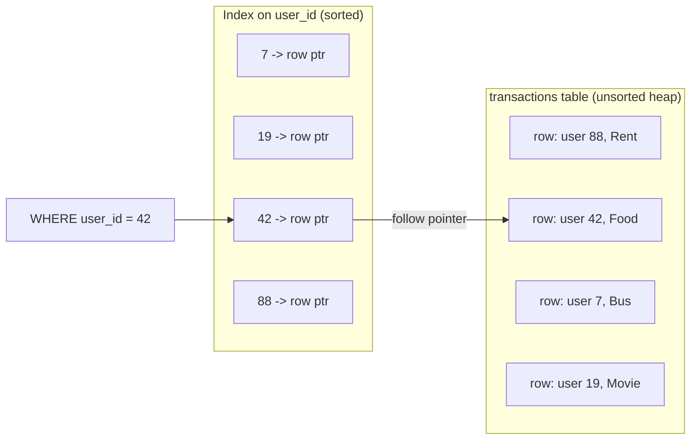
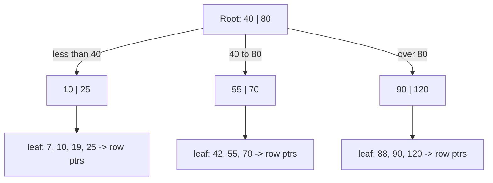

# 10. Database Indexing

> **One-liner:** An index is a small, sorted "lookup" the database keeps on the side so it can jump straight to the rows you asked for instead of scanning the entire table — turning a slow query fast, at the cost of a little storage and slightly slower writes.
> **Where this fits:** In [09-sql-vs-nosql.md](09-sql-vs-nosql.md) you learned that "my query is slow" almost never means "switch databases" — it usually means "add the right index." This chapter is that fix. It's also the reason the later scaling tools work: before you replicate ([11-replication.md](11-replication.md)) or shard ([12-sharding-and-partitioning.md](12-sharding-and-partitioning.md)) a database, you index it. Indexing is the highest-leverage backend skill a frontend dev can learn.

---

## 1. The Idea in Plain Words

Imagine Habex has grown and the `transactions` table holds **5 million rows**. You run:

```sql
SELECT * FROM transactions WHERE user_id = 42;
```

How does the database find user 42's rows? By default it does a **full table scan** — it literally reads *all 5 million rows*, one by one, checking each `user_id`, throwing away the 4,999,950 that don't match. That's like finding every mention of "recursion" in a 900-page textbook by reading every page start to finish. Slow, and it gets slower as the table grows.

An **index** fixes this. An index is a **separate, sorted data structure** the database maintains that maps *a column's values → the location of the matching rows*. Think of the alphabetical **index at the back of a textbook**: "recursion … pages 88, 240, 511." You don't read the book; you look up the word (fast, because it's sorted) and jump straight to those pages.

Create one like this:

```sql
CREATE INDEX idx_txn_user ON transactions (user_id);
```

Now `WHERE user_id = 42` becomes: "binary-search the sorted index for 42, follow the pointers to exactly those rows." Instead of touching 5 million rows, the database touches a handful. A query that took **seconds** now takes **milliseconds**.

Two definitions you'll use constantly:

- **Full table scan** — read every row to answer a query. The thing indexes exist to avoid.
- **Index** — an auxiliary sorted structure that lets the database *find* rows without scanning. It is a **trade**: faster reads, in exchange for extra storage and a bit more work on every write (because the index has to be kept up to date too).

Key mental model: **an index is not your data — it's a shortcut *to* your data.** The rows still live in the table. The index is a signpost.

---

## 2. Picture It (Diagram)

An index sits beside the table. Its entries are **sorted by the indexed column**, and each entry **points** at the full row in the table. The database searches the tidy sorted index, then follows the pointer.



Under the hood, that "sorted list" is actually a **B-tree** (balanced tree) so it stays fast even with millions of entries. Instead of one long list, values are arranged as a shallow tree you walk top-down, making only a few hops:



To find `42`: start at the root, `42` is between `40` and `80` so go to the middle child, land in the leaf, done — **3 hops** instead of 5 million comparisons. That's the whole magic.

---

## 3. Real-World Analogy

Three analogies, because different ones click for different people:

1. **The textbook index.** Want every page about "hooks" in a React book? You don't skim 500 pages — you flip to the index, find "hooks" (fast, it's alphabetical), and jump to the listed pages. The book's *content* is the table; the *back-of-book index* is the database index. Same word, same idea.

2. **A library.** Books on the shelves are stored by call number, not by topic. To find books on "system design" you use the catalog (an index) that maps topic → shelf location. Without it you'd walk every aisle (full table scan).

3. **A phone book.** Sorted by last name, so finding "Ramesh" is a few flips (binary search). But notice: it's useless for "find everyone with phone number ending 4242" — that's *not* the column it's sorted on. **An index only helps the queries that match how it's sorted.** Hold that thought; it's the whole point of composite indexes and the left-most prefix rule below.

---

## 4. Concrete Example

Let's solve a real Habex query end to end.

### The query

The Habex monthly dashboard runs, for the logged-in user:

> "Get this user's transactions for July, sorted by date."

```sql
SELECT amount, spent_on, note
FROM transactions
WHERE user_id = 42
  AND spent_on >= '2026-07-01'
  AND spent_on <  '2026-08-01'
ORDER BY spent_on;
```

### Attempt 1: no index

Full table scan of 5M rows, filter down to user 42, filter to July, then **sort the results** by date. On a big table this is hundreds of milliseconds to seconds — and it runs on *every* dashboard load. Unacceptable.

### Attempt 2: single-column index on user_id

```sql
CREATE INDEX idx_txn_user ON transactions (user_id);
```

Better — we jump to user 42's rows without scanning everyone. But user 42 might have 5 years of history (thousands of rows). The database still has to scan *all* of them to pick out July, and then **still sort by date**. Good, not great.

### Attempt 3: the composite index (the right answer)

A **composite (multi-column) index** is an index sorted by *more than one column, in order* — first by the first column, then by the second within each first value. Exactly like a phone book sorted by (last name, then first name).

```sql
CREATE INDEX idx_txn_user_date ON transactions (user_id, spent_on);
```

Now the entries are ordered like this:

```text
(7,  2026-06-30) -> ptr
(42, 2026-07-01) -> ptr   <-- July for user 42 starts here...
(42, 2026-07-03) -> ptr
(42, 2026-07-05) -> ptr   <-- ...and ends here, contiguously
(42, 2026-08-02) -> ptr
(88, 2026-01-10) -> ptr
```

The database:
1. **Jumps** to `user_id = 42` (first column).
2. Within user 42, the rows are **already sorted by `spent_on`**, so July is one **contiguous range** — grab it in one sweep.
3. Because the range is already in date order, the `ORDER BY spent_on` is **free** — no separate sort step.

One tiny range read, no sort. Milliseconds, forever, no matter how big the table gets. This `(user_id, spent_on)` index is the single most important index in Habex.

### The left-most prefix rule (the gotcha interviewers love)

A composite index on `(user_id, spent_on)` can be used for queries that filter on a **left-most prefix** of its columns — and *only* those:

| Query filter | Uses `(user_id, spent_on)` index? | Why |
|---|---|---|
| `WHERE user_id = 42` | ✅ Yes | uses the left-most column |
| `WHERE user_id = 42 AND spent_on >= '2026-07-01'` | ✅ Yes, fully | uses both, in order |
| `WHERE spent_on >= '2026-07-01'` (no `user_id`) | ❌ No | skips the left-most column — like looking up a phone book by first name only |
| `WHERE user_id = 42 ORDER BY spent_on` | ✅ Yes, sort is free | prefix + already-sorted second column |

**Rule of thumb:** in a composite index, you can use the columns left-to-right with no gaps. `(A, B, C)` helps `A`, `A+B`, and `A+B+C`, but *not* `B` alone or `C` alone. So **column order matters enormously** — put the column you always filter by *first*.

### Reading the plan with EXPLAIN

Every SQL database has an **`EXPLAIN`** command that shows *how* it will run a query — its **query plan**. You don't need to read every field; you need to spot a few keywords:

```sql
EXPLAIN SELECT amount, spent_on FROM transactions
WHERE user_id = 42 AND spent_on >= '2026-07-01';
```

What you're hunting for:

| You see... | Meaning | Verdict |
|---|---|---|
| `Seq Scan` / `Full Table Scan` | reading every row | ❌ bad on a big table — an index is missing or unused |
| `Index Scan` / `Index Range Scan` | using an index to find rows | ✅ good |
| `Index Only Scan` | answered *entirely* from the index, table not touched | ✅✅ best — a covering index (below) |
| a `Sort` step | database is sorting in memory/disk | ⚠️ sometimes removable with a composite index whose order matches your `ORDER BY` |
| `rows=4999950` estimate | how many rows it thinks it'll examine | huge number = trouble |

The one-line interview skill: **"I'd run `EXPLAIN`, and if I see a sequential scan on a large table where I expected an index scan, I know my index is missing or my query isn't using it."**

### Covering index (bonus speed)

A **covering index** is one that contains *every column the query needs*, so the database answers from the index alone and never visits the table — that's the `Index Only Scan` above. If a hot query only needs `amount` and `spent_on` for a user:

```sql
CREATE INDEX idx_txn_cover ON transactions (user_id, spent_on) INCLUDE (amount);
```

Now `SELECT amount ... WHERE user_id=42 AND spent_on...` is served straight from the index. Fastest possible read — reserve it for genuinely hot paths, because the index is now bigger.

---

## 5. Tie-Back to Your Projects

- **The one index Habex must have:** `(user_id, spent_on)` on `transactions`. Every dashboard, every "this month" view, every chart filters by user and slices by date. This composite index makes all of them fast *and* removes the sort. If you add exactly one index to Habex, add this one.
- **Foreign keys aren't auto-indexed (in PostgreSQL).** Your `transactions.category_id` and `transactions.user_id` are foreign keys, but PostgreSQL does **not** create an index on them automatically. Joins and "spend by category" queries will full-scan without it. Add `CREATE INDEX ON transactions (category_id);` — a classic bug that makes people wrongly blame "SQL is slow."
- **Unique constraints are indexes too.** `users.email UNIQUE` from [09-sql-vs-nosql.md](09-sql-vs-nosql.md) is backed by an index automatically — that's *how* the database checks uniqueness fast, and it also makes login-by-email lookups instant. You already had an index and didn't know it.
- **As a React dev, the exact right instinct:** when a Habex API endpoint feels slow, don't reach for a cache or a bigger server first. Open the query, run `EXPLAIN`, and check for a missing index. 9 times out of 10 for a growing app, that's the entire fix — and it's free. Caching ([07-caching.md](07-caching.md)) is what you do *after* you've indexed, not instead of it.
- **Don't over-index Habex.** Indexing every column "just in case" slows down every insert (each new expense must update every index) and wastes storage. Index the columns you actually filter, join, or sort on. For a habit/expense app that's basically `user_id`, `spent_on`, `category_id` — not `note` or `amount`.

---

## 6. Interview Questions (with answer pointers)

**Q1. "What is a database index and what problem does it solve?" (asked everywhere)**
Pointer: A separate sorted structure mapping column values → row locations, so the database can *find* rows without a **full table scan**. Use the back-of-book-index analogy. It turns O(n) scans into roughly O(log n) tree lookups. Trade-off: extra storage + slower writes.

**Q2. "What data structure backs a typical index, and why that one?" (Groww, CRED)**
Pointer: A **B-tree** (specifically B+ tree). It stays **balanced** and shallow, so lookups are a few hops even with millions of rows; crucially it keeps data **sorted**, which makes *range* queries (`BETWEEN`, `>=`, `ORDER BY`) fast, not just exact matches. That's why it's the default over a hash index.

**Q3. "Composite index `(user_id, spent_on)` — will `WHERE spent_on = X` use it?" (Razorpay, Zepto — the classic trap)**
Pointer: No. The **left-most prefix rule**: a composite index only helps queries that use its columns left-to-right with no gaps. Filtering on `spent_on` alone skips the left-most `user_id`, so the index can't be used. You'd need a separate index leading with `spent_on`. Column *order* is a design decision.

**Q4. "Design the index for 'get a user's transactions for a date range, sorted by date.'" (Habex-style system-design question)**
Pointer: `CREATE INDEX ON transactions (user_id, spent_on);`. Explain: jump to the user (equality on first col), read July as one contiguous already-sorted range (range on second col), and the `ORDER BY spent_on` becomes free. Mention a covering index with `INCLUDE (amount)` if it's a very hot read.

**Q5. "What's the downside of indexes? Why not index every column?" (CRED, Swiggy)**
Pointer: (1) **Writes slow down** — every `INSERT`/`UPDATE`/`DELETE` must update every affected index. (2) **Storage** — indexes can rival the table's own size. (3) Unused indexes are pure cost. So index for your *actual* read patterns; a write-heavy table pays for every extra index on every write.

**Q6. "Hash index vs B-tree index — when would you use a hash index?"**
Pointer: A **hash index** maps a key to a bucket via a hash function — O(1) for *exact equality* lookups (`WHERE token = 'abc'`), and often what an in-memory key-value store like Redis uses. But it supports **no range or sort** queries (hashing scatters order) and no prefix matches. B-tree is the general-purpose default *because* it also handles ranges and ordering. Use hash only for pure equality lookups where you never need ranges.

**Q7. "How do you tell if a query is using an index?" (Groww, Razorpay)**
Pointer: Run **`EXPLAIN`** (or `EXPLAIN ANALYZE` for real timings) and read the plan. `Seq Scan` on a big table = trouble (index missing/unused); `Index Scan` = good; `Index Only Scan` = covering index, best. Watch for an unexpected `Sort` step and a huge estimated `rows`.

**Q8. "When should you NOT add an index?"**
Pointer: On tiny tables (scan is already instant); on **low-cardinality** columns like a boolean `is_active` where an index barely narrows anything; on columns you never filter/sort/join by; and on very write-heavy tables where the write cost outweighs a rare read. Also: don't add a *redundant* index — `(user_id)` is already covered by the left-most prefix of `(user_id, spent_on)`.

---

## 7. Trade-offs & "Why Not Just X?"

### The core trade-off, in one table

| Aspect | Without index | With index |
|---|---|---|
| Read matching rows | Full table scan, O(n), slow at scale | Tree lookup, ~O(log n), fast |
| Range / `ORDER BY` | Scan + in-memory sort | Range read, sort often free |
| Writes (`INSERT`/`UPDATE`) | Just write the row | Write the row **+ update each index** |
| Storage | Table only | Table **+ index size** |

**"Why not just add an index on every column?"** Because indexes aren't free lunches — they're a *read optimization paid for by writes and storage*. On a write-heavy table (imagine a payments ledger taking thousands of inserts per second), ten indexes means every insert does eleven writes. You'd be trading your write throughput to speed up reads that may never happen. Index deliberately for measured read patterns.

**"Why not index instead of ever sharding or replicating?"** Indexing fixes *slow queries on one machine*. It does nothing for *too many queries for one machine* (that's read replicas — [11-replication.md](11-replication.md)) or *too much data/write load for one machine* (that's sharding — [12-sharding-and-partitioning.md](12-sharding-and-partitioning.md)). Indexing is step one and buys you enormous runway, but it's not a substitute for the scaling tools — it's the prerequisite that makes them worth doing.

**"Why not just cache the query result instead of indexing?"** Caching ([07-caching.md](07-caching.md)) hides a slow query behind a fast copy, but the query is still slow whenever the cache misses or the data changes, and you've added a *consistency* problem (stale results). Fixing the query with an index removes the slowness at the source. Correct order: index first, then cache the genuinely expensive stuff.

**"Why does column order in a composite index matter so much?"** Because the index is sorted *by that order*, exactly like a phone book sorted by (last, first). It's brilliant for looking up by last name, useless for first name alone. Put the column you filter by in *every* query (here, `user_id`) first, and the column you range/sort on (`spent_on`) second. Get the order wrong and the index quietly won't be used.

### When NOT to index — quick checklist

- Table is small → scan is already instant.
- Column has very few distinct values (`is_active` boolean) → index barely helps.
- Column is never in a `WHERE` / `JOIN` / `ORDER BY`.
- Table is extremely write-heavy and the read is rare.
- The index would be **redundant** with an existing composite's left-most prefix.

---

## 8. TL;DR

- An **index** is a separate **sorted** structure (usually a **B-tree**) mapping column values → row locations, so the database avoids a **full table scan**. Book-index analogy.
- **Primary** index = on the primary key (identifies a row). **Secondary** index = on any other column you query. **Composite** index = on multiple columns, in a specific order.
- **Left-most prefix rule:** a composite `(A, B, C)` index helps `A`, `A+B`, `A+B+C` — never `B` or `C` alone. So **column order is a real design choice**.
- A **covering index** answers the query from the index alone (`Index Only Scan`) — fastest reads, bigger index.
- Cost of indexes: **slower writes** (every write updates every index) and **storage**. Don't index everything; don't index tiny/low-cardinality/never-queried columns.
- **Hash index** = O(1) exact-match only, no ranges; **B-tree** = general-purpose, handles ranges and sorting — the default.
- Read query plans with **`EXPLAIN`**: hunt for `Seq Scan` (bad on big tables) vs `Index Scan` (good).
- **Habex:** the must-have index is `(user_id, spent_on)` on `transactions` — it powers every dashboard *and* makes the sort free. Also index your foreign keys.

Next: one machine can only serve so many reads and can still die — copy the database onto more machines with **replication** → [11-replication.md](11-replication.md).
