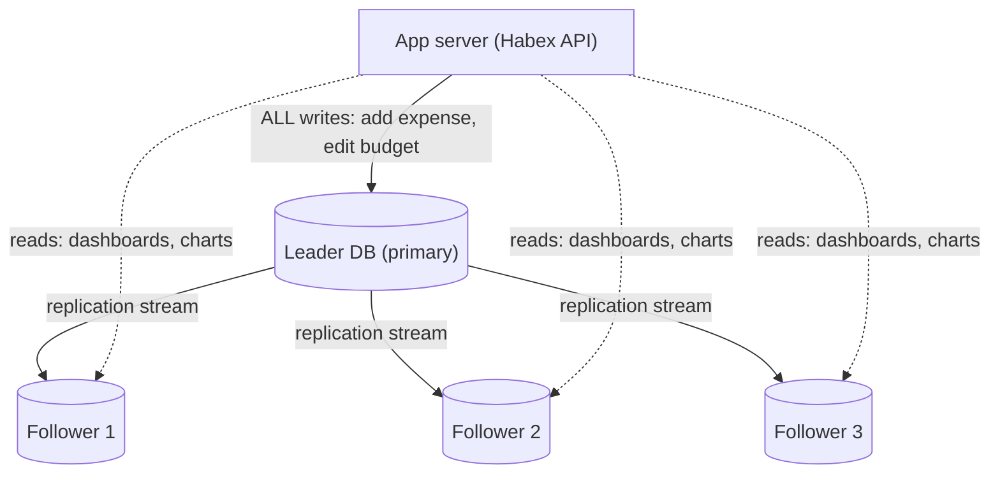
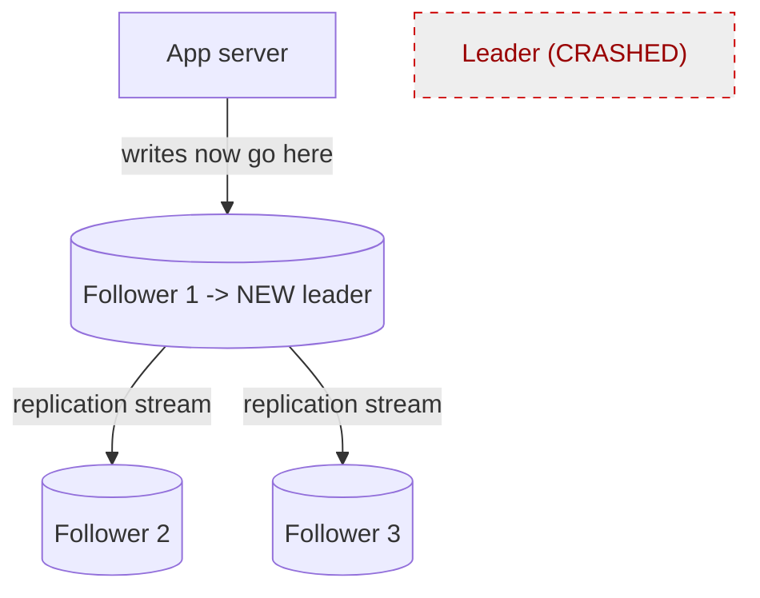

# 11. Replication

> **One-liner:** Replication means keeping live copies of your database on multiple machines so you can survive one dying, spread reads across many servers, and never lose data — at the price of a new problem called *replication lag*.
> **Where this fits:** In [10-database-indexing.md](10-database-indexing.md) you made a *single* database fast. But one machine has two hard limits: it can only handle so many reads per second, and if it dies your whole app is down. Replication is how you get past *both*. It's also your first real taste of a **distributed system**, which is exactly why it leads straight into the CAP theorem ([13-cap-theorem.md](13-cap-theorem.md)) and consistency ([14-acid-vs-base-and-consistency.md](14-acid-vs-base-and-consistency.md)). Sharding ([12-sharding-and-partitioning.md](12-sharding-and-partitioning.md)) is the *next* step, and it usually assumes you've already replicated.

---

## 1. The Idea in Plain Words

Right now Habex has **one** database. Two things keep a backend engineer up at night about that:

1. **It's a single point of failure.** If that one machine's disk dies or it reboots, Habex is *completely down* and — worse — you might have *lost* data.
2. **It's a single point of load.** Every login, every dashboard, every chart hits that one box. Reads pile up until it can't keep up.

**Replication** solves both by keeping **multiple synchronized copies** of the database on different machines. Let me define the words you'll hear in every interview:

- **Replica** — a full copy of the database running on another machine, kept up to date automatically.
- **Leader** (a.k.a. **primary**, **master**) — the *one* copy that accepts **writes** (inserts, updates, deletes). There is exactly one leader at a time in the standard setup.
- **Follower** (a.k.a. **replica**, **secondary**, **standby**) — a read-only copy. It receives a stream of changes from the leader and applies them so it stays current. It answers **reads**.

The default pattern is **leader-follower** (also called *primary-replica* or *single-leader*) replication:

- **All writes go to the leader.**
- The leader records every change and **streams it** to every follower.
- Followers apply those changes and can **serve reads**.

That one design buys you three huge things:

- **High availability (HA):** if the leader dies, you promote a follower to be the new leader and keep running. (Definition: *availability* = the system stays up and responds.)
- **Read scaling:** you have, say, 1 leader + 4 followers. Send all reads to the followers and you've roughly **5×'d your read capacity** without changing a line of app logic.
- **Durability:** the data exists on multiple disks in multiple machines. One disk failure no longer loses it. (Definition: *durability* = once saved, it survives crashes.)

The catch — and it's *the* catch, section 4 is all about it — is that copying takes time. For a brief moment a follower can be **behind** the leader. That gap is **replication lag**, and it creates surprising bugs if you don't design for it.

---

## 2. Picture It (Diagram)

Writes flow to the **one leader**; the leader streams changes to the **followers**; reads fan out across the followers.

Solid arrows = writes (only to the leader). Dotted arrows = reads (spread across followers). The leader-to-follower arrows are the **replication stream** — a continuous feed of "here's what just changed." Picture the followers always a fraction of a second behind, chasing the leader.

Here's the failover moment — the leader dies and Follower 1 is promoted:

---

## 3. Real-World Analogy

**A head chef and line cooks.** The **head chef (leader)** is the only one allowed to change the official recipe — they own the master recipe card. Whenever they tweak it, they call out the change and the **line cooks (followers)** scribble it onto their own copies. Now dozens of diners can ask any line cook "what's in the pasta?" and get an answer — you've scaled *answering questions* (reads) across the whole kitchen. But only the head chef *changes* recipes (writes), so there's never a conflict about what the real recipe is.

Two things fall out of the analogy naturally:

- **Replication lag:** the instant after the head chef changes a recipe, a line cook across the kitchen hasn't heard yet. Ask *that* cook right then and you get the *old* answer. They'll be right in a second — but right now, they're behind.
- **Failover:** if the head chef walks out mid-service, the kitchen doesn't shut down — the sous-chef with the most up-to-date card is **promoted** to head chef, and service continues.

**A newspaper** is the other classic analogy: the newsroom (leader) writes the story once; printing presses (followers) run off millions of identical copies for readers. One writer, many readers — that's read scaling.

---

## 4. Concrete Example

### Read scaling in Habex

Habex dashboards are **read-heavy**: a user opens the app and you fire off "spend this month," "spend by category," "budget progress," "recurring upcoming" — many reads, few writes (an occasional "add expense"). Perfect shape for replication.

- **Writes** ("add expense", "edit budget") → **leader**.
- **Reads** (every dashboard query) → **followers**.

Add followers and read capacity grows almost linearly. Your React app doesn't change at all — the *routing* of reads-to-followers happens in your backend/data layer. This is the single most common production database topology on earth, and it's the right first scaling move for Habex long before you ever consider sharding.

### Synchronous vs asynchronous: the durability/latency trade

When the leader gets a write, *when* does it tell the user "saved"? Two choices:

- **Synchronous replication:** the leader waits until at least one follower confirms it also stored the change, *then* replies "saved." Safer (the data provably exists in 2 places), but **slower** — the user waits for the network round-trip to the follower, and if that follower is slow or down, the write stalls.
- **Asynchronous replication:** the leader stores the change locally, immediately replies "saved," and streams to followers *in the background*. **Fast**, but if the leader dies in the split-second before a follower caught up, that last write can be **lost**.

| | Synchronous | Asynchronous |
|---|---|---|
| Leader replies after... | a follower confirms | writing locally (doesn't wait) |
| Write latency | Higher | Lower |
| Data loss on leader crash | None (it's on 2+ machines) | Possible (last un-replicated writes) |
| Replication lag | ~None for the synced follower | Present |
| If a follower is slow/down | Writes can **stall** | Writes unaffected |
| Common use | Financial/critical writes | Most web apps (the default) |

Most real systems use a pragmatic middle ground: **semi-synchronous** — one follower synchronous (so at least one guaranteed up-to-date copy), the rest asynchronous (so you keep speed and don't stall if one lags). This is the sensible default answer in interviews.

### How the change actually travels (replication methods)

When the leader tells followers "here's what changed," *what* does it send? Three approaches, and the difference matters in interviews:

| Method | What the leader ships | Gotcha |
|---|---|---|
| **Statement-based** | The literal SQL, e.g. `UPDATE ... SET amount = amount * 1.1` | Breaks with non-deterministic bits — `NOW()`, `RANDOM()`, auto-increment can produce *different* results on each follower |
| **Write-ahead log (WAL) / physical** | The low-level byte-level changes to the storage pages | Tightly coupled to the exact storage engine/version; hard to replicate across versions |
| **Logical (row-based)** | The *resulting row changes* ("row 42's amount became 275") in a storage-independent format | The sweet spot most modern setups use — deterministic *and* version-flexible |

PostgreSQL streams the **WAL** (its write-ahead log — the same append-only log that gives it durability) to followers, and also offers **logical replication** for row-level, cross-version streaming. You don't need the internals memorized, but knowing "PostgreSQL replicates by shipping its WAL" is a strong, concrete detail to drop.

### Replication lag & the "read-your-own-writes" bug — with Habex

This is *the* replication interview scenario, and it maps perfectly onto Habex. With **asynchronous** replication:

1. Santhosh taps **"Add expense: ₹250, Food"**. The write goes to the **leader**. Leader says "saved". ✅
2. The UI instantly navigates back to the dashboard, which fires a **read**.
3. That read is load-balanced to **Follower 2**, which is **200 ms behind** and *hasn't received the new expense yet*.
4. The dashboard renders **without the ₹250 expense**. Santhosh just added it — and it's gone!
5. He refreshes 1 second later; by now the follower caught up; the expense appears. 😤 "Buggy app."

Nothing is broken — this is **replication lag** producing a violation of **read-your-own-writes consistency**: the guarantee that a user always sees *their own* just-made change. Fixes you should be able to name:

| Fix | How it works | Cost |
|---|---|---|
| **Read-your-writes routing** | For a short window after a user writes, route *that user's* reads to the **leader** | Slightly more load on leader |
| **Read from leader for critical reads** | Just-after-write screens read the leader | Less read scaling on those paths |
| **Optimistic UI update** | Frontend adds the ₹250 to the list locally without re-fetching (you already know it — you just sent it) | Must reconcile if the write actually failed |
| **Sticky / monotonic reads** | Pin a user's session to one replica so they never jump to an *older* one | Uneven load |

As a React dev, the **optimistic UI** fix should feel natural — it's the same instinct as updating local state before the server confirms. That frontend habit is literally a distributed-systems consistency technique. Name-drop that in an interview and you sound senior.

### Failover: promoting a replica

If the leader crashes, you need a new leader. **Failover** = detect the leader is dead, **promote** a follower to leader, and redirect writes to it. Steps and the sharp edges:

1. **Detect** the leader is gone (health checks / heartbeats time out).
2. **Choose** the most up-to-date follower (least replication lag — the least data loss).
3. **Promote** it to leader; point the app's writes at it (often via reconfiguring or a virtual IP / DNS / proxy).
4. Old followers now follow the new leader; when the dead one returns it re-joins as a follower.

Two dangers to mention:
- **Lost writes:** with async replication, writes that hadn't replicated before the crash are gone.
- **Split-brain:** if the old leader comes back *thinking it's still leader* while a new one exists, you get **two leaders** accepting conflicting writes — data corruption. Real systems prevent this with fencing/quorum so only one leader can be active. Managed databases (e.g., Amazon RDS, Cloud SQL) automate this whole dance for you.

### Beyond single-leader (high level)

- **Multi-leader:** *more than one* leader, each accepting writes (e.g., one per region so writes are fast everywhere). Problem: two leaders can edit the same row at once → **write conflicts** you must resolve (last-write-wins, merge rules, CRDTs). Useful for multi-region or offline-capable apps; complex.
- **Leaderless (quorum):** *no* fixed leader — the client (or a coordinator) writes to *several* nodes and reads from *several* nodes. Correctness comes from a **quorum**: with `N` replicas, require `W` nodes to confirm a write and `R` nodes to answer a read, and if **R + W > N**, any read is guaranteed to overlap with the latest write on at least one node. Example: `N=3, W=2, R=2` → `2+2 > 3` ✅. This is how **Amazon DynamoDB** and **Cassandra** work, and it lets you *tune* the consistency/availability trade per query. This is a direct bridge to [13-cap-theorem.md](13-cap-theorem.md).

### How reads actually get routed (the practical bit)

"Send reads to followers, writes to the leader" — but *where* does that decision live? As a full-stack dev, you'll meet one of these three:

| Where routing lives | How it works | Trade-off |
|---|---|---|
| **In your app code** | Your data layer holds two connection pools and picks: writes → leader, reads → followers | Full control; you hand-code the read-your-writes exceptions |
| **A proxy in the middle** | A router like **ProxySQL** or **PgBouncer**-plus-routing inspects each query and sends it to the right place | App talks to one address; the proxy does the splitting |
| **Managed reader endpoint** | Amazon RDS/Aurora exposes a single **reader endpoint** that load-balances across all replicas | Least effort — point read traffic at that hostname |

The interview insight: routing is a **deliberate layer**, not magic. The "route this user's just-written reads to the leader for a few seconds" fix from the lag section is implemented *right here* — a flag your code flips after a write. Knowing *where* the read/write split lives is what separates people who've read about replication from people who've wired it up.

---

## 5. Tie-Back to Your Projects

- **Habex is a textbook read-replica candidate.** Read-heavy dashboards, occasional writes. When one PostgreSQL box starts straining, your first move is **not** sharding — it's **add read replicas** and route dashboard reads to them, writes to the leader. Simple, huge win, no app rewrite.
- **You'll hit the lag bug for real.** The moment you split reads to a replica, "add expense → dashboard doesn't show it" *will* happen. You already know the fix menu: optimistic UI (most natural for you), or route just-added-user reads to the leader briefly. Design for it *before* a user files the bug.
- **Managed replication is the sane path.** Don't hand-roll failover for Habex. Use a managed Postgres (Amazon RDS / Google Cloud SQL / Neon / Supabase) — you flip a switch for a read replica and automated failover, and skip split-brain nightmares. Knowing what it does under the hood (this chapter) is what interviews test; operating it is a checkbox.
- **santhu.site needs none of this.** A mostly-static portfolio ([09-sql-vs-nosql.md](09-sql-vs-nosql.md) noted it may have no DB at all) has nothing to replicate. Its "replication" is really your **CDN** ([08-cdn.md](08-cdn.md)) copying static files to edge locations — a different mechanism for a different job. Don't confuse the two in an interview.
- **CRED/Razorpay lens:** for money, you'd lean toward **synchronous (or semi-sync)** replication so a confirmed payment provably exists on more than one machine — durability over raw latency. For Habex's expenses, async is fine. Being able to pick per-workload is the senior signal.

---

## 6. Interview Questions (with answer pointers)

**Q1. "What is replication and why do it?" (asked everywhere)**
Pointer: Keep synchronized copies of the DB on multiple machines for three reasons: **high availability** (survive a node dying via failover), **read scaling** (followers serve reads), and **durability** (data on multiple disks). Name the leader-follower model: writes→leader, reads→followers.

**Q2. "Synchronous vs asynchronous replication — trade-off?" (Razorpay, CRED, Groww)**
Pointer: Sync = leader waits for a follower to confirm before acking → no data loss on crash, but higher latency and writes stall if a follower is slow. Async = ack immediately, replicate in background → fast, but can lose the last un-replicated writes if the leader dies. Mention **semi-synchronous** as the practical default, and pick sync-leaning for financial writes.

**Q3. "A user adds data but doesn't see it on the next screen. What's happening and how do you fix it?" (very common, Zepto/Swiggy/CRED)**
Pointer: **Replication lag** breaking **read-your-own-writes** — the read hit a follower that hadn't received the write yet. Fixes: route that user's post-write reads to the leader for a short window, sticky/monotonic reads, or **optimistic UI** on the frontend. This is the Habex "add expense" story.

**Q4. "How does replication scale reads but not writes?" (Groww, Zepto)**
Pointer: All followers can serve **reads**, so read throughput scales with the number of replicas. But every follower must apply **every** write (they're full copies), so adding replicas does **not** increase write capacity — writes are still bottlenecked on the single leader. Scaling *writes* is what **sharding** ([12-sharding-and-partitioning.md](12-sharding-and-partitioning.md)) is for.

**Q5. "Walk me through failover. What can go wrong?" (CRED, Razorpay)**
Pointer: Detect leader death → pick the most up-to-date follower → promote it → redirect writes. Risks: **lost writes** (un-replicated async writes) and **split-brain** (two leaders accepting conflicting writes if the old one returns). Prevent split-brain with fencing/quorum; managed DBs automate failover.

**Q6. "Explain R + W > N." (Groww, CRED — quorum question)**
Pointer: In leaderless replication with `N` replicas, require `W` acks per write and `R` responses per read. If `R + W > N`, the read set and the latest write set must **overlap** on at least one node, so a read sees the newest value. Example `N=3, W=2, R=2`. Tuning `W`/`R` trades consistency vs availability/latency — DynamoDB/Cassandra style.

**Q7. "Single-leader vs multi-leader — when multi-leader?"**
Pointer: Single-leader (one writer) is simplest and avoids write conflicts — the default. Multi-leader (a writer per region, or offline clients) gives low-latency local writes and offline support, but introduces **write conflicts** you must resolve (last-write-wins/merge/CRDT). Choose it for multi-region or offline-first, accept the conflict complexity.

**Q8. "How does replication relate to CAP?" (Groww, senior round)**
Pointer: Replication makes the system **distributed**, so a **network partition** between leader and followers is inevitable eventually. Then you must choose: keep serving reads from a possibly-stale follower (**availability**, but not strongly consistent) or refuse until it's caught up (**consistency**, but not available). That's the CAP trade — see [13-cap-theorem.md](13-cap-theorem.md). Async replication is a lean toward availability/eventual consistency.

---

## 7. Trade-offs & "Why Not Just X?"

### The trade-offs at a glance

| Benefit replication gives | New problem it creates |
|---|---|
| Read scaling (followers serve reads) | Replication **lag** → stale reads, read-your-writes bugs |
| High availability via failover | Failover is tricky: **lost writes**, **split-brain** risk |
| Durability (copies on many disks) | Sync replication adds **write latency**; async risks losing last writes |
| No app rewrite to add read capacity | Doesn't help **write** capacity at all — leader is still the write bottleneck |

**"Why not just make the one server bigger (vertical scaling)?"** You can, up to a point ([06-scaling-vertical-vs-horizontal.md](06-scaling-vertical-vs-horizontal.md)) — but a bigger box is *still one box*: still a single point of failure, and it can't exceed the biggest machine money can rent. Replication gives you **redundancy** (survive failure) that vertical scaling fundamentally can't. You usually do both.

**"Why not just make every write synchronous so I never lose data?"** Because then every write waits on a network round-trip to a follower, and — worse — if that follower is slow or down, your **writes stall entirely**. You'd trade availability and latency for durability. Semi-synchronous (one sync follower, rest async) is the balance most systems actually choose.

**"Why not just add more replicas to handle write load too?"** Replicas scale **reads**, not **writes** — every replica must replay every write, so adding them doesn't reduce write load on the leader; it can even add replication overhead. When *writes* are your bottleneck, replication is the wrong tool — you need **sharding** to split the write load across multiple leaders → [12-sharding-and-partitioning.md](12-sharding-and-partitioning.md).

**"Why not just let followers take writes too (multi-leader) by default?"** Because two leaders can modify the same row simultaneously, and now you own **conflict resolution** — genuinely hard (whose edit wins? how do you merge?). Single-leader sidesteps the entire problem by having exactly one source of truth. Only take on multi-leader when multi-region latency or offline support truly demands it.

**"Isn't replication the same as backups?"** No — a common trap. A replica applies changes *live*, including your mistakes: `DELETE FROM transactions;` replicates to every follower **instantly**, wiping them all. A **backup** is a point-in-time snapshot you can restore *from the past*. Replication protects against **hardware failure**; backups protect against **human error and corruption**. You need **both**.

---

## 8. TL;DR

- **Replication** = keep live, synchronized copies of the database on multiple machines. Wins: **high availability**, **read scaling**, **durability**.
- **Leader-follower** (primary-replica): **writes → the one leader**, which **streams changes** to **followers** that serve **reads**. The most common topology in production.
- **Sync** replication = wait for a follower to confirm → safe but slow / can stall. **Async** = ack immediately, replicate in background → fast but can lose the last writes on a crash. **Semi-sync** is the practical middle.
- **Replication lag** = followers briefly trail the leader → the **read-your-own-writes** bug (add expense, don't see it). Fix with leader-routing for fresh reads, sticky reads, or **optimistic UI** (your React instinct).
- **Failover** = promote a follower when the leader dies. Watch for **lost writes** and **split-brain**; let managed DBs automate it.
- Replication scales **reads, not writes** — the leader is still the single write bottleneck. **Multi-leader** and **leaderless quorum (R + W > N)** relax that at the cost of conflict/consistency complexity.
- **Habex:** add **read replicas** for dashboard reads *before* you ever shard; use managed Postgres; design for lag with optimistic UI. Replication ≠ backups — keep both.

Next: when the *write* load or the sheer *data size* outgrows one leader, you split the data itself across machines — **sharding & partitioning** → [12-sharding-and-partitioning.md](12-sharding-and-partitioning.md).
