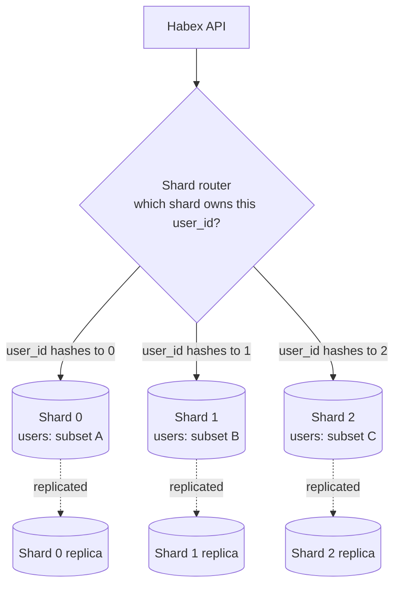

# 12. Sharding and Partitioning

> **One-liner:** Sharding splits one huge database into many smaller independent databases — each holding a *slice* of the data — so that write load and data size can grow beyond a single machine, at the cost of much harder queries and a shard key you'd better choose wisely.
> **Where this fits:** [10-database-indexing.md](10-database-indexing.md) made a single database *fast*; [11-replication.md](11-replication.md) made *copies* of it for read scaling and availability. But replication has one wall: **every copy still holds all the data and every write still hits the one leader.** When the data itself is too big for one machine, or writes outgrow one leader, you must **split the data** — that's sharding. It's the heaviest scaling hammer, it directly involves CAP ([13-cap-theorem.md](13-cap-theorem.md)), and the golden rule is: **don't do it until you truly must.**

---

## 1. The Idea in Plain Words

Replication copies the *whole* database to more machines. That's great until:

- The data no longer **fits** on one machine's disk, or
- **Writes** are too many for one leader to handle (remember: replicas scale reads, not writes — [11-replication.md](11-replication.md)).

The fix is to stop copying the whole thing and instead **split it into pieces**, putting each piece on its own machine. Definitions first, because interviewers police this vocabulary:

- **Partitioning** — the general idea of splitting a table/dataset into smaller parts. An umbrella term.
- **Sharding** — partitioning **across separate machines/servers**, where each part (a **shard**) is its own independent database. Every shard is often *also* replicated for HA. So: *sharding = horizontal partitioning spread across machines.*
- **Shard** — one of those independent pieces, holding a *subset* of the rows (e.g., "users A–H live here").
- **Shard key** (a.k.a. partition key) — the column whose value decides *which shard* a row goes to (e.g., `user_id`). This single choice makes or breaks the whole design.

Two directions you can split a table:

- **Vertical partitioning** — split by **columns**. Put frequently-used columns in one table/store and rarely-used or bulky ones in another. Example: keep `users(id, email, name)` hot and move a giant `users.profile_bio` or `users.avatar_blob` to a separate table. You're slicing the table *top-to-bottom*.
- **Horizontal partitioning** — split by **rows**. Same columns everywhere, but *different rows* live in different places: users 1–1M here, 1M–2M there. You're slicing *side-to-side*. **This is what "sharding" almost always means.**

The whole chapter, in one sentence: **sharding lets you scale writes and storage past one machine by splitting rows across shards — but it shatters the convenience of having all your data in one place** (joins, transactions, and "just query it" all get harder). So you delay it as long as humanly possible.

---

## 2. Picture It (Diagram)

**Horizontal sharding by user_id.** A router sends each query to the shard that owns that user's rows. Each shard is a full, independent database (and each is usually replicated internally).



**Vertical vs horizontal**, side by side, on one `users` table:

```text
        VERTICAL (split columns)                 HORIZONTAL (split rows = sharding)

  users_core        users_bulk               shard A            shard B
  ------------      ---------------          ------------       ------------
  id  email name    id  bio  avatar          id email name      id email name
  1   ...   ...     1   ...  ...              1  ...   ...       500001 ...  ...
  2   ...   ...     2   ...  ...              2  ...   ...       500002 ...  ...
  (hot, small)      (cold, large)            (users 1..500k)    (users 500k+)
```

**Consistent-hashing ring** (section 4 explains it). Nodes and keys are placed around a circle; a key belongs to the *next node clockwise*:

```text
                 0 / 360 deg
                     |
        keyX  •    [Node A]
                 /          \
      [Node C]  •            •  key42  -> belongs to Node B (next clockwise)
               \            /
                 [Node B] •
                     |
              key88 -> Node C

  Add Node D between A and B  ->  only keys in that arc move to D.
  Everything else stays put.  (Naive modulo would reshuffle ALMOST EVERYTHING.)
```

---

## 3. Real-World Analogy

**A library that outgrew one building.** A single library (one database) works until there are too many books to fit and too many people checking books in and out at the front desk (writes). You don't fix it by photocopying the entire library into a second building (that's replication — copies, same congestion at each desk). You fix it by opening **branches**, each holding a *different* slice of the collection: the Central branch keeps A–H authors, North keeps I–P, South keeps Q–Z (**range sharding**). Now each branch's desk handles only its own patrons — you've split the *load* and the *storage*.

But look at what you gave up. "Find every book by authors whose name contains 'kumar'" now means **calling all three branches and merging the answers** (a cross-shard query). "Move a book from A–H to Q–Z" spans two branches (a cross-shard transaction). And if everyone suddenly wants the one branch holding a viral bestseller, that branch is mobbed while the others sit idle (a **hotspot**). Every pain of sharding is visible in the branch library — and so is the reason you only build branches when one building genuinely can't cope.

**The shard key = how you decide which branch a book goes to.** Split by first letter of author (range), by a hash of the ISBN (hash), or by which city it's about (geo). Pick badly and one branch overflows while others stay empty.

---

## 4. Concrete Example

### Sharding strategies

Given a shard key, *how* do you map a key to a shard? Three classic strategies:

| Strategy | How it maps key → shard | Pros | Cons |
|---|---|---|---|
| **Range-based** | Contiguous ranges: users A–H → shard 0, I–P → shard 1, Q–Z → shard 2 | Range scans are easy ("all users M–N" = one shard); simple to reason about | **Hotspots**: uneven ranges overload one shard (everyone signs up in the "S" range, or newest IDs all land on the last shard) |
| **Hash-based** | Compute `hash(key)` and map to a shard | **Even distribution** — spreads load smoothly, avoids hotspots | Range queries are impossible (adjacent keys scatter everywhere); adding/removing shards reshuffles data (unless consistent hashing) |
| **Directory / lookup** | A lookup service stores an explicit "key → shard" map | Total flexibility; can move individual keys, rebalance freely | The directory is an extra hop and a **single point of failure**/bottleneck to run and scale |
| **Geo-based** | Shard by region: India users → Mumbai shard, EU users → Frankfurt shard | Low latency (data near users); helps **data-residency** laws | Uneven if one region dominates; cross-region queries costly |

Most large systems use **hash-based** (often via **consistent hashing**, below) because even load distribution is the thing you want most.

### Choosing a good shard key

The shard key decides everything. A good one:

1. **Has high cardinality** (many distinct values) so data spreads out. `user_id` = great; `country` = only ~200 values, terrible.
2. **Distributes load evenly** — no single value is astronomically more active than others.
3. **Matches your most common access pattern**, so your hot queries hit **one** shard, not all of them.

For most user-facing apps, **`user_id` is the canonical shard key**: it's high-cardinality, and almost every query is naturally scoped to one user ("*this user's* transactions"), so those queries land on a single shard. Bad shard keys: a boolean, a status enum, `created_date` (all *new* writes stampede the newest shard — a moving hotspot), or `country`.

### The hotspot / celebrity problem

Even a decent shard key can create a **hotspot** — one shard doing disproportionate work:

- **Instagram celebrity:** shard the `posts`/`followers` data by `user_id`, and a celebrity with 400M followers puts an enormous, lopsided load on *their* shard while others idle. This is literally called the **celebrity problem** (or "hot key").
- **Payments ledger:** shard by `merchant_id`, and one mega-merchant (say, a giant food-delivery app during dinner rush) hammers a single shard.

Mitigations to name: **further-split** the hot key (sub-shard the celebrity's data), **replicate** the hot key's data across more read replicas, **cache** it hard ([07-caching.md](07-caching.md)), or pick a compound key that spreads the hot entity's rows.

### Consistent hashing (the star concept), explained simply

**The problem with naive hashing.** Say you have 3 shards and route with `shard = hash(user_id) % 3`. Clean and even — until you add a 4th shard. Now the formula is `% 4`, and *almost every* key maps to a different shard than before. You'd have to **move nearly all your data** on a single node addition. Catastrophic — huge downtime, huge data movement.

**The fix: consistent hashing.** Imagine a **ring** numbered 0 to 360 (conceptually a big hash space wrapped into a circle):

1. **Place each shard** at a point on the ring (by hashing the shard's name).
2. **Place each key** on the ring (by hashing the key).
3. A key belongs to the **first shard clockwise** from it.

Now the payoff: when you **add a shard**, it drops onto one arc of the ring and only steals the keys in *that one arc* from its clockwise neighbor. **Every other key stays exactly where it was.** Removing a shard is the mirror image — only *its* keys move, to the next shard clockwise. Instead of "reshuffle everything," you move roughly **1/N of the data**.

| | Naive `hash % N` | Consistent hashing |
|---|---|---|
| Add/remove a node | ~**all** keys remap → massive data movement | ~**1/N** of keys move; rest untouched |
| Load spread | Even *while N is fixed* | Even, especially with **virtual nodes** |
| Used by | simple fixed-size setups | **Cassandra, DynamoDB, Redis Cluster**, CDNs, load balancers |

One refinement to mention: **virtual nodes** — each physical shard is placed at *many* points on the ring, not one, which smooths out the load and makes rebalancing even more even. That's the detail that signals you actually understand it.

### The pain: cross-shard queries, joins, and re-sharding

Sharding's bill comes due at read time:

- **Cross-shard query (scatter-gather):** "top 10 spenders across *all* users" must query **every** shard and merge results in your app. Slow, complex, and as slow as the slowest shard.
- **Cross-shard join:** joining rows that live on *different* shards is something a single database did for free — now it's manual application code, or you avoid it by **denormalizing** ([09-sql-vs-nosql.md](09-sql-vs-nosql.md)).
- **Cross-shard transaction:** an atomic operation touching two shards (money from a user on shard 0 to a user on shard 3) loses easy ACID; you need distributed-transaction machinery (two-phase commit / sagas) — genuinely hard.
- **Re-sharding:** adding shards means *moving live data* while serving traffic — risky and operationally heavy. Consistent hashing makes it *far* less bad, but it's never free.
- **Unique IDs:** auto-increment `id` per shard collides across shards; you need global ID schemes (UUIDs, Snowflake-style IDs).

This is exactly why the strong advice is: **shard late, and choose a key that keeps your hottest queries single-shard.**

### A pro trick: many logical shards, few physical machines

Re-sharding hurts because moving data between machines while serving traffic is risky. A widely-used trick softens it: **decouple *logical* shards from *physical* machines.** Up front, split your data into a large fixed number of **logical shards** — say **1024** buckets via `hash(user_id) % 1024`. That number *never changes*. Then map many logical shards onto each physical machine:

```text
  1024 logical shards (fixed forever)        mapped onto physical machines
  ---------------------------------          -----------------------------
  shards 0..341    ---------------------->   Machine A
  shards 342..682  ---------------------->   Machine B
  shards 683..1023 ---------------------->   Machine C

  Add Machine D?  Just MOVE some whole logical shards onto it:
  shards 900..1023 --------------------->    Machine D   (only those buckets move)
```

Growing the cluster is now "reassign some **whole logical shards** to the new machine," never "recompute every row's home." You get the smooth-growth benefit (like consistent hashing) with dead-simple bookkeeping. This is roughly how systems like **Vitess** and many production setups actually operate — a great detail to mention when an interviewer probes "okay, but how do you *add* a shard without downtime?"

### Instagram / payments example, and Habex

- **Instagram:** shard by `user_id`. A user's own photos, profile, and feed metadata live together on one shard, so loading a profile hits one shard. The celebrity problem is the known tax you engineer around.
- **Payments ledger (Razorpay/CRED-style):** you might shard by `user_id` or `merchant_id`. Cross-shard **transactions** are the crux — moving money between users on different shards needs careful distributed-transaction design, which is why ledgers stay on beefy single-leader relational setups for a long time before sharding.
- **Habex:** the natural shard key is `user_id`, because *every* Habex query is already "for this one user." That means if you ever sharded, almost all queries stay single-shard — ideal. **But Habex should shard much later, if ever.** A personal habit/expense tracker's data is tiny per user and modest in total; indexing ([10-database-indexing.md](10-database-indexing.md)) + read replicas ([11-replication.md](11-replication.md)) will carry it to a *very* large user base first. Sharding Habex early would add enormous complexity to solve a problem it doesn't have.

---

## 5. Tie-Back to Your Projects

- **Habex: know the shard key, don't build the shards.** The correct interview answer is *"I'd shard by `user_id` because all Habex queries are user-scoped, but I wouldn't shard until indexing and read replicas were exhausted — probably never for a habit tracker."* That sentence shows you understand *both* the mechanism and the discipline to not over-engineer.
- **Your realistic scaling ladder for Habex** (memorize this order): 1) add **indexes** ([10-database-indexing.md](10-database-indexing.md)); 2) add **caching** ([07-caching.md](07-caching.md)); 3) add **read replicas** ([11-replication.md](11-replication.md)); 4) **vertical partitioning** (split a bulky column out) if needed; 5) **shard** — last, and only under real write/size pressure. Reciting this ladder is worth more than any sharding trivia.
- **Vertical partitioning is the one you might actually use.** If Habex stores something heavy (say, exported report blobs or attached receipts), moving that bulky column into its own table/object store while keeping `transactions` lean is a light, sensible optimization — no full sharding required. It keeps your hot table small so indexes and caches stay effective.
- **santhu.site: not even a conversation.** A static portfolio has no data to shard. Its scaling is a **CDN** ([08-cdn.md](08-cdn.md)), which *distributes copies of files* geographically — superficially "spreading data around" but a totally different mechanism (copies of static assets, not partitions of a write database). Don't conflate them.
- **The senior signal in interviews is restraint.** Frontend-heavy candidates sometimes over-reach to sound backend-savvy ("we'll shard for scale!"). The stronger move is: *"Sharding is the last resort because it breaks joins, cross-shard transactions, and easy re-balancing. For Habex I'd index, cache, and replicate first, and I'd only shard by `user_id` under proven load."* Restraint reads as seniority.

---

## 6. Interview Questions (with answer pointers)

**Q1. "Partitioning vs sharding — what's the difference?" (asked everywhere)**
Pointer: Partitioning = the general idea of splitting a dataset into smaller parts (can be within one machine). Sharding = **horizontal** partitioning spread **across separate machines**, each shard an independent database. All sharding is partitioning; not all partitioning is sharding.

**Q2. "Vertical vs horizontal partitioning?" (Groww, Zepto)**
Pointer: Vertical = split by **columns** (hot columns in one table, bulky/cold in another). Horizontal = split by **rows** (same columns, different rows on different shards) — this is what "sharding" means. Give the `users` example: split `bio`/`avatar` off (vertical) vs users 1–1M / 1M–2M (horizontal).

**Q3. "How would you choose a shard key?" (CRED, Razorpay, Swiggy)**
Pointer: High **cardinality** (spreads data), even **load distribution** (no dominant value), and **matches the common query** so hot queries stay single-shard. `user_id` for user-scoped apps. Bad keys: booleans, `status`, `country`, or `created_date` (new writes stampede the newest shard).

**Q4. "Explain the celebrity / hotspot problem and how you'd handle it." (Zepto, Swiggy, Instagram-style)**
Pointer: One shard key value (a celebrity's `user_id`, a mega-merchant) draws disproportionate load, overloading its shard. Mitigate by further sub-sharding that key, extra read replicas for it, aggressive caching, or a compound key that spreads its rows. Name it "the celebrity problem."

**Q5. "Why consistent hashing instead of `hash(key) % N`?" (CRED, Groww — a favorite)**
Pointer: With `% N`, changing the number of nodes remaps **almost every** key → massive data movement/downtime. Consistent hashing puts nodes and keys on a **ring**; a key maps to the next node clockwise, so adding/removing a node moves only ~**1/N** of keys, leaving the rest put. Mention **virtual nodes** for even load. Used by Cassandra, DynamoDB, Redis Cluster.

**Q6. "What gets hard once you shard?" (Razorpay, CRED)**
Pointer: **Cross-shard queries** (scatter-gather + merge), **cross-shard joins** (no longer free — denormalize or app-join), **cross-shard transactions** (lose easy ACID — need 2PC/sagas), **re-sharding** (moving live data), and **global unique IDs** (UUID/Snowflake). This is *why* you shard late.

**Q7. "When should you NOT shard? / When is it premature?" (very common, tests judgment)**
Pointer: When indexing, caching, read replicas, and vertical scaling haven't been exhausted. Sharding multiplies operational complexity and breaks joins/transactions. Correct ladder: index → cache → read replicas → vertical partition → *then* shard, only under proven write/size limits. Habex likely never needs it.

**Q8. "How does sharding relate to replication and CAP?" (senior round, Groww)**
Pointer: They're **complementary**: shard to split data across machines (scale writes/size), and **replicate each shard** for HA and read scaling. Sharding makes the system more distributed → more exposed to **network partitions**, forcing CAP choices per operation ([13-cap-theorem.md](13-cap-theorem.md)). Cross-shard consistency is where distributed-transaction hardness lives.

---

## 7. Trade-offs & "Why Not Just X?"

### What you gain vs what you pay

| Sharding gives you | Sharding costs you |
|---|---|
| Scale **writes** beyond one leader | **Cross-shard queries/joins** become manual scatter-gather |
| Store data larger than one disk | **Cross-shard transactions** lose easy ACID (need 2PC/sagas) |
| Contain failures to one shard | **Re-sharding** = moving live data; hotspots to manage |
| Parallelism across shards | Big jump in **operational complexity**; global IDs needed |

**"Why not just add read replicas instead of sharding?"** Replicas ([11-replication.md](11-replication.md)) scale **reads** and add HA, but every replica still stores **all** the data and every write still funnels through the **one leader**. If your bottleneck is **write throughput** or **total data size**, replicas can't help — only splitting the data (sharding) does. Replication and sharding solve *different* problems; big systems use both.

**"Why not just buy a bigger machine (vertical scaling)?"** Do that first — it's simpler ([06-scaling-vertical-vs-horizontal.md](06-scaling-vertical-vs-horizontal.md)). But there's a ceiling: the largest machine you can rent, and you still have a single point of failure. Sharding scales **horizontally** past any single machine's limits. The art is riding vertical scaling + replicas as far as they go before sharding.

**"Why not just use `hash % N` — it's simpler?"** It is simpler, and fine if `N` truly never changes. But the moment you add or remove a node, `% N` remaps nearly everything and you're moving your entire dataset. Consistent hashing exists precisely so growth doesn't trigger a full reshuffle. If you'll ever scale the cluster (you will), pay the small upfront complexity.

**"Why not shard from day one to be safe?"** Because you'd pay sharding's entire tax — broken joins, distributed transactions, scatter-gather reads, global IDs, re-balancing ops — to solve a scale problem you don't have and may never have. It slows development and multiplies bugs. **Premature sharding is a classic over-engineering red flag.** Shard when metrics force you to, not speculatively.

**"Why not let a managed database handle it so I don't think about it?"** Managed/distributed SQL (Vitess, CockroachDB, Spanner, Citus) and NoSQL (Cassandra, DynamoDB) *do* automate much of the mechanics — and that's often the right call. But you still choose the **shard key** and still design around **cross-shard** costs and **hotspots**; the database can't make those modeling decisions for you. Automation removes the ops toil, not the design thinking.

---

## 8. TL;DR

- **Partitioning** = split a dataset into smaller parts (umbrella term). **Sharding** = **horizontal** partitioning across **separate machines**, each **shard** an independent database (usually itself replicated).
- **Vertical partitioning** = split by **columns** (hot vs bulky/cold). **Horizontal partitioning** = split by **rows** — this is what "sharding" means.
- Strategies: **range** (easy ranges, risks hotspots), **hash** (even spread, no range queries), **directory** (flexible, extra hop/SPOF), **geo** (latency + data residency). Hash-based is the common default.
- **Shard key** is everything: high cardinality, even load, matches the common query. `user_id` is the canonical choice for user-scoped apps. Watch the **celebrity/hotspot** problem.
- **Consistent hashing** beats `hash % N`: adding/removing a node moves only ~**1/N** of keys instead of nearly all. **Virtual nodes** smooth the load. Used by Cassandra, DynamoDB, Redis Cluster.
- Sharding's pain: **cross-shard queries/joins/transactions**, **re-sharding**, **global IDs**. That's why you **shard last**.
- **Scaling ladder:** index → cache → read replicas → vertical partition → **shard (last resort)**. Sharding and replication are **complementary**, not either/or.
- **Habex:** shard key would be `user_id`, but it should shard **much later, if ever** — indexing and replicas carry it a long way. The senior move is **restraint**.

Next: sharding and replication make your system truly distributed, which forces a fundamental choice between consistency and availability under network faults — the **CAP theorem** → [13-cap-theorem.md](13-cap-theorem.md).
