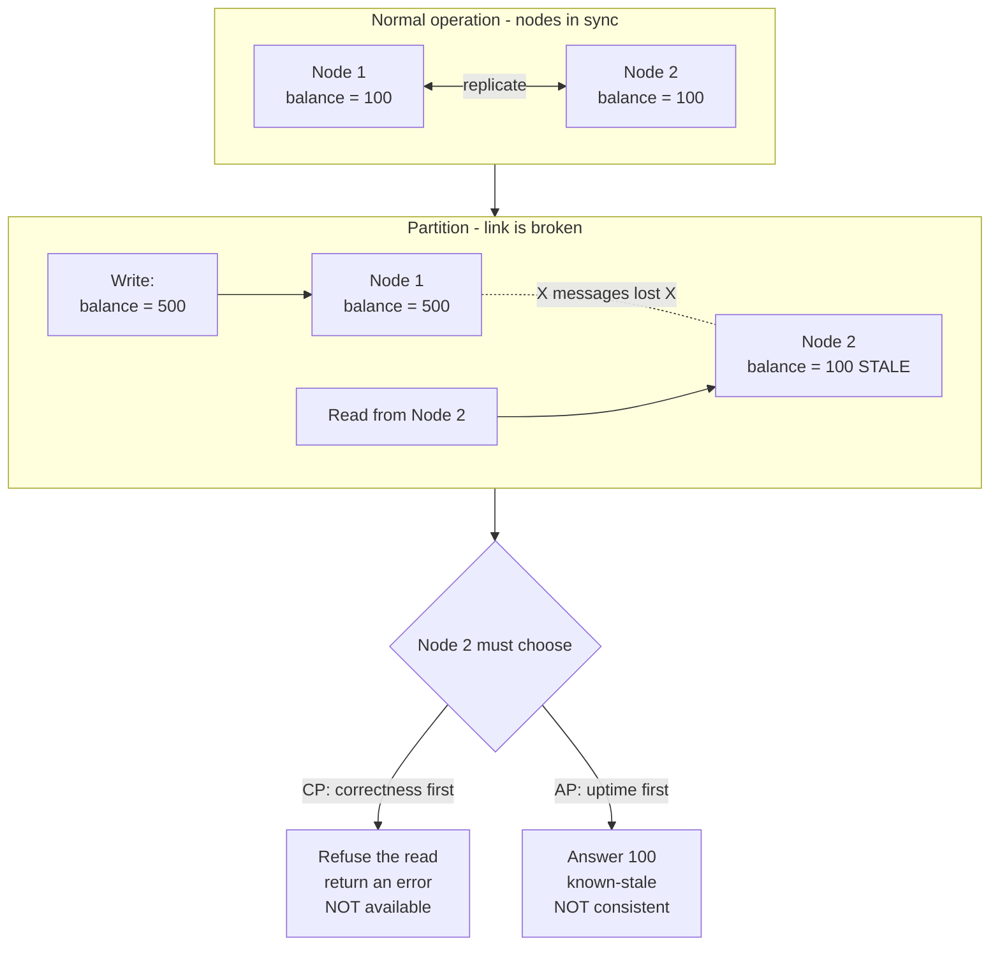

# 13. CAP Theorem

> **One-liner:** When the network between your servers breaks, you must choose: keep answering with possibly-stale data, or stop answering to stay correct — you cannot have both.
> **Where this fits:** In [11-replication.md](11-replication.md) you learned to keep multiple copies of your data, and in [12-sharding-and-partitioning.md](12-sharding-and-partitioning.md) you split data across machines. The moment your data lives on more than one machine, those machines can lose contact with each other. CAP is the theorem that tells you what happens then. It sets up [14-acid-vs-base-and-consistency.md](14-acid-vs-base-and-consistency.md), where we grade *how* correct you need to be.

---

## 1. The Idea in Plain Words

First, three words you need before anything else makes sense.

- **Distributed system** — software running on *more than one computer* at the same time, cooperating so that to the outside world it looks like one system. When you scale Habex from one server to five, you have a distributed system whether you wanted one or not.
- **Node** — one of those computers. Also called a replica when it holds a copy of the data (see [11-replication.md](11-replication.md)).
- **Network partition** — the moment two nodes that are *both alive and running* suddenly **cannot talk to each other** because the network link between them is broken, dropping messages, or so slow it might as well be broken. Neither node has crashed. They just can't reach each other, and — critically — **neither one knows whether the other is dead or just unreachable.**

That last point is the whole drama. A node on one side of the partition sees silence from the other side. It cannot tell the difference between "the other node crashed" and "the other node is fine but the cable is cut." It has to decide what to do with *incomplete information*.

The **CAP theorem** (proposed by Eric Brewer in 2000, formally proven by Gilbert and Lynch in 2002) says a distributed data store can only fully guarantee **two of these three** properties at once:

| Letter | Name | Plain-words meaning |
|---|---|---|
| **C** | **Consistency** | Every read gets the **most recent** write, or an error. All nodes agree on the value. It behaves as if there is only one single, always-up-to-date copy of the data. |
| **A** | **Availability** | Every request gets a **non-error response** — but not necessarily the latest data. The system always answers. |
| **P** | **Partition tolerance** | The system **keeps working even when a network partition happens** — messages between nodes are lost or delayed. |

> **Critical gotcha — CAP's "C" is NOT ACID's "C".**
> CAP-Consistency means **linearizability**: the system behaves as if there's one copy of the data and every operation happens in a single, agreed order, so a read never returns a value older than the last completed write. ACID-Consistency (from [14-acid-vs-base-and-consistency.md](14-acid-vs-base-and-consistency.md)) means something completely different — that a transaction moves the database from one *valid state to another*, respecting your rules like "balance can't go negative" or "every expense must reference a real user." **Same letter, unrelated ideas.** Interviewers love catching people who conflate them.

### The part everyone gets wrong

The famous version is "pick 2 of 3." That framing is **misleading** and we'll bury it properly in section 7. Here's the honest version:

**Partition tolerance is not a feature you choose — it's a fact of the universe.** Networks *will* partition. Cables get cut, switches reboot, a cloud availability zone loses connectivity, a garbage-collection pause makes a node unresponsive for 8 seconds. If your data is on multiple machines, you *will* eventually get a partition. You cannot opt out of physics.

So in any real distributed system, **P is mandatory.** That collapses CAP into a single real question:

> **When a partition happens, do you choose C or A?**
> Refuse to answer to stay correct (**CP**), or answer with maybe-stale data to stay up (**AP**)?

That's the entire theorem in one line.

---

## 2. Picture It (Diagram)

Two nodes normally stay in sync. Then the link between them breaks — a partition. A write lands on Node 1, but Node 1 can't reach Node 2 to copy it over. Now a client asks Node 2 for the value. What should Node 2 do?

Read it top to bottom: everything is fine until the dotted line (the partition) appears. Once Node 2 is cut off, it is holding an old value (100) while the truth is now 500. When the read arrives, Node 2 has exactly two honest options — **error out to protect correctness (CP)** or **serve the stale 100 to stay up (AP)**. There is no third door.

---

## 3. Real-World Analogy

Picture a shop with **two cash counters** at opposite ends of a huge store. They normally keep inventory in sync over a walkie-talkie: "Sold the last PS5, mark it zero." One PS5 left in stock.

Now the **walkie-talkie battery dies** — that's your network partition. Both cashiers are alive and serving customers, they just can't hear each other.

A customer walks up to Counter 2 and wants that last PS5. The cashier has two choices:

- **"Let me hold on — I can't confirm stock with the other counter right now. I won't sell until the walkie-talkie is back."** That's **CP**: consistent (never oversells) but **unavailable** (the customer is turned away even though there might be stock).
- **"Sure, here you go!"** — and risk that Counter 1 *also* just sold it, so now you've sold one PS5 twice. That's **AP**: available (customer served) but **inconsistent** (books are wrong, someone gets a refund and an apology).

Neither cashier is being dumb. They're making a **business trade-off with missing information.** A luxury-watch boutique picks CP (never double-sell a ₹10-lakh watch). A t-shirt stall at a fair picks AP (just sell it, sort out the rare oversell later). **The right answer depends on what the item costs you to get wrong.** Hold that thought — it's the whole game.

---

## 4. Concrete Example

Let's make it money, because that's what your target companies run on.

**Scenario:** A payments company (think **CRED**, **Razorpay**) runs its account-balance data on replicas in two data centres, Mumbai and Chennai. A fibre cut partitions them. You (the user) open the app and it happens to hit the Chennai replica, which is now cut off from Mumbai — where your *latest* transaction just landed.

Your true balance is **₹2,000** (Mumbai just processed a ₹8,000 debit from ₹10,000). Chennai still shows the old **₹10,000**.

| Design | What the app does during the partition | Consequence |
|---|---|---|
| **AP (availability first)** | Shows you **₹10,000** — the stale value. App stays fully usable. | You *think* you have ₹10,000. You try to pay ₹9,000 and it later bounces, or worse, a naive system lets you overdraw. **Money correctness broken.** |
| **CP (consistency first)** | Detects it can't confirm the latest state, so it **refuses**: "Balance temporarily unavailable, please retry." | Mildly annoying. But you are **never shown a wrong number about your own money.** |

For a **balance, a ledger, an order-placed confirmation, a fund transfer** — the answer is almost always **CP**. A payments ledger would rather show a spinner for 3 seconds than tell you a wrong balance, because a wrong balance leads to failed settlements, angry users, and RBI compliance problems. *Correctness is the product.*

**Now flip it.** The same app shows a **"You saved ₹12,340 this year on CRED"** stat, or a **social feed / offers carousel**. If that number is a few seconds stale during a partition, *nobody cares.* Here you choose **AP** — always show *something*, even slightly old, because an unavailable offers page is worse than a stale one.

**Choosing CP doesn't have to mean a blank error screen.** The mature product move is **graceful degradation**: instead of a hard "something went wrong," show the last-known balance clearly labelled *"as of 2 minutes ago"* and **disable the risky action** (block new spends/transfers) until the system can confirm fresh state. The user still sees useful information, but you never let them *act* on possibly-wrong money data. That's the difference between a junior "return 500" answer and a senior "degrade the feature, protect the invariant" answer — and it's exactly the product judgement CRED/Razorpay interviewers reward.

**The lesson interviewers want:** CAP is **not** a database-wide religion. It's a **per-operation** decision. The *same company* runs CP for the ledger and AP for the feed. Great answers say "it depends on the operation," not "we're an AP shop."

**Concrete DB leanings** (rough — most modern databases are tunable, see section 7):

| Leans CP (correctness under partition) | Leans AP (uptime under partition) |
|---|---|
| A payments **ledger** / order system | A **social feed**, likes, view counts |
| Traditional RDBMS with sync replication (PostgreSQL, MySQL in a strict setup) | Cassandra, DynamoDB (default), Riak |
| HBase, Google Spanner, etcd, ZooKeeper | CouchDB, Amazon DynamoDB, Voldemort |
| MongoDB with `majority` writes | MongoDB with relaxed reads, DNS |

### How does a system even *know* there's a partition? Heartbeats and quorum

A node can't see the network; it can only notice **silence**. Nodes constantly ping each other with **heartbeats** — tiny "still alive?" messages. When a node stops hearing heartbeats from a peer for longer than a **timeout**, it *declares* a partition. Note the honesty problem from section 1: it can't tell "peer crashed" from "peer is fine but unreachable." It acts on a guess.

The standard tool a **CP** system uses to make a *safe* guess is a **quorum** — a majority vote.

- **Quorum** — a majority of nodes (more than half). With 5 replicas, a quorum is 3.
- The rule: **only the side of the partition that still has a quorum is allowed to accept writes.** The minority side refuses (becomes unavailable) rather than risk diverging.

Why a majority? Because a network can split a 5-node cluster into a group of 3 and a group of 2, but it can **never** create *two* groups that both have 3+. At most one side can hold a majority. So letting only the majority side write **guarantees the two sides can't both accept conflicting writes** — that's how CP stays consistent. The 2-node minority side goes read-only or errors until the partition heals. This is exactly how etcd, ZooKeeper, and Spanner (via consensus algorithms like **Raft/Paxos**) behave, and it's why they need an **odd** number of nodes (so a majority always exists).

### Split-brain: the nightmare an AP system risks

**Split-brain** is when *both* sides of a partition keep accepting writes independently, so they diverge — like two managers both approving the same ₹10,000 withdrawal because neither could reach the other. When the partition heals, you have two conflicting truths and must reconcile them (last-write-wins, merge, or manual repair — see [14-acid-vs-base-and-consistency.md](14-acid-vs-base-and-consistency.md)). CP systems **prevent** split-brain by the quorum rule above (the minority refuses to write). AP systems **accept** the risk of split-brain in exchange for staying available, and lean on conflict-resolution later. This single distinction — *prevent divergence (CP) vs reconcile divergence later (AP)* — is often the crux an interviewer is fishing for.

### Seen in the wild

It helps to attach the theory to systems your interviewers actually run:

- **Amazon DynamoDB** and **Cassandra** are classic **AP**: during a partition every node keeps serving, and conflicts are reconciled afterwards (last-write-wins by default). That's why they're the go-to for shopping carts, feeds, and session stores — *available above all*.
- **Google Spanner** is famously **CP** yet feels highly available because it uses atomic clocks (**TrueTime**) and consensus to stay consistent, paying for it in coordination latency — the honest **PC/EC** corner. Fintechs love this profile.
- **etcd / ZooKeeper** (which coordinate Kubernetes, Kafka, service discovery) are strictly **CP** via **Raft/Paxos**: they'd rather lose availability than hand out a stale cluster config, because a wrong "who is the leader" answer corrupts everything downstream.
- **MongoDB** and **Cassandra** are **tunable** — you slide the same cluster toward CP or AP per request (see section 7). So "is MongoDB CP or AP?" is a trick question; the honest answer is "depends how you configure the write/read concern."

---

## 5. Tie-Back to Your Projects

**Habex** (your habit + expense tracker) is single-region and small today, so you may never *see* a partition. But interviewers will ask "what happens when you scale Habex to multiple regions?" — and you want a crisp answer.

Map Habex operations onto the C-vs-A choice:

| Habex operation | CP or AP? | Why |
|---|---|---|
| **Adding an expense / editing a transaction** | **CP-ish** | This is the user's money record. During a partition you'd rather queue the write or briefly refuse than silently drop it or show a wrong total. You never want a saved expense to "disappear." |
| **Showing the user their own expense they just added** | **CP for that read** | This is *read-your-writes* consistency — see [14-acid-vs-base-and-consistency.md](14-acid-vs-base-and-consistency.md). If they added it and it vanishes on refresh, they'll think Habex lost their data. |
| **Dashboard charts / monthly spend totals** | **AP is fine** | A chart that's 5 seconds stale during a blip is totally acceptable. Availability beats freshness here. |
| **Shared-budget total across two roommates** | **AP acceptable** | If your roommate added an expense a moment ago and the shared total is briefly behind, no harm — it converges in seconds. |
| **Sending the monthly-report email** | **AP / async** | Best handled off the request path via a queue — see [15-message-queues-and-pubsub.md](15-message-queues-and-pubsub.md). Delivery can be delayed without breaking anything. |

The killer interview move: *"In Habex, I'd treat the expense-write path as CP — correctness of the ledger matters — but treat dashboards and shared-budget aggregates as AP, because a few seconds of staleness there is invisible to users and keeps the app snappy."* That single sentence shows you understand CAP is per-operation, not per-app.

Your **portfolio, santhu.site**, is basically static and served from a CDN ([08-cdn.md](08-cdn.md)) — effectively an **AP** system. It's always available; if you push an update, some edge nodes might serve the old version for a minute (staleness), and that's completely fine. You've already been running an AP system without knowing the term.

---

## 6. Interview Questions (with answer pointers)

**Q1. Explain the CAP theorem in one minute.** *(Zepto, Swiggy, generic warm-up)*
→ In a distributed data store you can't simultaneously guarantee Consistency, Availability, and Partition tolerance. Partitions are unavoidable in the real world, so P is a given. The real trade-off is: during a partition, do you stay consistent (refuse/err) or available (serve stale)? Name a CP example (payments ledger) and an AP example (social feed).

**Q2. Why is "pick 2 of 3" a misleading way to state CAP?** *(CRED, Razorpay — they probe depth)*
→ Because you don't get to freely pick any 2. Partition tolerance isn't optional — networks fail. So you never really choose "CA." The theorem only bites *during a partition*, and then it's a binary C-vs-A choice. 99% of the time there's no partition and CAP says nothing at all — that's why PACELC exists.

**Q3. During a network partition, should a payments app show a possibly-stale balance or an error? Defend it.** *(Razorpay, CRED, Groww — very likely)*
→ Choose **CP** — refuse or retry rather than show a wrong balance. Reasoning: money correctness is the product; a stale balance causes failed settlements, overdrafts, disputes, compliance issues. A short "try again" is far cheaper than a wrong number. But note you'd design so the *write* is durable (queued) and only the *read* is briefly blocked.

**Q4. Give an operation where you'd deliberately pick AP over CP, in the same company.** *(Swiggy, Zepto)*
→ The restaurant listing, offers carousel, "items sold today" counter, or delivery-partner heatmap. Users must always see *something*; a few seconds of staleness is invisible. Availability > freshness here. The point: CAP is per-operation, not per-company.

**Q5. What's the difference between CAP-Consistency and ACID-Consistency?** *(CRED, Groww — gotcha question)*
→ CAP-C is linearizability: reads reflect the latest write across all nodes, as if one copy. ACID-C is that a transaction preserves invariants/constraints, moving the DB from one valid state to another. Different concepts that happen to share a letter.

**Q6. What is PACELC and why is it "more honest" than CAP?** *(senior rounds — CRED, Razorpay)*
→ PACELC: *if Partition, choose A or C; Else (normal operation), choose Latency or Consistency.* It adds the case CAP ignores — the 99.9% of time with no partition — where you still trade **latency vs consistency** (waiting to confirm with other replicas costs time). E.g., Dynamo/Cassandra are PA/EL; a strict RDBMS or Spanner is PC/EC.

**Q7. Is a single-server database subject to CAP?** *(Zepto, screening)*
→ Not meaningfully. CAP is about *distributed* data. One node can't partition from itself. The trade-off only appears once data lives on 2+ machines (via replication or sharding). This is why "just use one big server" (vertical scaling, [06-scaling-vertical-vs-horizontal.md](06-scaling-vertical-vs-horizontal.md)) sidesteps CAP — at the cost of a single point of failure and a scaling ceiling.

**Q8. How can a system be "mostly CP but degrade to AP"?** *(senior / staff)*
→ Tunable consistency. E.g., require a quorum of replicas to agree for money operations (CP behaviour), but allow single-replica reads for feeds (AP). Databases like Cassandra and MongoDB expose per-request consistency levels, so one cluster serves both. This is the practical answer to "which do you pick" — *you pick per request.*

**Q9. How does a CP system decide which side of a partition stays writable, and what's split-brain?** *(senior — CRED, Razorpay)*
→ By **quorum**: only the side holding a majority of nodes accepts writes; the minority side refuses (goes unavailable). Since a split can't produce two majorities, at most one side writes, so the copies can't diverge. **Split-brain** is the failure where *both* sides write independently and diverge — CP prevents it via quorum; AP allows it and reconciles later (last-write-wins/merge). This is why consensus systems (etcd, ZooKeeper) use an odd node count.

---

## 7. Trade-offs & "Why Not Just X?"

**"Why not just build a CA system — consistent and available, forget partitions?"**
Because partitions are not a design choice; they're weather. A CA system is only "CA" as long as the network never fails — which for anything bigger than one machine is never true for long. The instant a partition hits, a so-called CA system has to become CP or AP anyway. "CA" describes a **single-node** database, or a fantasy. Don't claim it in an interview.

**"Why not just always pick Consistency? Correct is always better, right?"**
Consistency during a partition means **downtime** — you refuse requests you can't verify. For an ads page, a feed, or a "trending restaurants" list, downtime is a worse product than mild staleness. You'd be trading real revenue and user trust for a correctness you don't need. Match the choice to the *cost of being wrong*.

**"Why not just always pick Availability? Users hate errors."**
Serve a stale balance and let someone overdraw, double-book the last delivery slot, or place an order on out-of-stock inventory, and you've turned a 3-second annoyance into a money loss, a refund, and a support ticket. For anything involving money, inventory, or identity, availability-with-wrong-data is the *expensive* option.

**The "pick 2 of 3" myth, killed properly.** The triangle diagram makes it look like three symmetric options where you calmly choose any two. Reality: (1) P is forced, so you're really choosing between just C and A; (2) the choice **only applies during a partition** — the rest of the time you're not sacrificing anything, which the triangle completely hides; (3) it's not even all-or-nothing — modern databases let you choose **per operation**. The triangle is a decent mnemonic and a bad model.

**PACELC — the grown-up version.** CAP is silent about normal operation, which is 99.9% of the time. PACELC fills the gap:

> **P**artition → choose **A**vailability or **C**onsistency. **E**lse (no partition) → choose **L**atency or **C**onsistency.

Even with a healthy network, being strongly consistent means a write must wait for other replicas to acknowledge — that costs **latency**. Want lower latency? Accept weaker consistency. This trade-off never goes away, partition or not.

| Database | PACELC class | Reading |
|---|---|---|
| Cassandra, DynamoDB (default) | **PA / EL** | Under partition favour availability; normally favour low latency |
| MongoDB (typical) | **PA / EC** | Available under partition; normally favour consistency |
| Fully consistent RDBMS, VoltDB, Google Spanner | **PC / EC** | Consistent under partition *and* in normal operation, latency be damned |
| Yahoo PNUTS | **PC / EL** | Consistent under partition, but favour latency when healthy |

Interview gold: bringing up PACELC unprompted signals you've gone past the textbook. Say *"CAP only describes the partition case; PACELC adds the latency-vs-consistency trade you're paying every day even without a partition."*

**Why not just use one big server and dodge all of this?** (See [06-scaling-vertical-vs-horizontal.md](06-scaling-vertical-vs-horizontal.md).) You can — up to a point. One node has no CAP problem. But you get a hard ceiling on how much you can scale, and a **single point of failure**: when it dies, you have 0% availability, which is worse than any partition. Distribution is how you survive machine death; CAP is the tax you pay for surviving.

---

## 8. TL;DR

- A **network partition** is when live nodes can't talk to each other. In any multi-machine system, partitions **will** happen — so **Partition tolerance is mandatory**, not a choice.
- That reduces CAP to one real question: **during a partition, choose Consistency (refuse/err to stay correct = CP) or Availability (serve stale to stay up = AP)?**
- **CAP-Consistency = linearizability** (reads see the latest write). It is **not** the same as **ACID-Consistency** (constraints/invariants hold). Same letter, different idea.
- **CP** examples: payments ledgers, orders, inventory (CRED/Razorpay/Groww balances). **AP** examples: social feeds, like/view counts, offers carousels (Swiggy/Zepto listings).
- CAP is **per-operation**, not per-company. The same app runs CP for money and AP for feeds.
- **"Pick 2 of 3" is misleading:** P is forced, the trade only bites during a partition, and it's tunable per request.
- **PACELC** is the honest version: *Partition → A or C; Else → Latency or C.* It covers the 99.9% of time with no partition, where you still trade latency for consistency.
- Interview reflex: for money → **CP** ("show a spinner, never a wrong balance"); for feeds/counters → **AP**; and always add *"it depends on the operation."*
- Next: [14-acid-vs-base-and-consistency.md](14-acid-vs-base-and-consistency.md) grades *how* consistent you actually need to be, from strong to eventual.
