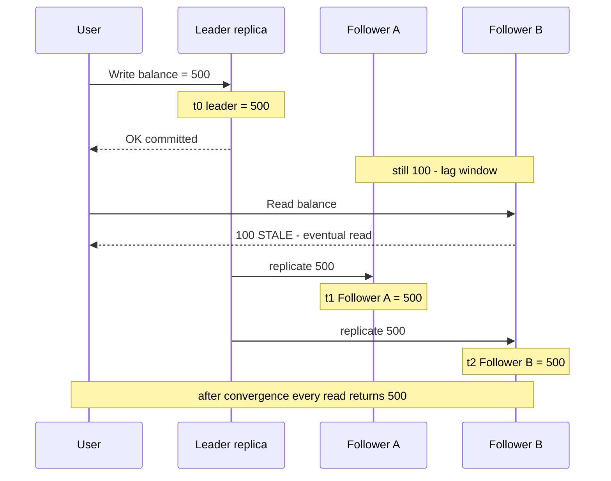

# 14. ACID vs BASE & Consistency Models

> **One-liner:** ACID databases promise "correct, always, immediately"; BASE databases promise "available now, correct soon" — and between those extremes is a whole spectrum of how fresh a read needs to be.
> **Where this fits:** [13-cap-theorem.md](13-cap-theorem.md) told you that during a partition you trade Consistency for Availability. This chapter zooms into *what "consistency" even means*, because it's not one thing — it's a dial from "strong" to "eventual." It builds directly on replication lag from [11-replication.md](11-replication.md): the gap between a write and its copies is exactly where these models differ.

---

## 1. The Idea in Plain Words

When you save data, you'd like two things: for it to be **correct**, and for the system to be **fast and always up**. In a single-machine world you can have both. The moment data is copied across machines (replication) or you scale out, those two goals start to fight. Databases pick a side, and the industry gave the two sides catchy names: **ACID** and **BASE**.

Let's define every term slowly.

- **Transaction** — a *group of operations treated as one single unit*. Either the whole group happens, or none of it does. "Move ₹500 from A to B" is really two operations (subtract from A, add to B) that must act as one.
- **Replica** — a copy of your data on another machine (from [11-replication.md](11-replication.md)).
- **Replication lag** — the short delay between a write landing on the main copy (the *leader*) and that write reaching the copies (the *followers*). Usually milliseconds; occasionally seconds. During that window, different replicas hold *different values*. This lag is the source of nearly everything in this chapter.

### ACID — the strict, correctness-first contract

**ACID** is the promise made by traditional relational databases (PostgreSQL, MySQL, Oracle, SQL Server — see [09-sql-vs-nosql.md](09-sql-vs-nosql.md)). Four letters:

| Letter | Name | Plain meaning |
|---|---|---|
| **A** | **Atomicity** | All-or-nothing. A transaction fully completes or fully rolls back. No half-done states. |
| **C** | **Consistency** | The database goes from one **valid state to another**, never breaking your rules (constraints, foreign keys, "balance ≥ 0"). *(This is ACID-C, not CAP-C — see the warning below.)* |
| **I** | **Isolation** | Concurrent transactions don't step on each other. It *looks like* they ran one at a time, even when running together. |
| **D** | **Durability** | Once the database says "committed," the data survives crashes, power loss, reboots. It's on disk, not just in memory. |

> **Same-letter trap again.** ACID-**C**onsistency = "invariants and constraints hold." CAP-**C**onsistency = "reads see the latest write (linearizability)." They are unrelated. See [13-cap-theorem.md](13-cap-theorem.md). If an interviewer asks "which C do you mean?", you look sharp by naming the difference.

### BASE — the relaxed, availability-first contract

Many NoSQL systems (Cassandra, DynamoDB, Riak) can't afford ACID's strictness at massive scale, so they flip the priorities. **BASE**:

| Letter | Name | Plain meaning |
|---|---|---|
| **BA** | **Basically Available** | The system always responds — reads and writes succeed — even if the answer isn't the freshest. |
| **S** | **Soft state** | The data may be "in flux"; the system's state can change over time even without new input, as replicas sync up. |
| **E** | **Eventual consistency** | If writes stop, all replicas will *eventually* converge to the same value. Not instantly — eventually. |

ACID says "correct now, or nothing." BASE says "available now, correct soon." Neither is better — they're tools for different jobs. ACID for money, BASE for scale.

---

## 2. Picture It (Diagram)

The heart of the whole chapter: a write hits the leader, then ripples out to followers **over time**. In the gap, a read can catch an old value. That gap is replication lag; the consistency model is your *rule* for what's allowed to happen inside it.

The dangerous window is between "OK committed" and the last "replicate" arrow. **Strong consistency** forbids the stale `100` read entirely (the system would route that read to the leader or wait). **Eventual consistency** allows it, betting that a few milliseconds of staleness is harmless. Everything in section 4 is about *which reads you allow inside that window*.

---

## 3. Real-World Analogy

**ACID is a bank wire; BASE is a group chat.**

When you do a **bank transfer** (ACID), the bank will not tell you "done" until it is *certain* the money left one account and landed in the other, permanently. If anything fails midway, the whole thing reverses — you never see ₹500 vanish from your account and not arrive in your friend's. Atomic, correct, isolated from other transfers, durable. Slower, but you'd never accept less for money.

When you post in a **WhatsApp group** (BASE), your message shows on *your* phone instantly, then propagates to everyone else's phone over the next moment. For a few seconds, different people see slightly different versions of the chat — someone's still loading, someone else already replied. Nobody minds. Eventually every phone shows the same thread. **Basically available, soft state, eventually consistent.** You'd hate this for a bank transfer and love it for a chat.

The skill is knowing which situation you're in. Money = bank wire. Likes, feeds, view counts, chat = group chat.

---

## 4. Concrete Example

### Strong vs eventual — the two poles

- **Strong consistency:** the instant a write is acknowledged, *every* subsequent read anywhere returns the new value. It behaves as if there's one copy. This is CAP's linearizability. Costs latency and/or availability.
- **Eventual consistency:** reads may return old values for a while; given enough time with no new writes, everyone converges. Cheap, fast, highly available.

Between these poles is a **spectrum**. You rarely need full strong consistency; you often need *one specific guarantee*. Here are the ones that matter, weakest to strongest:

| Model | Plain-words guarantee | Everyday example |
|---|---|---|
| **Eventual consistency** | "You'll see the latest value *eventually*. No promise when." | An Instagram **like count** ticking from 1,203 to 1,204 a second late. |
| **Read-your-writes** | "*You* will always see *your own* writes immediately. Others may lag." | You post a comment and it's there on refresh — even if friends see it a moment later. |
| **Monotonic reads** | "Once you've seen a value, you'll never see an *older* one." Time only moves forward for you. | A view counter you refresh never jumps *backwards* from 51 to 48. |
| **Causal consistency** | "Things that are cause-and-effect appear in the right order for everyone." | A reply never shows up *before* the message it replies to. |
| **Linearizable (strong)** | "Every read everywhere sees the single latest write, as if one copy." | Your bank balance after a debit — the same, correct number for everyone, now. |

The trick nobody teaches beginners: **you usually pick the *weakest* model that still feels correct to the user.** Weaker = faster, cheaper, more available. Reaching for "strong everywhere" is the rookie over-engineering move.

In practice, the two middle models are often bundled into **session consistency** — within a single user's session, guarantee both *read-your-writes* (you see your own writes) and *monotonic reads* (you never go backwards in time). It's cheap to implement (pin a session's reads to one replica, or to the leader briefly after a write) and it covers the vast majority of "why did my change disappear?!" complaints without paying for full linearizability. If an interviewer asks "what consistency does a logged-in user need for their own data?", *session consistency* is usually the crisp, correct answer.

### When eventual consistency is totally fine

- **Instagram / Reels like counts and view counts.** If 2 million people like a reel, whether the counter says 1,999,998 or 2,000,001 for a few seconds is *invisible and irrelevant*. Forcing strong consistency here would mean coordinating every replica on every like — absurd cost for zero user benefit. This is textbook **AP + eventual** (see [13-cap-theorem.md](13-cap-theorem.md)).
- **Twitter/X follower counts, YouTube views, "trending" lists, Swiggy's "1.2k ordered today."** All eventual. Nobody audits them to the unit.

### When you need strong consistency

- **CRED / Razorpay / Groww account balances, order placement, fund transfers, stock trades.** If Groww shows you own 10 shares when you own 8, or lets you place two orders that both spend the same ₹10,000 because a replica was stale, that's a financial and regulatory failure. Money and orders demand **strong consistency** on the write path — typically ACID transactions on a relational store, reads routed to the leader or done inside the transaction.
- **Inventory at checkout** (Zepto "1 left in stock"), **seat/slot booking**, **unique-username signup.** Anything where two users racing for one resource must not both win.

The senior-level nuance: even a payments company is **strong where it counts and eventual everywhere else.** Razorpay is strongly consistent about your settled balance, but perfectly happy for the "total transactions this month" dashboard tile to be eventually consistent.

### Isolation levels — the "I" in ACID, in practice

Isolation isn't a single on/off setting; it's a **dial** with named notches, trading correctness for speed. From weakest to strongest:

| Isolation level | Prevents | Classic anomaly it still allows |
|---|---|---|
| **Read Uncommitted** | (almost nothing) | **Dirty read** — you read another transaction's uncommitted, maybe-rolled-back data. |
| **Read Committed** | Dirty reads | **Non-repeatable read** — read the same row twice in one transaction, get two values. |
| **Repeatable Read** | Dirty + non-repeatable reads | **Phantom read** — a `WHERE` query returns new rows on re-run. |
| **Serializable** | Everything above | (none) — behaves as if transactions ran one-by-one. Slowest. |

For a bank transfer or an order that must not double-spend, you push toward **Serializable** (or use explicit row locks / `SELECT ... FOR UPDATE`). For a read-heavy dashboard, **Read Committed** (the PostgreSQL default) is plenty. Knowing these names and when to raise the level is a strong mid-level signal.

### Eventual consistency's homework: resolving conflicts

If two replicas accept writes independently during a partition (the split-brain risk from [13-cap-theorem.md](13-cap-theorem.md)), they can end up with **conflicting values** for the same key. "Eventually consistent" only works if the system has a *rule* for reconciling those conflicts when replicas re-sync. The common strategies, simplest to smartest:

| Strategy | How it resolves a conflict | Cost / catch |
|---|---|---|
| **Last-Write-Wins (LWW)** | Keep the write with the latest timestamp; discard the other. | Simple and popular (Cassandra default), but **silently loses** the discarded write, and clock skew between machines can pick the "wrong" winner. |
| **Vector clocks** | Track causality so the system can tell a true conflict from a stale copy, and *flag* genuine conflicts. | More correct, but pushes conflict resolution onto the app/client (Riak/Dynamo style). |
| **CRDTs** | Data types (counters, sets) mathematically designed so concurrent writes **always merge** without conflict. | Elegant and automatic, but only works for specific data shapes — great for a like counter, not a bank balance. |
| **Application merge** | The app decides (e.g. "sum both shopping carts," "union both edits"). | Full control, most work; used where losing data is unacceptable. |

The interview-worthy point: **eventual consistency is not "we don't care about correctness" — it's "we defer correctness to a conflict-resolution step."** A like counter uses a CRDT and merges cleanly; a shared document uses application merge; a balance refuses to be eventually consistent at all and stays on ACID. Naming *how* eventual consistency reconciles (LWW vs CRDT) is a senior-level signal most candidates miss.

### Quorum reads and writes: the tunable middle

Databases like Cassandra and DynamoDB let you dial consistency per request with three numbers: **N** replicas hold the data, a write must be acknowledged by **W** of them, and a read must consult **R** of them.

- If **R + W > N**, every read is guaranteed to overlap with the latest write on at least one replica — you get **strong-ish consistency**.
- If **R + W ≤ N**, reads are faster and more available but may be **stale** — eventual consistency.

So `W=all, R=1` gives fast reads but slow writes; `W=quorum, R=quorum` (the common choice) balances both. This is the concrete knob behind "tunable consistency" — the same cluster serves a strongly-consistent balance path and an eventual feed path just by choosing R and W per operation.

---

## 5. Tie-Back to Your Projects

**Habex** is the perfect place to show you *mix* consistency models in one app — which is exactly what real systems do.

**The read-your-writes moment (must be strong for the author):**
A user adds an expense: *"Coffee, ₹250."* The instant they hit save and the list refreshes, that expense **must be there.** If it's missing because their read hit a lagging replica, they'll assume Habex lost their money data and lose trust immediately. So for the **user reading their own just-written data**, you need **read-your-writes consistency**. Practical ways to get it:

- Route that user's reads to the **leader** for a few seconds after they write, or
- Read from the same replica you wrote to (sticky sessions), or
- Have the frontend **optimistically** show the new expense from local state (you already do this instinct in React) while the write settles.

**The eventually-consistent moment (fine to lag for others):**
A **shared budget** between you and your roommate shows a combined total. Your roommate adds *"Groceries, ₹1,200"* on their phone. If *your* view of the shared total takes 3–5 seconds to include it, **that's completely fine** — it converges, and nobody's making a split-second financial decision on a household grocery tracker. This is **eventual consistency**, and choosing it keeps the shared-total query cheap and the app fast.

**Where Habex needs real ACID transactions:**
When you build **transfers between categories** or **"split this expense across 3 people,"** those are multi-step operations that must be **atomic** — if debiting one side succeeds but crediting the other fails, you must roll back, or Habex's totals go wrong. Wrap them in a single database transaction. This is your chance in an interview to say *"I used a transaction so a partial failure can't corrupt the totals — atomicity."*

Put together, the standout Habex answer:

> *"In Habex I don't pick one consistency model globally. The user reading their own new expense needs read-your-writes — I route that read to the leader. A shared-budget total can be eventually consistent and I let it lag a few seconds to keep it cheap. And a category transfer is a single ACID transaction so it's atomic. Different data, different guarantees."*

Your portfolio **santhu.site** is static content behind a CDN — pure **eventual consistency**, and that's ideal for it. A deploy takes a minute to reach every edge; you never needed strong consistency for a portfolio.

---

## 6. Interview Questions (with answer pointers)

**Q1. Explain ACID with a bank-transfer example.** *(Razorpay, CRED, Groww — bread and butter)*
→ Transfer ₹500 A→B = subtract from A + add to B as **one transaction**. **Atomicity**: both or neither (no money vanishing). **Consistency**: invariants hold (A's balance can't go negative). **Isolation**: a concurrent transfer can't read A's half-updated balance. **Durability**: once "done," a crash can't undo it. Emphasise atomicity is what makes it safe.

**Q2. What is eventual consistency, and give a case where it's completely acceptable.** *(Swiggy, Zepto)*
→ Replicas may return stale values briefly but converge if writes stop. Fine for **like counts, view counts, "1.2k ordered today," trending lists** — nobody needs those exact-to-the-unit in real time, and forcing strong consistency there wastes huge coordination cost.

**Q3. When would you refuse eventual consistency and demand strong?** *(CRED, Razorpay, Groww — very likely)*
→ **Money and scarce resources:** balances, fund transfers, order placement, stock holdings, inventory at checkout, seat booking, unique usernames. Anything where a stale read lets two users spend/claim the same thing, or shows a wrong financial number.

**Q4. What's read-your-writes consistency and why does it matter for UX?** *(Zepto, Swiggy — product-minded)*
→ Guarantee that a user always sees their *own* writes immediately (others may lag). Matters because "I just did X and it's not there" reads as data loss. Implement via leader reads for a window, sticky sessions, or optimistic UI. Great to tie to a real frontend instinct.

**Q5. Difference between ACID-Consistency and CAP-Consistency?** *(CRED, senior — gotcha)*
→ ACID-C = transaction preserves invariants/constraints (valid → valid state). CAP-C = linearizability (reads see the latest write across nodes). Unrelated concepts, same letter.

**Q6. Walk me through isolation levels and where you'd use Serializable.** *(Razorpay, Groww — mid/senior)*
→ Read Uncommitted → Committed → Repeatable Read → Serializable, each preventing more anomalies (dirty, non-repeatable, phantom reads) at the cost of speed/concurrency. Use **Serializable** (or explicit locks / `SELECT FOR UPDATE`) for money movements and anything that must not double-spend; **Read Committed** is fine for dashboards.

**Q7. How does replication lag connect to all this?** *(CRED, senior)*
→ Replication lag (from [11-replication.md](11-replication.md)) is the window where followers hold old data. Every consistency model is really a rule about *what reads are allowed during that window*. Eventual = anything goes; read-your-writes = your own reads must dodge the lag; linearizable = no stale reads at all. Lag is the phenomenon; consistency models are the policy.

**Q8. Can one system use multiple consistency models?** *(senior / staff — Swiggy, CRED)*
→ Yes, and good systems do. A payments app is linearizable for balances, read-your-writes for a user's own recent activity, and eventual for dashboards/counters. Pick the weakest model that's still correct *for each operation* — same lesson as CAP being per-operation.

---

## 7. Trade-offs & "Why Not Just X?"

**"Why not just use ACID everywhere? Correct is always better."**
ACID's strong guarantees cost **latency, throughput, and availability**. Coordinating every replica to agree on every write doesn't scale to millions of writes/second, and it means downtime during partitions ([13-cap-theorem.md](13-cap-theorem.md)). Making a like-counter ACID would be paying bank-grade coordination for data nobody audits. Use ACID where wrong = money lost; use BASE where wrong-for-a-second = nobody notices.

**"Why not just use BASE everywhere? It scales better."**
Because eventual consistency on money is a disaster: overdrafts, double-spends, two users buying the last item, wrong balances triggering compliance failures. Scale is worthless if the numbers are wrong. BASE is a scaling tool, not a default.

**ACID vs BASE, side by side:**

| Dimension | ACID (e.g. PostgreSQL, MySQL) | BASE (e.g. Cassandra, DynamoDB) |
|---|---|---|
| Priority | Correctness now | Availability now, correctness soon |
| Consistency | Strong / immediate | Eventual |
| Scaling style | Vertical + read replicas; harder to scale writes | Horizontal, built for huge write scale |
| Best for | Money, orders, inventory, anything with invariants | Feeds, counters, logs, analytics, catalogs |
| CAP lean ([13](13-cap-theorem.md)) | CP-ish | AP-ish |
| Interview one-liner | "Bank wire" | "Group chat" |

**"Isn't 'strong vs eventual' really just a yes/no?"**
No — that's the beginner trap. It's a **spectrum**, and the money is in the middle. You rarely need full linearizability; you usually need *one* targeted guarantee like read-your-writes or monotonic reads, which is far cheaper. Naming the *specific* model you need (not just "strong") is what separates a mid-level answer from a junior one.

**"Why not force strong consistency and also stay highly available?"**
Because [13-cap-theorem.md](13-cap-theorem.md): during a partition you can't have both. Strong consistency implies you'll refuse or delay some requests when replicas can't confirm — i.e., you sacrifice availability exactly when the network misbehaves. Eventual consistency is what *buys* you that availability. They're two ends of the CAP trade, viewed up close.

**A note on "tunable" consistency.** Modern databases (Cassandra, DynamoDB, MongoDB) let you set consistency **per request** — e.g., write to a `QUORUM` of replicas for a balance update (strong-ish) but read from `ONE` replica for a feed (eventual). This is how one cluster serves both worlds, and it's the practical resolution to this whole chapter: *don't choose ACID vs BASE for your whole app — choose per operation.*

---

## 8. TL;DR

- **ACID** (relational DBs) = correctness-first: **A**tomicity (all-or-nothing), **C**onsistency (invariants hold), **I**solation (no stepping on each other), **D**urability (survives crashes). Think **bank wire.**
- **BASE** (many NoSQL) = availability-first: **B**asically **A**vailable, **S**oft state, **E**ventual consistency. Think **group chat.**
- **ACID-C ≠ CAP-C.** ACID-C = valid states/constraints; CAP-C = linearizability (see [13-cap-theorem.md](13-cap-theorem.md)).
- Consistency is a **spectrum**, weakest → strongest: **eventual → read-your-writes → monotonic reads → causal → linearizable (strong).** Pick the *weakest model that still feels correct.*
- **Eventual is fine** for like counts, view counts, trending, dashboards. **Strong is required** for balances, orders, transfers, inventory, bookings (CRED/Razorpay/Groww).
- **Replication lag** ([11-replication.md](11-replication.md)) is the window of staleness; consistency models are the *rules* about what reads are allowed inside it.
- **Isolation levels** (Read Uncommitted → Committed → Repeatable Read → Serializable) trade concurrency for correctness; use Serializable/locks for money.
- **Habex reflex:** read-your-writes for a user's own new expense (route to leader), eventual for shared-budget totals, an ACID transaction for a category transfer. **Different data, different guarantees** — same lesson as CAP being per-operation.
- Next: [15-message-queues-and-pubsub.md](15-message-queues-and-pubsub.md) — doing slow work asynchronously so the user's request stays fast.
