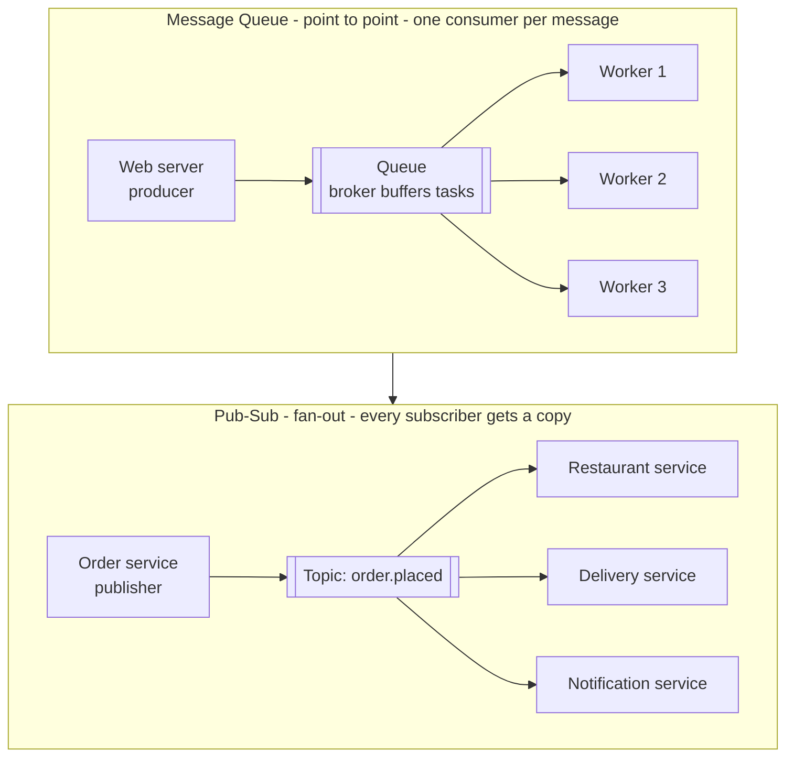

# 15. Message Queues & Pub-Sub

> **One-liner:** Instead of making the user wait while your server does slow work, drop a note in a queue and let a background worker handle it — the request returns instantly and the work still gets done.
> **Where this fits:** So far every request has been *synchronous* — the client waits for the server to finish. This chapter introduces *asynchronous* processing, the backbone of every scalable backend. It leans on [13-cap-theorem.md](13-cap-theorem.md) and [14-acid-vs-base-and-consistency.md](14-acid-vs-base-and-consistency.md) (queued work is eventually consistent by nature) and sets up [16-kafka-and-webhooks.md](16-kafka-and-webhooks.md) and the idempotency patterns in [19-reliability-patterns.md](19-reliability-patterns.md).

---

## 1. The Idea in Plain Words

Start with the two ways your server can handle a slow task.

- **Synchronous** — "wait for it." The client sends a request; the server does *everything* right then — talks to the database, resizes an image, sends an email — and only *then* replies. The user stares at a spinner the whole time. If the email server takes 4 seconds, the user waits 4 seconds.
- **Asynchronous ("async")** — "I'll handle it, you go." The server does the *fast* part (save the record), immediately replies "got it," and hands the *slow* part to a background worker to finish later. The user gets an instant response; the slow work happens off to the side.

**Why async matters:** the user-facing request stays fast and reliable even when the slow work is slow or flaky. Sending an email, generating a PDF report, charging a card, resizing a photo, calling a third-party API — none of that should make the user wait, and none of it should be able to *fail their request*. Move it off the request path.

The tool that makes async possible is a **message queue**. New vocabulary, defined once:

- **Message** — a small packet of data describing something to do or something that happened. E.g. `{ "task": "send_report_email", "userId": 42, "month": "2026-06" }`.
- **Producer** (or *publisher*) — the code that *creates* a message and drops it off. Usually your web server.
- **Broker** — the middleman software that *holds* messages safely until someone processes them. This is the queue itself (RabbitMQ, SQS, etc.). It's a buffer with delivery rules.
- **Consumer** (or *worker* / *subscriber*) — the code that *picks up* a message and does the actual work. Usually a separate background process.
- **Queue** — an ordered line of messages waiting to be processed, like people queueing at a counter: roughly first-in, first-out.
- **Topic** — a *named channel* messages are published to, so consumers can subscribe to just the categories they care about (e.g. a topic called `order.placed`).

So the flow is: **Producer → Broker (queue/topic) → Consumer.** The producer and consumer never talk directly and don't even need to be running at the same time — the broker sits in the middle holding the message. That indirection is the whole point, and it's called **decoupling.**

### Two shapes: Queue vs Pub-Sub

There are two fundamental patterns, and interviewers expect you to know the difference cold:

- **Message Queue (point-to-point):** each message is delivered to **exactly one** consumer. If you have 5 workers reading one queue, each message goes to *one* of them. This is for **distributing work** — "someone, do this task." Ten thousand emails to send, shared across 5 workers.
- **Publish-Subscribe (pub-sub, fan-out):** each message is delivered to **every** subscriber. One event, many independent reactions. "This happened — everyone who cares, react." One `order.placed` event → the kitchen service, the delivery service, *and* the notifications service all get their own copy.

Queue = *split the work among workers.* Pub-sub = *broadcast the event to all interested services.*

---

## 2. Picture It (Diagram)

Top half: a plain work queue — many producers drop tasks, and each task is handled by exactly one worker (load spread across workers). Bottom half: pub-sub — one event fans out to three independent services, each getting its own copy.

In the **queue** (top), a single task goes to *one* of Worker 1/2/3 — they share the load. In **pub-sub** (bottom), the *same* `order.placed` event is copied to *all three* services, which react independently and without knowing about each other. Same broker family, two delivery semantics.

---

## 3. Real-World Analogy

**A restaurant kitchen has both patterns running at once.**

**The order queue (message queue):** waiters clip order tickets onto a rail. Several cooks pull tickets off that rail — but each ticket is cooked by *exactly one* cook. The waiter (producer) doesn't wait at the counter watching food cook; they clip the ticket (drop the message) and go serve other tables (return instantly). If a rush hits and 30 tickets pile up, they *wait on the rail* — the rail **buffers** the spike so no order is lost, and the cooks work through them as fast as they can. That's **decoupling + buffering + point-to-point.**

**The "order ready" bell (pub-sub):** when a dish is done, the cook rings a bell. That one bell is heard by *everyone who cares* — the waiter for that table, the packing station, the delivery rider waiting outside. One event, **multiple independent listeners**, each doing their own thing. That's **fan-out.**

The magic in both: the waiter never blocks. Clip the ticket, ring the bell, move on. The kitchen absorbs bursts, and if a cook calls in sick you just have fewer hands on the same rail — nothing breaks, tickets just clear a bit slower.

---

## 4. Concrete Example

### Why the request gets fast: Swiggy places an order

Without a queue, "Place Order" might synchronously: charge the card, notify the restaurant, assign a delivery partner, send an SMS + email + push, update analytics. If any one of those six is slow or down, the user's "Place Order" button spins — or fails — even though their order is perfectly valid.

With pub-sub, "Place Order" does the *essential* fast bit (save the order, confirm payment intent) and **publishes one `order.placed` event.** Then it returns "Order placed!" in ~200ms. Downstream, independent consumers each pick up their copy:

| Subscriber to `order.placed` | What it does | If it's slow/down |
|---|---|---|
| **Restaurant service** | Push the ticket to the restaurant tablet | Order still placed; ticket arrives when it recovers |
| **Delivery service** | Find and assign a delivery partner | Assignment retries; user already saw success |
| **Notification service** | Send SMS + push + email confirmation | Notification is delayed, not lost |
| **Analytics service** | Update dashboards, demand heatmaps | Purely eventual, nobody waits on it |

The order is decoupled from its consequences. The notification service being down cannot break checkout. **This is the single most common "how would you scale X" answer in interviews** — "publish an event and let consumers fan out."

### Smoothing load spikes (buffering / backpressure)

Say a Zepto flash sale drives 50,000 orders in one minute, but your email service can only send 500/second. Without a queue, the email service gets crushed and drops mail. **With a queue**, all 50,000 email tasks sit safely in the buffer and drain at 500/sec over ~100 seconds. The spike is *absorbed*. Nothing is lost; things are just briefly delayed — usually a fine trade.

- **Backpressure** is what happens when producers push faster than consumers can drain: the queue grows. You handle it by adding more consumers (scale out), slowing producers, or shedding low-priority load. A growing queue depth is your early-warning metric that consumers are falling behind.

### Delivery guarantees — the part interviews dig into

When the broker hands a message to a consumer, networks and crashes make "did it actually get processed?" genuinely hard. Three guarantee levels:

| Guarantee | Meaning | Risk | Use when |
|---|---|---|---|
| **At-most-once** | Delivered zero or one time; never retried | Message can be **lost** | Loss is acceptable — metrics, non-critical logs |
| **At-least-once** | Delivered until acknowledged; may be **redelivered** | Possible **duplicates** | The common default — emails, order events, most work |
| **Exactly-once** | Processed once and only once | (the dream) | Money, where duplicates *and* loss both hurt |

**Why exactly-once is so hard:** imagine a consumer processes a message, then crashes *before* it can tell the broker "done" (acknowledge). The broker, hearing no ack, assumes failure and **redelivers** — so the work runs twice. To truly avoid both loss and duplication across independent machines and networks is provably very expensive. Most systems therefore choose **at-least-once + idempotency** and call *that* "effectively exactly-once."

- **Idempotent consumer** — a consumer written so that **processing the same message twice has the same effect as processing it once.** The trick: give each message a unique ID and record which IDs you've already handled; on a duplicate, skip it. Example: "charge order #123" — before charging, check "have I already charged #123?" This is the real-world answer to exactly-once, and it's covered in depth in [19-reliability-patterns.md](19-reliability-patterns.md).

### Dead-letter queues and ordering

- **Dead-letter queue (DLQ)** — a *side* queue where messages go after they fail too many times (say a message is malformed and every retry crashes the consumer). Instead of blocking the main queue forever or losing the message silently, you park it in the DLQ for a human to inspect later. It's the "problem messages" bin — essential in production.
- **Ordering** — a plain queue is *roughly* FIFO, but once you have multiple parallel consumers, strict global order is lost (Worker 2 might finish before Worker 1). If order matters (e.g. "created" before "updated" for the same entity), you need **partitioned/keyed ordering** — route all messages for the same key to the same consumer. That's a headline Kafka feature, so we pick it up in [16-kafka-and-webhooks.md](16-kafka-and-webhooks.md).

### The tools, one line each

- **RabbitMQ** — classic, feature-rich message broker; great routing, both queue and pub-sub; you run it.
- **Amazon SQS** — fully managed cloud queue; dead-simple, hugely scalable, at-least-once (FIFO variant for ordering).
- **Redis Streams** — lightweight streaming/queue built into Redis; fast, good when you already run Redis and don't need heavy infrastructure.

### How a consumer actually "finishes" a message: ack and visibility timeout

Beginners picture a consumer *reading* a message and it disappearing. Reality is a two-step **acknowledgement** dance that's the whole reason at-least-once works:

1. The consumer **receives** a message — but the broker doesn't delete it yet. Instead it **hides** the message from other consumers for a **visibility timeout** (say 30 seconds).
2. The consumer does the work, then sends an **ack** ("acknowledge — done"). *Now* the broker deletes it.
3. If the consumer **crashes** before acking, the visibility timeout expires, the message **reappears**, and another consumer picks it up. Nothing is lost — but this is exactly why **duplicates** happen (the first consumer may have finished the work and just died before acking) and why you need **idempotency**.

This also explains a subtle production bug: if your work takes *longer* than the visibility timeout, the broker thinks you died and hands the same message to a second worker while you're still processing it — instant duplicate. Fix by extending the timeout or making the work idempotent.

### A few more patterns worth naming

- **Competing consumers** — the formal name for "many workers reading one queue to share load." Scaling throughput = just add more competing consumers (until the database or downstream becomes the bottleneck).
- **Delay / scheduled messages** — deliver a message only after a delay (e.g. "send a reminder in 24 hours"). Useful for Habex nudges like "you haven't logged an expense today."
- **Priority queues** — some messages jump the line (a password-reset email should beat a monthly newsletter). Supported by RabbitMQ; often faked with separate high/low queues.
- **Fan-out via a broker** — pub-sub is often built by having one exchange/topic copy each message into several queues, one per subscriber, so each subscriber gets its own durable queue with its own backlog and retry. This is how "one event, many services" stays reliable even if one subscriber is down.

### The dual-write problem and the outbox pattern

Here's a trap that catches strong engineers. Your handler must do two things: **save to the database** *and* **publish a message**. What if the DB write succeeds but the broker is down when you try to publish (or vice versa)? Now your data and your events disagree — you saved an order but never told the kitchen, or you told the kitchen but the order didn't save. This is the **dual-write problem**: you can't atomically write to two different systems.

The clean fix is the **transactional outbox pattern**:

1. In *one* database transaction, write your business row **and** insert the event into an `outbox` table. Because it's one transaction, both commit or neither does — atomic.
2. A separate **relay** process reads new rows from the `outbox` table and publishes them to the broker, marking each as sent.
3. If the relay crashes mid-publish, it just retries on restart — giving you reliable **at-least-once** publishing (hence, again, idempotent consumers downstream).

This turns "two unreliable writes" into "one atomic DB write plus a reliable background publish." It's a favourite senior-level answer for "how do you make sure the event and the data never disagree?"

---

## 5. Tie-Back to Your Projects

**Habex** is a textbook case for queues — you almost certainly have slow work sitting on the request path today.

**1. Monthly-report email (move it off the request):**
When a user taps "Email me my June report," the naive version renders a PDF and calls the email provider *inside the HTTP request* — 3–5 seconds of spinner, and if the email API hiccups, the user sees an error for something that isn't their fault. Fix: the request just **publishes a `send_monthly_report` message** and returns "We're preparing your report ✉️" in ~100ms. A background worker consumes it, builds the PDF, calls the email API, and **retries with backoff** if the provider is down — the user never sees any of that. Instantly better UX and reliability.

**2. Recurring expenses (scheduled + queued):**
Habex has recurring entries (rent on the 1st, Netflix on the 5th). A scheduler wakes up, finds all recurring items due today, and **enqueues one message per item** rather than processing thousands in a tight synchronous loop that could time out. Workers drain the queue at a steady rate — this is exactly the **buffering** benefit. If a worker crashes mid-batch, at-least-once delivery means unprocessed messages are simply redelivered — but you must make the consumer **idempotent** so a redelivered "create June rent expense" doesn't create the rent expense *twice*. Use a key like `userId + recurringId + period` and skip if it already exists. (This is the read-your-writes/consistency thinking from [14-acid-vs-base-and-consistency.md](14-acid-vs-base-and-consistency.md) meeting reliability from [19-reliability-patterns.md](19-reliability-patterns.md).)

**3. Fan-out when an expense is added (pub-sub, if Habex grows):**
Publish `expense.added` and let independent consumers react: one updates the budget-vs-actual rollup, one checks "you've crossed 90% of your Food budget" and pushes an alert, one updates the dashboard cache. None of these should slow down the "save expense" tap, and adding a *new* reaction later (say a monthly-summary streak) means adding a new subscriber **without touching the write path.**

**The interview-ready sentence:**
> *"In Habex, adding an expense is synchronous and fast — save and confirm. But emails, recurring-expense generation, and budget alerts go through a queue so the request stays under 200ms, spikes get buffered, and a flaky email provider can't fail a user's action. My consumers are idempotent, keyed on userId + recurringId + period, so at-least-once redelivery never double-charges a recurring expense."*

Your **santhu.site** portfolio is static and has essentially no async backend work — and that's the right call. Don't add a queue where there's no slow work to defer; see section 7.

---

## 6. Interview Questions (with answer pointers)

**Q1. Why use a message queue instead of doing the work in the request?** *(Swiggy, Zepto — extremely common)*
→ Three reasons: **speed** (return to the user immediately, defer slow work), **decoupling** (a flaky downstream can't fail the user's request), and **buffering** (absorb load spikes so a burst doesn't crush a slow consumer). Give the email/report example.

**Q2. Queue vs pub-sub — what's the difference and when do you use each?** *(CRED, Razorpay)*
→ Queue = point-to-point, each message to **one** consumer, used to *distribute work* among workers. Pub-sub = fan-out, each message to **every** subscriber, used to *broadcast an event* so many services react independently. Swiggy `order.placed` → restaurant + delivery + notifications is pub-sub.

**Q3. Explain the delivery guarantees. Which do you pick?** *(CRED, Razorpay — money-minded)*
→ At-most-once (may lose), at-least-once (may duplicate), exactly-once (ideal but very hard). In practice pick **at-least-once + idempotent consumers**, which gives you "effectively exactly-once" without the cost. Explain the crash-before-ack redelivery scenario.

**Q4. Why is exactly-once delivery so hard?** *(senior — CRED, Razorpay)*
→ A consumer can process a message then crash before acknowledging; the broker redelivers, causing a double-process. Guaranteeing neither loss nor duplication across unreliable networks and independent failures is prohibitively expensive. The escape hatch is idempotency on the consumer side, not perfect delivery on the broker side.

**Q5. What's an idempotent consumer and how do you build one?** *(Razorpay, CRED — links to [19-reliability-patterns.md](19-reliability-patterns.md))*
→ One where processing a message twice = processing it once. Build it by tagging each message with a unique ID (or a natural key like `orderId`) and recording processed IDs; on a duplicate, no-op. Essential because at-least-once means duplicates *will* happen.

**Q6. What's a dead-letter queue and why do you need one?** *(Swiggy, Zepto)*
→ A side queue for messages that keep failing (malformed data, a persistent bug). It stops one poison message from blocking the queue or being lost silently, and lets a human investigate. Production hygiene.

**Q7. How do you handle ordering when you have many parallel consumers?** *(CRED, senior)*
→ A single queue with parallel consumers loses strict global order. If order matters, use **keyed partitioning** — route all messages for the same key (e.g. same user/order) to the same partition/consumer so their relative order is preserved. Full detail in [16-kafka-and-webhooks.md](16-kafka-and-webhooks.md).

**Q8. What is backpressure and how do you deal with it?** *(Zepto, senior)*
→ Producers outpacing consumers, so the queue grows. Handle by scaling out consumers, throttling producers, or shedding low-priority messages. Monitor **queue depth / consumer lag** as the early-warning signal. The buffer buys you time; sustained growth means you're under-provisioned.

**Q9. You need to save a record AND publish an event. How do you keep them from disagreeing?** *(CRED, Razorpay, senior)*
→ This is the **dual-write problem** — you can't atomically write to a DB and a broker. Use the **transactional outbox pattern**: in one DB transaction, write the business row *and* an `outbox` row; a separate relay publishes outbox rows to the broker and marks them sent, retrying on failure. One atomic DB write becomes a reliable at-least-once publish, so the data and the event can never diverge.

---

## 7. Trade-offs & "Why Not Just X?"

**"Why not just do everything synchronously? It's simpler."**
For genuinely fast, must-be-immediate work (validate input, save the record, return it), synchronous *is* the right call — don't add a queue for nothing. But for slow or failure-prone work (email, PDFs, third-party calls, heavy computation), synchronous means the user waits on it and a downstream outage becomes *their* error. Async decouples user experience from backend chores.

**"Why not just spin up a background thread instead of a whole queue?"**
A background thread lives *inside your web server's process*. If that server restarts or crashes, the in-flight work is **gone** — no durability, no retry, no visibility. A broker persists messages outside your app, survives restarts, retries on failure, spreads work across many worker machines, and buffers spikes. Threads are fine for trivial fire-and-forget; queues are for work you can't afford to silently lose.

**Sync vs async, at a glance:**

| | Synchronous | Asynchronous (queue) |
|---|---|---|
| User wait | Waits for all work | Returns immediately |
| Failure blast radius | Downstream failure = user's request fails | Downstream failure = retried in background |
| Load spikes | Can overwhelm slow components | Buffered by the queue |
| Complexity | Low | Higher (broker, workers, idempotency, DLQ) |
| Consistency | Immediate | Eventual (see [14-acid-vs-base-and-consistency.md](14-acid-vs-base-and-consistency.md)) |
| Best for | Fast, must-be-immediate ops | Slow, deferrable, or spiky work |

**The cost you're taking on.** Queues aren't free: you now run a broker (another thing to operate/monitor), your data becomes **eventually consistent** (the email sends *later*), and you *must* handle duplicates (idempotency), failures (DLQ), and ordering. Reach for a queue when the async benefits beat that complexity — not by default. A small CRUD app with no slow work doesn't need one.

**"Why not just use Kafka for everything?"**
Kafka is a superb *log/stream* but it's heavier and models the world differently (see [16-kafka-and-webhooks.md](16-kafka-and-webhooks.md)). For simple "distribute these tasks to workers," a plain queue (SQS, RabbitMQ) is simpler and cheaper. Choose Kafka when you need very high throughput, event **replay**, or many independent consumer groups reading the same stream — the next chapter draws that line precisely.

---

## 8. TL;DR

- **Synchronous** = user waits for the work. **Asynchronous** = do the fast part, return instantly, defer the slow part to a background worker. Async keeps requests fast and shields users from slow/flaky downstream work.
- A **message queue** connects a **producer → broker → consumer**. The broker holds messages, so producer and consumer are **decoupled** and needn't run at the same time.
- **Queue (point-to-point):** each message to **one** consumer — *distribute work.* **Pub-sub (fan-out):** each message to **every** subscriber — *broadcast an event.* Swiggy `order.placed` → restaurant + delivery + notifications is pub-sub.
- Queues **buffer spikes** (flash sale → drain at a safe rate) and reveal **backpressure** via growing queue depth (fix: scale consumers).
- **Delivery guarantees:** at-most-once (may lose), at-least-once (may duplicate), exactly-once (ideal, very hard). Real answer: **at-least-once + idempotent consumers** = "effectively exactly-once." Exactly-once is hard because a consumer can crash *after* working but *before* acknowledging, causing redelivery.
- **Idempotent consumer** ([19-reliability-patterns.md](19-reliability-patterns.md)): processing a message twice = once, via a unique message ID or natural key you check before acting.
- **Dead-letter queue** = side bin for messages that keep failing; **ordering** across parallel consumers needs **keyed partitioning** (see [16-kafka-and-webhooks.md](16-kafka-and-webhooks.md)).
- Tools: **RabbitMQ** (rich broker), **SQS** (managed, simple), **Redis Streams** (lightweight).
- **Habex reflex:** report emails, recurring-expense generation, and budget alerts go through a queue (fast request + buffering + retries), with **idempotent** consumers keyed on `userId + recurringId + period` so at-least-once redelivery never double-creates an expense. Don't add a queue where there's no slow work.
- Next: [16-kafka-and-webhooks.md](16-kafka-and-webhooks.md) — the event-log version of this (Kafka) and how servers call *you* back (webhooks).
