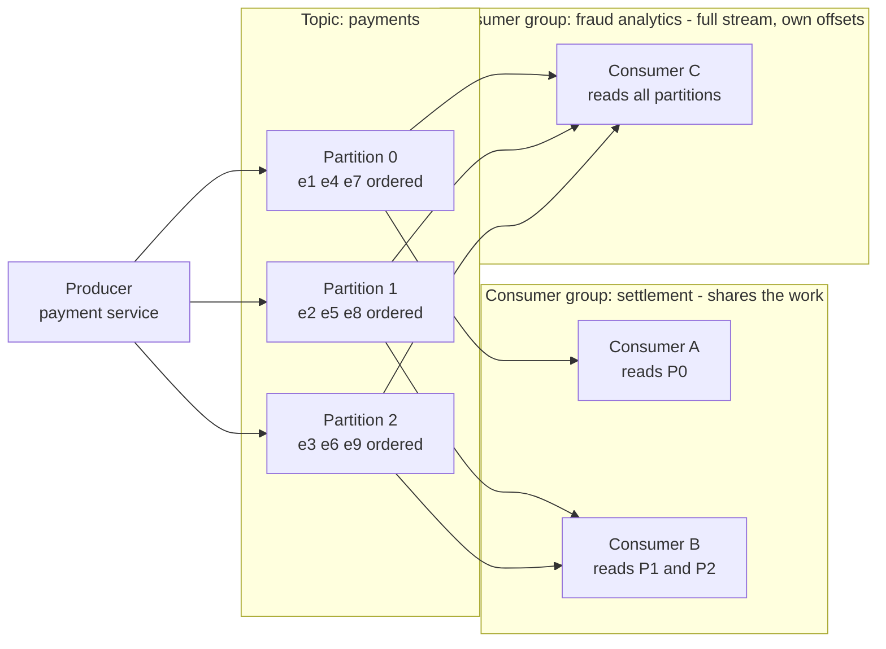
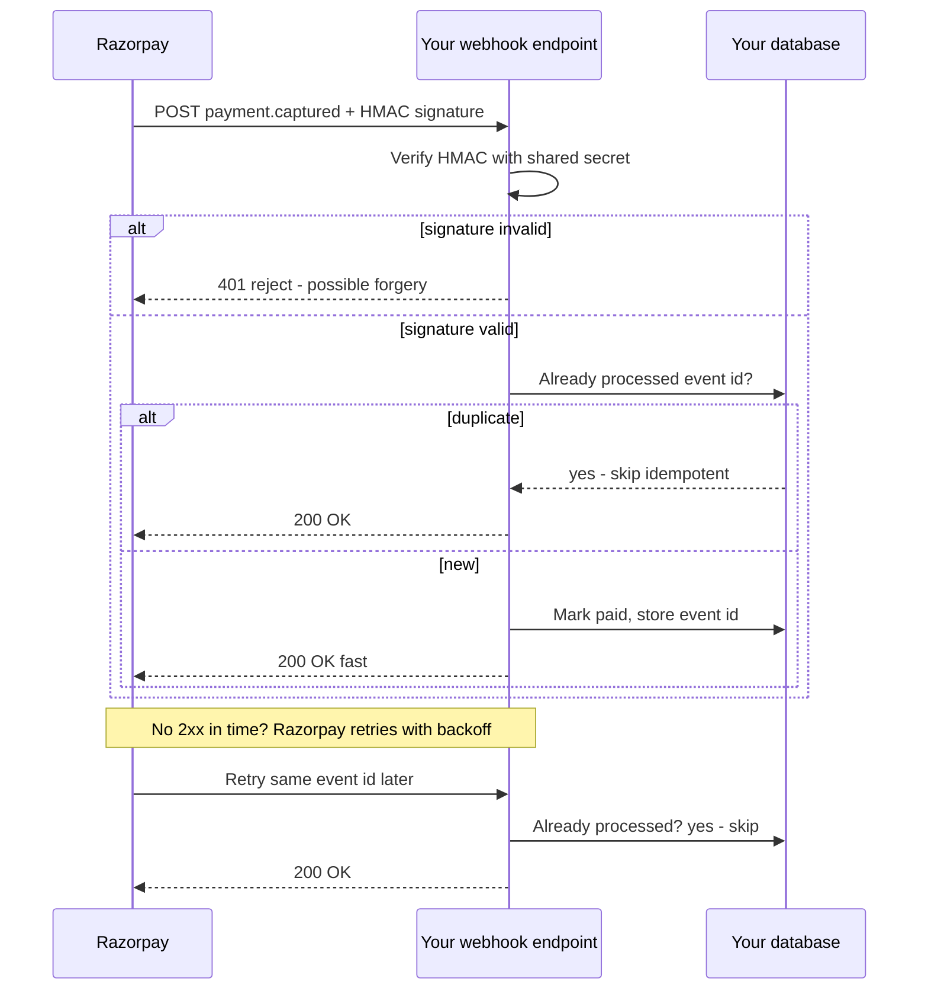

# 16. Kafka & Webhooks

> **One-liner:** Kafka is a durable, replayable *log* of events that many services can read independently; a webhook is a server phoning *you* back — "don't call us, we'll call you" — the moment something happens.
> **Where this fits:** [15-message-queues-and-pubsub.md](15-message-queues-and-pubsub.md) gave you queues and pub-sub. Kafka is the industrial-strength, replayable version of that idea, and webhooks are how *external* systems (like a payment gateway) push events into yours. Webhook reliability leans hard on the idempotency you met in [15](15-message-queues-and-pubsub.md) and [19-reliability-patterns.md](19-reliability-patterns.md). This is one of the most **Razorpay/CRED/Groww-relevant** chapters in the whole curriculum.

---

## 1. The Idea in Plain Words

This chapter covers two related-but-different tools. Both are about **events** — "something happened" — but they solve opposite ends of the problem.

### Part A — Kafka: the event log

A normal message queue ([15-message-queues-and-pubsub.md](15-message-queues-and-pubsub.md)) is like a to-do list: a worker takes a task *off* the list, and once it's done the task is **gone**. Great for distributing work, but the message vanishes after one consumer handles it.

**Apache Kafka** flips that. Instead of a disappearing to-do list, Kafka is a **log** — an append-only, ordered record of events that is **kept around** (for hours, days, or forever) and can be **re-read** by as many different consumers as you like. Think of it as a *shared, durable diary of everything that happened*, rather than a task list that gets erased.

New vocabulary, defined once:

- **Event** — an immutable record that something happened: `payment_succeeded`, `expense_added`, `user_signed_up`. Past tense, factual, never edited.
- **Log** — an ordered, append-only sequence. You only ever add to the end; you never insert in the middle or delete from it. Like a bank passbook.
- **Topic** — a named log/stream for one category of events, e.g. `payments`. Producers append to it, consumers read from it.
- **Partition** — a topic is split into partitions so it can scale. Each partition is its own ordered log living on a (possibly different) machine. **Order is guaranteed *within* a partition, not across partitions.** More partitions = more parallelism = more throughput.
- **Producer** — writes (appends) events to a topic. It picks which partition, usually by a **key** (e.g. `userId`) so all events for one user land in the same partition and stay ordered.
- **Offset** — a consumer's *bookmark*: the position in the partition it has read up to. Kafka doesn't delete a message when you read it; you just advance your offset. Rewind the offset and you **re-read** old events — this is **replay**.
- **Consumer group** — a team of consumers that *share* the work of a topic: each partition is read by exactly one consumer in the group. Crucially, **different consumer groups each get the full stream independently.** So the analytics group and the fraud group both read every `payments` event, at their own pace, with their own offsets.
- **Retention** — how long Kafka keeps events (e.g. 7 days, or forever). This is what makes replay possible.

The mental model: **a plain queue is a to-do list that's erased as it's done; Kafka is a permanent, ordered diary that any number of readers can read and re-read at their own pace.**

### Part B — Webhooks: "don't call us, we'll call you"

Normally *your* server calls other servers (you call the weather API, you call Razorpay). A **webhook** reverses the direction: **another server calls *you*** over HTTP when an event happens, so you don't have to keep asking.

- **Webhook** — a URL *you* host (e.g. `https://habex.santhu.site/webhooks/razorpay`) that an external system sends an HTTP POST to whenever something you care about occurs. It's a **server-to-server callback.** You register the URL once; they call it forever after, as events happen.

The classic contrast is **polling** vs **webhooks**:

- **Polling** — *you* repeatedly ask "any news yet? any news yet?" every few seconds. Simple, but wasteful (most checks return "nothing new") and laggy (you find out only on your next check).
- **Webhook** — you sit quietly; the moment there's news, *they* POST it to you. Efficient and near-instant. "Don't call us, we'll call you."

---

## 2. Picture It (Diagram)

### Diagram 1 — A Kafka topic: partitions + consumer groups

One `payments` topic split into 3 partitions. Producers key by `userId` so a user's events stay ordered in one partition. Two *independent* consumer groups each read the entire topic at their own offsets.

Key readings: within a partition, order is preserved (e1 before e4 before e7). The **settlement** group splits partitions across its two consumers to go faster. The **fraud** group independently reads the *same* events with its *own* bookmarks — neither group affects the other. Add a brand-new consumer group tomorrow and it can **replay from offset 0** to reprocess all history.

### Diagram 2 — A webhook delivery with retries

Razorpay charges a card, then POSTs a signed event to your webhook. Your server must **verify the signature**, respond fast, and be **idempotent** because retries can duplicate.

The retry at the bottom is why **idempotency is non-negotiable**: the same `payment.captured` can legitimately arrive twice, and you must not mark the order paid — or ship the goods — twice.

---

## 3. Real-World Analogy

**Kafka is a newspaper archive; a plain queue is a stack of tasks on a spike.**

A restaurant's **order spike** (the metal spike waiters impale tickets on) is a queue: a cook pulls a ticket, cooks it, and the ticket is *done and discarded*. One reader, then gone.

A **newspaper archive** is Kafka: every day's paper is printed once (append-only), kept for years (retention), and *anyone* can walk in and read — the history buff starts from 1990 (offset 0, replay), today's commuter reads only the latest (advancing offset), and the sports desk and the finance desk read the *same* papers independently for different reasons (consumer groups). The paper isn't consumed by being read; it stays on the shelf for the next reader.

**A webhook is a doorbell.** Polling is you opening the front door every 30 seconds to check if a package arrived — mostly you see an empty porch (wasted checks). A webhook is a doorbell the delivery person presses *only when* they're actually there — you find out instantly, and you never waste a trip. And just like a real doorbell, you'd better **check who's ringing** (signature verification) before you open the door — otherwise anyone can ring it and you'll act on a fake delivery.

---

## 4. Concrete Example

### Kafka: why LinkedIn built it, and when *you'd* use it

Kafka came from LinkedIn to move *huge* streams of events (activity, metrics, logs) to many systems at once. The property that makes it special: **one write, many independent readers, plus replay.** A single `user.activity` topic can feed the newsfeed, the notifications system, the ML training pipeline, and the data warehouse — each a separate consumer group, each reading everything at its own pace, none blocking the others.

**When Kafka is the right call:**

| Reason to choose Kafka | Why a plain queue struggles |
|---|---|
| **Very high throughput** (millions of events/sec) | Partitioning gives near-linear horizontal scale |
| **Replay** — reprocess history after a bug or for a new feature | Queue deletes messages once consumed; history is gone |
| **Many independent consumers** of the same stream | Queue message goes to *one* consumer; hard to fan out durably |
| **Event sourcing** — the log *is* your source of truth | Queues aren't built to store history |
| **Ordering per key** at scale | Partition-by-key preserves order while still parallel |

- **Event sourcing** — instead of storing only the *current* state ("balance = ₹2,000"), you store the *ordered log of events* that produced it ("+10,000 deposit, −8,000 debit"). The current state is a *replay* of the log. Kafka's durable, ordered log is a natural backbone for this. Great for audit trails — very relevant to fintech.

**When Kafka is overkill:** if you just need "send these emails" or "process these tasks," a plain queue (SQS/RabbitMQ) is simpler, cheaper, and less to operate. Kafka is a *distributed system in its own right* (brokers, partitions, ZooKeeper/KRaft, careful ops). Don't bring it in for modest task-distribution — that's résumé-driven design. Reach for Kafka when you genuinely need throughput, replay, or many independent readers.

### Webhooks: the Razorpay/Stripe payment flow (interview gold)

This is the scenario your target companies live and breathe. A user pays on Habex via **Razorpay**:

1. User pays; the money moves at Razorpay's end.
2. Razorpay **POSTs a `payment.captured` event to your webhook** URL, signed with a secret only you and Razorpay share.
3. Your server must, in order:
   - **Verify the HMAC signature** (below) — reject if it fails.
   - **Check idempotency** — have I already processed this event ID? If yes, return `200` and stop.
   - **Do the work** — mark the order paid, unlock the feature, record the event ID.
   - **Respond `200` quickly** — do heavy work async ([15-message-queues-and-pubsub.md](15-message-queues-and-pubsub.md)) so you ack fast; a slow response triggers retries.

**Why signature verification (HMAC) is mandatory.** Your webhook URL is a *public* HTTPS endpoint — anyone on the internet can POST to it. Without verification, an attacker could POST a fake `payment.captured` and get free goods. So Razorpay computes an **HMAC** — a cryptographic fingerprint of the request body using a **shared secret** — and sends it in a header. You recompute the HMAC with *your* copy of the secret; if it matches, the request genuinely came from Razorpay and wasn't tampered with. If not, reject with `401`. (More in [20-security-basics.md](20-security-basics.md).)

- **HMAC** — Hash-based Message Authentication Code: a hash of `(secret + payload)` that proves both *authenticity* (it came from someone who knows the secret) and *integrity* (the payload wasn't altered). You **must** compare using a constant-time comparison to avoid timing attacks, and compute it over the **raw** request body (not the re-serialized JSON).

**Why idempotency is mandatory.** Webhooks are delivered **at-least-once** ([15-message-queues-and-pubsub.md](15-message-queues-and-pubsub.md)). If your server is slow, briefly down, or the `200` gets lost, Razorpay **retries with exponential backoff** (e.g. after 1 min, 5 min, 30 min...). So the *same* `payment.captured` can arrive several times. If you naively "mark paid and grant premium" on every delivery, a retry could double-grant, double-ship, or double-count revenue. Fix: store each event's unique ID and make processing a **no-op on duplicates** — the exact idempotent-consumer pattern from [15](15-message-queues-and-pubsub.md) and [19-reliability-patterns.md](19-reliability-patterns.md).

**Ordering caveat.** Webhooks can arrive **out of order** (a retried `payment.authorized` might land *after* `payment.captured`). Don't assume order; make each handler decide based on *current* state, or use event timestamps/sequence numbers and ignore stale transitions.

### Kafka vs a plain queue, side by side

| Dimension | Plain queue ([15](15-message-queues-and-pubsub.md)) | Kafka |
|---|---|---|
| Message after consumption | Deleted | **Retained** (replayable) |
| Readers per message | Usually one consumer | Many independent consumer groups |
| Throughput | High | **Very** high (partitioned) |
| Ordering | Roughly FIFO; lost with parallelism | **Strict within a partition** |
| Replay history | No | **Yes** (rewind offsets) |
| Ops complexity | Low | Higher (it's a distributed system) |
| Best for | Task distribution, background jobs | Event streaming, event sourcing, analytics, high fan-out |

---

## 5. Tie-Back to Your Projects

**Habex + webhooks (the realistic, do-it-today case):**

Habex is an *expense tracker*, so payment and bank events are its lifeblood — webhooks fit naturally.

- **Consuming a payment webhook:** if Habex ever lets users pay for a premium tier via Razorpay, you'd expose `POST /webhooks/razorpay`. You would **verify the HMAC**, be **idempotent** on the event ID, mark the account premium, and return `200` fast. This is the single most likely code path an interviewer will ask you to design for a fintech-adjacent app — and you can say you've built exactly this pattern.
- **Consuming a bank/aggregator webhook:** to auto-import expenses, Habex could subscribe to a bank/account-aggregator that **webhooks you on every new transaction** (`transaction.created`). Each event becomes a Habex expense. Because deliveries are at-least-once and can be retried/reordered, you'd **dedupe on the bank's transaction ID** so the same purchase never becomes two expenses — the same idempotency key idea from your recurring-expense worker in [15-message-queues-and-pubsub.md](15-message-queues-and-pubsub.md).
- **Exposing a webhook:** Habex could *offer* webhooks to power users — "POST to my URL whenever I cross 90% of my Food budget." Now Habex is the *sender*: you'd sign your payloads with HMAC, retry with backoff on non-`2xx`, and send a stable event ID so *they* can dedupe. You've now seen both sides of the doorbell.

**Habex + Kafka (be honest: probably overkill today):**
Habex at its current scale does **not** need Kafka — a plain queue ([15-message-queues-and-pubsub.md](15-message-queues-and-pubsub.md)) covers report emails and recurring expenses. Saying *"Kafka would be overkill for Habex today"* is a **strong** interview answer because it shows judgement (see [01-what-is-system-design.md](01-what-is-system-design.md) on not over-engineering). But you can describe the *tipping point*: *"If Habex grew to ingest millions of bank transactions and I wanted several independent consumers — expense categorisation, budget alerts, fraud/anomaly detection, and a data warehouse — all reading the same `transaction` stream with replay for reprocessing after a categorisation-model change, **that's** when I'd move to Kafka. The replay-history-to-recategorise capability is the deciding feature."* That sentence shows you know both the tool *and* when it's warranted.

**The interview-ready sentence:**
> *"For Habex I'd consume Razorpay webhooks: verify the HMAC signature over the raw body, dedupe on the event ID so at-least-once retries can't double-grant premium, respond 200 fast and offload heavy work to a queue. Kafka would be overkill now; I'd only reach for it if I had a high-volume transaction stream feeding several independent consumers and needed replay."*

Your **santhu.site** portfolio needs neither — no events, no payments, nothing to stream or call back. Correctly recognising "not needed here" is itself the skill.

---

## 6. Interview Questions (with answer pointers)

**Q1. How is Kafka different from a plain message queue?** *(CRED, Razorpay, Swiggy — very common)*
→ A queue deletes a message once consumed and usually delivers to one consumer; Kafka is a **retained, ordered log** that many independent consumer groups can read and **replay** via offsets. Kafka scales via partitions and is built for high-throughput event streaming, not just task distribution.

**Q2. Explain partitions, offsets, and consumer groups.** *(CRED, senior)*
→ A topic splits into **partitions** (each an ordered log; order guaranteed only within a partition). An **offset** is a consumer's bookmark — Kafka doesn't delete on read, so rewinding the offset replays. A **consumer group** shares partitions among its members to parallelise; *different* groups each read the whole topic independently with their own offsets.

**Q3. When would you choose Kafka, and when is it overkill?** *(Zepto, Swiggy, CRED)*
→ Choose it for **high throughput, replay, many independent consumers, or event sourcing**. It's overkill for simple background jobs / task distribution — use a plain queue (SQS/RabbitMQ) there. Kafka is itself a distributed system to operate; don't adopt it without a reason. (Bonus: name the Habex tipping point.)

**Q4. What is a webhook and how does it beat polling?** *(Razorpay, Groww)*
→ A webhook is an HTTP callback: you host a URL and an external server POSTs to it when an event happens — "don't call us, we'll call you." Beats polling because polling wastes requests (mostly "nothing new") and adds latency (you learn only on your next poll); webhooks are near-instant and efficient.

**Q5. Design a payment webhook handler. What are the must-haves?** *(Razorpay, CRED, Groww — highly likely, sometimes as code)*
→ (1) **Verify the HMAC signature** over the raw body with the shared secret; reject if it fails. (2) **Idempotency** — dedupe on event ID so at-least-once **retries** don't double-process. (3) **Respond 2xx fast**; push heavy work to a queue. (4) Don't assume **ordering**; decide from current state. (5) Use HTTPS. Mention exponential-backoff retries from the sender's side.

**Q6. Why must webhook handlers be idempotent?** *(Razorpay, CRED)*
→ Because webhooks are **at-least-once**: if you're slow/down or the ack is lost, the sender **retries**, so the same event arrives multiple times. Without idempotency (dedupe on event ID), a retry could double-charge, double-ship, or double-grant access. Links to [15-message-queues-and-pubsub.md](15-message-queues-and-pubsub.md)/[19-reliability-patterns.md](19-reliability-patterns.md).

**Q7. Why verify the webhook signature, and how does HMAC work?** *(Razorpay, CRED, Groww — security-focused)*
→ Your endpoint is public; anyone can POST a **forged** event. HMAC is a hash of `(shared secret + payload)`; recompute it on your side and compare (constant-time) to prove authenticity and integrity. No match → reject. Compute over the **raw** body. See [20-security-basics.md](20-security-basics.md).

**Q8. What's event sourcing and how does Kafka support it?** *(senior — CRED, Groww)*
→ Store the **ordered log of events** as the source of truth instead of just current state; rebuild state by replaying events. Kafka's durable, ordered, replayable log is a natural fit, and gives you a full **audit trail** — valuable in fintech. Trade-off: more complexity, and you need snapshots so you're not replaying from the beginning of time.

**Q9. Kafka guarantees ordering — with a catch. What is it?** *(CRED, senior)*
→ Ordering is guaranteed **within a single partition**, not across a topic. To keep related events ordered (e.g. all events for one `userId`), the producer keys by that field so they land in the same partition. More partitions = more throughput but only per-partition order.

---

## 7. Trade-offs & "Why Not Just X?"

**"Why not just poll instead of running webhooks?"**
Polling every few seconds wastes huge numbers of requests that return "nothing new," adds latency (you learn only at the next poll), and scales badly across many users. Webhooks are efficient and near-instant. *But* polling has real virtues: it's dead simple, needs no public endpoint, and *you* control the pace — so for low-frequency or firewalled cases, polling is legitimately fine. Many systems offer both; some do **webhook + reconcile-by-polling** as a safety net for missed deliveries.

**"Why not just use Kafka for all our async needs?"**
Because Kafka is a heavyweight distributed system: brokers, partitions, replication, consumer-group rebalancing, careful capacity planning. For "send emails" or "process this batch," that's massive operational overhead for no benefit — a plain queue is simpler and cheaper ([15-message-queues-and-pubsub.md](15-message-queues-and-pubsub.md)). Use Kafka when throughput, replay, or multi-consumer fan-out actually demand it. Matching tool to need *is* the interview skill.

**"Why not have the payment gateway's webhook do the real work synchronously in the handler?"**
Because the sender expects a **fast 2xx** and will **retry** if you're slow — so a slow handler causes duplicate deliveries and, worse, the gateway may mark your endpoint unhealthy. Best practice: verify + dedupe + record + return `200` immediately, then do heavy lifting (emails, provisioning) **asynchronously** via a queue. Fast ack, async work.

**Webhooks vs Kafka — they're not competitors.** A subtle interview point: webhooks push events *across company boundaries* (Razorpay → you) over plain HTTP; Kafka moves events *within your own system* at scale. A common architecture is **both**: a webhook receives a payment event, your handler verifies it and **publishes it to a Kafka topic**, and your internal services consume it from there with replay and fan-out. Webhook = the front door from outside; Kafka = the internal nervous system.

| | Webhook | Kafka |
|---|---|---|
| Direction | External server → you, over HTTP | Internal event backbone |
| Transport | One HTTP POST per event | Durable partitioned log |
| Delivery | At-least-once, sender retries | At-least-once, consumer offsets |
| Replay | No (unless sender re-sends) | **Yes** (rewind offsets) |
| Security must-have | **HMAC signature verification** | Network/ACLs, internal trust |
| Typical use | Payment/3rd-party notifications | High-volume streaming, event sourcing |

**"Why not trust the webhook payload and skip verification to save time?"**
Never. A public endpoint that acts on unverified payloads is a wide-open door to fraud — forged `payment.captured` events, granting paid features for free. Signature verification is not optional for anything touching money or access. This is exactly the kind of security judgement Razorpay/CRED/Groww probe for; see [20-security-basics.md](20-security-basics.md).

---

## 8. TL;DR

- **Kafka is a durable, ordered, replayable *log* of events**, not a disappearing to-do list. Consumed messages aren't deleted — readers advance an **offset** and can **replay** by rewinding it.
- **Topic → partitions**: order is guaranteed **within a partition** (key by `userId` to keep a user's events ordered). More partitions = more throughput.
- **Consumer group** members *share* a topic's partitions; **different groups** each read the whole stream independently — that's how one event stream fans out to settlement, fraud, analytics, and a warehouse at once.
- **Choose Kafka** for high throughput, **replay**, many independent consumers, or **event sourcing**. It's **overkill** for simple task distribution — use a plain queue ([15-message-queues-and-pubsub.md](15-message-queues-and-pubsub.md)). Saying "Kafka is overkill here" is a strong answer.
- **A webhook is a server-to-server HTTP callback** — you host a URL, they POST to it on an event. "Don't call us, we'll call you." Beats **polling** (which wastes requests and lags).
- **Payment webhook must-haves (Razorpay/CRED/Groww gold):** (1) **verify the HMAC signature** over the raw body, (2) be **idempotent** — dedupe on event ID because at-least-once **retries** cause duplicates, (3) **respond 2xx fast** and offload heavy work to a queue, (4) don't assume **ordering**, (5) HTTPS only.
- **HMAC** = hash of `(secret + payload)` proving authenticity + integrity; recompute and compare constant-time. Never act on an unverified payload — forgery risk ([20-security-basics.md](20-security-basics.md)).
- **Habex reflex:** consume Razorpay/bank webhooks with HMAC verification + dedupe on event/transaction ID; optionally *expose* signed webhooks for budget alerts. Kafka only if Habex grows to a high-volume transaction stream with several independent consumers needing replay.
- Webhooks and Kafka often combine: **webhook receives the external event → publish to Kafka → internal services consume with fan-out and replay.**
- Next: [17-api-design-rest-graphql.md](17-api-design-rest-graphql.md) — designing the APIs that tie all these services together.
