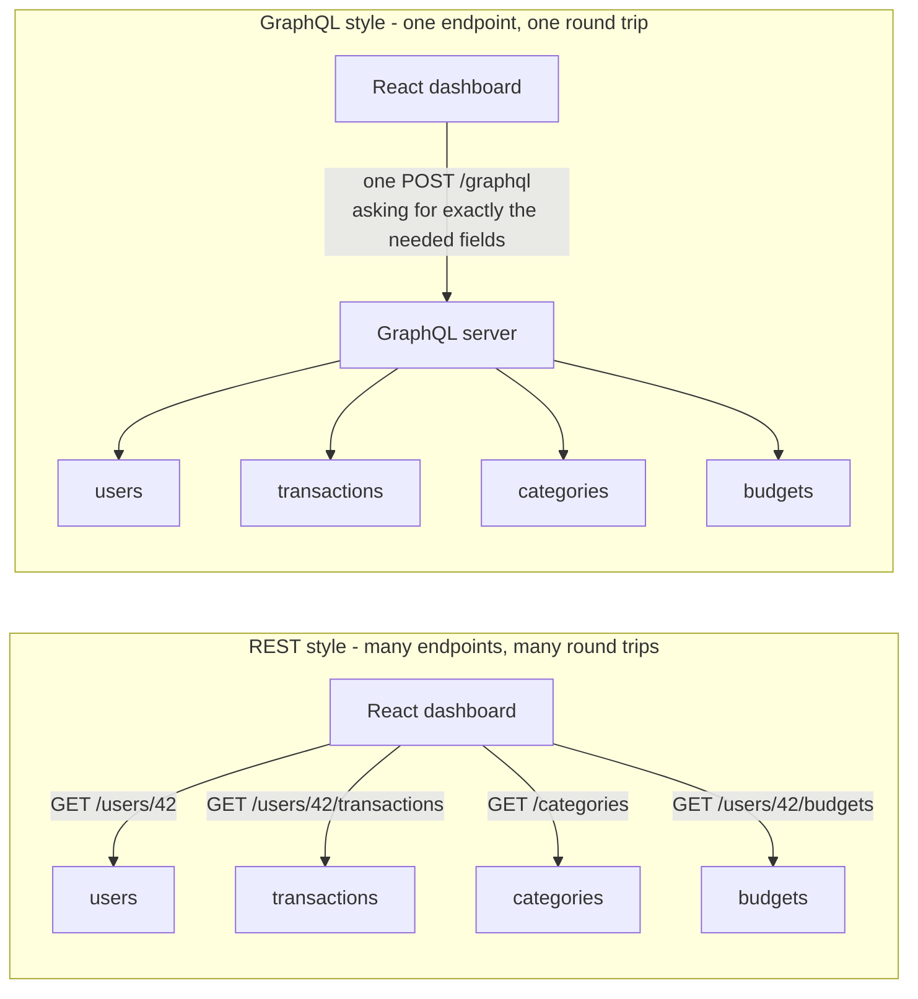

# 17. API Design: REST, GraphQL & gRPC

> **One-liner:** An API is the contract between your frontend and your backend — REST, GraphQL, and gRPC are three different styles for writing that contract, each optimizing for a different thing.
> **Where this fits:** This is where your frontend brain gives you an unfair advantage. You've _consumed_ hundreds of APIs (`fetch`, `axios`, React Query); now you learn to _design_ them. It builds directly on `04-http-and-https.md` (verbs, status codes) and feeds `18-rate-limiting-pagination-versioning.md` (operating an API) and every case study.

## 1. The Idea in Plain Words

An **API** (Application Programming Interface) is just **the agreed-upon way two programs talk to each other.** For web apps it usually means: your React app sends an HTTP request, your backend server sends a structured response (almost always JSON), and both sides have _agreed in advance_ on the shape of those messages.

That agreement is the **API contract**. It says things like: "To get a user's transactions, send `GET /users/42/transactions`. You'll get back a JSON array, each item has `id`, `amount`, `date`, and `category`. If the user doesn't exist, you get status `404`." The contract is a _promise_. Your React code is written against that promise; the backend is written to keep it.

**Why does good API design matter so much?**

1. **The contract is expensive to change.** Once your React app, your mobile app, and three partner integrations all depend on `amount` being a number in rupees, you can't just rename it. A clean contract is one you rarely need to break. (When you _do_ have to, see versioning in `18-rate-limiting-pagination-versioning.md`.)
2. **It's the seam between two teams.** Frontend and backend are often different people. The API is the handshake. A messy, inconsistent API means constant "wait, is it `userId` or `user_id` here?" friction and bugs.
3. **It leaks into everything.** Caching, security, rate limiting, and how fast your dashboard loads are all shaped by API design. A badly shaped API makes your React app do 8 round trips to render one screen.

Here's the frontend intuition to hold onto: **a good API feels like a well-designed set of React component props.** Predictable names, the right granularity, no surprises, and you can guess the next one without reading the docs. That instinct — "this feels clean" — is exactly what you're training.

Three big styles dominate interviews:

- **REST** — the default. Model your data as **resources** (nouns) and act on them with HTTP verbs. Simple, cacheable, everywhere.
- **GraphQL** — one smart endpoint. The client asks for _exactly_ the fields it wants, no more, no less. Great for rich, data-hungry UIs like dashboards.
- **gRPC** — binary and fast. Mostly used _between backend services_, not talking to browsers.

## 2. Picture It (Diagram)

The single clearest difference between REST and GraphQL: **how many endpoints your React dashboard has to hit to fill one screen.** Say the Habex dashboard needs the user's name, their recent transactions, each transaction's category, and their budgets.



On the left, REST: four separate URLs, four round trips, and each one probably returns _more fields than the dashboard uses_. On the right, GraphQL: one URL, one request that describes the whole shape you want, one response that matches it. Keep this picture in your head — it's the heart of the REST-vs-GraphQL debate.

## 3. Real-World Analogy

Think about **ordering food**, which you do on Swiggy and Zepto all the time.

- **REST is a fixed-menu thali.** Every dish has its own counter. Want rice? Go to the rice counter (`GET /rice`). Want dal? Different counter (`GET /dal`). Each counter serves a _standard portion_ — sometimes more than you can eat (over-fetching). To assemble a full meal you walk to several counters (several round trips). Simple, predictable, and the kitchen can pre-cook popular dishes (caching).

- **GraphQL is a build-your-own bowl with one waiter.** You hand over one slip: "small rice, extra dal, no onions, two rotis." One trip, exactly what you asked for, nothing wasted. More flexible — but the kitchen needs a smarter system to fulfill arbitrary combinations.

- **gRPC is the kitchen's internal intercom.** Chefs talking to chefs in fast shorthand no customer ever hears. Not meant for the dining room; meant for speed behind the scenes.

None is "best." A canteen with steady demand loves the thali. A trendy salad bar needs build-your-own. The kitchen staff need their intercom. Same in software.

## 4. Concrete Example

Let's design the **Habex transactions API** properly — first in REST, then fetch the same dashboard data with GraphQL.

### 4a. REST — resources as nouns, verbs as actions

The core REST idea: everything is a **resource** (a noun), identified by a URL, and you _act_ on it with an HTTP **verb** (method). You never put the action in the URL. So it's `POST /transactions`, **never** `POST /createTransaction`.

| You want to... | Verb + URL | HTTP verb meaning |
|---|---|---|
| List a user's transactions | `GET /users/42/transactions` | read |
| Get one transaction | `GET /transactions/98` | read |
| Create a transaction | `POST /transactions` | create |
| Fully replace one | `PUT /transactions/98` | replace |
| Partially update one | `PATCH /transactions/98` | edit some fields |
| Delete one | `DELETE /transactions/98` | remove |

Notice `/users/42/transactions` — that's a **sub-resource**: "the transactions _belonging to_ user 42." Collections are plural nouns (`/transactions`, `/categories`, `/budgets`). This nesting maps cleanly to how you think in the UI.

**Filtering, sorting, and pagination go in the query string**, not the path — because they narrow a collection rather than name a new resource:

```
GET /users/42/transactions?category=food&from=2026-06-01&to=2026-06-30&sort=-amount&page=2&limit=20
```

Read that like a sentence: user 42's transactions, only `food`, only June, sorted by `amount` descending (the `-` means descending), page 2 of 20-per-page. (Pagination has its own chapter — `18-rate-limiting-pagination-versioning.md`.)

**A `GET` response** — note the consistent envelope with `data` plus `meta`:

```json
{
  "data": [
    {
      "id": "txn_98",
      "amount": 240.00,
      "currency": "INR",
      "note": "Zepto groceries",
      "date": "2026-06-28",
      "type": "expense",
      "category": { "id": "cat_food", "name": "Food" }
    }
  ],
  "meta": { "page": 2, "limit": 20, "total": 137 }
}
```

**Creating a transaction** — the request body carries the new resource, and the status code tells the whole story (full status-code tour in `04-http-and-https.md`):

```http
POST /transactions
Content-Type: application/json

{ "amount": 240.00, "currency": "INR", "note": "Zepto groceries", "date": "2026-06-28", "type": "expense", "categoryId": "cat_food" }
```

```http
HTTP/1.1 201 Created
Location: /transactions/98

{ "data": { "id": "txn_98", "amount": 240.00, "note": "Zepto groceries", "date": "2026-06-28", "category": { "id": "cat_food", "name": "Food" } } }
```

`201 Created` (not a bare `200`) plus a `Location` header pointing at the new resource — that precision is what interviewers mean by "clean REST."

**Pick status codes that mean something.** Your React error handling depends on them:

| Code | Meaning | When Habex returns it |
|---|---|---|
| `200 OK` | success | fetched transactions |
| `201 Created` | resource made | created a transaction |
| `204 No Content` | success, nothing to return | deleted a transaction |
| `400 Bad Request` | client sent garbage | `amount` is missing or negative |
| `401 Unauthorized` | not logged in | token missing/expired |
| `403 Forbidden` | logged in, not allowed | editing someone else's transaction |
| `404 Not Found` | no such resource | `/transactions/99999` |
| `409 Conflict` | clashes with current state | duplicate/edit conflict |
| `422 Unprocessable` | valid JSON, invalid data | `date` in the future for an expense |
| `429 Too Many Requests` | rate limited | see `18-rate-limiting-pagination-versioning.md` |
| `500 Internal Server Error` | backend broke | uncaught exception |

**Use one consistent error shape everywhere** so your React app has exactly one error handler to write:

```json
{
  "error": {
    "code": "VALIDATION_ERROR",
    "message": "amount must be a positive number",
    "field": "amount",
    "requestId": "req_a1b2c3"
  }
}
```

A machine-readable `code` (switch on it), a human `message` (log/toast it), the offending `field` (highlight the input), and a `requestId` (so support can trace it). Consistency here is a gift to your future self.

**Two REST principles interviewers always probe:**

- **Statelessness.** Every request carries everything the server needs to handle it — typically an auth token in a header — and the server keeps _no_ memory of you between requests. Why it matters: any of your identical app servers can handle any request, so a load balancer (`05-load-balancers.md`) can spray traffic freely and you scale horizontally (`06-scaling-vertical-vs-horizontal.md`). The server remembers nothing; the _database_ remembers.
- **Idempotency.** An operation is **idempotent** if doing it 5 times lands you in the same state as doing it once. `GET`, `PUT`, `DELETE` are idempotent by design; `POST` is _not_ (retry `POST /transactions` twice → two expenses). This matters the instant a phone on flaky Indian mobile data retries a request. The fix is an **idempotency key** — a unique ID the client attaches so the server can dedupe retries:

  ```http
  POST /transactions
  Idempotency-Key: 6f1c-a2b9-...
  ```

  We only preview it here; the full retry/idempotency deep dive is `19-reliability-patterns.md`.

### 4b. GraphQL — ask for exactly what you need

**GraphQL** flips the model. Instead of many endpoints, there's **one endpoint** (`POST /graphql`) and a **typed schema** that describes every type and field the API offers. The client sends a _query_ that names precisely the fields it wants, nested however the UI needs them.

The schema (backend defines this once):

```graphql
type Transaction {
  id: ID!
  amount: Float!
  note: String
  date: String!
  category: Category!
}
type Category { id: ID!  name: String!  icon: String }
type Budget   { category: Category!  limit: Float!  spent: Float! }
type User {
  id: ID!
  name: String!
  transactions(from: String, to: String, limit: Int): [Transaction!]!
  budgets: [Budget!]!
}
type Query { user(id: ID!): User }
```

Now the React dashboard asks for the _whole screen in one query_:

```graphql
query DashboardData {
  user(id: "42") {
    name
    transactions(from: "2026-06-01", to: "2026-06-30", limit: 5) {
      amount
      note
      category { name icon }
    }
    budgets {
      category { name }
      limit
      spent
    }
  }
}
```

The response mirrors the query shape **exactly** — a frontend dev's dream, because the response looks like the query you wrote:

```json
{
  "data": {
    "user": {
      "name": "Santhosh",
      "transactions": [
        { "amount": 240, "note": "Zepto groceries", "category": { "name": "Food", "icon": "cart" } }
      ],
      "budgets": [
        { "category": { "name": "Food" }, "limit": 8000, "spent": 5240 }
      ]
    }
  }
}
```

This directly kills two classic REST pains:

- **Over-fetching** — REST's `GET /users/42` hands you `email`, `createdAt`, `phone`... even when the dashboard only needed `name`. Wasted bytes, painful on mobile data. GraphQL returns _only_ `name`.
- **Under-fetching** — with REST you often need several calls (user, then transactions, then each category) to build one screen. GraphQL fetches the nested graph in one shot.

**The catch — the N+1 problem.** A naive GraphQL server, resolving `category` for each of 50 transactions, fires **1** query for the transactions **+ 50** separate queries for categories = 51 database hits. That "1 + N" explosion is the famous **N+1 problem**. The standard fix is **batching** (e.g. a DataLoader) that collects all 50 category IDs and fetches them in _one_ query. Just naming "N+1, solved with a DataLoader / batching" in an interview signals you actually understand GraphQL's cost, not just its shine. (Related: database indexing to make each of those lookups fast — `10-database-indexing.md`.)

### 4c. gRPC in brief

**gRPC** is a high-performance style built for **service-to-service** calls _inside_ your backend. Three things to know:

- **Binary, not JSON.** It uses **Protocol Buffers** (protobuf) — a compact binary format defined in a `.proto` schema file. Smaller and faster to parse than JSON, but not human-readable.
- **Runs on HTTP/2.** Gets multiplexing and native **streaming** (a server can stream many messages over one connection) — see HTTP versions in `04-http-and-https.md`.
- **Contract-first & strongly typed.** You write the `.proto`, and it generates client/server code in many languages.

The trade-off: gRPC isn't natively callable from a browser (needs a `grpc-web` proxy), and you can't just eyeball it in DevTools. So it's rarely your public/browser API — it shines _between_ services, e.g. Habex's `transaction-service` calling an internal `currency-service` to convert USD→INR thousands of times a second, where every millisecond and byte counts.

### 4d. The comparison you'll be asked to draw

| | REST | GraphQL | gRPC |
|---|---|---|---|
| **Shape** | Many endpoints, one per resource | One endpoint, typed schema | RPC methods from a `.proto` |
| **Payload** | JSON (text) | JSON (text) | Protobuf (binary) |
| **Transport** | HTTP/1.1 or 2 | HTTP (usually POST) | HTTP/2 |
| **Client picks fields?** | No, server decides | Yes, exactly | No, method-defined |
| **Over/under-fetching** | Common | Solved by design | N/A |
| **Browser-native** | Yes | Yes | No (needs proxy) |
| **Caching** | Easy (HTTP caching per URL) | Harder (one URL, POST) | Manual |
| **Learning curve** | Low | Medium | Medium-high |
| **Use when...** | Public APIs, CRUD, simple + cacheable | Rich UIs / dashboards, many clients needing different data shapes, mobile | Internal microservice-to-service, low latency, streaming |

Interview-ready one-liner: **"REST for the public CRUD API, GraphQL when the frontend needs flexible data shapes, gRPC for fast internal service-to-service calls."**

## 5. Tie-Back to Your Projects

**santhu.site** (your portfolio) barely needs an API — a single `POST /contact` for the contact form is the whole surface. That's the right call. Don't reach for GraphQL to submit one form; a lone REST endpoint returning `201` is clean and done. _Matching the tool to the need is itself good design._

**Habex** is the perfect place to _show_ this thinking:

| Habex reality | API design choice | Why |
|---|---|---|
| Public REST API for the app | REST, nouns + verbs, consistent error envelope | Simple, cacheable, easy for your React app + any future mobile app |
| Dashboard needs user + txns + categories + budgets at once | GraphQL query (or a purpose-built REST `/dashboard` endpoint) | One round trip, no over-fetching, response matches the UI shape |
| `POST /transactions` retried on flaky mobile data | Idempotency key so a double-tap doesn't log the expense twice | Correctness with money — see `19-reliability-patterns.md` |
| Internal currency conversion at high volume | gRPC between services | Speed + binary efficiency |
| Generated TypeScript types from the schema | GraphQL schema (or OpenAPI for REST) | End-to-end type safety into your React code — your comfort zone |

A killer interview line about your own project: _"Habex is REST today because it's mostly CRUD and easy to cache. The one screen I'd consider GraphQL for is the dashboard — it fans out to four resources, and a single typed query would cut it to one round trip and let me generate my React types straight from the schema."_ That's concrete, honest, and shows judgement.

## 6. Interview Questions (with answer pointers)

**Q1. "What makes an API RESTful?" _(Zepto, Swiggy)_**
Resources as nouns in URLs, HTTP verbs for actions (`GET`/`POST`/`PUT`/`PATCH`/`DELETE`), **statelessness** (each request self-contained), proper status codes, and consistent JSON. Say "`POST /transactions`, never `POST /createTransaction`" — it instantly signals you get it.

**Q2. "REST vs GraphQL — when would you pick each?" _(Swiggy, CRED)_**
REST for straightforward, cacheable CRUD and public APIs. GraphQL when clients need flexible/varied data shapes or you're fighting over- and under-fetching on a rich UI (dashboards, mobile). Anchor it in Habex's dashboard fanning out to four resources.

**Q3. "What's the N+1 problem in GraphQL and how do you fix it?" _(CRED, Groww)_**
Resolving a nested field per item fires 1 query for the list + N for the children = N+1 DB hits. Fix with **batching** (DataLoader) that coalesces the N lookups into one, plus good indexes (`10-database-indexing.md`). Knowing this proves you've felt GraphQL's real cost.

**Q4. "Which HTTP methods are idempotent, and why does it matter?" _(Razorpay, Groww)_**
`GET`, `PUT`, `DELETE` (and `HEAD`/`OPTIONS`) are idempotent; `POST` is not. It matters because networks fail and clients retry — a retried `POST /payments` must not charge twice. Solution: **idempotency keys**. Fintechs live on this; deep dive in `19-reliability-patterns.md`.

**Q5. "Design the API for [feature]." _(all five companies)_**
Walk the flow: list resources (nouns) → map verbs → design URLs incl. sub-resources and query params for filter/sort/paginate → define the JSON request/response and one consistent error shape → pick status codes. Narrate it; that _is_ the answer they want.

**Q6. "How would you return errors from an API?" _(Razorpay, CRED)_**
Correct HTTP status code + a consistent JSON envelope with a machine-readable `code`, human `message`, offending `field`, and a `requestId` for tracing. Emphasise consistency: one shape means the frontend writes one error handler.

**Q7. "Where does gRPC fit, and why not use it for your public API?" _(Groww, CRED)_**
gRPC = binary protobuf over HTTP/2, ideal for fast internal service-to-service calls and streaming. Not the public/browser API because it's not browser-native (needs a proxy) and isn't human-readable/easily cacheable.

**Q8. "How do you keep an API contract from breaking clients as it evolves?" _(Swiggy, Razorpay)_**
Prefer **additive, backward-compatible** changes (new optional fields never hurt). For truly breaking changes, **version** the API and run old + new in parallel with a deprecation timeline. Full treatment in `18-rate-limiting-pagination-versioning.md`.

## 7. Trade-offs & "Why Not Just X?"

**"Why not just use GraphQL for everything? It sounds strictly better."** It buys flexibility but spends real complexity: HTTP caching gets harder (one URL, everything is `POST`, so no free per-URL CDN caching — `08-cdn.md`), you must defend against expensive/deeply-nested queries, and you own the N+1 problem. For a small CRUD app, REST is less to build, trivially cacheable, and debuggable in the browser. **GraphQL earns its keep when many clients need many different shapes of the same data — not before.**

**"Why not put the action in the URL, like `/getTransactions`?"** Because verbs already _are_ your actions. Nouns-only URLs mean the whole API is guessable and consistent: if `GET /transactions` lists them, you already know `POST /transactions` creates and `DELETE /transactions/98` removes. Action-URLs sprawl into `/getX`, `/fetchX`, `/loadX` chaos with no rules.

**"Why not always use gRPC — it's the fastest?"** Speed isn't free. You lose browser support, human-readable payloads, easy debugging, and simple HTTP caching. That's a great trade _inside_ your backend where machines talk to machines; a bad trade for the public API humans and browsers touch.

**"Why not one giant `/dashboard` endpoint that returns everything?"** Totally valid — it's the pragmatic REST answer to over/under-fetching (often called a Backend-for-Frontend). The trade: it's rigid. Every new screen wants a slightly different bundle, and you either bloat that endpoint or spawn `/dashboard-v2`, `/mobile-home`... GraphQL generalises this so the _client_ decides the shape. Pick per situation.

| Decision | Cheap/simple side | Flexible/robust side | You pay with... |
|---|---|---|---|
| Style | REST | GraphQL | Caching ease vs shape flexibility |
| Payload | JSON (readable) | Protobuf/gRPC (fast) | Debuggability vs speed/size |
| Data shaping | Server decides (fixed endpoints) | Client decides (queries) | Simplicity vs over/under-fetch |
| Evolving | Break + version | Add optional fields | Effort now vs contract stability |

The senior move is never "GraphQL is modern so use GraphQL." It's naming the read/write pattern, the number and variety of clients, and caching needs — _then_ choosing.

## 8. TL;DR

- An **API is a contract** between frontend and backend; a clean, consistent one is the difference between smooth teams and constant friction. Your React "does this feel clean?" instinct is the right instinct.
- **REST** = resources as **nouns** + HTTP **verbs**, **stateless**, proper **status codes**, consistent JSON. `POST /transactions`, never `POST /createTransaction`. Filter/sort/paginate go in the **query string**.
- **Idempotency**: `GET`/`PUT`/`DELETE` are safe to retry, `POST` isn't — use an **idempotency key** so retries don't double-charge (deep dive: `19-reliability-patterns.md`).
- **GraphQL** = one endpoint + typed schema; the client requests **exactly** the fields it needs, killing **over-fetching** and **under-fetching**. Watch the **N+1 problem**; fix with batching/DataLoader.
- **gRPC** = binary protobuf over HTTP/2, great for **internal service-to-service** speed and streaming; not browser-native.
- **Rule of thumb:** REST for public CRUD, GraphQL for flexible/rich UIs and mobile, gRPC for fast internal calls.
- Always return **meaningful status codes** and **one consistent error shape** (`code`, `message`, `field`, `requestId`) — your frontend will thank you.
- Every choice is a trade-off: flexibility vs caching, speed vs debuggability, simplicity vs shape-control. Name the trade, don't chase the buzzword.
