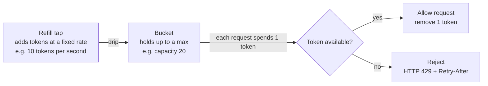

# 18. Rate Limiting, Pagination & Versioning

> **One-liner:** Three unglamorous-but-essential concerns for _operating_ an API in the real world: stopping abuse (rate limiting), returning big lists in chunks (pagination), and evolving the contract without breaking clients (versioning).
> **Where this fits:** `17-api-design-rest-graphql.md` taught you to _design_ an API; this chapter is about _running_ one that real users and abusers hammer. Rate limiting leans on load balancers/gateways (`05-load-balancers.md`), pagination on indexing (`10-database-indexing.md`), and idempotency threads through to `19-reliability-patterns.md`.

## 1. The Idea in Plain Words

You've designed a clean API. Now put it on the internet, where three new problems appear that have nothing to do with features and everything to do with survival:

- **Rate limiting** = capping how many requests a caller can make in a window. Without it, one buggy client in a `while(true)` loop, one scraper, or one attacker can flood your servers, run up your cloud bill, and make the app slow for _everyone_. A **rate limit** is a fairness-and-safety valve: "you get N requests per minute; past that, wait."
- **Pagination** = returning a long list in **pages** (small chunks) instead of all at once. Habex user with 8,000 transactions? You don't ship 8,000 rows in one response — you send 20, plus a way to ask for the next 20. **Pagination** is how a list endpoint stays fast and cheap no matter how much data sits behind it.
- **Versioning** = letting the API **change over time without breaking apps already using it.** Your live React app depends on today's response shape. The day you need a different shape, **versioning** lets the new API coexist with the old so nothing already deployed shatters.

Frontend framing you already feel: you've hit `429 Too Many Requests` from an API, built an infinite-scroll feed that loads more as you scroll, and cursed when an API "v1 → v2" migration broke your `fetch` calls. This chapter is the backend side of all three.

## 2. Picture It (Diagram)

**Rate limiting — the token bucket.** Picture a bucket that a tap refills at a steady rate. Each request must grab a token to proceed; empty bucket = rejected.



The bucket size (20) allows a short **burst**; the refill rate (10/sec) sets the sustained pace. Idle a moment and the bucket refills, so you're allowed a burst again. That "bursts OK, but bounded average" behaviour is exactly what real traffic needs.

**Pagination — why offset breaks on a _moving_ list.** This is the single most important diagram in the chapter. Watch what happens when new data arrives between two page fetches.

```
OFFSET pagination (page = skip N, take M)

T0  user fetches page 1  ->  offset 0, limit 3
    index:  0     1     2     3     4
    items: [P100][P99] [P98] [P97] [P96]
            \_____page 1_____/          (user sees P100, P99, P98)

... a NEW item P101 is inserted at the top (someone posted) ...

T1  user scrolls, fetches page 2  ->  offset 3, limit 3
    index:  0     1     2     3     4     5
    items: [P101][P100][P99] [P98] [P97] [P96]
                              \_____page 2_____/   (offset 3 -> P98, P97, P96)
    RESULT: P98 shows AGAIN. Everything shifted by one -> "page drift".

CURSOR pagination (page = give me items AFTER this anchor)

T1  page 2 asks: "items after P98"
    items: [P101][P100][P99] [P98] | [P97] [P96]
                          anchor ---^    \___page 2___/   (P97, P96)
    RESULT: no duplicates, no drift. New P101 just appears when
            you refresh page 1 -- it never corrupts page 2.
```

Offset says "skip 3, take 3" — but if the list shifted, position 3 now points at a different row, so you re-show `P98`. Cursor says "give me what comes _after_ `P98`" — anchored to a stable item, immune to inserts. That's why every infinite-scroll feed you've ever used runs on cursors.

## 3. Real-World Analogy

- **Rate limiting = a nightclub bouncer.** The club holds a safe number; the bouncer lets people in at a controlled rate. A queue forms; VIPs (higher-tier API keys) get a bigger allowance. Without a bouncer the club is dangerously overcrowded and _everyone_ has a bad night. The `429` is the bouncer's "not right now, come back in 30 seconds."
- **Pagination = reading a book, not swallowing it.** You read a page and a bookmark tells you where to resume. **Offset** is "go to page number 3" — but if someone inserts pages into the book, page 3 is now different content. **Cursor** is the bookmark physically wedged after the last line you read — it stays correct no matter how many pages get added elsewhere.
- **Versioning = a new edition of a textbook.** The 2nd edition renumbers chapters. Students on the 1st edition aren't forced to rebuy mid-semester — both editions coexist, and the old one is supported until a announced cut-off. That grace period is your deprecation window.

## 4. Concrete Example

### 4a. Rate limiting — Razorpay-style per-API-key limits

A payments company gives each merchant an **API key** (`key_id`) to call the API. Limits are enforced **per key**, so one merchant's traffic spike can't starve another's — that's **fairness**, the deepest reason rate limits exist. (They also stop abuse and cap cost.)

**Where does the check run?** At the **API gateway** — the single front door every request passes through before reaching your app servers (think of it living with the load balancer, `05-load-balancers.md`). Central enforcement means every service is protected without each one re-implementing the logic. The identity you limit on varies:

| Limit by | Good for | Example |
|---|---|---|
| **API key** | Partner/B2B APIs (Razorpay merchants) | 1000 req/min per `key_id` |
| **User ID** | Logged-in app users | 100 writes/min per Habex user |
| **IP address** | Anonymous/pre-login traffic, crude abuse defence | 20 login attempts/min per IP |

**The five algorithms** you must be able to explain — plain English, then a table:

- **Fixed window** — count requests per clock window (e.g. per minute), reset to 0 at the boundary. Dead simple. Flaw: two full bursts can straddle the boundary — 100 at 10:00:59 and 100 at 10:01:00 = 200 in one second, "double the limit."
- **Sliding window log** — store a timestamp for _every_ request, count how many fall in the last 60 seconds. Exact and smooth, but memory-heavy (one entry per request).
- **Sliding window counter** — approximate the log cheaply by blending this window's count with a weighted slice of the previous window's. Smooths the boundary burst without storing every timestamp. Common in production.
- **Token bucket** — the section-2 diagram: refill at a steady rate, each request spends a token, bucket capacity permits controlled bursts. Flexible and popular.
- **Leaky bucket** — requests enter a queue drained at a _fixed_ rate (like water leaking from a hole). Output is perfectly smooth; bursts wait in the queue and overflow is dropped.

| Algorithm | Idea | Pros | Cons |
|---|---|---|---|
| Fixed window | Count per clock window, reset at edge | Trivial, cheap memory | Up to 2x burst across the boundary |
| Sliding window log | Timestamp every request, count last N sec | Exact, smooth | Memory-heavy (one entry/request) |
| Sliding window counter | Weighted blend of current + previous window | Cheap, smooths edges | Approximate |
| Token bucket | Refill tokens, spend one per request | Allows bounded bursts, flexible | Two params to tune |
| Leaky bucket | Queue drained at fixed rate | Perfectly smooth output | Queue adds latency; drops on overflow |

**When you're rate-limited, respond in the standard way** so clients can behave. Use `429 Too Many Requests`, a `Retry-After`, and `X-RateLimit-*` headers on _every_ response (not just rejections) so a well-built client can slow down _before_ hitting the wall:

```http
HTTP/1.1 429 Too Many Requests
Retry-After: 30
X-RateLimit-Limit: 1000
X-RateLimit-Remaining: 0
X-RateLimit-Reset: 1720440000

{ "error": { "code": "RATE_LIMITED", "message": "Rate limit exceeded. Retry after 30s." } }
```

- `Retry-After: 30` — wait 30 seconds. Your React code should honour this, ideally with backoff, not hammer harder.
- `X-RateLimit-Limit / -Remaining / -Reset` — your budget, what's left, and the epoch second when it refills. A good frontend shows "slow down" _before_ the `429`.

### 4b. Pagination — a Swiggy/Zepto infinite-scroll feed with cursors

An infinite-scroll product/restaurant feed is the textbook case _against_ offset pagination. The feed changes every second (new items, sold-out removals, re-ranking), and users scroll deep. Offset pagination fails here twice:

1. **Page drift** (the section-2 diagram) — inserts/removals shift positions, so users see **duplicates** or **skipped** items as they scroll.
2. **Slow deep offsets** — `OFFSET 100000 LIMIT 20` forces the database to _walk past_ 100,000 rows to reach yours. The deeper you scroll, the slower it gets. Cursors don't; they jump straight to the anchor via an index (`10-database-indexing.md`).

So feeds use **cursor (a.k.a. keyset) pagination**: instead of "skip N," you say "give me items _after_ this anchor," where the **cursor** is an opaque token encoding the last item's stable sort key + id.

First page:

```http
GET /feed?limit=10
```
```json
{
  "data": [ { "id": "P100", "name": "Amul Butter 500g", "price": 265 } ],
  "page": { "next_cursor": "eyJpZCI6IlA5MSIsInNjb3JlIjoxMn0", "has_more": true }
}
```

Next page — hand back the cursor you were given (it's opaque; the client never parses it):

```http
GET /feed?limit=10&cursor=eyJpZCI6IlA5MSIsInNjb3JlIjoxMn0
```

Under the hood that decodes to something like "items after `(score=12, id=P91)`," which the DB answers instantly with an index seek — no row-skipping, no drift.

**Offset vs cursor, head to head:**

| | Offset / limit | Cursor / keyset |
|---|---|---|
| Request | `?page=3&limit=20` | `?cursor=abc123&limit=20` |
| Mental model | "skip N, take M" | "give me items after this anchor" |
| Jump to arbitrary page? | Yes (`page=57`) | No, sequential only |
| Stable on inserts/deletes? | No — page drift | Yes — anchored |
| Deep-page speed | Slow (walks skipped rows) | Fast (index seek) |
| Total count / "page 5 of 20"? | Easy | Hard |
| Best for | Admin tables, fixed small data | Infinite scroll, big/live feeds |

Rule of thumb: **offset for a paginated admin table** where jumping to page 57 matters and data is small/stable; **cursor for user-facing feeds** that are large or constantly changing. Always return **page metadata** (`next_cursor`, `has_more`, or `page`/`limit`/`total`) so the client knows whether to keep going.

### 4c. Versioning — evolving Habex from v1 to v2 without breaking the app

Habex v1 returns a transaction like this, and your live React app parses `amount` as a plain rupee number:

```json
{ "id": "txn_98", "amount": 240.00, "category": "Food" }
```

Now you add **multi-currency**. Money must become a structured object, and `category` should be an object with an id. Both are **breaking changes** — old code doing `txn.amount * 1` or `txn.category === "Food"` would break:

```json
{ "id": "txn_98", "money": { "value": 240.00, "currency": "INR" }, "category": { "id": "cat_food", "name": "Food" } }
```

**First, the crucial distinction — is this even breaking?** Not every change needs a new version:

| Change | Breaking? | Needs new version? |
|---|---|---|
| Add a new **optional** field | No | No — additive, safe |
| Add a new endpoint | No | No |
| **Rename** or **remove** a field | Yes | Yes |
| **Change a field's type** (number → object) | Yes | Yes |
| Make an optional field **required** | Yes | Yes |
| Tighten validation / change error codes | Usually | Often |

**Additive, backward-compatible changes are free** — new optional fields never hurt existing clients, which ignore what they don't know. The golden rule: **never remove, rename, or retype within a version; only add.** Here the retype is genuinely breaking, so we version.

**Three ways to express the version:**

| Approach | Looks like | Pros | Cons |
|---|---|---|---|
| **URI path** | `GET /v2/transactions` | Obvious, trivial to route, cache-friendly, easy to test in a browser | Version in every URL; REST purists grumble |
| **Header / media type** | `Accept: application/vnd.habex.v2+json` | Clean URLs; content-negotiation | Invisible, easy to forget, harder to eyeball/curl |
| **Query param** | `GET /transactions?version=2` | Simple to add | Easy to omit; can complicate caching |

For most teams and interviews, **URI path versioning (`/v1/`, `/v2/`) is the pragmatic default** — visible, obvious, and cache-friendly.

**The migration, step by step — this is the answer interviewers want:**

1. **Ship `/v2/` alongside `/v1/`.** Both run at once. `/v1/` keeps returning the old shape; your deployed React app keeps working, untouched. Zero-downtime.
2. **Point the new frontend at `/v2/`.** Update the React app to read `money.value` and `category.name`, deploy on your own schedule — not forced by the backend.
3. **Announce deprecation.** Tell any other clients, and have `/v1/` responses advertise their sunset with standard headers:
   ```http
   Deprecation: true
   Sunset: Wed, 31 Dec 2026 23:59:59 GMT
   Link: </v2/transactions>; rel="successor-version"
   ```
4. **Monitor `/v1/` traffic.** Watch it drain toward zero as clients move.
5. **Retire `/v1/`** only after the sunset date and once usage is negligible.

That parallel-run + deprecation-window pattern is how you evolve a contract _without a flag day_. Say those five steps out loud and you've answered the question.

## 5. Tie-Back to Your Projects

**santhu.site** needs almost none of this — but the _one_ thing worth adding is a rate limit on the contact form's `POST /contact` (per IP, e.g. 5/min). Without it, a bot submits 10,000 times and floods your inbox / email quota. Cheap, high-value, and a great "I actually thought about abuse" line.

**Habex** exercises all three:

| Concern | Habex application |
|---|---|
| **Rate limiting** | Per-user cap on `POST /transactions` (stops a runaway retry loop double-logging money) and a strict per-IP cap on `POST /login` (brute-force defence — pairs with `20-security-basics.md`). |
| **Pagination** | Transactions list = **cursor** pagination sorted by `date` desc, so a user with 8,000 entries scrolls smoothly and page 40 loads as fast as page 1. An **admin** report table can use **offset** (jump to page N over a fixed date range). |
| **Versioning** | The multi-currency `amount → money{}` change above: ship `/v2/`, migrate the React app, deprecate `/v1/` — no downtime for existing users. |

Interview-ready line about your own app: _"Habex's feed uses cursor pagination keyed on `(date, id)` so it's drift-free and fast at any depth, I rate-limit writes per user and logins per IP, and when I moved money to a multi-currency object I ran `/v2/` in parallel with `/v1/` and deprecated the old one on a timeline instead of breaking the live app."_

## 6. Interview Questions (with answer pointers)

**Q1. "Why rate-limit an API, and where do you enforce it?" _(Razorpay, CRED)_**
Three reasons: block abuse/DoS, ensure **fairness** between callers, and cap cost. Enforce centrally at the **API gateway** so every service is covered, keyed by **API key** (partners), **user ID** (app users), or **IP** (anonymous). One caller must never be able to starve the rest.

**Q2. "Compare rate-limiting algorithms." _(Razorpay, Groww)_**
Fixed window (simple, but 2x boundary burst) → sliding window log (exact, memory-heavy) → sliding window counter (cheap approximation, smooths edges) → token bucket (allows bounded bursts, very common) → leaky bucket (perfectly smooth output via a queue). Name **token bucket** as a sensible default and know its refill/capacity knobs.

**Q3. "What do you return when a client is rate-limited?" _(CRED, Swiggy)_**
`429 Too Many Requests` + `Retry-After` + `X-RateLimit-Limit/Remaining/Reset` headers on responses, and a well-behaved client backs off (ideally exponential backoff) instead of hammering. Send the headers on success too so clients slow down _before_ the wall.

**Q4. "Offset vs cursor pagination — when and why?" _(Swiggy, Zepto)_**
Offset (`page`/`limit`) is simple and lets you jump to any page — fine for small, stable, admin-style data. Cursor/keyset ("items after this anchor") is **drift-free** on changing data and **fast at deep pages**, so it's what infinite-scroll feeds use. Trade-off: cursor can't jump to an arbitrary page or easily give a total count.

**Q5. "Why does offset pagination get slow and buggy at scale?" _(Zepto, Groww)_**
Two failures: **page drift** — inserts/deletes shift row positions, so users see duplicates or skips; and **slow deep offsets** — `OFFSET 100000` makes the DB walk past 100k rows every time. Cursor pagination fixes both by seeking to an indexed anchor (`10-database-indexing.md`).

**Q6. "How do you version an API without breaking existing clients?" _(Razorpay, Swiggy)_**
Prefer **additive** changes (new optional fields are backward-compatible — no version needed). For breaking changes (rename/remove/retype), introduce a new version (URI `/v2/` is the pragmatic default), **run old and new in parallel**, announce deprecation with `Deprecation`/`Sunset` headers, monitor old-version traffic, then retire after a grace period.

**Q7. "Which API changes are backward-compatible vs breaking?" _(CRED, Groww)_**
Compatible: adding an optional field or a new endpoint. Breaking: renaming/removing a field, changing its type, or making an optional field required. The rule: **within a version, only add — never remove, rename, or retype.**

**Q8. "A single API key is hammering you and degrading service for others. What do you do?" _(Razorpay, CRED)_**
Per-key rate limiting isolates the blast radius so others are unaffected; return `429` + `Retry-After`; optionally tier limits by plan and add short-term throttling/quarantine for egregious keys. Tie it back to fairness and cost control.

## 7. Trade-offs & "Why Not Just X?"

**"Why not skip rate limiting — real users won't abuse me?"** Real users aren't the threat; bugs, scrapers, and attackers are. One retry loop or one scraper can exhaust servers and your cloud budget, hurting _every_ honest user. The cost of adding a gateway limit is tiny; the cost of an unthrottled incident is an outage and a bill. Always limit anything public.

**"Why not just use offset pagination everywhere — it's simpler?"** For small, stable, admin data, do exactly that: it's simpler and lets you jump to page N. It falls apart on **large or changing** datasets — page drift shows duplicates, and deep offsets crawl. Feeds need cursors. Match the pattern to the data: **offset for stable tables, cursor for live feeds.**

**"Why not return the whole list and paginate on the frontend?"** Fine for 50 rows; catastrophic for 50,000 — you ship a huge payload, the DB does a massive read, and the user waits ages for data mostly scrolled past. Pagination exists so response size and DB work stay flat regardless of total data.

**"Why version at all — why not keep one API forever and just be careful?"** Because products change: new fields, better shapes, multi-currency money. Refusing to version means either freezing the API forever or breaking live clients on deploy day. Versioning buys you a controlled migration window. The cost is running two versions for a while — cheap insurance against a flag-day outage.

**"Why not just never break anything and only add fields?"** That's genuinely the ideal — **most** changes _should_ be additive, and you should exhaust that option first. But some evolutions (a number becoming a structured object) can't be expressed additively without ugliness. When you truly must break, version deliberately.

| Decision | Cheap/simple side | Robust side | You pay with... |
|---|---|---|---|
| Rate limiting | None / global | Per-key/user/IP, tiered | Complexity, state to track |
| Rate algorithm | Fixed window | Token/sliding-window | Tuning + memory for accuracy |
| Pagination | Offset/limit | Cursor/keyset | Can't jump to page N / no easy total |
| Evolving | Add optional fields | Full versioning + deprecation | Running 2 versions during migration |

## 8. TL;DR

- **Rate limiting** protects against abuse, ensures **fairness**, and caps cost. Enforce at the **API gateway**, keyed by **API key / user / IP**. Anything public needs it.
- **Algorithms:** fixed window (simple, boundary-burst), sliding window log (exact, heavy), sliding window counter (cheap approximation), **token bucket** (bounded bursts — the go-to), leaky bucket (smooth via a queue).
- **When limited, return `429` + `Retry-After` + `X-RateLimit-*` headers**, and clients should back off (exponential backoff), not hammer.
- **Pagination:** **offset/limit** is simple and can jump to any page but suffers **page drift** and **slow deep offsets** on big/changing data. **Cursor/keyset** ("items after this anchor") is drift-free and fast — the choice for infinite-scroll feeds.
- **Always return page metadata** (`next_cursor` + `has_more`, or `page`/`limit`/`total`).
- **Versioning:** prefer **additive, backward-compatible** changes (new optional fields need no version). For breaking changes, version it — **URI `/v1/`** is the pragmatic default.
- **Migrate safely:** ship the new version **in parallel**, move clients over, announce deprecation with `Deprecation`/`Sunset` headers, monitor, then retire — never a flag day.
- **Within a version, only add — never remove, rename, or change a field's type.**
