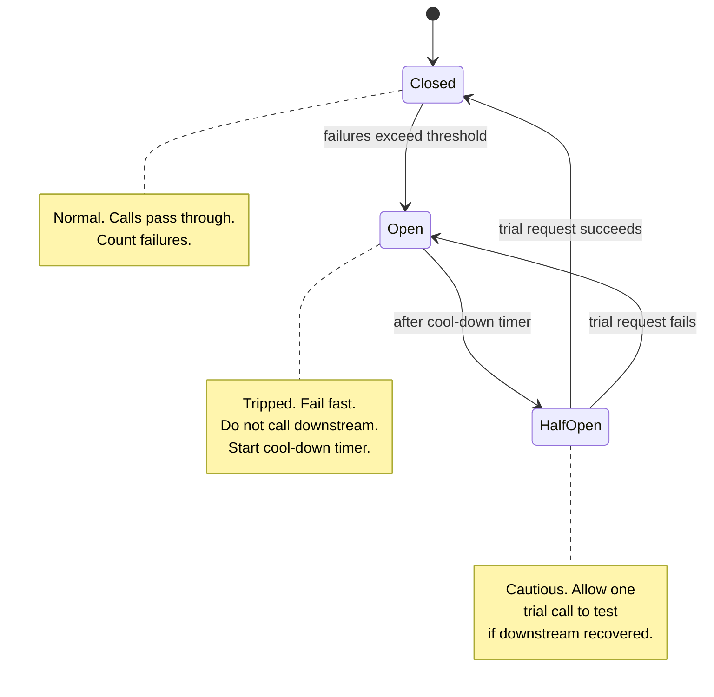
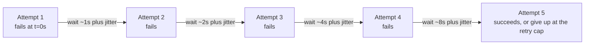

# 19. Reliability Patterns

> **One-liner:** Reliability patterns are the standard tricks — redundancy, failover, timeouts, retries, circuit breakers, and idempotency — that keep a system working (and correct) even though the machines and networks it runs on are constantly failing.
> **Where this fits:** Chapter 01 named the quality words (availability, reliability, durability); chapters 05–06 and 11 gave you the raw tools (load balancers, redundancy, replication). This chapter is where they combine into deliberate patterns. It is the single most important chapter for **fintech interviews** (Razorpay, CRED, Groww), because when money moves, "usually works" is not good enough.

## 1. The Idea in Plain Words

Here is the uncomfortable truth of running software at scale: **everything fails, all the time.** Disks die, network cables get cut, a data center loses power, a downstream service you depend on gets slow, someone deploys a bad build. If your design assumes the happy path, it will break the first time reality disagrees.

Reliability engineering is the opposite mindset: **assume every part can fail, and design so the system keeps working anyway.** That is the whole game.

Let me define the three words people constantly mix up, because interviewers love catching this:

- **Availability** = "is it up and answering right now?" Measured as a percentage of time — the famous "nines" (99.9%, 99.99%). A system is *available* if it responds.
- **Reliability** = "does it answer *correctly and consistently* over time?" A system can be available but unreliable — it responds, but returns a wrong account balance. For a bank, that is worse than being down.
- **Durability** = "once you told me it was saved, does it *stay* saved?" It is specifically about not losing stored data across crashes, restarts, and power loss (usually achieved by writing to disk and replicating — see `11-replication.md`).

A quick way to remember: **Available** = up. **Reliable** = up *and correct*. **Durable** = the data survives. You can fail any one while passing the others. A payment API that is up but double-charges people is highly *available* and catastrophically *unreliable*.

**Availability is measured in "nines," and the gap between them is brutal.** An **SLA** (Service Level Agreement) is a *contractual promise* about availability, often with refunds/penalties if missed. Internally you track an **SLO** (the target you aim for) via an **SLI** (the actual measured metric). Here is what each nine really costs in downtime:

| Availability | Nickname | Downtime / year | Downtime / month | Feels like |
|---|---|---|---|---|
| 99% | two nines | ~3.65 days | ~7.2 hours | A hobby project |
| 99.9% | three nines | ~8.76 hours | ~43 minutes | A decent web app |
| 99.95% | — | ~4.38 hours | ~22 minutes | Serious SaaS |
| 99.99% | four nines | ~52 minutes | ~4.3 minutes | Payments-grade |
| 99.999% | five nines | ~5.26 minutes | ~26 seconds | Telco / critical infra |

Each extra nine costs roughly **10× more** engineering — more redundancy, faster *automated* failover, and zero tolerance for risky manual steps. So you don't buy nines you don't need: Habex's dashboard doesn't need five nines, but a Razorpay payment-authorization path might.

The rest of this chapter is a toolbox. Each tool attacks a specific failure mode:

- **Redundancy + failover** — a part died, keep serving from a spare.
- **Health checks** — notice the dead part quickly.
- **Timeouts** — don't wait forever on something that's hung.
- **Retries with backoff + jitter** — try again, but politely, so you don't make things worse.
- **Circuit breakers** — stop hammering a service that's clearly down.
- **Idempotency** — make it safe to retry without doing the action twice (this is the one that prevents double charges).
- **Bulkheads** — isolate failures so one broken thing doesn't sink everything.
- **Graceful degradation** — lose a feature, not the whole app.

Two of these deserve a closer look up front, because most real outages are won or lost here. **Timeouts:** every network call needs one, because the default in many libraries is "wait forever," and a hung call quietly holds a thread until your server has no threads left. There are two — a **connect timeout** (how long to wait to establish the connection) and a **read/request timeout** (how long to wait for the response). A subtle rule: a downstream call's timeout should be *shorter* than the caller's own deadline, so you get a chance to react (retry, fall back) instead of the whole chain timing out at once — this is **deadline propagation**. **Health checks:** the load balancer pings each server on a schedule — a *shallow* check (`GET /health` returns 200) or a *deep* check (also verifies the DB connection is alive) — and stops routing traffic to any instance that fails, which is exactly what makes failover automatic (`05-load-balancers.md`). Circuit breakers use the same success/failure signal internally. The catch: checks that are too aggressive can evict a healthy-but-briefly-slow node and shrink your capacity *during* the spike you needed it for.

## 2. Picture It (Diagram)

Two diagrams do most of the work in this chapter. First, the **circuit breaker state machine** — the pattern that stops your service from repeatedly calling a downstream that is already on fire:



Second, a **retry-with-exponential-backoff-and-jitter timeline**. Notice the gaps get bigger each attempt, and jitter spreads them out so a thousand clients don't all retry in lockstep:



The backoff doubles (1s, 2s, 4s, 8s…); the jitter is a small random offset added to each wait so retries scatter instead of stacking into a spike.

## 3. Real-World Analogy

Think about a **busy hospital**, because a hospital is a system designed around the assumption that things go wrong and people's lives depend on it not falling over.

- **Redundancy / no single point of failure** — there isn't one doctor. If one is off sick, another covers. There are backup generators for when the power grid fails.
- **Health checks** — nurses take vitals on a schedule to catch a patient (or a machine) that has silently stopped working.
- **Timeouts** — a triage nurse doesn't let one complicated patient block the entire queue forever; there are limits.
- **Retries with backoff** — if a pager doesn't answer, you try again in a bit — you don't smash the button 500 times a second.
- **Circuit breaker** — if the MRI machine is broken, you *stop sending patients to it* and reroute, instead of wheeling everyone into a room that can't help them.
- **Bulkheads** — the maternity ward and the ER are separate. An outbreak in one doesn't automatically shut the other. (The word literally comes from ship design: sealed compartments so one hull breach doesn't sink the whole ship.)
- **Graceful degradation** — if the fancy imaging system is down, staff fall back to manual checks. Reduced service beats no service.

## 4. Concrete Example

Let's make this a **payment**, because that is exactly what a Razorpay or CRED interviewer will push you on. This is the flagship example of the chapter — read it slowly.

**The setup.** A user taps "Pay ₹2,000" in an app. Your server receives `POST /payments` and must call an external **payment gateway / bank** (a "downstream" — a service your service depends on). Then the network does what networks do.

**The nightmare scenario — the timeout.** Your server calls the bank. The bank *actually processes the charge* — money moves — but the response back to you is lost, or the bank is slow and your **timeout** fires first. From your side, all you know is: *"I never got a reply."* You have no idea whether the charge happened or not.

Now you're stuck between two bad options:
- **Don't retry** → maybe the user was charged but your system thinks the payment failed. Angry customer, support ticket, refund mess.
- **Naively retry** → maybe the first charge *did* go through, and now you charge them **twice**. This is the classic double-charge bug, and in fintech it is a fireable, front-page-news kind of bug.

**The fix: idempotency keys.** *Idempotent* means "doing it once and doing it many times give the same result." An **idempotency key** is a unique ID (say a UUID) the client generates for *this one payment attempt* and sends with every retry:

```
POST /payments
Idempotency-Key: 7c2e-...-a91f
{ "amount": 2000, "currency": "INR", "order_id": "ord_88" }
```

The server keeps a table of keys it has already processed. The logic:

1. Request arrives with key `7c2e…`.
2. Server checks: *have I seen this key before?*
3. **No** → process the charge, store the key + its result, return the result.
4. **Yes** → *do not charge again.* Return the **stored result** from the first time.

So when your client times out and retries with the **same key**, the server recognizes it, skips the second charge, and just replays the original outcome. Retry is now safe. The user is charged exactly once no matter how many times the request is retried. (This is exactly why Razorpay's and Stripe's real APIs require an `Idempotency-Key` header on payment creation.)

**The second fix: the circuit breaker.** Now imagine the bank isn't just slow for one request — it's *down* for everyone, for two minutes. Without protection, every incoming payment tries to call the bank, waits for the full timeout (say 10 seconds), fails, and retries. Thousands of your threads are now stuck waiting on a dead service. Your *own* server runs out of threads and falls over — the bank's outage becomes *your* outage. This spreading collapse is a **cascading failure**.

A **circuit breaker** wraps the call to the bank and watches the failure rate:

- **Closed** (normal): calls pass through. It's counting failures.
- Too many failures in a short window → it trips to **Open**: for the next, say, 30 seconds it **fails instantly** without even calling the bank. Your threads are freed. You can return a friendly "payments are temporarily unavailable, we'll retry your order" instead of hanging.
- After the cool-down it goes **Half-Open**: it lets *one* trial request through. If that succeeds, the bank is back → **Closed**. If it fails → back to **Open** for another cool-down.

Combine them and you get a system that (a) never double-charges thanks to idempotency, and (b) protects itself from a failing downstream thanks to the circuit breaker. That two-part answer — *idempotency for correctness, circuit breaker for stability* — is a genuinely senior response to "what happens when a payment times out?"

## 5. Tie-Back to Your Projects

**Habex (habex.santhu.site)** doesn't move money to a bank, but it has the same shapes, and framing them this way is a strong interview move:

- **Recurring entries.** Habex auto-creates recurring expenses (rent on the 1st, subscription on the 5th). Suppose a background job (see `15-message-queues-and-pubsub.md`) fires them. If that job crashes halfway and re-runs, you must not create the rent expense **twice**. Give each recurring occurrence a deterministic key like `recurring_{entryId}_{2026-07-01}` and make the insert idempotent on it. Same idea as the payment key, zero money involved.
- **The contact form on santhu.site.** If the email-send call to a third-party (say Resend/SendGrid) times out, a naive retry could send the same message five times. Wrap it in a timeout + a couple of backoff retries + an idempotency key so the visitor isn't spammed.
- **Dashboard degradation.** Habex's dashboard shows charts computed from transactions. If the analytics/aggregation path is slow or down, **degrade gracefully**: show the raw recent transactions list (cheap query) with a "charts are loading / temporarily unavailable" note, instead of failing the whole dashboard. The user can still see their data.
- **Single points of failure (SPOF).** Be honest in the interview: "Today Habex is one API server and one database — both are single points of failure. My first reliability upgrade would be a second app server behind a load balancer (`05-load-balancers.md`) and a database replica (`11-replication.md`) I can fail over to." That's an accurate, credible growth story.
- **Timeouts everywhere.** Right now Habex's frontend probably calls the API with no explicit timeout. Add one, plus a retry-with-backoff on idempotent GETs (loading the dashboard), but **not** blind retries on the POST that creates an expense unless it carries an idempotency key.

## 6. Interview Questions (with answer pointers)

**Q1. "A payment request times out. You don't know if the charge went through. What do you do?"** *(Razorpay, CRED — the signature question.)*
Two-part answer. **Correctness:** use an **idempotency key** so retrying the same logical payment can't double-charge — the server dedupes on the key and replays the stored result. **Safety on the client:** retry with backoff, and reconcile async (query the gateway for the payment's status) rather than assuming failure. Mention you'd never blindly retry a non-idempotent POST.

**Q2. "What is an idempotency key and how does the server use it?"** *(Razorpay, Groww.)*
A unique client-generated ID for one logical operation, sent with every retry. Server stores processed keys with their results; on a repeat key it skips the side effect and returns the saved result. Makes "at least once" delivery safe. Cross-link: this is what makes retried webhooks and queue messages safe too (`16-kafka-and-webhooks.md`).

**Q3. "Explain the circuit breaker pattern and its three states."** *(CRED, Swiggy.)*
**Closed** = calls pass, count failures. **Open** = too many failures, fail fast without calling downstream, start a cool-down. **Half-Open** = after cool-down, allow one trial call; success → Closed, failure → Open. Point: it prevents a slow/dead downstream from exhausting your threads and causing a **cascading failure**.

**Q4. "Why are naive retries dangerous? What's a retry storm?"** *(Swiggy, Zepto.)*
If a downstream hiccups and thousands of clients all retry immediately and in lockstep, they create a synchronized traffic spike — a **retry storm / thundering herd** — that kicks the service while it's down and prevents recovery. Fix: **exponential backoff** (wait longer each attempt) **plus jitter** (random offset so retries scatter), a retry cap, and a circuit breaker.

**Q5. "Availability vs reliability vs durability?"** *(Groww, Razorpay.)*
Availability = it's up and answering (the "nines"). Reliability = it answers *correctly* over time. Durability = saved data survives crashes. A system can be available but unreliable (up, wrong balances) — deadly for fintech. Durability is about not losing data, typically via disk + replication.

**Q6. "What does 99.9% vs 99.99% availability actually mean in downtime?"** *(all.)*
Give real numbers: 99.9% ≈ **8.8 hours/year** down; 99.99% ≈ **52 minutes/year**; 99.999% ≈ **5 minutes/year**. Each extra nine costs roughly 10× the engineering (more redundancy, faster failover, no risky manual steps). Note SLA vs SLO vs SLI: SLI is the measurement, SLO is your internal target, SLA is the contractual promise (with penalties).

**Q7. "What's a single point of failure and how do you remove it?"** *(all.)*
Any component whose failure takes the whole system down (one DB, one LB, one server). Remove via **redundancy** — more than one of everything — plus **failover** to switch to the healthy copy. Even the load balancer needs a redundant pair, or you've just moved the SPOF.

**Q8. "Active-passive vs active-active failover?"**
Active-passive: one node serves, a standby waits and takes over on failure (simpler, some idle capacity, brief failover gap). Active-active: all nodes serve simultaneously and share load (better utilization and instant failover, but needs the nodes to coordinate/share state, which is harder). Tie to health checks: the LB detects the dead node and stops routing to it (`05-load-balancers.md`). Bonus: mention **bulkheads** — isolating resources (a separate thread/connection pool per downstream) so one failing integration can't starve the rest.

## 7. Trade-offs & "Why Not Just X?"

**"Why not just retry until it works?"** Because retries without discipline *cause* outages. Naive immediate retries create retry storms; retries on non-idempotent operations cause duplicate side effects (double charges, double emails). Retries are only safe when the operation is **idempotent** and the retries are **backed off, jittered, capped, and circuit-broken**.

**"Why not just aim for 99.999% (five nines) on everything?"** Because each nine is exponentially more expensive and complex. Five nines means ~5 minutes of downtime *per year* — no room for a risky manual deploy, requires multi-region redundancy, automated failover, and relentless testing. Match the target to the feature: a payment path might justify four nines; Habex's "export to CSV" button does not.

**"Why add circuit breakers — won't they reject requests that might have worked?"** Yes, and that's the point. Failing *fast* on a known-bad downstream is better than failing *slow* (holding threads for a 10s timeout each) and dragging your own service down with it. You trade a few possibly-recoverable requests for the survival of the whole system. This is the classic availability-vs-latency-vs-blast-radius trade.

Here's the toolbox mapped to what each pattern buys and costs:

| Pattern | Failure it fixes | Cost / downside |
|---|---|---|
| Redundancy + failover | A component dies (SPOF) | 2× (or more) infra cost, coordination |
| Health checks | Silent/dead nodes | False positives can eject healthy nodes |
| Timeouts | Hung calls block threads | Too short → kill slow-but-valid requests |
| Retries + backoff + jitter | Transient blips | Duplicate effects if not idempotent |
| Circuit breaker | Cascading failure from a dead downstream | Rejects some maybe-good requests |
| Idempotency keys | Double side effects on retry | Storage + dedup logic on every write |
| Bulkheads | One integration starves others | More pools to size and tune |
| Graceful degradation | Total outage from a partial failure | Extra fallback code paths to maintain |

And the mental model for reliability vs availability vs durability, since interviewers test the distinction:

| Property | Question it answers | Won by | Failure looks like |
|---|---|---|---|
| Availability | Is it up now? | Redundancy, failover, load balancing | 503s, timeouts, site down |
| Reliability | Is it correct over time? | Idempotency, validation, testing, consistency | Up, but wrong data / double charge |
| Durability | Does saved data survive? | Disk writes, replication, backups | "Saved" data vanishes after a crash |

**"Why not just handle failures in the app code case by case?"** You can, but you'll reinvent these patterns badly and inconsistently. That's why they're standardized and often pushed into libraries (Resilience4j, Polly), service meshes, and gateways — so retries, timeouts, and circuit breaking are configured once, uniformly, not sprinkled ad hoc. More on that in `21-architecture-patterns.md`.

**One more thing interviewers respect: you can't claim reliability you haven't tested.** Failure-handling code is the code that runs least in normal times and most during an incident — so it rots silently. Mature teams *deliberately* inject failure — kill a node, add latency, block a downstream — in staging or even production (**chaos engineering**, popularized by Netflix's Chaos Monkey) and run **game days** where the on-call team rehearses a real outage. If you have never watched your failover actually fail over, the honest assumption is that it doesn't work.

## 8. TL;DR

- **Design for failure.** At scale something is always broken; reliability is keeping the system working *and correct* anyway.
- **Know the three words:** availability = up; reliability = up *and correct*; durability = saved data survives. Fintech cares most that you never trade correctness for uptime.
- **The nines:** 99.9% ≈ 8.8 hrs/yr down, 99.99% ≈ 52 min/yr, 99.999% ≈ 5 min/yr. Each extra nine ~10× the cost. SLI (measure) → SLO (target) → SLA (contract).
- **Kill single points of failure** with redundancy + failover (active-passive vs active-active), detected by **health checks** (`05-load-balancers.md`).
- **Retry politely:** timeouts + **exponential backoff + jitter** + a cap, or you cause **retry storms**. Never blind-retry a non-idempotent POST.
- **Circuit breaker** (Closed → Open → Half-Open) stops you hammering a dead downstream and prevents cascading failure. **Bulkheads** isolate blast radius.
- **Idempotency keys** make retries safe: same key ⇒ do the side effect once, replay the stored result. This is *the* fix for the payment double-charge (`16-kafka-and-webhooks.md`, `17-api-design-rest-graphql.md`).
- **Graceful degradation:** shed a feature, not the whole app — Habex shows recent transactions when charts are down.
