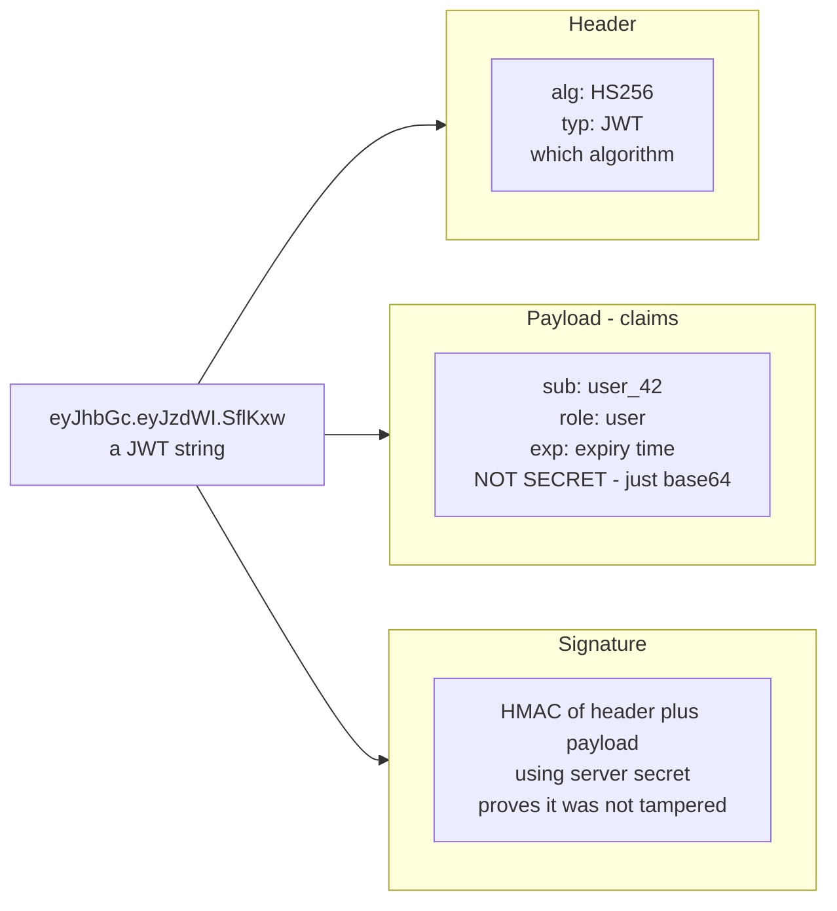
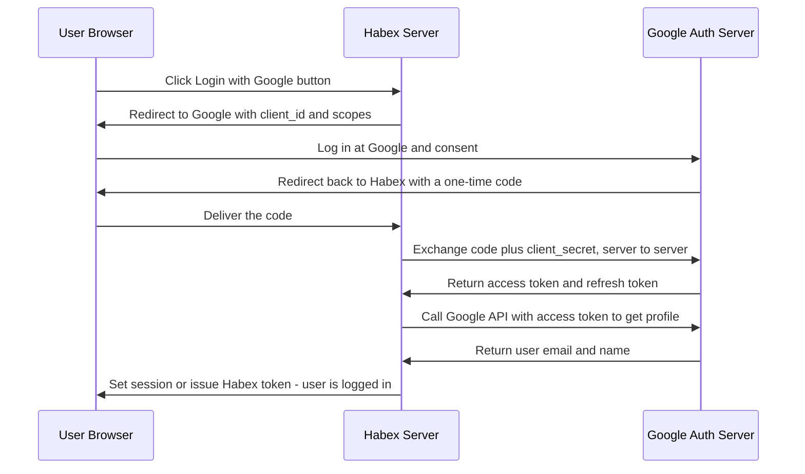

# 20. Security Basics

> **One-liner:** Security basics are the small set of non-negotiable habits — proving who a user is, controlling what they can do, encrypting data, hashing passwords, and blocking the classic web attacks — that every full-stack dev must get right, because one miss can leak everyone's data.
> **Where this fits:** Chapter 04 gave you HTTP/HTTPS; chapter 18 gave you rate limiting. This chapter turns those into a security posture. It's the auth backbone for the case studies (`25-case-study-expense-tracker.md`) and a guaranteed interview topic — especially at **CRED, Razorpay, and Groww**, where a security slip is a regulatory and trust disaster.

## 1. The Idea in Plain Words

Two words sound the same and are constantly confused. Nail them first, because half of application security is just keeping them straight:

- **Authentication (authN)** = **"who are you?"** Proving identity. Logging into Habex with your email and password is authentication.
- **Authorization (authZ)** = **"what are you allowed to do?"** Checking permissions. Habex letting you see *your* expenses but not another user's is authorization.

Order matters: you authenticate *first* (establish identity), then authorize *each action* (check they're allowed to do this specific thing). A depressingly common bug is authenticating correctly but forgetting to authorize — user A is logged in (authN passes) and can fetch `/expenses/999`, an expense that belongs to user B, because nobody checked ownership (authZ missing). That's called a **broken object-level authorization** (or IDOR) bug and it's one of the most common real-world breaches.

How is authorization actually structured? The common model is **RBAC** (Role-Based Access Control): each user holds one or more **roles** (`user`, `admin`, `support`), each role grants a set of **permissions**, and the server checks the role/permission before allowing an action. A finer-grained variant, **ABAC** (Attribute-Based), decides from attributes of the request (this user, this resource, this amount, this time of day). Two principles sit under both: **least privilege** — grant the minimum access needed and nothing more — and **enforce on the server, every time**. Hiding a button in the React UI is *not* authorization; anyone can call the API directly, so the check must live on the backend.

Now, HTTP is **stateless** — each request stands alone, the server doesn't inherently remember you from the last one (see `04-http-and-https.md`). So after you log in, how does the *next* request prove it's still you? Two schools of thought:

- **Sessions (server-side state).** On login, the server creates a **session** — a record in its own memory/database — and hands the browser a **cookie** (a small piece of data the browser automatically sends back on every request) containing an opaque **session ID**. Each request, the server looks up that ID to find "oh, this is Santhosh." The server *remembers*.
- **Tokens (stateless).** On login, the server hands you a **token** — a signed string that *contains* your identity. The server stores nothing; each request you send the token, and the server verifies its signature to trust it. The most common format is a **JWT** (JSON Web Token). The server *forgets*; the token carries the truth.

Everything else in this chapter — JWT internals, OAuth, password hashing, HTTPS, the attack list — hangs off these ideas.

**Quick HTTPS/TLS recap, because all of the above is worthless without it.** HTTPS is just HTTP wrapped in **TLS** (Transport Layer Security). When your browser connects to `habex.santhu.site`, the two do a **TLS handshake**: the server presents a **certificate** (issued by a trusted Certificate Authority) that proves it's genuinely Habex and not an impostor, they agree on a shared encryption key, and from then on everything is scrambled. That gives you **encryption in transit** — nobody sharing the café WiFi, no ISP, no one in the middle can read *or tamper with* the traffic (so TLS provides secrecy, integrity, *and* authenticity). This is separate from **encryption at rest** — encrypting stored data (database, disks, backups) so a stolen dump is useless without the key. You want both. The takeaway: doing auth over plain `http://` is pointless, because passwords and tokens would travel in cleartext for anyone to grab.

## 2. Picture It (Diagram)

First, the **anatomy of a JWT**. It's three base64-encoded parts joined by dots: `header.payload.signature`.

The critical insight most beginners miss: **the header and payload are only base64-encoded, not encrypted — anyone can read them.** The signature doesn't hide the data; it proves the data wasn't *changed*. So never put secrets (passwords, card numbers) in a JWT payload.

Second, the **OAuth 2.0 authorization-code flow** — the "Login with Google" dance:

The clever bit: the sensitive **code → token** exchange happens **server-to-server** using a secret the browser never sees, so a malicious script can't steal it.

## 3. Real-World Analogy

Picture a **secured office building**.

- **Authentication** = showing your ID at the front desk to prove who you are.
- **Authorization** = your keycard only opening the doors you're cleared for. You're *in the building* (authenticated) but you still can't enter the server room (not authorized).
- **Session vs token** = two ways the guard remembers you. **Session:** the guard writes your name in a logbook and gives you a numbered tag; every door, they check the tag against the logbook. **Token:** they give you a tamper-proof holographic badge that *states* your clearance; any door reader can verify the hologram without phoning the front desk. Faster, but if you get fired at 10am, the logbook approach can cancel you instantly, while the badge keeps working until it expires.
- **OAuth** = a valet key. You don't hand a parking valet your house keys and bank cards — you hand a limited key that only starts the car (limited **scope**). "Login with Google" is you telling Google "let Habex see my name and email, nothing else."
- **Password hashing** = the front desk never storing your actual password. They store a scrambled fingerprint of it, so even a stolen logbook doesn't reveal anyone's real password.
- **HTTPS/TLS** = a sealed, tamper-evident envelope for everything sent between you and the desk, so nobody in the hallway can read or alter it.

## 4. Concrete Example

Let's secure **Habex login** end to end, since it has real accounts and real money data. This is your interview-ready walkthrough.

**Step 1 — Store passwords correctly.** When a user signs up with password `hunter2`, you must **never** store it as-is (plaintext) and must never store a plain hash either. You **hash with a slow, salted algorithm** — **bcrypt** or **argon2**:

- A **hash** is a one-way scramble: easy to compute `hash(password)`, practically impossible to reverse. You store the hash; at login you hash the attempt and compare.
- A **salt** is a random value added per user before hashing, so two users with the same password get *different* hashes — this defeats precomputed "rainbow table" attacks. bcrypt/argon2 generate and embed the salt for you.
- They're **deliberately slow** (and argon2 is memory-hard), so an attacker who steals your database can only try a few thousand guesses per second instead of billions. Never use plain MD5/SHA-256 for passwords — they're too *fast*, which here is a weakness.

**Step 2 — Log in and issue tokens.** User submits email + password over **HTTPS** (so it's encrypted in transit). Server looks up the user, runs `bcrypt.compare(attempt, storedHash)`. On success it issues **two** tokens:

| Token | Lifetime | Purpose | Where stored |
|---|---|---|---|
| **Access token** (JWT) | Short (~15 min) | Sent on every API call to prove identity | Memory, or httpOnly cookie |
| **Refresh token** | Long (days/weeks) | Used *only* to get a new access token | Secure **httpOnly** cookie, and a copy server-side so it's revocable |

Why two? A JWT access token is **stateless and can't easily be revoked** — the server doesn't track it, so it's valid until it expires. Keeping it *short-lived* limits the damage if it leaks. The **refresh token** is long-lived but you *do* store it server-side, so you can revoke it (on logout, or "log out all devices"). Access token expires → the client silently uses the refresh token to get a fresh one.

**Step 3 — Set cookies safely.** Store tokens (especially the refresh token) in cookies with these flags — this is a favorite interview follow-up:

- **httpOnly** → JavaScript cannot read the cookie. This means an **XSS** attack can't steal the token. (If you keep a JWT in `localStorage`, any injected script can read it — a big reason httpOnly cookies are preferred for auth.)
- **Secure** → the cookie is only sent over HTTPS, never plaintext HTTP.
- **SameSite=Lax/Strict** → the browser won't attach the cookie to cross-site requests, which blocks most **CSRF** attacks.

**Step 4 — "Login with Google" via OAuth 2.0.** Some users won't want a Habex password at all. OAuth lets them authenticate with Google, and Habex never sees their Google password. Follow the sequence diagram in section 2: Habex redirects to Google with a `client_id` and requested **scopes** (`email`, `profile` — the minimum), the user consents, Google returns a one-time **code**, and Habex's *server* exchanges that code (plus its secret `client_secret`) for an **access token** (call Google's API now) and a **refresh token** (call it later). Habex reads the verified email and either logs the matching user in or creates an account. Note: here Habex is the *client* trusting Google; the access/refresh token distinction is Google's, mirroring what you did yourself in Step 2. One modern addition worth naming in an interview: for **public clients** that can't safely keep a `client_secret` (a React SPA or a mobile app, where anyone can read the shipped code), the flow adds **PKCE** — the client sends a one-time secret "code verifier/challenge" so that even an attacker who intercepts the authorization code can't redeem it. PKCE is now recommended for essentially all authorization-code flows.

**Step 5 — Rate-limit the login endpoint.** An attacker will try thousands of passwords (a **brute-force / credential-stuffing** attack). Rate limiting is a *security* control here, not just a scaling one: cap attempts per IP/account, add exponential backoff or a lockout/CAPTCHA after repeated failures. See `18-rate-limiting-pagination-versioning.md`.

**Step 6 — add a second factor for sensitive accounts (defense in depth).** A password is one leak away from compromise. **MFA/2FA** (multi-factor / two-factor auth) requires a second proof — a TOTP code from an authenticator app, an OTP, or a passkey — so a stolen password alone isn't enough to get in. For Habex you'd offer MFA at login and *require* re-authentication for high-risk actions (changing the account email, exporting all data). The principle is **defense in depth**: never lean on a single control; layer several so one failure isn't fatal.

## 5. Tie-Back to Your Projects

- **Habex auth = the whole example above.** Be ready to narrate it: bcrypt/argon2 hashing + salt, HTTPS, short access JWT + revocable refresh token, `httpOnly`+`Secure`+`SameSite` cookies, "Login with Google" via OAuth, rate-limited login. That single walkthrough answers a huge chunk of any auth interview.
- **Authorization on every expense read.** Habex's biggest real risk isn't fancy crypto — it's forgetting the ownership check. Every `GET /expenses/:id`, `PUT`, `DELETE` must verify `expense.userId === currentUser.id`. Trusting an ID from the client without this is the IDOR bug from section 1. Say this out loud; interviewers love it.
- **SQL injection on search/filter.** Habex filters transactions by category, date, amount. If you build SQL by string-concatenating user input, an attacker types `'; DROP TABLE expenses; --` and you're done. Defense: **parameterized queries / prepared statements** (or an ORM that does it) — never concatenate.
- **XSS in expense notes.** A user's expense note like `` rendered raw would run in other contexts. React escapes text by default (good), but the moment you use `dangerouslySetInnerHTML` you reopen it. Defense: escape/sanitize output; keep tokens in httpOnly cookies so even a successful XSS can't read them.
- **santhu.site contact form.** Lower stakes, same rules: it should still be HTTPS-only, validate/escape input (don't reflect it back unescaped → XSS), and rate-limit submissions so it isn't a spam relay.
- **Secrets management.** Your Google `client_secret`, DB password, and JWT signing key must **never** be hardcoded or committed to git. Keep them in environment variables / a secrets manager (Vault, AWS Secrets Manager, Doppler), and rotate them if leaked. A JWT secret in your repo = anyone can forge Habex login tokens.

## 6. Interview Questions (with answer pointers)

**Q1. "Authentication vs authorization — difference?"** *(all companies.)*
AuthN = who you are (login). AuthZ = what you're allowed to do (permissions). AuthN first, then authorize *each* action. Killer point: mention that forgetting the per-object authorization check (IDOR) is a top real-world breach — authenticated ≠ allowed to touch *this* record.

**Q2. "Sessions vs JWT/tokens — when would you pick each?"** *(CRED, Razorpay.)*
Sessions = server stores state, easy to revoke instantly, but needs a shared session store to scale horizontally. JWT = stateless, scales trivially (any server can verify), but **hard to revoke** before expiry. Common real answer: short-lived JWT access token for statelessness + a stored, revocable refresh token to regain control. State the trade-off explicitly.

**Q3. "Walk me through a JWT. How is it verified? What are its pitfalls?"** *(Groww, CRED.)*
Three base64 parts `header.payload.signature`. Verify by recomputing the signature over header+payload with the server's secret/public key and checking it matches, then checking `exp`. Pitfalls: payload is **readable, not encrypted** (no secrets in it), **can't easily revoke** before expiry (hence short expiry + refresh tokens), and you must reject `alg: none` and pin the algorithm to avoid signature-bypass attacks.

**Q4. "Explain OAuth 2.0 'Login with Google' in plain words."** *(Swiggy, Zepto.)*
Delegated authorization: the user proves identity to Google, and Google gives *your app* a limited-scope token to act on their behalf — your app never sees their Google password. Authorization-**code** flow: redirect to Google → user consents → get a one-time code → **server** swaps code + client_secret for access + refresh tokens. Access token = short-lived, call the API now; refresh token = get new access tokens later; scopes = exactly what you're allowed to access.

**Q5. "How do you store passwords?"** *(all — a near-guaranteed question.)*
Never plaintext, never plain fast hashes. Use a **slow, salted** hash: **bcrypt** or **argon2** (argon2 is memory-hard and current best practice). Salt is per-user to kill rainbow tables; slowness throttles offline brute-force. Add a work factor you tune upward over time. Optionally a server-side "pepper."

**Q6. "Name the big web attacks and one defense each."** *(Razorpay, CRED — full-stack security screen.)*
**XSS** (inject scripts) → escape/sanitize output, CSP, httpOnly cookies. **CSRF** (forge a request from a logged-in user) → SameSite cookies + CSRF tokens. **SQL injection** → parameterized queries / prepared statements. Bonus: broken authorization (IDOR) → check object ownership; secrets in code → use a secrets manager.

**Q7. "Encryption in transit vs at rest?"** *(Groww, Razorpay.)*
In transit = data moving over the network is encrypted so no one can read/alter it mid-flight — that's **HTTPS/TLS**. At rest = stored data (DB, disks, backups) is encrypted so a stolen disk/dump is useless without the key. You want both; fintech and compliance (PCI-DSS) essentially require it.

**Q8. "How is rate limiting a security control, not just a scaling one?"** *(CRED, Swiggy.)*
It blunts brute-force/credential-stuffing on login, OTP abuse, scraping, and denial-of-service. Cap attempts per IP/account, add backoff/lockout/CAPTCHA on repeated failures. Cross-link `18-rate-limiting-pagination-versioning.md`.

## 7. Trade-offs & "Why Not Just X?"

**"Why not just use JWTs for everything — they're stateless and scale great?"** Because statelessness *is* the downside for auth: you can't easily revoke a JWT before it expires. If a token leaks or you need to force-logout a user, a pure-JWT setup can't, until expiry. That's why the mature pattern is *short* access JWTs (small leak window) + a *stored, revocable* refresh token (control). You give back a little statelessness to regain revocation.

**"Why not store the JWT in localStorage — it's easy?"** Because any XSS that runs on your page can read `localStorage` and steal the token. An `httpOnly` cookie can't be read by JavaScript, so it survives an XSS (though you then must handle CSRF with SameSite/CSRF tokens). Neither is free; the trade is *XSS exposure* vs *CSRF handling*.

**"Why hash slowly — isn't fast better?"** For passwords, *no*. Fast hashing helps the attacker who stole your DB try billions of guesses/second. bcrypt/argon2 are deliberately slow (and memory-hard) so offline cracking is throttled. The tiny cost you pay per legitimate login is the whole point.

**"Why bother with OAuth instead of just building password login?"** OAuth offloads credential handling to Google/Apple (they never give you the password, less for you to leak), improves signup conversion, and gives users least-privilege scopes. Cost: added redirect complexity, dependency on the provider, and you still need your own session/token layer afterward. For internal service-to-service auth you'd use something else entirely (mTLS, API keys).

**"Can't I just rely on CORS to protect my API?"** No — and this trips up a lot of frontend devs, so it's a great interview differentiator to get right. **CORS** (Cross-Origin Resource Sharing) is a *browser* rule about which origins' JavaScript is allowed to *read* a response. It is **not** a server-side authorization mechanism: any non-browser client — curl, Postman, a mobile app, a bot — ignores CORS completely. So CORS limits what a malicious *website* can do with a logged-in user's browser (a useful guardrail against some CSRF-style abuse), but your server must still authenticate and authorize *every* request itself. Never treat CORS as your security boundary.

Sessions vs tokens, side by side:

| Aspect | Sessions (server-side) | JWT / tokens (stateless) |
|---|---|---|
| Server stores state? | Yes (session store) | No (token self-contains claims) |
| Revoke instantly? | Yes | Hard — valid until expiry |
| Horizontal scaling | Needs shared session store | Trivial — any server verifies |
| Payload visible to client? | No (opaque ID) | Yes — base64, readable |
| Typical use | Classic web apps | APIs, SPAs, mobile, microservices |
| Common pitfall | Session store is a bottleneck/SPOF | Can't revoke; secrets leak in payload |

The one-line defenses, as a cheat card:

| Attack | What it does | One-line defense |
|---|---|---|
| XSS | Injects JS that runs in the victim's browser | Escape/sanitize output; CSP; httpOnly cookies |
| CSRF | Tricks a logged-in browser into a request | SameSite cookies + anti-CSRF token |
| SQL injection | Injects SQL via unescaped input | Parameterized queries / prepared statements |
| Brute force | Guesses passwords/OTPs at scale | Rate limit + lockout + slow hashing + MFA |
| IDOR / broken authZ | Accesses others' objects by ID | Check ownership on every object access |
| Secret leakage | Hardcoded keys in code/git | Env vars / secrets manager + rotation |

## 8. TL;DR

- **AuthN = who you are; authZ = what you can do.** Authenticate once, authorize *every* action — forgetting the per-object ownership check (IDOR) is a top breach.
- **Sessions** store state server-side (revocable, needs shared store to scale). **Tokens/JWTs** are stateless (scale free, hard to revoke). Real-world combo: short access JWT + stored, revocable refresh token.
- **A JWT is `header.payload.signature`** — base64, **not encrypted**. Signature proves integrity, not secrecy. No secrets in the payload; keep expiry short; pin the algorithm.
- **OAuth 2.0** = delegated auth. Authorization-code flow: redirect → consent → one-time code → **server** swaps code + secret for access + refresh tokens; request least-privilege **scopes**. Your app never sees the Google password.
- **Passwords:** hash with **bcrypt/argon2 + per-user salt**, never plaintext, never fast hashes. Slowness is a feature.
- **Encrypt in transit (HTTPS/TLS) and at rest (DB/backup encryption).** Auth cookies get **httpOnly + Secure + SameSite**.
- **Know the attacks cold:** XSS → escape/CSP/httpOnly; CSRF → SameSite + token; SQLi → parameterized queries. Keep secrets in a manager, and **rate-limit** login as a security control (`18-rate-limiting-pagination-versioning.md`).
- **Habex** shows it all: hashed passwords, short JWT + refresh, secure cookies, Login-with-Google, ownership checks, parameterized filters.
