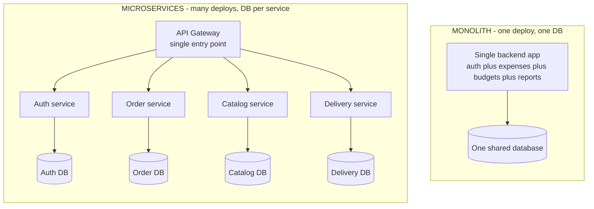
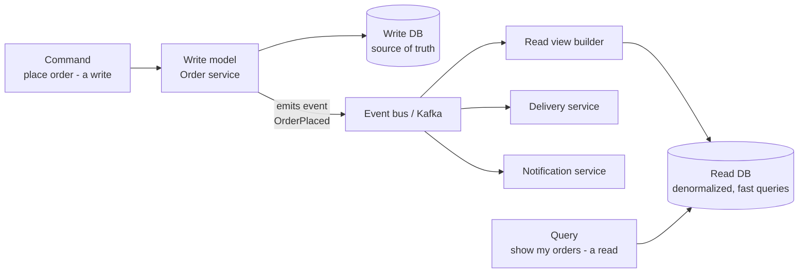

# 21. Architecture Patterns

> **One-liner:** Architecture patterns are the big-picture shapes for arranging your whole backend — one deployable monolith vs many microservices, sync calls vs async events, and the coordination patterns (API gateway, sagas, CQRS) you need once you split things apart.
> **Where this fits:** This is the capstone of the reliability/security/architecture trio. It builds on messaging (`15-message-queues-and-pubsub.md`, `16-kafka-and-webhooks.md`), API design (`17-api-design-rest-graphql.md`), reliability (`19-reliability-patterns.md`), and databases (`09`–`12`). It's the lens the case studies (`23`, `24`, `25`) are drawn through, and a favorite senior-signal topic at **Swiggy, Zepto, CRED, and Razorpay**.

## 1. The Idea in Plain Words

When you built Habex, all your backend code lives in **one** codebase, deploys as **one** unit, and talks to **one** database. That is a **monolith** — and despite the word sounding dated, it's a completely valid, often *correct* architecture.

- A **monolith** = the entire backend is one program. Auth, expenses, budgets, reports — all one codebase, one deployment, usually one database. Functions call functions directly (fast, simple).
- **Microservices** = you split that one program into many small, independently deployable services, each owning one business capability and (ideally) its own database. They talk over the network (HTTP, gRPC, or events).

The core tension is **simplicity vs independence**. A monolith is simple to build, test, and deploy — but as the team and codebase grow, everyone steps on each other, one bug can take down everything, and you must scale the whole thing even if only one part is hot. Microservices fix those *organizational and scaling* problems by giving each team an independent unit — at the cost of enormous *operational* complexity: now you have a distributed system with network calls that fail, data spread across services, and no single database transaction to lean on.

The single most important piece of wisdom in this chapter, and the thing interviewers *want* to hear: **start with a monolith.** Almost every company that succeeded at microservices (Amazon, Uber, Netflix) started as a monolith and split it *later*, when the pain of staying monolithic exceeded the pain of distributing. Splitting too early is a classic mistake — you pay all the distributed-systems tax before you have the scale or team size to benefit.

And the trap to name explicitly: the **distributed monolith** — the worst of both worlds. That's when you split into services but they're so tightly coupled (they all share one database, or every request fans out through five synchronous calls) that you can't deploy or scale any of them independently. You took on all the operational cost of microservices and kept all the coupling of a monolith. If you're going to split, split along real boundaries and decouple for real.

**So where *do* the boundaries go?** Split by **business capability** (a "bounded context" — one cohesive slice of the domain), *not* by technical layer. A good service owns one domain end-to-end plus its own data — "Payments" owns everything about charging, refunds, and the ledger. A *bad* split is horizontal: a "database service," a "business-logic service," a "UI service" — that just scatters one feature across three services that must always change together, i.e. a distributed monolith. Two rules of thumb: (1) if two services always deploy together or share a database, they're really one service; (2) **Conway's law** — systems tend to mirror the org that builds them, so draw each boundary around something *one team* can own and ship independently.

## 2. Picture It (Diagram)

**Monolith vs microservices**, side by side. Left: one box, one DB. Right: many services, each with its own DB, fronted by a gateway.

**Event-driven flow with CQRS.** Writes ("commands") go to the write model; it emits **events**; those events update separate read-optimized stores that queries hit. Reads and writes use different models:

Notice the write side and read side never touch the same store, and other services (delivery, notifications) react to the *same* event without the order service knowing they exist. That's **loose coupling**.

## 3. Real-World Analogy

Think of a **restaurant** growing into a **food court**.

- A **monolith** is one chef doing everything — taking orders, cooking, plating, billing. For a small place, unbeatable: no coordination overhead, the chef just *knows* the whole flow. But that chef is a single point of failure and can only move so fast.
- **Microservices** are a food court: separate specialist stalls — one does biryani, one does dosa, one does drinks, one handles billing. Each stall hires, cooks, and scales on its own. The biryani stall can get a second cook on a busy night without touching the dosa stall. But now you need a **food-court map at the entrance** (an **API gateway**) so customers find the right stall, and a **directory that stays updated as stalls open and close** (**service discovery**).
- **Sync vs async communication:** synchronous is standing at the counter waiting for your food before doing anything else (simple, but you're blocked). Asynchronous is the buzzer coupon — you order, walk away, and get buzzed when it's ready (**events**); the stall and you are decoupled.
- **Saga (distributed transaction):** a combo meal from three different stalls. There's no single cashier who can atomically guarantee all three. So you pay each stall, and if the drinks stall is out of stock *after* you've bought biryani and dosa, someone has to **undo** the earlier steps (refund them) — a **compensating action**. That coordination *is* a saga.

## 4. Concrete Example

**How Swiggy or Zepto might split into services.** A food/grocery delivery app is the textbook microservices case because different parts have wildly different scaling and ownership needs:

| Service | Owns | Why it's separate |
|---|---|---|
| **Auth / User** | Accounts, login, addresses | Shared by everything; security-sensitive; changes rarely |
| **Catalog** | Restaurants/stores, menus, prices, stock | Read-heavy, cache-heavy; updated by merchants, not users |
| **Order** | Cart, order lifecycle, order state machine | The transactional core; heavy writes at meal times |
| **Payments** | Charging, refunds, wallet, ledger | Regulated, needs strong consistency + idempotency (`19`) |
| **Delivery / Logistics** | Rider assignment, live tracking, ETAs | Realtime, geospatial, totally different tech from catalog |
| **Notifications** | Push, SMS, email | Async, fire-and-forget, spiky |

Now watch a single "place order" tap ripple through them — and why it *can't* be one database transaction. Order, Payments, and Delivery each own their **own** database on **separate** machines. There is no shared transaction that can atomically "reserve stock + charge card + assign rider" across three services. So you use a **saga**: a sequence of local transactions, each emitting an event, with **compensating actions** to undo on failure.

Choreography version (services react to events, no central boss):
1. **Order** service creates the order (status `PENDING`), emits `OrderCreated`.
2. **Payments** hears it, charges the card (idempotently!), emits `PaymentCompleted` — or `PaymentFailed`.
3. **Catalog/Inventory** reserves stock, emits `StockReserved` — or `OutOfStock`.
4. **Delivery** hears the success events, assigns a rider, emits `RiderAssigned`.
5. Order flips to `CONFIRMED`.
6. **If any step fails** — say `PaymentFailed` — earlier steps run **compensating actions**: release the reserved stock, cancel the order. The system converges to a consistent state *eventually*, not via one atomic transaction.

The alternative is **orchestration**: a central "Order Saga Orchestrator" that explicitly calls each service in order and issues the compensations if a step fails — one brain telling everyone what to do next, instead of everyone reacting to events.

**Sync vs async in the same flow.** Fetching the menu to show the user is **synchronous** — the app needs the answer *now*, so it's a request/response call (REST or gRPC) through the gateway. But "order placed → notify restaurant, update analytics, start delivery" is **asynchronous** — publish an event and let interested services react on their own time (see `15-message-queues-and-pubsub.md`). Getting this split right — sync for "I need the answer to continue," async for "others should know this happened" — is the heart of good service design.

**One cost you're forced to pay the moment you split: observability.** In a monolith, one stack trace tells the whole story. Across services, a single "place order" tap hops through five processes, so a failure could be in any of them. The fix is to attach a **correlation / trace ID** to the request at the gateway and propagate it through every downstream call, then use **distributed tracing** (OpenTelemetry, Jaeger, Zipkin) plus centralized logging to reconstruct the full journey. Teams that skip this end up unable to debug their own system — it's a hidden but very real tax of microservices, and a sharp interviewer will ask how you'd trace a request end to end.

**And because each service owns its own database, there are no cross-service SQL joins.** In the monolith you'd happily `JOIN orders and users` in one query. Once Order and User are separate services with separate databases, that join is simply impossible. The fix is *deliberate* data duplication: a service keeps a local copy of the fields it frequently needs — the Order service stores the customer's name and address on the order itself, kept current by listening to `UserUpdated` events — so it can answer queries without a synchronous call to the User service on every request. This event-fed duplication feels wrong to a database-normalization instinct, but it's normal and healthy here; fighting it by turning every read into a live cross-service call is exactly how you build a slow, fragile distributed monolith.

## 5. Tie-Back to Your Projects

**Habex is, and should stay, a monolith — for now.** This is the mature answer, and stating it well signals seniority: *"Habex is one React frontend, one backend, one database. For its scale and a solo/small team, a monolith is the right call — microservices would add operational overhead I get nothing back for. I'd only split when I hit a concrete, named problem."*

Then show you know *when* and *how* you'd split:

- **First real candidate: a reporting/analytics service.** Habex's dashboards run heavy aggregations (spend by category, monthly trends, budget burn-down). Those big read queries can compete with — and slow down — the fast writes when a user adds an expense. That's a genuine reason to split: move analytics into its own service with its own **read-optimized** store, fed **asynchronously** by events (`ExpenseAdded`, `BudgetUpdated`). This is **CQRS** in miniature — the write path (add expense) and the read path (dashboard) get separate models tuned for their job. The write DB stays normalized and fast to write; the reporting store is denormalized and fast to query. Cost: the dashboard is now **eventually consistent** (a new expense might take a second or two to appear in charts) — usually fine for analytics, and you'd say so.
- **Recurring-entries worker.** The job that materializes recurring expenses can be a separate service triggered by a schedule/queue, so it can fail and retry (idempotently, per `19-reliability-patterns.md`) without touching the main API.
- **How you'd extract it safely: the strangler-fig pattern.** You don't rewrite Habex from scratch. You put a gateway/router in front of the monolith and peel off *one* capability at a time — route `/reports/*` to the new analytics service while everything else still hits the monolith — gradually "strangling" the old code the way a strangler-fig vine grows over a tree. Low-risk, incremental, reversible if it goes wrong. This is how real monolith-to-services migrations actually happen.
- **What you would NOT do:** split Habex into 8 microservices "because that's what real apps do." Naming that as a mistake — the **premature-microservices** and **distributed-monolith** traps — is exactly the judgment interviewers probe for.
- **Gateway, later.** If Habex ever *did* grow to a few services, a small **API gateway** would give the React app one URL and centralize auth (`20-security-basics.md`), rate limiting (`18`), and routing — instead of the frontend knowing every service's address.

## 6. Interview Questions (with answer pointers)

**Q1. "Monolith or microservices — how do you choose?"** *(Swiggy, Zepto, CRED — extremely common.)*
"It depends on scale and team size." **Start with a monolith**; it's simpler to build, test, deploy, and reason about. Split into services only when you hit concrete pain: teams blocking each other, parts needing independent scaling, or independent deploy cadence. Never split for résumé reasons. Name the **distributed-monolith** anti-pattern as the failure mode of splitting badly.

**Q2. "What's a distributed monolith and why is it the worst outcome?"** *(CRED, Razorpay.)*
Services that are physically separate but tightly coupled — shared database, or every request synchronously fans out through many services. You pay the full operational cost of microservices (network failures, deployment complexity) but keep the coupling of a monolith (can't deploy/scale independently). Avoid by splitting along real business boundaries and decoupling via async events + DB-per-service.

**Q3. "How should services communicate — sync or async?"** *(Swiggy, Zepto.)*
Sync (REST/gRPC) when the caller needs the answer to proceed (fetch menu). Async (events/queues) when you're just announcing that something happened and others react (order placed → notify, analytics, delivery). Async gives **loose coupling** and resilience — the publisher doesn't wait on or even know its consumers. gRPC over REST for internal, high-throughput, low-latency service-to-service calls. Cross-link `15-message-queues-and-pubsub.md`.

**Q4. "What is an API gateway? What is service discovery?"** *(Razorpay, CRED.)*
Gateway = a single entry point in front of many services that handles routing, auth, rate limiting, TLS termination, and request aggregation — so clients don't call services directly. Service discovery = the mechanism (a registry like Consul/etcd, or platform DNS) that lets services find each other's current network addresses as instances come and go, instead of hardcoding IPs.

**Q5. "Explain event-driven architecture and its benefits/costs."** *(Swiggy, Zepto.)*
Services communicate by emitting and reacting to **events**; the event log can be the source of truth. Benefits: loose coupling (add a consumer without touching producers), resilience, natural scalability, and audit history. Costs: harder to trace a flow end-to-end, **eventual consistency**, duplicate/out-of-order events (need idempotency), and more moving infrastructure (a broker like Kafka).

**Q6. "What is CQRS and when is it worth it?"** *(CRED, Groww.)*
Command Query Responsibility Segregation: separate the **write** model (optimized for consistency/validation) from the **read** model (denormalized, optimized for fast queries), often kept in sync via events. Worth it when read and write workloads are very different or reads vastly outnumber writes (feeds, dashboards, analytics). Cost: more complexity and **eventual consistency** between the models. Don't apply it to simple CRUD — it's overkill.

**Q7. "You can't use one ACID transaction across services. How do you keep data consistent?"** *(Razorpay, CRED — fintech favorite.)*
Use the **saga** pattern: a sequence of local transactions, each emitting an event, with **compensating actions** to undo prior steps on failure — giving *eventual* consistency instead of atomic. **Choreography** (services react to each other's events, decentralized — simple for short flows, but the overall logic becomes implicit and hard to trace as it grows) vs **orchestration** (a central coordinator explicitly drives the steps and compensations — easier to reason about and monitor, but the orchestrator is itself a component you must build and keep available). Pair with **idempotency keys** (`19-reliability-patterns.md`) since steps get retried.

**Q8. "What's a service mesh, briefly?"** *(Swiggy, CRED — bonus depth.)*
Infrastructure that moves cross-cutting service-to-service concerns — mTLS encryption, retries, timeouts, circuit breaking, load balancing, and observability — out of your app code and into **sidecar proxies** (e.g. Envoy, managed by Istio/Linkerd) next to each service. So the reliability patterns from `19` are enforced uniformly by the platform, not reimplemented per service.

## 7. Trade-offs & "Why Not Just X?"

**"Why not go microservices from day one — everyone does it?"** Because you pay the entire distributed-systems tax immediately — network failures, distributed transactions (sagas), eventual consistency, service discovery, deployment orchestration, distributed tracing — to solve *organizational* problems (many teams, independent scaling) you don't have at day one. For a small team, a monolith ships faster and breaks less. Split when the monolith's pain is real and nameable, not before.

**"Why not just keep the monolith forever?"** Sometimes you should. But past a certain team/codebase size it bites: every change risks the whole app, deploys become scary all-or-nothing events, one memory leak in reporting can crash checkout, and you must scale the entire app to scale one hot path. Those are the concrete signals to start carving off services.

**"Why not have all services share one database — simpler, and I can still use transactions?"** That's the road to a distributed monolith. A shared DB couples services at the schema level: you can't change one service's tables without risking others, and you can't deploy or scale them independently. **Database-per-service** is what actually buys independence — and it's *why* you're forced into sagas and eventual consistency (the trade you accept for decoupling).

**"Why not make everything synchronous — it's easier to reason about?"** Sync chains couple availability: if service A calls B calls C synchronously, C being down takes A down too, and latency stacks up. Async events decouple them — A publishes and moves on; B and C process when able. You trade immediate consistency and easy tracing for resilience and loose coupling.

Monolith vs microservices, head to head:

| Dimension | Monolith | Microservices |
|---|---|---|
| Complexity | Low — one app, direct calls | High — distributed system |
| Deploy | One unit, all-or-nothing | Independent per service |
| Scaling | Whole app together | Per service, granular |
| Data | One DB, real ACID transactions | DB per service, sagas + eventual consistency |
| Failure blast radius | One bug can down everything | Isolated (if truly decoupled) |
| Team fit | Small teams, early stage | Many teams, large org |
| Debugging | Easy — one process, one log | Hard — distributed tracing needed |
| Right when… | Starting out, unclear domain | Proven scale/team pain, clear boundaries |

Communication styles:

| Style | Use for | Example | Trade-off |
|---|---|---|---|
| Sync REST | Public APIs, simple calls | App fetches menu | Simple; couples availability + latency |
| Sync gRPC | Internal high-throughput calls | Order → Payments | Fast, typed; more setup, not browser-native |
| Async events | "This happened, react to it" | OrderPlaced → notify/analytics | Decoupled, resilient; eventual consistency |

## 8. TL;DR

- **Monolith** = one deploy, one DB, direct calls — simple and often *correct*. **Microservices** = many independent services, DB-per-service, network calls — independence at the cost of distributed complexity.
- **Start with a monolith.** Split only when you hit concrete pain (teams blocking each other, independent scaling/deploy needs). Splitting too early is a top mistake.
- **Avoid the distributed monolith** — separated services that are still tightly coupled (shared DB, sync fan-out). Worst of both worlds. Split on real boundaries; decouple with events + DB-per-service.
- **Sync (REST/gRPC)** when you need the answer to continue; **async events** when announcing something happened → loose coupling and resilience (`15-message-queues-and-pubsub.md`).
- **API gateway** = one entry point (routing, auth, rate limiting). **Service discovery** = how services find each other's addresses as instances come and go.
- **Event-driven** = services emit/react to events, events as source of truth → loose coupling, at the cost of eventual consistency and harder tracing.
- **CQRS** = separate read and write models (often event-synced); great when reads/writes differ sharply (dashboards, feeds), overkill for simple CRUD.
- **Sagas** replace cross-service ACID: local transactions + **compensating actions**, via **choreography** (react to events) or **orchestration** (central coordinator); needs idempotency (`19-reliability-patterns.md`). **Service mesh** pushes retries/mTLS/circuit-breaking into sidecars.
- **Habex** stays a monolith until a real need — first split is a **reporting/analytics service** (mini-CQRS, event-fed), not 8 services for show.
