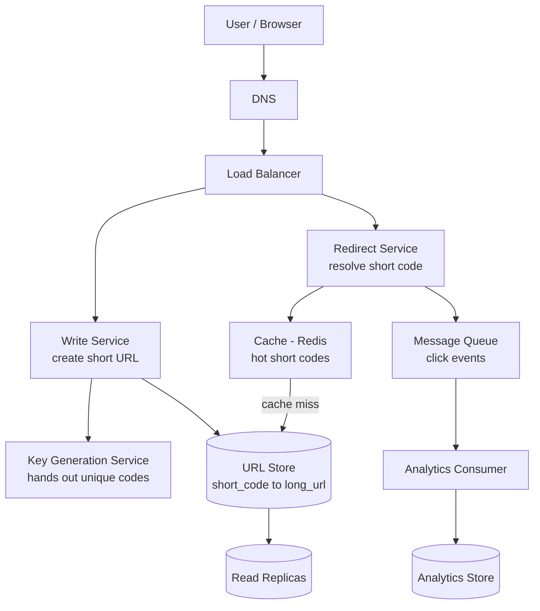
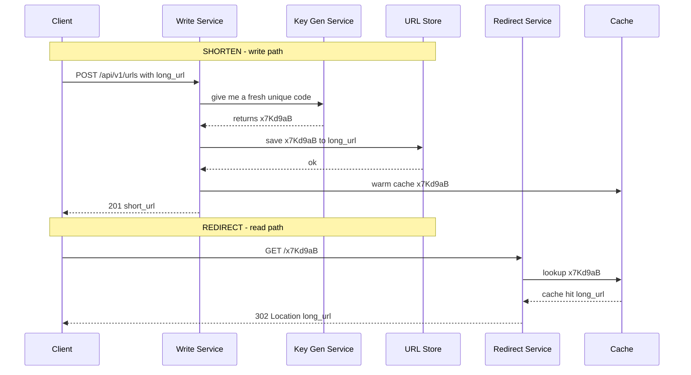
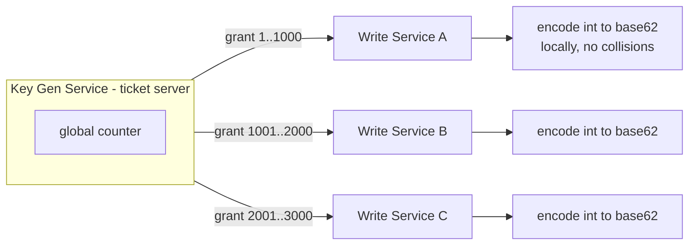

# 22. Design a URL Shortener

> **One-liner:** After this chapter you can take "design bit.ly / TinyURL" from a blank whiteboard to a defensible, end-to-end design in about 40 minutes — and sound calm doing it.
> **Interview frequency:** The classic warm-up. Extremely common as the *opener* at Zepto, Swiggy, and CRED, and a standard phone-screen question almost everywhere. It looks trivial, which is the trap: the interviewer is watching whether you follow a process or just blurt "use a hash map." Nail this one and you set the tone for the whole loop.

---

## 1. The Problem in Plain Words

You paste a long, ugly URL — `https://www.swiggy.com/restaurants/bengaluru/indiranagar/xyz?utm_source=email&promo=NEWUSER50` — and the service hands you back something tiny like `sho.rt/x7Kd9aB`. Later, anyone who opens `sho.rt/x7Kd9aB` in a browser gets **redirected** to the original long URL.

That's it. Two operations: **shorten** (write) and **redirect** (read). The whole art of this interview is realising that a two-operation product, at scale, quietly hides real questions: How do you generate billions of unique short codes without two users ever colliding? How do you make a redirect return in single-digit milliseconds? How do you stay up when a database machine dies? This chapter answers all of that using the standard interview flow from `01-what-is-system-design.md`.

> **Tie-back:** This is genuinely the one system on the whole list you could ship *this weekend* on top of the stack you already run for **santhu.site** — a tiny API, a table, and a Redis cache. And it's a real feature for **Habex**: "share a snapshot of my monthly report" wants a short, clean link like `hx.bx/r/9aBk2` rather than a 300-character signed URL. Being able to say *"I actually built the shorten+redirect core"* turns this from a memorised answer into a story.

---

## 2. Step 1 — Clarify Requirements

Do **not** start drawing boxes. Spend the first two minutes pinning down scope out loud. Here's what I'd lock in.

**Functional requirements (what it does):**

- Given a long URL, return a short URL.
- Given a short URL, redirect the user to the original long URL.
- **Optional — custom alias:** let a user pick `sho.rt/santhu` instead of a random code.
- **Optional — expiry:** a link can have a time-to-live and stop working after it.
- **Optional — analytics:** count clicks per short link, maybe with referrer / country.

**Non-functional requirements (how well it does it):**

- **Scale:** assume **100M new URLs/month** (a number the interviewer usually supplies or accepts).
- **Read-heavy:** clicks vastly outnumber creations — I'll assume a **100:1 read:write** skew. This single fact drives most of the design.
- **Latency:** a redirect must feel instant — target **p99 under ~50ms**, ideally single-digit ms from cache. A slow redirect feels broken.
- **Availability:** very high, especially for reads. A dead link shortener is worthless and every printed/emailed link points at you forever. This is an **AP** system — I'll favour availability over strict consistency (see `13-cap-theorem.md`).
- **Durability:** once a mapping is created, it must never be lost. Links live in emails and billboards for years.
- **Consistency:** short codes must be **globally unique** (no code ever maps to two different long URLs). Analytics counts can be eventually consistent — being off by a few for a second is fine.

**Questions I'd ask the interviewer (say these out loud — it scores points):**

- How long should the short code be? Do we need human-friendly custom aliases?
- Should links expire by default, or live forever? What's the default TTL?
- Do we need click analytics, and how detailed — just a counter, or per-click events?
- If the **same long URL** is submitted twice, do we return the same short code (dedup) or always mint a new one? (This decides whether hashing is even viable.)
- What's the expected read:write ratio and geographic spread — one region or global?
- Do we need to block malicious/phishing URLs? (Affects a validation step.)

> Interview tip: explicitly declaring "custom aliases and analytics are **stretch goals**; I'll design the core shorten+redirect first and layer them on" shows you scope like a senior engineer instead of trying to boil the ocean.

---

## 3. Step 2 — Back-of-the-Envelope Estimation

The goal here isn't precision — it's deciding **"one box or a fleet?"** Show the arithmetic in small steps and state every assumption.

**Write throughput (creating short URLs):**

- Assumption: 100M new URLs/month.
- Seconds per month ≈ 30 days × 24 h × 3600 s = **2,592,000 s** (~2.6M).
- Average writes/sec = 100,000,000 ÷ 2,592,000 ≈ **~40 writes/sec**.
- Traffic is spiky; assume peak ≈ 5× average → **~200 writes/sec peak**.

**Read throughput (redirects):**

- Read:write skew = 100:1.
- Average reads/sec = 40 × 100 = **~4,000 reads/sec**.
- Peak ≈ 5× → **~20,000 reads/sec peak**.

**Storage (how big does the mapping table get?):**

- Size one record: short_code (7 B) + long_url (avg ~200 B) + metadata like timestamps, owner, flags (~90 B) ≈ **~500 bytes/record** (round up for safety).
- Per month: 100M × 500 B = **50 GB/month**.
- Per year: 1.2B URLs × 500 B = **~600 GB/year** (~0.6 TB).
- Over 5 years: 6B URLs ≈ **~3 TB**. That's small — it fits comfortably on a single beefy DB, though we'll replicate/shard for availability, not capacity.

**Short-code key space (do we have enough codes?):**

- We use **base62** characters `[a-z A-Z 0-9]` = 62 symbols.
- 6 chars → 62⁶ = **~56.8 billion** codes.
- 7 chars → 62⁷ = **~3.52 trillion** codes.
- We need ~6B codes over 5 years. **7 characters** gives ~3.5 trillion — comfortable for decades. (6 would technically fit, but 7 buys headroom against collisions and future growth.)

**Bandwidth:**

- Writes: 200/sec × 500 B ≈ **100 KB/sec** — negligible.
- Reads: 20,000/sec × ~500 B (a redirect response is tiny — just headers + a `Location`) ≈ **10 MB/sec** — modest.

**Cache sizing (the important one):**

- Daily reads ≈ 4,000 × 86,400 ≈ **~345M reads/day**.
- By the 80/20 rule, a small hot set serves most traffic. Caching, say, the 100M hottest mappings at ~200 B each (`short_code → long_url`) ≈ **~20 GB** of RAM — easily held in a modest Redis cluster.

| Metric | Average | Peak (~5×) |
|---|---|---|
| Writes (shorten) | ~40 /sec | ~200 /sec |
| Reads (redirect) | ~4,000 /sec | ~20,000 /sec |
| New storage | ~50 GB/month | ~0.6 TB/year |
| Read bandwidth | — | ~10 MB/sec |

**Takeaway:** writes and storage are trivial; **reads are the whole game.** The design must make redirects blindingly fast and highly available. That points straight at caching and read replicas.

---

## 4. Step 3 — API Design

A clean, small REST surface (see `17-api-design-rest-graphql.md`). Creation is a normal JSON API; the redirect itself is *not* JSON — it's an HTTP redirect.

**Create a short URL**

```
POST /api/v1/urls
Authorization: Bearer <api_key>
Content-Type: application/json

{
  "long_url": "https://www.swiggy.com/restaurants/...long...",
  "custom_alias": "santhu-lunch",     // optional
  "expiry_at": "2026-12-31T00:00:00Z" // optional
}

201 Created
{
  "short_url": "https://sho.rt/x7Kd9aB",
  "short_code": "x7Kd9aB",
  "long_url":  "https://www.swiggy.com/restaurants/...",
  "expiry_at": null
}
```

If `custom_alias` is already taken → `409 Conflict`. If `long_url` is malformed → `400`.

**Redirect (the hot path)**

```
GET /x7Kd9aB

302 Found
Location: https://www.swiggy.com/restaurants/...
```

Returns **301** or **302** (that choice is a deliberate trade-off — see §8). On an unknown/expired code → `404`.

**Fetch metadata / analytics (optional)**

```
GET /api/v1/urls/x7Kd9aB

200 OK
{ "short_code": "x7Kd9aB", "long_url": "...", "created_at": "...", "click_count": 10432 }
```

**Delete (optional):** `DELETE /api/v1/urls/x7Kd9aB → 204`.

Cross-cutting concerns to name out loud:

- **Auth** on creation via API key / bearer token (`20-security-basics.md`) so you can attribute and throttle.
- **Rate limiting** on `POST` per API key/IP to stop abuse (`18-rate-limiting-pagination-versioning.md`).
- **Idempotency:** an `Idempotency-Key` header so a retried "shorten" doesn't mint two codes for one logical request (`19-reliability-patterns.md`).
- **Versioning** the create API (`/v1/`); the bare redirect path stays unversioned and permanent.

---

## 5. Step 4 — Data Model

The access pattern is the simplest possible: **look up one row by its primary key.** No joins, no range scans on the hot path. That shapes the whole storage choice.

**Core table — `urls`:**

| Field | Type | Notes |
|---|---|---|
| `short_code` | string (7) | **Primary key.** The lookup key on every redirect. |
| `long_url` | string | The destination. |
| `owner_id` | string | Which account created it (for analytics/quotas). |
| `created_at` | timestamp | Audit + expiry math. |
| `expiry_at` | timestamp / null | Null = never expires. |
| `is_active` | boolean | Soft-delete / disable flag. |

**Which database? Link `09-sql-vs-nosql.md`.** This is the textbook case for a **key-value store** — every hot request is `get(short_code)`. Options:

- **Key-value / wide-column store** (DynamoDB, Cassandra) partitioned by `short_code`: scales horizontally almost for free, single-digit-ms point reads. Great fit at large scale.
- **A single indexed SQL table** (Postgres/MySQL) with the primary-key index on `short_code`: also perfectly fine — 3 TB over 5 years is not big, a B-tree PK lookup is fast (`10-database-indexing.md`), and you get easy ad-hoc analytics queries for free. Simpler to operate.

I'd say: *"At this scale I'd honestly start with a single indexed SQL table plus read replicas — it's simpler and the data is small. If we outgrow a single primary's write capacity or want seamless horizontal scale, I'd move the mapping to a key-value store, because we never need joins on the hot path."* That "start simple, name the upgrade trigger" framing is exactly what senior interviewers reward.

**Analytics — keep it out of the hot table.** Writing a click row on *every* redirect would 100× your write load. Instead, emit a lightweight **click event to a message queue** (`15-message-queues-and-pubsub.md`) and let a consumer aggregate counts into a separate analytics store. The redirect path stays a pure, fast read.

---

## 6. Step 5 — High-Level Design

Two lightweight services behind a load balancer (`05-load-balancers.md`): a **Write Service** (mints codes) and a **Redirect Service** (resolves them). Splitting them lets you scale the read path independently — and it's mostly reads.



**Walking the two flows:**



- **Shorten:** client `POST`s → Write Service asks the **Key Generation Service** for a guaranteed-unique code → persists the mapping → pre-warms the cache → returns the short URL.
- **Redirect:** client `GET`s the short code → Redirect Service checks **Redis first** (cache-aside, `07-caching.md`). Cache hit → return the redirect immediately. Cache miss → read from DB (or a read replica), populate the cache, then redirect. Meanwhile a click event is fired to the queue for async analytics so the user never waits on it.

---

## 7. Step 6 — Deep Dive: Generating the Short Code

This is *the* question for this system, and where a good candidate separates from a memoriser. The requirement: produce a short, unique code for every URL, forever, with **no collisions**, at hundreds of writes/sec. Four approaches — I'd talk through all four and land on one.

**(a) Random base62.** Generate a random 7-char string, check the DB for a collision, retry if taken.
- *Collision handling:* read-before-write; on the rare clash, regenerate.
- *Pro:* dead simple, codes are unguessable (good for privacy).
- *Con:* every write needs an extra read to check uniqueness; as the space fills, collision probability and retries climb.

**(b) Auto-increment counter + base62 encode.** Keep one global integer counter; each new URL takes the next integer, which you **encode to base62**. Code `125` → `cb`, code `1,000,000,000` → `15FTGg`.
- *Collision handling:* none needed — unique by construction.
- *Pro:* zero collision checks, dense/short codes, very fast.
- *Con:* a single counter is a **bottleneck and single point of failure**; and sequential codes are **guessable** (`x7Kd8` → try `x7Kd9`), letting people enumerate everyone's links.

**(c) Hash + truncate.** Compute `MD5`/`SHA256(long_url)` and take the first 7 base62 chars.
- *Collision handling:* on clash, re-hash with a salt or append a char.
- *Pro:* the **same URL naturally maps to the same code** (free dedup) — *if* that's what you want.
- *Con:* truncating a hash reintroduces collisions you must detect; and "same URL → same code" is often *undesirable* (two users shortening the same link would share analytics). Avoid as the primary scheme.

**(d) Key Generation Service (KGS) / ticket server.** Pre-generate keys, or hand out **ranges** of the counter. A central coordinator (a **ticket server**, or ranges tracked in **Zookeeper**) gives each Write Service instance a block of, say, 1,000 IDs at once. The instance encodes locally and only comes back for another block when it runs low.
- *Collision handling:* none at runtime — ranges never overlap, so keys are unique by design.
- *Pro:* no per-write collision check, no per-write coordination (you coordinate once per 1,000), so writes are fast and the central service isn't a hot bottleneck.
- *Con:* extra infrastructure to run and make highly available; IDs in an unfinished block are "lost" if an instance dies (harmless — the space is trillions).



**Comparison:**

| Approach | Collision handling | Write cost | Guessable? | Verdict |
|---|---|---|---|---|
| (a) Random base62 | read-check + retry | extra read per write | No (good) | Fine at small/medium scale |
| (b) Counter + base62 | none needed | 1 counter increment | **Yes** (sequential) | Great logic, but single counter = SPOF |
| (c) Hash + truncate | rehash on clash | hash + check | No | Only if you *want* URL dedup; avoid otherwise |
| (d) KGS / ticket server | none at runtime | ~1 coord per 1,000 | Can scramble to hide | **Best at scale** — my default |

**What I'd pick and say:** *"I'd use approach (d): a range-based Key Generation Service. It keeps writes fast with no runtime collision checks and no single hot counter. To stop enumeration, I'd map the counter through a reversible scramble — e.g. base62 of the counter XORed with a secret, or bit-interleaving — so codes look random even though they're generated sequentially. If the scale were tiny, I'd honestly just use random base62 (a) for simplicity and revisit later."* Naming the security wrinkle (enumeration) unprompted is a strong signal.

---

## 8. Step 7 — Scaling, Bottlenecks & Trade-offs

**Reads are the bottleneck — attack them in layers:**

1. **Cache (Redis), cache-aside** in front of the DB (`07-caching.md`). With a ~90%+ hit rate, most of those 20K peak reads/sec never touch the database. Use an LRU eviction and set a TTL that respects link expiry.
2. **Read replicas** for cache misses (`11-replication.md`). Redirects tolerate slightly stale reads, so serving misses from replicas is safe — a link's destination almost never changes after creation.
3. **CDN / edge** (`08-cdn.md`). Since a redirect is just an HTTP response, you can serve popular short codes right from edge PoPs close to the user, shaving latency globally.

**301 vs 302 — the signature trade-off of this system:**

| | 301 Moved Permanently | 302 Found (temporary) |
|---|---|---|
| Browser behaviour | **Caches** the redirect; future clicks skip your server | Asks your server **every time** |
| Server load | Much lower | Higher |
| Analytics | You **miss** cached clicks | You **count every** click |
| Editable destination | Effectively no | Yes |

Real services like bit.ly use **302** precisely because analytics and editable/disable-able links are core to the product — worth the extra load. If analytics didn't matter and you only cared about speed and cost, **301** is better. *"It depends on whether counting clicks is a product requirement"* is the answer they want.

**Sharding the store** (`12-sharding-and-partitioning.md`): partition by `short_code` (hash-based). Because the code is essentially random/uniform, load spreads evenly with no natural hot partition — a rare case where sharding is painless.

**Abuse & safety** (`18`, `20`): rate-limit creation per API key/IP; scan submitted URLs against phishing/malware blocklists; strip your own domain to prevent redirect loops. Otherwise you become a free spam-laundering service.

**"Why not just…?"**

- **…one big database, no cache?** It works until ~20K reads/sec hammer it and every redirect pays disk latency. A cache turns most reads into microsecond RAM hits and shields the DB. Cheap, huge win — do it.
- **…a hash (MD5) as the code?** Truncation collisions plus unwanted "same URL → same code" behaviour. A counter/KGS is cleaner unless dedup is an explicit goal.
- **…UUIDs?** A UUID is 36 chars — the opposite of "short." The whole product is *brevity*; base62 of a small integer is far shorter.
- **…microservices and Kafka everywhere?** Overkill for a two-operation app. Start with two small services, a cache, and a DB. Matching effort to need is itself the skill (`21-architecture-patterns.md`).

---

## 9. Common Interview Questions & Follow-ups

- **"How do you guarantee two users never get the same code?"** → Uniqueness by construction: a counter/KGS with non-overlapping ranges. If using random codes, a unique constraint on `short_code` + retry-on-conflict.
- **"Why is this read-heavy, and how do you exploit that?"** → 100:1 skew → cache aggressively, add read replicas and a CDN; keep the redirect path free of any synchronous work (analytics goes async via a queue).
- **"301 or 302 — which and why?"** → 302 if you need click analytics or editable links (bit.ly's choice); 301 if raw speed/cost matters more and you'll never count clicks. State the trade-off, don't just pick.
- **"How would you support custom aliases?"** → Same table; the alias *is* the `short_code`. Enforce uniqueness on insert → `409` if taken. Keep a reserved-words list so nobody grabs `/api` or `/login`.
- **"How do expiring links work?"** → Store `expiry_at`; check it on read and return `404` if past. Set the cache TTL to the remaining life. A background job lazily purges expired rows.
- **"The Key Generation Service is a single point of failure — fix it."** → Run it replicated with a durable counter (or Zookeeper/DB-backed ranges). Each app instance holds a local block of IDs, so brief KGS downtime doesn't stall writes — they keep spending their buffer.
- **"How do you stop abuse / malicious links?"** → Auth + per-key rate limits on creation, URL blocklist scanning, and monitoring for spikes from one account.
- **"Sequential codes are guessable — is that a problem?"** → Yes, it enables enumeration/scraping. Mitigate by scrambling the counter (XOR with a secret, bit-interleave) so codes look random while staying collision-free.
- **"How would you add per-link analytics without slowing redirects?"** → Fire an async event to a queue on each redirect; a consumer aggregates counts into a separate store (`15-message-queues-and-pubsub.md`). The hot path never waits.

---

## 10. TL;DR

- **Two operations, one hard truth: it's ~100:1 read-heavy.** Everything follows from making redirects fast and always-available.
- **Estimation:** ~40 writes/sec (peak ~200), ~4K reads/sec (peak ~20K), ~0.6 TB/year, ~3.5 trillion codes from **7-char base62** — plenty.
- **Data model:** a single `short_code → long_url` mapping. Perfect **key-value** pattern; a plain indexed SQL table also works at this scale (`09-sql-vs-nosql.md`).
- **Deep dive — code generation:** random / counter+base62 / hash+truncate / **KGS ticket-server**. Prefer a **range-based KGS** (fast, collision-free, no hot counter); scramble sequential IDs to prevent enumeration.
- **Scale reads:** Redis cache-aside → read replicas → CDN. Keep analytics **async** via a queue.
- **Signature trade-off:** **301 vs 302** — permanent+cacheable+fast vs temporary+counts-every-click+editable. Answer "it depends on whether we need analytics."
- **Match effort to need:** two small services, a cache, a DB. No Kafka-everywhere. That restraint is the senior signal.

**The 60-second version to say out loud:** *"It's a read-heavy key-value problem — roughly 40 writes and 4,000 reads per second. I'd expose `POST /urls` to create and `GET /{code}` to redirect. Codes are 7-char base62 minted by a range-based key-generation service, so they're unique with no runtime collision checks; I'd scramble the sequence so they aren't guessable. Storage is just a `short_code → long_url` map — a KV store or a simple indexed SQL table, since I only ever look up by key. The redirect path is Redis cache-aside backed by read replicas and a CDN, hitting single-digit-ms latency. I'd return 302 so I can count clicks and disable links, and push click events to a queue so analytics never slows the redirect. Rate-limit and URL-scan creation to prevent abuse."*

*Next: `23-case-study-instagram.md` — where the read-heavy pattern meets a social graph and the feed fan-out problem.*
