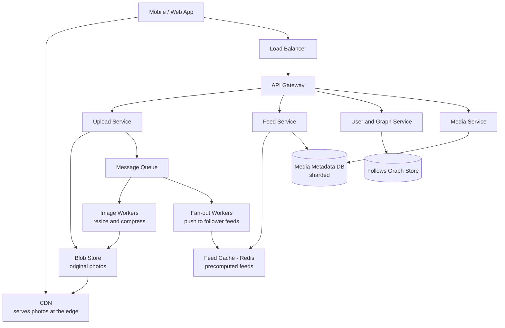
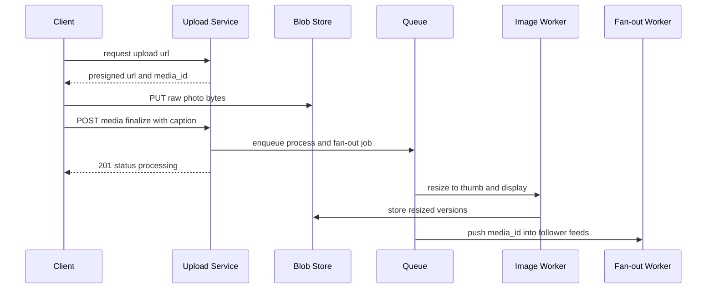
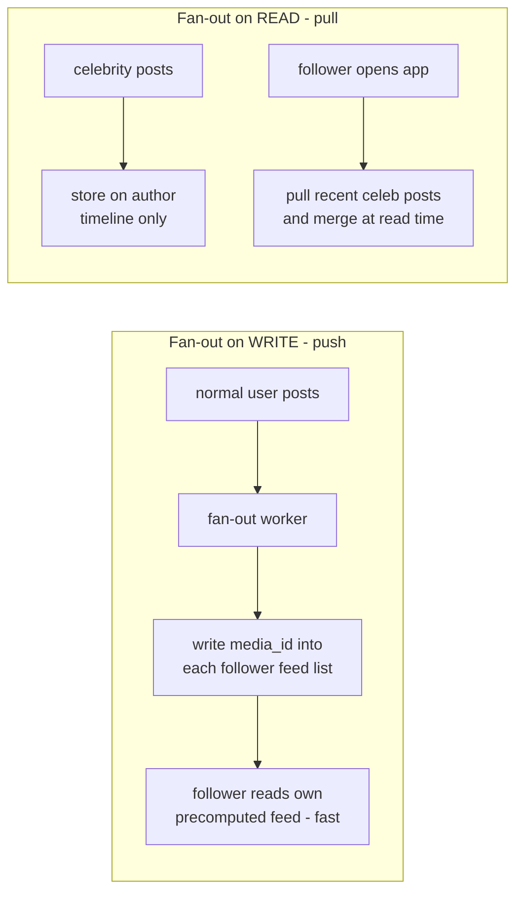

# 23. Design Instagram

> **One-liner:** After this chapter you can design a photo-sharing app with a home feed at hundreds-of-millions-of-users scale — and confidently handle the fan-out question that makes or breaks this interview.
> **Interview frequency:** A top-tier favourite for mid and senior loops. Instagram/Twitter/feed-style designs show up constantly at product companies; in India, expect the *feed* variant at CRED, Swiggy (activity feeds), and any team that does a social/timeline surface. The real test is the **newsfeed fan-out** trade-off — get that right and you've passed.

---

## 1. The Problem in Plain Words

You open the app. You see a scrollable **home feed** of photos posted by the people you **follow**, newest-ish first. You can **upload** your own photo with a caption, **like** and **comment** on others, and visit anyone's **profile grid** of their posts.

Under the hood there are three hard things hiding in that simple description. First, the photos themselves are big binary blobs — you don't want those anywhere near your database. Second, "show me posts from everyone I follow" is a surprisingly expensive query when you follow 500 people and one of them has 200 million followers. Third, it's staggeringly **read-heavy** — for every photo posted, that photo is viewed thousands of times. This chapter builds it up the same way the interviewer wants: clarify, estimate, API, data, high-level, then a deep dive on the feed.

---

## 2. Step 1 — Clarify Requirements

**Functional requirements (in scope):**

- **Upload** a photo with a caption.
- **Follow / unfollow** other users (a directed social graph).
- **Home feed / timeline:** photos from the people you follow, in reverse-chronological order.
- **Like** and **comment** on a photo.
- View a **user profile grid** (all of one user's posts).

**Explicitly out of scope** (say this — it shows scoping discipline): direct messages, Stories, Reels/video, Explore/search, ads, notifications. I'll mention where video or ranking would slot in, but I won't design them.

**Non-functional requirements:**

- **Scale:** assume **500M DAU**.
- **Read-heavy:** feed views massively outnumber uploads — I'll assume roughly **100:1**.
- **Latency:** feed should load in **~200ms**; photos must load fast, which means serving them from a **CDN** near the user (`08-cdn.md`).
- **Availability:** high. A feed that's briefly stale is fine; a feed that's *down* is not. This leans **AP** (`13-cap-theorem.md`).
- **Consistency:** **eventual** is acceptable for feeds and like counts — if a new post takes a few seconds to appear, or a like count is off by a handful for a moment, nobody cares (`14-acid-vs-base-and-consistency.md`).
- **Durability:** a user's photos must **never** be lost. Blob storage with replication.

**Questions I'd ask the interviewer:**

- Is the feed strictly **chronological**, or **ranked** by an ML relevance model? (I'll assume chronological for the core design and note where ranking plugs in.)
- What's the average **follower / following** count, and do we have **celebrities** with tens of millions of followers? (This single question decides the whole fan-out strategy.)
- Photos only, or **video** too? (Assume photos; video changes the storage/transcoding math.)
- Do like counts need to be **exact**, or is approximate fine at the high end? (Approximate is usually fine.)
- Global userbase, or single region? (Assume global → CDN + regional replication.)

---

## 3. Step 2 — Back-of-the-Envelope Estimation

The point is to prove **why** we need a blob store, a CDN, and precomputed feeds. Arithmetic in small steps, assumptions stated.

**Upload (write) throughput:**

- Assumption: 500M DAU, and ~20% post one photo/day → **100M photos/day**.
- Seconds/day = 86,400.
- Uploads/sec = 100,000,000 ÷ 86,400 ≈ **~1,200 writes/sec** average.
- Peak ≈ 3× → **~3,500 uploads/sec**.

**Feed (read) throughput:**

- Assumption: each DAU makes ~20 feed-related reads/day (opens, refreshes, scrolls).
- Reads/day = 500M × 20 = **10 billion/day**.
- Reads/sec = 10,000,000,000 ÷ 86,400 ≈ **~115,000 reads/sec** average.
- Peak ≈ 3× → **~350,000 reads/sec**.
- Read:write ≈ 115,000 ÷ 1,200 ≈ **~100:1** — confirmed read-heavy.

**Photo storage:**

- Assumption: each upload is stored as multiple resolutions (thumbnail + display + compressed original) totalling **~500 KB average**.
- Per day: 100M × 500 KB = **50 TB/day**.
- Per year: 50 TB × 365 ≈ **~18 PB/year**.
- This is why photos live in a **blob store**, not a database. No relational DB wants 18 PB/year of binary.

**Metadata storage:**

- Assumption: per-photo metadata row ≈ **1 KB** (id, owner, caption, URLs, timestamp, location).
- Per day: 100M × 1 KB = **100 GB/day** → **~36 TB/year**. Big, but fine for a **sharded** database (`12-sharding-and-partitioning.md`).

**Bandwidth (why the CDN is non-negotiable):**

- Feed *metadata* egress: 350K reads/sec × ~10 KB/response (metadata for ~15 posts) ≈ **~3.5 GB/sec**.
- Photo egress: if an average feed view loads ~5 photos at ~200 KB display size, that's ~1 MB per view × 115K avg views/sec ≈ **~115 GB/sec** of image bytes. No origin fleet serves that — it **must** come from CDN edges.

| Metric | Average | Peak (~3×) |
|---|---|---|
| Uploads | ~1,200 /sec | ~3,500 /sec |
| Feed reads | ~115,000 /sec | ~350,000 /sec |
| Photo storage | ~50 TB/day | ~18 PB/year |
| Metadata | ~100 GB/day | ~36 TB/year |
| Photo egress | ~115 GB/sec | (served by CDN) |

**Takeaways that drive the design:** (1) photos → **blob store + CDN**; (2) metadata → **sharded DB**; (3) 100:1 reads → **precompute and cache feeds** rather than assembling them from scratch on every open.

---

## 4. Step 3 — API Design

REST with **cursor-based pagination** for feeds (`18-rate-limiting-pagination-versioning.md` — offset pagination breaks on a constantly-growing feed). Uploads use a **presigned-URL** pattern so raw photo bytes never pass through the app servers.

**Upload a photo (three steps, so app servers stay out of the byte path):**

```
# 1. Ask for a direct-to-blob upload slot
POST /api/v1/media/upload-url
-> 200 { "media_id": "m_88f2", "upload_url": "https://blob.../m_88f2?signature=..." }

# 2. Client PUTs the raw bytes straight to the blob store (not our servers)
PUT <upload_url>   (binary image body)  -> 200

# 3. Finalize: attach caption, trigger processing + fan-out
POST /api/v1/media
{ "media_id": "m_88f2", "caption": "sunset in Goa", "location": "Goa" }
-> 201 { "media_id": "m_88f2", "status": "processing" }
```

**Home feed (cursor pagination):**

```
GET /api/v1/feed?cursor=<opaque>&limit=20
-> 200 {
     "items": [ { "media_id": "...", "author": {...}, "image_urls": {...},
                  "caption": "...", "like_count": 1042, "liked_by_me": true } ],
     "next_cursor": "eyJ0cyI6..."
   }
```

**Social + engagement:**

```
POST   /api/v1/users/{id}/follow      -> 204
DELETE /api/v1/users/{id}/follow      -> 204
POST   /api/v1/media/{id}/likes       -> 204   (idempotent: liking twice = liked once)
POST   /api/v1/media/{id}/comments    { "text": "🔥" } -> 201
GET    /api/v1/users/{id}/media?cursor=...&limit=30    -> profile grid
```

Cross-cutting: auth via bearer token / OAuth (`20-security-basics.md`); rate-limit uploads, likes, comments and follows per user (`18`); make like/follow **idempotent** so client retries are safe (`19-reliability-patterns.md`).

---

## 5. Step 4 — Data Model

Different data has different shapes, so we deliberately mix stores (`09-sql-vs-nosql.md`).

**`users` — relational (SQL).** Profiles are structured, low-volume, and benefit from transactions.

| Field | Notes |
|---|---|
| `user_id` (PK) | |
| `username`, `full_name`, `bio` | |
| `avatar_url` | points to blob/CDN |
| `follower_count`, `following_count` | denormalized counters |

**`media` — metadata, wide-column / NoSQL, sharded by `media_id`.** High write volume, only ever queried by id or by author.

| Field | Notes |
|---|---|
| `media_id` (PK) | time-sortable id (Snowflake-style) |
| `owner_id` | author |
| `caption`, `location`, `created_at` | |
| `image_urls` | JSON: `{thumb, display, original}` → blob/CDN paths |
| `status` | `processing` / `ready` |

**`follows` — the social graph.** A huge set of directed edges `(follower_id → followee_id)`. Stored as an **adjacency list**, sharded by `follower_id` (to fetch "who I follow" fast) with a secondary index by `followee_id` (to fetch "my followers" for fan-out). This is often its own service/store.

**`likes` — massive, counter-driven.** Row `(media_id, user_id)` for "did I like it", plus a **denormalized `like_count`** on the media (updated asynchronously — eventual consistency, `14-acid-vs-base-and-consistency.md`). At the high end, exact counts don't matter.

**`comments`** — sharded by `media_id`, cursor-paginated.

**`feed` / timeline — precomputed per user.** In fan-out-on-write, each user has a list of recent `media_id`s (their ready-to-serve feed), kept in **Redis** or a wide-column store keyed by `user_id`. This is the cache that makes 115K feed reads/sec affordable.

**The photos themselves live in a blob store (e.g. S3), fronted by a CDN (`08-cdn.md`) — never in the database.** The DB stores only tiny URL pointers. This split is the single most important data decision: databases hold small, queryable metadata; blob+CDN holds the big bytes and serves them from the edge.

---

## 6. Step 5 — High-Level Design

Split by concern: an **Upload Service**, a **Feed Service**, a **User/Graph Service**, and a **Media Service**, behind an API gateway and load balancer (`05-load-balancers.md`). Photo bytes flow client → blob → CDN, bypassing the app tier. A **message queue** decouples the slow work (image resizing, feed fan-out) from the user's request (`15-message-queues-and-pubsub.md`).



**Upload flow** (the request returns fast; heavy work is async):



- **Upload:** client gets a presigned URL, uploads bytes **directly to blob storage**, then finalizes with a caption. The service enqueues a job and returns immediately — the user isn't blocked on resizing. Image workers generate thumbnails/display sizes and push them to the CDN; fan-out workers insert the new `media_id` into followers' feeds.
- **Feed read:** the Feed Service reads the user's **precomputed feed** from Redis (a list of `media_id`s), hydrates metadata from the Media DB (cached), and returns it. Photo URLs point at the CDN, so the actual images load from the edge. This is why a feed open is ~200ms even at 350K reads/sec.

---

## 7. Step 6 — Deep Dive: Newsfeed Generation

This is the heart of the interview. The question: **when should we assemble a user's feed — at write time or at read time?** Three strategies.

**Fan-out on write (PUSH).** The moment a user posts, a worker writes that `media_id` into the **precomputed feed list of every follower**. Reading a feed is then trivial — just read your own list from Redis.
- *Pro:* feed reads are **blazing fast** and cheap (one cache read). Perfect for a 100:1 read-heavy system.
- *Con:* posting is expensive — a user with *N* followers triggers *N* writes. For a celebrity with 200M followers, one post = 200M feed writes (a **fan-out storm**). Also wastes storage duplicating posts into millions of inactive users' feeds.

**Fan-out on read (PULL).** Posting is cheap — just store the post once on the author's own timeline. At **read time**, the feed is assembled: fetch the list of people you follow, pull their recent posts, merge and sort by time.
- *Pro:* writes are cheap and constant regardless of follower count; no wasted storage.
- *Con:* reads are **expensive** — every feed open fans out to hundreds of authors and merges. At 350K reads/sec this crushes the database. Bad for a read-heavy app.

**Hybrid (what real systems do).** Use **push for normal users** and **pull for celebrities**. When you open your feed, you get your precomputed list (from push) **merged at read time** with the latest posts from the handful of celebrities you follow (pulled live). Celebrities never fan out to millions; everyone else enjoys fast precomputed reads.



**Comparison:**

| | Fan-out on WRITE (push) | Fan-out on READ (pull) | Hybrid |
|---|---|---|---|
| Cost of posting | High (N follower writes) | Low (one write) | Low for celebs, high for normal |
| Cost of reading | Very low (one cache read) | High (gather + merge) | Low (mostly precomputed) |
| Storage | High (duplicated feeds) | Low | Moderate |
| Celebrity problem | **Breaks** (fan-out storm) | Fine | **Solved** |
| Best when | Mostly low-follower users | Write-heavy / few reads | **Real-world mix** |

**What I'd say:** *"I'd default to fan-out-on-write because we're 100:1 read-heavy — I want feed reads to be a single cache lookup. But I'd set a follower threshold, say ~10K. Above it, users are treated as 'celebrities' and their posts are pulled at read time instead of pushed, so one post never triggers millions of writes. A feed open merges your precomputed list with the freshest celeb posts. That hybrid is exactly why my earlier estimate of a ~200ms feed at 350K reads/sec is realistic."*

**The celebrity / hot-key problem (`12-sharding-and-partitioning.md`).** A celebrity's data (their post, their follower list) is a **hot partition** — everyone hits it at once. Beyond the pull strategy above, mitigate by **caching hot posts** in many replicas so the load spreads, and by keeping the follower-list read (needed for fan-out) sharded and cached rather than a single hot row.

**Caching feeds (`07-caching.md`).** Precomputed feeds live in **Redis** as capped lists (keep, say, the latest ~500–1,000 `media_id`s per user; older items are paged in from the DB on demand). Post metadata is cached separately so hydrating a feed is all cache hits. Feed cache + CDN for photos is what absorbs the 100:1 read skew.

**Eventual consistency of like counts (`14-acid-vs-base-and-consistency.md`).** At this scale you do **not** run a transaction per like. Likes append to a store and a background aggregator updates a **denormalized `like_count`**; the UI may show a slightly stale number for a second. Users never notice, and you avoid a write bottleneck on hot posts. This is a textbook place to trade strict consistency for availability and throughput.

**Image processing via the queue (`15-message-queues-and-pubsub.md`).** Resizing/compression is slow and must not block the upload response, and fan-out is bursty. Both go through a queue so the user's `POST` returns in milliseconds while workers churn asynchronously — and if a worker dies, the job is retried, not lost.

> **Tie-back:** The fan-out idea isn't just for photo apps. Imagine adding a **shared/family activity feed to Habex** — "Amma added a ₹2,000 grocery expense," "you hit your savings goal." That's the exact same problem in miniature: when one member posts an activity, do you push it into each family member's feed (write) or assemble it when they open the app (pull)? At Habex's scale the honest answer is *neither yet* — a few family members means you just query on read; there's no celebrity, no 100:1 skew. Knowing **when the fancy fan-out is overkill** is as strong an interview signal as knowing how it works.

---

## 8. Step 7 — Scaling, Bottlenecks & Trade-offs

**Serving the read storm in layers:**

1. **CDN for photos** (`08-cdn.md`) — the ~115 GB/sec of image egress is served from edge PoPs, not origin. Non-negotiable.
2. **Feed cache (Redis)** — precomputed feeds turn a feed open into one cache read.
3. **Read replicas** for metadata (`11-replication.md`) — feed hydration reads from replicas; stale-by-seconds is fine.

**Sharding (`12-sharding-and-partitioning.md`):**

- **Media metadata** sharded by `media_id` (uniform, no hot partition).
- **Feeds** sharded/keyed by `user_id`.
- **Follows graph** sharded by `follower_id`, indexed by `followee_id` for fan-out — the celebrity followee is the hot key handled by the hybrid strategy.

**Where it breaks & the fixes:**

| Bottleneck | Symptom | Fix |
|---|---|---|
| Celebrity posts | fan-out storm, write spike | hybrid pull for high-follower users |
| Hot post (viral) | like/read spike on one key | multi-replica cache, async counters |
| Feed assembly cost | slow reads | precompute (push) + Redis |
| Photo egress | origin saturated | CDN at the edge |
| Image processing | slow uploads | async queue + workers |

**"Why not just…?"**

- **…assemble every feed on read (pure pull)?** Simple, but at 100:1 read-heavy it re-does the same expensive merge millions of times. Precompute once on write instead.
- **…push for everyone including celebrities?** One celebrity post = hundreds of millions of writes and a latency spike for the whole system. The follower threshold + pull for celebs is the whole reason the hybrid exists.
- **…store photos in the database as blobs?** 18 PB/year of binary in a relational DB is a non-starter — bloated backups, terrible cache locality, no edge delivery. Blob + CDN is purpose-built for this.
- **…strong consistency on likes/feeds?** A per-like transaction and synchronous fan-out would throttle throughput for zero user benefit. Eventual consistency is the right call here (`14`).

---

## 9. Common Interview Questions & Follow-ups

- **"Push vs pull for the feed — which and why?"** → Default push (100:1 read-heavy → cheap reads), but **hybrid**: pull for celebrities above a follower threshold so one post never fans out to millions. This is the answer they're really probing.
- **"How do you handle a user with 200M followers?"** → Don't fan out their posts. Store once; pull and merge their latest at read time. Cache the hot post across replicas.
- **"Where do the actual photos live, and how are they served fast globally?"** → Blob store for durability; CDN for edge delivery. DB holds only URL pointers. Client uploads directly to blob via presigned URL.
- **"How do you keep feed reads ~200ms at 350K reads/sec?"** → Precomputed Redis feeds + cached metadata + CDN photos, so a feed open is essentially cache reads.
- **"Are like counts exact?"** → No — appended asynchronously and aggregated into a denormalized counter (`14`). Approximate for a moment; never a bottleneck.
- **"Why is image processing on a queue?"** → To keep the upload response fast and make slow, bursty resize/fan-out work async, retryable, and independently scalable (`15`).
- **"How do you paginate an infinite, growing feed?"** → **Cursor** pagination, not offset — a cursor on `(created_at, media_id)` is stable as new posts arrive (`18`).
- **"How would you add ranking (non-chronological feed)?"** → Keep the candidate-generation (push/pull) layer; insert a ranking service that scores candidates by an ML model before returning. The fan-out architecture is unchanged.
- **"What if a fan-out worker crashes mid-way?"** → The job is on a durable queue and retried; fan-out is idempotent (inserting the same `media_id` twice is deduped), so retries are safe (`19`).

---

## 10. TL;DR

- **Three hard parts:** big photos, an expensive "posts from everyone I follow" query, and a ~100:1 read skew.
- **Estimation:** ~1,200 uploads/sec (peak ~3,500), ~115K feed reads/sec (peak ~350K), **~18 PB/year** of photos, ~36 TB/year metadata.
- **Storage split:** photos in a **blob store + CDN**; only tiny metadata/URL pointers in a **sharded DB**. Mix SQL (users) with wide-column NoSQL (media/feed) — right tool per shape (`09-sql-vs-nosql.md`).
- **Deep dive — fan-out:** **push** (precompute feeds, fast reads, breaks for celebrities) vs **pull** (cheap writes, slow reads) vs **hybrid** (push for normal users, pull for celebrities). Default hybrid.
- **Celebrity = hot key** (`12`): don't fan out to millions; pull + cache across replicas.
- **Eventual consistency** for like counts and feed freshness (`14`); **async queue** for image processing and fan-out (`15`); **CDN** for photo delivery (`08`); **cursor** pagination for the feed (`18`).

**The 60-second version to say out loud:** *"Instagram is dominated by a ~100:1 read skew, so I optimise for fast feed reads. Photos go to a blob store fronted by a CDN — clients upload directly via presigned URLs and the DB only keeps metadata pointers. The core problem is feed generation: I'd fan out on write, precomputing each user's feed in Redis so a feed open is a single cache read. But pure push breaks for celebrities — one post would trigger hundreds of millions of writes — so I go hybrid: above a follower threshold, I pull those authors' posts at read time and merge them into the precomputed feed. Image resizing and fan-out run async through a message queue so uploads return instantly, like counts are eventually consistent denormalized counters, and everything shards cleanly by media_id or user_id. The celebrity hot key is the one place I spend real design effort, and the hybrid fan-out is how I solve it."*

*Next: `24-case-study-chat-app.md` — where the read-heavy feed gives way to realtime, bidirectional messaging and delivery receipts.*
