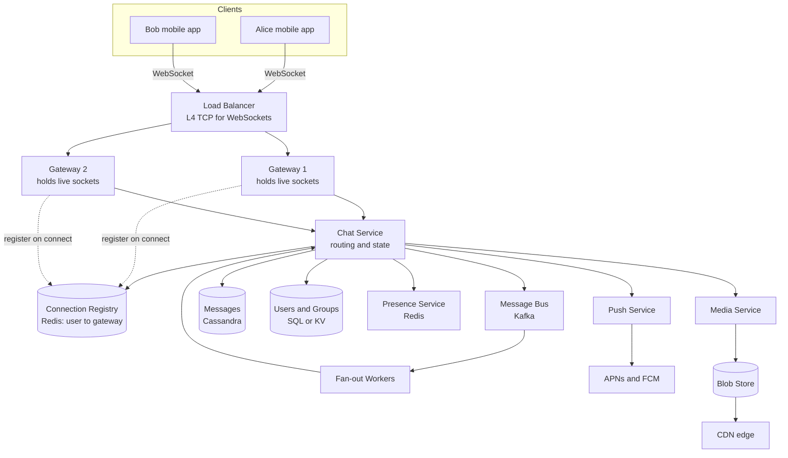
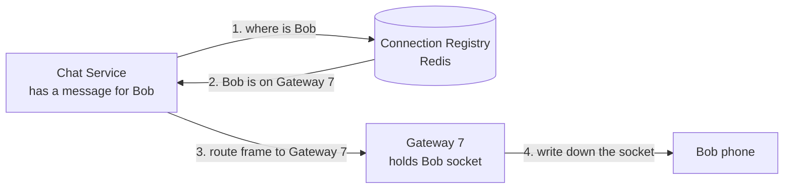
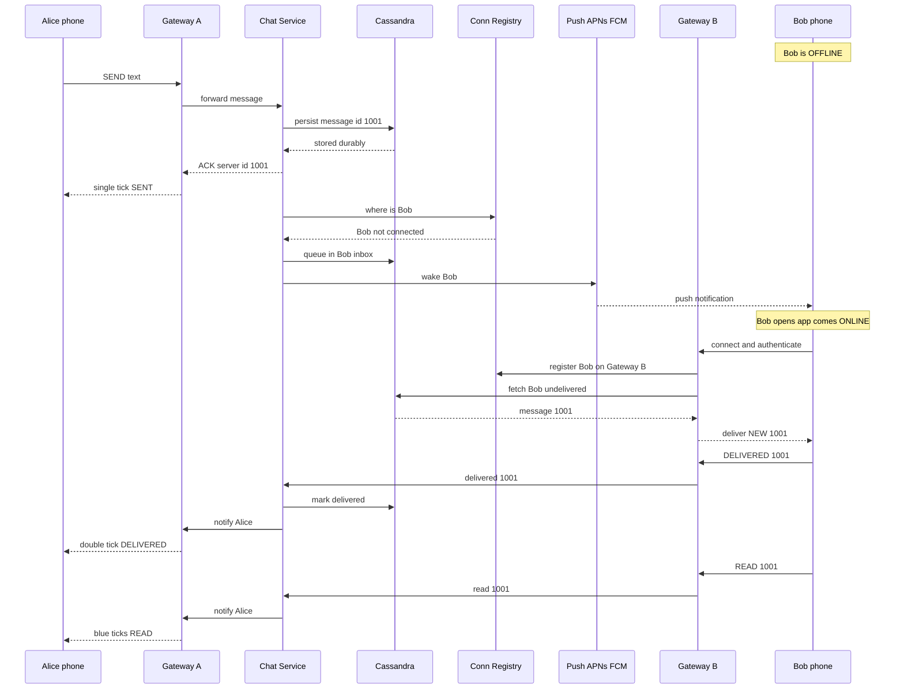

# 24. Design a Chat App like WhatsApp

> **One-liner:** A realtime messaging system that carries a message from one phone to another in well under a second — whether the other person is online, offline, or in a 200-person group — and never loses it.
> **Interview frequency:** **High.** This is *the* canonical "realtime" system-design question (WhatsApp / Messenger / Slack / Telegram). It's less common at the pure fintechs, but it's a favourite for probing WebSockets, presence, and delivery guarantees — and Swiggy/Zepto ask a close cousin of it as "realtime order tracking / live delivery location."

---

## 1. The Problem in Plain Words

Every system you've designed so far in this curriculum runs on **request/response**: the client asks, the server answers, the connection closes (`[02 — Client-Server Basics](02-client-server-basics.md)`). A chat app is the first design where that model *breaks*.

Why? Because when Bob sends Alice a message, **Alice's phone never asked for it.** The server has to *push* data to Alice out of nowhere. HTTP, as you know it, can't do that on its own — the server can only reply to a request. So the very first hard problem of a chat app is: *how does a server send something to a client that isn't currently asking?*

That single question drags in everything else:

- If the server pushes to Alice, there must be an **open connection** to her phone the whole time she's online. Millions of users online = **millions of open connections** held somewhere.
- When Bob's message arrives, the system must find **which machine, out of thousands, is holding Alice's connection** right now.
- If Alice is **offline**, the message can't be pushed — it must be **stored and forwarded** later, plus a **push notification** ("WhatsApp: Bob sent you a message") fired through Apple/Google.
- Bob wants to *know* what happened to his message: one tick (sent to server), two ticks (delivered to Alice's phone), blue ticks (Alice read it). Those **receipts** flow *backwards*.
- Messages must arrive **in order** and must **never be lost**, even though they're flying through a distributed system at hundreds of thousands per second.

So the honest framing for the interviewer: *"Storing chat messages is trivial CRUD. The entire difficulty is realtime delivery — persistent connections at massive scale, routing a message to the one server holding the recipient, and handling the online/offline/receipt state machine. Let me design around that."* Saying this in the first 60 seconds already signals you understand the problem.

> **A note on end-to-end encryption (E2EE).** Real WhatsApp encrypts messages on Bob's device so that *even WhatsApp's servers can't read them* — only Alice's device can decrypt. It's a beautiful design (the Signal protocol), but it's mostly a client-side crypto concern and it's a common *"we'll acknowledge it and scope it out"* in interviews. I'll mention where it changes the design (it kills any server-side feature that needs to read message content) but won't design the key exchange. Flag it, then move on.

---

## 2. Step 1 — Clarify Requirements  (functional + non-functional + questions I'd ask)

**Functional requirements (what it does):**

| # | Requirement | Notes |
|---|---|---|
| F1 | **1:1 messaging** | The core. Alice ↔ Bob, text. |
| F2 | **Group messaging** | Up to ~256 members (WhatsApp's real cap). Fan-out to all. |
| F3 | **Online / last-seen presence** | "online", "last seen 5 min ago". |
| F4 | **Delivery receipts** | Sent (✓), Delivered (✓✓), Read (blue ✓✓). |
| F5 | **Push notifications** | When the recipient is offline, ring their phone via APNs/FCM. |
| F6 | **Message history** | Messages persist and sync to a new device / after reinstall. |
| F7 | **Media** | Images, video, voice notes. *(Kept light — media = blob store + CDN, same as `[23 — Instagram](23-case-study-instagram.md)`.)* |
| F8 | **E2E encryption** | *Mentioned, scoped out* (see box above). |

**Non-functional requirements (how well it does it):**

| Property | Target | Why |
|---|---|---|
| **Latency** | Message delivered in **< 500 ms** when both users are online | Chat feels broken if it lags |
| **Availability** | Very high (99.99%+) | A messenger that's down is useless |
| **Durability** | **Never lose an accepted message** | Once we ✓ it, it must survive crashes |
| **Ordering** | Messages appear **in order within a conversation** | Out-of-order chat is confusing |
| **Scale** | Hundreds of millions DAU, tens of billions of msgs/day | Drives the whole design |
| **Consistency** | *Per-conversation* ordering matters; *global* ordering doesn't | We don't need every user's clocks to agree — just each chat to be self-consistent (`[14 — Consistency Models](14-acid-vs-base-and-consistency.md)`) |

**Questions I'd ask the interviewer first** (never skip this — see `[26 — Interview Playbook](26-interview-playbook.md)`):

1. **1:1 only, or groups too?** If groups, what's the max size? (256 vs "Telegram channels of 1M" are *completely* different fan-out problems.)
2. **Do we need read receipts and presence?** They're surprisingly expensive — presence traffic can dwarf message traffic. Worth confirming they're in scope.
3. **Multi-device?** Does a message sync to my laptop *and* phone? (Changes the "deliver to a user" into "deliver to all of a user's devices.")
4. **Media in scope, or text-only for now?** I'll design text-first and bolt media on.
5. **How long do we retain history server-side?** Real WhatsApp deletes from its servers once delivered (E2EE + privacy). A Slack-style product keeps everything forever. This swings storage by *orders of magnitude*.
6. **Global or single-region?** Global means cross-region latency and data-locality questions.

For this write-up I'll assume: **1:1 + groups up to 256, presence + receipts + push required, multi-device, text-first, and we keep history server-side** (so the storage math is interesting).

---

## 3. Step 2 — Back-of-the-Envelope Estimation  (SHOW the arithmetic: DAU, QPS, storage, bandwidth)

Estimation decides "one box or a fleet." Let me use the `86,400 s/day ≈ 10^5` shortcut from the `[26 — Interview Playbook](26-interview-playbook.md)` throughout.

**Assumptions I'll state out loud:**

| Quantity | Assumed value |
|---|---|
| Daily active users (DAU) | **500 million** |
| Messages sent per user per day | **40** |
| Avg stored size per message | **~300 bytes** (100 B text + ~200 B metadata: ids, sender, ts, status) |
| Peak factor | **~3×** the average |
| Fraction of DAU connected at peak | **~20% → 100 million concurrent** |

**Messages per day (write volume):**

```
500,000,000 users  ×  40 msgs/user/day  =  20,000,000,000  =  20 billion messages/day
```

**Average write QPS:**

```
20 × 10^9 msgs/day  ÷  10^5 s/day  ≈  2 × 10^5  =  ~230,000 messages/sec (average)
Peak (×3)  ≈  ~700,000 messages/sec
```

**Receipt & fan-out amplification.** Each 1:1 message generates *at least* a "delivered" and a "read" event flowing back — roughly **2× more realtime events** than raw messages. Group messages fan out to up to 255 recipients. So the realtime event bus is comfortably handling **well over 1 million events/sec at peak.** Worth saying: *"the receipt and presence traffic is bigger than the message traffic itself."*

**Storage per day / year (text only):**

```
20 × 10^9 msgs/day  ×  300 bytes  =  6 × 10^12 bytes  =  6 TB/day
6 TB/day  ×  365  ≈  2,190 TB  ≈  ~2.2 PB/year   (text only)
```

With a replication factor of 3 for durability (`[11 — Replication](11-replication.md)`), that's **~6.6 PB/year of raw disk** — and that's *before* media. Media (photos/voice/video) is 100–1000× larger per item and dominates real storage, but it lives in a blob store + CDN, not the message DB. **This petabyte-scale, write-heavy, no-joins-needed shape is exactly why the message store is a wide-column DB, not SQL** — I'll justify that in Step 4.

**Write bandwidth (text ingest):**

```
230,000 msgs/sec  ×  300 bytes  ≈  69,000,000 bytes/sec  ≈  ~70 MB/s
```

Tiny! Text is cheap on the wire. This reinforces that the bottleneck is *connections and routing*, not bandwidth (until media enters).

**Connections (the real constraint):**

```
100,000,000 concurrent connections at peak
If one gateway server holds ~500,000 sockets (aggressively tuned, WhatsApp-style):
    100,000,000 ÷ 500,000  =  ~200 gateway servers
If a modestly tuned server holds ~100,000 sockets:
    100,000,000 ÷ 100,000  =  ~1,000 gateway servers
```

**Presence cost:** if every connected client heartbeats every 30 s, that's `100M ÷ 30 ≈ 3.3 million presence pings/sec` — on par with or above the message load. This is why presence is *approximated*, not exact (Step 7).

**Summary table:**

| Metric | Estimate |
|---|---|
| Messages/day | 20 billion |
| Avg / peak write QPS | ~230K / ~700K per sec |
| Realtime events/sec (msgs + receipts + presence) | >1 million at peak |
| Text storage/year | ~2.2 PB (×3 replicas ≈ 6.6 PB) |
| Text write bandwidth | ~70 MB/s |
| Concurrent connections | ~100 million |
| Gateway servers | ~200–1,000 |

The headline: **massive connection count + massive write volume + trivial per-message size.** That profile is what shapes every decision below.

---

## 4. Step 3 — API Design  (endpoints with request/response sketches)

A chat app has **two** surfaces: ordinary **REST** for things that fit request/response (login, history, group management), and a **persistent WebSocket protocol** for the realtime flow. This split is worth calling out explicitly — it shows you know *when* request/response is the wrong tool.

### REST endpoints (request/response is fine here)

```http
POST /v1/auth/login              → { token }          # get an auth token (see 20)
GET  /v1/conversations           → [ {id, title, lastMsg, unread} ]
GET  /v1/conversations/{id}/messages?before={msgId}&limit=50
                                 → [ ...messages ]      # history, cursor-paginated (see 18)
POST /v1/groups                  { name, memberIds } → { groupId }
POST /v1/groups/{id}/members     { memberIds } → 200
POST /v1/media                   (binary) → { mediaId, url }   # upload, returns CDN url
PUT  /v1/devices                 { pushToken, platform } → 200 # register for APNs/FCM
```

Note the **cursor pagination** on history (`?before={msgId}`) rather than `?page=2` — chat history is a huge, append-heavy list, exactly the case where offset pagination falls apart (`[18 — Rate Limiting, Pagination & Versioning](18-rate-limiting-pagination-versioning.md)`).

### WebSocket protocol (the realtime core)

Once logged in, the client opens **one long-lived WebSocket** to a gateway and speaks a small message protocol over it. Frames are JSON (real WhatsApp uses a compact binary format, but JSON is fine to sketch):

```jsonc
// Client → Server: send a message
{ "type": "SEND", "clientMsgId": "c-9f3", "conversationId": "conv-42",
  "text": "running 5 min late" }

// Server → sender: acknowledge + assign the real id  (this is the ✓ "sent")
{ "type": "ACK", "clientMsgId": "c-9f3", "serverMsgId": "1001", "ts": 1720440000 }

// Server → recipient: here is a new message (the server PUSH)
{ "type": "NEW", "serverMsgId": "1001", "conversationId": "conv-42",
  "senderId": "alice", "text": "running 5 min late", "ts": 1720440000 }

// Recipient → Server: I received it  (drives ✓✓ "delivered")
{ "type": "DELIVERED", "serverMsgId": "1001" }

// Recipient → Server: user opened the chat  (drives blue ✓✓ "read")
{ "type": "READ", "conversationId": "conv-42", "upToMsgId": "1001" }

// Server → sender: status update flowing backwards
{ "type": "RECEIPT", "serverMsgId": "1001", "status": "delivered" }

// Either direction: presence & typing
{ "type": "PRESENCE", "userId": "bob", "status": "online", "lastSeen": null }
{ "type": "TYPING", "conversationId": "conv-42", "userId": "alice" }
```

Two details interviewers reward:

- **`clientMsgId`** — the client generates a temporary id *before* sending, so it can show the message immediately (optimistic UI, which you already do in React) and later reconcile it with the server's real `serverMsgId` in the `ACK`. It also makes **retries idempotent**: if the network flaps and the client resends, the server sees the same `clientMsgId` and doesn't duplicate the message (`[19 — Reliability Patterns](19-reliability-patterns.md)`).
- **`READ` carries `upToMsgId`, not a single id** — reading a chat marks *everything up to here* as read in one frame, instead of N separate frames. Small design, big traffic saving.

---

## 5. Step 4 — Data Model  (tables/collections + which DB and why)

Two very different data shapes → **two different stores**.

### User & group metadata → relational or KV (small, relational-ish)

```
users        (user_id PK, phone, display_name, last_seen_at, ...)
devices      (device_id PK, user_id FK, push_token, platform, last_active)
groups       (group_id PK, name, created_by, created_at)
group_members(group_id, user_id, role, joined_at)     # PK (group_id, user_id)
```

This is modest in size (hundreds of millions of rows, not trillions) and benefits from relational integrity — a normal SQL DB or a KV store is fine.

### Messages → a wide-column store (Cassandra) — and here's *why*

The message store must absorb **~230K writes/sec, grow into petabytes, need no joins, and always answer one query shape: "give me the last N messages in this conversation, newest first."** That is the textbook fit for a **wide-column store like Cassandra** (`[09 — SQL vs NoSQL](09-sql-vs-nosql.md)`):

| What we need | Why Cassandra fits |
|---|---|
| Enormous, ever-growing write volume | Writes scale horizontally by adding nodes; no single write primary bottleneck |
| Partition by conversation, sorted by time | Cassandra's data model *is* partition key + clustering key — a natural fit |
| Petabyte scale | Designed for it; linear scale-out (`[12 — Sharding & Partitioning](12-sharding-and-partitioning.md)`) |
| No cross-entity joins | We only ever read one conversation's messages — no joins needed |
| Tunable consistency | Choose per-query consistency vs latency (`[13 — CAP Theorem](13-cap-theorem.md)`) |

**The messages table:**

```
messages
    PARTITION KEY : conversation_id      -- all of a chat's messages live together
    CLUSTERING KEY: message_id  (DESC)   -- time-sortable id, newest first
    columns      : sender_id, content, msg_type, created_at
```

Because the **partition key is `conversation_id`**, every message in a chat is physically stored together and pre-sorted by `message_id`. Loading "the last 50 messages of conv-42" is a single, blazing-fast partition read — no scatter-gather, no sort at query time. This is the whole reason we chose the partition key this way; it's `[12 — Sharding & Partitioning](12-sharding-and-partitioning.md)` applied deliberately.

**Message IDs must be globally unique AND time-sortable.** We use a **Snowflake-style ID**: a 64-bit number built from `timestamp || machine_id || sequence`. Because the high bits are the timestamp, sorting by id = sorting by time, and different servers never collide (the `machine_id` bits keep them apart). This gives us per-conversation ordering *for free* from the clustering key — no coordination needed.

**Per-user inbox / undelivered "mailbox".** To deliver to an *offline* user when they reconnect, we need to know what they haven't received yet. Two common patterns:

```
user_inbox (mailbox)
    PARTITION KEY : user_id
    CLUSTERING KEY: message_id
    columns      : conversation_id, status(sent|delivered|read)
```

On reconnect, Bob's device reads `user_inbox WHERE user_id = bob AND status = 'sent'` to pull everything queued while he was away. (An alternative is a durable queue per user; the table works and is simpler to reason about.)

> **Why not just put messages in SQL like Habex does?** Great contrast to draw out loud. Habex (`[25 — Expense Tracker](25-case-study-expense-tracker.md)`) is ~1 TB/year, needs rich `GROUP BY` analytics, and demands ACID correctness for money → **SQL wins**. Chat is ~PB/year, needs zero analytics/joins, and only ever reads "last N by time" → **wide-column wins**. Same question ("SQL or NoSQL?"), opposite answers, because the *data shape and scale* differ. Being able to argue *both* sides using two of your own case studies is a senior move.

---

## 6. Step 5 — High-Level Design  (a valid Mermaid architecture diagram + walkthrough)



**Walkthrough of the boxes:**

- **Load Balancer (L4).** WebSockets ride on a long-lived TCP connection, so we balance at **Layer 4 (TCP)**, not Layer 7 (HTTP) — an L7 LB that terminates each HTTP request doesn't fit a connection that stays open for hours (`[05 — Load Balancers](05-load-balancers.md)`).
- **Gateway servers.** These *hold the WebSocket connections*. This makes them **stateful in a specific way** — a gateway "owns" the sockets of the users connected to it. This is the one place in the whole system where we deliberately break the "stateless servers" rule from `[06 — Scaling](06-scaling-vertical-vs-horizontal.md)`, because *somebody* has to hold the socket. We manage the risk by keeping gateways *dumb* (just connection plumbing) and putting all real logic in the stateless Chat Service.
- **Connection Registry (Redis).** The answer to "which gateway is holding Bob's socket right now?" A simple map `user_id → gateway_id`, updated when Bob connects/disconnects. This is the linchpin of routing — I deep-dive it in Step 6.
- **Chat Service.** Stateless brain: persists messages, assigns IDs, looks users up in the registry, decides online-vs-offline, updates receipts, triggers push. Scales horizontally like any stateless service.
- **Message Bus (Kafka).** Decouples "accept the message" from "fan it out to N recipients / update receipts / fire push" (`[15 — Message Queues & Pub-Sub](15-message-queues-and-pubsub.md)`, `[16 — Kafka & Webhooks](16-kafka-and-webhooks.md)`). Durable log = if a fan-out worker dies mid-job, another replays from the offset; nothing is lost.
- **Cassandra (messages) + SQL/KV (users/groups).** As justified in Step 4.
- **Presence Service (Redis).** Tracks online/last-seen with TTL keys (Step 7).
- **Push Service → APNs/FCM.** Apple Push Notification service and Firebase Cloud Messaging — the *only* way to wake an app that's backgrounded or a phone that's asleep.
- **Media Service → Blob store → CDN.** Photos/voice go to object storage; the chat message just carries a URL; the CDN serves the bytes from the edge (`[08 — CDN](08-cdn.md)`), same pattern as Instagram.

**Happy path in one breath:** Alice's phone sends `SEND` over its WebSocket → her Gateway hands it to the Chat Service → Chat Service persists it to Cassandra, assigns id 1001, and `ACK`s Alice (she sees ✓) → it asks the Registry where Bob is → routes a `NEW` frame to Bob's Gateway → Bob's Gateway writes it down his socket. Sub-second, end to end.

---

## 7. Step 6 — Deep Dive on the Hard Part  (the 1–2 tricky problems, with a diagram)

Two things make or break a chat system: **(A) the realtime transport + connection routing**, and **(B) the online/offline delivery + receipt state machine.**

### A. Realtime transport — WebSockets vs long-polling vs SSE

The server needs to *push*. Here are the three ways to fake or achieve a server→client channel over the web, and why chat picks WebSockets:

| Technique | How it works | Direction | Fit for chat |
|---|---|---|---|
| **HTTP long-polling** | Client sends a request; server *holds it open* until it has data (or times out), then responds; client immediately re-requests | Server→client only, faked; each message is a full HTTP round trip | Works everywhere, but heavy: constant reconnect overhead, higher latency, awkward for sending. A fallback, not the primary. |
| **SSE (Server-Sent Events)** | One long-lived HTTP response that the server streams events down | **Server→client only** (true push), but client→server needs *separate* requests | Great for one-way feeds/notifications; **not** for bidirectional chat |
| **WebSockets** | One TCP connection, upgraded from HTTP once, then **full-duplex** — both sides send anytime, low per-message overhead | **Both directions**, persistent | **The winner.** Bidirectional, low latency, minimal overhead after the handshake |

**Why WebSockets:** chat is inherently two-way and chatty (messages, receipts, typing, presence all flow constantly, both directions). WebSockets pay a one-time handshake cost and then every subsequent frame is tiny — no repeated HTTP headers, no reconnect churn. Long-polling is the *fallback* when a corporate proxy blocks WebSockets; SSE is the right tool for a *one-way* stream (a live feed, a notification channel) but can't carry the client→server half of a conversation.

### The connection registry — routing to the socket that holds the recipient

Here's the crux question from Step 5: Alice's message for Bob arrives at the Chat Service. **Bob's socket is held by exactly one of ~1,000 gateways. Which one?**



- When Bob connects, his gateway writes `bob → gateway-7` into the **Redis connection registry** (and refreshes it with a TTL heartbeat so a dead gateway's entries expire).
- To deliver, the Chat Service looks up `bob`, finds `gateway-7`, and forwards the frame there (via a direct RPC or by publishing to a per-gateway Kafka topic that gateway-7 consumes).
- **Multi-device:** the value becomes a *set* — `bob → {gateway-7 (phone), gateway-3 (laptop)}` — and we fan out to all of Bob's devices.
- **If the lookup says "Bob not connected,"** we've detected offline → switch to store-and-forward + push (below).

This registry is the beating heart of routing. It must be fast (Redis, in-memory) and is itself made highly available with replication.

### B. Sending to an offline-then-online user, with delivered & read receipts

This is the sequence diagram every chat interview wants to see. Bob starts **offline**, then comes online:



**The receipt state machine**, said plainly:

| Tick | Meaning | Triggered when |
|---|---|---|
| ✓ (sent) | Server has durably stored it | Chat Service persists to Cassandra and `ACK`s the sender |
| ✓✓ (delivered) | Recipient's *device* has it | Recipient's client sends `DELIVERED` |
| ✓✓ blue (read) | Recipient *opened* the chat | Recipient's client sends `READ upToMsgId` |

Notice the golden rule: **we ✓ (persist + ack) *before* we try to deliver.** Durability comes first. Even if Bob never comes online, the message is safe in Cassandra and his inbox, and the push will keep nudging him.

### Message ordering & group fan-out

- **Ordering:** we don't need *global* order across all of WhatsApp — an impossible and pointless goal. We need order *within a conversation*, and the Snowflake `message_id` clustering key gives us exactly that. If two of Alice's rapid messages arrive at slightly different times, their ids still sort correctly.
- **Group fan-out:** a message to a 256-member group is **written once** to the group conversation partition, then **fanned out** to up to 255 recipients — for each, the same online/offline decision runs. Because groups are capped at 256, **fan-out-on-write** is cheap and fine. (Contrast `[23 — Instagram](23-case-study-instagram.md)`, where a celebrity with 100M followers makes fan-out-on-write impossible and forces fan-out-*on-read* for big accounts. Chat's small cap dodges that whole problem — a useful thing to point out.)

---

## 8. Step 7 — Scaling, Bottlenecks & Trade-offs

**Where it strains, and what you do about it:**

| Bottleneck | Symptom | Fix |
|---|---|---|
| **Connection count** | One gateway can only hold so many sockets | Many gateways behind an L4 LB; tune the OS (file descriptors, memory per socket). ~200–1,000 gateways at our scale. |
| **Gateways are stateful** | Can't just kill one — you'd drop live sockets | Clients **auto-reconnect** on drop (and re-register in the registry); drain gracefully on deploy; keep gateways dumb so restarts are cheap |
| **Message write volume** | 230K writes/sec would melt one DB | Cassandra scales writes horizontally by partition (`[12](12-sharding-and-partitioning.md)`); no single write primary |
| **Hot partition** | A giant, hyperactive group = one very hot `conversation_id` | Cap group size; for broadcast-scale, switch that conversation to a fan-out-on-read model |
| **Presence traffic** | 3M+ pings/sec, bigger than messages | **Approximate it** (below) |
| **Push fan-out** | Waking millions of offline users | Batch to APNs/FCM; they're built for this volume |

**Presence: the "cheat" you should mention.** Exact presence is prohibitively expensive. Real systems **approximate**:
- A user is "online" if the presence service has seen a heartbeat in the last ~30–60 s (a Redis key with a TTL that the client refreshes).
- "Last seen" is updated lazily, and often only pushed to people actively viewing that user's chat — not broadcast to all contacts.
- Typing indicators are best-effort and fire-and-forget; losing one is harmless.
Saying *"presence is eventually-consistent and approximate on purpose, because exact presence costs more than the messaging itself"* is a strong `[14 — Consistency](14-acid-vs-base-and-consistency.md)` callback.

**Key trade-offs to name out loud:**

| Decision | We chose | We gave up | Because |
|---|---|---|---|
| Transport | WebSockets | Simplicity of plain HTTP | Chat is bidirectional and latency-sensitive |
| Gateway state | Stateful (holds sockets) | The clean stateless ideal | Someone must physically hold the connection |
| Message store | Wide-column (Cassandra) | SQL joins & ad-hoc queries | Write scale + fixed read pattern beat query flexibility |
| Presence | Approximate | Perfect accuracy | Exact presence is too expensive |
| E2E encryption | Scoped out | Server-side search / smart features | Reading content server-side conflicts with true E2EE |
| Ordering | Per-conversation only | Global total order | Global order is impossible and unnecessary |

**The E2EE trade-off is worth 20 seconds:** once messages are end-to-end encrypted, the server stores **ciphertext it cannot read.** That's great for privacy but *kills* any feature needing message content server-side (server-side search, smart replies, spam-scanning the text). It's a real product trade-off, not just a crypto detail.

---

## 9. Common Interview Questions & Follow-ups

**Q1. Why WebSockets and not just HTTP polling? *(warm-up — most interviewers)***
> HTTP is request/response — the server can't push. Chat needs the server to deliver messages the client never asked for, in both directions, with low latency. WebSockets give a persistent full-duplex channel after one handshake. Long-polling is a heavier fallback; SSE only pushes one way, so it can't carry the send half of a conversation.

**Q2. Alice sends Bob a message. Which of your thousands of servers has Bob's connection, and how do you find it? *(the core routing question)***
> A **connection registry** (Redis) maps `user_id → gateway_id`, written when the user connects. The Chat Service looks Bob up, gets his gateway, and forwards the frame there. Multi-device = a set of gateways. If the lookup is empty, Bob's offline → store-and-forward + push.

**Q3. What happens when the recipient is offline? *(Swiggy/Zepto — same as "driver app is backgrounded")***
> We've already persisted + `ACK`'d the sender (✓). We queue the message in the recipient's inbox table and fire a push via APNs/FCM to wake the app. When they reconnect, their client pulls undelivered messages from the inbox, then sends `DELIVERED` (✓✓).

**Q4. How do the double-tick / blue-tick receipts work?**
> A small state machine: ✓ when the server persists, ✓✓ when the recipient's device `DELIVERED`s it, blue when the recipient's app `READ`s the chat. Each transition flows *backwards* to the sender as a `RECEIPT` frame. `READ` carries "up to message X" to mark many at once.

**Q5. How do you guarantee messages aren't lost or duplicated? *(CRED/Razorpay-style reliability probe)***
> **Not lost:** persist to Cassandra (replication factor 3) and `ACK` *before* attempting delivery — durability precedes delivery. **Not duplicated:** the client's `clientMsgId` makes sends idempotent (a retried send with the same id is deduped), and Kafka's replayable log means a crashed fan-out worker re-processes without creating duplicates (`[19 — Reliability Patterns](19-reliability-patterns.md)`).

**Q6. How do you keep messages in order?**
> Order is only required *within a conversation*. Snowflake-style `message_id`s embed a timestamp, so they sort by time and act as the Cassandra clustering key — the conversation is stored pre-sorted. No global ordering needed, which is good because it's practically impossible at this scale.

**Q7. How would you support group messaging? Does it scale to a 1-million-member broadcast? *(scale probe)***
> For 256-member groups, **fan-out-on-write** is cheap: store once, deliver to up to 255. For a *broadcast channel* of millions, fan-out-on-write is impossible — you'd switch that conversation to **fan-out-on-read** (subscribers pull), exactly the celebrity problem from the Instagram case study (`[23](23-case-study-instagram.md)`).

**Q8. Presence for hundreds of millions of users — how? *(the expensive-detail probe)***
> Approximate it. Online = a Redis TTL key refreshed by a ~30 s heartbeat. Last-seen updated lazily and shown mainly to people actively viewing that chat, not broadcast to all contacts. Presence is deliberately eventually-consistent because exact presence would cost more than messaging.

**Q9. Where does end-to-end encryption change your design? *(senior probe)***
> The server stores ciphertext it can't read, so anything needing message *content* server-side (search, smart replies, content moderation of text) breaks. Delivery, receipts, and routing still work because they only touch metadata. I'd scope the key-exchange out but acknowledge the feature trade-off.

**Q10. Your gateway servers are stateful — doesn't that contradict "always design stateless services"? *(trap / judgement question)***
> It's a deliberate exception: *someone* must physically hold the socket. We contain it by keeping gateways dumb (pure connection plumbing) and putting all logic in stateless services behind them. Clients auto-reconnect and re-register on drop, so losing a gateway is survivable — the state is *recoverable*, not precious.

---

## 10. TL;DR  (recap + the 60-second spoken version)

**Recap bullets:**

- Chat breaks request/response: the server must **push**, so we need **persistent connections** (WebSockets) held by **gateway servers**.
- A **connection registry** (Redis, `user_id → gateway`) answers "which server holds the recipient's socket?" — the linchpin of routing.
- **Persist-then-deliver:** store the message durably (Cassandra, RF 3) and ✓ the sender *before* delivering. Online → push down the socket; offline → **store-and-forward + APNs/FCM push**.
- **Receipts** are a backward-flowing state machine: ✓ sent, ✓✓ delivered, blue ✓✓ read.
- **Messages live in a wide-column store (Cassandra)** partitioned by `conversation_id`, clustered by a time-sortable **Snowflake id** — massive writes, no joins, "last N by time" reads. Users/groups live in SQL/KV.
- **Groups ≤ 256 → fan-out-on-write** is fine; broadcast-scale would need fan-out-on-read (the Instagram problem).
- **Presence is approximate** on purpose — exact presence costs more than the messages.
- Scale bottlenecks: connection count (many gateways), write volume (Cassandra shards), hot group partitions, presence traffic. Gateways are the one *deliberately stateful* tier.

**The 60-second spoken version** *(memorize the shape, not the words):*

> "A chat app's hard part isn't storing messages — it's realtime delivery, because the server has to *push* to a recipient who never asked. So clients hold a **WebSocket** to **gateway servers**, and a **Redis connection registry** tells us which gateway holds a given user's socket. When Alice sends to Bob, we **persist to Cassandra and ack Alice** (that's the ✓), look Bob up in the registry, and either push the frame down his socket if he's online, or **queue it in his inbox and fire an APNs/FCM push** if he's offline. When he reconnects he pulls undelivered messages and sends **DELIVERED** then **READ**, which flow back to Alice as the double and blue ticks. Messages go in a **wide-column store partitioned by conversation and sorted by a time-based Snowflake id**, because we need huge write throughput and only ever read 'last N by time' — no joins. At ~500M DAU and ~20B messages/day, that's ~230K writes/sec and ~2 PB/year of text, spread across ~1,000 gateways and a Cassandra cluster. Presence I'd keep **approximate** because exact presence would cost more than the messaging itself. E2E encryption I'd acknowledge and scope out."

**Next:** `[25 — Design an Expense Tracker (your Habex)](25-case-study-expense-tracker.md)` — the capstone, where the answers flip (SQL, strong consistency, precomputed analytics) because the data shape is the opposite of chat.
