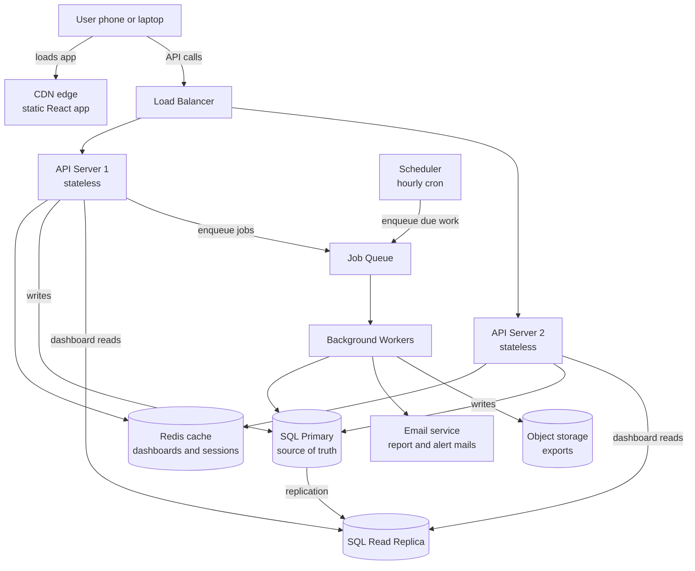
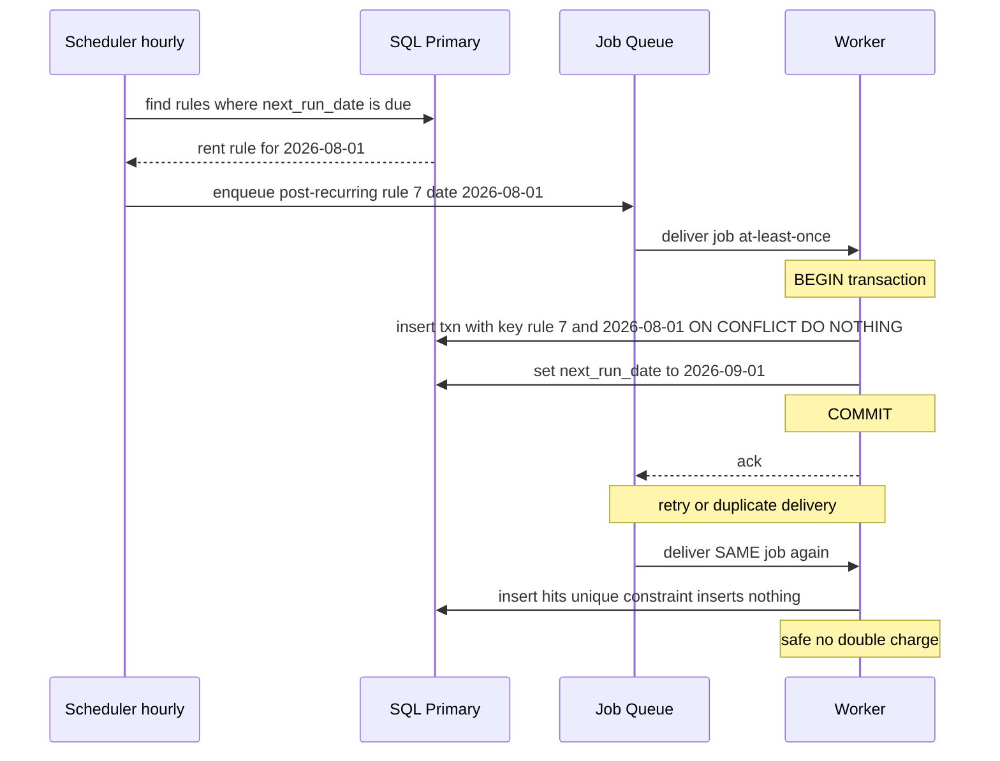
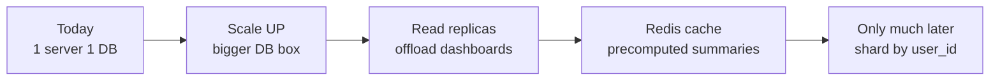

# 25. Design an Expense Tracker at Scale — Habex

> **One-liner:** Take **Habex** — the habit + expense tracker you actually built — and design it to serve *millions* of users: every rupee correct and durable, dashboards fast, recurring transactions and report emails running themselves, all in sync across a user's phone and laptop.
> **Interview frequency:** **High — and for you, the single most valuable design in this whole curriculum.** "Design an expense tracker / budgeting app / personal finance app" is a common prompt, and because it's *your own project* you can answer it from lived experience instead of theory. It also rehearses the exact themes CRED, Razorpay, and Groww care about: money correctness, consistency, idempotency, and durability.

---

## 1. The Problem in Plain Words

You already built this. **Habex** (`habex.santhu.site`) lets a user log income and expenses, tag them with categories, set up recurring entries (rent, Netflix, salary), define monthly budgets with alerts, and stare at dashboards that chart where their money went. Today it's probably **one backend server and one database** — perfect for you and a few friends.

This chapter is the interviewer's favourite move: *"nice — now make it serve 5 million users."* Nothing about the *features* changes. Everything about the *engineering* does. And the shape of this system is the **opposite of the chat app** you just designed (`[24 — Chat App](24-case-study-chat-app.md)`):

| | Chat app (Ch. 24) | Habex (this chapter) |
|---|---|---|
| Dominant load | Writes (messages) | **Reads** (dashboards) |
| Consistency need | Per-conversation ordering | **Strong — it's money** |
| Data store | Wide-column (Cassandra) | **Relational (SQL)** |
| Scale | PB/year | **~1 TB/year** |
| Hard part | Realtime delivery | **Correctness + fast analytics + background jobs** |

Three properties define Habex and drive every decision:

1. **It's money, so it must be correct and durable.** A user's ledger — their list of transactions and the balances derived from it — must be *exactly* what they entered, always, and must survive any crash. This means **strong consistency for a user's own data** and ACID transactions (`[14 — ACID vs BASE & Consistency](14-acid-vs-base-and-consistency.md)`). "Eventually correct" is fine for a like-count; it is **not** fine for someone's expenses.
2. **It's read-heavy.** People open the dashboard, flip between months, and re-check budgets far more than they add an expense. The wins are in **caching and read replicas**, not write throughput.
3. **It runs work on its own.** Recurring transactions post themselves; monthly report emails send themselves. That means **background workers, a scheduler, and a queue** — and the thorniest correctness bug in the whole system (a job that double-charges your rent) lives here.

> **How to tell this in an interview (keep this framing in your back pocket):** *"I actually built a smaller version of this — Habex, my expense tracker. It's one server and one Postgres today. Let me design how I'd grow it to millions, and I'll flag the real decisions I already made versus what I'd add."* That sentence instantly makes you the person in the room who has *shipped* the thing being designed. We'll return to this framing at every step.

---

## 2. Step 1 — Clarify Requirements  (functional + non-functional + questions I'd ask)

**Functional requirements:**

| # | Requirement | Notes |
|---|---|---|
| F1 | **Auth / accounts** | Email+password, JWT sessions (`[20 — Security](20-security-basics.md)`) |
| F2 | **Add / edit / delete transactions** | Both expenses *and* income |
| F3 | **Categories** | System defaults (Food, Rent…) + user-defined |
| F4 | **Recurring transactions** | Rent monthly, salary monthly, Netflix monthly — auto-posted |
| F5 | **Budgets & alerts** | Monthly limit per category; alert at 80% / 100% |
| F6 | **Dashboards / analytics** | Spend by month, by category; trends; charts |
| F7 | **Multi-device sync** | Same data on phone and laptop |
| F8 | **Export** | CSV / PDF of a period |
| F9 | *(Future)* | Bank/SMS auto-import; shared/group budgets |

**Non-functional requirements — and these are the ones that drive the design:**

| Property | Target | Why |
|---|---|---|
| **Correctness** | A user's ledger is *exactly* what they entered | It's money |
| **Durability** | Once "saved", it survives crashes forever | Losing a transaction is unacceptable |
| **Consistency** | **Strong** for a user's own ledger (read-your-writes) | Add an expense → it *must* show immediately everywhere (`[14](14-acid-vs-base-and-consistency.md)`) |
| **Read-heavy** | Optimise dashboard reads | ~5–10 reads per write |
| **Availability** | High, but a few seconds of stale *dashboard* is OK | The ledger must be strict; a cached chart can lag slightly |
| **Security** | Financial data protected at rest and in transit | `[20 — Security](20-security-basics.md)` |
| **Scale** | ~5M users, ~1M DAU | Modest — and admitting that is the point |

**Questions I'd ask first:**

1. **How many users / what scale?** (5M is a very different design from 500M. I'll assume low-millions.)
2. **Single or multi-currency?** (Multi-currency adds FX and a currency field everywhere — I'll assume single for now but design the field in.)
3. **Real-time multi-device sync, or is "refresh shows latest" enough?** (Pull-on-refresh is far simpler and almost always sufficient here.)
4. **Are shared / group budgets in scope now?** (They break the clean "each user owns only their data" model, so I'd defer them.)
5. **Bank / SMS import now or later?** (Big, messy integration — I'd phase it in later.)
6. **Retention?** (Financial history is kept *forever* — users want last year's taxes. This matters for storage growth.)

> **The senior move here:** after listing scale, say *"~5 million users is genuinely modest — the write volume is tiny, so I'm going to resist over-engineering. One SQL primary carries this for a long time, and I'll add complexity only when a specific bottleneck demands it."* Interviewers *love* right-sizing. Jumping to Kafka and sharding for a budgeting app is a red flag (`[26 — Interview Playbook](26-interview-playbook.md)`).

---

## 3. Step 2 — Back-of-the-Envelope Estimation  (SHOW the arithmetic: DAU, QPS, storage, bandwidth)

The whole point of this section is to *prove* Habex is small — which justifies a simple design. Using `86,400 s/day ≈ 10^5`:

**Assumptions:**

| Quantity | Assumed value |
|---|---|
| Total users | **5 million** |
| Daily active users (DAU) | **1 million** (finance apps have lowish daily engagement) |
| Transactions per user per month | **~50** (mix of manual + recurring) |
| Read requests per active user per day | **~40** (dashboard opens, month switches, list scrolls) |
| Avg transaction row size | **~300 bytes** (ids, amount, currency, date, note, timestamps) |
| Peak factor | **~10×** (evenings + month-end) |

**Write volume (adding/editing transactions):**

```
5,000,000 users × 50 txns/month  =  250,000,000 txns/month
250,000,000 ÷ 30 days            ≈  8,300,000 txns/day
8,300,000 ÷ 10^5 s/day           ≈  ~83  →  ~100 writes/sec (average)
Peak (×10)                        ≈  ~1,000 writes/sec
```

**~100 writes/sec average, ~1,000 at peak.** That is *nothing* — a single modest Postgres instance handles thousands of writes/sec comfortably. **This number alone tells you not to shard.**

**Read volume (dashboards — the dominant load):**

```
1,000,000 DAU × 40 reads/day  =  40,000,000 reads/day
40,000,000 ÷ 10^5             ≈  ~400 reads/sec (average)
Peak (×10)                     ≈  ~4,000 reads/sec
Read : Write ratio            ≈  40M : 8.3M  ≈  ~5 : 1  (read-heavy)
```

So Habex is clearly **read-heavy (~5:1)**, and the reads are the *expensive* kind — each dashboard load aggregates a user's transactions (`SUM ... GROUP BY category`). At ~4,000 read QPS of aggregation, the primary would rather not do all of it — hence **read replicas + a cache** (Steps 6–8). *That's* where the engineering goes, not writes.

**Storage:**

```
Rows/year   =  250,000,000/month × 12  =  3,000,000,000 txns/year
Bytes/year  =  3 × 10^9 × 300 bytes     =  900 × 10^9  =  ~900 GB ≈ ~1 TB/year (base table)
With indexes (~1.5–2×)                   ≈  ~1.5–2 TB/year
5 years                                  ≈  ~5–10 TB total
```

**~1 TB/year.** Compare that with the chat app's **~2 PB/year** — Habex is roughly **1,000× smaller**. Multiple *years* of every user's financial history fit on a single large SQL instance, or with one gentle level of partitioning by date. **This is the key insight to say out loud: the data is small, so a boring, correct relational database is exactly right.**

**Bandwidth:** trivial. Writes are a few hundred bytes; dashboard responses are small JSON aggregates (a few KB). No CDN needed for the *data*. (We do use a CDN — for the static React app, Step 6.)

**Summary table:**

| Metric | Estimate | Design implication |
|---|---|---|
| Avg / peak writes | ~100 / ~1,000 per sec | One SQL primary, easily |
| Avg / peak reads | ~400 / ~4,000 per sec | Read replicas + cache |
| Read:write ratio | ~5:1 | Read-heavy → cache dashboards |
| Storage/year | ~1–2 TB | No sharding needed for years |
| vs. Chat app | ~1,000× smaller | Simplicity is *correct* here |

---

## 4. Step 3 — API Design  (endpoints with request/response sketches)

Clean **REST** fits Habex perfectly — resources (transactions, categories, budgets) with standard verbs (`[17 — API Design: REST, GraphQL, gRPC](17-api-design-rest-graphql.md)`). Everything is scoped to the authenticated user; the `user_id` comes from the **JWT**, *never* from the request body (never trust the client — `[02](02-client-server-basics.md)`, `[20](20-security-basics.md)`).

```http
POST   /v1/auth/register        { email, password } → { token }
POST   /v1/auth/login           { email, password } → { token }

GET    /v1/transactions?month=2026-07&category=food&cursor=...  → { items, nextCursor }
POST   /v1/transactions         { amountMinor, type, categoryId, accountId, date, note }
                                → 201 { id, ... }
PUT    /v1/transactions/{id}    { ...fields } → 200
DELETE /v1/transactions/{id}    → 204   (soft delete — sets deleted_at)

GET    /v1/categories           → [ ... ]
POST   /v1/categories           { name, type, icon } → 201

GET    /v1/budgets?month=2026-07 → [ { categoryId, limitMinor, spentMinor } ]
PUT    /v1/budgets/{id}          { limitMinor } → 200

GET    /v1/recurring-rules      → [ ... ]
POST   /v1/recurring-rules      { amountMinor, categoryId, frequency, interval, nextRunDate } → 201

GET    /v1/dashboard/summary?month=2026-07
                                → { totalIncome, totalExpense, byCategory: [...], budgetStatus: [...] }

GET    /v1/sync?since=2026-07-08T10:00:00Z
                                → { changed: [...], deletedIds: [...], serverTime }  # delta sync

POST   /v1/export               { from, to, format } → { jobId }   # async, worker builds file
```

**Two details that show maturity:**

**(a) An `Idempotency-Key` on `POST /v1/transactions`.** Mobile networks are flaky. If the phone sends "add ₹500 groceries," times out, and retries, you must **not** create two ₹500 groceries. The client sends a unique `Idempotency-Key` header; the server records it and, on a duplicate, returns the *original* result instead of inserting again (`[19 — Reliability Patterns](19-reliability-patterns.md)`). This is the *exact* idempotency discipline Razorpay/CRED probe for payments — and here it's protecting a user's ledger.

```http
POST /v1/transactions
Idempotency-Key: 7c1f-add-groceries-500
{ "amountMinor": 50000, "type": "expense", "categoryId": "food", "date": "2026-07-08" }
```

**(b) A delta-sync endpoint (`GET /v1/sync?since=...`).** For multi-device, each device asks "what changed since my last sync?" and gets back only the deltas, rather than re-downloading everything. Simple, cheap, and avoids needing realtime push for an app where pull-on-open is plenty.

---

## 5. Step 4 — Data Model  (tables/collections + which DB and why)

**The database is SQL (PostgreSQL), and the interviewer *will* ask you to defend it. Here's the airtight defence.**

### Why relational is the right call (`[09 — SQL vs NoSQL](09-sql-vs-nosql.md)`)

| Money need | How SQL delivers it |
|---|---|
| **Correctness under concurrent edits** | **ACID transactions** — wrap "insert transaction + update budget's spent" so they're all-or-nothing (`[14](14-acid-vs-base-and-consistency.md)`) |
| **Strong consistency / read-your-writes** | A single primary is the one source of truth; you read exactly what you wrote |
| **Rich analytics** | Dashboards are `SUM(amount) GROUP BY category, month` — SQL's home turf |
| **Referential integrity** | Foreign keys guarantee every transaction points to a real category/account — no orphan money |
| **Naturally relational data** | users → accounts → transactions → categories is a clean relational graph |

Chat needed the opposite and chose Cassandra (`[24](24-case-study-chat-app.md)`). Habex needs correctness + analytics + integrity at modest scale → **relational wins decisively.** Being able to argue *why the same "SQL vs NoSQL" question flips* between your two case studies is a standout answer.

### The schema

```sql
users (
  id            BIGINT PRIMARY KEY,
  email         TEXT UNIQUE NOT NULL,
  password_hash TEXT NOT NULL,          -- bcrypt/argon2, NEVER plaintext (see 20)
  created_at    TIMESTAMPTZ
)

accounts (                               -- "Cash", "HDFC Card", "Savings"
  id        BIGINT PRIMARY KEY,
  user_id   BIGINT REFERENCES users(id),
  name      TEXT,
  type      TEXT,                        -- cash | card | bank
  currency  CHAR(3)                      -- 'INR'
)

categories (
  id      BIGINT PRIMARY KEY,
  user_id BIGINT REFERENCES users(id),   -- NULL = system default category
  name    TEXT,
  type    TEXT,                           -- income | expense
  icon    TEXT
)

transactions (
  id                BIGINT PRIMARY KEY,
  user_id           BIGINT REFERENCES users(id) NOT NULL,
  account_id        BIGINT REFERENCES accounts(id),
  category_id       BIGINT REFERENCES categories(id),
  amount_minor      BIGINT NOT NULL,      -- paise, INTEGER — never a float! (see below)
  currency          CHAR(3) NOT NULL,
  type              TEXT NOT NULL,        -- income | expense
  txn_date          DATE NOT NULL,        -- the accounting date (may differ from created_at)
  note              TEXT,
  recurring_rule_id BIGINT REFERENCES recurring_rules(id),  -- NULL if manually added
  created_at        TIMESTAMPTZ,
  updated_at        TIMESTAMPTZ,
  deleted_at        TIMESTAMPTZ           -- soft delete (audit trail for money)
)

recurring_rules (
  id             BIGINT PRIMARY KEY,
  user_id        BIGINT REFERENCES users(id),
  account_id     BIGINT,
  category_id    BIGINT,
  amount_minor   BIGINT,
  type           TEXT,
  frequency      TEXT,                    -- daily | weekly | monthly | yearly
  interval       INT,                     -- every N of frequency
  next_run_date  DATE,                    -- when it fires next  (the scheduler reads this)
  end_date       DATE,
  last_run_date  DATE,
  timezone       TEXT                      -- fire at local midnight
)

budgets (
  id                BIGINT PRIMARY KEY,
  user_id           BIGINT REFERENCES users(id),
  category_id       BIGINT REFERENCES categories(id),
  period_month      DATE,                  -- '2026-07-01'
  limit_minor       BIGINT,
  spent_cached_minor BIGINT DEFAULT 0      -- kept updated for fast "how much left?" reads
)
```

**Store money as integer minor units (`amount_minor` = paise), never a float.** `0.1 + 0.2 != 0.3` in floating point — a rounding bug in a *finance* app is a credibility-killer. Integers of the smallest currency unit are exact. Mentioning this unprompted signals you take money seriously — a great CRED/Razorpay/Groww signal.

### Indexing for the "user + month" query (`[10 — Database Indexing](10-database-indexing.md)`)

The single hottest query in Habex is *"give me user 42's transactions for July, optionally by category"* — powering the list view **and** the dashboard aggregation. Without an index, that's a full-table scan across billions of rows. The fix:

```sql
CREATE INDEX idx_txn_user_date     ON transactions (user_id, txn_date);
CREATE INDEX idx_txn_user_cat_date ON transactions (user_id, category_id, txn_date);
```

Because `user_id` is the **leading column**, the DB jumps straight to *this user's* rows (out of billions), and `txn_date` keeps them ordered so a month range is a contiguous slice. The second index makes "by category for this month" equally fast. This is `[10 — Indexing](10-database-indexing.md)` applied with intent: **index for your actual query shape, leading with the most selective column (`user_id`).** Say that out loud and you've demonstrated you understand *why* indexes work, not just that they exist.

---

## 6. Step 5 — High-Level Design  (a valid Mermaid architecture diagram + walkthrough)



**Walkthrough — trace the pieces (this is essentially "grown-up Habex"):**

- **React client on a CDN.** Habex's frontend is a static React/TS bundle — exactly like `santhu.site`. Ship it to a **CDN** so it loads fast worldwide and your origin barely gets touched (`[08 — CDN](08-cdn.md)`). *"My portfolio and Habex's frontend already work this way"* — a real tie-back.
- **Load balancer → stateless API servers.** The API is **stateless** (identity travels in the JWT, no server-side session memory), so you can run 1 or 20 instances and scale horizontally the instant you need to (`[05](05-load-balancers.md)`, `[06 — Scaling](06-scaling-vertical-vs-horizontal.md)`). *You'd make this change first, and it's cheap because you designed statelessly from the start.*
- **SQL primary (writes) + read replica (reads).** All writes go to the **primary** (the one source of truth → strong consistency). Heavy **dashboard reads** go to a **read replica** to keep them off the write path (`[11 — Replication](11-replication.md)`). This directly exploits the ~5:1 read-heavy ratio from Step 3.
- **Redis cache.** Precomputed dashboard summaries and hot lookups live here so a chart render doesn't re-aggregate on every open (`[07 — Caching](07-caching.md)`). Deep-dived in Step 7.
- **Scheduler + queue + background workers.** A **scheduler** (hourly cron) finds due recurring rules and monthly report jobs and drops them on a **queue** (`[15 — Message Queues & Pub-Sub](15-message-queues-and-pubsub.md)`); **workers** consume them — posting recurring transactions, sending budget-alert and monthly-report **emails**, and building **exports** into object storage. Doing this async keeps the user-facing API fast and lets these jobs retry safely on failure.

**One consistency nuance to state:** the *ledger* reads strongly (from primary, or replica with read-your-writes handling), but the *dashboard* is allowed to be a few seconds stale because it's served from cache/replica. That's a deliberate, defensible split — strict where it's money, relaxed where it's a chart (`[14 — Consistency](14-acid-vs-base-and-consistency.md)`).

---

## 7. Step 6 — Deep Dive on the Hard Part  (the 1–2 tricky problems, with a diagram)

Two genuinely interesting problems: **(A) the recurring-transaction scheduler and its idempotency**, and **(B) fast dashboards via precompute + cache.**

### A. The recurring-transaction scheduler — and not double-charging rent

**The job:** every day, some recurring rules come due (rent on the 1st, salary on the 25th). A **scheduler** must find them and post a real transaction for each — reliably, exactly once.

**The naive version and why it's dangerous.** A cron job runs, `SELECT * FROM recurring_rules WHERE next_run_date <= today`, inserts a transaction for each, and advances `next_run_date`. Now imagine any of: the worker crashes *after* inserting but *before* advancing the date; two workers pick up the same rule; a retry fires after a timeout. Result: **your rent gets logged twice.** In a finance app that's not a glitch, it's a broken product. The fix is **idempotency** (`[19 — Reliability Patterns](19-reliability-patterns.md)`).

**The idempotent design:**

1. **A deterministic idempotency key per occurrence:** `(recurring_rule_id, scheduled_date)`. Rent for 2026-08-01 has exactly one key, no matter how many times the job runs.
2. **A unique constraint enforces "exactly once" at the database:**
   ```sql
   ALTER TABLE transactions
     ADD CONSTRAINT uq_recurring_occurrence UNIQUE (recurring_rule_id, txn_date);
   ```
   The insert becomes `INSERT ... ON CONFLICT DO NOTHING`. A re-run simply hits the constraint and inserts nothing. **The database is the referee** — even a buggy worker can't double-insert.
3. **Advance the date in the *same* DB transaction as the insert.** Wrap "insert the transaction" **and** "update `next_run_date` / `last_run_date`" in one ACID transaction (`[14](14-acid-vs-base-and-consistency.md)`). Either both happen or neither — you can never advance without inserting, or insert without advancing.
4. **The queue is at-least-once, so workers *must* be idempotent** — which, thanks to (2) and (3), they are. This is the general rule: *design workers so re-processing the same job is harmless.*



**A scheduling nuance worth a sentence:** if 5M users all have rent due at "midnight on the 1st," that's a **predictable spike** of writes — the monthly cousin of the dinner-rush from `[06 — Scaling](06-scaling-vertical-vs-horizontal.md)`. Spread it: run the scheduler continuously through the day fetching small batches, or fire each rule at the user's *local* midnight (that's why `recurring_rules.timezone` exists), so the load smears across 24 hours instead of one thundering herd.

### B. Fast dashboards — precomputed aggregates + cache

Dashboards are the read load, and each one wants `SUM(amount) GROUP BY category` for a month (or a year). Two approaches, and the honest answer is *"start simple, precompute when it hurts":*

| Approach | How | Pro | Con |
|---|---|---|---|
| **On-the-fly aggregation** | Run the `GROUP BY` on each dashboard load (against the read replica, using `idx_txn_user_cat_date`) | Dead simple; always fresh; fine at low scale | Repeats the same scan for every open; heavier for year/multi-year views |
| **Precomputed monthly aggregates** | Maintain a `monthly_summary(user_id, period_month, category_id, total_minor)` table, updated incrementally on each write (or rebuilt nightly) | Dashboard read is a tiny lookup, not a scan; cheap year views | Extra write work; must keep it in sync; a little staleness risk |
| **Cache the rendered summary** | Store `dashboard:{user}:{month}` JSON in **Redis** with a TTL; invalidate/refresh on a new transaction in that month | Sub-millisecond repeat reads; offloads the DB entirely | Cache-invalidation logic; brief staleness |

**The pragmatic combination:** serve dashboards from a **Redis cache** keyed `dashboard:{user_id}:{month}`; on a cache miss, compute from the **precomputed monthly_summary** (falling back to on-the-fly for cold months); and on every new/edited transaction, **invalidate that one month's cache key** (and bump the affected `monthly_summary` row). The user's *own* just-added expense should reflect immediately, so on a write we refresh their current-month cache rather than serving stale — read-your-writes where it matters, cached everywhere else. This is `[07 — Caching](07-caching.md)` with deliberate invalidation, and the whole reason the read-heavy load stops hurting the primary.

---

## 8. Step 7 — Scaling, Bottlenecks & Trade-offs

**The scaling story — and its order matters (say it as a progression):**



1. **Today: one server, one DB.** The honest starting point — and given the tiny numbers, it lasts a long time.
2. **Scale up first (vertical, `[06](06-scaling-vertical-vs-horizontal.md)`).** A bigger DB box is the cheapest next move; no code changes. Scale up until it hurts.
3. **Add read replicas (`[11 — Replication](11-replication.md)`).** Because Habex is ~5:1 read-heavy, moving dashboard reads to replicas is the single biggest win. This is where most of the growth headroom is.
4. **Add the Redis cache** for dashboard summaries — most reads then never touch the DB at all.
5. **Only *much* later, shard by `user_id` (`[12 — Sharding & Partitioning](12-sharding-and-partitioning.md)`).** Habex shards *beautifully* because **every user only ever touches their own data** — there are no cross-user joins, so splitting users A–M onto shard 1 and N–Z onto shard 2 is clean, and no two users' writes ever conflict. But at ~1 TB/year and ~1,000 peak writes/sec, you won't need this for *years*. **Naming that you *could* shard, and exactly why it'd be easy, while correctly saying you *wouldn't yet*, is the senior answer.**

**Bottlenecks & how you'd handle them:**

| Bottleneck | Fix |
|---|---|
| Dashboard aggregation load | Read replicas + precompute + cache (Step 7) |
| Single write primary | Fine at this scale; shard by `user_id` far later if ever |
| Month-start recurring spike | Smear across the day / fire at local midnight (Step 7A) |
| Cache staleness on own writes | Refresh the user's current-month cache on write (read-your-writes) |
| Report-email fan-out | Async workers off a queue; batch and rate-limit the email provider |

**Security for financial data (`[20 — Security Basics](20-security-basics.md)`) — don't skip this in a *money* app:**

- **JWT auth**, short-lived tokens; the server derives `user_id` from the verified token, never from the request body.
- **Passwords hashed** with bcrypt/argon2 + salt — *never* stored or logged in plaintext.
- **Encryption in transit (TLS/HTTPS)** everywhere, and **encryption at rest** for the DB and backups.
- **Authorization on every query** — `WHERE user_id = <from token>` on *every* read/write so user A can never fetch user B's transactions (a classic broken-access-control bug — the top OWASP risk).
- **Rate limiting** on auth and write endpoints (`[18](18-rate-limiting-pagination-versioning.md)`) to blunt credential-stuffing and abuse.

**Key trade-offs to state out loud:**

| Decision | Chose | Gave up | Because |
|---|---|---|---|
| Data store | **SQL** | Web-scale write throughput | Money needs ACID + strong consistency + rich analytics; scale is modest |
| Dashboards | **Precompute + cache** | Perfect freshness | A chart can lag seconds; speed + DB relief win |
| Ledger consistency | **Strong** | Some availability under partition | It's money — correctness beats availability here (`[13 — CAP](13-cap-theorem.md)`) |
| Sharding | **Not yet** | "Infinite" scale today | Premature sharding is complexity with no payoff at 1 TB/year |
| Recurring jobs | **Idempotent + async** | Simplicity of a naive cron | Exactly-once posting is non-negotiable for money |

> **How to *tell* the whole thing in an interview.** The narrative arc is your edge: *"I built Habex as a one-server, one-Postgres hobby app. To reach millions I'd (1) keep it on SQL — deliberately — because it's money and needs ACID and analytics; (2) make the API stateless, which it already is, so I can scale out behind a load balancer; (3) lean on read replicas and a Redis cache because it's ~5:1 read-heavy; (4) run recurring transactions and report emails on idempotent background workers so a retry can never double-charge rent; and (5) only consider sharding by user_id much later, though it'd shard cleanly since users never share data. The theme throughout is right-sizing — the numbers are small, so the correct design is a boring, correct relational system, not a distributed one."* That paragraph, spoken calmly, is a *strong* senior-level answer — and it's *true*, which is why you can defend every clause.

---

## 9. Common Interview Questions & Follow-ups

**Q1. Why SQL and not NoSQL for an expense tracker? *(the defining question — CRED, Groww, Razorpay)***
> It's money: I need ACID transactions and strong consistency so a user's ledger is exactly what they entered, plus rich `GROUP BY` analytics for dashboards and foreign-key integrity so no transaction points at a missing category. The scale is modest (~1 TB/year), so I don't need NoSQL's write scale-out. Relational wins on every axis that matters here — the opposite of my chat-app case study, where the shape favoured Cassandra.

**Q2. A user's recurring rent could get posted twice if a job retries. How do you prevent that? *(idempotency — Razorpay/CRED love this)***
> Idempotency. A deterministic key per occurrence — `(rule_id, scheduled_date)` — plus a **unique constraint** on `transactions(recurring_rule_id, txn_date)` and `INSERT ... ON CONFLICT DO NOTHING`. I advance `next_run_date` in the *same* DB transaction as the insert, so it's atomic. The queue is at-least-once, so the worker is *designed* to be safe on re-delivery — the database is the referee.

**Q3. How do you make dashboards fast when a user has years of transactions? *(the read-heavy probe)***
> Serve them from a Redis cache keyed by `user:month`; on a miss, read from a precomputed `monthly_summary` table (updated incrementally on write); dashboard reads hit a read replica, not the primary. On a new transaction I refresh that month's cache so the user sees their own change immediately. It's caching + precompute + replicas exploiting the ~5:1 read-heavy ratio.

**Q4. How would you store the money amounts? *(the correctness trap)***
> Integer **minor units** (paise), never floats — floating point can't represent `0.1 + 0.2` exactly, and rounding errors in a finance app are unacceptable. Plus a currency field per amount for future multi-currency.

**Q5. Walk me through how you'd scale from your one-server Habex to millions. *(the capstone question)***
> Scale up the DB first (cheap, no code change); make the API stateless and scale it out behind a load balancer; add read replicas for the read-heavy dashboards; add a Redis cache for precomputed summaries; and only *much* later shard by `user_id` — which is easy here because users never share data, but unnecessary at ~1 TB/year. Match each move to a real bottleneck.

**Q6. When *would* you shard, and how? *(scale probe)***
> When one primary can't hold the write volume or the dataset — nowhere near at this scale. I'd shard **by `user_id`**, because every query is already scoped to one user and there are no cross-user joins, so it partitions cleanly with no cross-shard transactions. I'd call it out as the eventual plan but explicitly *not* do it prematurely.

**Q7. Multi-device sync — how does my phone and laptop stay consistent? *(design probe)***
> A delta-sync endpoint: each device sends `GET /v1/sync?since=<last sync time>` and gets only what changed plus deleted ids. Writes go to the strongly-consistent primary, so once saved, the next sync on any device sees it. I don't need realtime push for a budgeting app — pull-on-open is simpler and enough.

**Q8. How do you keep one user from reading another user's data? *(security — always asked for money apps)***
> Authorization on every query: `user_id` comes from the verified JWT (never the request body), and *every* read/write filters `WHERE user_id = <token>`. Passwords are hashed (bcrypt/argon2), TLS in transit, encryption at rest, rate limiting on auth. Broken access control is the #1 web risk, so I enforce ownership at the query layer, not just the UI.

**Q9. What if a budget-alert or report email fails to send? *(reliability probe)***
> Emails go through async workers off a queue, so a failure just means a **retry** — the user request never blocked on it. Sends are idempotent-ish (dedupe per user+period so a retry doesn't send twice), and a dead-letter queue catches persistent failures for inspection (`[19](19-reliability-patterns.md)`).

**Q10. Where's the single point of failure, and does it matter? *(judgement)***
> The write **primary**. I mitigate with replication + automated failover to a promoted replica, frequent backups, and point-in-time recovery — durability of money data is paramount. Reads survive on replicas + cache even during a brief primary blip. At this scale one well-run primary with failover is the right trade-off, not a distributed write layer.

---

## 10. TL;DR  (recap + the 60-second spoken version)

**Recap bullets:**

- **Habex is your capstone story** — you built it, so design it from experience. Frame it as *"one server, one Postgres today; here's how I'd grow it to millions."*
- **It's the inverse of the chat app:** read-heavy, strongly consistent, **SQL**, ~1 TB/year. The numbers are *small* — right-sizing is the whole game.
- **SQL (Postgres) is a deliberate choice:** money needs ACID + strong consistency + rich `GROUP BY` analytics + integrity. Store amounts as **integer paise, never floats.**
- **Index for the hot query:** `(user_id, txn_date)` and `(user_id, category_id, txn_date)` — leading with `user_id` — make "this user's month" fast (`[10](10-database-indexing.md)`).
- **Read-heavy → read replicas + Redis cache** with precomputed monthly summaries; refresh the user's own month on write for read-your-writes.
- **Recurring transactions run on an idempotent async scheduler:** deterministic key `(rule_id, date)` + a unique constraint + advance-date-in-the-same-transaction = a retry can **never** double-charge rent.
- **Scaling order:** up → read replicas → cache → *(much later)* shard by `user_id` (clean, because users never share data). Don't shard prematurely.
- **Security is non-negotiable for money:** JWT (user_id from the token), hashed passwords, TLS + encryption at rest, `WHERE user_id` on every query, rate limiting.

**The 60-second spoken version** *(your Habex pitch — memorize the shape):*

> "Habex is my expense tracker — accounts, transactions, categories, recurring entries, budgets, and dashboards. Today it's one server and one Postgres. To serve millions I'd *keep* it relational on purpose, because it's money: I need ACID transactions and strong consistency so a user's ledger is exactly what they entered, plus SQL's `GROUP BY` for the dashboards. The load is only ~100 writes/sec but ~5× that in dashboard reads, so it's read-heavy — I'd add **read replicas** and a **Redis cache** of precomputed monthly summaries, invalidating a user's month on their own writes. Recurring transactions and report emails run on **idempotent background workers** off a queue: a deterministic key per occurrence plus a unique constraint means a retry can never post rent twice. I'd store money as **integer paise, never floats**, and index on `(user_id, txn_date)` for the hot 'this user's month' query. Scaling-wise I'd go up, then read replicas, then cache, and only *much* later shard by `user_id` — which is clean because users never share data. The theme is right-sizing: the data's about a terabyte a year, so the correct design is a boring, correct relational system, not a distributed one."

**Next:** `[26 — Interview Playbook](26-interview-playbook.md)` — the framework, cheat sheets, per-company focus, and how to steer any interview toward the Habex story you just built.
