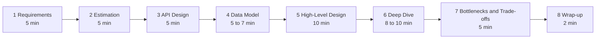

# 26. The System Design Interview Playbook

> **One-liner:** The whole curriculum, distilled into a repeatable interview weapon — a 45-minute framework, cheat sheets you can recall under pressure, per-company focus, and how to steer any question toward the Habex story you already own.
> **Who it's for:** You, **Santhosh** — a frontend-heavy full-stack dev prepping for **Zepto, Swiggy, CRED, Razorpay, Groww**. This is the chapter you re-read the night before every interview. Everything here points back to chapters 01–25; this is where they become *answers*.

---

## 1. The 45-Minute Framework

A system-design round is ~45 minutes of *you talking and drawing* while the interviewer watches **how you think**. There is no right answer — there's a right *process*. Run these eight steps, out loud, every time. It's the same flow from `[01 — What Is System Design](01-what-is-system-design.md)`, now with a clock.



**Time budget (flex it, but know it):**

| # | Step                               | Time       | What you actually do                                                                                                                                | Chapter                                                                                                                                             |
| - | ---------------------------------- | ---------- | --------------------------------------------------------------------------------------------------------------------------------------------------- | --------------------------------------------------------------------------------------------------------------------------------------------------- |
| 1 | **Requirements**             | ~5 min     | List**functional** (what it does) + **non-functional** (fast/available/consistent/durable); ask clarifying questions; state assumptions | `[01](01-what-is-system-design.md)`                                                                                                               |
| 2 | **Estimation**               | ~5 min     | Back-of-envelope: DAU → QPS, storage/year, bandwidth, read:write ratio. Decides "one box or a fleet"                                               | §3 below,`[06](06-scaling-vertical-vs-horizontal.md)`                                                                                            |
| 3 | **API Design**               | ~5 min     | The handful of endpoints (or the realtime protocol). Nails down what the system*does*                                                             | `[17](17-api-design-rest-graphql.md)`, `[18](18-rate-limiting-pagination-versioning.md)`                                                        |
| 4 | **Data Model**               | ~5–7 min  | Tables/collections +**which DB and why** (SQL vs NoSQL); the key indexes                                                                      | `[09](09-sql-vs-nosql.md)`, `[10](10-database-indexing.md)`                                                                                     |
| 5 | **High-Level Design**        | ~10 min    | Draw the boxes: client → LB → services → cache → DB → queue/workers. Walk the happy path                                                       | `[05](05-load-balancers.md)`, `[21](21-architecture-patterns.md)`                                                                               |
| 6 | **Deep Dive**                | ~8–10 min | Pick the 1–2*interesting* problems and go deep (the interviewer usually steers this)                                                             | the case studies`[22](22-case-study-url-shortener.md)`–`[25](25-case-study-expense-tracker.md)`                                                |
| 7 | **Bottlenecks & Trade-offs** | ~5 min     | Where it breaks under load; what you optimised for vs gave up; how you'd scale                                                                      | `[06](06-scaling-vertical-vs-horizontal.md)`, `[11](11-replication.md)`, `[12](12-sharding-and-partitioning.md)`, `[13](13-cap-theorem.md)` |
| 8 | **Wrap-up**                  | ~2 min     | 60-second recap: "here's what I built, the key trade-off, and what I'd do next"                                                                     | —                                                                                                                                                  |

**The three rules that matter more than the steps:**

1. **Never skip 1 and 2.** Jumping straight to boxes is the #1 way juniors fail. Requirements + estimation are where you *earn the senior read*.
2. **Think out loud, always.** Silence reads as "stuck." Narrate even your uncertainty: *"I'm weighing SQL vs NoSQL here — let me reason about it."*
3. **Let them steer the deep dive.** After the high-level design, ask *"which part would you like me to go deeper on?"* — it turns a monologue into a collaboration and spends your time where *they* care.

---

## 2. A Reusable Checklist

A copy-pasteable checklist you can run mentally in *any* design round. Tick each phase before moving on.

**Phase 1 — Requirements**

- [ ] Restated the problem in one sentence to confirm I understood it
- [ ] Listed **functional** requirements (the features)
- [ ] Listed **non-functional** requirements: scale, latency, availability, consistency, durability
- [ ] Asked: how many users? read- or write-heavy? how consistent must it be? global or one region?
- [ ] Stated my assumptions out loud and got a nod

**Phase 2 — Estimation**

- [ ] DAU → **QPS** (avg *and* peak, peak ≈ 2–10× avg)
- [ ] **Storage/year** (rows/day × bytes/row × 365)
- [ ] **Bandwidth** (QPS × payload size)
- [ ] **Read:write ratio** — stated it, because it drives caching/replicas
- [ ] Concluded: *"so this needs one box / a fleet / a distributed store"*

**Phase 3 — API**

- [ ] The core endpoints (method + path) or realtime protocol
- [ ] Auth model (token/JWT), pagination for big lists, idempotency for writes that matter

**Phase 4 — Data Model**

- [ ] Chose **SQL or NoSQL** and *justified it by the data shape*, not by habit
- [ ] Key entities + relationships
- [ ] The **index** for the hottest query
- [ ] For money/critical data: consistency + durability story

**Phase 5 — High-Level Design**

- [ ] Drew: client → CDN → LB → stateless services → cache → DB → queue → workers
- [ ] Marked what's **stateless** vs **stateful**
- [ ] Walked the happy path end to end

**Phase 6 — Deep Dive**

- [ ] Went deep on the 1–2 genuinely hard parts
- [ ] Handled failure/edge cases in that part

**Phase 7 — Bottlenecks & Trade-offs**

- [ ] Named the **single points of failure**
- [ ] Named the first thing to break under 10× load and the fix
- [ ] Stated **what I optimised for and what I gave up**

**Phase 8 — Wrap-up**

- [ ] 60-second recap + "what I'd build next"

---

## 3. Back-of-the-Envelope Cheat Sheet

The math that makes estimation fast. Memorize the shortcuts, not exact figures.

### Powers of 2 and data sizes

| Power of 2 | ≈ decimal     | Name          | Mnemonic         |
| ---------- | -------------- | ------------- | ---------------- |
| 2^10       | ~1 thousand    | 1**KB** | a thousand bytes |
| 2^20       | ~1 million     | 1**MB** | a million bytes  |
| 2^30       | ~1 billion     | 1**GB** | a billion bytes  |
| 2^40       | ~1 trillion    | 1**TB** | a trillion bytes |
| 2^50       | ~1 quadrillion | 1**PB** | a petabyte       |

Handy: **1 billion rows × 100 bytes ≈ 100 GB.** Scale from there — this one anchor sizes most tables in your head.

### Latency numbers every programmer should know

Rounded to *orders of magnitude* — that's all you need. The lesson is the **ratios**: memory is fast, disk is slow, the network is slower, and crossing the planet is *very* slow.

| Operation                                            | Time                        | In human terms             |
| ---------------------------------------------------- | --------------------------- | -------------------------- |
| L1 cache reference                                   | ~1 ns                       | —                         |
| L2 cache reference                                   | ~4 ns                       | —                         |
| **Main memory (RAM) reference**                | **~100 ns**           | the baseline "fast"        |
| Read 1 MB sequentially from RAM                      | ~10 µs                     | —                         |
| **SSD random read**                            | **~100 µs (0.1 ms)** | ~1,000× slower than RAM   |
| Read 1 MB from SSD                                   | ~1 ms                       | —                         |
| **Round trip within one datacenter**           | **~0.5 ms**           | same-region network        |
| Disk (HDD) seek                                      | ~10 ms                      | ~100,000× slower than RAM |
| Read 1 MB from spinning disk                         | ~20 ms                      | —                         |
| **Round trip cross-region (e.g. India ↔ US)** | **~150 ms**           | crossing the planet        |

**What to *do* with this table in an interview:**

- **Cache in RAM** (Redis) because RAM (~100 ns) is ~1,000× faster than SSD and ~1,000,000× faster than a cross-region hop. That's *why* caching is the biggest lever (`[07 — Caching](07-caching.md)`).
- **Cross-region calls are ~150 ms** — one is fine, ten chained in a request is a disaster. Keep data near the user (`[08 — CDN](08-cdn.md)`, replicas).
- **Sequential beats random** on disk by a lot — why append-heavy logs (Kafka) and clustered indexes are fast.

### The seconds-in-a-day trick

```
1 day = 86,400 seconds  ≈  10^5 seconds
```

This one approximation powers all QPS math. Because of it:

| Volume per day    | ÷ 10^5 → per second |
| ----------------- | --------------------- |
| 1 million / day   | ~10 / sec             |
| 100 million / day | ~1,000 / sec          |
| 1 billion / day   | ~10,000 / sec         |
| 10 billion / day  | ~100,000 / sec        |

### DAU → QPS in one line

```
avg QPS  =  (DAU × requests per user per day)  ÷  86,400   ( ≈ ÷ 10^5 )
peak QPS ≈  avg QPS × 2 to 10        (spiky consumer apps: use ×10)
```

**Worked example:** 1M DAU, 20 requests/user/day → `20M ÷ 10^5 = 200 QPS avg`, peak `~2,000 QPS`. (That's roughly Habex — `[25](25-case-study-expense-tracker.md)`.)

### Storage / bandwidth shortcuts

```
storage per year  =  rows/day × bytes/row × 365
bandwidth (write) =  write QPS × avg payload bytes
```

**Worked example:** 8.3M txns/day × 300 bytes × 365 ≈ **~900 GB/year ≈ ~1 TB/year** (Habex again). Contrast the chat app's 20B msgs/day × 300 B ≈ **6 TB/day ≈ 2 PB/year** (`[24](24-case-study-chat-app.md)`). The 1,000× gap is *why* they get different databases — estimation *is* the design driver.

### Capacity rules of thumb (to conclude "one box or a fleet?")

Once you have QPS and storage, compare against what a *single* modern machine roughly handles. These are order-of-magnitude anchors — enough to say "one box is fine" or "I need to scale out."

| Component                      | A single instance roughly handles                                         | Implication                                                                           |
| ------------------------------ | ------------------------------------------------------------------------- | ------------------------------------------------------------------------------------- |
| One**SQL database**      | ~thousands of writes/sec, ~tens of thousands of reads/sec, low-TB dataset | Habex's ~1,000 peak writes/sec fits with huge headroom                                |
| One**Redis cache**       | ~100k+ ops/sec, sub-ms                                                    | Absorbs the read-heavy dashboard load easily                                          |
| One**app server**        | ~a few thousand simple req/sec (stateless)                                | Scale out horizontally once past this                                                 |
| One**WebSocket gateway** | ~100k–1M concurrent connections (tuned)                                  | Chat's 100M connections → ~200–1,000 gateways (`[24](24-case-study-chat-app.md)`) |

**How to use it live:** *"My peak is ~1,000 writes/sec and ~1 TB/year — that's well inside a single Postgres, so I'll start with one primary and a read replica, not a distributed store."* Grounding the decision in a capacity number is exactly the reasoning interviewers want.

---

## 4. Company-Specific Focus

Your five targets probe different muscles. Same framework, different deep-dive emphasis. Map each to the chapters and *lead with what they care about*.

| Company            | Domain                  | Tends to probe                                                                                                                                     | Lead chapters                                                                                                                                                                                            |
| ------------------ | ----------------------- | -------------------------------------------------------------------------------------------------------------------------------------------------- | -------------------------------------------------------------------------------------------------------------------------------------------------------------------------------------------------------- |
| **Zepto**    | 10-minute q-commerce    | Hyperlocal geo, dark-store**inventory**, high-scale catalog **reads**, surge, **ETA**                                            | `[06](06-scaling-vertical-vs-horizontal.md)` `[07](07-caching.md)` `[08](08-cdn.md)` `[12](12-sharding-and-partitioning.md)` `[23](23-case-study-instagram.md)`                                |
| **Swiggy**   | Food delivery           | Feeds/**search**, restaurant listings, **order lifecycle**, delivery-partner **matching**, ETA, realtime tracking, notifications | `[05](05-load-balancers.md)` `[07](07-caching.md)` `[15](15-message-queues-and-pubsub.md)` `[16](16-kafka-and-webhooks.md)` `[24](24-case-study-chat-app.md)`                                  |
| **CRED**     | Credit-card / fintech   | Payments**correctness**, **idempotency**, strong **consistency**, **webhooks**, reliability, **security**, rewards   | `[14](14-acid-vs-base-and-consistency.md)` `[16](16-kafka-and-webhooks.md)` `[19](19-reliability-patterns.md)` `[20](20-security-basics.md)` `[25](25-case-study-expense-tracker.md)`          |
| **Razorpay** | Payments infrastructure | Payment gateway,**idempotency**, **webhooks**, reconciliation, **rate limiting**, reliability, security                          | `[14](14-acid-vs-base-and-consistency.md)` `[16](16-kafka-and-webhooks.md)` `[18](18-rate-limiting-pagination-versioning.md)` `[19](19-reliability-patterns.md)` `[20](20-security-basics.md)` |
| **Groww**    | Investing / stocks      | **Orders/transactions**, **market-data** feeds, portfolio math, consistency, low latency, realtime                                     | `[11](11-replication.md)` `[13](13-cap-theorem.md)` `[14](14-acid-vs-base-and-consistency.md)` `[19](19-reliability-patterns.md)` `[24](24-case-study-chat-app.md)`                            |

**Notes to internalize:**

- **Zepto / Swiggy → scale, geo, and reads.** They think in *dinner rushes* and *surge*. Expect "your app is fine at noon but melts at 8pm" (the exact `[06](06-scaling-vertical-vs-horizontal.md)` scenario) and geo questions ("find stores/riders within 2 km"). Talk **caching, read replicas, auto-scaling with pre-scaling for known peaks, and CDN**. Delivery tracking → the realtime transport from `[24](24-case-study-chat-app.md)`.
- **CRED / Razorpay → money must be *correct*.** They barely care about pretty feeds; they care that a payment is **charged exactly once**. Lead with **idempotency keys, ACID transactions, strong consistency, webhooks with retries + signatures, reconciliation, and security**. Your Habex idempotency story (`[25](25-case-study-expense-tracker.md)`) is *tailor-made* for these two — the recurring-transaction "don't double-charge rent" design is literally payment-idempotency in disguise.
- **Groww → transactions + market data.** Two flavours: **order placement** (must be consistent, durable, idempotent — like payments) and **market-data fan-out** (high-read, realtime price streams — like chat's push problem). Know both `[14](14-acid-vs-base-and-consistency.md)` and `[24](24-case-study-chat-app.md)`.

**Likely opening questions (rehearse these exact shapes):**

| Company            | A question they might actually open with                                  | Your anchor                                                                                                   |
| ------------------ | ------------------------------------------------------------------------- | ------------------------------------------------------------------------------------------------------------- |
| **Zepto**    | "Design the 'stores near me' / inventory view for 10-minute delivery"     | Geo lookup + heavy read caching + CDN                                                                         |
| **Swiggy**   | "Design food-order tracking so the user sees the rider move in real time" | Realtime transport from`[24](24-case-study-chat-app.md)`                                                    |
| **CRED**     | "Design bill payments so a user is never charged twice"                   | Idempotency + ACID (`[19](19-reliability-patterns.md)`, `[14](14-acid-vs-base-and-consistency.md)`)       |
| **Razorpay** | "Design a payment webhook system that survives the merchant being down"   | Retries + signatures + dead-letter (`[16](16-kafka-and-webhooks.md)`, `[19](19-reliability-patterns.md)`) |
| **Groww**    | "Design order placement + a live price feed for a stock"                  | Consistent orders + fan-out streaming                                                                         |

**The meta-move:** in the first minute, silently classify the question — *is this a "scale & reads" problem (Zepto/Swiggy) or a "correctness & money" problem (CRED/Razorpay/Groww)?* — and lead your requirements and deep-dive toward that axis.

---

## 5. Common Mistakes

Every one of these is a known interviewer red flag. Learn the *fix*, not just the mistake.

| Mistake                                                         | Why it sinks you                                                     | The fix                                                                                                   |
| --------------------------------------------------------------- | -------------------------------------------------------------------- | --------------------------------------------------------------------------------------------------------- |
| **Jumping to a solution before requirements**             | You might design the wrong system fast; signals you don't clarify    | Spend the first 5 min on requirements + questions. Say*"let me clarify before I design."*               |
| **Skipping estimation**                                   | You can't justify*any* choice (one box vs a fleet) without numbers | Always do DAU→QPS, storage/year. Even rough. It*drives* the design (§3).                              |
| **Ignoring trade-offs**                                   | Reads as "memorized one answer," not "engineer"                      | For every choice name the cost:*"I gained X, I gave up Y."*                                             |
| **Over-engineering (microservices/Kafka for everything)** | Complexity with no problem to solve = premature-scaling red flag     | Right-size. Start with one DB. Say*"at this scale that's overkill; I'd add it only when ___."*          |
| **Forgetting failure & edge cases**                       | At scale things*always* fail; ignoring it is junior                | Name single points of failure; add retries, replicas, idempotency (`[19](19-reliability-patterns.md)`). |
| **Going silent**                                          | The interviewer can't score thoughts they can't hear                 | Narrate constantly — even*"I'm not sure yet, let me reason aloud."*                                    |
| **Not managing time**                                     | You spend 30 min on requirements and never draw the system           | Watch the clock (§1). Move on; you can revisit.                                                          |
| **Defending a wrong idea after a hint**                   | Interviewers*test* whether you adapt                               | Treat hints as gifts:*"good point — that changes my approach to ___."*                                 |

---

## 6. Phrases That Signal Seniority

Say these — genuinely, at the right moment. They're not tricks; they're what senior engineers actually say, and they map to real chapters.

- **"Let me clarify the requirements before I start designing."** — you don't build the wrong thing (`[01](01-what-is-system-design.md)`).
- **"Let me estimate the scale first, so my choices are grounded."** — sizes the whole design (§3).
- **"The read:write ratio is heavily read-skewed, so I'd cache and add read replicas."** — reads scale by copying (`[06](06-scaling-vertical-vs-horizontal.md)`, `[11](11-replication.md)`).
- **"We could cache here, but the trade-off is staleness and invalidation."** — you see both sides (`[07](07-caching.md)`).
- **"This is money, so I need strong consistency and ACID transactions — a relational DB fits."** — correctness instinct (`[14](14-acid-vs-base-and-consistency.md)`, `[25](25-case-study-expense-tracker.md)`).
- **"I'd make this operation idempotent so a retry can't double-charge."** — reliability maturity (`[19](19-reliability-patterns.md)`) — gold at CRED/Razorpay.
- **"That's a single point of failure; I'd add a replica with automatic failover."** — you think about failure (`[11](11-replication.md)`).
- **"At this scale one Postgres is plenty — I wouldn't shard yet."** — right-sizing beats buzzwords (`[12](12-sharding-and-partitioning.md)`).
- **"I'm optimising for X at the cost of Y — is that the right trade-off for your use case?"** — collaborative + trade-off aware.
- **"Let me note that as a bottleneck and come back to it."** — you manage scope and time.
- **"There's no single right answer here; it depends on ___, so let me state my assumptions."** — the core mindset (`[01](01-what-is-system-design.md)`).

**Anti-phrases (avoid):** "we'll just use Kafka/microservices/blockchain" (buzzword-dropping), "it'll scale fine" (no reasoning), or silence.

---

## 7. Using Your Own Projects (Habex) as an Edge

Almost no candidate has *built and can defend* a real multi-feature system. **You do.** `habex.santhu.site` (auth, transactions, categories, recurring entries, budgets, dashboards, report emails) and `santhu.site` (a CDN-served React app) are your unfair advantage. Use them.

**How to steer the conversation toward Habex:**

- **On an open-ended opener** ("tell me about a system you've designed"): go straight to Habex — *"I built an expense tracker; let me walk through its design and how I'd scale it."*
- **When asked to design something adjacent** (a payments/ledger/analytics/CRUD app): bridge — *"this is close to something I built, Habex — a transactions ledger with dashboards. The same idempotency and consistency issues apply; let me draw on that."*
- **Cite real decisions, not hypotheticals** — *"I already made the API stateless and used JWT, so scaling out is a config change, not a rewrite."* Real beats theoretical every time.
- **Be honest about its current size** — *"it's one server and one Postgres today; here's the exact order I'd grow it."* Interviewers respect right-sizing over fake scale.

**Your 60-second Habex pitch — memorize the *shape*, deliver it in your words:**

> "Habex is my expense + habit tracker — users log income and expenses, tag categories, set up recurring entries and budgets, and view dashboards. It's a React/TypeScript frontend on a CDN, a stateless API with JWT auth, and one Postgres today. I chose **relational on purpose**: it's money, so I want ACID transactions and strong consistency, plus SQL's `GROUP BY` for the dashboards. It's **read-heavy** — people check dashboards far more than they add expenses — so the scaling plan is read replicas plus a Redis cache of precomputed monthly summaries. Recurring transactions and report emails run on **idempotent background workers** off a queue, with a deterministic key per occurrence and a unique constraint so a retry can never post rent twice. If it grew to millions I'd go: scale up, add read replicas, add caching, and only *much* later shard by `user_id` — which is clean because users never share data. The theme is right-sizing: about a terabyte a year, so a boring correct relational system is exactly right."

That paragraph touches consistency, caching, replication, idempotency, sharding, and right-sizing — half the curriculum — and it's **true**, so you can defend any clause they poke. See the full design in `[25 — Design an Expense Tracker (Habex)](25-case-study-expense-tracker.md)`.

---

## 8. A 6-Week Revision Plan

Maps chapters 01–25 to a schedule with **mock-interview milestones**. Aim for ~1 hour/day. Do every chapter's Interview Questions **out loud**.

| Week                                                     | Chapters                                                                       | Focus                                                                        | Milestone                                                                                                                           |
| -------------------------------------------------------- | ------------------------------------------------------------------------------ | ---------------------------------------------------------------------------- | ----------------------------------------------------------------------------------------------------------------------------------- |
| **1 — Fundamentals**                              | `[01](01-what-is-system-design.md)`–`[05](05-load-balancers.md)`          | How a request travels the internet: client-server, DNS, HTTP, load balancers | Explain a request's full journey aloud in 3 min                                                                                     |
| **2 — Scaling basics**                            | `[06](06-scaling-vertical-vs-horizontal.md)`–`[08](08-cdn.md)`            | Vertical vs horizontal, statelessness, caching, CDN                          | Answer the "app melts at 8pm, fix it" question cold                                                                                 |
| **3 — Databases**                                 | `[09](09-sql-vs-nosql.md)`–`[12](12-sharding-and-partitioning.md)`        | SQL vs NoSQL, indexing, replication, sharding                                | Defend a DB choice + design an index out loud                                                                                       |
| **4 — Consistency & messaging**                   | `[13](13-cap-theorem.md)`–`[16](16-kafka-and-webhooks.md)`                | CAP, ACID/BASE, queues, Kafka, webhooks                                      | Explain idempotency + when to use a queue                                                                                           |
| **5 — APIs, reliability, security, architecture** | `[17](17-api-design-rest-graphql.md)`–`[21](21-architecture-patterns.md)` | REST, rate limiting, reliability patterns, security, architecture            | Design a clean REST API + name failure patterns.**First full mock** (URL shortener, `[22](22-case-study-url-shortener.md)`) |
| **6 — Case studies & drills**                     | `[22](22-case-study-url-shortener.md)`–`[26](26-interview-playbook.md)`   | Run full designs end to end; drill this playbook                             | **3 timed mocks**: Instagram `[23](23)`, Chat `[24](24)`, Habex `[25](25)`. Rehearse the 60-sec Habex pitch             |

**Daily rhythm:** read the chapter → cover the answers and do the Interview Questions aloud → jot the TL;DR from memory. **Mock rhythm (weeks 5–6):** set a 45-min timer, whiteboard/paper only, run the §1 framework, then self-review against the §2 checklist — *did I estimate? name trade-offs? handle failure?* Record yourself once; you'll catch the silences and filler.

**The night before any interview:** re-read only the **TL;DR** sections + this playbook's **§1 framework**, **§3 cheat sheet**, the **§4 row for that company**, and your **§7 Habex pitch**. Don't cram new material — trust the reps.

---

## 9. TL;DR

- **Run the 8-step framework every time:** Requirements → Estimation → API → Data Model → High-Level → Deep Dive → Bottlenecks/Trade-offs → Wrap-up (~45 min). Never skip requirements + estimation.
- **Think out loud, manage the clock, let them steer the deep dive.** They're scoring *how you think*, not a memorized answer.
- **Estimation math to own cold:** `86,400 ≈ 10^5`; `QPS = DAU × req/user ÷ 10^5`, peak ≈ ×2–10; `storage/year = rows/day × bytes/row × 365`; RAM ~100 ns ≪ SSD ~0.1 ms ≪ cross-region ~150 ms — **which is why you cache**.
- **Classify the question fast:** "scale & reads" (Zepto/Swiggy → caching, replicas, geo, CDN) vs "correctness & money" (CRED/Razorpay/Groww → idempotency, ACID, consistency, webhooks, security).
- **Avoid the red flags:** solution-before-requirements, no estimation, no trade-offs, over-engineering, ignoring failure, going silent. Each has a one-line fix (§5).
- **Signal seniority with real phrases:** "let me clarify first," "the read:write ratio suggests…," "we could cache but the trade-off is staleness," "I'd make this idempotent," "at this scale I wouldn't shard yet."
- **Habex is your edge.** Steer questions toward it and deliver the 60-second pitch — it demonstrates consistency, caching, replication, idempotency, and right-sizing from *real* experience.
- **Follow the 6-week plan**, do questions **out loud**, and run **timed mocks** in weeks 5–6. The night before: TL;DRs + this playbook only.

You've read the whole curriculum. You have a real system under your belt. Walk in, clarify, estimate, draw, and reason about trade-offs out loud — calmly. That *is* the job. Good luck.
